# 13. @Transactional 的傳播、隔離與失效情境

> 來源：[筆記平台 · Spring 後端](https://hhtim.github.io/notes-platform/spring/#/lesson/spring-transactional-propagation)　第 13 課 / 共 23 課 · 約 62 分鐘

**七種傳播行為實跑對照、UnexpectedRollbackException 從哪來、rollbackFor 與受檢例外、隔離與唯讀、常見的失效情境、交易事件與 JPA 的交易邊界。**

### 讀完這課你會

*   說出七種傳播行為差在哪、各開幾筆交易
*   看程式算出資料庫最後剩幾筆
*   設定 rollbackFor、隔離層級與唯讀交易
*   認出 `@Transactional` 失效的寫法

*【先把舞台搭好，代理、執行緒、連線】*

## 宣告式交易到底怎麼運作

〈Spring AOP 與交易控制〉講過：在服務方法上加 `@Transactional`，Spring 就替你開交易、提交、還原。巢狀呼叫、例外與失效情境怎麼運作，要從它背後的機制看起。

交易的設定加上 AOP，會產生一個 AOP 代理：它用 `TransactionInterceptor` 搭配適當的 `TransactionManager` 實作，在方法呼叫前後驅動交易。[出處](https://docs.spring.io/spring-framework/reference/data-access/transaction/declarative/tx-decl-explained.html) 代理（proxy）就是包在你的物件外面的一層替身：別的 Bean 拿到的其實是代理，呼叫先進代理，代理裡的交易攔截器（interceptor）開好交易，再轉給你寫的方法；方法結束後，攔截器決定提交還是還原。



*圖：* 呼叫要「從外面經過代理」才會被交易攔截器處理。紅色虛線是同一個物件裡用 this 呼叫自己，沒經過代理，這就是後面要講的自我呼叫失效。

交易開好之後放在哪？**綁在目前這條執行緒上**。JDBC 的交易管理器 `DataSourceTransactionManager` 把指定 DataSource 的一條 JDBC 連線綁到目前的執行緒[出處](https://docs.spring.io/spring-framework/docs/current/javadoc-api/org/springframework/jdbc/datasource/DataSourceTransactionManager.html)；負責記帳的 `TransactionSynchronizationManager` 以每條執行緒為單位，集中管理資源與交易同步。[出處](https://docs.spring.io/spring-framework/docs/current/javadoc-api/org/springframework/transaction/support/TransactionSynchronizationManager.html) 同一條執行緒裡後面再用 `JdbcTemplate` 或 Repository，拿到的都是同一條連線，所以它們自然在同一筆交易裡。

還要分清兩個詞：實體交易與邏輯交易。[出處](https://docs.spring.io/spring-framework/reference/data-access/transaction/declarative/tx-propagation.html) **實體交易**是資料庫真的開的那一筆（一條連線上的 begin 到 commit）；**邏輯交易範圍**是每個標了 `@Transactional` 的方法各自圈出的一段。好幾個邏輯範圍可以共用同一筆實體交易，這正是傳播行為在決定的事。

以下範例用 Spring Boot 4.1.1（內含 Spring Framework 7.0.9）、Java 21、MySQL 8.4，交易管理器是 `JdbcTemplate` 搭配的 `DataSourceTransactionManager`；JPA 那一段另外用 Hibernate 7.4.5 與 H2。傳播與還原規則在 Spring Framework 6.2（Spring Boot 3.4）以後都一樣；Boot 4 的變動之一是 starter（一包預先配好的相依組合）改名，例如 Web 改叫 `spring-boot-starter-webmvc`。兩張表 `transfer_record`（轉帳紀錄）與 `audit_log`（稽核紀錄），每個情境先清空、執行，再數各剩幾筆。

```
docker run -d --name tx-mysql -e MYSQL_ROOT_PASSWORD=demo -e MYSQL_DATABASE=bank \
  -p 127.0.0.1:33961:3306 mysql:8.4
```

範例裡的 `Db` 類別只包了幾個 `JdbcTemplate` 呼叫：`db.transfer(…)` 寫一筆轉帳、`db.audit(…)` 寫一筆稽核，另外兩個方法數各剩幾筆。

**🧩 小練習：** 別的 Bean 注入 `TransferService` 之後呼叫它的 `@Transactional` 方法，這次呼叫第一個碰到的是什麼？

- (A) TransferService 方法的第一行
- (B) Spring 產生的代理
- (C) 資料庫的觸發程序
- (D) JdbcTemplate

<details><summary>看答案</summary>

**答案：(B)** 注入進去的是代理。呼叫先進代理、由 TransactionInterceptor 開交易，才轉給你寫的方法。

</details>

**🧩 小練習：** 交易開好之後，Spring 把那條連線放在哪裡，讓後面的 JdbcTemplate 也用同一條？

- (A) 放在 static 全域變數，整個程式共用
- (B) 放在 HTTP Session 裡
- (C) 綁在目前這條執行緒上
- (D) 每次查詢都重新拿一條新連線

<details><summary>看答案</summary>

**答案：(C)** DataSourceTransactionManager 把連線綁到目前的執行緒；同一條執行緒後面的資料存取拿到的都是它。這也是另開執行緒會脫離交易的原因。

</details>

**🧩 小練習：** 「實體交易」跟「邏輯交易範圍」差在哪？

- (A) 實體交易是寫在程式碼裡的，邏輯交易是資料庫裡的
- (B) 兩個是同一件事的不同叫法，Spring 文件只是換個說法強調交易很重要，實作上完全一樣
- (C) 實體交易只用在 JPA，邏輯交易只用在 JDBC
- (D) 實體是資料庫真的開的那筆，好幾段邏輯範圍可以共用它

<details><summary>看答案</summary>

**答案：(D)** 傳播行為決定的就是：這一段邏輯範圍要加入既有的實體交易、另開一筆，還是不用交易。

</details>

**🧩 小練習：** 為什麼交易邊界通常放在服務層，而不是每個 DAO 方法各開一個？

- (A) 因為 DAO 不能加 @Transactional
- (B) 一件商業操作的幾步要一起成功或失敗
- (C) 因為服務層比較快
- (D) 因為 DAO 上的 @Transactional 會被忽略

<details><summary>看答案</summary>

**答案：(B)** 轉帳要扣款又入帳，兩步必須在同一筆交易裡。各自在 DAO 開交易，扣款提交了、入帳失敗就只做一半。〈Spring AOP 與交易控制〉講過這點。

</details>

*【裡面那層，要加入、另開，還是不要交易】*

## 七種傳播行為

傳播行為（propagation）決定：一個 `@Transactional` 方法被呼叫時，如果外面已經有交易，它要怎麼辦；外面沒有交易時，又要怎麼辦。`Propagation` 列舉定義了七種，預設是 `REQUIRED`：[出處](https://docs.spring.io/spring-framework/docs/current/javadoc-api/org/springframework/transaction/annotation/Propagation.html)

| 傳播行為 | 外層有交易時 | 外層沒有交易時 |
| --- | --- | --- |
| `REQUIRED`（預設） | 加入外層 | 自己開一筆 |
| `REQUIRES_NEW` | 暫停外層，另開一筆 | 自己開一筆 |
| `NESTED` | 在外層裡設儲存點 | 跟 REQUIRED 一樣 |
| `SUPPORTS` | 加入外層 | 不用交易 |
| `MANDATORY` | 加入外層 | 丟例外 |
| `NOT_SUPPORTED` | 暫停外層，不用交易 | 不用交易 |
| `NEVER` | 丟例外 | 不用交易 |

下面這支程式讓每個方法回報「現在有沒有實體交易、這筆交易是誰開的」，再分別從沒有交易的地方、從一個有交易的外層方法裡呼叫它。

```
@Service
public class ProbeService {
    // 回報「現在有沒有實體交易、交易叫什麼名字」
    static String now() {
        return TransactionSynchronizationManager.isActualTransactionActive()
                ? "在交易中（" + TransactionSynchronizationManager.getCurrentTransactionName()
                        .replace("com.example.txjdbc.", "") + "）"
                : "沒有交易";
    }

    @Transactional(propagation = Propagation.REQUIRED)      public String required()     { return now(); }
    @Transactional(propagation = Propagation.REQUIRES_NEW)  public String requiresNew()  { return now(); }
    @Transactional(propagation = Propagation.NESTED)        public String nested()       { return now(); }
    @Transactional(propagation = Propagation.SUPPORTS)      public String supports()     { return now(); }
    @Transactional(propagation = Propagation.MANDATORY)     public String mandatory()    { return now(); }
    @Transactional(propagation = Propagation.NOT_SUPPORTED) public String notSupported() { return now(); }
    @Transactional(propagation = Propagation.NEVER)         public String never()        { return now(); }
}
```

執行結果（括號裡是開這筆交易的方法）：

```
REQUIRED       外層沒有：在交易中（ProbeService.required）｜外層有：在交易中（OuterService.inTransaction）
REQUIRES_NEW   外層沒有：在交易中（ProbeService.requiresNew）｜外層有：在交易中（ProbeService.requiresNew）
NESTED         外層沒有：在交易中（ProbeService.nested）｜外層有：在交易中（OuterService.inTransaction）
SUPPORTS       外層沒有：沒有交易｜外層有：在交易中（OuterService.inTransaction）
MANDATORY      外層沒有：丟出 IllegalTransactionStateException｜外層有：在交易中（OuterService.inTransaction）
NOT_SUPPORTED  外層沒有：沒有交易｜外層有：沒有交易
NEVER          外層沒有：沒有交易｜外層有：丟出 IllegalTransactionStateException
```

幾個要看懂的地方：REQUIRED 在外層有交易時，交易名稱是外層的 `OuterService.inTransaction`，代表它加入了外層；REQUIRES_NEW 不管外面有沒有，交易都是自己開的；NOT_SUPPORTED 在外層有交易時也回報「沒有交易」，因為外層被暫停了。MANDATORY 與 NEVER 丟的是 `IllegalTransactionStateException`。

**🧩 小練習：** 沒寫 propagation 的 `@Transactional`，傳播行為是哪一個？

- (A) REQUIRES_NEW
- (B) SUPPORTS
- (C) REQUIRED
- (D) NESTED

<details><summary>看答案</summary>

**答案：(C)** 預設值是 PROPAGATION_REQUIRED：有交易就加入，沒有就開一筆。

</details>

**🧩 小練習：** 一個標 `MANDATORY` 的方法，被一個**沒有交易**的地方呼叫，會怎樣？

- (A) 丟出 IllegalTransactionStateException
- (B) 自己開一筆交易
- (C) 不用交易照常執行
- (D) 先不執行，排進佇列，等呼叫端之後開了交易才補做

<details><summary>看答案</summary>

**答案：(A)** MANDATORY 在沒有交易時丟例外。適合「一定要被包在別人交易裡才能呼叫」的方法，用它在一開始就擋掉誤用。

</details>

**🧩 小練習：** 一個標 `NEVER` 的方法，被一個**有交易**的方法呼叫，會怎樣？

- (A) 加入外層交易
- (B) 暫停外層，不用交易執行，跑完再讓外層恢復
- (C) 另開一筆交易
- (D) 丟出 IllegalTransactionStateException

<details><summary>看答案</summary>

**答案：(D)** NEVER 在已經有交易時丟例外。暫停外層、不用交易的是 NOT_SUPPORTED。

</details>

**🧩 小練習：** 哪兩種傳播行為在「外層有交易」時，都會**暫停**外層？

- (A) REQUIRED 與 SUPPORTS
- (B) REQUIRES_NEW 與 NOT_SUPPORTED
- (C) NESTED 與 MANDATORY
- (D) NEVER 與 REQUIRED

<details><summary>看答案</summary>

**答案：(B)** REQUIRES_NEW 暫停外層、另開一筆；NOT_SUPPORTED 暫停外層、不用交易。NESTED 不暫停，是在外層裡設儲存點。

</details>

**🧩 小練習：** 執行結果裡，REQUIRES_NEW 在「外層有」那欄，交易名稱為什麼是 `ProbeService.requiresNew`，不是外層的 `OuterService.inTransaction`？

- (A) 因為外層交易已經提交了
- (B) 因為 REQUIRES_NEW 會改掉外層交易的名字
- (C) 因為它另開了一筆自己的實體交易，現在看到的是這一筆
- (D) 因為 Spring 印錯了

<details><summary>看答案</summary>

**答案：(C)** REQUIRES_NEW 暫停外層、開一筆新的，方法裡看到的是新開的那一筆；外層在它結束後才恢復。

</details>

*【最常考的三個，加上那個嚇人的例外】*

## REQUIRED、REQUIRES_NEW、NESTED 實際跑一次

三種的差別用一張圖看：



*圖：* REQUIRED 只有一筆實體交易；REQUIRES_NEW 多開第二條連線、外層先暫停；NESTED 還是一筆交易，只是多一個可以退回去的儲存點。

*   **REQUIRED**：每個方法各有一個邏輯範圍，但這些範圍全部對應到同一筆實體交易，所以內層設的還原標記會影響外層能不能真正提交。[出處](https://docs.spring.io/spring-framework/reference/data-access/transaction/declarative/tx-propagation.html)
*   **REQUIRES_NEW**：每個受影響的交易範圍都用獨立的實體交易，絕不參與外層既有的交易，所以可以各自獨立提交或還原，內層的鎖在它完成後馬上釋放。[出處](https://docs.spring.io/spring-framework/reference/data-access/transaction/declarative/tx-propagation.html)
*   **NESTED**：用單一實體交易，帶著好幾個可以退回去的儲存點，內層可以只還原自己那一段，外層繼續。它通常對應到 JDBC 儲存點，所以只對 JDBC 資源交易有效。[出處](https://docs.spring.io/spring-framework/reference/data-access/transaction/declarative/tx-propagation.html) 儲存點（savepoint）是交易中途做的記號，可以只退回到記號那裡，不用整筆還原。

實驗用一個稽核服務，三個方法只差傳播行為；`fail` 為 true 時寫完稽核再丟例外：

```
    @Transactional                                     // 預設 REQUIRED：加入外層交易
    public void logRequired(String message, boolean fail) {
        db.audit(message);
        if (fail) throw new IllegalStateException("稽核失敗");
    }

    @Transactional(propagation = Propagation.REQUIRES_NEW)   // 暫停外層，自己另開一筆
    public void logRequiresNew(String message, boolean fail) {
        db.audit(message);
        if (fail) throw new IllegalStateException("稽核失敗");
    }

    @Transactional(propagation = Propagation.NESTED)         // 在外層交易裡設一個儲存點
    public void logNested(String message, boolean fail) {
        db.audit(message);
        if (fail) throw new IllegalStateException("稽核失敗");
    }
```

外層是轉帳服務，六個情境寫在同一個類別，這裡節錄 A、B、C 三個（D、E、F 只差在 REQUIRES_NEW／NESTED 與丟例外的位置）：

```
    // 情境 A：內層 REQUIRED 丟例外，外層不接，例外一路往外丟
    @Transactional
    public void requiredInnerFails() {
        db.transfer("轉帳 1000");
        audit.logRequired("轉帳 1000", true);
    }

    // 情境 B：內層 REQUIRED 丟例外，外層 catch 住、假裝沒事
    @Transactional
    public void requiredInnerFailsCaught() {
        db.transfer("轉帳 1000");
        try {
            audit.logRequired("轉帳 1000", true);
        } catch (IllegalStateException e) {
            // 吞掉例外，想讓轉帳照常提交
        }
    }
…
    // 情境 C：稽核用 REQUIRES_NEW 先寫好，之後轉帳失敗
    @Transactional
    public void requiresNewThenOuterFails() {
        db.transfer("轉帳 1000");
        audit.logRequiresNew("嘗試轉帳 1000", false);
        throw new IllegalStateException("餘額不足");
    }
```

執行結果：

```
A REQUIRED 內層丟例外、外層不接
    例外：IllegalStateException；transfer_record 0 筆 []、audit_log 0 筆
B REQUIRED 內層丟例外、外層 catch 住
    例外：UnexpectedRollbackException；transfer_record 0 筆 []、audit_log 0 筆
C 稽核 REQUIRES_NEW，之後外層失敗
    例外：IllegalStateException；transfer_record 0 筆 []、audit_log 1 筆
D REQUIRES_NEW 內層丟例外、外層 catch 住
    例外：沒有例外；transfer_record 1 筆 [轉帳 1000]、audit_log 0 筆
E NESTED 內層丟例外、外層 catch 住
    例外：沒有例外；transfer_record 1 筆 [轉帳 1000]、audit_log 0 筆
F NESTED 內層成功，之後外層失敗
    例外：IllegalStateException；transfer_record 0 筆 []、audit_log 0 筆
```

逐一看：A 是同一筆交易，例外丟出去整筆還原；B 是外層吞掉例外，卻拿到 `UnexpectedRollbackException`（下一段解釋）；C 的稽核用 REQUIRES_NEW 先提交，外層失敗只還原轉帳；D 是 REQUIRES_NEW 內層自己還原、外層照常提交；E 的 NESTED 失敗只退回儲存點，結果跟 D 一樣，但只用一條連線；F 的 NESTED 是外層交易的一部分，外層失敗連它一起還原，這是它跟 REQUIRES_NEW（情境 C）最大的不同。

**UnexpectedRollbackException 從哪來**？情境 B 裡，內層是 REQUIRED，跟外層共用同一筆實體交易。內層丟例外時，它的攔截器把**整筆**交易標成「只能還原」（rollback-only）。外層 catch 住例外繼續跑，結束時要求提交，交易管理器看到標記，只能還原。這時丟出 `UnexpectedRollbackException` 是刻意的：讓呼叫端不會誤以為已經提交了，其實沒有。[出處](https://docs.spring.io/spring-framework/reference/data-access/transaction/declarative/tx-propagation.html)



*圖：* 內層與外層共用一筆交易，還原標記記在那一筆上。外層吞掉例外改變不了標記，提交時只能改成還原並丟例外通知。

要讓內層失敗不拖累外層，做法有三：內層改 REQUIRES_NEW（多一條連線）、內層改 NESTED（JDBC 才行），或內層根本不要丟例外到攔截器，改回傳結果讓外層判斷。

**REQUIRES_NEW 的代價：多吃一條連線**。外層的連線還綁著，內層又取得自己的資源（例如一條新的資料庫連線），可能耗盡連線池，甚至造成死結。規則：

*   連線池大小至少要比同時執行的執行緒數多 1，否則不要用 `PROPAGATION_REQUIRES_NEW`。[出處](https://docs.spring.io/spring-framework/reference/data-access/transaction/declarative/tx-propagation.html)

連線池（connection pool）是事先開好、大家輪流借用的一批資料庫連線；全部借光時，後來的執行緒就得排隊等。

**銀行情境：轉帳與稽核紀錄要不要同一筆交易**？要看稽核紀錄想證明什麼：

| 稽核要記的是 | 選擇 | 結果 |
| --- | --- | --- |
| 「發生了一筆成功的轉帳」 | REQUIRED，跟轉帳同一筆交易 | 轉帳還原，稽核也跟著消失，不會留下沒發生的事 |
| 「有人嘗試轉帳」（不論成敗都要留） | REQUIRES_NEW，另開一筆先提交 | 情境 C：轉帳失敗，嘗試紀錄還在；稽核寫入失敗也不拖垮轉帳（情境 D） |

用 REQUIRES_NEW 時，稽核內容要寫成「嘗試」而不是「完成」，因為它提交的時候還不知道轉帳會不會成功；要記最後結果，可以再搭配下面的交易事件，在提交或還原之後補一筆。

> REQUIRED 一筆交易、REQUIRES_NEW 兩筆交易兩條連線、NESTED 一筆交易加儲存點；內層 REQUIRED 失敗被外層吞掉，換來 UnexpectedRollbackException

下面的練習，`audit` 是上面的 `AuditService`，`db.transfer` 寫一筆轉帳、`audit.logXxx(訊息, true)` 寫完稽核再丟 `IllegalStateException`。每題都問：方法跑完之後，兩張表各剩幾筆？

**🧩 小練習：** 兩張表各剩幾筆？

```
@Transactional
public void d2() {
    db.transfer("t");
    audit.logRequired("a", false);
    throw new IllegalStateException();
}
```

- (A) 轉帳 0、稽核 0
- (B) 轉帳 0、稽核 1
- (C) 轉帳 1、稽核 1
- (D) 轉帳 1、稽核 0

<details><summary>看答案</summary>

**答案：(A)** 稽核加入外層同一筆交易，外層丟例外整筆還原，兩筆都不見。

</details>

**🧩 小練習：** 兩張表各剩幾筆？

```
@Transactional
public void d3() {
    db.transfer("t");
    audit.logRequiresNew("a", false);
    throw new IllegalStateException();
}
```

- (A) 轉帳 0、稽核 0
- (B) 轉帳 0、稽核 1
- (C) 轉帳 1、稽核 1
- (D) 轉帳 1、稽核 0

<details><summary>看答案</summary>

**答案：(B)** 稽核在另一筆交易裡、已經提交；外層還原只影響轉帳。

</details>

**🧩 小練習：** 兩張表各剩幾筆？

```
@Transactional
public void d4() {
    db.transfer("t");
    try { audit.logRequiresNew("a", true); }
    catch (IllegalStateException e) { }
}
```

- (A) 轉帳 0、稽核 0，外層拿到 UnexpectedRollbackException
- (B) 轉帳 0、稽核 1
- (C) 轉帳 1、稽核 1
- (D) 轉帳 1、稽核 0

<details><summary>看答案</summary>

**答案：(D)** 內層是另一筆交易，自己還原；它的還原標記不在外層那筆上，外層 catch 住之後照常提交。

</details>

**🧩 小練習：** 這個方法執行時，呼叫端會收到什麼？兩張表各剩幾筆？

```
@Transactional
public void d5() {
    db.transfer("t");
    try { audit.logRequired("a", true); }
    catch (IllegalStateException e) { }
}
```

- (A) 沒有例外；轉帳 1、稽核 0
- (B) 沒有例外；轉帳 1、稽核 1
- (C) UnexpectedRollbackException；轉帳 0、稽核 0
- (D) IllegalStateException；轉帳 0、稽核 0

<details><summary>看答案</summary>

**答案：(C)** 內層 REQUIRED 共用外層交易，丟例外時整筆被標成只能還原；外層吞掉例外、要求提交，結果還原並丟 UnexpectedRollbackException。

</details>

**🧩 小練習：** 兩張表各剩幾筆？（MySQL、DataSourceTransactionManager）

```
@Transactional
public void d6() {
    db.transfer("t");
    try { audit.logNested("a", true); }
    catch (IllegalStateException e) { }
}
```

- (A) 轉帳 0、稽核 0
- (B) 轉帳 1、稽核 0
- (C) 轉帳 1、稽核 1
- (D) 轉帳 0、稽核 1

<details><summary>看答案</summary>

**答案：(B)** NESTED 失敗只退回儲存點，稽核那一段被還原，外層繼續提交轉帳。

</details>

**🧩 小練習：** 兩張表各剩幾筆？

```
@Transactional
public void d7() {
    db.transfer("t");
    audit.logNested("a", false);
    throw new IllegalStateException();
}
```

- (A) 轉帳 0、稽核 1
- (B) 轉帳 1、稽核 1
- (C) 轉帳 1、稽核 0
- (D) 轉帳 0、稽核 0

<details><summary>看答案</summary>

**答案：(D)** NESTED 成功也只是釋放儲存點，它還是外層那一筆交易的一部分；外層還原，它一起還原。

</details>

**🧩 小練習：** 外層方法**沒有** @Transactional。兩張表各剩幾筆？

```
public void d8() {
    db.transfer("t");
    audit.logRequired("a", true);
}
```

- (A) 轉帳 1、稽核 0
- (B) 轉帳 0、稽核 0
- (C) 轉帳 1、稽核 1
- (D) 轉帳 0、稽核 1

<details><summary>看答案</summary>

**答案：(A)** 外層沒有交易，db.transfer 照資料庫的自動提交（autocommit）直接存進去；logRequired 自己開一筆、丟例外還原。外層沒交易，就沒有東西能把轉帳一起撤回。

</details>

**🧩 小練習：** 外層**沒有** @Transactional。兩張表各剩幾筆？

```
public void d9() {
    db.transfer("t");
    audit.logRequiresNew("a", false);
    throw new IllegalStateException();
}
```

- (A) 轉帳 0、稽核 1
- (B) 轉帳 0、稽核 0
- (C) 轉帳 1、稽核 1
- (D) 轉帳 1、稽核 0

<details><summary>看答案</summary>

**答案：(C)** 轉帳不在任何交易裡，寫入就自動提交；稽核另開一筆也提交了。最後的例外沒有交易可以還原。

</details>

**🧩 小練習：** 兩張表各剩幾筆？

```
@Transactional
public void d11() {
    db.transfer("t");
    audit.logRequired("a1", false);
    try { audit.logRequiresNew("a2", true); }
    catch (IllegalStateException e) { }
}
```

- (A) 轉帳 1、稽核 1
- (B) 轉帳 1、稽核 2
- (C) 轉帳 0、稽核 0
- (D) 轉帳 1、稽核 0

<details><summary>看答案</summary>

**答案：(A)** a1 跟外層同一筆交易、一起提交；a2 在自己的交易裡還原，不影響外層。

</details>

**🧩 小練習：** 兩張表各剩幾筆？

```
@Transactional
public void d12() {
    db.transfer("t");
    try {
        audit.logNested("a1", false);
        audit.logNested("a2", true);
    } catch (IllegalStateException e) { }
}
```

- (A) 轉帳 1、稽核 0
- (B) 轉帳 0、稽核 0
- (C) 轉帳 1、稽核 2
- (D) 轉帳 1、稽核 1

<details><summary>看答案</summary>

**答案：(D)** 每次 NESTED 呼叫各設一個儲存點。a1 成功；a2 失敗只退回它自己的儲存點，所以留下 a1。

</details>

**🧩 小練習：** 某系統尖峰時有 50 條執行緒同時在跑外層交易，每筆都會呼叫一個 REQUIRES_NEW 方法。連線池只有 50 條，最可能出什麼事？

- (A) 沒事，REQUIRES_NEW 會借用外層的連線
- (B) 內層會自動降級成 REQUIRED
- (C) 內層借不到第二條連線，全部卡住
- (D) MySQL 會自動多開連線

<details><summary>看答案</summary>

**答案：(C)** REQUIRES_NEW 要多一條連線，可能耗盡連線池甚至死結；連線池要比同時執行的執行緒數多至少 1。

</details>

**🧩 小練習：** 情境 D（REQUIRES_NEW）和情境 E（NESTED）的資料結果一樣，兩者最大的差別是什麼？

- (A) D 比較安全，E 會遺失轉帳
- (B) E 會丟出 UnexpectedRollbackException
- (C) 沒有差別
- (D) D 多用一條連線、內層獨立提交

<details><summary>看答案</summary>

**答案：(D)** 差別在外層後來失敗時：D 的內層已經提交、留得住；E 的內層會跟外層一起還原（情境 F）。

</details>

*【哪些例外會還原，哪些不會】*

## 還原規則：rollbackFor 與受檢例外

預設規則：

*   `RuntimeException` 或 `Error`：觸發還原
*   受檢的 `Exception`：不還原[出處](https://docs.spring.io/spring-framework/reference/data-access/transaction/declarative/annotations.html)

受檢例外（checked exception）就是方法要寫 `throws` 才能丟出去的那種，例如 `IOException`。判斷的時機：例外往上冒出呼叫堆疊時，交易基礎建設接住任何沒被處理的例外，再決定要不要標成還原。[出處](https://docs.spring.io/spring-framework/reference/data-access/transaction/declarative/rolling-back.html)

```
    // 受檢例外：預設不還原
    @Transactional
    public void checkedDefault() throws IOException {
        db.transfer("轉帳 1000");
        throw new IOException("對帳檔寫不出去");
    }

    // 指定 rollbackFor 之後，受檢例外也還原
    @Transactional(rollbackFor = Exception.class)
    public void checkedWithRollbackFor() throws IOException {
        db.transfer("轉帳 1000");
        throw new IOException("對帳檔寫不出去");
    }
```

```
受檢例外、預設設定
    例外：IOException；transfer_record 1 筆 [轉帳 1000]、audit_log 0 筆
受檢例外、rollbackFor = Exception.class
    例外：IOException；transfer_record 0 筆 []、audit_log 0 筆
```

同樣丟 `IOException`，預設版本把轉帳**提交**了；加了 `rollbackFor = Exception.class` 才還原。可以設的規則：

*   `rollbackFor`／`noRollbackFor`：用例外型別指定，丟出的例外「等於這個型別或是它的子類別」就算符合。[出處](https://docs.spring.io/spring-framework/reference/data-access/transaction/declarative/rolling-back.html)
*   `rollbackForClassName`：用類別名稱的字串比對，而且是「名稱包含」的比對，寫 `"Exception"` 幾乎什麼都符合，可能誤中名字相似的例外，所以優先用型別。[出處](https://docs.spring.io/spring-framework/reference/data-access/transaction/declarative/rolling-back.html)
*   整個應用程式改預設：6.2 起可以全域改變預設的還原行為，例如 `@EnableTransactionManagement(rollbackOn = ALL_EXCEPTIONS)`，讓交易內丟出的所有例外都還原，包含受檢例外。[出處](https://docs.spring.io/spring-framework/reference/data-access/transaction/declarative/annotations.html)
*   不丟例外也要還原：用 `TransactionAspectSupport` 拿到目前交易的狀態（`currentTransactionStatus()`），再呼叫 `setRollbackOnly()`。這做法侵入性很高，能用宣告式就用宣告式。[出處](https://docs.spring.io/spring-framework/reference/data-access/transaction/declarative/rolling-back.html)

**🧩 小練習：** 轉帳表剩幾筆？

```
@Transactional
public void d13() throws IOException {
    db.transfer("t");
    throw new IOException();
}
```

- (A) 0 筆，因為丟了例外
- (B) 1 筆
- (C) 0 筆，而且呼叫端收到 UnexpectedRollbackException
- (D) 2 筆

<details><summary>看答案</summary>

**答案：(B)** IOException 是受檢例外，預設不還原，交易照常提交；呼叫端還是會收到 IOException。

</details>

**🧩 小練習：** 轉帳表剩幾筆？

```
@Transactional(rollbackFor = Exception.class)
public void d14() throws IOException {
    db.transfer("t");
    throw new IOException();
}
```

- (A) 0 筆
- (B) 1 筆
- (C) 2 筆
- (D) 拿到 IllegalTransactionStateException

<details><summary>看答案</summary>

**答案：(A)** IOException 是 Exception 的子類別，符合 rollbackFor 規則，還原。

</details>

**🧩 小練習：** `BizException` 繼承 `RuntimeException`。轉帳表剩幾筆？

```
@Transactional(noRollbackFor = BizException.class)
public void d15() {
    db.transfer("t");
    throw new BizException("x");
}
```

- (A) 0 筆
- (B) 0 筆，而且例外被吞掉
- (C) 1 筆
- (D) 2 筆

<details><summary>看答案</summary>

**答案：(C)** noRollbackFor 指定這種例外不還原，交易提交；例外還是照樣丟給呼叫端。

</details>

**🧩 小練習：** 同樣的 `BizException`（繼承 RuntimeException），沒有任何還原規則。轉帳表剩幾筆？

```
@Transactional
public void d16() {
    db.transfer("t");
    throw new BizException("x");
}
```

- (A) 1 筆，自訂例外預設不還原
- (B) 0 筆
- (C) 2 筆
- (D) 拿到 UnexpectedRollbackException

<details><summary>看答案</summary>

**答案：(B)** 預設看的是型別：RuntimeException 的子類別都還原，不管是不是自訂的。

</details>

**🧩 小練習：** 轉帳表剩幾筆？

```
@Transactional
public void d17() {
    db.transfer("t");
    try { throw new IOException(); }
    catch (IOException e) { throw new IllegalStateException(e); }
}
```

- (A) 0 筆
- (B) 1 筆，因為最初是受檢例外
- (C) 1 筆，因為例外被 catch 了
- (D) 拿到 UnexpectedRollbackException，1 筆

<details><summary>看答案</summary>

**答案：(A)** 真正丟出方法的是 IllegalStateException（RuntimeException），攔截器看的是它，所以還原。把受檢例外包成執行期例外是常見寫法。

</details>

**🧩 小練習：** 方法沒有丟出任何例外。轉帳表剩幾筆？

```
@Transactional
public void d18() {
    db.transfer("t");
    try { throw new IllegalStateException(); }
    catch (IllegalStateException e) {
        TransactionAspectSupport.currentTransactionStatus().setRollbackOnly();
    }
}
```

- (A) 0 筆
- (B) 1 筆，因為沒有例外丟出來
- (C) 1 筆，而且呼叫端收到 UnexpectedRollbackException
- (D) 2 筆

<details><summary>看答案</summary>

**答案：(A)** setRollbackOnly 是程式化地把這筆交易標成只能還原；它是這筆交易的最外層，自己要求的還原不算「意外」，所以不丟 UnexpectedRollbackException。

</details>

*【同時有人在讀寫，要隔到什麼程度】*

## 隔離層級與唯讀交易

髒讀、不可重複讀、幻讀這三種「讀到怪東西」，以及各隔離層級怎麼擋、資料庫怎麼用鎖與多版本實作，見資料庫模組〈交易隔離層級與鎖〉。Spring 這邊的設定方式：

```
    @Transactional
    public String byDefault() throws SQLException { return describe(); }

    @Transactional(isolation = Isolation.SERIALIZABLE)
    public String serializable() throws SQLException { return describe(); }

    @Transactional(readOnly = true)
    public String readOnly() throws SQLException { return describe(); }

    @Transactional(readOnly = true)
    public void writeInReadOnly() { db.transfer("唯讀交易裡寫入"); }
```

從交易綁的那條連線讀出實際設定，同一支程式分別接 MySQL 與 H2：

```
預設：隔離層級 REPEATABLE_READ，唯讀 false
SERIALIZABLE：隔離層級 SERIALIZABLE，唯讀 false
readOnly = true：隔離層級 REPEATABLE_READ，唯讀 true
唯讀交易裡寫入
    資料庫回應：Connection is read-only. Queries leading to data modification are not allowed
    例外：TransientDataAccessResourceException；transfer_record 0 筆 []、audit_log 0 筆
```

*   **預設的 `Isolation.DEFAULT` 是「用底層資料庫的預設」**。[出處](https://docs.spring.io/spring-framework/docs/current/javadoc-api/org/springframework/transaction/annotation/Isolation.html) 所以同一支程式，MySQL 跑出來是 REPEATABLE_READ，換 H2 實跑是 READ_COMMITTED。換資料庫時這個差別要留意。
*   **隔離層級只在開新交易時生效**。isolation 只適用於 REQUIRED 或 REQUIRES_NEW 傳播；加入既有交易時，預設沿用外層範圍的特性，自己的隔離層級、逾時與唯讀設定會被默默忽略。[出處](https://docs.spring.io/spring-framework/reference/data-access/transaction/declarative/tx-propagation.html) 想讓這種不一致直接報錯，可以把交易管理器的 `validateExistingTransaction` 設成 true。
*   **唯讀只是提示。**`readOnly` 只是給實際交易子系統的提示，不一定會讓寫入失敗；看不懂這個提示的交易管理器會直接忽略它。[出處](https://docs.spring.io/spring-framework/docs/current/javadoc-api/org/springframework/transaction/annotation/Transactional.html) 實跑結果正好示範：連線確實被設成唯讀（唯讀 true），MySQL 的驅動拒絕寫入；同一段程式換成 H2，寫入照樣成功、留下 1 筆。唯讀交易的價值是讓資料庫與 ORM 做最佳化，不是拿來當權限控管。

**🧩 小練習：** `@Transactional` 沒寫 isolation，接 MySQL 8.4（InnoDB）時，實際的隔離層級是？

- (A) READ_COMMITTED，Spring 的預設
- (B) REPEATABLE_READ，用資料庫自己的預設
- (C) SERIALIZABLE
- (D) READ_UNCOMMITTED

<details><summary>看答案</summary>

**答案：(B)** Isolation.DEFAULT 是「用底層資料庫的預設」，Spring 自己不挑。實跑印出 REPEATABLE_READ；同一支程式接 H2 是 READ_COMMITTED。

</details>

**🧩 小練習：** 外層是 `@Transactional(isolation = READ_COMMITTED)`，裡面呼叫一個 `@Transactional(isolation = SERIALIZABLE)`（傳播是預設的 REQUIRED）的方法。內層方法裡實際的隔離層級是？

- (A) SERIALIZABLE，比較嚴格的優先
- (B) READ_COMMITTED，沿用外層
- (C) 丟出 IllegalTransactionStateException
- (D) 資料庫預設的 REPEATABLE_READ

<details><summary>看答案</summary>

**答案：(B)** 實跑印出「隔離層級 READ_COMMITTED」。REQUIRED 加入既有交易時，預設默默忽略內層的隔離層級；要讓它報錯得開 validateExistingTransaction。

</details>

**🧩 小練習：** 外層是一般的讀寫交易，裡面呼叫一個 `@Transactional(readOnly = true)`（傳播 REQUIRED）的方法，那個方法寫入一筆。在 MySQL 上結果是？

- (A) 丟出例外，因為內層是唯讀
- (B) 內層另開一筆唯讀交易，寫入失敗
- (C) 寫入了，但外層提交時會發現內層是唯讀，整筆改成還原並丟出例外
- (D) 寫入成功，轉帳 1 筆；加入外層時沿用外層的讀寫特性

<details><summary>看答案</summary>

**答案：(D)** 實跑結果：沒有例外、1 筆。REQUIRED 加入外層時忽略自己的唯讀設定。

</details>

**🧩 小練習：** 同樣的情況，但內層改成 `@Transactional(readOnly = true, propagation = REQUIRES_NEW)`，在 MySQL 上寫入會怎樣？

- (A) 寫入成功，唯讀只是提示
- (B) 內層另開一筆唯讀交易，MySQL 驅動拒絕寫入、丟出例外
- (C) 沿用外層的讀寫特性，寫入成功
- (D) 內層改成不用交易，寫入走自動提交，所以會成功並且留下一筆

<details><summary>看答案</summary>

**答案：(B)** REQUIRES_NEW 開的是自己的新交易，唯讀設定生效；實跑丟出 TransientDataAccessResourceException，例外往外丟，外層也一起還原。

</details>

**🧩 小練習：** 關於 `readOnly = true`，下面哪一句正確？

- (A) 它保證任何寫入都會失敗，可以拿來做權限控管
- (B) 它會讓交易的隔離層級變成 SERIALIZABLE
- (C) 它只是提示，擋不擋看資料庫與驅動
- (D) 它只對 JPA 有效，用 JdbcTemplate 時這個設定會被完全忽略，連線也不會被設成唯讀

<details><summary>看答案</summary>

**答案：(C)** readOnly 只是給交易子系統的提示，不一定會讓寫入失敗。

</details>

*【寫了註解，交易卻沒開或沒還原】*

## 常見的失效情境

失效分兩類：**代理攔不到**（根本沒開交易），或**攔到了但還原條件不成立**（開了卻不還原）。

*   **自我呼叫**：在代理模式（預設）下，只有從外面經過代理進來的方法呼叫會被攔截。所以自我呼叫時，即使被呼叫的方法標了 `@Transactional`，執行期也不會產生實際的交易。另外，代理要完全初始化才會有預期的行為，不要在 `@PostConstruct` 這類初始化程式裡依賴它。[出處](https://docs.spring.io/spring-framework/reference/data-access/transaction/declarative/annotations.html)
*   **方法可見度**：6.0 起，類別式代理預設也可以讓 protected 或套件可見的方法有交易；介面式代理的交易方法永遠必須是 public，而且定義在被代理的介面裡。[出處](https://docs.spring.io/spring-framework/reference/data-access/transaction/declarative/annotations.html) private 方法別的 Bean 呼叫不到，只能從自己內部呼叫，那就是自我呼叫。6.0 之前只有 public 方法有效。
*   **例外被吞掉**：還原的判斷是在例外「往上冒出呼叫堆疊時」做的；方法自己 catch 住、只寫日誌，攔截器看不到例外，就提交。
*   **另開執行緒**：交易綁在執行緒上，新執行緒拿不到這筆交易的連線，它的寫入自己自動提交。
*   **不是 Spring 管理的物件**：自己 `new` 出來的物件沒有代理包著，上面的註解沒人處理。

```
    // 自我呼叫：從同一個物件裡的方法呼叫有 @Transactional 的方法
    public void selfInvocation() {
        this.saveAndFail();
    }

    @Transactional
    public void saveAndFail() {
        db.transfer("轉帳 1000");
        throw new IllegalStateException("餘額不足");
    }

    // 例外被吞掉：方法自己 catch，交易攔截器看不到例外
    @Transactional
    public void swallow() {
        db.transfer("轉帳 1000");
        try {
            throw new IllegalStateException("餘額不足");
        } catch (IllegalStateException e) {
            System.out.println("    （只印了日誌：" + e.getMessage() + "）");
        }
    }

    // 另開執行緒：新執行緒拿不到這筆交易
    @Transactional
    public void otherThread() throws InterruptedException {
        db.transfer("主執行緒寫的");
        Thread t = new Thread(() -> db.transfer("另一條執行緒寫的"));
        t.start();
        t.join();
        throw new IllegalStateException("餘額不足");
    }
```

```
// 沒有 @Service：不是 Spring 管理的 Bean，要自己 new
public class PlainService {
    private final Db db;

    public PlainService(Db db) { this.db = db; }

    @Transactional
    public void saveAndFail() {
        db.transfer("轉帳 1000");
        throw new IllegalStateException("餘額不足");
    }
}
```

執行結果（每個情境最後都丟了例外或該還原，卻都留下了資料）：

```
自我呼叫
    例外：IllegalStateException；transfer_record 1 筆 [轉帳 1000]、audit_log 0 筆
例外被吞掉
    （只印了日誌：餘額不足）
    例外：沒有例外；transfer_record 1 筆 [轉帳 1000]、audit_log 0 筆
另開執行緒
    例外：IllegalStateException；transfer_record 1 筆 [另一條執行緒寫的]、audit_log 0 筆
自己 new 出來的物件
    例外：IllegalStateException；transfer_record 1 筆 [轉帳 1000]、audit_log 0 筆
```

另開執行緒那個情境最容易看錯：留下的是「另一條執行緒寫的」，主執行緒那筆其實有還原。主執行緒的交易照規矩運作，新執行緒卻完全在交易外。

> 代理攔不到（自我呼叫、private、自己 new）就沒有交易；攔到了但例外被吞、受檢例外、換執行緒，就不會還原

面試集〈Spring 面試快答：IoC、Bean、AOP 與交易〉有失效情境的速答版。

**🧩 小練習：** 從外面的 Bean 呼叫 `d19()`。轉帳表剩幾筆？

```
public void d19() {
    this.d19inner();
}
@Transactional
public void d19inner() {
    db.transfer("t");
    throw new IllegalStateException();
}
```

- (A) 0 筆
- (B) 1 筆
- (C) 0 筆，而且拿到 UnexpectedRollbackException
- (D) 2 筆

<details><summary>看答案</summary>

**答案：(B)** this.d19inner() 不經過代理，d19inner 的註解沒作用，寫入自動提交，例外也沒有交易可以還原。

</details>

**🧩 小練習：** 反過來：外層有 @Transactional，用 this 呼叫一個**沒有**註解的方法。轉帳表剩幾筆？

```
@Transactional
public void d20() {
    this.d20inner();
}
public void d20inner() {
    db.transfer("t");
    throw new IllegalStateException();
}
```

- (A) 0 筆
- (B) 1 筆，因為自我呼叫會失效
- (C) 1 筆，因為 d20inner 沒有註解
- (D) 拿到 IllegalTransactionStateException

<details><summary>看答案</summary>

**答案：(A)** d20 是從外面經過代理呼叫的，交易已經開好、綁在這條執行緒上；d20inner 在同一條執行緒裡執行，寫入就在這筆交易裡，例外丟出去整筆還原。自我呼叫只是讓「被呼叫那個方法的註解」失效。

</details>

**🧩 小練習：** Spring Framework 6 起，下面哪個方法的 `@Transactional` 在 Spring Boot（預設 CGLIB 類別式代理）下會生效？（都是從別的 Bean 呼叫）

- (A) public、protected、套件可見
- (B) 只有 public 的
- (C) public 與 private 的
- (D) 所有方法，包括 private

<details><summary>看答案</summary>

**答案：(A)** 從 Spring Framework 6.0 起，用類別為基礎的代理時，protected 或套件可見的方法預設也能有交易。實跑時套件可見的方法也回報「在交易中」。private 方法別的 Bean 根本呼叫不到。

</details>

**🧩 小練習：** 轉帳表剩幾筆？呼叫端收到什麼？

```
@Transactional
public void swallow() {
    db.transfer("t");
    try { throw new IllegalStateException(); }
    catch (IllegalStateException e) { System.out.println("失敗"); }
}
```

- (A) 0 筆，收到 IllegalStateException
- (B) 0 筆，收到 UnexpectedRollbackException
- (C) 1 筆，沒有例外
- (D) 1 筆，收到 IllegalStateException

<details><summary>看答案</summary>

**答案：(C)** 例外在方法裡就被處理掉了，攔截器看到的是正常結束，所以提交。想還原就重新丟出去，或呼叫 setRollbackOnly。

</details>

**🧩 小練習：** 交易方法裡開了一條新執行緒寫入一筆，主執行緒也寫一筆，最後丟例外。哪一筆會留下？

- (A) 兩筆都留下
- (B) 兩筆都還原
- (C) 主執行緒那筆留下
- (D) 新執行緒那筆留下

<details><summary>看答案</summary>

**答案：(D)** 主執行緒的寫入在交易裡，例外丟出去就還原；新執行緒拿不到綁在主執行緒上的交易，它的寫入自動提交了。實跑結果留下的就是「另一條執行緒寫的」。

</details>

**🧩 小練習：** `new PlainService(db).saveAndFail()`（PlainService 上有 @Transactional 但不是 Bean）之後，轉帳表剩幾筆？

- (A) 0 筆
- (B) 0 筆，而且拿到 UnexpectedRollbackException
- (C) 1 筆
- (D) 編譯錯誤

<details><summary>看答案</summary>

**答案：(C)** 自己 new 出來的物件外面沒有代理，註解只是一段沒人讀的資訊。要交易就讓它成為 Bean，用注入拿。

</details>

**🧩 小練習：** 下面四種狀況，哪一種是「交易有開，只是沒還原」，而不是「根本沒開交易」？

- (A) 自我呼叫
- (B) 自己 new 出來的物件
- (C) private 方法
- (D) 方法裡把例外 catch 住吞掉

<details><summary>看答案</summary>

**答案：(D)** 吞掉例外時代理有攔到、交易有開，只是攔截器沒看到例外就提交了。其他三種都是代理攔不到，交易根本沒開。

</details>

*【提交之後才做的事】*

## @TransactionalEventListener：等交易有結果再通知

轉帳成功之後要發簡訊。如果在交易方法裡直接發，萬一後面的步驟失敗還原了，客戶已經收到「轉帳成功」的簡訊。比較好的做法是發布一個事件，讓監聽器等交易有結果再處理。用 `@TransactionalEventListener` 時，監聽器預設綁在交易的提交階段；可選的階段有 `BEFORE_COMMIT`、`AFTER_COMMIT`（預設）、`AFTER_ROLLBACK`、`AFTER_COMPLETION`（提交或還原都算）；而且如果沒有交易在跑，監聽器根本不會被呼叫，除非把 `fallbackExecution` 設成 true。[出處](https://docs.spring.io/spring-framework/reference/data-access/transaction/event.html)

```
    @Transactional
    public void transfer(boolean fail) {
        db.transfer("轉帳 1000");
        events.publishEvent(new TransferDone("轉帳 1000"));   // 在交易中發布事件
        System.out.println("    發布事件之後、方法結束之前");
        if (fail) throw new IllegalStateException("餘額不足");
    }
```

```
@Component
public class Notifier {
    @EventListener                                   // 一般監聽器：發布當下就執行
    public void onEvent(TransferDone e) {
        System.out.println("    @EventListener 收到：" + e.note());
    }

    @TransactionalEventListener                      // 預設 AFTER_COMMIT：提交成功後才執行
    public void afterCommit(TransferDone e) {
        System.out.println("    AFTER_COMMIT 收到：發簡訊通知「" + e.note() + "」");
    }

    @TransactionalEventListener(phase = TransactionPhase.AFTER_ROLLBACK)
    public void afterRollback(TransferDone e) {
        System.out.println("    AFTER_ROLLBACK 收到：" + e.note() + " 沒有成功");
    }
}
```

執行結果：

```
提交成功
    @EventListener 收到：轉帳 1000
    發布事件之後、方法結束之前
    AFTER_COMMIT 收到：發簡訊通知「轉帳 1000」
    例外：沒有例外；transfer_record 1 筆 [轉帳 1000]、audit_log 0 筆
還原
    @EventListener 收到：轉帳 1000
    發布事件之後、方法結束之前
    AFTER_ROLLBACK 收到：轉帳 1000 沒有成功
    例外：IllegalStateException；transfer_record 0 筆 []、audit_log 0 筆
```



*圖：* 一般的 @EventListener 在 publishEvent 當下就跑，比方法結束還早；AFTER_COMMIT 等提交成功才跑，還原時改由 AFTER_ROLLBACK 處理。

還原那次，`@EventListener` 還是收到了事件（它在發布當下就執行），AFTER_COMMIT 則沒有執行。所以「提交後才能做」的事（發通知、送訊息到外部系統）要用 AFTER_COMMIT。在 AFTER_COMMIT 裡要再寫資料庫時要小心：跑到 `TransactionSynchronization.afterCommit` 時，交易已經提交，但交易資源可能還開著，這時觸發的資料存取程式碼仍然會參與原本的交易，而且之後不會再有提交。所以從這裡呼叫的任何交易操作都要用 `PROPAGATION_REQUIRES_NEW`。[出處](https://docs.spring.io/spring-framework/docs/current/javadoc-api/org/springframework/transaction/support/TransactionSynchronization.html) 沒另開交易的寫入，等於加入一筆已經提交、不會再提交的交易。另外，AFTER_COMMIT 擋住的是「交易還原了，通知卻送出去」；擋不住「交易已經提交、通知還沒送出就當機」，這時通知就漏掉了。要做到提交與送出不會一邊成功一邊失敗，用交易式 Outbox，見〈訊息佇列：Spring 接 Kafka 與 RabbitMQ〉。

**🧩 小練習：** 交易方法裡發布事件，之後方法丟例外還原。哪個監聽器**不會**執行？

- (A) @EventListener
- (B) @TransactionalEventListener(phase = AFTER_ROLLBACK)
- (C) @TransactionalEventListener(phase = AFTER_COMPLETION)
- (D) @TransactionalEventListener（預設 AFTER_COMMIT）

<details><summary>看答案</summary>

**答案：(D)** AFTER_COMMIT 只在提交成功後跑。@EventListener 在發布當下已經跑過；AFTER_ROLLBACK 與 AFTER_COMPLETION 都會在還原後執行。

</details>

**🧩 小練習：** 轉帳成功後要發簡訊給客戶。監聽器該用哪個？

- (A) @EventListener，發布當下就送
- (B) @TransactionalEventListener，預設的 AFTER_COMMIT
- (C) @TransactionalEventListener(phase = BEFORE_COMMIT)
- (D) 直接在交易方法最後一行發簡訊

<details><summary>看答案</summary>

**答案：(B)** 提交成功才發，才不會發生「簡訊說成功、資料卻還原」。BEFORE_COMMIT 與交易方法裡直接發，都還不確定會不會提交。

</details>

**🧩 小練習：** 在**沒有交易**的方法裡發布事件，`@TransactionalEventListener`（沒設 fallbackExecution）會怎樣？

- (A) 立刻執行
- (B) 等下一筆交易提交時執行
- (C) 不會被呼叫
- (D) 丟出 IllegalTransactionStateException

<details><summary>看答案</summary>

**答案：(C)** 沒有交易在跑時，這種監聽器根本不會被呼叫。實跑時只有 @EventListener 收到。要它照樣執行得設 fallbackExecution = true。

</details>

*【JPA 的寫入，錯誤可能到提交才出現】*

## 交易與 JPA：兩件跟交易有關的事

用 JPA 時，`save` 不一定馬上送出 SQL：持久化環境（persistence context，JPA 在記憶體裡替你記住這筆交易讀過、改過的物件）先把變更記著，等 flush（把記住的變更寫回資料庫）時才送出；預設的 AUTO 模式會在「提交交易之前」flush。[出處](https://docs.hibernate.org/orm/7.4/userguide/html_single/#flushing) flush 的其他時機、主鍵產生方式的影響、N+1 這類效能問題，見〈JPA 效能：N+1、延遲載入與批次〉。跟交易邊界有關的有兩件事：

```
    @Transactional
    public void duplicate() {
        accounts.save(new Account("001-1"));                    // 這個帳號已經存在
        System.out.println("  save 正常回來了，方法也準備結束");
    }

    @Transactional
    public void duplicateWithFlush() {
        accounts.saveAndFlush(new Account("001-1"));
        System.out.println("  （這行不會印出來）");
    }

    @Transactional(propagation = Propagation.NESTED)
    public void nested() {
        accounts.save(new Account("002-2"));
    }
```

執行結果（H2、JPA 交易管理器 `JpaTransactionManager`，帳號欄位設成不能重複）：

```
== 帳號重複，用 save
  save 正常回來了，方法也準備結束
  結果：DataIntegrityViolationException
== 帳號重複，用 saveAndFlush
  結果：DataIntegrityViolationException
== JPA 交易管理器下的 NESTED
  結果：NestedTransactionNotSupportedException：Transaction manager does not allow nested transactions by default - specify 'nestedTransactionAllowed' property with value 'true'
```

*   **違反唯一限制的錯誤，用 save 時到提交才出現**：方法裡的「save 正常回來了」有印出來，例外是在方法結束、攔截器提交時才丟，方法裡的 try／catch 接不到。想在方法裡就知道，用 `saveAndFlush`，它儲存實體並且立刻 flush 變更。[出處](https://docs.spring.io/spring-data/jpa/docs/current/api/org/springframework/data/jpa/repository/JpaRepository.html)
*   **JPA 交易管理器預設不支援 NESTED**：`JpaTransactionManager` 雖然能用 JDBC 儲存點做巢狀交易，但 `nestedTransactionAllowed` 預設是 false，因為巢狀交易只作用在 JDBC 連線，不作用在 JPA 的 EntityManager 與它快取的實體物件。[出處](https://docs.spring.io/spring-framework/docs/current/javadoc-api/org/springframework/orm/jpa/JpaTransactionManager.html) 實跑丟出的就是 `NestedTransactionNotSupportedException`。JPA 專案要「失敗也留下紀錄」，用 REQUIRES_NEW。

**🧩 小練習：** 帳號欄位有唯一限制，交易方法裡用 `save` 存一個重複的帳號，並用 try／catch 包住 save。例外會在哪裡出現？

- (A) save 那一行，catch 接得到
- (B) 不會出現，重複的資料會被忽略
- (C) 下一次查詢時
- (D) 提交時，方法裡的 catch 接不到

<details><summary>看答案</summary>

**答案：(D)** 實跑時「save 正常回來了」有印出來，DataIntegrityViolationException 在方法結束、攔截器提交時才丟。要在方法裡處理，用 saveAndFlush。

</details>

**🧩 小練習：** JPA 專案（JpaTransactionManager 預設設定）裡，內層用 `Propagation.NESTED` 會怎樣？

- (A) 跟 JDBC 一樣設儲存點
- (B) 自動改成 REQUIRES_NEW
- (C) 丟出例外：預設不支援巢狀交易
- (D) 自動改成 REQUIRED

<details><summary>看答案</summary>

**答案：(C)** JpaTransactionManager 的 nestedTransactionAllowed 預設 false，因為儲存點只管得到 JDBC 連線，管不到 EntityManager 快取的物件。實跑就是這個例外。

</details>

### 重點整理

*   @Transactional 靠代理加交易攔截器運作，交易（連線）綁在目前的執行緒上；好幾個邏輯範圍可以共用一筆實體交易。
*   七種傳播：REQUIRED（預設，有就加入、沒有就開）、REQUIRES_NEW（暫停外層另開）、NESTED（外層裡設儲存點）、SUPPORTS、MANDATORY（沒有就丟例外）、NOT_SUPPORTED（暫停外層不用交易）、NEVER（有就丟例外）。
*   REQUIRED 內層丟例外、外層吞掉 → UnexpectedRollbackException 整筆還原；REQUIRES_NEW 多一條連線、各自提交，外層失敗留得住；NESTED 只對 JDBC 有效，外層失敗一起還原。
*   預設只有 RuntimeException 與 Error 還原，受檢例外提交；用 rollbackFor／noRollbackFor 調整，6.2 起可全域 rollbackOn。
*   isolation 預設用資料庫的（MySQL 是 REPEATABLE_READ）；isolation 與 readOnly 只在開新交易時生效；readOnly 只是提示，擋不擋寫入看資料庫與驅動。
*   失效：自我呼叫、private（6.0 起 protected 與套件可見可以）、自己 new、例外被吞、另開執行緒。
*   提交後才做的事用 @TransactionalEventListener（預設 AFTER_COMMIT，沒有交易時不執行）；JPA 的 save 要到 flush 才送 SQL，違反限制的錯誤可能到提交才出現，用 saveAndFlush 提早。

## 隨堂測驗

**Q1. 外層 @Transactional 方法寫一筆轉帳後呼叫內層 REQUIRED 方法，內層丟出 RuntimeException，外層把它 catch 住後正常結束。結果是？**

- (A) 整筆還原，收到 UnexpectedRollbackException
- (B) 轉帳提交，因為外層 catch 住了例外
- (C) 只有內層還原，外層提交
- (D) 轉帳提交，呼叫端收到原本的 RuntimeException

<details><summary>看答案</summary>

**答案：(A)** REQUIRED 共用同一筆實體交易，內層丟例外時整筆被標成只能還原；外層要求提交時改成還原，並丟 UnexpectedRollbackException 告訴呼叫端其實沒提交。

</details>

**Q2. 轉帳失敗時，「有人嘗試轉帳」的稽核紀錄也要留下來。稽核方法用哪種傳播行為？**

- (A) REQUIRES_NEW：另開一筆先提交
- (B) REQUIRED：跟轉帳同一筆交易
- (C) NESTED：設儲存點，稽核留得住
- (D) SUPPORTS：有交易就加入

<details><summary>看答案</summary>

**答案：(A)** NESTED 仍是外層交易的一部分，外層還原它也一起還原；只有 REQUIRES_NEW 是獨立提交的。

</details>

**Q3. 使用 REQUIRES_NEW 時要特別注意什麼？**

- (A) 內層多要一條連線，可能耗盡連線池甚至死結
- (B) 它只對 JDBC 有效，JPA 專案不能用
- (C) 它會讓外層的隔離層級變成 SERIALIZABLE
- (D) 它不能跟 @Transactional 一起用

<details><summary>看答案</summary>

**答案：(A)** 外層的連線還綁著，內層要再借一條新的；同時有很多外層交易在等內層連線時，連線池可能借光。

</details>

**Q4. JPA 專案（JpaTransactionManager 預設設定）內層用 Propagation.NESTED，結果是？**

- (A) 丟出例外：預設不支援巢狀交易
- (B) 跟 JDBC 一樣設儲存點
- (C) 自動改成 REQUIRES_NEW
- (D) 自動改成 SUPPORTS

<details><summary>看答案</summary>

**答案：(A)** JpaTransactionManager 的 nestedTransactionAllowed 預設 false：儲存點只作用在 JDBC 連線，管不到 EntityManager 快取的物件。

</details>

**Q5. @Transactional 方法丟出 IOException（受檢例外），沒有設任何還原規則，結果是？**

- (A) 交易提交，呼叫端收到 IOException
- (B) 交易還原，呼叫端收到 IOException
- (C) 交易還原，呼叫端收到 UnexpectedRollbackException
- (D) 交易提交，例外被吞掉

<details><summary>看答案</summary>

**答案：(A)** 預設只有 RuntimeException 與 Error 會還原，受檢例外照樣提交；要還原得設 rollbackFor，或 6.2 起用 rollbackOn 全域調整。

</details>

**Q6. 外層交易是 READ_COMMITTED，內層方法標 @Transactional(isolation = SERIALIZABLE)，傳播是預設的 REQUIRED。內層實際的隔離層級是？**

- (A) READ_COMMITTED：沿用外層，內層的被忽略
- (B) SERIALIZABLE：比較嚴格的優先
- (C) 資料庫預設的層級
- (D) 丟出 IllegalTransactionStateException

<details><summary>看答案</summary>

**答案：(A)** 加入外層的交易沿用外層的特性，內層自己設的隔離層級直接被忽略；要報錯可以開 validateExistingTransaction。

</details>

**Q7. 同一個類別裡，沒有註解的 a() 用 this.b() 呼叫有 @Transactional 的 b()，b() 寫一筆後丟 RuntimeException。外面的 Bean 呼叫 a()，結果是？**

- (A) 那一筆留在資料庫裡：自我呼叫不經過代理，b() 沒有交易
- (B) 那一筆被還原：b() 有 @Transactional
- (C) 丟出 UnexpectedRollbackException
- (D) 編譯錯誤

<details><summary>看答案</summary>

**答案：(A)** 代理模式下只有從外面經過代理的呼叫會被攔截；this.b() 直接呼叫目標物件，b() 的註解沒作用，寫入自動提交。

</details>

**Q8. @Transactional 方法裡開一條新執行緒寫一筆，主執行緒也寫一筆，最後丟 RuntimeException。哪一筆會留下？**

- (A) 新執行緒寫的那一筆
- (B) 主執行緒寫的那一筆
- (C) 兩筆都留下
- (D) 兩筆都還原

<details><summary>看答案</summary>

**答案：(A)** 交易綁在執行緒上；主執行緒的寫入在交易裡被還原，新執行緒拿不到這筆交易，寫入自動提交。

</details>

**Q9. 轉帳成功才發簡訊通知，避免交易還原了簡訊卻已送出。監聽器用哪個？**

- (A) @TransactionalEventListener，預設 AFTER_COMMIT
- (B) @EventListener
- (C) @TransactionalEventListener(phase = BEFORE_COMMIT)
- (D) 在交易方法最後一行直接發

<details><summary>看答案</summary>

**答案：(A)** AFTER_COMMIT 等提交成功才執行；@EventListener 在 publishEvent 當下就跑，還原了也已經送出。

</details>

**Q10. JPA、主鍵用 SEQUENCE、帳號欄位有唯一限制。交易方法裡用 save 存一個重複帳號，例外在哪裡出現？**

- (A) 提交時，catch 接不到
- (B) save 那一行，catch 接得到
- (C) 不會出現
- (D) 下一個交易開始時

<details><summary>看答案</summary>

**答案：(A)** AUTO flush 模式在提交前才把 insert 送出去，違反限制的錯誤到那時才出現；要在方法裡就知道，用 saveAndFlush 或 flush()。

</details>
