# 14. Spring Boot 自動組態與 Actuator

> 來源：[筆記平台 · Spring 後端](https://hhtim.github.io/notes-platform/spring/#/lesson/spring-boot-autoconfig-actuator)　第 14 課 / 共 23 課 · 約 60 分鐘

**拆開 @SpringBootApplication、imports 檔與 @Conditional、看條件報告、外部化設定優先順序與 Profile、Actuator 端點、K8s 探針、Micrometer 指標。**

### 讀完這課你會

*   說出自動組態怎麼找候選、怎麼決定生效
*   用條件報告查出組態為什麼沒生效
*   講出外部化設定的優先順序與 Profile
*   設定 Actuator 端點並接上 K8s 探針

*【一個註解，三件事】*

## 自動組態是什麼

〈Spring 入門與 IoC、DI〉講過三種設定 Bean 的方式：元件掃描、Java 組態、XML。用 Spring Boot 時，你沒有寫任何組態，Web 伺服器、JSON 轉換器、連線池卻都準備好了，這就是**自動組態**（auto-configuration）。自動組態依照你加進來的 jar 相依，嘗試自動設定你的 Spring 應用程式。例如 classpath 上有 HSQLDB，而你沒有手動設定任何資料庫連線的 Bean，Spring Boot 就自動組態一個記憶體內的資料庫。[出處](https://docs.spring.io/spring-boot/reference/using/auto-configuration.html) classpath（類別路徑）就是 JVM 找類別的地方，你在 pom.xml 加的相依都會出現在這裡。

它是靠啟動類別上那個註解打開的。單一個 `@SpringBootApplication` 就啟用三項功能：[出處](https://docs.spring.io/spring-boot/reference/using/using-the-springbootapplication-annotation.html)

*   `@EnableAutoConfiguration`：啟用 Spring Boot 的自動組態機制
*   `@ComponentScan`：在應用程式所在的套件上啟用 `@Component` 掃描
*   `@SpringBootConfiguration`：可以在內容裡註冊額外 Bean 或匯入額外組態類別；它是 Spring 標準 `@Configuration` 的替代品，有助於整合測試偵測組態



*圖：* @SpringBootApplication 是三個註解的組合。啟動類別放在最外層套件，元件掃描才掃得到所有子套件。

```
package com.example.bootdemo;

import org.springframework.boot.SpringApplication;
import org.springframework.boot.autoconfigure.SpringBootApplication;

@SpringBootApplication
public class BootdemoApplication {

	public static void main(String[] args) {
		SpringApplication.run(BootdemoApplication.class, args);
	}

}
```

兩條使用規則：整個專案只加一個 `@SpringBootApplication` 或 `@EnableAutoConfiguration`；以及**自動組態是可以被你取代的**：自動組態是非侵入式的，任何時候都可以定義自己的組態，取代自動組態的特定部分。例如加了自己的 `DataSource` Bean，預設的內嵌資料庫支援就會退開。[出處](https://docs.spring.io/spring-boot/reference/using/auto-configuration.html)

以下用 Spring Boot 4.1.1（內含 Spring Framework 7.0）、Java 21。跟 Boot 3 有差的地方會標出來，最明顯的是 Boot 4 把程式拆成很多小模組，starter（一包預先配好的相依組合）改名（例如 Web 改叫 `spring-boot-starter-webmvc`），套件名稱也改成 `org.springframework.boot.<模組>`。[出處](https://github.com/spring-projects/spring-boot/wiki/Spring-Boot-4.0-Migration-Guide)

**🧩 小練習：** `@SpringBootApplication` 包含哪三個註解？

- (A) @Configuration、@EnableWebMvc、@ComponentScan
- (B) @SpringBootConfiguration、@EnableAutoConfiguration、@ComponentScan
- (C) @SpringBootConfiguration、@EnableAutoConfiguration、@EnableTransactionManagement
- (D) @Component、@Bean、@Autowired

<details><summary>看答案</summary>

**答案：(B)** 第三個常被說成 @Configuration，正確是 @SpringBootConfiguration，它是 @Configuration 的替代品，多出來的好處是整合測試能自動找到它。

</details>

**🧩 小練習：** 啟動類別在 `com.bank.app`，有一個 `@Service` 放在 `com.bank.shared`。這個 Service 會被掃描到嗎？

- (A) 會，元件掃描整個 classpath
- (B) 會，只要加了 @Service
- (C) 會，com.bank 底下都會掃到
- (D) 不會，只掃啟動類別的套件與子套件

<details><summary>看答案</summary>

**答案：(D)** @ComponentScan 在「應用程式所在的套件」上啟用掃描。com.bank.shared 不是 com.bank.app 的子套件，要嘛搬家，要嘛自己指定掃描範圍。

</details>

**🧩 小練習：** classpath 上有 H2，你又自己定義了一個連到 MySQL 的 `DataSource` Bean。結果是？

- (A) 兩個都建立，啟動時報錯
- (B) 用自動組態的 H2，你的被忽略
- (C) 用你定義的，自動組態退開
- (D) 隨機挑一個

<details><summary>看答案</summary>

**答案：(C)** 自動組態是非侵入式的，加了自己的 DataSource Bean，預設的內嵌資料庫支援就會退開。

</details>

*【候選名單，加上一關一關的條件】*

## 自動組態的機制：imports 檔與 @Conditional 家族

**候選從哪來**。Spring Boot 會檢查你發布的 jar 裡有沒有 `META-INF/spring/org.springframework.boot.autoconfigure.AutoConfiguration.imports` 檔，檔案裡一行一個組態類別的名稱。而且自動組態只能透過被列在 imports 檔裡載入，要放在專屬的套件，絕不能成為元件掃描的目標。[出處](https://docs.spring.io/spring-boot/reference/features/developing-auto-configuration.html) Spring Boot 2 時代是寫在 `spring.factories` 的 `EnableAutoConfiguration` 鍵底下，Spring Boot 3.0 起這個方式已被移除，改用 imports 檔。[出處](https://github.com/spring-projects/spring-boot/wiki/Spring-Boot-3.0-Migration-Guide)

**要不要生效看條件**。自動組態類別上幾乎一定會加一個以上的 `@Conditional` 註解。常用的幾個：[出處](https://docs.spring.io/spring-boot/reference/features/developing-auto-configuration.html)

| 條件 | 白話 | 常見用途 |
| --- | --- | --- |
| `@ConditionalOnClass`／`OnMissingClass` | classpath 上有（沒有）某個類別 | 加了某個函式庫才設定它 |
| `@ConditionalOnBean`／`OnMissingBean` | 容器裡有（沒有）某種 Bean | 使用者沒自己定義，才給預設的 |
| `@ConditionalOnProperty` | 某個設定值存在、等於某個值 | 用開關打開或關閉功能 |
| `@ConditionalOnWebApplication`／`OnNotWebApplication` | 是不是 Web 應用程式 | 只在 Web 環境設定 DispatcherServlet |

幾個細節：`@ConditionalOnProperty` 預設任何存在、而且不等於 false 的值都算符合，可以用 `havingValue` 與 `matchIfMissing` 做更細的判斷；`@ConditionalOnMissingBean` 是讓開發者在不滿意預設值時可以覆寫的常見做法；而因為 Bean 條件是依「到目前為止處理過的 Bean 定義」判斷的，`@ConditionalOnBean` 與 `@ConditionalOnMissingBean` 建議只用在自動組態類別上：自動組態保證在所有使用者定義的 Bean 都加進來之後才載入。[出處](https://docs.spring.io/spring-boot/reference/features/developing-auto-configuration.html)



*圖：* 每個候選的自動組態都要過條件這幾關，全部通過才註冊 Bean。最後一關「你還沒定義同型別的 Bean」就是自動組態會退開的原因。

**自己寫一個看看**。假設行內有一個「匯率查詢」函式庫，希望別的專案加了相依就自動有一個 `FxRateClient` 可以注入，但專案可以自己覆寫、也可以用設定關掉：

```
package com.example.fxstarter;

import org.springframework.boot.autoconfigure.AutoConfiguration;
import org.springframework.boot.autoconfigure.condition.ConditionalOnClass;
import org.springframework.boot.autoconfigure.condition.ConditionalOnMissingBean;
import org.springframework.boot.autoconfigure.condition.ConditionalOnProperty;
import org.springframework.boot.context.properties.EnableConfigurationProperties;
import org.springframework.context.annotation.Bean;

@AutoConfiguration
@ConditionalOnClass(FxRateClient.class)                     // classpath 上有這個類別才考慮
@ConditionalOnProperty(prefix = "bank.fx", name = "enabled",
        havingValue = "true", matchIfMissing = true)        // bank.fx.enabled=false 就整個關掉
@EnableConfigurationProperties(FxProperties.class)
public class FxAutoConfiguration {

    @Bean
    @ConditionalOnMissingBean                              // 使用者自己定義了，就退開
    public FxRateClient fxRateClient(FxProperties properties) {
        return new FxRateClient(properties.baseUrl());
    }
}
```

```
# src/main/resources/META-INF/spring/org.springframework.boot.autoconfigure.AutoConfiguration.imports
com.example.fxstarter.FxAutoConfiguration
```

這個類別放在 `com.example.fxstarter`，不在啟動類別的套件底下，元件掃描掃不到它，只靠 imports 檔載入，自動組態本來就只能這樣載入。應用程式這邊另外寫一個只有 `custom` Profile 才生效的組態，自己定義 `FxRateClient`：

```
package com.example.bootdemo;

import com.example.fxstarter.FxRateClient;
import org.springframework.context.annotation.Bean;
import org.springframework.context.annotation.Configuration;
import org.springframework.context.annotation.Profile;

@Configuration
@Profile("custom")                                          // 只有 custom 這個 Profile 啟用時才生效
public class CustomFxConfig {
    @Bean
    public FxRateClient fxRateClient() {
        return new FxRateClient("https://fx.internal.bank");
    }
}
```

啟動時印出拿到的 `FxRateClient`（印出的程式在下一段），三種啟動方式：

```
$ java -jar bootdemo.jar --spring.profiles.active=custom
啟用的 Profile：[custom]
bank.greeting = 來自 application.yaml
FxRateClient：FxRateClient(https://fx.internal.bank)

$ java -jar bootdemo.jar --bank.fx.enabled=false
啟用的 Profile：[]
bank.greeting = 來自 application.yaml
FxRateClient：沒有這個 Bean

$ BANK_FX_BASEURL=https://fx.uat.bank java -jar bootdemo.jar
啟用的 Profile：[]
bank.greeting = 來自 application.yaml
FxRateClient：FxRateClient(https://fx.uat.bank)
```

自己定義了，自動組態就退開，用的是自己的；`bank.fx.enabled=false` 時整個自動組態不生效；設定值可以從環境變數來，`BANK_FX_BASEURL` 綁到 `bank.fx.base-url`，這是下一段要講的寬鬆綁定。

**🧩 小練習：** Spring Boot 3 與 4 從哪裡找出所有自動組態的候選？

- (A) jar 裡的 AutoConfiguration.imports 檔
- (B) 元件掃描所有標了 @AutoConfiguration 的類別
- (C) META-INF/spring.factories 檔
- (D) application.properties 的 spring.autoconfigure.include

<details><summary>看答案</summary>

**答案：(A)** spring.factories 是 Boot 2 的做法，3.0 已移除這個用途。自動組態也不能靠元件掃描找到，只能透過 imports 檔載入。

</details>

**🧩 小練習：** 為什麼自動組態類別要放在專屬套件、不能被元件掃描到？

- (A) 因為元件掃描比較慢
- (B) 文件規定只能透過 imports 檔載入
- (C) 因為不能和 @Component 一起用
- (D) 沒有理由，只是命名習慣

<details><summary>看答案</summary>

**答案：(B)** 自動組態只能透過列在 imports 檔裡載入，絕不能是元件掃描的目標。被當成一般組態載入時，@ConditionalOnMissingBean 這類條件可能在使用者的 Bean 還沒登記前就判斷，結果就不對了。

</details>

**🧩 小練習：** 函式庫的自動組態在 `@Bean` 方法上加 `@ConditionalOnMissingBean`，主要是為了什麼？

- (A) 讓那個 Bean 變成單例
- (B) 讓那個 Bean 延後建立
- (C) 確保 classpath 上有那個類別
- (D) 讓使用者能覆寫預設值

<details><summary>看答案</summary>

**答案：(D)** @ConditionalOnMissingBean 常用來讓開發者覆寫自動組態。實跑 custom Profile 時拿到的就是自己定義的那一個。

</details>

**🧩 小練習：** `FxAutoConfiguration` 的 `@ConditionalOnProperty` 寫了 `havingValue = "true", matchIfMissing = true`。**完全沒有設定** `bank.fx.enabled` 時，結果是？

- (A) 符合，自動組態生效
- (B) 不符合，因為找不到這個設定
- (C) 啟動失敗，要求一定要設定
- (D) 看環境變數決定

<details><summary>看答案</summary>

**答案：(A)** matchIfMissing = true 表示沒設定時當作符合，所以預設就打開；第一次執行的結果就是有 FxRateClient。

</details>

**🧩 小練習：** 同一個自動組態，設定 `bank.fx.enabled=yes` 啟動，會有 `FxRateClient` 嗎？

- (A) 有，yes 也是真的意思
- (B) 有，不是 false 的值都算
- (C) 啟動失敗，yes 不是合法的布林值
- (D) 沒有

<details><summary>看答案</summary>

**答案：(D)** 「任何不是 false 的值都符合」是沒寫 havingValue 時的預設；這裡指定了 havingValue = "true"，實跑 yes 時印出「沒有這個 Bean」。

</details>

**🧩 小練習：** 啟用 `custom` Profile（自己定義了 FxRateClient），同時設定 `bank.fx.enabled=false`，會拿到哪一個？

- (A) 沒有任何 FxRateClient
- (B) 自己定義的那個（https://fx.internal.bank）
- (C) 自動組態的那個（https://fx.example.com）
- (D) 兩個都有：自己定義的跟自動組態的各一個，注入時因為有兩個候選而報錯

<details><summary>看答案</summary>

**答案：(B)** bank.fx.enabled 只關掉自動組態；CustomFxConfig 是你自己的組態，不看這個開關。實跑印出 https://fx.internal.bank。

</details>

**🧩 小練習：** 為什麼 `@ConditionalOnMissingBean` 建議只用在自動組態類別上，不要用在自己的一般組態？

- (A) 因為一般組態不支援條件註解
- (B) 因為它很慢
- (C) 因為它只能判斷介面
- (D) 只有自動組態保證最後才載入

<details><summary>看答案</summary>

**答案：(D)** 條件是依「到目前為止處理過的內容」判斷；自動組態類別保證在使用者自己定義的 Bean 都登記之後才載入。

</details>

**🧩 小練習：** 函式庫的 `@Bean` 方法回傳型別是 `FxRateClient`，加了 `@ConditionalOnMissingBean` 但沒寫 value。它判斷的是哪種 Bean 不存在？

- (A) FxRateClient 型別的 Bean 不存在
- (B) 任何 Bean 都不存在
- (C) 名叫 fxRateClient 的 Bean 不存在
- (D) 同一個套件的 Bean 不存在

<details><summary>看答案</summary>

**答案：(A)** 加在 @Bean 方法上時，要比對的型別預設就是方法的回傳型別。條件報告裡也寫 types: com.example.fxstarter.FxRateClient。

</details>

*【到底哪些組態生效了】*

## 看條件報告：--debug 與 /actuator/conditions

要知道目前套用了哪些自動組態、為什麼，用 `--debug` 參數啟動應用程式。這會打開一些核心記錄器的除錯日誌，並在主控台印出條件報告。[出處](https://docs.spring.io/spring-boot/reference/using/auto-configuration.html) 報告分四段：Positive matches（生效的）、Negative matches（沒生效的，附原因）、Exclusions（被排除的）、Unconditional classes（沒有條件、一定載入的）。實跑節錄（這次啟動時把 `spring.main.web-application-type` 設成 none，不開 Web 伺服器）：

```
============================
CONDITIONS EVALUATION REPORT
============================


（中略）
   FxAutoConfiguration matched:
      - @ConditionalOnClass found required class 'com.example.fxstarter.FxRateClient' (OnClassCondition)
      - @ConditionalOnProperty (bank.fx.enabled=true) matched (OnPropertyCondition)

   FxAutoConfiguration#fxRateClient matched:
      - @ConditionalOnMissingBean (types: com.example.fxstarter.FxRateClient; SearchStrategy: all) did not find any beans (OnBeanCondition)

（中略）
Negative matches:
-----------------

（中略）
   DispatcherServletAutoConfiguration:
      Did not match:
         - not a servlet web application (OnWebApplicationCondition)
      Matched:
         - @ConditionalOnClass found required class 'org.springframework.web.servlet.DispatcherServlet' (OnClassCondition)
（中略）
Exclusions:
-----------

    None
```

每一行都寫了是哪個條件、找到什麼。換兩種啟動方式，同一個自動組態就跑到 Negative matches，原因寫得清清楚楚：

```
# --spring.profiles.active=custom（自己定義了 FxRateClient）
Negative matches:
   FxAutoConfiguration#fxRateClient:
      Did not match:
         - @ConditionalOnMissingBean (types: com.example.fxstarter.FxRateClient; SearchStrategy: all) found beans of type 'com.example.fxstarter.FxRateClient' fxRateClient (OnBeanCondition)

# --bank.fx.enabled=false
Negative matches:
   FxAutoConfiguration:
      Did not match:
         - @ConditionalOnProperty (bank.fx.enabled=true) found different value in property 'enabled' (OnPropertyCondition)
      Matched:
         - @ConditionalOnClass found required class 'com.example.fxstarter.FxRateClient' (OnClassCondition)
```

不想要某個自動組態，可以用 `@SpringBootApplication(exclude = …)`，類別不在 classpath 上時改用 `excludeName` 寫完整類別名，或用設定值 `spring.autoconfigure.exclude`；自動組態類別裡唯一算公開 API 的只有類別名稱，拿來排除用，裡面的巢狀組態與 Bean 方法不要直接用。[出處](https://docs.spring.io/spring-boot/reference/using/auto-configuration.html) 應用程式已經在跑、不能重開時，可以把 Actuator 的 `conditions` 端點打開，用 HTTP 看同一份報告（端點怎麼打開見後面）。

**🧩 小練習：** 條件報告裡出現這段，代表什麼？  
`FxAutoConfiguration#fxRateClient: Did not match: @ConditionalOnMissingBean ... found beans of type 'FxRateClient'`

- (A) classpath 上沒有 FxRateClient
- (B) bank.fx.enabled 是 false
- (C) 已經有 FxRateClient，這個 @Bean 沒建立
- (D) FxAutoConfiguration 整個類別都沒載入

<details><summary>看答案</summary>

**答案：(C)** #fxRateClient 指的是那個 @Bean 方法；找到同型別的 Bean，所以它退開。類別本身是有載入的，Positive matches 裡還有 FxAutoConfiguration matched。

</details>

**🧩 小練習：** 要關掉某個自動組態，但那個類別根本不在 classpath 上（拿不到 .class），該怎麼寫？

- (A) @SpringBootApplication(exclude = 那個類別.class)
- (B) 用 excludeName 或設定值排除
- (C) 刪掉 imports 檔
- (D) 在那個類別上加 @Profile("off")

<details><summary>看答案</summary>

**答案：(B)** exclude 要能引用到類別；引用不到就用 excludeName 字串，或設定值。

</details>

**🧩 小練習：** 實跑報告裡 `DispatcherServletAutoConfiguration` 出現在 Negative matches，原因是？

- (A) classpath 上沒有 DispatcherServlet
- (B) 使用者自己定義了 DispatcherServlet，自動組態看到已經有同型別的 Bean，所以整個類別跳過不載入
- (C) 這次啟動把 Web 應用程式類型設成 none，「不是 servlet Web 應用程式」這個條件不通過
- (D) 它被 exclude 了

<details><summary>看答案</summary>

**答案：(C)** 報告寫 Did not match: not a servlet web application，同時 Matched: found required class DispatcherServlet。類別在，但 Web 條件不通過。

</details>

**🧩 小練習：** 一個已經在 UAT 跑著、不能重開的服務，想查它的條件報告，可以用什麼？

- (A) 打開 conditions 端點
- (B) 只能重開加 --debug
- (C) /actuator/health
- (D) 看 application.yaml

<details><summary>看答案</summary>

**答案：(A)** conditions 端點提供的就是條件評估結果；它預設不暴露，要用 management.endpoints.web.exposure.include 打開，而且要注意權限。

</details>

*【同一個 jar，到不同環境換不同設定】*

## 外部化設定與 Profile

同一個 jar 要部署到開發、UAT、正式環境，連線網址、帳號、功能開關都不一樣。Spring Boot 讓設定可以從很多地方來，而且排好了優先順序：後面的屬性來源可以覆寫前面定義的值，清單由低到高包含：預設屬性、`@PropertySource`、設定檔（application.properties 這類）、作業系統環境變數、Java 系統屬性……最後是命令列參數；設定檔本身又分四層，由低到高是「jar 內的 application」「jar 內的 application-{profile}」「jar 外的 application」「jar 外的 application-{profile}」。[出處](https://docs.spring.io/spring-boot/reference/features/external-config.html)



*圖：* 常用的幾層，越上面越優先。同一個鍵在好幾處都有值時，上面那一層贏。

用一個 `bank.greeting` 實際試：`application.yaml` 與 `application-uat.yaml` 各給一個值，再從環境變數、命令列蓋過去。印出的程式：

```
@Component
public class Startup implements ApplicationRunner {
    private final ObjectProvider<FxRateClient> fx;
    private final Environment env;
    private final String greeting;

    public Startup(ObjectProvider<FxRateClient> fx, Environment env, @Value("${bank.greeting}") String greeting) {
        this.fx = fx; this.env = env; this.greeting = greeting;
    }

    @Override
    public void run(ApplicationArguments args) {
        System.out.println("啟用的 Profile：" + Arrays.toString(env.getActiveProfiles()));
        System.out.println("bank.greeting = " + greeting);
        FxRateClient client = fx.getIfAvailable();
        System.out.println("FxRateClient：" + (client == null ? "沒有這個 Bean" : client.describe()));
    }
}
```

```
$ java -jar bootdemo.jar
啟用的 Profile：[]
bank.greeting = 來自 application.yaml
FxRateClient：FxRateClient(https://fx.example.com)

$ java -jar bootdemo.jar --spring.profiles.active=uat
啟用的 Profile：[uat]
bank.greeting = 來自 application-uat.yaml
FxRateClient：FxRateClient(https://fx.example.com)

$ BANK_GREETING=來自環境變數 java -jar bootdemo.jar --spring.profiles.active=uat
啟用的 Profile：[uat]
bank.greeting = 來自環境變數
FxRateClient：FxRateClient(https://fx.example.com)

$ BANK_GREETING=來自環境變數 java -jar bootdemo.jar --spring.profiles.active=uat --bank.greeting=來自命令列
啟用的 Profile：[uat]
bank.greeting = 來自命令列
FxRateClient：FxRateClient(https://fx.example.com)
```

四次一路往上蓋：Profile 設定檔蓋過基本設定檔、環境變數蓋過設定檔、命令列蓋過環境變數。同時給環境變數與 `-Dbank.greeting=sysprop` 時，結果是 sysprop：系統屬性比環境變數優先。

**環境變數怎麼對到設定鍵**。大部分作業系統不允許環境變數名稱有點，可以用底線代替，例如 `SPRING_CONFIG_NAME` 代替 `spring.config.name`；綁定到 `@ConfigurationProperties` 時還有「寬鬆綁定」（relaxed binding），例如 `my.main-project.person.first-name` 用環境變數寫成 `MY_MAINPROJECT_PERSON_FIRSTNAME`：全大寫、點換成底線、去掉連字號。[出處](https://docs.spring.io/spring-boot/reference/features/external-config.html) 前一段的 `BANK_FX_BASEURL` 綁到 `bank.fx.base-url` 就是這條規則。

**Profile** 是把應用程式設定的一部分分開、只在某些環境可用的方法，任何 `@Component`、`@Configuration`、`@ConfigurationProperties` 都可以標 `@Profile` 限制什麼時候載入，用 `spring.profiles.active` 指定啟用哪些。[出處](https://docs.spring.io/spring-boot/reference/features/profiles.html) 啟用之後，`application-{profile}.yaml` 會被讀進來、蓋過基本設定。`spring.profiles.active` 本身也是一個設定，可以從命令列或環境變數 `SPRING_PROFILES_ACTIVE` 給。

想知道某個值最後是從哪來的，用 Actuator 的 `env` 端點；`env` 與 `configprops` 端點都可以用來判斷某個屬性為什麼是這個值。[出處](https://docs.spring.io/spring-boot/reference/features/external-config.html) 用 uat Profile 加環境變數啟動，查 `bank.greeting`。env 端點預設會把值遮成 `******`，要 `show-values` 設成 never 以外的值才看得到[出處](https://docs.spring.io/spring-boot/reference/actuator/endpoints.html)，這次示範加了 `--management.endpoint.env.show-values=always`（回應節錄並重新排版）：

```
$ curl -i http://127.0.0.1:18091/actuator/env/bank.greeting
HTTP/1.1 200
property.source = systemEnvironment
property.value  = 來自環境變數
propertySources（由上而下的優先順序，節錄）：
  commandLineArgs、systemProperties ……（中略）
  systemEnvironment  ← 來自環境變數
  random
  Config resource 'class path resource [application-uat.yaml]' …  ← 來自 application-uat.yaml
  Config resource 'class path resource [application.yaml]' …  ← 來自 application.yaml
```

三個來源都有值，列在最上面、優先的 `systemEnvironment` 贏了。

**🧩 小練習：** 同一個鍵，`application.yaml`、`application-uat.yaml`（uat 已啟用）、環境變數都有值，最後用哪一個？

- (A) application.yaml
- (B) application-uat.yaml
- (C) 環境變數
- (D) 啟動失敗，值衝突

<details><summary>看答案</summary>

**答案：(C)** 作業系統環境變數比設定檔優先。實跑第三次就是這個情況，印出「來自環境變數」。

</details>

**🧩 小練習：** 接上題，再加上命令列參數 `--bank.greeting=來自命令列`，用哪一個？

- (A) 環境變數，因為它最接近作業系統
- (B) application-uat.yaml
- (C) application.yaml
- (D) 命令列參數

<details><summary>看答案</summary>

**答案：(D)** 命令列參數在一般執行時是最優先的（測試用的屬性另外再上面）。命令列參數一定優先於設定檔裡的屬性。

</details>

**🧩 小練習：** 同時給環境變數 `BANK_GREETING=env` 與 Java 系統屬性 `-Dbank.greeting=sysprop`，用哪一個？

- (A) env，作業系統環境變數是所有來源裡最優先的，連命令列參數都蓋不過
- (B) sysprop，Java 系統屬性比作業系統環境變數優先
- (C) 兩個串在一起
- (D) 看哪個先設定

<details><summary>看答案</summary>

**答案：(B)** 屬性來源清單裡，Java 系統屬性排在作業系統環境變數後面，後面的蓋前面。實跑印出 sysprop。

</details>

**🧩 小練習：** jar 裡有 `application.yaml`，部署時在 jar 旁邊再放一個 `application.yaml`，同一個鍵兩邊都有，用哪個？

- (A) jar 裡的，它是打包好的正式設定
- (B) 啟動失敗
- (C) 兩個隨機
- (D) jar 外的

<details><summary>看答案</summary>

**答案：(D)** 設定檔四層由低到高：jar 內、jar 內 profile、jar 外、jar 外 profile。這讓維運不用重新打包就能改設定。

</details>

**🧩 小練習：** `@ConfigurationProperties(prefix = "bank.fx")` 的 `baseUrl` 欄位，用環境變數設定時名稱該怎麼寫？

- (A) BANK_FX_BASEURL
- (B) bank.fx.baseUrl
- (C) BANK.FX.BASE-URL
- (D) bankFxBaseUrl

<details><summary>看答案</summary>

**答案：(A)** 寬鬆綁定的環境變數寫法：全大寫、點換底線、去掉連字號。實跑 BANK_FX_BASEURL=https://fx.uat.bank 時，FxRateClient 拿到的就是這個網址。

</details>

**🧩 小練習：** 不改任何檔案、也不改啟動指令，只能設環境變數，要怎麼啟用 uat Profile？

- (A) 做不到，只能用命令列參數
- (B) 設 PROFILE=uat
- (C) 設 SPRING_PROFILES_ACTIVE=uat
- (D) 設 SPRING_PROFILE=uat

<details><summary>看答案</summary>

**答案：(C)** spring.profiles.active 也是一般的設定，可以從環境變數給，名稱照「點換底線、全大寫」就是 SPRING_PROFILES_ACTIVE。實跑過，啟用的 Profile 是 [uat]。

</details>

**🧩 小練習：** 某個 `@Configuration` 只想在 `prod` 環境載入，最直接的寫法是？

- (A) @ConditionalOnClass(Prod.class)
- (B) 在類別上加 @Profile("prod")
- (C) 把它移到別的套件
- (D) 在 application-prod.yaml 裡寫類別名稱

<details><summary>看答案</summary>

**答案：(B)** 任何 @Component、@Configuration、@ConfigurationProperties 都可以用 @Profile 限制什麼時候載入。本課的 CustomFxConfig 就是 @Profile("custom")。

</details>

**🧩 小練習：** UAT 上某個設定值跟你預期的不一樣，想知道它是從哪個來源來的，用哪個 Actuator 端點？

- (A) health
- (B) metrics
- (C) conditions
- (D) env（或 configprops）

<details><summary>看答案</summary>

**答案：(D)** env/某個鍵 會列出每個屬性來源的值，以及最後採用的是哪一個。實跑時顯示 property.source = systemEnvironment。

</details>

*【打開窗口之前，先想清楚誰能看】*

## Actuator 端點與暴露設定

Actuator 是 Spring Boot 的「上線用功能」：加了 `spring-boot-starter-actuator`，就有一組端點（endpoint，提供監控資訊的網址）可以查健康狀態、設定、指標。打開之前要記住兩件事：[出處](https://docs.spring.io/spring-boot/reference/actuator/endpoints.html)

*   預設只有 health 端點透過 HTTP 與 JMX 暴露。端點可能含有敏感資訊，何時暴露要仔細考慮。
*   用 `management.endpoints.web.exposure.include`／`exclude` 調整，`exclude` 優先於 `include`。

預設設定啟動，什麼都不改（回應節錄並重新排版）：

```
$ curl -i http://127.0.0.1:18091/actuator
HTTP/1.1 200
（_links 只有：self、health-path、health）

$ curl -i http://127.0.0.1:18091/actuator/health
HTTP/1.1 200
{
  "groups": [
    "liveness",
    "readiness"
  ],
  "status": "UP"
}

$ curl -i http://127.0.0.1:18091/actuator/env
HTTP/1.1 404
{
  "status": 404,
  "error": "Not Found",
  "path": "/actuator/env"
}

$ curl -i http://127.0.0.1:18091/actuator/health/liveness
HTTP/1.1 200
{
  "status": "UP"
}

$ curl -i http://127.0.0.1:18091/actuator/health/readiness
HTTP/1.1 200
{
  "status": "UP"
}
```

只看得到 health，`env` 是 404。health 也只回一個總狀態：細節要靠 `management.endpoint.health.show-details`，它可以是 `never`、`when-authorized`、`always`，預設值是 never。[出處](https://docs.spring.io/spring-boot/reference/actuator/endpoints.html) 加上這兩個設定再啟動（實務上 `always` 與 `env` 只該開在受保護的管理網路，或配合 Spring Security）：

```
--management.endpoints.web.exposure.include=health,info,env,conditions,metrics
--management.endpoint.health.show-details=always
--management.endpoint.env.show-values=always
```

並寫一個自訂的健康指標，檢查核心帳務系統通不通（示範用設定值假裝結果）：

```
package com.example.bootdemo;

import org.springframework.beans.factory.annotation.Value;
import org.springframework.boot.health.contributor.Health;
import org.springframework.boot.health.contributor.HealthIndicator;
import org.springframework.stereotype.Component;

@Component
public class CoreBankingHealthIndicator implements HealthIndicator {
    private final boolean up;

    public CoreBankingHealthIndicator(@Value("${bank.core.up:true}") boolean up) { this.up = up; }

    @Override
    public Health health() {
        // 實務上這裡會去 ping 核心帳務系統；示範用一個設定值假裝結果
        return up ? Health.up().withDetail("core", "reachable").build()
                  : Health.down().withDetail("core", "timeout").build();
    }
}
```

```
$ curl -i http://127.0.0.1:18091/actuator
HTTP/1.1 200
（_links 有：self、conditions、env-toMatch、env、info、health-path、health、metrics、metrics-requiredMetricName）

$ curl -i http://127.0.0.1:18091/actuator/health
HTTP/1.1 200
{
  "components": {
    "coreBanking": { "details": { "core": "reachable" }, "status": "UP" },
    "diskSpace": （中略）,
    "livenessState": { "status": "UP" },
    "ping": { "status": "UP" },
    "readinessState": { "status": "UP" },
    "ssl": （中略）
  },
  "groups": [ "liveness", "readiness" ],
  "status": "UP"
}
```

自訂指標出現在 `coreBanking` 這個名稱底下：健康指標的識別名稱是 Bean 名稱去掉 `HealthIndicator` 字尾。[出處](https://docs.spring.io/spring-boot/reference/actuator/endpoints.html)

Boot 4 的 `HealthIndicator` 在 `org.springframework.boot.health.contributor` 套件[出處](https://docs.spring.io/spring-boot/api/java/org/springframework/boot/health/contributor/HealthIndicator.html)，Boot 3 是 `org.springframework.boot.actuate.health`[出處](https://docs.spring.io/spring-boot/3.5/api/java/org/springframework/boot/actuate/health/HealthIndicator.html)，升級時要改 import。

整體狀態怎麼對到 HTTP 回應碼：預設 OUT_OF_SERVICE 與 DOWN 對應到 503，其他沒對應的狀態（包括 UP）對應到 200。[出處](https://docs.spring.io/spring-boot/reference/actuator/endpoints.html) 把核心帳務設成不通再查：

```
# bank.core.up=false，只開 show-details
$ curl -i http://127.0.0.1:18091/actuator/health
HTTP/1.1 503
{
  "components": {
    "coreBanking": { "details": { "core": "timeout" }, "status": "DOWN" },
    "diskSpace": （中略）,
    "livenessState": { "status": "UP" },
    "ping": { "status": "UP" },
    "readinessState": { "status": "UP" },
    "ssl": （中略）
  },
  "groups": [ "liveness", "readiness" ],
  "status": "DOWN"
}

$ curl -i http://127.0.0.1:18091/actuator/health/liveness
HTTP/1.1 200
{ "status": "UP" }

$ curl -i http://127.0.0.1:18091/actuator/health/readiness
HTTP/1.1 200
{ "status": "UP" }
```

**🧩 小練習：** 剛加了 Actuator、什麼設定都沒改，透過 HTTP 能看到哪些端點？

- (A) 全部端點
- (B) health、info、metrics
- (C) 只有 health
- (D) 一個都沒有，要先打開

<details><summary>看答案</summary>

**答案：(C)** 預設只有 health 端點透過 HTTP 與 JMX 暴露。實跑時 /actuator 只列出 health，/actuator/env 是 404。

</details>

**🧩 小練習：** 設定 `exposure.include=*` 同時 `exposure.exclude=env`，`/actuator/env` 會怎樣？

- (A) 200，因為 include 寫了 \*
- (B) 404
- (C) 啟動失敗，設定衝突
- (D) 403

<details><summary>看答案</summary>

**答案：(B)** exclude 優先於 include。實跑時 env 回 404，其他端點（例如 beans）正常。

</details>

**🧩 小練習：** 沒改設定時，`/actuator/health` 會顯示每個健康指標的細節嗎？

- (A) 會，全部顯示
- (B) 只有登入的使用者看得到
- (C) 不會，show-details 預設是 never，只回總狀態
- (D) 只顯示失敗的那些健康指標的細節，正常的只回 UP，方便快速找出問題

<details><summary>看答案</summary>

**答案：(C)** 預設值是 never。實跑預設設定時，health 只回 status 與 groups。

</details>

**🧩 小練習：** 核心帳務的健康指標回 DOWN，其他都 UP。`/actuator/health` 的 HTTP 回應碼是？

- (A) 503
- (B) 200，因為大部分是 UP
- (C) 500
- (D) 404

<details><summary>看答案</summary>

**答案：(A)** 整體狀態取最嚴重的，變成 DOWN；DOWN 預設對應 503。實跑結果就是 HTTP/1.1 503。

</details>

**🧩 小練習：** 一個健康指標的 Bean 叫 `coreBankingHealthIndicator`，它在 health 回應裡的名稱是？

- (A) coreBankingHealthIndicator
- (B) CoreBanking
- (C) health
- (D) coreBanking

<details><summary>看答案</summary>

**答案：(D)** 識別名稱是 Bean 名稱去掉 HealthIndicator 字尾。設定健康群組時也要用這個名稱。

</details>

**🧩 小練習：** 為什麼 `env` 這類端點不該直接對外暴露？

- (A) 因為它會讓應用程式變慢
- (B) 因為它會修改設定
- (C) 因為它可能含敏感資訊
- (D) 因為它只能在開發環境用

<details><summary>看答案</summary>

**答案：(C)** 端點可能含有敏感資訊，何時暴露要仔細考慮。本課示範時還把值的遮蔽關掉了，正式環境不能這樣做。

</details>

*【讓 K8s 知道該重啟，還是先別送流量】*

## 健康檢查與 K8s 的存活、就緒探針

K8s 會定期呼叫兩種探針：**存活探針**（liveness）失敗就重啟容器，**就緒探針**（readiness）失敗就先不把流量送給這個 Pod。各探針的參數與啟動探針怎麼設，見面試集〈容器與部署面試題：映像分層、K8s 部署策略與探針〉。

Spring Boot 這邊：Actuator 把應用程式的存活與就緒狀態做成兩個健康指標，也以健康群組的方式各自暴露成 HTTP 探針：`/actuator/health/liveness` 與 `/actuator/health/readiness`。[出處](https://docs.spring.io/spring-boot/reference/actuator/endpoints.html)

Boot 4 起這兩個探針預設啟用，health 端點預設就列出 liveness 與 readiness 群組，不需要的話用 `management.endpoint.health.probes.enabled` 關掉。[出處](https://github.com/spring-projects/spring-boot/wiki/Spring-Boot-4.0-Migration-Guide) Boot 3 時不一樣：到 3.5 為止，這兩個群組只有在 Kubernetes 環境執行時才自動啟用，其他環境要自己用同一個設定打開。[出處](https://docs.spring.io/spring-boot/3.5/reference/actuator/endpoints.html)



*圖：* 兩個探針各自是一個健康群組。存活失敗會被重啟，所以只放「自己壞掉了」的判斷；就緒失敗只是暫時不收流量。

**外部系統要不要放進探針？**[出處](https://docs.spring.io/spring-boot/reference/actuator/endpoints.html)

*   **存活探針：不應依賴外部系統的健康檢查**。外部系統（資料庫、Web API、外部快取）一掛，Kubernetes 可能重啟所有應用程式實例，造成連鎖故障。
*   **就緒探針**：要不要檢查外部系統，必須由開發者審慎決定，所以 Spring Boot 不會在就緒探針加入任何額外的健康檢查。

上一段的實跑正好示範這個預設：核心帳務 DOWN 時，整體 health 是 503，但 liveness 與 readiness 都還是 200。

如果判斷「核心帳務不通時，這個服務接了流量也做不了事，寧可讓前面的負載平衡改送別台」，就把它加進就緒群組（探針也是健康群組，群組的功能都能用）：

```
--management.endpoint.health.group.readiness.include=readinessState,coreBanking
```

```
# 再加上 management.endpoint.health.group.readiness.include=readinessState,coreBanking
$ curl -i http://127.0.0.1:18091/actuator/health/liveness
HTTP/1.1 200
{ "status": "UP" }

$ curl -i http://127.0.0.1:18091/actuator/health/readiness
HTTP/1.1 503
{ "status": "DOWN" }
```

就緒變成 503（K8s 不送流量），存活還是 200（不會被重啟）。注意：如果所有實例都不就緒，`ClusterIP` 或 `NodePort` 類型的 Service 會直接不接受連線；所有實例共用的外部系統放進就緒探針，等於它一掛整個服務下線，這是要權衡的取捨。[出處](https://docs.spring.io/spring-boot/reference/actuator/endpoints.html)

**🧩 小練習：** Spring Boot 4 的專案，沒做任何設定，`/actuator/health/liveness` 存在嗎？

- (A) 存在，Boot 4 起存活與就緒探針預設啟用
- (B) 不存在，要部署到 K8s 上才有
- (C) 不存在，要設 probes.enabled=true
- (D) 存在，但只有 POST 能用

<details><summary>看答案</summary>

**答案：(A)** Spring Boot 4.0 起，存活與就緒探針預設就啟用。實跑時本機（不在 K8s）就有這兩個端點。Boot 3 才需要在 K8s 上或手動打開。

</details>

**🧩 小練習：** 為什麼不該把資料庫的健康檢查放進**存活**探針？

- (A) 因為存活探針不能呼叫資料庫
- (B) 因為資料庫檢查太慢
- (C) 資料庫一掛，所有實例都會被重啟
- (D) 因為存活探針只能回 200

<details><summary>看答案</summary>

**答案：(C)** 存活探針不應依賴外部系統的健康檢查，否則外部系統一掛，Kubernetes 可能重啟所有應用程式實例，造成連鎖故障。

</details>

**🧩 小練習：** 核心帳務的健康指標 DOWN，沒有設定任何健康群組。存活與就緒探針各回什麼？

- (A) 都是 503
- (B) 存活 503、就緒 200
- (C) 存活 200、就緒 503
- (D) 都是 200

<details><summary>看答案</summary>

**答案：(D)** 實跑結果：整體 health 503，但 liveness 與 readiness 都 200。預設群組只含 livenessState、readinessState。

</details>

**🧩 小練習：** 把 `coreBanking` 加進 readiness 群組後，核心帳務 DOWN。K8s 會怎麼處理這個 Pod？

- (A) 重啟它
- (B) 不送流量，但不重啟
- (C) 刪掉它
- (D) 什麼都不做

<details><summary>看答案</summary>

**答案：(B)** 就緒 503 → 從 Service 的流量名單拿掉；存活還是 200 → 不重啟。核心帳務恢復後，就緒變回 200，流量自動回來。

</details>

**🧩 小練習：** 所有實例共用的核心帳務系統放進就緒探針，最需要想清楚的後果是？

- (A) 啟動會變慢
- (B) 它一掛，所有實例同時不就緒，整個服務對外完全收不到流量
- (C) 日誌會變多，因為每次探針失敗都會在每個實例印出一大段例外堆疊
- (D) 記憶體會增加

<details><summary>看答案</summary>

**答案：(B)** 所有實例都不就緒時，ClusterIP 或 NodePort 的 Service 不接受任何連線。要嘛接受整個下線，要嘛不放進探針、改在呼叫端用斷路器處理。

</details>

**🧩 小練習：** 存活與就緒探針在 Spring Boot 裡是用什麼機制做的？

- (A) 兩個獨立的 Servlet
- (B) Spring Security 的過濾器，在請求進到 Controller 之前就直接回應探針，所以不受健康指標影響
- (C) health 端點的健康群組，所以可以用 group.<名稱>.include 調整內容
- (D) JMX

<details><summary>看答案</summary>

**答案：(C)** Actuator 把存活與就緒探針設定成健康群組（Health Group）。所以本課才能用 group.readiness.include 加進 coreBanking。

</details>

*【健康之外，還要知道跑得好不好】*

## 指標端點與 Micrometer

健康檢查只回答「活著沒」，指標（metrics）回答「跑得怎樣」：每秒幾個請求、記憶體用了多少、連線池剩幾條。Spring Boot Actuator 為 Micrometer 提供相依管理與自動組態；Micrometer 是支援多種監控系統的應用程式指標門面，Prometheus、Datadog、OTLP 等都支援；Spring Boot 會自動組態一個組合式的 `MeterRegistry`，classpath 上有 `micrometer-registry-{系統}` 就幫你接上那個系統。[出處](https://docs.spring.io/spring-boot/reference/actuator/metrics.html) 門面（facade）的意思是：程式只寫一套 Micrometer 的 API，要送到哪個監控系統換相依就好，跟 SLF4J 之於日誌一樣。

自訂指標的做法是注入 `MeterRegistry` 自己註冊。[出處](https://docs.spring.io/spring-boot/reference/actuator/metrics.html) 加一個「轉帳請求次數」的計數器，呼叫三次之後查 `metrics` 端點：

```
@RestController
public class TransferController {
    private final Counter transfers;

    public TransferController(MeterRegistry registry) {
        this.transfers = Counter.builder("bank.transfers")          // 自訂指標：轉帳次數
                .description("轉帳請求次數")
                .register(registry);
    }

    @PostMapping("/transfers")
    public String transfer() {
        transfers.increment();
        return "ok";
    }
}
```

```
$ curl -i http://127.0.0.1:18091/actuator/metrics/bank.transfers
HTTP/1.1 200
{
  "name": "bank.transfers",
  "description": "轉帳請求次數",
  "measurements": [ { "statistic": "COUNT", "value": 3.0 } ],
  "availableTags": []
}
```

查某個指標用 `/actuator/metrics/指標名稱`，名稱要用程式裡的名字（例如 `jvm.memory.max`），不是送到 Prometheus 之後被改成的 `jvm_memory_max`；後面可以加 `tag=鍵:值` 往下篩，例如 `/actuator/metrics/jvm.memory.max?tag=area:nonheap`。[出處](https://docs.spring.io/spring-boot/reference/actuator/metrics.html) Prometheus 怎麼來抓、追蹤怎麼串，見面試集〈微服務與架構面試題：服務發現、韌性、可觀測性與十二要素〉。

**🧩 小練習：** Micrometer 在 Spring Boot 指標裡扮演什麼角色？

- (A) 一個監控系統，跟 Prometheus 一樣存資料
- (B) Spring Boot 的日誌框架
- (C) 指標的門面，接哪個監控系統換相依就好
- (D) K8s 的探針

<details><summary>看答案</summary>

**答案：(C)** Micrometer 是支援多種監控系統的應用程式指標門面。它本身不是監控後端。

</details>

**🧩 小練習：** 想在 Prometheus 裡看到某個指標叫 `jvm_memory_max`，用 Actuator 的 metrics 端點查時，網址該寫？

- (A) /actuator/metrics/jvm_memory_max
- (B) /actuator/metrics/jvm.memory.max
- (C) /actuator/prometheus/jvm_memory_max
- (D) /actuator/metrics?name=JVM_MEMORY_MAX

<details><summary>看答案</summary>

**答案：(B)** 用程式裡的名稱當選擇器，不是送到監控系統之後依命名慣例改過的名稱。

</details>

**🧩 小練習：** 程式裡加了一個名為 `bank.transfers` 的計數器，呼叫 3 次 `POST /transfers` 之後，`/actuator/metrics/bank.transfers` 的 COUNT 是？

- (A) 0，計數器要重啟才會更新
- (B) 1
- (C) 3
- (D) 404，自訂指標不會出現在端點

<details><summary>看答案</summary>

**答案：(C)** 實跑結果：COUNT 3.0。透過注入的 MeterRegistry 註冊的指標，metrics 端點都看得到（前提是 metrics 端點有暴露）。

</details>

**🧩 小練習：** 只想看堆積（heap）那部分的 JVM 記憶體用量，網址怎麼寫？

- (A) /actuator/metrics/jvm.memory.used.heap
- (B) /actuator/health/heap
- (C) /actuator/env/jvm.memory.used
- (D) /actuator/metrics/jvm.memory.used?tag=area:heap

<details><summary>看答案</summary>

**答案：(D)** 在指標名稱後面加 tag=鍵:值 往下篩。本課實跑過這個網址，回應裡列出 G1 的各個記憶體區。

</details>

### 重點整理

*   @SpringBootApplication = @SpringBootConfiguration + @EnableAutoConfiguration + @ComponentScan（掃啟動類別所在套件與子套件）；整個專案只放一個。
*   自動組態的候選列在 jar 裡的 AutoConfiguration.​imports（Boot 2 是 spring.factories，3.0 起移除），不能被元件掃描；每個候選要過 @ConditionalOnClass、OnProperty、OnMissingBean 等條件，你自己定義了同型別的 Bean，自動組態就退開。
*   --debug 印出條件報告：Positive matches、Negative matches（附原因）、Exclusions、Unconditional classes；不要的用 exclude、excludeName 或 spring.​autoconfigure.​exclude；在跑的服務用 conditions 端點。
*   外部化設定越後面越優先：設定檔 < 環境變數 < Java 系統屬性 < 命令列；設定檔 jar 外 > jar 內、profile 版 > 基本版；環境變數用全大寫加底線（BANK_FX_BASEURL）；值從哪來用 env 端點查。
*   Actuator 預設只暴露 health，exclude 優先於 include，端點可能含敏感資訊；show-details 預設 never；DOWN 與 OUT_OF_SERVICE 回 503；健康指標名稱是 Bean 名稱去掉 HealthIndicator。
*   Boot 4 起存活、就緒探針預設啟用（/​actuator/​health/​liveness、/readiness），它們是健康群組；存活不放外部系統，就緒要不要放自己權衡，用 group.​readiness.​include 加入。
*   指標靠 Micrometer（指標門面），注入 MeterRegistry 註冊自訂指標，用 /​actuator/​metrics/​名稱?tag=鍵:值 查。

## 隨堂測驗

**Q1. @SpringBootApplication 等於哪三個註解的組合？**

- (A) @SpringBootConfiguration、@EnableAutoConfiguration、@ComponentScan
- (B) @Configuration、@EnableWebMvc、@ComponentScan
- (C) @SpringBootConfiguration、@EnableAutoConfiguration、@EnableTransactionManagement
- (D) @Component、@Bean、@Autowired

<details><summary>看答案</summary>

**答案：(A)** 第三個是 @SpringBootConfiguration，它是 @Configuration 的替代品，整合測試能自動找到它。

</details>

**Q2. Spring Boot 3 與 4 從哪裡找出自動組態的候選類別？**

- (A) jar 裡的 AutoConfiguration.imports 檔
- (B) META-INF/spring.factories 的 EnableAutoConfiguration 鍵
- (C) 元件掃描所有標了 @AutoConfiguration 的類別
- (D) application.yaml 的 spring.autoconfigure.include

<details><summary>看答案</summary>

**答案：(A)** spring.factories 是 Boot 2 的做法，3.0 已移除；自動組態也不能被元件掃描到，只能透過 imports 檔載入。

</details>

**Q3. 函式庫的自動組態在 @Bean 方法上加 @ConditionalOnMissingBean，專案自己又定義了同型別的 Bean。結果是？**

- (A) 用專案自己定義的，自動組態的不建立
- (B) 兩個都建立，注入時因為有兩個候選而報錯
- (C) 用自動組態的，專案定義的被忽略
- (D) 啟動失敗

<details><summary>看答案</summary>

**答案：(A)** @ConditionalOnMissingBean 讓使用者可以覆寫預設值；條件報告會在 Negative matches 寫 found beans of type ……。

</details>

**Q4. 想知道某個自動組態為什麼沒生效，最直接的做法是？**

- (A) 用 --debug 啟動，看條件報告
- (B) 看 pom.xml 有沒有那個相依
- (C) 把所有自動組態都排除，再一個一個加回來
- (D) 看 /actuator/health

<details><summary>看答案</summary>

**答案：(A)** --debug 會印出 CONDITIONS EVALUATION REPORT；應用程式已經在跑時可以改用 conditions 端點。

</details>

**Q5. 同一個鍵在 application.yaml、application-uat.yaml（uat 已啟用）、作業系統環境變數、命令列參數都有值，最後用哪一個？**

- (A) 命令列參數
- (B) 作業系統環境變數
- (C) application-uat.yaml
- (D) application.yaml

<details><summary>看答案</summary>

**答案：(A)** 後面的來源蓋前面：設定檔 < 環境變數 < Java 系統屬性 < 命令列；profile 版設定檔蓋過基本版。

</details>

**Q6. @ConfigurationProperties(prefix = "bank.fx") 的 baseUrl，用作業系統環境變數設定時該寫成？**

- (A) BANK_FX_BASEURL
- (B) bank.fx.baseUrl
- (C) BANK.FX.BASE-URL
- (D) bankFxBaseUrl

<details><summary>看答案</summary>

**答案：(A)** 寬鬆綁定的環境變數寫法：全大寫、點換底線、去掉連字號。

</details>

**Q7. 剛加了 Actuator、沒改任何設定，下面哪一句正確？**

- (A) 只有 health，預設不顯示細節
- (B) 所有端點都透過 HTTP 暴露
- (C) health、info、metrics 三個端點都暴露
- (D) 沒有任何端點暴露，要先設定 include

<details><summary>看答案</summary>

**答案：(A)** 預設只有 health 透過 HTTP 與 JMX 暴露；show-details 預設是 never。

</details>

**Q8. 一個健康指標回 DOWN、其他都 UP，/actuator/health 的 HTTP 回應碼是？**

- (A) 503
- (B) 200，因為大部分的健康指標都是 UP，整體狀態取多數決
- (C) 500
- (D) 404

<details><summary>看答案</summary>

**答案：(A)** 整體狀態變成 DOWN；預設 DOWN 與 OUT_OF_SERVICE 對應 503，其他（包括 UP）是 200。

</details>

**Q9. 核心帳務系統的健康檢查應該放進哪個探針？**

- (A) 不放存活探針；就緒探針要不要放，自己權衡
- (B) 放進存活探針，失敗時讓 K8s 重啟就好
- (C) 兩個都放，越多檢查越安全
- (D) 兩個都不能放，Spring Boot 不允許自訂探針內容

<details><summary>看答案</summary>

**答案：(A)** 存活探針不應依賴外部系統，否則可能連鎖重啟；就緒探針要不要檢查外部系統必須審慎決定，Spring Boot 預設不加。

</details>

**Q10. Spring Boot 4 與 3 在 K8s 探針上的差別是？**

- (A) Boot 4 起預設啟用；Boot 3 只在 K8s 環境才自動啟用
- (B) Boot 4 移除了探針，改用 Micrometer
- (C) Boot 3 預設啟用，Boot 4 要手動設定才打開
- (D) 沒有差別

<details><summary>看答案</summary>

**答案：(A)** Spring Boot 4.0 起探針預設就啟用；Spring Boot 3.5 只有在 Kubernetes 環境執行時才自動啟用。

</details>
