# 16. JPA 效能：N+1、延遲載入與批次

> 來源：[筆記平台 · Spring 後端](https://hhtim.github.io/notes-platform/spring/#/lesson/jpa-performance)　第 16 課 / 共 23 課 · 約 60 分鐘

**實際數 SQL 次數看 N+1 怎麼發生，再用 JOIN FETCH、@EntityGraph、批次抓取與 DTO 投影收掉；open-in-view 的坑、一級快取與 flush 時機、批次寫入與 IDENTITY 主鍵。**

### 讀完這課你會

*   算出一段 JPA 程式送幾次 SQL
*   選出 N+1 的解法並說出代價
*   分清 `open-in-view` 開與關的差別
*   說明一級快取、flush 與批次寫入

*【程式只寫了一行，資料庫卻被問了好幾次】*

## N+1 查詢怎麼發生：先數清楚送了幾次 SQL

看 JPA 效能先數一件事：**同一段程式送了幾次 SQL**？每一次都是一個來回（round trip，送出一句 SQL、等資料庫回覆），來回越多，回應越慢。延遲載入與 LAZY、EAGER 的設定見〈Hibernate 入門與環境〉〈Hibernate 查詢與關聯〉。

示範專案用 Spring Boot 4.1.1（Spring Framework 7.0.9、Hibernate 7.4.5）、Java 21、H2 記憶體資料庫，資料是三個部門、六名員工（研發部 2 人、業務部 3 人、客服部 1 人）：

```
@Entity
public class Department {
    @Id @GeneratedValue(strategy = GenerationType.SEQUENCE)
    private Long id;
    private String name;

    @OneToMany(mappedBy = "department")            // 一對多預設就是 LAZY
    private List<Employee> employees = new ArrayList<>();
    // 建構子、getter 省略
}

@Entity
public class Employee {
    @Id @GeneratedValue(strategy = GenerationType.SEQUENCE)
    private Long id;
    private String name;

    @ManyToOne(fetch = FetchType.LAZY)              // 多對一預設是 EAGER，這裡改成 LAZY
    private Department department;
    // 建構子、getter 省略
}
```

最簡單的看法是設 `spring.jpa.show-sql=true`，把 SQL 印進記錄。[出處](https://docs.spring.io/spring-boot/4.1/appendix/application-properties/index.html) 這課改用 datasource-proxy 函式庫把 `DataSource` 包一層，每次真的送到資料庫就編號印出來。DataSource 代理還能在測試時檢查執行了幾句 SQL，讓整合測試一偵測到 N+1 就失敗。[出處](https://docs.hibernate.org/orm/7.4/userguide/html_single/#best-practices-logging)

在一筆交易裡（`tx` 是〈Spring AOP 與交易控制〉提過的 `TransactionTemplate`）查出所有部門，再印每個部門的人數；`depts` 是繼承 `JpaRepository` 的 Repository：

```
tx.executeWithoutResult(s -> {
    List<Department> list = depts.findAll();
    for (Department d : list) {
        System.out.println(d.getName() + " 有 " + d.getEmployees().size() + " 人");
    }
});
```

```
== nplus1
  SQL 1：select d1_0.id,d1_0.name from department d1_0
  SQL 2：select e1_0.department_id,e1_0.id,e1_0.name from employee e1_0 where e1_0.department_id=?
研發部 有 2 人
  SQL 3：select e1_0.department_id,e1_0.id,e1_0.name from employee e1_0 where e1_0.department_id=?
業務部 有 3 人
  SQL 4：select e1_0.department_id,e1_0.id,e1_0.name from employee e1_0 where e1_0.department_id=?
客服部 有 1 人
共 4 次 SQL
```

`findAll()` 只送了 SQL 1。員工集合是延遲載入，迴圈每碰一次 `getEmployees()`，Hibernate 才替那個部門補查一次（SQL 2〜4）。這就是 **N+1 查詢**：1 次查清單，再為 N 筆各查 1 次；一百個部門就是 101 次。「每個關聯另外送一句 SELECT 去載入」這種抓法，就是一般說的 N+1。[出處](https://docs.hibernate.org/orm/7.4/userguide/html_single/#fetching-strategies)



*圖：* 同一個需求（印出三個部門各有幾人），三種寫法實跑送出的 SQL 次數。部門越多，第一列越長，下面兩列幾乎不變。

#### 多對一預設 EAGER，也會造成 N+1

JPA 規格規定 `@ManyToOne`、`@OneToOne` 預設 EAGER（立即載入）。Hibernate 建議全部標 LAZY，但它是 JPA 實作，所以照樣遵守這個預設。[出處](https://docs.hibernate.org/orm/7.4/userguide/html_single/#fetching-strategies) EAGER 不等於一句拿齊。示範專案的筆電實體 `owner` 沒寫 `fetch`，四台筆電分給阿明（兩台）、小美、志豪：

```
@ManyToOne                                      // 沒寫 fetch：照 JPA 預設是 EAGER
private Employee owner;                         // Laptop 實體的欄位

// 在交易裡
List<Laptop> list = laptops.findAll();
System.out.println("拿到 " + list.size() + " 台筆電");
```

```
== eager
  SQL 1：select l1_0.id,l1_0.owner_id,l1_0.serial from laptop l1_0
  SQL 2：select e1_0.id,e1_0.department_id,e1_0.name from employee e1_0 where e1_0.id=?
  SQL 3：select e1_0.id,e1_0.department_id,e1_0.name from employee e1_0 where e1_0.id=?
  SQL 4：select e1_0.id,e1_0.department_id,e1_0.name from employee e1_0 where e1_0.id=?
拿到 4 台筆電
共 4 次 SQL
```

程式沒碰 `owner`，Hibernate 還是為每個不同的主人補查一次；阿明的兩台共用同一個物件，第二次從一級快取拿（後面會講），所以補 3 次。EAGER 幾乎總是不好的選擇：

*   它不能針對單一查詢關掉。
*   JPQL 忘了 JOIN FETCH 時還會另外補查，進而可能造成 N+1。[出處](https://docs.hibernate.org/orm/7.4/userguide/html_single/#best-practices-fetching-associations)

所以多對一、一對一都明寫 `fetch = FetchType.LAZY`，需要時再在查詢上指定一起抓。

**🧩 小練習：** 3 個部門，先 `findAll()` 再逐一讀 `getEmployees()`，共送幾次 SQL？

- (A) 1 次
- (B) 3 次
- (C) 4 次
- (D) 7 次

<details><summary>看答案</summary>

**答案：(C)** 清單 1 次，三個部門的員工各補查 1 次，共 4 次。

</details>

**🧩 小練習：** 四台筆電屬於三個人，`owner` 是預設的 EAGER。`laptops.findAll()` 送幾次 SQL？

- (A) 4 次
- (B) 1 次
- (C) 5 次
- (D) 2 次

<details><summary>看答案</summary>

**答案：(A)** 筆電 1 次，三個不同的主人各補 1 次；阿明的第二台從一級快取拿，所以不是 5 次。

</details>

**🧩 小練習：** `@ManyToOne` 沒寫 `fetch` 時，照 JPA 規格是哪一種？

- (A) LAZY
- (B) EAGER
- (C) 看資料庫決定
- (D) 看 Hibernate 版本

<details><summary>看答案</summary>

**答案：(B)** 規格規定一對一、多對一預設立即載入；一對多、多對多預設才是 LAZY。

</details>

**🧩 小練習：** Hibernate 對關聯載入的建議是什麼？

- (A) 全部標 EAGER，省得之後還要再查一次
- (B) 只有一對多標 LAZY
- (C) 不寫關聯，全部改用原生 SQL 查
- (D) 全標 LAZY，需要時在查詢指定

<details><summary>看答案</summary>

**答案：(D)** EAGER 不能針對單一查詢關掉，還可能造成 N+1，所以建議全部 LAZY、需要時再指定。

</details>

**🧩 小練習：** 想在整合測試裡自動抓出 N+1，建議的做法是哪一個？

- (A) 用 DataSource 代理數句數
- (B) 把 show-sql 打開，靠眼睛一行一行看
- (C) 全部改成 EAGER
- (D) 把測試資料改成只有一筆就好

<details><summary>看答案</summary>

**答案：(A)** 代理記下每次真的送出的 SQL，測試裡檢查句數，多出來就失敗；只放一筆資料反而看不出 N+1。

</details>

*【一次把要用的都拿回來】*

## JOIN FETCH 與 @EntityGraph：在查詢上指定要一起抓

這個使用情境要用到員工，就在查詢時一起抓。HQL／JPQL 用 `join fetch`：它蓋過關聯的延遲設定，改用 SQL 的 join 一起抓。少了它，很快就會遇上 N+1 查詢。[出處](https://docs.hibernate.org/orm/7.4/userguide/html_single/#hql-explicit-fetch-join)

```
interface DepartmentRepository extends JpaRepository<Department, Long> {
    @Query("select d from Department d left join fetch d.employees order by d.id")
    List<Department> findAllWithEmployees();
}

// 在交易裡
List<Department> list = depts.findAllWithEmployees();
System.out.println("list.size() = " + list.size());
for (Department d : list) {
    System.out.println(d.getName() + " 有 " + d.getEmployees().size() + " 人");
}
```

```
== joinfetch
  SQL 1：select d1_0.id,e1_0.department_id,e1_0.id,e1_0.name,d1_0.name from department d1_0 left join employee e1_0 on d1_0.id=e1_0.department_id order by d1_0.id
list.size() = 3
研發部 有 2 人
業務部 有 3 人
客服部 有 1 人
共 1 次 SQL
```

*   **`left join fetch` 與 `join fetch` 不一樣。**`join fetch`（內部連接）只回傳有關聯實體的那些，一個人都沒有的部門也要列出來就用 `left`。[出處](https://docs.hibernate.org/orm/7.4/userguide/html_single/#hql-explicit-fetch-join)
*   **從 Hibernate 6 起不必再寫 `distinct`**。SQL 回 6 列（一個員工一列），`list.size()` 卻是 3：join fetch 造成的重複結果，Hibernate 會在記憶體裡自動去掉，不該再為了這個目的寫 distinct。[出處](https://docs.hibernate.org/orm/7.4/userguide/html_single/#hql-distinct) `select distinct d … join fetch` 是 Hibernate 5 的寫法。[遷移指南](https://docs.jboss.org/hibernate/orm/6.0/migration-guide/migration-guide.html#query-sqm-distinct)

#### @EntityGraph：衍生查詢也能一起抓

方法名稱衍生查詢（〈Spring 資料存取〉）沒有地方寫 `join fetch`，改用 `@EntityGraph`：寫在 `attributePaths` 的屬性會轉成對應的實體圖，不必在實體上另外加 `@NamedEntityGraph`。[出處](https://docs.spring.io/spring-data/jpa/reference/4.1/jpa/query-methods.html#jpa.entity-graph) 實體圖（entity graph）就是「這次查詢要一起載入哪些關聯」的清單。

```
@EntityGraph(attributePaths = "employees")
List<Department> findByNameEndingWith(String suffix);
```

```
== graph
  SQL 1：select d1_0.id,e1_0.department_id,e1_0.id,e1_0.name,d1_0.name from department d1_0 left join employee e1_0 on d1_0.id=e1_0.department_id where d1_0.name like ? escape '\'
（中略：三個部門的人數，跟上面相同）
共 1 次 SQL
```

一樣是一句左外部連接。差別只在寫在哪：JOIN FETCH 在查詢字串裡，`@EntityGraph` 是方法上的註解。

#### 抓取連接的三個注意事項

**分頁要看 Hibernate 版本與資料庫**。抓取集合時 SQL 一列是「一個部門配一名員工」，外層直接 limit 切的是列，不是部門。Hibernate 7.4 的實跑：

```
@Query(value = "select d from Department d left join fetch d.employees",
       countQuery = "select count(d) from Department d")
Page<Department> findPageWithEmployees(Pageable pageable);

// 在交易裡：第一頁、每頁 2 個部門
var page = depts.findPageWithEmployees(PageRequest.of(0, 2));
System.out.println("這一頁 " + page.getContent().size() + " 個部門，共 " + page.getTotalElements() + " 個");
```

```
（H2）
== page
  SQL 1：select d1_0.id,e1_0.department_id,e1_0.id,e1_0.name,d1_0.name from (select d1_0.id,d1_0.name from department d1_0 offset ? rows fetch first ? rows only) d1_0(id,name) left join employee e1_0 on d1_0.id=e1_0.department_id
  SQL 2：select count(d1_0.id) from department d1_0
這一頁 2 個部門，共 3 個
共 2 次 SQL
```

Hibernate 7.4 先在子查詢裡切出這一頁的 2 個部門，再 left join 員工，每個部門的員工都完整；MySQL 8.4 上一樣，只是寫成 `limit ?,?`。資料庫不支援子查詢裡的 LIMIT 時，`hibernate.query.fail_on_pagination_over_collection_fetch` 管的就是這種情況：筆數限制只能在記憶體裡套用、不能交給資料庫。這個設定預設關閉，打開才會直接丟例外。[出處](https://docs.hibernate.org/orm/7.4/userguide/html_single/#settings-hibernate.query.fail_on_pagination_over_collection_fetch) 舊版本要特別小心：同一支程式用 Spring Boot 3.5.16（Hibernate 6.6.53）在 H2 上跑，沒有子查詢，而是印出警告、把整張表撈回來才切：

```
（Spring Boot 3.5.16、Hibernate 6.6.53、H2，只列警告與 SQL 1）
2026-10-02T19:16:30.881+08:00  WARN 95355 --- [           main] org.hibernate.orm.query                  : HHH90003004: firstResult/maxResults specified with collection fetch; applying in memory
  SQL 1：select d1_0.id,e1_0.department_id,e1_0.id,e1_0.name,d1_0.name from department d1_0 left join employee e1_0 on d1_0.id=e1_0.department_id
```

**不要同時抓兩個以上的集合**。這會在資料庫產生笛卡兒積，效能可能非常差：一個部門 10 名員工、10 個專案，join 起來是 100 列。[出處](https://docs.hibernate.org/orm/7.4/userguide/html_single/#hql-explicit-fetch-join) JOIN FETCH 最多只抓一個集合，其他集合用第二句查詢。[出處](https://docs.hibernate.org/orm/7.4/userguide/html_single/#best-practices-fetching-associations)

**不要在被抓的那一邊加條件**。那樣抓回來的集合元素會不完整。[出處](https://docs.hibernate.org/orm/7.4/userguide/html_single/#hql-explicit-fetch-join) 例如 `join fetch d.employees e where e.name like '阿%'`，`d.getEmployees()` 只剩名字開頭是「阿」的人，看起來卻像完整的集合。

**🧩 小練習：** 改用 `left join fetch d.employees` 查部門再印人數，總共送幾次 SQL？

- (A) 4 次
- (B) 1 次
- (C) 2 次
- (D) 3 次

<details><summary>看答案</summary>

**答案：(B)** 部門和員工在同一句 left join 裡拿回來，讀集合時不必再查。

</details>

**🧩 小練習：** `left join fetch` 的 SQL 回 6 列（6 名員工、3 個部門）。`list.size()` 是多少？

- (A) 6
- (B) 9
- (C) 3
- (D) 1

<details><summary>看答案</summary>

**答案：(C)** 從 Hibernate 6 起，join fetch 造成的重複部門會在記憶體裡去掉。

</details>

**🧩 小練習：** 想列出所有部門和員工，**連一個人都沒有的部門也要出現**，該用哪一個？

- (A) `join fetch`
- (B) `inner join fetch`
- (C) `left join fetch`
- (D) 不寫 fetch，用延遲載入

<details><summary>看答案</summary>

**答案：(C)** 內部連接只回傳有員工的部門；join fetch 就是 inner join fetch；不寫 fetch 會回到 N+1。

</details>

**🧩 小練習：** 衍生查詢 `findByNameEndingWith` 沒有地方寫 `join fetch`，想讓它一起抓員工，Spring Data JPA 的做法是？

- (A) 加 `@EntityGraph(attributePaths = "employees")`
- (B) 把 Department.employees 改成 FetchType.EAGER
- (C) 在方法名稱裡加上 FetchEmployees 關鍵字
- (D) 把 spring.jpa.open-in-view 打開

<details><summary>看答案</summary>

**答案：(A)** attributePaths 會轉成這次查詢的實體圖。改 EAGER 會影響所有查詢；方法名稱沒有 Fetch 這種關鍵字。

</details>

**🧩 小練習：** Hibernate 7.4 跑 `left join fetch` 加 `PageRequest.of(0, 2)`，SQL 1 怎麼切出這一頁？

- (A) 子查詢先切部門，再 join
- (B) 全部撈回來，再在記憶體裡切
- (C) 外層直接 limit 2，只拿兩列
- (D) 直接丟例外，不送 SQL

<details><summary>看答案</summary>

**答案：(A)** 實跑是先在子查詢裡切部門、再 join 員工。整批撈回在記憶體裡切，是 Hibernate 6.6 的行為。

</details>

**🧩 小練習：** 假設部門還有專案集合 `projects`，一句查詢同時 join fetch 員工與專案，會有什麼問題？

- (A) 編譯會失敗
- (B) 交易會自動還原，資料讀不到
- (C) 產生笛卡兒積，可能很慢
- (D) 第二個集合會被 Hibernate 忽略

<details><summary>看答案</summary>

**答案：(C)** 兩個集合平行 join，列數相乘。JOIN FETCH 最多抓一個集合，其他用第二句查詢。

</details>

**🧩 小練習：** `select d from Department d join fetch d.employees e where e.name like '阿%'`，拿到的 `d.getEmployees()` 有什麼問題？

- (A) 會再補查一次，變成 N+1
- (B) 只剩符合條件的員工，集合不完整
- (C) 會丟出 LazyInitializationException
- (D) 沒有問題，跟不加條件一樣

<details><summary>看答案</summary>

**答案：(B)** 集合裡只剩名字開頭是「阿」的人，卻看起來像完整的員工集合。

</details>

*【一次問好幾個，少跑幾趟】*

## 批次抓取：@BatchSize 與 hibernate.default_batch_fetch_size

JOIN FETCH 最好只抓一個集合，分頁也不一定能交給資料庫。這時還有一招：**延遲載入照舊，但補查時一次補好幾個**。這種抓法叫 BATCH：另外送一句 SQL，WHERE 裡用 IN 條件，依批次大小一次載入好幾個。[出處](https://docs.hibernate.org/orm/7.4/userguide/html_single/#fetching-strategies) 全站一起開用 `spring.jpa.properties.*`（原樣交給 JPA 實作的屬性）：[出處](https://docs.spring.io/spring-boot/4.1/appendix/application-properties/index.html)

```
spring.jpa.properties.hibernate.default_batch_fetch_size=10
```

只開某一個關聯就在集合上加 `@BatchSize`；預設只有明確標了 `@BatchSize` 的實體與集合會批次抓取。[出處](https://docs.hibernate.org/orm/7.4/userguide/html_single/#settings-hibernate.default_batch_fetch_size)

```
@OneToMany(mappedBy = "department")
@BatchSize(size = 2)                               // org.hibernate.annotations.BatchSize
private List<Employee> employees = new ArrayList<>();
```

第一段那支 N+1 程式一個字都不改，只改設定再跑：

```
（default_batch_fetch_size=2）
== nplus1
  SQL 1：select d1_0.id,d1_0.name from department d1_0
  SQL 2：select e1_0.department_id,e1_0.id,e1_0.name from employee e1_0 where e1_0.department_id in (?,?)
研發部 有 2 人
業務部 有 3 人
  SQL 3：select e1_0.department_id,e1_0.id,e1_0.name from employee e1_0 where e1_0.department_id=?
客服部 有 1 人
共 3 次 SQL

（default_batch_fetch_size=10，只列 SQL 2 與最後一行）
  SQL 2：select e1_0.department_id,e1_0.id,e1_0.name from employee e1_0 where e1_0.department_id in (?,?,?,?,?,?,?,?,?,?)
共 2 次 SQL
```

不設全站、只在 `employees` 加 `@BatchSize(size = 2)` 再跑一次，輸出跟上面 size=2 那組逐字相同。

讀第一個部門的員工時，Hibernate 順便把**還沒載入員工的其他部門**一起放進 IN。N 個部門、批次大小 b，補查約 N ÷ b 次（無條件進位）：100 個部門、大小 10 是 1 + 10 次，不是 1 + 100 次。

不過多數時候，DTO 投影或 JOIN FETCH 是好得多的選擇，因為一句查詢就拿齊。[出處](https://docs.hibernate.org/orm/7.4/userguide/html_single/#fetching-batch) 批次抓取適合 JOIN FETCH 用不上的地方：要抓兩個以上集合，或沒辦法用子查詢分頁的列表。

**🧩 小練習：** 設 `default_batch_fetch_size=10`，3 個部門跑第一段那支程式，共送幾次 SQL？

- (A) 4 次
- (B) 1 次
- (C) 2 次
- (D) 11 次

<details><summary>看答案</summary>

**答案：(C)** 清單 1 次，三個部門的員工用一句 IN 補完，共 2 次。

</details>

**🧩 小練習：** 批次大小改成 2，同樣 3 個部門，共送幾次 SQL？

- (A) 3 次
- (B) 2 次
- (C) 4 次
- (D) 5 次

<details><summary>看答案</summary>

**答案：(A)** 清單 1 次；研發部與業務部一起補 1 次；客服部再補 1 次。

</details>

**🧩 小練習：** 100 個部門、批次大小 10，讀完所有部門的員工集合，大約送幾次 SQL？

- (A) 101 次
- (B) 2 次
- (C) 10 次
- (D) 11 次

<details><summary>看答案</summary>

**答案：(D)** 清單 1 次，員工每 10 個部門補 1 次、共補 10 次。不設批次是 101 次。

</details>

**🧩 小練習：** 批次抓取補查時，SQL 用哪一種條件把好幾個部門一起問？

- (A) `department_id = ?`，一次一個
- (B) `department_id in (?, ?, …)`
- (C) `left join department`
- (D) `department_id between ? and ?`

<details><summary>看答案</summary>

**答案：(B)** BATCH 用 IN 條件依批次大小載入；只剩一個時才退回 = ?。

</details>

**🧩 小練習：** `@BatchSize` 和 `hibernate.default_batch_fetch_size` 差在哪？

- (A) @BatchSize 管寫入，另一個管讀取
- (B) @BatchSize 只管標了它的關聯，另一個是全站預設
- (C) @BatchSize 是 JPA 標準，另一個是 Hibernate 專屬
- (D) 兩個一模一樣，只是寫的位置不同

<details><summary>看答案</summary>

**答案：(B)** 預設只對標了 @BatchSize 的關聯做批次抓取；default_batch_fetch_size 把它變成全站預設。兩者都是 Hibernate 專屬。

</details>

**🧩 小練習：** `@BatchSize` 跟 JOIN FETCH、DTO 投影比起來如何？

- (A) @BatchSize 永遠是三者裡最快的
- (B) 多數時候後兩者更好
- (C) 三者效果完全相同，只是寫法不同
- (D) JOIN FETCH 已經不建議再使用

<details><summary>看答案</summary>

**答案：(B)** 多數時候 DTO 投影或 JOIN FETCH 更好，一句查詢就能拿齊。

</details>

*【畫面都快寫完了，還在查資料庫】*

## open-in-view 的坑

〈Hibernate 入門與環境〉提過 `spring.jpa.open-in-view`，這裡實際跑一次。它在處理請求的整段期間把 JPA `EntityManager` 綁在執行緒上，預設 `true`；[出處](https://docs.spring.io/spring-boot/4.1/appendix/application-properties/index.html#application-properties.data.spring.jpa.open-in-view) 用途是讓原本的交易結束之後，畫面還能延遲載入。[出處](https://docs.spring.io/spring-framework/docs/7.0.x/javadoc-api/org/springframework/orm/jpa/support/OpenEntityManagerInViewInterceptor.html) 示範端點：服務層在交易裡查出部門就回傳，Controller 才去讀員工集合：

```
@Service
class DepartmentService {
    @Transactional(readOnly = true)
    public Department find(Long id) {                 // 交易在這個方法結束時就提交了
        return repo.findById(id).orElseThrow();
    }
}

@RestController
class DepartmentController {
    @GetMapping("/departments/{id}")
    DepartmentView get(@PathVariable Long id) {
        Department d = service.find(id);
        List<String> names = d.getEmployees().stream().map(Employee::getName).toList();   // 在交易外碰延遲載入的集合
        return new DepartmentView(d.getName(), names);
    }
}
```

沒設這個屬性時，啟動先印一行警告，呼叫端點的結果是：

```
2026-10-02T19:23:17.764+08:00  WARN 19769 --- [           main] JpaBaseConfiguration$JpaWebConfiguration : spring.jpa.open-in-view is enabled by default. Therefore, database queries may be performed during view rendering. Explicitly configure spring.jpa.open-in-view to disable this warning

== GET /departments/1
  SQL 1：select d1_0.id,d1_0.name from department d1_0 where d1_0.id=?
  SQL 2：select e1_0.department_id,e1_0.id,e1_0.name from employee e1_0 where e1_0.department_id=?
200 {"name":"研發部","employees":["阿明","小美"]}
共 2 次 SQL
```

能動，但 SQL 2 是在 Controller 裡、交易結束之後才送的，警告講的就是這件事。[出處](https://github.com/spring-projects/spring-boot/blob/v4.1.1/module/spring-boot-jpa/src/main/java/org/springframework/boot/jpa/autoconfigure/JpaBaseConfiguration.java) 改成 `false` 再跑：

```
== GET /departments/1
  SQL 1：select d1_0.id,d1_0.name from department d1_0 where d1_0.id=?
500 LazyInitializationException：Cannot lazily initialize collection of role 'demo.Department.employees' with key '1' (no session)
共 1 次 SQL
```



*圖：* 開著 open-in-view，EntityManager 從請求進來活到回應寫完，Controller 讀延遲載入的集合時還能補查；關掉之後它跟著交易結束，讀不到就丟例外。

開著看起來方便，坑在：SQL 散到 Controller 與轉 JSON 的階段，服務層看不出來；那些查詢也不在服務層的交易裡。關掉之後的 `LazyInitializationException` 反而是好訊號，它指出「這個使用情境要的資料，服務層沒準備好」。直接回傳實體給 Jackson 還有另一個坑：

Controller 直接回傳 `List<Department>` 實體（open-in-view 開著）：

```
@GetMapping("/departments")
List<Department> all() {
    return service.findAll();                       // 直接把實體交給 Jackson 轉 JSON
}
```

```
== GET /departments
  SQL 1：select d1_0.id,d1_0.name from department d1_0
  SQL 2：select e1_0.department_id,e1_0.id,e1_0.name from employee e1_0 where e1_0.department_id=?
200 [{"name":"研發部","employees":[{"name":"阿明","department":{"name":"研發部","employees":[{"name":"阿明","department":（中略）}}]}]HttpMessageNotWritableException：Could not write JSON: Document nesting depth (501) exceeds the maximum allowed (500, from `StreamWriteConstraints.getMaxNestingDepth()`)
共 2 次 SQL
```

部門有員工、員工又有部門，Jackson 在兩邊來回，寫到第 501 層才失敗，這時狀態碼 200 已經送出、本體只寫了一半（〈Hibernate 查詢與關聯〉提醒過雙向關聯直接序列化會無限遞迴）。在員工的 `department` 欄位加 `@com.fasterxml.jackson.annotation.JsonIgnore`（不輸出這一側）再跑：

```
== GET /departments
  SQL 1：select d1_0.id,d1_0.name from department d1_0
  SQL 2：select e1_0.department_id,e1_0.id,e1_0.name from employee e1_0 where e1_0.department_id=?
  SQL 3：select e1_0.department_id,e1_0.id,e1_0.name from employee e1_0 where e1_0.department_id=?
  SQL 4：select e1_0.department_id,e1_0.id,e1_0.name from employee e1_0 where e1_0.department_id=?
200 [{"name":"研發部","employees":[{"name":"阿明","id":1},{"name":"小美","id":2}],"id":1},（中略）]
共 4 次 SQL
```

這次回 200，但序列化時替每個部門補查一次員工，正是 N+1。兩個問題的解法一樣：不要把實體直接交給 Jackson，在服務層查成 DTO。

常見的做法是明確設 `open-in-view=false`，讓服務層在交易裡用 JOIN FETCH、`@EntityGraph` 或 DTO 把資料準備齊。處理 `LazyInitializationException` 最好的方式，是在關閉持久化環境（persistence context，下一段會講）之前，把需要的關聯都抓好。[出處](https://docs.hibernate.org/orm/7.4/userguide/html_single/#best-practices-fetching-associations)

**🧩 小練習：** Spring Boot 4.1 沒設定 `spring.jpa.open-in-view` 時，它的值是什麼？

- (A) false，要自己打開
- (B) 沒有值，這個功能不存在
- (C) 看資料庫種類決定
- (D) true，啟動時印警告

<details><summary>看答案</summary>

**答案：(D)** 預設值是 true；沒明確設定時會印出 enabled by default 的警告。

</details>

**🧩 小練習：** open-in-view 開著時，示範端點的 SQL 2（查員工）是在哪裡送出的？

- (A) 服務層方法的那筆交易裡
- (B) 應用程式剛啟動的時候
- (C) 回應寫完之後的背景執行緒
- (D) Controller，交易已結束

<details><summary>看答案</summary>

**答案：(D)** 服務層查完部門交易就提交；Controller 讀 getEmployees() 時，靠綁在執行緒上的 EntityManager 補查。

</details>

**🧩 小練習：** 把 `spring.jpa.open-in-view` 設成 false，同一個端點會怎樣？

- (A) 200，但員工清單是空的陣列
- (B) 200，而且整個請求只送 1 次 SQL
- (C) 應用程式啟動時就失敗
- (D) 500，延遲載入的例外

<details><summary>看答案</summary>

**答案：(D)** EntityManager 跟著交易結束，Controller 再讀還沒載入的集合就失敗，實跑回 500。

</details>

**🧩 小練習：** Spring Boot 啟動時為什麼要對 open-in-view 印警告？

- (A) 查詢可能跑到畫面渲染時
- (B) 因為這個屬性下一版就要移除
- (C) 讓交易變唯讀
- (D) 因為它會拖慢應用程式啟動

<details><summary>看答案</summary>

**答案：(A)** 警告的內容是：畫面渲染期間可能會執行資料庫查詢。

</details>

**🧩 小練習：** 關掉 open-in-view 之後冒出 `LazyInitializationException`，比較好的修法是哪一個？

- (A) 把 spring.jpa.open-in-view 打開回去
- (B) 把 employees 關聯改成 EAGER
- (C) 服務層用 JOIN FETCH 或 DTO 查齊
- (D) 在 Controller 方法上也加 @Transactional

<details><summary>看答案</summary>

**答案：(C)** 在關閉持久化環境之前把需要的關聯抓好。改 EAGER 會讓所有查詢都多抓；打開回去或在 Controller 開交易，只是把查詢搬回畫面層。

</details>

**🧩 小練習：** open-in-view 開著，員工那一側的 `department` 加了 `@JsonIgnore`，Controller 直接回傳 3 個部門的 `List<Department>` 實體。實跑共送幾次 SQL？

- (A) 1 次
- (B) 2 次
- (C) 3 次
- (D) 4 次

<details><summary>看答案</summary>

**答案：(D)** 查部門 1 次，序列化時三個部門各補查員工 1 次，共 4 次。沒加 @JsonIgnore 的話會先無限遞迴而失敗。

</details>

*【查過的不再查，改過的晚點一起送】*

## 一級快取與 flush 時機

Hibernate 在一個 `Session`（JPA 叫 `EntityManager`）裡維護一個**持久化環境**（persistence context）：這段工作範圍裡它正在管的那批實體物件，也叫**一級快取**（first level cache）。[出處](https://docs.hibernate.org/orm/7.4/userguide/html_single/#architecture-overview)

在這個範圍裡，Hibernate 保證資料庫的一列只對應 Java 的一個物件。[出處](https://docs.hibernate.org/orm/7.4/userguide/html_single/#mapping-model-pojo-equalshashcode)

Spring 注入的 `EntityManager` 是代理，所有呼叫都轉給目前那筆交易的 `EntityManager`（有交易的話），[出處](https://docs.spring.io/spring-framework/reference/7.0/data-access/orm/jpa.html) 所以一級快取通常跟著一筆交易走（開著 open-in-view 時跟著整個請求），不是全站共用。

#### 查過的不再查

```
Long id = depts.findAll().get(0).getId();
em.clear();                                       // 先清空，從頭示範
SqlLog.reset();                                   // 計數歸零
Department a = em.find(Department.class, id);
Department b = em.find(Department.class, id);
Department c = depts.findById(id).orElseThrow();
System.out.println("a == b：" + (a == b) + "，a == c：" + (a == c));
Department q = em.createQuery("select d from Department d where d.id = :id", Department.class)
        .setParameter("id", id).getSingleResult();
System.out.println("a == q：" + (a == q));
```

```
== cache
  SQL 1：select d1_0.id,d1_0.name from department d1_0
  SQL 1：select d1_0.id,d1_0.name from department d1_0 where d1_0.id=?
a == b：true，a == c：true
  SQL 2：select d1_0.id,d1_0.name from department d1_0 where d1_0.id=?
a == q：true
共 2 次 SQL
```

（第一行是取得 id 的 `findAll()`，之後計數歸零。）第二次 `find` 與 `findById` 都沒有 SQL，拿到的是**同一個物件**。JPQL 查詢一定會送 SQL（不問資料庫不知道有哪些列），但回傳的仍是快取裡那個 `a`。

#### 改過的晚點一起送：flush

持久化環境像一個延後寫入的快取：變更先套用在記憶體，flush 時才同步到資料庫。[出處](https://docs.hibernate.org/orm/7.4/userguide/html_single/#flushing) 預設的 AUTO 模式在三個時機 flush：[出處](https://docs.hibernate.org/orm/7.4/userguide/html_single/#flushing-auto)

*   交易提交之前
*   執行一個跟排隊中的變更有重疊的 JPQL／HQL 查詢之前
*   執行沒有宣告會影響哪些資料表的原生 SQL 查詢之前：原生 SQL 是手寫字串，Hibernate 看不出它碰哪些表，沒宣告就先全部 flush

改名字之後不呼叫任何 `save`：

```
Department d = depts.findAll().get(0);
SqlLog.reset();
d.setName("研究部");
System.out.println("改完名字，沒有呼叫 save");
System.out.println("方法結束，準備提交");
```

```
== dirty
  SQL 1：select d1_0.id,d1_0.name from department d1_0
改完名字，沒有呼叫 save
方法結束，準備提交
  SQL 1：update department set name=? where id=?
共 1 次 SQL
```

UPDATE 出現在「準備提交」之後：提交前 flush，髒資料檢查（〈Hibernate 入門與環境〉）看出名字變了。同一段程式在改名字後多一行查同一張表（印出的提示字也改短）：

```
Long n = em.createQuery("select count(d) from Department d where d.name = '研究部'", Long.class)
        .getSingleResult();
System.out.println("查到改名後的部門 " + n + " 個");
```

```
== flush
  SQL 1：select d1_0.id,d1_0.name from department d1_0
改完名字
  SQL 1：update department set name=? where id=?
  SQL 2：select count(d1_0.id) from department d1_0 where d1_0.name='研究部'
查到改名後的部門 1 個
方法結束，準備提交
共 2 次 SQL
```

查詢碰到 department 表，跟排隊中的 UPDATE 重疊，所以先 flush 再查，才會查到 1；查不相干的表就不必先 flush。[出處](https://docs.hibernate.org/orm/7.4/userguide/html_single/#_auto_flush_on_jpqlhql_query)



*圖：* 變更先排在持久化環境裡，flush 時才變成 SQL。IDENTITY 主鍵的新物件不排隊：要等資料庫給號碼，persist 當下就得 INSERT。

flush 和 commit 是兩件事（〈Hibernate 入門與環境〉）：flush 把 SQL 送出去，但交易還沒結束，之後還原的話，已經 flush 的變更也一起還原。

**🧩 小練習：** 同一筆交易裡連續兩次 `em.find(Department.class, 1L)`（之前沒載入過），送幾次 SQL？

- (A) 0 次
- (B) 1 次
- (C) 2 次
- (D) 看有沒有開二級快取

<details><summary>看答案</summary>

**答案：(B)** 第二次直接從一級快取拿同一個物件；一級快取不用另外開。

</details>

**🧩 小練習：** 已經 `find` 過部門 1，再用 JPQL `select d from Department d where d.id = :id` 查同一筆，會怎樣？

- (A) 不送 SQL，直接回傳快取裡的物件
- (B) 送 SQL，回傳一個新的物件
- (C) 丟出例外，同一筆不能查兩次
- (D) 送 SQL，但回傳同一個物件

<details><summary>看答案</summary>

**答案：(D)** JPQL 一定要問資料庫，但查回來的那一列已被管理，回傳的是快取裡那個物件。

</details>

**🧩 小練習：** 交易裡查出部門、呼叫 `setName("研究部")`，沒有呼叫 `save`。交易提交時會怎樣？

- (A) 提交前 flush，送出 UPDATE
- (B) 什麼都不送，沒呼叫 save 就不算
- (C) 丟出例外，要求先呼叫 save
- (D) 送 DELETE 再送 INSERT

<details><summary>看答案</summary>

**答案：(A)** 髒資料檢查在提交前 flush 時看出變化並送 UPDATE。

</details>

**🧩 小練習：** 改完部門名字，接著在同一筆交易裡用 JPQL 數「名字是研究部的部門」，SQL 的順序是？

- (A) 先 SELECT，提交時才 UPDATE
- (B) 只有 SELECT，查到 0 個
- (C) 只有 UPDATE，查詢被略過
- (D) 先 UPDATE，再 SELECT

<details><summary>看答案</summary>

**答案：(D)** 查詢跟排隊中的 UPDATE 重疊，AUTO 模式先 flush 再查，所以查到 1 個。

</details>

**🧩 小練習：** 下面哪一個**不是** AUTO 模式會 flush 的時機？

- (A) 交易提交之前
- (B) 查跟排隊變更重疊的 JPQL 之前
- (C) 每次呼叫 setter 之後
- (D) 沒宣告影響哪些表的原生 SQL 之前

<details><summary>看答案</summary>

**答案：(C)** setter 只改記憶體；三個時機是提交前、重疊的 JPQL 前、沒宣告影響哪些表的原生 SQL 前。

</details>

**🧩 小練習：** 交易裡先 `em.flush()`，之後丟出 RuntimeException 讓交易還原。flush 送出去的 UPDATE 呢？

- (A) 已經送出，留在資料庫
- (B) 只有一半留下來
- (C) 跟著交易一起還原
- (D) flush 會自動提交交易

<details><summary>看答案</summary>

**答案：(C)** flush 只是送出 SQL，交易還沒結束，還原時一起還原。

</details>

**🧩 小練習：** 在 Spring 的一般設定下（沒開 open-in-view），一級快取的範圍是什麼？

- (A) 整個應用程式共用一份
- (B) 每個 Repository 各一份
- (C) 跟著 EntityManager 走
- (D) 每張資料表各有一份

<details><summary>看答案</summary>

**答案：(C)** 持久化環境屬於一個 EntityManager，Spring 預設讓它跟著交易走，不是全站共用。

</details>

*【一句一句送，不如一批一批送】*

## 批次寫入：hibernate.jdbc.batch_size 與 IDENTITY 主鍵

JDBC 可以把同一句 SQL 的多組參數打包一次送（〈Spring 資料存取〉的 `batchUpdate`），Hibernate 也能，但**預設沒開**，每一句 INSERT 都要一次資料庫來回。要開啟，把 `hibernate.jdbc.batch_size` 設成 10 到 50 之間的整數。[出處](https://docs.hibernate.org/orm/7.4/userguide/html_single/#batch-session-batch) 示範專案有兩個只差主鍵策略的便條實體：SEQUENCE 先從序列（sequence，資料庫裡專門發號碼的物件）拿號碼；IDENTITY 用自動遞增欄位，INSERT 時才由資料庫給號碼。

```
@Entity
public class SeqNote {
    @Id @GeneratedValue(strategy = GenerationType.SEQUENCE)   // 序列：先拿號碼，INSERT 可以晚點一起送
    private Long id;
    private String text;
}

@Entity
public class IdNote {
    @Id @GeneratedValue(strategy = GenerationType.IDENTITY)   // 自動遞增：INSERT 完才知道號碼
    private Long id;
    private String text;
}

// 在交易裡（IdNote 那一次把 SeqNote 換成 IdNote）
for (int i = 1; i <= 12; i++) {
    em.persist(new SeqNote("便條 " + i));
}
System.out.println("迴圈結束，準備提交");
```

沒設 `batch_size` 時 SeqNote 是 12 句單獨的 INSERT（提交前 flush 才送）。加上 `spring.jpa.properties.hibernate.jdbc.batch_size=5` 再跑兩種：

```
== batchseq
迴圈結束，準備提交
  SQL 1：（批次 5 筆）insert into seq_note (text,id) values (?,?)
  SQL 2：（批次 5 筆）insert into seq_note (text,id) values (?,?)
  SQL 3：（批次 2 筆）insert into seq_note (text,id) values (?,?)
共 3 次 SQL
== batchid
  SQL 1：insert into id_note (text,id) values (?,default)
  SQL 2：insert into id_note (text,id) values (?,default)
  （中間 SQL 3〜11 都一樣，省略）
  SQL 12：insert into id_note (text,id) values (?,default)
迴圈結束，準備提交
共 12 次 SQL
```

「（批次 5 筆）」是計數器加的標記：一次送出一批、裡面 5 組參數。SeqNote 變成 5、5、2 三批；IdNote 還是 12 句，而且在「迴圈結束」**之前**就送了。

用 IDENTITY 主鍵產生器時，Hibernate 會在 JDBC 層自動關掉 INSERT 批次，不會報錯；[出處](https://docs.hibernate.org/orm/7.4/userguide/html_single/#batch-session-batch) 因為 IDENTITY 產生器必須在呼叫 `persist()` 之後馬上執行 INSERT，號碼要 INSERT 完才拿得到，沒有東西能排隊打包。[出處](https://docs.hibernate.org/orm/7.4/userguide/html_single/#_auto_flush_on_commit)

序列主鍵拿號碼也要問資料庫，但 JPA 的 `allocationSize` 預設 50，一次配一批，示範時已經配好，所以輸出裡沒有拿號碼的 SQL。[出處](https://jakarta.ee/specifications/persistence/3.2/apidocs/jakarta.persistence/jakarta/persistence/sequencegenerator)



*圖：* 同樣 12 筆、同樣 batch_size=5：序列主鍵打包成 3 批；IDENTITY 主鍵一筆一筆送；在 MySQL 上，驅動程式還要開 rewriteBatchedStatements，伺服器那端才真的變少。

#### MySQL 還要看驅動程式

MySQL 的自動遞增欄位就是 IDENTITY，所以在 MySQL 上要批次寫入，主鍵不能用 IDENTITY；MySQL 沒有序列，Hibernate 會建一張表模擬（實跑：`create table seq_note_seq (next_val bigint) engine=InnoDB`）。另外，Hibernate 打包了，驅動程式不一定照包送：Connector/J 的 `rewriteBatchedStatements` 預設 false，打開才會在 `executeBatch()` 時把 INSERT（與 REPLACE）的預備敘述（PreparedStatement）改寫成一句多組值的寫法。[出處](https://dev.mysql.com/doc/connector-j/en/connector-j-connp-props-performance-extensions.html) 用伺服器的 `Com_insert` 計數器量同一段 SeqNote 程式：

```
（jdbc:mysql://…/demo?rewriteBatchedStatements=false）
== batchseq
迴圈結束，準備提交
  SQL 1：（批次 5 筆）insert into seq_note (text,id) values (?,?)
  SQL 2：（批次 5 筆）insert into seq_note (text,id) values (?,?)
  SQL 3：（批次 2 筆）insert into seq_note (text,id) values (?,?)
共 3 次 SQL
MySQL 伺服器實際執行的 INSERT：12 次

（rewriteBatchedStatements=true，前面幾行相同，中略）
MySQL 伺服器實際執行的 INSERT：3 次
```

`Com_insert` 用的是 `show global status`，示範時這台 MySQL 只有這支程式在用；實際專案請在測試環境自己量。

#### 大量寫入要定期 flush 與 clear

一次寫幾萬筆時，persist 過的物件都留在一級快取裡，要定期呼叫 `flush()` 與 `clear()` 控制一級快取的大小，[出處](https://docs.hibernate.org/orm/7.4/userguide/html_single/#batch-session-batch-insert) 筆數跟 `batch_size` 對齊：

```
int batch = 5;                                    // 跟 hibernate.jdbc.batch_size 一樣
for (int i = 1; i <= 12; i++) {
    em.persist(new SeqNote("便條 " + i));
    if (i % batch == 0) {
        em.flush();
        em.clear();
        System.out.println("第 " + i + " 筆：flush 並 clear，一級快取裡剩 "
                + em.unwrap(org.hibernate.Session.class).getStatistics().getEntityCount() + " 個物件");
    }
}
System.out.println("迴圈結束，準備提交");
```

```
== flushclear
  SQL 1：（批次 5 筆）insert into seq_note (text,id) values (?,?)
第 5 筆：flush 並 clear，一級快取裡剩 0 個物件
  SQL 2：（批次 5 筆）insert into seq_note (text,id) values (?,?)
第 10 筆：flush 並 clear，一級快取裡剩 0 個物件
迴圈結束，準備提交
  SQL 3：（批次 2 筆）insert into seq_note (text,id) values (?,?)
共 3 次 SQL
```

`clear()` 之後物件都變成分離狀態（〈Hibernate 入門與環境〉），再改不會同步回資料庫，只適合「寫進去就不再動」的匯入。

**🧩 小練習：** 沒設 `hibernate.jdbc.batch_size`，一筆交易裡 persist 12 個 SeqNote（序列主鍵），送幾次 SQL？

- (A) 1 次
- (B) 3 次
- (C) 12 次
- (D) 24 次

<details><summary>看答案</summary>

**答案：(C)** 預設沒開 JDBC 批次，每句 INSERT 一次來回，共 12 句。

</details>

**🧩 小練習：** 設 `batch_size=5`，persist 12 個 SeqNote，Hibernate 送出幾批？每批幾筆？

- (A) 2 批：6、6
- (B) 3 批：5、5、2
- (C) 12 批：每批 1 筆
- (D) 1 批：12 筆

<details><summary>看答案</summary>

**答案：(B)** batch_size 是一批的上限：湊滿 5 筆就送，剩 2 筆在最後一批。

</details>

**🧩 小練習：** 同樣 `batch_size=5`，persist 12 個 IdNote（IDENTITY 主鍵），送幾次 SQL？

- (A) 12 次
- (B) 3 次
- (C) 1 次
- (D) 5 次

<details><summary>看答案</summary>

**答案：(A)** 用 identity 產生器時，Hibernate 會悄悄關掉 INSERT 批次。

</details>

**🧩 小練習：** IDENTITY 主鍵為什麼讓 INSERT 批次失效？

- (A) 因為 IDENTITY 欄位不能用預備敘述
- (B) 自動遞增表不能開交易
- (C) 要先 INSERT 才拿得到主鍵
- (D) 因為 Hibernate 7 還沒支援這個

<details><summary>看答案</summary>

**答案：(C)** IDENTITY 必須在 persist() 之後馬上 INSERT，號碼不送就拿不到，沒有東西能排隊打包。

</details>

**🧩 小練習：** IdNote 的實跑輸出裡，12 句 INSERT 出現在「迴圈結束，準備提交」之前還是之後？

- (A) 之前，每次 persist 當下就送
- (B) 之後，提交前才 flush 送出
- (C) 前 5 句在之前，其他句在之後
- (D) 完全沒有送出，交易被還原

<details><summary>看答案</summary>

**答案：(A)** IDENTITY 一 persist 就 INSERT；SeqNote 才是排著等提交前 flush。

</details>

**🧩 小練習：** 大量匯入時，每 N 筆呼叫一次 `flush()` 加 `clear()`，主要是為了什麼？

- (A) 讓交易每 N 筆就提交一次
- (B) 讓 IDENTITY 主鍵也能批次寫入
- (C) 讓資料庫自動幫表建立索引
- (D) 控制一級快取的大小

<details><summary>看答案</summary>

**答案：(D)** flush 把排著的 INSERT 送出，clear 清掉物件；交易仍是一筆，提交在最後。

</details>

**🧩 小練習：** MySQL 8.4 上 Hibernate 送出 5、5、2 三批，網址沒開 `rewriteBatchedStatements`。伺服器實際執行幾句 INSERT？

- (A) 3 句
- (B) 12 句
- (C) 1 句
- (D) 0 句，資料沒寫進去

<details><summary>看答案</summary>

**答案：(B)** 實測 Com_insert 增加 12；開了 rewriteBatchedStatements 才變成 3。

</details>

*【只要兩個欄位，就只查兩個欄位】*

## 投影成 DTO：只查畫面要的欄位

前面的解法都還是查出完整的實體。畫面只要幾個欄位時，可以直接**投影**（〈Hibernate 查詢與關聯〉講過 HQL 的 `select new`）。Spring Data JPA 有兩種寫法：

**介面投影**：回傳型別是只有 getter 的介面。getter 都對應到 Repository 管的那個實體的屬性時叫**封閉投影**。Spring Data 事先知道投影要哪些屬性，可以把查詢最佳化。[出處](https://docs.spring.io/spring-data/jpa/reference/4.1/repositories/projections.html#projections.interfaces.closed)

**類別投影（DTO）**：回傳型別是 record，Java record 很適合拿來定義 DTO；用 `@Query` 寫 JPQL 時靠建構子表示式 `select new`，類別名稱要寫完整（含套件名）。[出處](https://docs.spring.io/spring-data/jpa/reference/4.1/repositories/projections.html#projections.dtos)

```
interface EmployeeName { String getName(); }                       // 介面投影
public record EmployeeRow(String employee, String department) {}    // DTO

interface EmployeeRepository extends JpaRepository<Employee, Long> {
    List<EmployeeName> findByDepartmentName(String departmentName);

    @Query("select new demo.EmployeeRow(e.name, d.name) from Employee e join e.department d order by e.id")
    List<EmployeeRow> findRows();
}

// 在交易裡
for (EmployeeName e : emps.findByDepartmentName("業務部")) System.out.print(e.getName() + " ");
System.out.println();
for (EmployeeRow r : emps.findRows()) System.out.print(r + " ");
System.out.println();
```

```
== projection
  SQL 1：select e1_0.name from employee e1_0 left join department d1_0 on d1_0.id=e1_0.department_id where d1_0.name=?
志豪 怡君 建宏 
  SQL 2：select e1_0.name,d1_0.name from employee e1_0 join department d1_0 on d1_0.id=e1_0.department_id order by e1_0.id
EmployeeRow[employee=阿明, department=研發部] EmployeeRow[employee=小美, department=研發部] EmployeeRow[employee=志豪, department=業務部] EmployeeRow[employee=怡君, department=業務部] EmployeeRow[employee=建宏, department=業務部] EmployeeRow[employee=雅婷, department=客服部] 
共 2 次 SQL
```

兩句都只選需要的欄位，沒有補查。DTO 不是實體，不進一級快取、不被髒資料檢查追蹤：拿來顯示很合適，要修改還是查實體。

#### 整理：哪個情境用哪一招

| 情境 | 先考慮 |
| --- | --- |
| 唯讀列表、報表，只要幾個欄位 | DTO 或介面投影 |
| 要修改實體，而且要用到一個集合 | JOIN FETCH 或 `@EntityGraph` |
| 要用到兩個以上的集合，或沒辦法用子查詢分頁 | 批次抓取 |
| 大量新增 | `batch_size`＋序列主鍵＋定期 flush、clear |

**🧩 小練習：** `List<EmployeeName> findByDepartmentName(String)`，`EmployeeName` 只有 `getName()`。實跑的 SQL 選了哪些欄位？

- (A) employee 的所有欄位
- (B) employee 與 department 的所有欄位
- (C) 只有 employee 的 name
- (D) 只有 department 的 name

<details><summary>看答案</summary>

**答案：(C)** 封閉投影讓 Spring Data 只查 name；部門只用在 where 條件裡。

</details>

**🧩 小練習：** 什麼樣的投影介面叫「封閉投影」？

- (A) 介面宣告成 sealed
- (B) 只能在交易裡使用的投影
- (C) 用 @Value 算出新值的投影
- (D) getter 全對應實體屬性

<details><summary>看答案</summary>

**答案：(D)** getter 全部對應到實體的屬性才是封閉投影；用 @Value 算新值的是開放投影。

</details>

**🧩 小練習：** `findRows()` 用 `select new demo.EmployeeRow(e.name, d.name)` 查出 6 名員工與部門名稱，送幾次 SQL？

- (A) 1 次
- (B) 7 次
- (C) 4 次
- (D) 2 次

<details><summary>看答案</summary>

**答案：(A)** 一句 join 直接把兩個名稱放進 record，沒有實體，也就沒有補查。

</details>

**🧩 小練習：** 用 `findRows()` 查出 `EmployeeRow` 清單，在交易裡把清單裡某一筆換成姓名不同的新 record。交易提交時會怎樣？

- (A) 送出 UPDATE 更新員工
- (B) 丟出 LazyInitializationException
- (C) 送出 INSERT 新增一筆員工
- (D) 什麼都不會發生

<details><summary>看答案</summary>

**答案：(D)** DTO 不是實體，不被追蹤；換掉 record 只是改了記憶體裡的 List。

</details>

**🧩 小練習：** 畫面是「每頁 20 個部門，每個部門列出員工與專案兩個清單」，而且要修改部門資料。最適合先考慮哪一招？

- (A) 一句同時 join fetch 員工與專案
- (B) 把兩個集合都改成 EAGER
- (C) 分頁查部門，兩個集合用批次抓取
- (D) 打開 open-in-view 讓畫面自己查

<details><summary>看答案</summary>

**答案：(C)** 兩個集合一起 JOIN FETCH 會產生笛卡兒積；改 EAGER、開 open-in-view 都不對。分頁查部門再用批次抓取。

</details>

### 重點整理

*   N+1：1 次查清單，再為 N 筆的延遲載入關聯各補查 1 次；用 DataSource 代理在測試裡檢查句數。多對一、一對一預設 EAGER 也會造成 N+1，明寫 LAZY。
*   JOIN FETCH 與 `@EntityGraph` 一句拿齊，Hibernate 6 起不必寫 distinct；Hibernate 7 把分頁放進子查詢（6 是在記憶體裡切）；不要同時抓兩個集合、不要在被抓的一邊加條件。
*   批次抓取（`@BatchSize`、`default_batch_fetch_size`）用 IN 一次補好幾筆，約 N ÷ 批次大小次；適合多個集合。
*   `open-in-view` 預設 true，延遲載入跑到交易外的 Controller 與 JSON 序列化；直接回傳實體還可能因雙向關聯無限遞迴。
*   一級快取：同一個 EntityManager 裡一個主鍵只有一個物件；AUTO flush 在提交前、查重疊的表前、原生 SQL 前；flush 不等於 commit。
*   批次寫入預設沒開；IDENTITY 主鍵讓 INSERT 批次失效；MySQL 還要 `rewriteBatchedStatements=true`；大量匯入定期 flush、clear。
*   唯讀畫面優先投影成 DTO 或介面投影：只查需要的欄位、不進一級快取。

## 隨堂測驗

**Q1. 查出 50 個部門後逐一讀延遲載入的員工集合，沒做任何調整，會送幾次 SQL？**

- (A) 51 次
- (B) 1 次
- (C) 50 次
- (D) 100 次

<details><summary>看答案</summary>

**答案：(A)** 部門清單 1 次，每個部門的員工集合各補查 1 次，共 1 + 50 次，這就是 N+1。

</details>

**Q2. 筆電實體的 @ManyToOne owner 沒寫 fetch，用 JPQL 查出所有筆電時會怎樣？**

- (A) 照預設 EAGER，每個主人補查一次
- (B) 預設 LAZY，不會查主人
- (C) 一句 join 自動把主人一起抓回來
- (D) 查詢時直接丟出 LazyInitializationException

<details><summary>看答案</summary>

**答案：(A)** 多對一預設 EAGER；JPQL 沒 JOIN FETCH 時，Hibernate 用第二句 SQL 去初始化它，一樣造成 N+1。實跑 4 台筆電、3 個主人，共 4 次 SQL。

</details>

**Q3. 用 Hibernate 7 的 left join fetch 查部門與員工，為什麼不必再加 distinct？**

- (A) Hibernate 會自動在記憶體去重
- (B) left join 不會產生重複的列
- (C) distinct 在 Hibernate 7 會造成語法錯誤
- (D) 資料庫會自動合併主鍵相同的那些列

<details><summary>看答案</summary>

**答案：(A)** SQL 仍然一個員工一列，但從 Hibernate 6 起，Hibernate 在把結果轉成物件後自動去重，不該再為這個目的用 distinct。

</details>

**Q4. Hibernate 7.4 執行「join fetch 集合＋分頁」的查詢，資料庫支援子查詢 LIMIT 時怎麼做？**

- (A) 分頁放進子查詢，先切部門再 join
- (B) 整批撈回來，再在記憶體裡切頁
- (C) 外層直接加 limit，員工可能被切掉
- (D) 直接丟出例外，拒絕執行

<details><summary>看答案</summary>

**答案：(A)** 實跑在 H2 與 MySQL 8.4 上，SQL 都是先在子查詢裡切出這一頁的部門，再 left join 員工。在記憶體裡切是 Hibernate 6.6 的行為，或資料庫不支援子查詢 LIMIT 時的退路；打開 fail_on_pagination_over_collection_fetch 才會丟例外。

</details>

**Q5. default_batch_fetch_size=10、30 個部門，逐一讀員工集合，大約送幾次 SQL？**

- (A) 4 次
- (B) 3 次
- (C) 2 次
- (D) 31 次

<details><summary>看答案</summary>

**答案：(A)** 清單 1 次，員工每 10 個部門用一句 IN 補 1 次，補 3 次，共 4 次。

</details>

**Q6. spring.jpa.open-in-view 保持預設（true）時，下面哪一句正確？**

- (A) 交易結束後，畫面層仍可延遲載入
- (B) 每次查詢都自動開新交易
- (C) 延遲載入的集合會在服務層結束前全部載入
- (D) Controller 讀延遲載入的集合一定會丟例外

<details><summary>看答案</summary>

**答案：(A)** OpenEntityManagerInViewInterceptor 在處理請求的整段期間把 EntityManager 綁在執行緒上，Controller 與 JSON 序列化時仍可補查，那些查詢已經在服務層交易之外。

</details>

**Q7. 同一筆交易裡改了部門名字、沒呼叫 save，接著用 JPQL 查 department 表，SQL 順序是？**

- (A) 先 UPDATE，再 SELECT
- (B) 先 SELECT，提交時才 UPDATE
- (C) 只 SELECT，UPDATE 被丟掉
- (D) 只送 UPDATE

<details><summary>看答案</summary>

**答案：(A)** AUTO flush 模式在執行跟排隊變更重疊的 JPQL 前先 flush，所以 UPDATE 先送，查詢才看得到新名字。

</details>

**Q8. hibernate.jdbc.batch_size=5，用 IDENTITY 主鍵 persist 12 筆，會送幾次 INSERT？**

- (A) 12 次
- (B) 3 次
- (C) 5 次
- (D) 13 次

<details><summary>看答案</summary>

**答案：(A)** IDENTITY 必須在 persist 之後馬上 INSERT 才拿得到主鍵，Hibernate 會悄悄關掉 INSERT 批次。換成序列主鍵才會變 5、5、2 三批。

</details>

**Q9. 在 MySQL 上要讓 Hibernate 的批次 INSERT 在伺服器端也真的變少，還要做什麼？**

- (A) 連線網址加 rewriteBatchedStatements=true
- (B) 把每個實體的主鍵產生策略都改成 IDENTITY
- (C) 把 spring.jpa.open-in-view 設成 false 關掉
- (D) 把 hibernate.jdbc.batch_size 調小成 1

<details><summary>看答案</summary>

**答案：(A)** Connector/J 預設不改寫；實測沒開時 Hibernate 送 3 批、伺服器仍執行 12 句，開了才變成 3 句多列 INSERT。IDENTITY 反而會讓批次失效。

</details>

**Q10. 唯讀列表只要「員工姓名、部門名稱」兩個欄位，最適合哪一種做法？**

- (A) 投影成 DTO
- (B) 查出完整實體再轉
- (C) 把關聯改成 EAGER
- (D) 打開 open-in-view

<details><summary>看答案</summary>

**答案：(A)** DTO 或介面投影一句查詢只拿需要的欄位，不進一級快取、不被追蹤；實跑 select new 一句就拿齊 6 名員工與部門名稱。

</details>
