# 20. 可觀測性：Micrometer、Prometheus 與 OpenTelemetry

> 來源：[筆記平台 · Spring 後端](https://hhtim.github.io/notes-platform/spring/#/lesson/spring-observability)　第 20 課 / 共 23 課 · 約 60 分鐘

**三種訊號與四個黃金訊號、/actuator/prometheus 與 PromQL、W3C traceparent 跨服務追蹤、結構化日誌與 MDC、看症狀的告警，兩個 Spring Boot 4.1 服務全程實跑。**

### 讀完這課你會

*   分清指標、日誌、追蹤各回答什麼
*   看懂 Prometheus 指標並寫出 PromQL
*   用 `traceparent` 跨服務串起請求
*   寫結構化日誌與看症狀的告警

*【從外面看懂裡面】*

## 可觀測性與三種訊號

可觀測性是從外部看出一個執行中系統內部狀態的能力，由三個支柱組成：[出處](https://docs.spring.io/spring-boot/4.1/reference/actuator/observability.html)

*   **日誌**：一件事情的紀錄
*   **指標**：執行期擷取的量測
*   **追蹤**：請求穿過應用程式的路徑 [出處](https://opentelemetry.io/docs/concepts/signals/)

用醫院比喻：**指標**像體溫、血壓這些一直量的數字，告訴你「有沒有事」；**追蹤**像病人從掛號、檢查到批價的動線紀錄，告訴你「卡在哪一站」；**日誌**像每一站的病歷，寫下「那一站發生了什麼」。下面這張圖的數字來自實跑的兩個服務：



*圖：* 指標先告訴你「出事了」，追蹤指出「慢在 account」，日誌說明「核心帳務逾時」；串起三者的是同一個 traceId。

示範環境：`transfer` 服務（轉帳前檢查）呼叫 `account` 服務（查餘額），帳號 `X999` 會模擬核心帳務逾時、回 503。兩個服務都用 Spring Boot 4.1.1、Java 21；Prometheus 收指標、Jaeger 收追蹤，都用 Docker 跑。面試怎麼把三種訊號講成一句答案，見〈微服務與架構面試題：服務發現、韌性、可觀測性與十二要素〉；端到端監控那題見〈後端與雲端面試題庫〉。

> 指標說「有沒有事」、追蹤說「事在哪一段」、日誌說「那一段發生了什麼」；三者靠同一個 traceId 串起來

**🧩 小練習：** 網銀 API 的錯誤率在 10:05 突然升到 5%。這個「有沒有事」最先從哪一種訊號看出來？

- (A) 日誌
- (B) 指標
- (C) 追蹤
- (D) 程式碼

<details><summary>看答案</summary>

**答案：(B)** 錯誤率是一直在量的數字，屬於指標。指標先告訴你出事了，接著才用追蹤找慢在哪一段、用日誌看那一段發生什麼。

</details>

**🧩 小練習：** 已經知道「轉帳檢查變慢了」，想知道慢在 transfer 自己還是它呼叫的 account。最直接的是看哪一種？

- (A) 那個請求的追蹤
- (B) 兩台機器的 CPU 使用率
- (C) 兩個服務的每秒請求數
- (D) 把全部服務的日誌從頭讀一遍

<details><summary>看答案</summary>

**答案：(A)** 追蹤記錄請求穿過每個服務的路徑與每段耗時。實跑那條追蹤顯示 transfer 335 毫秒裡，有 314 毫秒花在 account。

</details>

**🧩 小練習：** 追蹤指出慢在 account，想知道 account 那一段到底發生了什麼錯。下一步看哪裡？

- (A) Prometheus 上的錯誤率趨勢圖
- (B) Grafana 上的整體儀表板
- (C) 把 account 服務重開一次看看
- (D) account 的日誌，用 traceId 篩

<details><summary>看答案</summary>

**答案：(D)** 日誌寫下那一段發生的事。實跑時 account 那行日誌寫著「核心帳務逾時 account=X999」，靠的是它跟追蹤帶著同一個 traceId。

</details>

**🧩 小練習：** 可觀測性的三種訊號裡，「追蹤」指的是什麼？

- (A) 執行期擷取的量測
- (B) 一件事情的紀錄
- (C) 請求穿過應用程式的路徑
- (D) 每秒的請求數

<details><summary>看答案</summary>

**答案：(C)** 追蹤是請求的路徑；執行期的量測是指標，一件事情的紀錄是日誌。

</details>

**🧩 小練習：** 三種訊號是靠什麼串在一起，讓你能從一個錯誤的請求找到它的追蹤和日誌？

- (A) 相同的主機名稱與連接埠
- (B) 相同的時間戳記，精確到秒
- (C) 相同的程式碼行號
- (D) 同一個 trace ID

<details><summary>看答案</summary>

**答案：(D)** 同一個請求在每個服務、每一行日誌、每一段 span 都帶著同一個 trace ID。只靠時間戳記，同一秒有幾百個請求時分不出誰是誰。

</details>

*【先決定量什麼，再決定什麼時候叫人】*

## 四個黃金訊號，與「看症狀不看原因」的告警

監控的四個黃金訊號是延遲、流量、錯誤與飽和。面向使用者的系統如果只能量四個指標，就量這四個。[出處](https://sre.google/sre-book/monitoring-distributed-systems/)

| 訊號 | 定義 | 本課實跑怎麼量 |
| --- | --- | --- |
| 延遲 latency | 服務一個請求要多久；要分開看成功與失敗的延遲，「慢的錯誤比快的錯誤更糟」 | `histogram_quantile(0.95, …)` 算出 p95 約 0.134 秒 |
| 流量 traffic | 系統承受多少需求，網路服務通常是每秒 HTTP 請求數 | `rate(http_server_requests_seconds_count[1m])` 約每秒 10.9 個 |
| 錯誤 errors | 失敗請求的比例：明確失敗（HTTP 500）、隱性失敗（回 200 但內容錯）、違反政策的 | 5xx 次數除以全部次數，約 1.2% |
| 飽和 saturation | 服務有多「滿」，強調最受限的資源 | 本課沒量；例如網銀的瓶頸若在核心帳務的連線池，就量它的使用率 |

實跑的例子：失敗的 X999 請求每個要等 300 毫秒逾時，比成功的請求還慢。如果把錯誤從延遲裡濾掉，平均延遲反而變好看，所以成功與失敗的延遲要分開看。

#### 告警看症狀，不看原因

監控系統要回答兩個問題：「什麼壞了、為什麼壞」，「什麼壞了」是**症狀**（symptom），「為什麼」是**原因**（cause）；例如「回應變慢」是症狀，「CPU 被一支爛排序程式吃滿」是原因。[出處](https://sre.google/sre-book/monitoring-distributed-systems/)

告警的原則：

*   告警保持簡單、盡量少
*   對症狀告警：只告跟使用者痛苦相關的症狀，不要想抓住每一種可能造成痛苦的原因
*   準備好用的主控台，讓人找得出原因
*   避免發出收到也沒事可做的呼叫 [出處](https://prometheus.io/docs/practices/alerting/)

判斷標準：每一次呼叫都要能採取行動。[出處](https://sre.google/sre-book/monitoring-distributed-systems/)

照這個原則寫兩條規則：錯誤率與 p95 延遲，都是使用者感受得到的症狀。`for` 子句讓 Prometheus 在第一次符合條件之後，等一段時間才把告警算成觸發，用來忽略一閃而過的波動。[出處](https://prometheus.io/docs/prometheus/3.15/configuration/alerting_rules/)

```
groups:
  - name: transfer-symptoms
    rules:
      # 症狀一：使用者看到錯誤。轉帳檢查的 5xx 比例連續 5 分鐘超過 2%
      - alert: TransferHighErrorRatio
        expr: |
          sum(rate(http_server_requests_seconds_count{job="transfer",uri="/transfers/check",status=~"5.."}[5m]))
            / sum(rate(http_server_requests_seconds_count{job="transfer",uri="/transfers/check"}[5m])) > 0.02
        for: 5m
        labels:
          severity: page
        annotations:
          summary: "轉帳檢查錯誤率超過 2%"
      # 症狀二：使用者覺得慢。p95 延遲連續 10 分鐘超過 0.5 秒
      - alert: TransferSlowP95
        expr: |
          histogram_quantile(0.95, sum by (le) (rate(http_server_requests_seconds_bucket{job="transfer",uri="/transfers/check"}[5m]))) > 0.5
        for: 10m
        labels:
          severity: page
        annotations:
          summary: "轉帳檢查 p95 延遲超過 0.5 秒"
```

用 Prometheus 映像裡的 `promtool` 檢查語法：

```
$ promtool check rules rules.yml
Checking rules.yml
  SUCCESS: 2 rules found
```

CPU 90%、某台機器記憶體高這類「原因」，適合放在儀表板上，出事時幫你找原因；直接拿來半夜叫人，常常是 CPU 高但使用者沒感覺，叫醒了也沒事可做。

> 量延遲、流量、錯誤、飽和；告警只對使用者感受得到的症狀，原因放在儀表板上查

**🧩 小練習：** 監控的四個黃金訊號是哪四個？

- (A) CPU、記憶體、磁碟、網路
- (B) 延遲、流量、錯誤、飽和
- (C) 指標、日誌、追蹤、告警
- (D) 可用性、一致性、分區容錯、延遲

<details><summary>看答案</summary>

**答案：(B)** 四個黃金訊號是延遲、流量、錯誤、飽和。CPU、記憶體是資源，可以拿來量飽和，但不是四個訊號本身。

</details>

**🧩 小練習：** 網銀轉帳 API 的「流量」最適合用什麼量？

- (A) 每秒的 HTTP 請求數
- (B) CPU 使用率的百分比
- (C) JVM 堆積的用量
- (D) 日誌檔每天長多大

<details><summary>看答案</summary>

**答案：(A)** 網路服務的流量通常是每秒 HTTP 請求數。實跑用 rate(http_server_requests_seconds_count[1m]) 算出約每秒 10.9 個。

</details>

**🧩 小練習：** 某 API 都回 HTTP 200，但回傳的餘額是錯的。這算不算錯誤？

- (A) 不算，狀態碼是 200 就是成功
- (B) 算，這是隱性失敗
- (C) 不算，那是延遲的問題
- (D) 超過 1% 的請求出錯才算

<details><summary>看答案</summary>

**答案：(B)** 錯誤分成明確失敗（HTTP 500）、隱性失敗（200 但內容錯）與違反政策的。所以只數 5xx 會漏掉這種，需要端到端的檢查才抓得到。

</details>

**🧩 小練習：** 計算延遲時，為什麼不該直接把失敗的請求濾掉？

- (A) 失敗的請求一定比較快
- (B) Prometheus 不允許過濾狀態碼
- (C) 失敗的可能更慢，濾掉會失真
- (D) 濾掉會讓流量的數字變少

<details><summary>看答案</summary>

**答案：(C)** 慢的錯誤比快的錯誤更糟。實跑的 X999 每個等 300 毫秒才失敗，比成功的請求還慢。

</details>

**🧩 小練習：** 下面哪一個比較適合當「半夜叫醒值班人員」的告警？

- (A) 5xx 比例連續 5 分鐘超過 2%
- (B) 某台機器 CPU 超過 80%
- (C) JVM 執行緒數比昨天多一倍
- (D) 日誌裡出現一行 WARN

<details><summary>看答案</summary>

**答案：(A)** 錯誤率是使用者感受得到的症狀；CPU、執行緒數是可能的原因，使用者不一定有感覺，叫醒了常常沒事可做。原因放在儀表板上幫忙查。

</details>

**🧩 小練習：** 告警規則裡的 `for: 5m` 作用是？

- (A) 每 5 分鐘發一次告警
- (B) 告警發出後只保留 5 分鐘
- (C) 條件持續 5 分鐘才算觸發
- (D) 只看最近 5 分鐘的日誌

<details><summary>看答案</summary>

**答案：(C)** for 子句讓 Prometheus 在第一次符合條件後等一段時間，才把告警算成觸發。

</details>

**🧩 小練習：** 「每一次呼叫都應該要能採取行動」這句話，用來篩掉哪一種告警？

- (A) 錯誤率太高時發出的告警
- (B) 延遲太高時發出的告警
- (C) 收到了也沒事可做的告警
- (D) 寫在 rules.yml 裡的所有告警

<details><summary>看答案</summary>

**答案：(C)** 每一次呼叫都要能採取行動。收到後只會「再觀察看看」的，不該是半夜叫人的告警。

</details>

**🧩 小練習：** 網銀 API 的「飽和」最該量什麼？

- (A) 最受限的資源
- (B) 每秒的請求數
- (C) 失敗請求的比例
- (D) 首頁的載入時間

<details><summary>看答案</summary>

**答案：(A)** 飽和要強調最受限的資源。如果瓶頸是連到核心帳務的連線數，CPU 再低也沒用。

</details>

*【指標從哪裡來】*

## Micrometer 與 Actuator：`/actuator/prometheus`

**Micrometer** 是 Spring Boot 收集指標用的程式庫，在各種監控系統的用戶端之上提供一層簡單的門面，讓你寫程式時不被特定廠商綁住，可以想成「可觀測性版的 SLF4J」。[出處](https://docs.micrometer.io/micrometer/reference/1.17/) 意思是：程式裡只用 Micrometer 的計數器、計時器，要送去 Prometheus 還是別的系統，換一個相依套件就好。

Spring Boot 4.1 的相依套件（兩個服務都有；transfer 另外加 `spring-boot-starter-restclient` 來呼叫 account）：

```
<dependencies>
  <dependency>
    <groupId>org.springframework.boot</groupId>
    <artifactId>spring-boot-starter-webmvc</artifactId>
  </dependency>
  <dependency>
    <groupId>org.springframework.boot</groupId>
    <artifactId>spring-boot-starter-restclient</artifactId>
  </dependency>
  <dependency>
    <groupId>org.springframework.boot</groupId>
    <artifactId>spring-boot-starter-actuator</artifactId>
  </dependency>
  <dependency>
    <groupId>org.springframework.boot</groupId>
    <artifactId>spring-boot-starter-opentelemetry</artifactId>
  </dependency>
  <dependency>
    <groupId>io.micrometer</groupId>
    <artifactId>micrometer-registry-prometheus</artifactId>
  </dependency>
</dependencies>
```

Prometheus 會定時來抓（輪詢）各個應用程式實例的指標，Spring Boot 在 `/actuator/prometheus` 提供這個端點，但預設不開，必須暴露。[出處](https://docs.spring.io/spring-boot/4.1/reference/actuator/metrics.html)

*   預設只有 health 端點透過 HTTP 與 JMX 暴露
*   端點可能含敏感資訊，要想清楚再開 [出處](https://docs.spring.io/spring-boot/4.1/reference/actuator/endpoints.html)

設定檔（account 的，transfer 只差名字與埠號）：

```
spring.application.name=account
server.port=8081
# 預設只有 health；打開 prometheus 端點
management.endpoints.web.exposure.include=health,prometheus
# 預設取樣 10%；示範時全取樣
management.tracing.sampling.probability=1.0
# 追蹤用 OTLP 送到 Jaeger（4318 是 OTLP over HTTP 的埠）
management.opentelemetry.tracing.export.otlp.endpoint=http://localhost:4318/v1/traces
# OpenTelemetry starter 也會用 OTLP 推指標；這裡指標交給 Prometheus 來拉，所以關掉推送
management.otlp.metrics.export.enabled=false
# 讓 http.server.requests 輸出直方圖桶，PromQL 才能算百分位數
management.metrics.distribution.percentiles-histogram.http.server.requests=true
# 內建結構化日誌（Spring Boot 3.4 起）：主控台輸出 JSON（ECS 格式）
logging.structured.format.console=ecs
```

只打開 `health` 與 `prometheus`，所以 `/actuator/metrics` 回 404。打開的 `/actuator/prometheus` 是純文字，每行一個時間序列（指標名稱加上一組標籤）：

```
$ curl -s -o /dev/null -w "%{http_code}\n" localhost:8080/actuator/metrics
404

$ curl -s localhost:8080/actuator/prometheus | grep -E "^http_server_requests_seconds_(count|sum)\{.*uri=\"/transfers/check\""
http_server_requests_seconds_count{error="ServiceUnavailable",exception="ServiceUnavailable",method="GET",outcome="SERVER_ERROR",status="500",uri="/transfers/check"} 10
http_server_requests_seconds_sum{error="ServiceUnavailable",exception="ServiceUnavailable",method="GET",outcome="SERVER_ERROR",status="500",uri="/transfers/check"} 3.129694042
http_server_requests_seconds_count{error="none",exception="none",method="GET",outcome="SUCCESS",status="200",uri="/transfers/check"} 793
http_server_requests_seconds_sum{error="none",exception="none",method="GET",outcome="SUCCESS",status="200",uri="/transfers/check"} 89.261272875
```

`http_server_requests_seconds` 是 Spring 自動量的每個 HTTP 請求耗時。標籤把它切成好幾條：成功（`status="200"`）793 次、失敗（`status="500"`）10 次；`_count` 是次數，`_sum` 是總秒數。這些數字只會一直往上加，叫**計數器**（counter）：只會增加、或在重新啟動時歸零的累計值。[出處](https://prometheus.io/docs/concepts/metric_types/)

業務指標自己加。transfer 用 Micrometer 的 `Counter` 記檢查結果（完整程式在後面的追蹤段）：

```
Counter.builder("transfer.checks").tag("result", "ok").register(registry).increment();
```

```
$ curl -s localhost:8080/actuator/prometheus | grep -E "^(# TYPE )?transfer_checks"
# TYPE transfer_checks_total counter
transfer_checks_total{result="error"} 10.0
transfer_checks_total{result="ok"} 793.0
```

程式裡取名 `transfer.checks`，送到 Prometheus 時點換成底線、計數器加上 `_total`，變成 `transfer_checks_total`；`result` 標籤把成功與失敗分開。

> Micrometer 是指標的門面；Actuator 預設只開 health，/actuator/prometheus 要自己打開；計數器只增不減，重啟歸零

**🧩 小練習：** Micrometer 常被比作「可觀測性版的 SLF4J」。這個比喻的意思是？

- (A) Micrometer 會取代 SLF4J 印日誌
- (B) 程式不綁廠商，換監控系統只要換相依套件
- (C) Micrometer 只能搭配 Logback
- (D) Micrometer 會把指標寫進日誌檔

<details><summary>看答案</summary>

**答案：(B)** SLF4J 讓你不綁定 Logback 或 Log4j；Micrometer 讓你不綁定 Prometheus 或其他監控系統，兩者都是門面。

</details>

**🧩 小練習：** 加了 Actuator 和 `micrometer-registry-prometheus`，但沒設定任何暴露屬性。`GET /actuator/prometheus` 會？

- (A) 拿不到，預設只暴露 health
- (B) 回傳所有指標
- (C) 回傳 health 的結果
- (D) 自動跳轉到 Prometheus

<details><summary>看答案</summary>

**答案：(A)** 預設只有 health 端點透過 HTTP 暴露，prometheus 端點要用 management.endpoints.web.exposure.include 打開。

</details>

**🧩 小練習：** 設定 `management.endpoints.web.exposure.include=health,prometheus` 之後，`GET /actuator/metrics` 會？

- (A) 回 200 並列出所有指標名稱
- (B) 回 500，因為設定錯了
- (C) 回 404，沒在暴露清單裡
- (D) 自動導向 /actuator/prometheus

<details><summary>看答案</summary>

**答案：(C)** 只暴露清單裡的端點，其他都不對外。實跑 curl 這個網址得到 404。

</details>

**🧩 小練習：** `http_server_requests_seconds_count{…status="200"…} 793` 中的 793 是什麼？

- (A) 最近一秒內的請求數
- (B) 平均每個請求耗時 793 毫秒
- (C) 啟動以來成功請求的累計次數
- (D) 目前同時在處理的請求數

<details><summary>看答案</summary>

**答案：(C)** _count 是計數器，從啟動起一直累加；要「每秒幾個」得交給 PromQL 的 rate 算。

</details>

**🧩 小練習：** 服務重新啟動之後，`transfer_checks_total` 會變成多少？

- (A) 維持重啟前的值繼續加
- (B) 變成負數
- (C) Prometheus 會自動補回重啟前的值
- (D) 從 0 重新開始加

<details><summary>看答案</summary>

**答案：(D)** 計數器只會增加，或在重新啟動時歸零。計數器歸零時，rate 會自動處理（後面講），所以不用自己補。

</details>

**🧩 小練習：** 程式裡建立 `Counter.builder("transfer.checks")`，在 Prometheus 裡看到的名稱是？

- (A) transfer.checks（原名不變）
- (B) transfer-checks-total
- (C) TransferChecksTotal
- (D) transfer_checks_total

<details><summary>看答案</summary>

**答案：(D)** 送到 Prometheus 時點換成底線，計數器加上 _total。實跑的端點輸出就是 transfer_checks_total{result="ok"}。

</details>

**🧩 小練習：** 想分開統計「檢查成功」和「檢查失敗」的次數，Micrometer 的做法是？

- (A) 建兩個不同名字的指標
- (B) 同一個名字，加上 result 標籤
- (C) 寫進日誌，事後再用工具數
- (D) 每次檢查都建一個新的 MeterRegistry

<details><summary>看答案</summary>

**答案：(B)** 用標籤切維度，PromQL 才能 sum by (result) 一起看或分開看。實跑的 transfer_checks_total 就有 result="ok" 與 result="error" 兩條。

</details>

**🧩 小練習：** Actuator 的端點為什麼不建議全部打開（`include=*`）？

- (A) 會讓服務的啟動變慢
- (B) Prometheus 會因此拉不到資料
- (C) Spring Boot 根本不允許這樣設
- (D) 可能含敏感資訊

<details><summary>看答案</summary>

**答案：(D)** 端點可能含敏感資訊，暴露前要仔細考慮。只開需要的，例如 health 與 prometheus。

</details>

*【Prometheus 自己來拿】*

## 拉取模型與 PromQL：`rate`、`histogram_quantile`、錯誤率

Prometheus 用 HTTP 拉取的方式收集時間序列；要用推送的，透過中間的 gateway。[出處](https://prometheus.io/docs/introduction/overview/) 意思是服務不用知道 Prometheus 在哪，只要提供 `/actuator/prometheus`，Prometheus 照設定定時來拉。實跑的設定：

```
global:
  scrape_interval: 5s          # 每 5 秒去拉一次（示範用；預設是 1 分鐘）
scrape_configs:
  - job_name: transfer
    metrics_path: /actuator/prometheus
    static_configs:
      - targets: ["host.docker.internal:8080"]
  - job_name: account
    metrics_path: /actuator/prometheus
    static_configs:
      - targets: ["host.docker.internal:8081"]
```



*圖：* 指標是被拉、追蹤是被推：Prometheus 定時來抓，span 則由服務自己送給 Jaeger。

下面是打了 70 秒流量之後，用 Prometheus 的 HTTP API 查的實際結果（`jq` 只是把回應整理成一行一筆）。先看 `up`：1 表示上一次拉取成功。

```
$ curl -s --get localhost:9090/api/v1/query --data-urlencode 'query=up' | jq -c '.data.result[] | {job: .metric.job, value: .value[1]}'
{"job":"account","value":"1"}
{"job":"transfer","value":"1"}
```

#### 流量：`rate`

計數器一直往上加，原始值看不出快慢。`rate` 算出區間向量裡每條時間序列每秒的平均增加量，計數器因重啟歸零造成的斷點會自動補正。要加總時有一條規則：一定先 `rate`，再加總，否則 `rate` 偵測不到目標重啟造成的計數器歸零。[出處](https://prometheus.io/docs/prometheus/3.15/querying/functions/) `[1m]` 是取最近一分鐘；`uri!~"/actuator.*"` 排除 Prometheus 自己來拉的請求。

```
$ curl -s --get localhost:9090/api/v1/query --data-urlencode 'query=sum by (job) (rate(http_server_requests_seconds_count{uri!~"/actuator.*"}[1m]))' | jq -c '.data.result[] | {job: .metric.job, value: .value[1]}'
{"job":"account","value":"10.745454545454544"}
{"job":"transfer","value":"10.927272727272726"}
```

#### 延遲：直方圖與 `histogram_quantile`

設定檔那行 `percentiles-histogram` 讓耗時輸出成**直方圖**：不存每一筆耗時，只存「耗時不超過某條線的有幾筆」，每條線是一個桶（bucket），用 `le`（less than or equal）標籤標出。下面挑出 p95 附近的幾個桶（中間還有很多桶，這裡用 grep 只挑幾個）：

```
$ curl -s localhost:8080/actuator/prometheus | grep -E "^http_server_requests_seconds_bucket\{.*status=\"200\".*uri=\"/transfers/check\"" | grep -E "le=\"(0.089478485|0.111848106|0.134217727|0.156587348|\+Inf)\""
http_server_requests_seconds_bucket{error="none",exception="none",method="GET",outcome="SUCCESS",status="200",uri="/transfers/check",le="0.089478485"} 0
http_server_requests_seconds_bucket{error="none",exception="none",method="GET",outcome="SUCCESS",status="200",uri="/transfers/check",le="0.111848106"} 432
http_server_requests_seconds_bucket{error="none",exception="none",method="GET",outcome="SUCCESS",status="200",uri="/transfers/check",le="0.134217727"} 774
http_server_requests_seconds_bucket{error="none",exception="none",method="GET",outcome="SUCCESS",status="200",uri="/transfers/check",le="0.156587348"} 792
http_server_requests_seconds_bucket{error="none",exception="none",method="GET",outcome="SUCCESS",status="200",uri="/transfers/check",le="+Inf"} 793
```



*圖：* 直方圖不存每一筆耗時，只存「多少筆不超過這條線」；百分位數是從桶裡估出來的，桶越細越準。

`histogram_quantile` 從這些桶估出百分位數：

*   百分位數沒剛好落在桶邊界時，在它所在的桶裡內插
*   傳統直方圖假設觀測值在桶內均勻分布，也叫線性內插
*   要彙總時用 `sum` 包住 `rate`，而且 `le` 一定要留在 `by` 裡 [出處](https://prometheus.io/docs/prometheus/3.15/querying/functions/)

```
$ curl -s --get localhost:9090/api/v1/query --data-urlencode 'query=histogram_quantile(0.95, sum by (le, job) (rate(http_server_requests_seconds_bucket{uri!~"/actuator.*"}[1m])))' | jq -c '.data.result[] | {job: .metric.job, value: .value[1]}'
{"job":"account","value":"0.12986914981422415"}
{"job":"transfer","value":"0.1337764512732422"}
```

p95 約 0.134 秒：100 個請求裡有 95 個在 0.134 秒內完成。它是估出來的，準不準看桶切得細不細；圖上用累計數字算出約 0.133 秒，Prometheus 用最近一分鐘的速率、也算進了失敗請求，所以差一點點。

#### 錯誤率與業務指標

錯誤率是「5xx 的速率除以全部的速率」；`increase` 是「rate 乘以區間秒數」，主要讓人看得懂。[出處](https://prometheus.io/docs/prometheus/3.15/querying/functions/)

```
$ curl -s --get localhost:9090/api/v1/query --data-urlencode 'query=sum(rate(http_server_requests_seconds_count{job="transfer",uri!~"/actuator.*",status=~"5.."}[1m])) / sum(rate(http_server_requests_seconds_count{job="transfer",uri!~"/actuator.*"}[1m]))' | jq -c '.data.result[] | {value: .value[1]}'
{"value":"0.011647254575707155"}

$ curl -s --get localhost:9090/api/v1/query --data-urlencode 'query=sum by (result) (increase(transfer_checks_total[1m]))' | jq -c '.data.result[] | {result: .metric.result, value: .value[1]}'
{"result":"error","value":"7.636363636363636"}
{"result":"ok","value":"648"}
```

錯誤率約 1.2%：打流量時每輪 8 個正常請求、每 10 輪混一個 X999，約 1／81，大致對得上。最近一分鐘約 648 次成功、7.6 次失敗；increase 是從速率推回來的，所以會出現小數。

> Prometheus 定時來拉；看快慢用 rate（先 rate 再 sum）；百分位數用 histogram_quantile 從桶裡估，le 要留在 by 裡

**🧩 小練習：** Prometheus 怎麼拿到 transfer 服務的指標？

- (A) transfer 每 5 秒把指標推給 Prometheus
- (B) Prometheus 每 5 秒來拉
- (C) transfer 把指標寫進日誌，Prometheus 讀日誌
- (D) Prometheus 直接連資料庫查

<details><summary>看答案</summary>

**答案：(B)** Prometheus 是拉取模型：照 prometheus.yml 的 scrape_configs 定時去拉。這課 scrape_interval 設 5 秒。

</details>

**🧩 小練習：** PromQL 查 `up` 得到 transfer 是 1。代表？

- (A) transfer 目前有 1 個錯誤
- (B) transfer 每秒收到 1 個請求
- (C) 上一次拉取 transfer 成功
- (D) transfer 只部署了 1 個實例

<details><summary>看答案</summary>

**答案：(C)** up 是 Prometheus 替每個拉取目標記的：拉成功是 1、失敗是 0。服務掛掉時最先變的就是它。

</details>

**🧩 小練習：** 想知道「每秒幾個請求」，該對 `http_server_requests_seconds_count` 用哪個函式？

- (A) rate(…[1m])
- (B) 直接查原始值
- (C) histogram_quantile
- (D) max

<details><summary>看答案</summary>

**答案：(A)** 原始值是啟動以來的累計，rate 才是每秒的平均增加量。實跑算出 transfer 約每秒 10.9 個。

</details>

**🧩 小練習：** 要算所有實例加總的每秒請求數，下面哪一個寫法對？

- (A) rate(sum(http_server_requests_seconds_count)[1m])
- (B) sum(rate(http_server_requests_seconds_count[1m]))
- (C) sum(http_server_requests_seconds_count) / 60
- (D) max(http_server_requests_seconds_count)

<details><summary>看答案</summary>

**答案：(B)** 一定先 rate 再加總，否則 rate 偵測不到某個實例重啟造成的計數器歸零。

</details>

**🧩 小練習：** 某台實例重啟，它的計數器從 800 掉回 0。`rate` 會算出一個很大的負數嗎？

- (A) 會，所以要手動排除那一段
- (B) 會，所以計數器不能用 rate
- (C) 不會，rate 會自動調整
- (D) 不會，因為 rate 只看最後一個值

<details><summary>看答案</summary>

**答案：(C)** rate 會自動處理計數器重啟造成的斷點。前提是先 rate 再 sum。

</details>

**🧩 小練習：** 直方圖的桶 `le="0.134217727"} 774` 是什麼意思？

- (A) 有 774 個請求剛好花 0.134 秒
- (B) 累計 774 個不超過 0.134 秒
- (C) 第 774 個請求花了 0.134 秒
- (D) 代表 p95 是 0.134 秒

<details><summary>看答案</summary>

**答案：(B)** le 是 less than or equal，每個桶是累計數：不超過 0.1118 秒的 432 個，不超過 0.1342 秒的 774 個。

</details>

**🧩 小練習：** 用 `histogram_quantile` 彙總多個實例時，`by` 裡一定要留哪個標籤？

- (A) job
- (B) instance
- (C) le
- (D) status

<details><summary>看答案</summary>

**答案：(C)** histogram_quantile 靠 le 知道每個桶的上界；sum 時把 le 加總掉，就算不出百分位數了。例如 sum by (job, le)。

</details>

**🧩 小練習：** `histogram_quantile` 算出的 p95 是精確值嗎？

- (A) 是，它記得每一筆耗時
- (B) 不是，在桶裡內插估出來的
- (C) 是，只要桶夠多就跟平均一樣
- (D) 不是，它只是把最大值乘以 0.95

<details><summary>看答案</summary>

**答案：(B)** 直方圖只存累計數，histogram_quantile 假設觀測值在桶內均勻分布、線性內插。實跑 p95 落在 0.1118 到 0.1342 秒的桶裡。

</details>

**🧩 小練習：** 錯誤率的 PromQL 最合理的寫法是？

- (A) 5xx 的 rate 除以全部的 rate
- (B) sum(…{status=~"5.."}) 的累計值
- (C) rate(…_seconds_sum[1m])
- (D) max(…_seconds_max)

<details><summary>看答案</summary>

**答案：(A)** 比例要兩個速率相除；只看 5xx 的累計次數看不出比例，也看不出是不是最近才發生。實跑結果約 0.012。

</details>

*【把查詢變成圖】*

## Grafana 一眼

Prometheus 擅長存與查，看圖通常交給 **Grafana**：Grafana 已經內建 Prometheus 資料來源，在查詢編輯器裡直接寫 PromQL。[出處](https://grafana.com/docs/grafana/latest/datasources/prometheus/) 所以上一段的每一條 PromQL，貼進 Grafana 就是一張隨時間變化的圖（示範環境沒有架 Grafana）。常見的第一個儀表板就是四個黃金訊號各一張圖，加上 `up`；儀表板通常都包含某種形式的四個黃金訊號。[出處](https://sre.google/sre-book/monitoring-distributed-systems/)

**🧩 小練習：** 在 Grafana 裡畫「transfer 每秒請求數」的圖，查詢要寫什麼語言？

- (A) SQL
- (B) PromQL
- (C) Java
- (D) jq

<details><summary>看答案</summary>

**答案：(B)** Grafana 的 Prometheus 資料來源在查詢編輯器用 PromQL；上一段的 rate 查詢可以直接貼上。

</details>

**🧩 小練習：** Prometheus 與 Grafana 的分工是？

- (A) Grafana 拉指標，Prometheus 負責畫圖
- (B) 兩個都要各自去拉一次指標
- (C) Grafana 會取代 Prometheus
- (D) Prometheus 拉與存，Grafana 查與畫

<details><summary>看答案</summary>

**答案：(D)** 拉取與儲存是 Prometheus 的事；Grafana 把查詢結果畫成儀表板，本身不去拉服務的指標。

</details>

*【一個請求，跨兩個服務】*

## 分散式追蹤：Micrometer Tracing、OpenTelemetry 與 `traceparent`

一個請求從 transfer 走到 account，要把兩邊的紀錄接起來，就要給它一個貫穿全程的編號。一次**追蹤**（trace）由好幾段 **span** 組成，span 是其中一段工作，各有自己的 span ID，並記得自己的父節點。服務 A 呼叫服務 B 時：

*   A 把 trace ID 與 span ID 放進情境（context）裡帶過去
*   B 用這些值建立一個屬於同一條 trace 的新 span，並把 A 的那段設成父節點
*   這個傳播通常由 instrumentation 函式庫處理，預設用 W3C TraceContext 規格定義的標頭 [出處](https://opentelemetry.io/docs/concepts/context-propagation/)

Spring 這邊是 **Micrometer Tracing**：替最常見的追蹤程式庫提供一層簡單的門面，原本是 Spring Cloud Sleuth 的那一套。[出處](https://docs.micrometer.io/tracing/reference/1.7/) Spring Boot 4.1 內建兩種組合：

*   OpenTelemetry 用 OTLP（OpenTelemetry 自己的傳輸協定）送出：要加 `spring-boot-starter-opentelemetry`，用 `management.opentelemetry.tracing.export.otlp.*` 設定送到哪
*   Brave 用 Zipkin 送出 [出處](https://docs.spring.io/spring-boot/4.1/reference/actuator/tracing.html)

這課用前者，送到 Jaeger（它直接收 OTLP）。

transfer 的程式：用 Spring Boot 自動設定的 `RestClient.Builder` 建立用戶端。不是用自動設定的 builder 建立 `RestTemplate`、`RestClient` 或 `WebClient`，自動的追蹤傳播就不會生效。[出處](https://docs.spring.io/spring-boot/4.1/reference/actuator/tracing.html)

```
package demo.transfer;

import io.micrometer.core.instrument.Counter;
import io.micrometer.core.instrument.MeterRegistry;
import org.slf4j.Logger;
import org.slf4j.LoggerFactory;
import org.slf4j.MDC;
import org.springframework.boot.SpringApplication;
import org.springframework.boot.autoconfigure.SpringBootApplication;
import org.springframework.web.bind.annotation.GetMapping;
import org.springframework.web.bind.annotation.RequestParam;
import org.springframework.web.bind.annotation.RestController;
import org.springframework.web.client.RestClient;
import org.springframework.web.client.RestClientResponseException;

@SpringBootApplication
@RestController
public class TransferApp {
    private static final Logger log = LoggerFactory.getLogger(TransferApp.class);
    private final RestClient accountClient;
    private final MeterRegistry registry;

    // 用 Spring Boot 自動設定的 RestClient.Builder 建立，追蹤標頭才會自動帶過去
    TransferApp(RestClient.Builder builder, MeterRegistry registry) {
        this.accountClient = builder.baseUrl("http://localhost:8081").build();
        this.registry = registry;
    }

    public static void main(String[] args) {
        SpringApplication.run(TransferApp.class, args);
    }

    @GetMapping("/transfers/check")
    public String check(@RequestParam String account) {
        MDC.put("account", account);                       // 業務欄位放進 MDC，這次請求的每行日誌都會帶著
        try {
            log.info("轉帳前檢查餘額");
            String body = accountClient.get().uri("/accounts/{id}/balance", account)
                    .retrieve().body(String.class);
            Counter.builder("transfer.checks").tag("result", "ok").register(registry).increment();
            return body;
        } catch (RestClientResponseException e) {
            Counter.builder("transfer.checks").tag("result", "error").register(registry).increment();
            log.warn("查餘額失敗 status={}", e.getStatusCode().value());
            throw e;
        } finally {
            MDC.remove("account");
        }
    }
}
```

account 收到請求時，順手把上游傳來的 `traceparent` 標頭印出來：

```
// 查餘額：模擬 20〜120 毫秒的處理時間；帳號 X999 模擬核心帳務逾時
@GetMapping("/accounts/{id}/balance")
public String balance(@PathVariable String id,
                      @RequestHeader(value = "traceparent", required = false) String traceparent)
        throws InterruptedException {
    log.info("查詢餘額 account={} traceparent={}", id, traceparent);   // 看上游傳來的 W3C 標頭
    if (id.equals("X999")) {
        Thread.sleep(300);
        log.error("核心帳務逾時 account={}", id);
        throw new ResponseStatusException(HttpStatus.SERVICE_UNAVAILABLE, "core timeout");
    }
    Thread.sleep(20 + Math.floorMod(id.hashCode(), 100));
    return "{\"account\":\"" + id + "\",\"balance\":12000}";
}
```

#### `traceparent` 標頭長什麼樣

traceparent 標頭用來識別追蹤系統裡傳入的請求，有四個欄位：version、trace-id、parent-id、trace-flags。trace-id 是整個追蹤森林的 ID，16 個位元組；parent-id 是呼叫端所知的這個請求的 ID（有些追蹤系統叫 span-id），8 個位元組；全部為零都是無效值。trace-flags 的最低位元是 sampled，表示呼叫端可能已經記錄了追蹤資料。[出處](https://www.w3.org/TR/2021/REC-trace-context-1-20211123/) 實跑時 account 收到的是：

```
traceparent=00-67e70a401431e867dab5b5ae6729fde2-ceae3b4330fd56b3-03
             │  │                                │                └ trace-flags：03＝sampled（01）加 random（02）
             │  │                                └ parent-id：transfer 發出呼叫那一段 span 的 ID
             │  └ trace-id：整條追蹤的 ID，兩個服務都是這一個
             └ version：00
```

flags 是 `03` 而不是常見範例的 `01`：多出來的 `02` 是 Level 2 草案新增的 random-trace-id 旗標，在 trace-flags 的第二個最低位元，表示 trace-id 至少右邊 7 個位元組是隨機產生的。[出處](https://www.w3.org/TR/2024/CRD-trace-context-2-20240328/) Level 2 目前是候選推薦草案；本課實跑的 OpenTelemetry 1.62（Spring Boot 4.1.1 管理的版本）有設這個旗標。

#### 到 Jaeger 查這條追蹤

用上面那個 trace ID 去 Jaeger 的查詢 API 拿資料，三段 span 依開始時間排好：

```
$ curl -s localhost:16686/api/traces/67e70a401431e867dab5b5ae6729fde2 | jq -c '.data[0] as $t | $t.spans | sort_by(.startTime)[] | {service: $t.processes[.processID].serviceName, name: .operationName, id: .spanID, parent: (.references[0].spanID // null), ms: (.duration / 1000 | floor)}'
{"service":"transfer","name":"http get /transfers/check","id":"078dd44cd50adb93","parent":null,"ms":335}
{"service":"transfer","name":"http get","id":"ceae3b4330fd56b3","parent":"078dd44cd50adb93","ms":331}
{"service":"account","name":"http get /accounts/{id}/balance","id":"8b5c899fd52d0c0f","parent":"ceae3b4330fd56b3","ms":314}
```



*圖：* 一條 trace 由好幾段 span 組成，每段記得自己的父節點；跨服務時，父節點的 ID 就放在 traceparent 標頭裡傳過去。

對照起來：transfer 收到請求那段（`078dd44c…`）沒有父節點，是這條追蹤的根；transfer 發出呼叫那段（`ceae3b43…`）的父節點是根；account 那段（`8b5c899f…`）的父節點是 `ceae3b43…`，正是 `traceparent` 的第三欄。335 毫秒裡有 314 毫秒花在 account，問題在哪一段一眼就看出來。

取樣要注意：Spring Boot 預設只取樣 10% 的請求，避免把追蹤後端壓垮；這課為了示範設成 1.0。[出處](https://docs.spring.io/spring-boot/4.1/reference/actuator/tracing.html)

> trace ID 貫穿全程、span ID 標每一段；跨服務靠 traceparent 傳父節點；用自動設定的 builder 建用戶端，傳播才會生效；預設取樣 10%

**🧩 小練習：** transfer 呼叫 account 時，account 要怎麼知道「這個請求屬於哪一條追蹤」？

- (A) account 自己產生一個新的 trace ID
- (B) 兩邊去同一個資料庫查
- (C) 靠兩邊的時間戳記對齊
- (D) 用 traceparent 標頭傳過去

<details><summary>看答案</summary>

**答案：(D)** A 呼叫 B 時把 trace ID 與 span ID 放進情境，B 用它們建立同一條 trace 的新 span、把 A 的那段設成父節點。HTTP 上就是 traceparent 標頭。

</details>

**🧩 小練習：** 在 `traceparent: 00-67e70a40…e2-ceae3b4330fd56b3-03` 裡，`ceae3b4330fd56b3` 是？

- (A) trace-id，整條追蹤的 ID
- (B) account 自己這一段的 span ID
- (C) version，規格的版本號
- (D) parent-id，呼叫端那段的 ID

<details><summary>看答案</summary>

**答案：(D)** 四個欄位依序是 version、trace-id、parent-id、trace-flags。parent-id 是呼叫端所知的這個請求的 ID，也就是 transfer 發出呼叫那段的 span ID。

</details>

**🧩 小練習：** traceparent 裡的 trace-id 有多長？

- (A) 8 個位元組（16 個十六進位字元）
- (B) 16 個位元組（32 個十六進位字元）
- (C) 4 個位元組
- (D) 沒有規定長度

<details><summary>看答案</summary>

**答案：(B)** trace-id 是 16 位元組的陣列，寫成 32 個十六進位字元；parent-id 是 8 位元組。實跑的 67e70a401431e867dab5b5ae6729fde2 正好 32 個字元。

</details>

**🧩 小練習：** 實跑的 trace-flags 是 `03`。拆開來是？

- (A) sampled 加 random
- (B) 版本號 3，代表第三版規格
- (C) 這條追蹤一共有 3 段 span
- (D) 錯誤碼 3，代表呼叫失敗

<details><summary>看答案</summary>

**答案：(A)** 最低位元是 sampled；第二個最低位元是 Level 2 草案的 random-trace-id 旗標，表示 trace-id 至少右邊 7 個位元組是隨機的。

</details>

**🧩 小練習：** 同事自己 `RestClient.create()` 出一個用戶端去呼叫 account，結果 account 的 trace ID 跟 transfer 對不上。最可能的原因是？

- (A) 沒用自動設定的 RestClient.Builder
- (B) Jaeger 那邊壞掉了
- (C) account 沒有開 Prometheus 端點
- (D) 取樣率設得太高

<details><summary>看答案</summary>

**答案：(A)** 不用自動設定的 builder 建立 RestTemplate、RestClient 或 WebClient，自動的追蹤傳播就不會生效。

</details>

**🧩 小練習：** Jaeger 查出三段 span，其中 account 那段的 parent 是 `ceae3b43…`。`ceae3b43…` 是哪一段？

- (A) transfer 發出 HTTP 呼叫那段
- (B) transfer 收到請求那段（根）
- (C) account 自己
- (D) Prometheus 拉指標那段

<details><summary>看答案</summary>

**答案：(A)** transfer 收到請求是根；它發出呼叫是子段（CLIENT）；account 處理請求那段的父節點就是這個 CLIENT 段，也就是 traceparent 的 parent-id。

</details>

**🧩 小練習：** Spring Boot 沒設定 `management.tracing.sampling.probability` 時，大約多少比例的請求會被送去追蹤後端？

- (A) 100%
- (B) 50%
- (C) 10%
- (D) 0%，要手動開

<details><summary>看答案</summary>

**答案：(C)** Spring Boot 預設只取樣 10%，避免壓垮追蹤後端。示範時設成 1.0 是為了每個請求都看得到。

</details>

**🧩 小練習：** Spring Boot 4.1 要用 OpenTelemetry 送追蹤，加哪個 starter？

- (A) spring-cloud-starter-sleuth
- (B) spring-boot-starter-opentelemetry
- (C) spring-boot-starter-zipkin
- (D) spring-boot-starter-jaeger-tracing

<details><summary>看答案</summary>

**答案：(B)** Spring Boot 4.1 裡，OpenTelemetry 加 OTLP 需要 spring-boot-starter-opentelemetry；spring-boot-starter-zipkin 是 Brave 加 Zipkin 那一組。Sleuth 是 Spring Boot 2 時代的東西。

</details>

**🧩 小練習：** 實跑時加了 OpenTelemetry starter，又設了 `management.otlp.metrics.export.enabled=false`。為什麼？

- (A) 不關的話追蹤送不出去
- (B) Prometheus 規定一定要關
- (C) 不關的話日誌不會是 JSON
- (D) starter 也會推指標，這課改用拉

<details><summary>看答案</summary>

**答案：(D)** spring-boot-starter-opentelemetry 帶著 micrometer-registry-otlp，指標推送預設是開的；Jaeger 只收追蹤，指標這邊用 /actuator/prometheus 讓 Prometheus 拉。

</details>

*【讓機器讀得懂的日誌】*

## 結構化日誌與 MDC

**結構化日誌**是把日誌輸出寫成定義清楚、通常機器可讀的格式。Spring Boot 內建三種 JSON 格式，設定 `logging.structured.format.console` 就能開：[出處](https://docs.spring.io/spring-boot/4.1/reference/features/logging.html)

*   Elastic Common Schema（ECS）
*   Graylog（GELF）
*   Logstash

這個功能是 Spring Boot 3.4 加進來的，4.1 照樣用。[出處](https://github.com/spring-projects/spring-boot/wiki/Spring-Boot-3.4-Release-Notes) 設成 `ecs` 之後，transfer 的一行日誌長這樣：

```
$ grep 67e70a401431e867dab5b5ae6729fde2 transfer.log | head -1 | jq .
{
  "@timestamp": "2026-10-02T15:56:10.412703Z",
  "log": {
    "level": "INFO",
    "logger": "demo.transfer.TransferApp"
  },
  "process": {
    "pid": 43777,
    "thread": {
      "name": "http-nio-8080-exec-3"
    }
  },
  "service": {
    "name": "transfer",
    "version": "1.0",
    "node": {}
  },
  "message": "轉帳前檢查餘額",
  "traceId": "67e70a401431e867dab5b5ae6729fde2",
  "spanId": "078dd44cd50adb93",
  "account": "X999",
  "ecs": {
    "version": "8.11"
  }
}
```

每個欄位都有名字，日誌平台可以直接用 `service.name`、`log.level`、`traceId` 篩選，不用寫正規表示式去切字串。`traceId` 與 `spanId` 是 Micrometer Tracing 自動放的：用了 Micrometer Tracing，Spring Boot 預設就會在日誌裡加上關聯 ID，由 MDC 裡的 traceId 與 spanId 組成。[出處](https://docs.spring.io/spring-boot/4.1/reference/actuator/tracing.html)

`account` 那個欄位是程式自己放的，用的是 **MDC**（Mapped Diagnostic Context，對應式診斷情境）：

*   開發者把資訊放進診斷情境，之後由 logback 的元件取出
*   以執行緒為單位管理
*   典型用法是開始處理一個請求時，把客戶 ID 這類資訊放進去 [出處](https://logback.qos.ch/manual/mdc.html)

因為是綁在執行緒上，而 Tomcat 會重複使用執行緒，所以 transfer 的程式在 `finally` 裡 `MDC.remove`，不然下一個請求會帶著上一個人的帳號。

#### 同一個 traceId，跨兩個服務

把兩個服務的日誌合在一起，用 trace ID 篩出同一個請求（`jq` 只挑出幾個欄位，並略過錯誤堆疊那一行）：

```
$ cat transfer.log account.log | grep 67e70a401431e867dab5b5ae6729fde2 | jq -c 'select(.error == null) | {service: .service.name, level: .log.level, message, traceId, spanId}'
{"service":"transfer","level":"INFO","message":"轉帳前檢查餘額","traceId":"67e70a401431e867dab5b5ae6729fde2","spanId":"078dd44cd50adb93"}
{"service":"transfer","level":"WARN","message":"查餘額失敗 status=503","traceId":"67e70a401431e867dab5b5ae6729fde2","spanId":"078dd44cd50adb93"}
{"service":"account","level":"INFO","message":"查詢餘額 account=X999 traceparent=00-67e70a401431e867dab5b5ae6729fde2-ceae3b4330fd56b3-03","traceId":"67e70a401431e867dab5b5ae6729fde2","spanId":"8b5c899fd52d0c0f"}
{"service":"account","level":"ERROR","message":"核心帳務逾時 account=X999","traceId":"67e70a401431e867dab5b5ae6729fde2","spanId":"8b5c899fd52d0c0f"}
```

四行來自兩個服務，trace ID 都是同一個；transfer 的兩行 spanId 相同（同一段），account 的兩行是 account 自己那段。從指標看到錯誤率升高，到追蹤看到慢在 account，再到這裡看到「核心帳務逾時」，三種訊號就這樣接起來。日誌不要寫進身分證字號、卡號這類敏感資料；結構化之後欄位更容易被整批搜出來，更要小心。

> 結構化日誌讓欄位可以篩選；traceId、spanId 由 Micrometer Tracing 自動放進 MDC；業務欄位自己放進 MDC，用完一定要清

**🧩 小練習：** 開啟 `logging.structured.format.console=ecs` 之後，主控台的日誌會變成？

- (A) 彩色的純文字
- (B) 每行一筆 JSON（ECS）
- (C) 直接寫進資料庫
- (D) 只剩 ERROR 等級的日誌

<details><summary>看答案</summary>

**答案：(B)** ECS 是 Spring Boot 內建的三種結構化格式之一。實跑的每一行都是 JSON，有 service.name、log.level、message、traceId、spanId 等欄位。

</details>

**🧩 小練習：** 結構化日誌比一般純文字日誌好在哪？

- (A) 日誌檔案會比較小
- (B) 寫日誌的速度比較快
- (C) 欄位有名字，可以直接篩選
- (D) 不需要時間戳記了

<details><summary>看答案</summary>

**答案：(C)** 純文字要寫正規表示式切出欄位，格式一改就壞；結構化日誌的欄位機器直接讀得懂。

</details>

**🧩 小練習：** 日誌裡的 `traceId` 與 `spanId` 是誰放進去的？

- (A) 程式設計師在每一行 log 手動加上
- (B) Micrometer Tracing 自動放進 MDC
- (C) Prometheus 來拉指標時順便加上去
- (D) Jaeger 收到 span 之後回寫到日誌

<details><summary>看答案</summary>

**答案：(B)** 用了 Micrometer Tracing，預設就會在日誌加上關聯 ID，由 MDC 的 traceId 與 spanId 組成。

</details>

**🧩 小練習：** MDC 的資料是以什麼為單位管理的？

- (A) 以整個應用程式為單位
- (B) 以 HTTP 連線為單位
- (C) 以 logger 名稱為單位
- (D) 以執行緒為單位，各自一份

<details><summary>看答案</summary>

**答案：(D)** MDC 以執行緒為單位管理情境資訊。所以同一條執行緒處理下一個請求時，沒清掉的值還在。

</details>

**🧩 小練習：** transfer 在請求開始時 `MDC.put("account", …)`，卻忘了在 `finally` 裡 `MDC.remove`。可能出什麼事？

- (A) 程式會編譯不過
- (B) traceId 會從日誌裡不見
- (C) 下個請求可能帶著上個人的帳號
- (D) Prometheus 會拉不到指標

<details><summary>看答案</summary>

**答案：(C)** MDC 綁在執行緒上，執行緒池會把同一條執行緒交給下一個請求；沒清掉，舊值就跟著寫進別人的日誌。

</details>

**🧩 小練習：** 把兩個服務的日誌合起來，怎麼找出「同一個請求」的所有紀錄？

- (A) 找時間戳記在同一秒的日誌
- (B) 找執行緒名稱相同的日誌
- (C) 找 logger 名稱相同的日誌
- (D) 用同一個 traceId 篩選

<details><summary>看答案</summary>

**答案：(D)** 不同服務的執行緒、logger 都不一樣，同一秒也有很多請求；只有 traceId 是同一個請求全程共用的。實跑篩出四行，兩個服務各兩行。

</details>

### 重點整理

*   三種訊號：指標說「有沒有事」、追蹤說「在哪一段」、日誌說「發生了什麼」，靠同一個 trace ID 串起來。
*   四個黃金訊號：延遲、流量、錯誤、飽和；延遲要把失敗請求算進去，飽和看最受限的資源。告警只對使用者感受得到的症狀，加 `for` 忽略一閃而過的波動，每次呼叫都要能採取行動。
*   Micrometer 是指標的門面；Actuator 預設只暴露 health，要打開 `prometheus`；計數器只增不減、重啟歸零，名稱的點換底線並加 `_total`。
*   Prometheus 定時來拉；`rate` 算每秒增加量，先 rate 再 sum；`histogram_quantile` 從直方圖的桶線性內插估百分位數，`le` 要留在 by 裡；錯誤率是兩個 rate 相除。
*   追蹤：trace ID 貫穿全程，span 記得父節點；跨服務靠 W3C `traceparent`（version、trace-id、parent-id、trace-flags）；用自動設定的 builder 建 HTTP 用戶端；預設取樣 10%。Spring Boot 4.1 用 `spring-boot-starter-opentelemetry` 以 OTLP 送出。
*   結構化日誌（3.4 起內建，`logging.structured.format.console=ecs`）讓欄位可篩選；traceId 與 spanId 自動進 MDC；業務欄位自己放進 MDC，用完在 finally 清掉；敏感資料不進日誌。

## 隨堂測驗

**Q1. 錯誤率升高、追蹤顯示慢在 account、account 日誌寫著核心帳務逾時。這三種訊號依序回答了哪三個問題？**

- (A) 有沒有事、在哪一段、發生了什麼
- (B) 發生了什麼、有沒有事、在哪一段
- (C) 在哪一段、有沒有事、發生了什麼
- (D) 三個訊號都在回答同一個問題

<details><summary>看答案</summary>

**答案：(A)** 指標說有沒有事，追蹤說事在哪一段，日誌說那一段發生了什麼；三者靠同一個 traceId 串起來。

</details>

**Q2. 下面哪一個最適合當半夜叫醒值班人員的告警？**

- (A) 5xx 比例連續 5 分鐘超過 2%
- (B) 某台機器的 CPU 使用率超過 80%
- (C) JVM 執行緒數比昨天多了一倍
- (D) 日誌裡出現了一行 WARN 等級

<details><summary>看答案</summary>

**答案：(A)** 告警要對症狀：錯誤率是使用者感受得到的；CPU、執行緒數是可能的原因，適合放在儀表板上幫忙找原因。

</details>

**Q3. Spring Boot 加了 Actuator 與 micrometer-registry-prometheus，什麼都沒設定，GET /actuator/prometheus 會怎樣？**

- (A) 拿不到，預設只暴露 health
- (B) 回傳所有指標
- (C) 回傳 health 的結果
- (D) 自動推送到 Prometheus

<details><summary>看答案</summary>

**答案：(A)** 預設只有 health 端點透過 HTTP 暴露，prometheus 端點要用 management.​endpoints.​web.​exposure.​include 打開。

</details>

**Q4. Prometheus 是怎麼拿到服務的指標的？**

- (A) 定時到 /actuator/prometheus 拉
- (B) 服務每次收到請求就主動推給 Prometheus
- (C) 讀取服務寫在磁碟上的日誌檔再解析
- (D) 連到服務背後的資料庫直接查詢數字

<details><summary>看答案</summary>

**答案：(A)** Prometheus 用 HTTP 拉取模型收集時間序列；推送要經過中介的 gateway。

</details>

**Q5. 要算所有實例加總的每秒請求數，哪一個寫法對？**

- (A) sum(​rate(​http_​server_​requests_​seconds_​count[1m]))
- (B) rate(​sum(​http_​server_​requests_​seconds_​count)[1m])
- (C) sum(​http_​server_​requests_​seconds_​count) / 60
- (D) max(​http_​server_​requests_​seconds_​count)

<details><summary>看答案</summary>

**答案：(A)** 一定先 rate 再加總，否則 rate 偵測不到目標重啟造成的計數器歸零。

</details>

**Q6. histogram_quantile(0.95, sum by (le, job) (rate(…_bucket[1m]))) 算出 0.134，下面哪一句對？**

- (A) 從直方圖的桶裡線性內插估出來的
- (B) 最近一分鐘最慢那個請求的耗時
- (C) 平均耗時乘以 0.95 的結果
- (D) 精確值，因為它記得每一筆耗時

<details><summary>看答案</summary>

**答案：(A)** 直方圖只存「不超過某條線」的累計數；histogram_quantile 假設桶內均勻分布、線性內插。le 要留在 by 裡。

</details>

**Q7. traceparent 是 00-67e70a401431e867dab5b5ae6729fde2-ceae3b4330fd56b3-03，其中 ceae3b4330fd56b3 是什麼？**

- (A) parent-id，呼叫端那段的 ID
- (B) trace-id，整條追蹤的 ID
- (C) 接收端自己這一段的 span ID
- (D) traceparent 的版本號

<details><summary>看答案</summary>

**答案：(A)** traceparent 的四個欄位依序是 version、trace-id、parent-id、trace-flags；parent-id 是呼叫端所知的這個請求的 ID。

</details>

**Q8. 自己 new 出來的 RestClient 去呼叫下游，下游的 trace ID 跟上游對不上。最可能的原因是？**

- (A) 沒用自動設定的 Builder 建立
- (B) 取樣率設得太高，追蹤被丟掉了
- (C) Prometheus 的端點沒有打開
- (D) 下游服務沒有開結構化日誌

<details><summary>看答案</summary>

**答案：(A)** 不用自動設定的 builder 建立 RestTemplate、RestClient 或 WebClient，自動的追蹤傳播就不會生效。

</details>

**Q9. Spring Boot 沒設 management.​tracing.​sampling.​probability 時，大約多少請求的追蹤會送到後端？**

- (A) 10%
- (B) 100%
- (C) 50%
- (D) 0%

<details><summary>看答案</summary>

**答案：(A)** Spring Boot 預設只取樣 10%，避免把追蹤後端壓垮；示範時才設成 1.0。

</details>

**Q10. 在請求開始時 MDC.put("account", …)，為什麼一定要在 finally 裡 MDC.remove？**

- (A) MDC 綁在會被重用的執行緒上
- (B) 不移除的話程式會編譯不過
- (C) 不移除的話 traceId 會消失
- (D) 不移除的話 Prometheus 拉不到

<details><summary>看答案</summary>

**答案：(A)** MDC 以執行緒為單位管理；Tomcat 重複使用執行緒，沒清掉的值會跑進下一個人的日誌。

</details>
