# 22. 資料庫遷移：Flyway 與 Liquibase

> 來源：[筆記平台 · Spring 後端](https://hhtim.github.io/notes-platform/spring/#/lesson/spring-db-migration)　第 22 課 / 共 23 課 · 約 50 分鐘

**為什麼正式環境不靠 ddl-auto、Flyway 的腳本命名與歷史表、校驗和、晚到版本與失敗腳本的處理、往前修的回退策略、Liquibase 一眼，以及不停機改欄位的擴張收縮。**

### 讀完這課你會

*   說出正式環境為什麼改用遷移腳本
*   處理三種常見的 Flyway 啟動失敗
*   知道 Flyway 社群版改錯只能往前修
*   用擴張收縮不停機改欄位

*【表要改，但不能靠運氣】*

## 為什麼不能靠 ddl-auto

Spring Data JPA（見〈Spring 資料存取〉）可以用 `spring.jpa.hibernate.ddl-auto` 讓 Hibernate 依實體類別自己建表。可用的值是 `none`、`validate`、`update`、`create`、`create-drop`，預設值看資料庫而定：[出處](https://docs.spring.io/spring-boot/4.1/how-to/data-initialization.html)

*   用內嵌資料庫（H2 這類）又沒偵測到 Flyway 或 Liquibase：預設 `create-drop`
*   其他情況：預設 `none`

自動產生結構適合測試與做雛形；正式環境用遞增的遷移腳本管理結構，彈性大得多。[出處](https://docs.hibernate.org/orm/7.4/userguide/html_single/#schema-generation) 銀行的正式資料庫裡，每一次改表都要能審查、能重現、能說得出是哪一版改的，這正是遷移工具（migration tool：把每一次改資料庫結構寫成一支有版本號的腳本、依序執行並記錄的工具）在做的事。Spring Boot 內建支援兩種：Flyway 與 Liquibase。[出處](https://docs.spring.io/spring-boot/4.1/how-to/data-initialization.html)

示範專案的結構全部交給 Flyway，Hibernate 只設 `ddl-auto=validate`：對不上就不讓應用程式起來。

> 正式環境：表由遷移腳本建、由遷移工具記錄；Hibernate 只用 validate 核對

**🧩 小練習：** Spring Boot 連的是 Docker 裡的 MySQL（不是內嵌資料庫），沒有另外設 `ddl-auto`。預設值是什麼？

- (A) create-drop，每次啟動都重建
- (B) update，自動補上缺的欄位
- (C) none
- (D) validate，啟動時核對結構

<details><summary>看答案</summary>

**答案：(C)** 只有內嵌資料庫而且沒偵測到 Flyway／Liquibase 時才預設 create-drop，其他情況預設 none。

</details>

**🧩 小練習：** 結構交給 Flyway 管之後，`spring.jpa.hibernate.ddl-auto` 最適合設成哪一個？

- (A) update，讓 Hibernate 補 Flyway 漏掉的
- (B) create，確保表一定存在
- (C) create-drop，測試和正式都一樣
- (D) validate，只核對不修改

<details><summary>看答案</summary>

**答案：(D)** 兩個工具同時改結構就分不清是誰改的；validate 只核對，對不上就讓啟動失敗。

</details>

**🧩 小練習：** 實體多了一個欄位 `nickname`，但沒有寫遷移腳本，`ddl-auto=validate`。實跑結果是？

- (A) 啟動失敗，缺 nickname 欄位
- (B) Hibernate 自動在表上補一個 nickname 欄位
- (C) 啟動成功，等到存資料時才報錯
- (D) Flyway 偵測到差異，自動產生補欄位的腳本

<details><summary>看答案</summary>

**答案：(A)** 實跑訊息：Schema validation: missing column [nickname] in table [account]。validate 只核對、不修改，問題在啟動時就被擋下。

</details>

*【一個資料夾、一張表】*

## Flyway 的兩樣東西：腳本與歷史表

Spring Boot 4 加 `spring-boot-starter-flyway`。starter 只涵蓋內嵌與檔案型資料庫，其他資料庫還要加專用模組，MySQL 要加 `org.flywaydb:flyway-mysql`。腳本的位置與檔名：[出處](https://docs.spring.io/spring-boot/4.1/how-to/data-initialization.html)

*   預設放在 `classpath:db/migration`
*   檔名是 `V<版本>__<名稱>.sql`，版本用底線分隔，例如 `1` 或 `2_1`



*圖：* 檔名就是設定：V 加版本的只跑一次，R 開頭的沒有版本、內容改了就重跑。

版本化腳本的規則：[出處](https://documentation.red-gate.com/fd/versioned-migrations-273973333.html)

*   依順序套用，每支只套用一次
*   版本照數字大小排序
*   `flyway_schema_history` 表記錄哪些腳本已經套用過，並存下校驗和，確保腳本沒被改過

校驗和（checksum：把腳本內容算成一個數字，內容改一個字數字就變），SQL 腳本用的是 CRC32。[出處](https://documentation.red-gate.com/flyway/reference/commands/validate)

示範專案的前兩支腳本：

```
CREATE TABLE account (
    id      BIGINT PRIMARY KEY,
    owner   VARCHAR(50)    NOT NULL,
    balance DECIMAL(14, 2) NOT NULL
);
```

`V2__seed_accounts.sql` 放兩筆示範資料。對一個空的資料庫第一次啟動（日誌只留 Flyway 那幾行，拿掉時間與執行緒）：

```
INFO FlywayExecutor : Database: jdbc:mysql://127.0.0.1:33618/bank (MySQL 8.4)
INFO JdbcTableSchemaHistory : Schema history table `bank`.`flyway_schema_history` does not exist yet
INFO DbValidate : Successfully validated 2 migrations (execution time 00:00.008s)
INFO JdbcTableSchemaHistory : Creating Schema History table `bank`.`flyway_schema_history` ...
INFO DbMigrate : Current version of schema `bank`: << Empty Schema >>
INFO DbMigrate : Migrating schema `bank` to version "1 - create account"
INFO DbMigrate : Migrating schema `bank` to version "2 - seed accounts"
INFO DbMigrate : Successfully applied 2 migrations to schema `bank`, now at version v2 (execution time 00:00.010s)
== flyway_schema_history
1 | 1 | create account | SQL | V1__create_account.sql | 490333979 | 1
2 | 2 | seed accounts | SQL | V2__seed_accounts.sql | -1473178337 | 1
exit=0
```

最後幾行是啟動後查 `flyway_schema_history` 印出的：installed_rank（第幾個套用）、version、description（檔名的描述，底線變空白）、type、script、checksum、success（1 是成功）。



*圖：* Flyway 在 JPA 之前跑完；先驗、再補、最後才讓 Hibernate 核對。

> V＋版本＋兩個底線＋描述＋.sql；歷史表記下每支腳本的版本、校驗和與成敗

**🧩 小練習：** 下面哪一個檔名，Flyway 會當成版本 2.1 的版本化腳本？

- (A) V2.1_add_index.sql（一個底線）
- (B) V2_1__add_index.sql
- (C) 2_1__add_index.sql（沒有 V）
- (D) R2_1__add_index.sql

<details><summary>看答案</summary>

**答案：(B)** 預設格式是 V＋版本＋兩個底線＋描述；版本裡的底線代表點。少了 V 或只有一個底線都不符合；R 開頭是可重複腳本，沒有版本。

</details>

**🧩 小練習：** 已經加了 `spring-boot-starter-flyway`，資料庫是 MySQL。還必須加哪個 Flyway 模組？

- (A) 不用，starter 已經支援所有資料庫
- (B) flyway-core，starter 沒有帶
- (C) flyway-database-postgresql
- (D) flyway-mysql

<details><summary>看答案</summary>

**答案：(D)** starter 只涵蓋內嵌與檔案型資料庫，其他情況要加資料庫專用模組，MySQL 是 org.flywaydb:flyway-mysql。

</details>

**🧩 小練習：** 示範專案把腳本放在專案外的 `mig/` 資料夾，啟動時加 `--spring.flyway.locations=filesystem:mig`。這個屬性的作用是？

- (A) 指定 flyway_schema_history 要建在哪個 schema
- (B) 指定去哪裡找遷移腳本
- (C) 指定 MySQL 存放資料檔的磁碟路徑
- (D) 只在測試環境有效的除錯開關

<details><summary>看答案</summary>

**答案：(B)** 預設 classpath:db/migration，可以用 spring.flyway.locations 改成一個或多個 classpath: 或 filesystem: 位置。

</details>

**🧩 小練習：** 第一次對空資料庫啟動，日誌顯示 `Schema history table ... does not exist yet`。接下來 Flyway 做了什麼？

- (A) 停止啟動，要求先手動建立歷史表
- (B) 建歷史表，再依序跑 V1、V2
- (C) 先跑 V2，再回頭跑 V1
- (D) 先把兩支腳本跑完，最後才建歷史表

<details><summary>看答案</summary>

**答案：(B)** 實跑：Creating Schema History table …，接著 Migrating … to version "1 - create account"、"2 - seed accounts"。

</details>

**🧩 小練習：** flyway_schema_history 的 `checksum` 欄位是用來做什麼的？

- (A) 把腳本內容加密，避免外洩
- (B) 記錄每支腳本執行花了多少毫秒
- (C) 偵測腳本事後有沒有被改
- (D) 決定同一版號的腳本誰先執行

<details><summary>看答案</summary>

**答案：(C)** Flyway 存下 CRC32 校驗和，每次啟動重算本機檔案的值來比；順序由版本決定。

</details>

**🧩 小練習：** 檔案 `V10__add_fee.sql` 與 `V9__add_rate.sql` 都還沒跑過。Flyway 先跑哪一支？

- (A) V10，因為字串排序 "1" 在 "9" 前面
- (B) 兩支同時跑
- (C) 看檔案建立的時間
- (D) V9，版本照數字排序

<details><summary>看答案</summary>

**答案：(D)** 版本照數字大小排序，9 小於 10。

</details>

**🧩 小練習：** 實跑日誌裡，Hibernate 的 `entityManagerFactory` 依賴 `flywayInitializer`。這代表什麼？

- (A) Flyway 先跑完，Hibernate 才核對
- (B) Hibernate 會先建表，Flyway 再補上缺的
- (C) 兩者同時啟動、平行執行
- (D) Flyway 失敗時改由 Hibernate 接手建表

<details><summary>看答案</summary>

**答案：(A)** Spring Boot 讓需要資料庫的元件依賴負責初始化的元件，所以 validate 看到的是遷移後的結構。

</details>

*【已經跑過的不跑，新的補上】*

## 再啟動、加新腳本、可重複腳本

什麼都沒改，再啟動一次：

```
INFO DbMigrate : Current version of schema `bank`: 2
INFO DbMigrate : Schema `bank` is up to date. No migration necessary.
```

加一支 `V3__add_branch.sql`（`ALTER TABLE account ADD COLUMN branch VARCHAR(10) NULL, ALGORITHM=INSTANT;`），再加一支可重複腳本 `R__account_summary_view.sql` 建一個 view。可重複腳本的規則：[出處](https://documentation.red-gate.com/flyway/flyway-concepts/migrations/repeatable-migrations)

*   每次校驗和改變，migrate 時就（重新）套用
*   同一次執行裡，永遠排在所有待跑的版本化腳本之後
*   能不能重複執行是你的責任，通常靠 `CREATE OR REPLACE`

```
CREATE OR REPLACE VIEW account_summary AS
SELECT owner, balance FROM account;
```

```
INFO DbMigrate : Current version of schema `bank`: 2
INFO DbMigrate : Migrating schema `bank` to version "3 - add branch"
INFO DbMigrate : Migrating schema `bank` with repeatable migration "account summary view"
```

接著把 view 多加一個 `branch` 欄位、存檔、再啟動：

```
INFO DbMigrate : Current version of schema `bank`: 3
INFO DbMigrate : Migrating schema `bank` with repeatable migration "account summary view"
INFO DbMigrate : Successfully applied 1 migration to schema `bank` (execution time 00:00.007s)
```

只有 R 被重跑；歷史表多了第 5 筆，version 是 null、checksum 從 -118949109 變成 25797383。V1〜V3 沒動。

> 版本化：沒跑過才跑、只跑一次；可重複：內容變了就重跑、永遠排在最後

**🧩 小練習：** 已經跑到 V2，什麼都沒改又重啟一次。日誌會出現什麼？

- (A) V1、V2 會重新執行一次
- (B) No migration necessary
- (C) 校驗和錯誤，啟動失敗
- (D) 刪掉歷史表後重新建立一次

<details><summary>看答案</summary>

**答案：(B)** 歷史表已經記了 V1、V2，沒有新腳本，就什麼都不做。這也是 migrate 可以每次啟動都跑的原因。

</details>

**🧩 小練習：** 同一次啟動有一支新的 V3 和一支新的 R 腳本，執行順序是？

- (A) R 先跑，因為字母 R 在 V 前面
- (B) 兩支同時跑
- (C) 看檔案大小
- (D) V3 先，R 最後

<details><summary>看答案</summary>

**答案：(D)** 可重複腳本永遠排在所有待跑的版本化腳本之後。實跑日誌也是先 version "3 - add branch"，再 repeatable migration。

</details>

**🧩 小練習：** 把 `R__account_summary_view.sql` 的 SELECT 多加一個欄位再啟動，會發生什麼？

- (A) R 重跑，歷史表多一筆
- (B) 啟動失敗，因為校驗和不符
- (C) V1 到 V3 也會跟著重跑一次
- (D) 什麼都不做，R 只會跑一次

<details><summary>看答案</summary>

**答案：(A)** 可重複腳本的校驗和一變就重跑，不算錯誤。實跑：with repeatable migration "account summary view"，歷史表第 5 筆的 checksum 變成 25797383。

</details>

**🧩 小練習：** 可重複腳本裡建 view，用 `CREATE VIEW` 而不是 `CREATE OR REPLACE VIEW`。第二次重跑時最可能怎樣？

- (A) Flyway 會自動先 DROP
- (B) 沒差，結果一樣
- (C) 失敗，因為 view 已經存在
- (D) 跳過不跑

<details><summary>看答案</summary>

**答案：(C)** 確保可重複執行是你的責任，通常用 CREATE OR REPLACE。單純 CREATE 在物件已存在時會報錯。

</details>

*【已經跑過的腳本，不能再改】*

## 校驗和被改了會怎樣

假設有人覺得 V1 的 `owner VARCHAR(50)` 太短，直接把已經套用過的 V1 改成 80，然後重啟：

```
Migration checksum mismatch for migration version 1
-> Applied to database : 490333979
-> Resolved locally    : 64298645
Either revert the changes to the migration, or run repair to update the schema history.
```

應用程式直接起不來。Spring Boot 的 `spring.flyway.validate-on-migrate`（migrate 時先自動 validate）預設是 true[出處](https://docs.spring.io/spring-boot/4.1/appendix/application-properties/index.html)，validate 不過就不 migrate。錯誤訊息給了兩條路：

*   **把檔案改回去**（revert the changes）：這幾乎永遠是對的。改 V1 不會讓已經存在的表變成 80，正式環境的表還是 50，只是腳本跟實際對不上了。要改長度，**新增一支 V** 去 ALTER：已經套用到下游環境的版本化腳本不要改，建立一支新的版本化腳本往前修。[出處](https://documentation.red-gate.com/fd/versioned-migrations-273973333.html)
*   **執行 repair**：repair 把已套用腳本的校驗和、描述與類型，對齊成目前檔案的版本。[出處](https://documentation.red-gate.com/flyway/reference/commands/repair) 它只改歷史表、不改你的表。比較安全的用法是只在改了註解、排版這類不影響結果的內容時用它。

> 已套用的版本化腳本不改；要改結構就加一支新的 V；repair 只改歷史表

**🧩 小練習：** 已經套用到正式環境的 V1 被改了一個字，重啟時 Flyway 怎麼處理？

- (A) validate 失敗，啟動失敗
- (B) 自動重跑 V1，把表改成新的樣子
- (C) 忽略差異，繼續跑新的腳本
- (D) 自動執行 repair 之後繼續啟動

<details><summary>看答案</summary>

**答案：(A)** 實跑：Migration checksum mismatch for migration version 1，Applied to database 490333979、Resolved locally 64298645，Spring Boot 啟動失敗。

</details>

**🧩 小練習：** 把已套用的 V1 裡 `VARCHAR(50)` 改成 `VARCHAR(80)`，再執行 repair 讓啟動成功。正式環境的 owner 欄位現在是多長？

- (A) 80，repair 會重跑 V1
- (B) 還是 50；repair 只改歷史表
- (C) 80，Flyway 會自動 ALTER
- (D) 欄位被刪掉重建

<details><summary>看答案</summary>

**答案：(B)** repair 只對齊歷史表、不執行腳本：腳本說 80、資料庫是 50，新建的環境會跟正式環境不一樣。

</details>

**🧩 小練習：** owner 欄位需要從 50 加長到 80，照 Flyway 的做法該怎麼做？

- (A) 改 V1，再 repair
- (B) 直接在正式資料庫下 ALTER，不寫腳本
- (C) 新增一支版本化腳本去 ALTER
- (D) 把 V1 刪掉重新編號

<details><summary>看答案</summary>

**答案：(C)** 已經套用的版本化腳本不改，建立一支新的版本化腳本往前修。每個環境都照同樣的腳本走到同樣的結果。

</details>

**🧩 小練習：** 什麼情況下用 repair 處理校驗和不符是合理的？

- (A) 任何情況都可以，repair 很安全
- (B) 改了欄位型別，例如加長字串
- (C) 刪掉了一張已經沒用的表
- (D) 只改了註解或排版

<details><summary>看答案</summary>

**答案：(D)** repair 只對齊歷史表的紀錄。內容的效果沒變時對齊沒問題；效果變了的話，腳本與實際結構會從此不一致。

</details>

**🧩 小練習：** 為什麼校驗和不符時，Spring Boot 連 V5、V6 這些新腳本都不跑，直接啟動失敗？

- (A) validate-on-migrate 預設 true
- (B) 新腳本的校驗和也跟著一起壞了
- (C) Flyway 只在第一次啟動時跑腳本
- (D) MySQL 偵測到校驗和不符而拒絕連線

<details><summary>看答案</summary>

**答案：(A)** spring.flyway.validate-on-migrate 預設 true。先驗、驗過才補新腳本，避免在不一致的基礎上繼續改。

</details>

*【版本號比較小，卻比較晚到】*

## 晚到的版本：out-of-order

團隊同時開發時常見：A 寫了 V3 先上了，B 的 V2_1 比較晚合進來。這時資料庫已經在 V3，又出現一支版本更小、還沒跑過的 V2_1：

```
Detected resolved migration not applied to database: 2.1.
```

預設是拒絕。要讓它跑，設 `spring.flyway.out-of-order=true`（預設 false）：已經套用 1.0 與 3.0、又找到 2.0 時，會把 2.0 也套用，而不是忽略。[出處](https://documentation.red-gate.com/flyway/reference/configuration/flyway-namespace/flyway-out-of-order-setting)

```
WARN DbMigrate : outOfOrder mode is active. Migration of schema `bank` may not be reproducible.
INFO DbMigrate : Migrating schema `bank` to version "2.1 - add index owner" [out of order]
INFO DbMigrate : Successfully applied 1 migration to schema `bank`, now at version v2.1 (execution time 00:00.015s)
```

它跑了，但警告結果可能無法重現：正式環境是 V3 → V2_1，新建的環境卻是 V2_1 → V3。另一種做法是用時間當版本號的一部分：Flyway Desktop 產生腳本時，預設把時間戳記放進版本號，避免兩位成員同時新增遷移時撞號。它減少的是撞號；晚合進來的腳本照樣是晚到的版本。[出處](https://documentation.red-gate.com/fd/versioned-migrations-273973333.html)

> 版本比目前小又沒跑過：預設擋下；out-of-order=true 會跑，但順序可能不能重現

**🧩 小練習：** 資料庫已經在 V3，新出現一支沒跑過的 V2_1，`out-of-order` 是預設值。啟動結果是？

- (A) 自動在 V3 之後補跑 V2_1，啟動成功
- (B) 忽略 V2_1，照常啟動
- (C) validate 失敗，啟動失敗
- (D) 刪掉 V3，再依版本順序全部重跑

<details><summary>看答案</summary>

**答案：(C)** 預設 out-of-order 是 false，validate 發現有本機腳本沒套用、版本又比目前小，就擋下。

</details>

**🧩 小練習：** 設了 `spring.flyway.out-of-order=true` 讓 V2_1 跑完。Flyway 警告「may not be reproducible」，指的是什麼？

- (A) V2_1 下次啟動時會再跑一次
- (B) 新環境跑的順序跟正式環境不同
- (C) 歷史表會在下次啟動時被清空
- (D) V2_1 的校驗和無法計算，之後不會驗證

<details><summary>看答案</summary>

**答案：(B)** 新環境從頭跑時照版本排序，跟正式環境實際的順序不同；兩支有關聯時結果就可能不同。

</details>

**🧩 小練習：** 兩個人常在同一天各自新增遷移腳本、撞到同一個版本號。Flyway 減少衝突的方式是？

- (A) 版本號加上時間
- (B) 兩個人共用同一支腳本，輪流往下寫
- (C) 全部改用可重複腳本，就不需要版本號
- (D) 每次部署都打開 out-of-order

<details><summary>看答案</summary>

**答案：(A)** Flyway Desktop 預設把時間戳記放進版本號，避免兩位成員同時新增遷移時撞號。

</details>

*【MySQL 的 DDL 退不回去】*

## 跑到一半失敗：沒有交易式 DDL

`V4__add_status.sql` 有兩句：先加 `status` 欄位，再加一個 CHECK 約束，第二句故意打錯字：

```
ALTER TABLE account ADD COLUMN status VARCHAR(10) NOT NULL DEFAULT 'ACTIVE';
ALTER TABLE account ADD CONSTRAINT chk_status CHECK (status IN ('ACTIVE', 'FROZEN')) NOT ENFORCED_TYPO;
```

```
INFO DbMigrate : Migrating schema `bank` to version "4 - add status"
ERROR DbMigrate : Migration of schema `bank` to version "4 - add status" failed! Please restore backups and roll back database and code!
SQL State  : 42000
Error Code : 1064
Message    : You have an error in your SQL syntax; check the manual that corresponds to your MySQL server version for the right syntax to use near 'ENFORCED_TYPO' at line 1
Location   : mig/V4__add_status.sql (…/mig/V4__add_status.sql)
Line       : 2
```

這時查資料庫：

```
installed_rank	version	description	success
1	1	create account	1
2	2	seed accounts	1
3	3	add branch	1
4	NULL	account summary view	1
5	NULL	account summary view	1
6	2.1	add index owner	1
7	4	add status	0
Field	Type	Null	Key	Default	Extra
status	varchar(10)	NO		ACTIVE	
```

歷史表多了一筆 `success = 0`，而第一句加的 `status` 欄位**已經在表裡了**。原因在 MySQL 的 DDL：[出處](https://dev.mysql.com/doc/refman/8.4/en/implicit-commit.html)

*   執行前隱含地結束目前的交易，就像先做了 COMMIT
*   大多數 DDL 執行後也會隱含提交

8.0 起的原子 DDL 也只保證單一句子不留半套；原子 DDL 不是交易式 DDL。[出處](https://dev.mysql.com/doc/refman/8.4/en/atomic-ddl.html)

資料庫不能乾淨地在交易裡跑 DDL 時，Flyway 失敗了無法乾淨地退回，只會把這支腳本標成失敗，表示可能需要手動清理，也可能要跑 repair。[出處](https://documentation.red-gate.com/flyway/flyway-concepts/migrations/migration-transaction-handling)



*圖：* MySQL 的 DDL 一句一提交，失敗時會留下半套；先清乾淨、repair，再重跑。

把腳本改好直接重啟，還是起不來：

```
Detected failed migration to version 4 (add status).
Please remove any half-completed changes then run repair to fix the schema history.
```

照訊息做：手動 `ALTER TABLE account DROP COLUMN status;` 清掉半套，再執行 repair。[出處](https://documentation.red-gate.com/flyway/reference/commands/repair)

*   repair 的第一件事是移除失敗的紀錄；留下的物件仍要手動清理
*   repair 必須給跟 migrate 一樣的 locations

```
DbRepair : Successfully repaired schema history table `bank`.`flyway_schema_history` (execution time 00:00.052s).
DbRepair : Manual cleanup of the remaining effects of the failed migration may still be required.
repair：[Removed failed migrations]
```

```
INFO DbMigrate : Migrating schema `bank` to version "4 - add status"
INFO DbMigrate : Successfully applied 1 migration to schema `bank`, now at version v4 (execution time 00:00.038s)
```

實跑時故意讓 repair 去預設位置找（腳本其實在 `mig/`），預設位置只有舊的 V1、V2。它回報 `Marked missing migrations as deleted`，在歷史表插了一筆 type 為 `DELETE` 的紀錄，把找不到檔案的那支可重複腳本標成已刪除；V3〜V6 比本機最高的 V2 新，被當成未來版本，預設忽略。歷史表就這樣被改了，所以 repair 必須給跟 migrate 一樣的 locations。

> MySQL 的 DDL 一句一提交：建議一支腳本只放一件 DDL；失敗了先清半套、repair（同樣的 locations）、再重跑

**🧩 小練習：** V4 有兩句 DDL，第一句成功、第二句語法錯誤，資料庫是 MySQL 8.4。失敗後第一句加的欄位怎樣了？

- (A) 被 Flyway 自動退回
- (B) 還在表裡，已經提交
- (C) 被 MySQL 標成暫時不可用
- (D) 要等重啟才會出現

<details><summary>看答案</summary>

**答案：(B)** MySQL 的 DDL 會隱含提交，實跑 SHOW COLUMNS 看得到 status。Flyway 也只能把這支腳本標成失敗。

</details>

**🧩 小練習：** 接上題，失敗後 flyway_schema_history 裡 V4 那筆的 `success` 是多少？

- (A) 1
- (B) 沒有這一筆
- (C) 0
- (D) null

<details><summary>看答案</summary>

**答案：(C)** 實跑：7 | 4 | add status | 0。資料庫不支援交易式 DDL 時，Flyway 留下一筆失敗紀錄，提醒你需要手動處理。

</details>

**🧩 小練習：** 把 V4 的錯字改好，**沒做別的**就重啟。結果是？

- (A) V4 重跑成功，status 欄位不受影響
- (B) 還是失敗：Detected failed migration
- (C) 只跑第二句，第一句自動略過
- (D) Flyway 自動 repair 後繼續

<details><summary>看答案</summary>

**答案：(B)** 歷史表還留著失敗紀錄，Flyway 要你先清掉半套、再 repair。實跑訊息：Please remove any half-completed changes then run repair。

</details>

**🧩 小練習：** 清理順序哪一個正確？

- (A) 刪掉 flyway_schema_history 整張表再重啟
- (B) 先 repair，再重啟，status 欄位會被自動處理掉
- (C) 直接把 V4 改名成 V5，讓它當成新腳本
- (D) 刪 status 欄位、repair、再重啟

<details><summary>看答案</summary>

**答案：(D)** repair 只移除失敗紀錄；不先刪 status，V4 第一句重跑時會因為欄位已存在而失敗。

</details>

**🧩 小練習：** 執行 repair 時沒給跟 migrate 一樣的 locations，預設位置只有舊的 V1、V2，沒有後來的 V3〜V6，也沒有那支可重複腳本。實跑結果是？

- (A) 那支可重複腳本被標成已刪除
- (B) 報錯並停止，什麼都不改
- (C) V3〜V6 全部被標成已刪除
- (D) 自動在整台機器上搜尋正確的資料夾

<details><summary>看答案</summary>

**答案：(A)** repair 會把找不到檔案的腳本標成已刪除，實跑多了一筆 type 為 DELETE 的紀錄，就是那支可重複腳本。V3〜V6 比本機最高的 V2 還新，被當成 future（未來版本），預設忽略、不處理。結果看起來沒事，其實歷史表已經被改了，所以 repair 必須給跟 migrate 一樣的 locations。

</details>

**🧩 小練習：** 在 MySQL 上，為什麼建議一支遷移腳本只放一件 DDL？

- (A) 失敗時只會留下一句的半套
- (B) Flyway 規定每支腳本只能有一句
- (C) 一句一支跑起來比較快
- (D) MySQL 一個連線一次只能執行一句 SQL

<details><summary>看答案</summary>

**答案：(A)** MySQL 不支援交易式 DDL，一支腳本裡前面成功的 DDL 退不回去。拆小之後，失敗的範圍就只有那一句。

</details>

*【回不去，只能往前】*

## 回退策略：社群版沒有 undo

Flyway 有 undo 腳本（檔名 U 開頭，對應同版本的 V），但 undo 指令屬於 **Flyway Teams**，是付費版的功能。[出處](https://documentation.red-gate.com/flyway/reference/commands/undo) Spring Boot 內建的 Flyway 是社群版，所以上線後發現改錯，做法是**往前修**：再寫一支新的 V 把結構改回需要的樣子，跟前面「已套用的腳本不改，加新的 V」是同一個原則。

*   **先備份再上線**。刪欄位、刪表這種資料會消失的改動，undo 腳本也救不回資料；能救的是上線前的備份。
*   **不要在正式環境開 clean**。Flyway 的 clean 會清空整個 schema。Spring Boot 的 `spring.flyway.clean-disabled`（停用 clean）預設是 true[出處](https://docs.spring.io/spring-boot/4.1/appendix/application-properties/index.html)，不要把它關掉。
*   **既有資料庫第一次導入 Flyway**：已經有表的 schema 不是空的，要先 baseline，標記「現在這個狀態是起點」。Spring Boot 有 `spring.flyway.baseline-on-migrate`（預設 false，設成 true 時遇到非空的 schema 會自動先 baseline）。[出處](https://docs.spring.io/spring-boot/4.1/appendix/application-properties/index.html)

> 社群版沒有 undo：改錯就加一支新的 V 往前修；刪資料的改動靠備份；clean 永遠關著

**🧩 小練習：** 用 Spring Boot 內建的 Flyway（社群版），上週上線的 V7 把一個欄位型別改錯了。該怎麼處理？

- (A) 寫一支 U7 undo 腳本執行
- (B) 改 V7 的內容再 repair
- (C) 新增 V8 把型別改成正確的
- (D) clean 之後從 V1 重跑

<details><summary>看答案</summary>

**答案：(C)** undo 是 Flyway Teams 的功能；改 V7 會讓腳本與實際不一致；clean 會清空資料。

</details>

**🧩 小練習：** Spring Boot 的 `spring.flyway.clean-disabled` 預設是什麼？為什麼？

- (A) false，方便開發時隨時清空重來
- (B) true，避免誤清空整個 schema
- (C) 沒有這個屬性，clean 一律禁止
- (D) true，因為社群版根本不支援 clean

<details><summary>看答案</summary>

**答案：(B)** 預設是 true。clean 會刪掉 schema 裡的所有物件，正式環境絕不能誤觸。

</details>

**🧩 小練習：** 一個已經上線多年、表都建好了的資料庫，第一次要改用 Flyway 管。第一步該做什麼？

- (A) 先 baseline，把現狀標成起點
- (B) 打開 out-of-order，讓 V1 可以晚一點跑
- (C) 把現有的表全部刪掉，再用 V1 重建一次
- (D) 直接放 V1 進去，讓 Flyway 照常執行

<details><summary>看答案</summary>

**答案：(A)** 非空的 schema 要先 baseline（或設 baseline-on-migrate），Flyway 才知道現在的狀態是起點，不會拿 V1 去建已經存在的表。

</details>

*【同一件事，另一套工具】*

## Liquibase 一眼

Liquibase 用 changelog（變更紀錄檔）描述結構，裡面每一個 changeset 是一個變更單位：

*   changeset 由 author 與 id 兩個屬性（寫成 `author:id`），加上 changelog 的檔案路徑，唯一標記[出處](https://docs.liquibase.com/secure/user-guide-5-1/what-is-a-changeset)
*   changelog 可以寫成 SQL、XML、YAML、JSON[出處](https://docs.liquibase.com/secure/user-guide-5-1/what-is-a-changelog)

Spring Boot 加 `spring-boot-starter-liquibase` 就會在啟動時執行。示範的第二個 changeset（YAML）：

```
id: 2-add-branch
author: tim
changes:
  - addColumn:
      tableName: account
      columns:
        - column:
            name: branch
            type: VARCHAR(10)
rollback:
  - dropColumn:
      tableName: account
      columnName: branch
```

```
INFO liquibase.ui : Running Changeset: db/changelog/db.changelog-master.yaml::1-create-account::tim
INFO liquibase.changelog : Table account created
INFO liquibase.changelog : ChangeSet db/changelog/db.changelog-master.yaml::1-create-account::tim ran successfully in 15ms
INFO liquibase.ui : Running Changeset: db/changelog/db.changelog-master.yaml::2-add-branch::tim
INFO liquibase.changelog : Columns branch(VARCHAR(10)) added to account
INFO liquibase.changelog : ChangeSet db/changelog/db.changelog-master.yaml::2-add-branch::tim ran successfully in 17ms
INFO liquibase.command : Update command completed successfully.
INFO liquibase.ui : Liquibase: Update has been successful. Rows affected: 0
== DATABASECHANGELOG
1-create-account | tim | db/changelog/db.changelog-master.yaml | 1 | EXECUTED | 9:892c705d500f19ec07bac40f80041de0
2-add-branch | tim | db/changelog/db.changelog-master.yaml | 2 | EXECUTED | 9:bfcf4d4016e4557afc19012dc5fb492d
```

它記錄執行狀況的表叫 DATABASECHANGELOG，`MD5SUM` 欄位存 changeset 執行時的校驗和，每次執行都拿來確認 changelog 沒有被意外修改。[出處](https://docs.liquibase.com/secure/user-guide-5-1/what-is-the-databasechangelog-table) 跟 Flyway 最大的差別在回退：用 XML、YAML、JSON 寫的 changelog 可以為 changeset 定義自訂的回退邏輯，`rollback-count` 這類指令所有版本（All editions）都有。[出處](https://docs.liquibase.com/secure/user-guide-5-1/what-is-a-rollback) 上面的 `rollback` 區塊就是寫給這個用的。

> Liquibase：changelog 裡一個個 changeset，用 author:id 加檔案路徑辨識，可以自帶 rollback

**🧩 小練習：** Liquibase 怎麼辨識「這個 changeset 跑過了沒」？

- (A) 只看 id，id 必須是遞增的整數
- (B) 看檔名裡的版本號，跟 Flyway 一樣
- (C) author、id 與 changelog 路徑
- (D) 看每個 changeset 最後一次被修改的時間

<details><summary>看答案</summary>

**答案：(C)** changeset 由 author、id 加上 changelog 的檔案路徑唯一標記；而且 id 不決定執行順序、也不必是整數。

</details>

**🧩 小練習：** 實跑時 DATABASECHANGELOG 裡兩個 changeset 的 `EXECTYPE` 是什麼？

- (A) SUCCESS
- (B) EXECUTED
- (C) APPLIED
- (D) 1（代表成功）

<details><summary>看答案</summary>

**答案：(B)** 實跑印出 1-create-account | tim | … | 1 | EXECUTED。可能的值還有 FAILED、SKIPPED、RERAN、MARK_RAN。

</details>

**🧩 小練習：** Liquibase 的 changeset 依什麼順序執行？

- (A) changelog 裡的順序
- (B) id 的數字由小到大
- (C) author 名字的字母順序
- (D) 檔案在磁碟上的修改時間

<details><summary>看答案</summary>

**答案：(A)** id 只是識別用，不決定執行順序。順序是 changelog 寫的順序。

</details>

**🧩 小練習：** 團隊需要「每個變更都附上怎麼退回」，而且只能用免費版。Flyway 社群版與 Liquibase 哪個比較直接？

- (A) Flyway 社群版，用 U 開頭的 undo 腳本就好
- (B) 兩個都沒有任何回退機制
- (C) Liquibase，changeset 可寫 rollback
- (D) 兩個都要買付費版才能回退

<details><summary>看答案</summary>

**答案：(C)** Flyway 的 undo 屬於 Flyway Teams；Liquibase 用模型化的 changelog 可以自訂 rollback，rollback-count 等指令所有版本（All editions）都有。

</details>

*【改名不停機：先加、再搬、最後刪】*

## 擴張收縮：不停機改欄位

把 `owner` 改名成 `owner_name`，最直覺的寫法是一支 V 做 `RENAME COLUMN`。問題是上線那一刻：新版程式還沒全部部署完，舊版程式（還在讀寫 `owner`）已經找不到欄位；滾動更新期間新舊版本一定會同時在跑。解法叫平行變更（parallel change），也叫擴張收縮（expand and contract），把不相容的改動拆成三個階段：擴張、遷移、收縮。大多數資料庫重構都照這個模式。[出處](https://martinfowler.com/bliki/ParallelChange.html)



*圖：* 不相容的改動拆成三步：先加新的、再搬程式、最後刪舊的；每一步新舊程式都能跑。

**擴張**（這一版程式還在讀寫 `owner`）：

```
-- 擴張：先加新欄位（可為 NULL、即時完成），再把舊資料複製過去
ALTER TABLE account ADD COLUMN owner_name VARCHAR(80) NULL, ALGORITHM=INSTANT;
UPDATE account SET owner_name = owner WHERE owner_name IS NULL;
```

```
id	owner	owner_name
1	alice	alice
2	bob	bob
```

新欄位要可以是 NULL，舊程式插入資料時才不會失敗；加欄位用 `ALGORITHM=INSTANT` 不必複製整張表、不會長時間鎖表；但仍要短暫的中繼資料鎖，前面有長交易時會等（見〈交易隔離層級與鎖〉）。過渡期那一版程式要兩個欄位都寫，`UPDATE` 補的是上線前的舊資料。**遷移**：所有程式改讀寫 `owner_name`（示範把實體改成 `@Column(name = "owner_name")`），舊版全部下線。**收縮**：

```
-- 收縮：確定沒有任何版本的程式還在讀寫 owner 之後才做
ALTER TABLE account MODIFY COLUMN owner_name VARCHAR(80) NOT NULL;
ALTER TABLE account DROP COLUMN owner;
```

這裡有一個坑：V6 成功了，但前面那支可重複腳本的 view 還寫著 `owner`：

```
ERROR 1356 (HY000) at line 1: View 'bank.account_summary' references invalid table(s) or column(s) or function(s) or definer/invoker of view lack rights to use them
```

MySQL 允許刪掉 view 用到的欄位，view 就這樣壞了，Flyway 與啟動都沒有報錯。把 `R__account_summary_view.sql` 改成用 `owner_name`，同一次啟動就會在 V6 之後重跑它：

```
INFO DbMigrate : Migrating schema `bank` with repeatable migration "account summary view"
INFO DbMigrate : Successfully applied 1 migration to schema `bank` (execution time 00:00.013s)
```

> 不相容的改動拆三步：擴張（加可為 NULL 的新欄位、補資料）、遷移（程式換用新欄位）、收縮（刪舊欄位，連同 view 一起改）

**🧩 小練習：** 為什麼不直接用一支 V 做 `RENAME COLUMN owner TO owner_name`？

- (A) RENAME COLUMN 會把欄位裡的資料清掉
- (B) MySQL 不支援修改欄位名稱
- (C) Flyway 不允許腳本裡出現 RENAME
- (D) 舊版程式還在跑，會找不到 owner

<details><summary>看答案</summary>

**答案：(D)** 部署不是瞬間完成的，新舊版本會同時存在一段時間。擴張收縮讓每個時間點的每一版程式都找得到它要的欄位。

</details>

**🧩 小練習：** 擴張那一步加 `owner_name` 時，為什麼要先設成可以是 NULL？

- (A) NULL 欄位比 NOT NULL 省空間
- (B) 舊程式不會寫它，NOT NULL 會讓插入失敗
- (C) MySQL 規定新加的欄位只能是 NULL
- (D) NOT NULL 欄位之後不能再建索引

<details><summary>看答案</summary>

**答案：(B)** 擴張期間舊程式還在跑，它不知道新欄位。等所有程式都寫 owner_name、資料補齊後，收縮那支 V6 才改成 NOT NULL。

</details>

**🧩 小練習：** 擴張收縮的三個階段，正確順序是？

- (A) 收縮、遷移、擴張
- (B) 擴張、遷移、收縮
- (C) 遷移、擴張、收縮
- (D) 擴張、收縮、遷移

<details><summary>看答案</summary>

**答案：(B)** 三個階段：擴張、遷移、收縮（expand、migrate、contract）。先加新的、再讓所有程式改用新的、最後刪舊的。

</details>

**🧩 小練習：** 什麼時候才能跑收縮那支 V6（刪掉 `owner`）？

- (A) 擴張的 V5 一跑完就可以立刻接著跑
- (B) 任何時候都可以，順序不重要
- (C) 舊程式全部下線之後
- (D) 等 MySQL 自動更新完 view 之後

<details><summary>看答案</summary>

**答案：(C)** 收縮是不可逆的（刪欄位就刪了資料），只能在舊程式全部下線後做，而且要先備份。

</details>

**🧩 小練習：** V6 刪掉 `owner` 成功，但 view `account_summary` 還寫著 `SELECT owner …`。實跑時發生什麼？

- (A) view 會自動改成讀 owner_name
- (B) V6 失敗，MySQL 不准刪 view 用到的欄位
- (C) Flyway 偵測到 view 並自動改寫
- (D) V6 成功，查 view 時 ERROR 1356

<details><summary>看答案</summary>

**答案：(D)** MySQL 允許刪掉 view 依賴的欄位，壞掉的 view 要等被查詢才報錯；收縮時要連 view 一起改。

</details>

### 重點整理

*   正式環境的結構交給 Flyway／Liquibase；Hibernate 設 `ddl-auto=validate` 只核對。非內嵌資料庫的 ddl-auto 預設是 none。
*   Flyway 檔名 `V版本__描述.sql`，版本照數字排序、只跑一次；`R__描述.sql` 沒有版本、內容變了就重跑、永遠排最後。歷史表記版本、CRC32 校驗和與成敗。Boot 4 要 `spring-boot-starter-flyway`，MySQL 再加 `flyway-mysql`。
*   改了已套用的腳本：校驗和不符、啟動失敗。改回去，要改結構就加新的 V；repair 只改歷史表。
*   版本比目前小又沒跑過：預設擋下；`out-of-order=true` 會跑，但順序可能無法重現；版本號可以加時間減少衝突。
*   MySQL 的 DDL 會隱含提交，失敗會留半套與一筆 success = 0：先手動清理、再 repair（同樣的 locations）、再重跑；建議一支腳本只放一件 DDL。
*   社群版 Flyway 沒有 undo（Teams 才有），改錯就往前修；clean-disabled 預設 true；既有資料庫先 baseline。Liquibase 用 changelog 與 changeset，可自帶 rollback。
*   不相容的改動用擴張收縮：先加可為 NULL 的新欄位並補資料、程式全部換用新欄位、最後才刪舊欄位，依賴舊欄位的 view 要一起改。

## 隨堂測驗

**Q1. 正式環境的結構交給 Flyway 管，Hibernate 的 ddl-auto 最適合設什麼？**

- (A) validate：只核對，不改表
- (B) update：讓 Hibernate 補上 Flyway 漏掉的欄位
- (C) create：每次啟動都確保表存在
- (D) create-drop：跟測試環境的設定一致

<details><summary>看答案</summary>

**答案：(A)** 兩個工具同時改結構就分不清誰改的。validate 不改資料庫；實跑時實體多一個欄位，啟動就以 missing column 失敗。

</details>

**Q2. 下面哪一個檔名會被 Flyway 當成版本 2.1 的版本化腳本？**

- (A) V2_1__add_index.sql
- (B) V2.1_add_index.sql
- (C) 2_1__add_index.sql
- (D) R2_1__add_index.sql

<details><summary>看答案</summary>

**答案：(A)** 格式是 V＋版本＋兩個底線＋描述，版本裡的底線代表點；R 開頭是可重複腳本，沒有版本。

</details>

**Q3. 同一次啟動同時有待跑的 V3 與內容改過的 R 腳本，順序是？**

- (A) 先 V3，可重複腳本永遠最後
- (B) 先 R，因為字母 R 在 V 前面
- (C) 兩支同時執行
- (D) 看檔案修改時間

<details><summary>看答案</summary>

**答案：(A)** 同一次執行裡，可重複腳本永遠排在所有待跑的版本化腳本之後。

</details>

**Q4. 已套用到正式環境的 V1 被改了內容，重啟時會怎樣？**

- (A) 校驗和不符，啟動失敗
- (B) Flyway 自動把 V1 重跑一次
- (C) 忽略差異，繼續跑後面的新腳本
- (D) Flyway 自動執行 repair 再繼續

<details><summary>看答案</summary>

**答案：(A)** 實跑：Migration checksum mismatch for migration version 1，Spring Boot 啟動失敗。validate-on-migrate 預設 true。

</details>

**Q5. V1 的欄位長度需要加長，照 Flyway 的做法該怎麼做？**

- (A) 加一支新腳本 ALTER，往前修
- (B) 改 V1 的內容再 repair
- (C) 在正式資料庫直接下 ALTER
- (D) clean 後從 V1 重跑

<details><summary>看答案</summary>

**答案：(A)** 已套用的腳本不改，建立一支新的版本化腳本往前修。repair 只改歷史表，不改結構。

</details>

**Q6. 資料庫已在 V3，出現一支沒跑過的 V2_1，out-of-order 是預設值。結果是？**

- (A) 啟動失敗，回報有版本還沒套用
- (B) 自動排在 V3 之後執行 V2_1
- (C) 忽略 V2_1，照常啟動
- (D) 刪掉 V3 再依版本順序重跑

<details><summary>看答案</summary>

**答案：(A)** out-of-order 預設 false，實跑訊息是 Detected resolved migration not applied to database。設成 true 會執行，但 Flyway 警告順序可能無法重現。

</details>

**Q7. MySQL 上一支腳本兩句 DDL，第一句成功、第二句失敗，之後的狀況是？**

- (A) 第一句已提交，要手動清理再 repair
- (B) Flyway 自動把整支腳本退回原狀
- (C) 兩句都沒有生效，直接重跑就好
- (D) 下次啟動 Flyway 只會補跑第二句

<details><summary>看答案</summary>

**答案：(A)** MySQL 的 DDL 會隱含提交，原子 DDL 也不是交易式 DDL；Flyway 只能在歷史表記一筆 success = 0。實跑查得到第一句加的欄位。

</details>

**Q8. Spring Boot 內建的 Flyway 社群版，上線後發現 V7 改錯了，正確的回退方式是？**

- (A) 寫一支新的 V8 往前修
- (B) 執行 undo 回到 V6
- (C) 改 V7 再 repair
- (D) clean 整個 schema 再重跑

<details><summary>看答案</summary>

**答案：(A)** undo 是 Flyway Teams 的功能；clean 會清空資料，而且 clean-disabled 預設 true。

</details>

**Q9. Liquibase 用什麼辨識一個 changeset 是否已執行？**

- (A) author、id 與檔案路徑
- (B) 只看 id，id 必須是遞增整數
- (C) 檔名裡的版本號
- (D) changeset 的執行時間

<details><summary>看答案</summary>

**答案：(A)** changeset 由 author、id 加上 changelog 的檔案路徑唯一標記，紀錄存在 DATABASECHANGELOG。

</details>

**Q10. 要把 owner 改名為 owner_name 又不停機，擴張收縮的做法是？**

- (A) 先加新欄位並補資料，最後才刪舊的
- (B) 一支腳本直接 RENAME COLUMN
- (C) 先刪 owner，再加 owner_name
- (D) 安排停機時間，一次全部改完

<details><summary>看答案</summary>

**答案：(A)** 三個階段：擴張、遷移、收縮（expand、migrate、contract）。滾動更新期間新舊程式同時在跑，每個時間點都要找得到各自需要的欄位；依賴 owner 的 view 也要在收縮時一起改。

</details>
