# 01. 一台機器一個服務

> 來源：[筆記平台 · 容器與 Kubernetes](https://hhtim.github.io/notes-platform/k8s/#/lesson/physical)　第 1 課 / 共 23 課 · 約 7 分鐘

**為什麼當年一台機器只敢跑一個服務——一切的起點。**

### 讀完這課你會

*   用「會打架」解釋為什麼一台機器只跑一個服務
*   說出當年上線一個服務為什麼要等兩個月

*【第一代・實體機】*

## 買一台機器，只跑一個服務

以前要上線一個新服務，流程是：填採購單 → 等機器送到 → 搬進機房 → 裝作業系統 → 裝環境 → 部署。前後兩個月跑不掉。

那為什麼不兩個服務擠一台？因為**它們會打架**——一個要舊版 Java、一個要新版，裝上去互相蓋掉；而且一個寫爆記憶體，另一個跟著陪葬。

*圖：* 機器貴、閒著也是閒著，但為了不打架只能一台一個。

### 重點整理

*   兩個服務要的環境會互相蓋掉、資源會互搶，所以一台只跑一個。
*   機器效能大部分閒著，要多一個服務就再買一台、再等兩個月。

## 隨堂測驗

**Q1. 為什麼以前不把兩個服務裝在同一台機器上？**

- (A) 兩個服務要的環境（例如不同版本的 Java）會互相蓋掉，還會搶記憶體
- (B) 一台機器的硬碟裝不下兩個服務
- (C) 作業系統規定一台只能跑一個程式
- (D) 兩個服務會互相抄襲程式碼

看答案

**答案：(A)** 環境衝突＋資源互搶，一個寫爆記憶體另一個陪葬——所以當年寧可一台一個。

**Q2. 那個年代要上線一個新服務，時間主要花在哪？**

- (A) 採購、等機器送到、進機房、裝系統裝環境——前後約兩個月
- (B) 寫程式本身
- (C) 幫服務取名字
- (D) 申請網址

看答案

**答案：(A)** 瓶頸在「等一台實體機器就位」，不在寫程式。這就是虛擬機要解決的第一個痛。

**Q3. 一台機器只跑一個服務，最大的浪費是什麼？**

- (A) 機器效能大部分時間只用到一小部分
- (B) 電費太便宜
- (C) 機房空間太大
- (D) 網路頻寬用不完

看答案

**答案：(A)** 圖裡那條「效能只用了一成」的量條就是在講這件事：買了一整台，九成在發呆。

**Q4. 公司要上線第二個服務，當年的標準做法是？**

- (A) 再買一台新機器、再等它就位——一台機器一個服務是鐵律
- (B) 把它裝進現有那台閒置的九成效能裡
- (C) 用虛擬機切一台出來
- (D) 租一台雲端主機

看答案

**答案：(A)** 當年還沒有虛擬機也沒有雲端，只能再買再等——切一台出來是〈虛擬機〉那課才出現的招。

**Q5. 服務 A 突然吃光整台機器的記憶體，同一台上的服務 B 會怎樣？**

- (A) 跟著遭殃——沒有任何隔離手段，B 會被拖垮（陪葬）
- (B) 完全不受影響，作業系統會保護它
- (C) B 會自動搬去別台機器
- (D) B 會暫停等 A 用完

看答案

**答案：(A)** 資源互搶沒有裁判，這就是當年寧可一台只跑一個的原因。

**Q6. 「一個要舊版 Java、一個要新版」——這個例子在說明哪一種打架？**

- (A) 環境衝突：兩個服務要的執行環境裝上去會互相蓋掉
- (B) 資源互搶：一個吃光記憶體、另一個陪葬
- (C) 網路衝突：兩個服務搶同一個連接埠
- (D) 硬碟不夠：兩份 Java 裝不下

看答案

**答案：(A)** 課文講的「打架」有兩種：環境互相蓋掉、資源互搶；不同版本的 Java 是前者。

