# 05. 為什麼需要 Kubernetes

> 來源：[筆記平台 · 容器與 Kubernetes](https://hhtim.github.io/notes-platform/k8s/#/lesson/why-k8s)　第 5 課 / 共 23 課 · 約 6 分鐘

**容器多到管不動之後：一個一直在比對的管家。**

### 讀完這課你會

*   說出 K8s 的一句話本質：比對單子與現況的管家
*   分清「宣告式」和「一步一步下指令」的差別

*【一句話本質】*

## 一個一直在比對的管家

〈Docker〉結尾那四個「還沒解決的」問題——放哪台、誰重開、怎麼找、怎麼換版本——共同點是：**都需要有人一直盯著、一直做決定**。Kubernetes（常簡寫 K8s，因為 K 和 s 中間有 8 個字母）就是那個盯著的人。

它的運作方式只有一句話：**你交一張「我要什麼」的單子，它每分每秒比對現況跟單子一不一樣，不一樣就自己補到一樣。**

*圖：* 你交一張單子，K8s 負責讓現況一直符合它——不必自己寫「如果掛了就重開」的腳本。

這種「只講結果，不講步驟」的做法，正式名稱叫**宣告式（declarative）**。相對的是傳統做法：寫一堆「如果掛了就重開」「先停 A 再起 B」的腳本，一步一步下指令。

> 你負責「說要什麼」，K8s 負責「讓現況一直是那樣」

### 重點整理

*   K8s 的核心是一個沒有停過的迴圈：比對「單子」和「現況」，不一樣就補到一樣。
*   你只寫「我要 3 份」，不寫「掛了要重開」的腳本——這叫宣告式（declarative）。
*   掛掉一份，它自己補一份回來，你不用半夜起床。

## 隨堂測驗

**Q1. K8s 的核心運作方式是？**

- (A) 你交一張「我要什麼」的單子，它不停比對現況、不一樣就自己補到一樣
- (B) 你下一步指令它做一步
- (C) 它每天半夜重開所有機器
- (D) 它自動幫你寫程式

看答案

**答案：(A)** 那個比對迴圈沒有停過。掛掉一份，它發現「現況 2 份 ≠ 單子 3 份」，就自己補一份。

**Q2. 「宣告式（declarative）」的意思是？**

- (A) 只講結果，不講步驟——寫「我要 3 份」，而不是寫「掛了就重開」的腳本
- (B) 部署前要先寫一份聲明文件
- (C) 用特定的程式語言宣告變數
- (D) 一次只能宣告一台機器

看答案

**答案：(A)** 傳統腳本是「怎麼做」，K8s 的單子是「要什麼」。步驟由它自己想。

**Q3. 下列哪件事 Docker 自己做不到、要 K8s 接手？**

- (A) 跨機器決定容器放哪台、機器整台掛了把工作移走
- (B) 把程式打包成映像檔
- (C) 在一台機器上啟動容器
- (D) 寫 Dockerfile

看答案

**答案：(A)** Docker（含 Compose）管的是「這一台」；第二台機器一出現，就沒有人幫你做決定了。

**Q4. 半夜一個容器掛了，K8s 會怎麼處理？**

- (A) 比對迴圈發現「現況 2 份 ≠ 單子 3 份」，自己補一份回來，不用叫醒任何人
- (B) 發簡訊叫工程師起床重開
- (C) 等到早上上班時間再處理
- (D) 把整台機器重開一遍

看答案

**答案：(A)** 這就是管家的價值：你只寫「要 3 份」，補回去的步驟它自己想。

**Q5. 「K8s」這個簡寫是怎麼來的？**

- (A) Kubernetes 的 K 和 s 中間剛好有 8 個字母
- (B) 它是第 8 個版本
- (C) 它有 8 個核心元件
- (D) 發明它的團隊有 8 個人

看答案

**答案：(A)** 純粹是縮寫的玩法：K-ubernete-s，中間數一數 8 個字母。

**Q6. 你把單子上的份數從 3 改成 2，K8s 會怎麼做？**

- (A) 比對發現現況多了一份，把多的那份關掉，讓現況符合單子
- (B) 什麼都不做，單子只在第一次建立時有效
- (C) 再開一份，變成 4 份
- (D) 等你自己登入機器關掉一份

看答案

**答案：(A)** 那個迴圈是雙向的：不一樣就補到一樣——少了補、多了減。

