# 06. Pod 與 Node

> 來源：[筆記平台 · 容器與 Kubernetes](https://hhtim.github.io/notes-platform/k8s/#/lesson/pod-node)　第 6 課 / 共 23 課 · 約 10 分鐘

**派工的最小單位，和它住的那台機器。**

### 讀完這課你會

*   說出 Pod 和容器的關係、Node 的組成公式
*   知道一台 Node 跑幾個 Pod、kubelet 為什麼存在

*【第 1 層・最小的】*

## 容器

就是第 3、4 課講的那個，你已經懂了。**K8s 沒有改變容器是什麼**——它只是決定「什麼時候、在哪一台、起幾個」。

*【第 2 層・往外一層】*

## Pod：一組綁在一起的容器

Pod 是**一組永遠綁在一起的容器**：同一個網路位址、同一批磁碟、一定在同一台機器上、一起生一起死。

多數情況下，一個 Pod 裡面就是**一個**容器。那為什麼還要多包這一層？因為還有另一種情況：主程式旁邊要擺一個貼身小幫手（正式叫 **sidecar**，邊車容器——收日誌的、處理加密連線的），這兩個要能用 `localhost` 互打，所以不能分開放。Pod 就是那個「綁在一起」的盒子。

> 你說「我要 3 份」，指的是 3 個 Pod，不是 3 個容器

*【第 3 層・再往外】*

## Node：Pod 住的那台機器

> 💡 「我可以用 Hypervisor 開一台虛擬機，在那個作業系統裡裝 Docker，然後跑好幾個容器嗎？」

**可以**。這正是〈虛擬機〉和〈容器〉兩課講的東西疊起來的樣子。你講的那台虛擬機，只要再多裝一個小東西，它就變成一個 Node。

那個小東西叫 **kubelet**——一個**一直開著、不會關掉的小程式**，當這台機器的聯絡窗口：聽大腦（**Control Plane**，控制平面）的指令、在自己這台把容器叫起來或關掉、然後回報「我這邊還活著、還剩多少資源」。

> 一台機器 ＋ 容器執行環境（containerd）＋ kubelet ＝ 一個 Node

*圖：* 你講的「開一台虛擬機、裝 Docker、跑很多容器」，就是這張圖裡的一格。K8s 只是在上面多加了 kubelet 和 Pod 這兩層。

> 💡 「可是 Docker 本來就能啟動很多容器啊，為什麼還要裝 kubelet？一定要變成 Node 嗎？」

**不一定。一台裝了 Docker、沒有 kubelet 的機器，可以跑得好好的**。它只是不在 K8s 叢集裡而已。你甚至可以混著用：三台加入叢集，另外一台獨立跑 Docker。

kubelet 存在的理由，不是「啟動容器」——那件事容器執行環境（container runtime）本來就會做。它存在的理由是**回答「誰來決定要起什麼容器」**：

*圖：* 兩排最後都是「容器執行環境把容器叫起來」，一模一樣。差別只在最左邊：**是人親自登入那台機器下指令，還是遠端的大腦下指令。**

> 要不要裝 kubelet ＝ 這台機器要不要交給大腦管

> 💡 「一台虛擬機開起來，通常只會跑一個容器嗎？」

**不是。一台機器只跑一個容器的話，容器就白用了**——那跟第一代「一台機器一個服務」沒兩樣。

容器的整個價值就在**密度**：它輕，所以一台塞得下很多個。K8s 預設**一台 Node 最多 110 個 Pod**，這個數字可以調。

*圖：* 例外確實有：有些高度隔離的場景真的一台只放一個，但那是為了安全刻意放棄密度，不是常態。

順帶一提：kubelet 自己也不會起容器，它是叫底下的容器執行環境去起。「K8s 移除 dockershim」（v1.24，2022 年）講的就是這一層的事：被拿掉的是 **dockershim**（kubelet 裡那段專門用來接 Docker Engine 的轉接程式），之後 kubelet 一律透過 CRI 這個共同介面接容器執行環境，**containerd、CRI-O 都行**，不是「只能用 containerd」；想繼續用 Docker Engine 的話，可以裝 cri-dockerd 這個替代轉接程式接上去。不影響你，因為 `docker build` 出來的映像檔在所有 CRI 實作上都能跑。[出處](https://kubernetes.io/blog/2022/02/17/dockershim-faq/)

### 重點整理

*   Pod 是派工單位：通常裡面就一個容器，偶爾多一個貼身小幫手（sidecar）。
*   一台機器＋容器執行環境（containerd）＋kubelet ＝ 一個 Node；kubelet 是聽大腦指令的聯絡窗口。
*   一台 Node 跑幾十個 Pod 是常態（預設上限 110 個）；一台只跑一個就白用容器了。
*   Pod 落在哪台不用你管，重開一次就可能換位子。

## 隨堂測驗

**Q1. 一個 Pod 裡面通常有幾個容器？**

- (A) 一個；偶爾多一個貼身小幫手（sidecar，例如收日誌的）
- (B) 固定兩個
- (C) 至少五個
- (D) 跟 Node 的數量一樣多

看答案

**答案：(A)** 九成情況一對一。多包 Pod 這層是為了那一成：要用 localhost 互打、綁在一起生死的組合。

**Q2. 一台機器要成為 Node 的條件是？**

- (A) 機器＋容器執行環境（containerd）＋kubelet
- (B) 只要有裝 Docker 就是 Node
- (C) 一定要是實體機
- (D) 要先裝好 nginx

看答案

**答案：(A)** kubelet 是關鍵：它是聽大腦指令的聯絡窗口。沒有它，就只是一台裝了 Docker 的機器。

**Q3. 一台 Node 上通常跑多少個 Pod？**

- (A) 幾十個很常見，K8s 預設上限是 110 個
- (B) 只能跑一個
- (C) 最多三個
- (D) 沒有上限，通常跑上萬個

看答案

**答案：(A)** 容器的價值就在密度。一台只跑一個容器，就跟第一代「一台機器一個服務」沒兩樣。

**Q4. kubelet 存在的理由是什麼？**

- (A) 當大腦在這台機器上的聯絡窗口——接指令、回報狀況；「啟動容器」本來就是容器執行環境的事
- (B) 負責啟動容器，取代 containerd
- (C) 幫機器掃毒
- (D) 負責畫出管理介面

看答案

**答案：(A)** 沒有 kubelet，這台就只是一台裝了容器執行環境的普通機器，大腦叫不動它。

**Q5. 你的 Pod 重開了一次，它會回到原本那台機器上嗎？**

- (A) 不一定——放哪台是大腦決定的，重開就可能換位子，你不用管也管不著
- (B) 一定回到原機器，位置是固定的
- (C) 規定一定要換一台
- (D) 要自己登入機器把它搬回去

看答案

**答案：(A)** 「Pod 落在哪台不用你管」——也因為位置會變，才需要之後的 Service 來找路。

**Q6. 什麼情況下一個 Pod 裡會放兩個容器？**

- (A) 主程式旁邊要擺一個貼身小幫手（sidecar），兩者要用 localhost 互打、一起生一起死
- (B) 兩個不相干的服務想省機器，擠在一起
- (C) 一個容器不夠快，再加一個分擔流量
- (D) K8s 規定每個 Pod 至少要有兩個容器

看答案

**答案：(A)** Pod 是「綁在一起」的盒子，只有真的必須綁在一起的容器才放同一個 Pod。

