# 09. Service：找路

> 來源：[筆記平台 · 容器與 Kubernetes](https://hhtim.github.io/notes-platform/k8s/#/lesson/service)　第 9 課 / 共 23 課 · 約 9 分鐘

**Pod 一直換位子，靠一個永遠不變的名字找到它。**

### 讀完這課你會

*   解釋 Service 為什麼存在、本質是什麼
*   說出「有幾組 Pod 就有幾個 Service」

*【操作二・找路】*

## Service：Pod 一直換位子，怎麼找得到

Pod 隨時會重開、換位子，一換位址就變了。所以呼叫方**不去找 Pod**，只認一個名字 `http://backend`，Service 負責把這個名字翻成「現在還活著的後端 Pod 有哪幾個」。

#### 先把層次擺正：它不是堆疊裡的一層樓

*圖：* 「東西住在哪」和「請求怎麼走」是兩個垂直的軸。Service 只出現在第二個軸上，而且一般的 Service 接的是 Pod、**不是 Node**。

「接的是 Pod」講的是**一般的 Service**——也就是寫了 `selector`、靠標籤挑 Pod 的那種，你平常寫的都是這種。有兩種例外不接 Pod：`type: ExternalName` 的 Service 只是把名字轉成叢集外的另一個網域名稱，以及不寫 `selector` 的 Service（後端要自己手動指定，常用來指向叢集外的資料庫）。

#### 那它本質是什麼？一條發到每台機器的規則

Service 不是機器、也不是跑著的東西，它是**一筆存在檔案室（etcd）裡的規則**。大腦把這筆規則發到每一台 worker node，由那台的 **kube-proxy** 寫進機器的網路轉發表。所以請求**根本沒經過任何「Service 伺服器」**。

*圖：* 比喻：不是「總機小姐」（那聽起來像有個中間人），而是**每支電話機裡都燒了一份速撥表**（那份表由每台機器上的 `kube-proxy` 維護）。你按「客服部」，你自己這支電話就直接轉出去了。

> 有幾組 Pod，就有幾個 Service

前端那組有自己的 `frontend`，後端那組有自己的 `backend`。它們是兩筆各自獨立的規則，**不是同一個中繼站被用兩次**——所以請求不會繞回去，是一路往前走的。

### 重點整理

*   Pod 的位址一直變，所以呼叫方只認名字；Service 就是那個永遠不變的名字。
*   它不是機器也不是 Pod，是一筆存在 etcd 的規則，由每台機器的 kube-proxy 寫進轉發表——請求不經過任何中間伺服器。
*   「東西住在哪」和「請求怎麼走」是兩個垂直的軸；Service 只在第二個軸上。
*   有幾組 Pod 就有幾個 Service，前端後端各自一個。

## 隨堂測驗

**Q1. 為什麼呼叫方不直接打 Pod 的位址？**

- (A) Pod 會重開、換位子，位址一直變；Service 的名字永遠不變
- (B) Pod 根本沒有位址
- (C) 直接打的速度比較慢
- (D) 防火牆規定不能直接打

看答案

**答案：(A)** Pod 是員工會換座位；Service 是那支永遠不變的分機號碼。

**Q2. Service 的本質是什麼？**

- (A) 一筆存在 etcd 的規則，由每台機器的 kube-proxy 寫進網路轉發表——不是機器也不是 Pod
- (B) 一台專門負責轉發的伺服器
- (C) 一種特殊規格的 Pod
- (D) 一條實體的網路線

看答案

**答案：(A)** 請求沒有經過任何「Service 伺服器」——在呼叫方自己那台機器上，位址就當場被改寫了。所以它不會塞車、也不會單點故障。

**Q3. 前端那組 Pod 和後端那組 Pod，共用同一個 Service 嗎？**

- (A) 不——有幾組 Pod 就有幾個 Service，各自獨立
- (B) 整個叢集只有一個 Service
- (C) Service 要手動填每個 Pod 的位址
- (D) 只有後端可以有 Service

看答案

**答案：(A)** frontend 和 backend 是兩筆各自獨立的規則，請求一路往前走，不會繞回同一個中繼站。

**Q4. 請求經過 Service 時，有經過一台「Service 伺服器」嗎？**

- (A) 沒有——在呼叫方自己那台機器上，位址就被 kube-proxy 寫好的轉發表當場改寫了
- (B) 有，所有流量都先到 Service 主機集中再轉發
- (C) 有，Service 是一台實體設備
- (D) 要看當天的網路狀況

看答案

**答案：(A)** 所以 Service 不會塞車、也沒有單點故障——它是一筆規則，不是一台機器。

**Q5. 「東西住在哪」和「請求怎麼走」是兩個垂直的軸——意思是？**

- (A) Pod 放哪台是排班的事、請求找到 Pod 是 Service 的事，兩者互不干涉
- (B) Service 決定 Pod 要放在哪台機器
- (C) Pod 的位置決定了請求的路線
- (D) 兩個軸指的是 CPU 和記憶體

看答案

**答案：(A)** Service 只管第二個軸：不管 Pod 搬到哪台，名字都找得到它。

**Q6. 一般的 Service 是靠什麼決定「這群 Pod 是我的後端」？**

- (A) selector——靠標籤挑出符合條件的 Pod
- (B) 手動填好的一份 Pod IP 位址清單
- (C) Pod 所在的 Node 名稱
- (D) 映像檔的名稱

看答案

**答案：(A)** 一般 Service 就是寫了 selector、靠標籤挑 Pod 的那種；不寫 selector 的例外才要自己指定後端。

