# 11. 單子與執行者

> 來源：[筆記平台 · 容器與 Kubernetes](https://hhtim.github.io/notes-platform/k8s/#/lesson/pattern)　第 11 課 / 共 23 課 · 約 5 分鐘

**一個貫穿全部的模式：看懂這個，前面全部串起來。**

### 讀完這課你會

*   用「單子＋執行者」一句話統整 K8s 的設計
*   把 Deployment、Service、Ingress 配對到執行者
*   說出「Service 是 Node 還是 Pod」為什麼問錯了

*【核心設計】*

## 每樣東西都是「一張單子（YAML）」加「一個執行者」

Deployment、Service、Ingress 是同一個形狀：

*圖：* 三組完全一樣的形狀。你永遠只寫左邊，K8s 永遠負責讓右邊變成左邊說的樣子。

> 你寫的每一份設定都只是「你要什麼」  
> K8s 負責讓某個真的在跑的東西去符合它

這就是「你只講結果，不講步驟」的完整意思。也是為什麼「**Service 本質是 Node 還是 Pod」這個問題會問不出答案**——它是左欄的東西，Node 和 Pod 是右欄的東西，本來就不同類。

### 重點整理

*   Deployment／Service／Ingress 都只是存在 etcd 的單子；Pod／轉發表／Ingress Controller 才是執行者。
*   你永遠只寫單子，K8s 負責讓執行者符合單子。
*   「Service 是 Node 還是 Pod」問不出答案，因為它是單子欄的東西——跟執行者不同類。

## 隨堂測驗

**Q1. Deployment、Service、Ingress 的共同點是？**

- (A) 都只是存在 etcd 的「單子」，各自有真正在跑的執行者去實現它
- (B) 都是會跑的程式
- (C) 都是要另外採購的硬體
- (D) 都只存在 worker node 上

看答案

**答案：(A)** 單子：Deployment／Service／Ingress。執行者：Pod／每台機器的轉發表／Ingress Controller。你永遠只寫左邊。

**Q2. 「Service 本質是 Node 還是 Pod？」這個問題為什麼問不出答案？**

- (A) 因為 Service 是「單子」那一欄的東西，Node 和 Pod 是「執行者」那一欄——本來就不同類
- (B) 因為官方文件沒有寫
- (C) 因為 Service 已經被淘汰了
- (D) 因為 Node 其實就是 Pod

看答案

**答案：(A)** 把兩個欄位的東西放在一起比，怎麼比都不對。看懂單子／執行者這個模式，這類問題就消失了。

**Q3. 你平常「操作 K8s」，實際上在做的是？**

- (A) 改單子（YAML），讓大腦去把現況變成單子寫的樣子
- (B) 登入每一台機器手動啟動容器
- (C) 直接編輯 etcd 裡的資料
- (D) 重灌每台機器的作業系統

看答案

**答案：(A)** 宣告式的日常：改一行「份數：3 → 5」，交給櫃檯，剩下的是大腦的事。

**Q4. 「單子」和「執行者」的配對，哪一組是對的？**

- (A) Deployment→Pod；Service→每台機器的轉發表；Ingress→Ingress Controller
- (B) Pod→Deployment；轉發表→Service；Ingress Controller→Ingress
- (C) Deployment→Ingress Controller；Service→Pod；Ingress→轉發表
- (D) 三張單子共用同一個執行者

看答案

**答案：(A)** 左欄是存在 etcd 的願望，右欄是真的在跑（或真的存在）的東西。你永遠只寫左欄。

**Q5. 想把服務從 3 份加到 5 份，宣告式的做法是？**

- (A) 把 Deployment 單子上的份數改成 5、交給櫃檯，剩下的大腦自己做
- (B) 登入兩台機器，手動各啟動一份
- (C) 打電話請雲端商加兩台機器
- (D) 把現有 3 份重開一次就會變 5 份

看答案

**答案：(A)** 改單子是你唯一要做的事——排班的找位子、巡邏的補到 5 份。

**Q6. 有人手動把一個正在跑的 Pod 刪掉，接下來會發生什麼？**

- (A) 右邊的現況少了一份、跟左邊的單子不符，巡邏的會再開一份補回來
- (B) 左邊的單子會自動改成少一份
- (C) 從此就是少一份，K8s 不會管
- (D) 整個 Deployment 會跟著被刪掉

看答案

**答案：(A)** 你只寫單子，K8s 只認單子；現況被人動過，它照樣把執行者補到跟單子一樣。

