# 12. 壞掉的時候

> 來源：[筆記平台 · 容器與 Kubernetes](https://hhtim.github.io/notes-platform/k8s/#/lesson/failure)　第 12 課 / 共 23 課 · 約 9 分鐘

**補位和選舉是兩回事——誰掛了誰救、誰救不了。**

### 讀完這課你會

*   分清補位和選舉兩種機制
*   說出 master 死一台之後會發生什麼、誰負責補

*【兩種完全不同的機制】*

## 補位 vs 選舉

##### 補位

*   數量不夠了，**生一個新的出來**。
*   前提：要有一個「更上層的東西」來生。
*   Pod 掛了、worker node 掛了，都是這種。

##### 選舉

*   數量**本來就固定，不會變多**。
*   只是決定「剩下這群裡面誰做主」。
*   master node 掛了是這種。

| 誰掛了 | 怎麼發現 | 怎麼處理 | 是哪一種 |
| --- | --- | --- | --- |
| 一個 Pod | 巡邏的（kube-controller-manager）發現「單子說 3 份，現在 2 份」 | 直接開一個新的（會換位子、換位址） | 補位 |
| 一台 worker node | 它的 kubelet 不回報了（預設約 50 秒沒消息就標記不健康） | 再等幾分鐘確認真的死了，把上面的 Pod 排到其他還活著的機器 | 補位 |
| master 上的一個 Pod | 那台自己的 kubelet 發現 | 它自己就重開了，機器還在，很快回來；期間工作由別台 master 接手 | 補位 |
| 一台 master node | 其他 master 發現它沒回應 | 檔案室（etcd）重選一個主；排班和巡邏由待命的接手。**但台數不會變回來** | 選舉 |

那個 50 秒是**可以調的預設值**，不是硬規定：巡邏的（kube-controller-manager）有一個 `--node-monitor-grace-period` 參數，意思是節點多久沒回應就標成不健康，預設值 `50s`。[出處](https://kubernetes.io/docs/reference/command-line-tools-reference/kube-controller-manager/) 這個數字從 Kubernetes v1.32 起才是 50 秒，v1.31 以前是 40 秒。[出處](https://github.com/kubernetes/kubernetes/blob/master/CHANGELOG/CHANGELOG-1.32.md)

*【補位補不回來的那一種】*

## 「死了一個補上一個，所以只剩兩個？」

> 💡 「原本三個，死了一個，補上一個，所以現在只剩兩個？那下次掛掉呢？」

**master node 不會自動補位。3 台死 1 台，就是剩 2 台，不會有第 4 台自己長出來。**

原因很簡單：worker 上的 Pod 掛了，是**大腦（Control Plane**）去補的。那 master 掛了誰去補？**沒有更上層的東西了**——大腦自己就是壞掉的那個。

*圖：* 所以「死一台要趕快補回去」是**維運的責任**，不是 K8s 的功能。這就是為什麼「顧 K8s 是一份全職工作」。

#### master 掛掉時，那兩場選舉在選什麼

##### 檔案室（etcd）選主

*   3 台裡面要**超過半數（2 台）活著**才寫得進去。
*   主的那台掛了，剩下兩台投票選一個新的主。
*   這就是為什麼要奇數台。

##### 排班的、巡邏的搶標記（leader election）

*   這兩個角色**同一時間只能有一個在做事**——不然兩個同時補 Pod，會補出雙份。
*   3 台上面都有跑，但要先搶到一個標記，搶到的才幹活。
*   搶到的那台掛了，剩下的重新搶。

> 「同一時間只能有一個在做事」＝ 這就是分散式鎖

而 K8s 這把鎖是用**檔案室（etcd**）做的，不是 Redis。理由是換主機時的保證不一樣：Redis 的複寫是非同步的，**已經回覆「收到了」的寫入，在換主機時仍可能掉**。[出處](https://redis.io/docs/latest/operate/oss_and_stack/management/replication/) 一把會掉紀錄的鎖，可能讓兩台同時以為自己搶到。

#### 那 master 全掛了會怎樣？

**已經在跑的 Pod 會繼續跑**。因為每台 worker 上的 kubelet 是自主的，它照著最後一次收到的指令繼續維持，使用者不會馬上感覺到。

**但整個叢集會凍結**：不能改任何東西、換版本做不了、自動增減份數停擺。**掛掉的 Pod 也只剩一半的救援**——同一台上的容器崩潰，那台的 kubelet 照 `restartPolicy` 還是會就地重開；但「換一台機器重排」「份數少了補一份新的」這兩件事要巡邏的下令，大腦全掛就沒人做。整體是「還在動但沒人管」——這反而更危險，因為不會有人立刻發現。

雲端託管的 K8s（GKE、EKS）是雲端商幫你顧 master，你看不到也不用管。這是託管版最大的價值。

### 重點整理

*   Pod 掛、worker 掛 → 補位（大腦生一個新的）；master 掛 → 選舉（台數不會自己變回來）。
*   master 要奇數台：3 台可死 1 台，2 台死 1 台就過不了半數。
*   補回 master 是人的工作——這就是「顧 K8s 是一份全職工作」的原因。
*   master 全掛：已在跑的 Pod 照跑，同一台上崩潰的容器 kubelet 還會就地重開，但換台重排和補份數停擺——還在動但沒人管，反而更危險。

## 隨堂測驗

**Q1. 一個 Pod 掛了，會發生什麼？**

- (A) 巡邏的發現份數不夠，直接補一個新的（位址可能會變）
- (B) 整個叢集跟著停機
- (C) 要等工程師手動重開
- (D) 那一份就永遠消失了

看答案

**答案：(A)** 這是「補位」：單子說 3 份、現況 2 份，巡邏的就生一個新的。位址變了沒關係，有 Service。

**Q2. master 3 台死了 1 台，會自動補回第 3 台嗎？**

- (A) 不會——補台是人的工作；剩 2 台照常運作，但已經沒有餘裕了
- (B) 會，馬上自動長出一台新的
- (C) 叢集會立刻全部停止
- (D) 其中一台 worker 會自動升級成 master

看答案

**答案：(A)** worker 的 Pod 是大腦補的；master 掛了沒有更上層的東西來補——大腦自己就是壞掉的那個。

**Q3. master 為什麼要擺奇數台（3 台、5 台）？**

- (A) 很多決定要「超過半數同意」：3 台可死 1 台，2 台死 1 台就過不了半數
- (B) 偶數在機房裡不吉利
- (C) 授權費用以奇數計價比較便宜
- (D) 機架的空位剛好是奇數

看答案

**答案：(A)** 4 台的容錯跟 3 台一樣（都只能死 1 台），多一台純浪費——所以一律奇數。

**Q4. master 全部掛掉，已經在跑的 Pod 會怎樣？**

- (A) 照跑——但叢集凍結了：Pod 再掛沒人補、單子再改沒人理，還在動但沒人管
- (B) 立刻全部停止服務
- (C) 自動搬去別的叢集
- (D) 其中一個 Pod 會升級成大腦

看答案

**答案：(A)** 「還在動但沒人管」反而更危險——表面看起來正常，出事才發現大腦早就不在了。

**Q5. 「補位」和「選舉」差在哪？**

- (A) Pod 或 worker 掛了→大腦補一個新的（補位）；master 掛了→剩下的靠過半數同意繼續運作（選舉），台數不會自己變回來
- (B) 兩個詞是同一件事的兩種說法
- (C) worker 掛了要選舉、master 掛了要補位
- (D) 只有雲端環境才有這兩件事

看答案

**答案：(A)** 方向是「上面補下面」：大腦能補 worker 上的東西；大腦自己壞了沒有更上層來補，補台是人的工作。

**Q6. 排班的和巡邏的在 3 台 master 上都有跑，為什麼還要「搶標記」？**

- (A) 同一時間只能有一個在做事，否則兩個同時補 Pod 會補出雙份
- (B) 搶到的那台可以多拿 CPU 和記憶體
- (C) 為了讓 3 台輪流休息
- (D) 標記是要給 worker node 看的

看答案

**答案：(A)** leader election 的目的就是「同一時間只有一個在幹活」——這正是分散式鎖在做的事。

