# 21. Docker 的架構與安裝

> 來源：[筆記平台 · 容器與 Kubernetes](https://hhtim.github.io/notes-platform/k8s/#/lesson/docker-architecture)　第 21 課 / 共 23 課 · 約 15 分鐘

**下單的、做事的、放東西的三個角色，加上那個等於 root 的群組。**

### 讀完這課你會

*   說出 Docker 三個角色怎麼互相講話
*   看一眼就知道該用 dnf、apt 還是 zypper
*   知道加進 docker 群組等於交出管理權

*【架構】*

## 你打的 `docker` 自己不做事，它只是去下單

Docker 是**用戶端－伺服器架構**（client-server，白話：一邊負責下單、另一邊負責做事，兩邊是分開的兩支程式）：用戶端跟背景服務講話，建置、執行、分發容器這些粗重的活都是背景服務在做。指令怎麼打見〈Docker 上手〉。[出處](https://docs.docker.com/get-started/docker-overview/)

| 角色 | 白話 | 做什麼 |
| --- | --- | --- |
| Docker 用戶端（`docker`） | 你在終端機打字的那個介面，負責把要求送出去 | 多數人操作 Docker 的主要方式；打 `docker run` 這類指令時，用戶端把指令送給 `dockerd` 去執行 |
| Docker 背景服務（`dockerd`） | 真正在做事的那支，一直開著等人來下單（這種一直待命的背景程式，正式名稱叫 daemon，中文常譯作常駐程式） | 聽 Docker API 的要求，管映像檔、容器、網路、資料卷這些東西 |
| 映像檔倉庫（registry） | 放映像檔的架子，大家上傳下載都在這裡（〈Docker〉提過） | 存映像檔；Docker Hub 是誰都能用的公開倉庫，Docker 預設就去那裡找 |



*圖：* 三個角色分得很開，所以它們**不一定在同一台機器上**。

兩邊用 **REST API** 講話（白話：一套講好的呼叫格式，像網頁瀏覽器連網站那樣，一邊送要求、一邊回結果），走的管道則是本機的一個通訊用檔案（UNIX socket），或直接走網路。[出處](https://docs.docker.com/get-started/docker-overview/)

Docker Desktop 不是第四個角色，它是把上面這些包成一個好裝的桌面軟體，Mac、Windows、Linux 都有，用來建置與分享容器化的應用程式和微服務。[出處](https://docs.docker.com/get-started/docker-overview/)Mac 和 Windows 上它底下還墊了一層 Linux，那層是〈Docker Desktop 與 Colima〉的內容。

順序是**先有映像檔，才有容器**：映像檔是唯讀的範本，裡面寫著怎麼建出一個容器；容器是映像檔「跑起來的那一份」，不是一個先開好、再等映像檔放進去的空殼[出處](https://docs.docker.com/get-started/docker-overview/)。〈Docker〉的三個詞（食譜、成品、跑起來的那一份）講的就是這個方向。

> 📝 查證更正：原筆記寫「接著在 Docker Engine 上面去製造一個叫『Docker Container』的東西……當 Container 取得必要資源後，我們就可以在這個 Container 上面部署一個叫『Docker Image』的東西」，等於先有容器、再把映像檔放上去。查證後這個方向是反的（屬於查證後確認寫錯的事實，照這個順序理解後面 docker run 的行為會全部對不上）

*【中間那條管道】*

## 一個檔案，決定了誰使喚得動 `dockerd`

在 Linux 上，用戶端跟背景服務預設不走網路，而是走一個特別的檔案：`dockerd` 預設在 `/var/run/docker.sock` 建一個 unix domain socket（也叫 IPC socket），要有 `root` 權限或是 `docker` 群組成員才碰得到。[出處](https://docs.docker.com/reference/cli/dockerd/)

**Unix domain socket**（白話：同一台機器上兩支程式互相講話用的一個特殊檔案，長得像檔案，但裡面不存資料，只負責傳話）。所以「我打 `docker ps` 卻說權限不足」不是 `docker` 這支指令不給你用，而是**你碰不到那個檔案**。

```
ls -l /var/run/docker.sock
# srw-rw----. 1 root docker 0 ...
#  ↑         ↑    ↑
#  s＝這是 socket 檔   擁有者是 root   群組是 docker
```

要碰得到那個 socket 有兩條路：用 `sudo` 借一下 root 的身分（`sudo` ＝ superuser do，以系統管理員身分執行這一行），或者把自己放進 `docker` 這個群組。後者方便得多。

*【裝之前】*

## 先認出手上這台是哪一種 Linux

Linux 有很多套**發行版**（distribution，白話：同一個核心配上不同的預裝軟體與管理工具，各自打包成一套作業系統），而裝軟體用的**套件管理工具**（白話：幫你下載、安裝、升級、移除軟體並處理相依關係的那支指令）各家不同。裝 Docker 之前得先認人。

```
cat /etc/os-release     # 看 ID 和 ID_LIKE 兩欄，就知道自己屬於哪一系
which dnf apt zypper    # 哪個印得出路徑，就有哪個
```

| 系別 | 常見成員 | 套件管理工具 |
| --- | --- | --- |
| Red Hat 系 | RHEL、CentOS、Fedora、Amazon Linux | `dnf`（`yum` 是它的前身） |
| Debian 系 | Debian、Ubuntu | `apt`（或舊寫法 `apt-get`） |
| SUSE 系 | SLES、openSUSE | `zypper` |

三欄各自的指令：RHEL 上裝 Docker 用 `sudo dnf install docker-ce docker-ce-cli containerd.io docker-buildx-plugin docker-compose-plugin`[出處](https://docs.docker.com/engine/install/rhel/)；Ubuntu 上用 `sudo apt install` 加同一串套件名[出處](https://docs.docker.com/engine/install/ubuntu/)；SUSE 的 Zypper 是命令列的套件管理工具，負責安裝、更新、移除套件。[出處](https://documentation.suse.com/smart/systems-management/html/concept-zypper/index.html)

Amazon Linux 2023 上，`yum` 實際上是 `dnf` 的別名或符號連結，兩者指向同一個程式，建議優先用 `dnf`：AL2023 預設的套件管理工具就是 DNF，`yum` 指令還在，但只是指向 `dnf`。（**符號連結**＝一個指向另一個檔案的捷徑，點它等於點到原本那個）[出處](https://docs.aws.amazon.com/linux/al2023/ug/package-management.html)AL2023 走的是 Fedora 的架構：正式版（GA）含有 Fedora 34、35、36 的元件，但不能直接對應到某一版 Fedora。[出處](https://docs.aws.amazon.com/linux/al2023/ug/relationship-to-fedora.html)

一個會影響你裝到什麼的前提：**套件名叫 `docker` 跟叫 `docker-ce` 是兩個來源**。打 `sudo yum install docker -y`，拿的是那台機器自己的倉庫；Docker 官方套件支援的是 CentOS、Debian、Fedora、Raspberry Pi OS（32 位元）、RHEL、Ubuntu，沒有 Amazon Linux，也沒有 SUSE[出處](https://docs.docker.com/engine/install/)；發行版自己可能提供非官方的 Docker 套件，可能跟 Docker 的官方套件衝突。[出處](https://docs.docker.com/engine/install/ubuntu/)自己練習用哪個都行，只是要知道版本與支援期間不一樣，而且兩邊裝在一起會打架。

*【裝完】*

## 裝好不等於跑起來，而且它偷偷替你開了一個群組

在 RHEL 上照 Docker 官方指令裝完，有兩件事要知道：

*   **它不會自己啟動**，要自己啟動
*   安裝會建一個 `docker` 群組，但**預設不把任何使用者加進去**，群組已經存在、只是空的 [出處](https://docs.docker.com/engine/install/rhel/)

```
sudo systemctl enable --now docker   # 現在啟動，而且以後開機自動啟動
docker --version                     # 確認裝了哪一版
```

`sudo service docker start` 與 `sudo service docker status` 這種寫法在今天的機器上也會動——`service` 在有 systemd 的系統（systemd 是現在多數 Linux 用來管開機與背景服務的那一套；`systemctl` 就是操作它的指令）上會被轉給 `systemctl`：對 systemd 管的服務，start、stop、status、reload 都會轉成對應的 systemctl 指令。[出處](https://manpages.debian.org/bookworm/init-system-helpers/service.8.en.html) 差別只在上面那行多做了一件事：`enable` 會讓它以後開機自動啟動，`start` 只管這一次。[出處](https://docs.docker.com/engine/install/rhel/)

*【最要小心的一步】*

## `docker` 群組＝這台機器的 root

每打一次指令就要加 `sudo` 很煩，所以幾乎每份教學都會教你把自己加進 `docker` 群組：

```
sudo usermod -aG docker $USER
newgrp docker
```

`-a` 是附加、不覆蓋原有群組，`-G` 指定群組，`$USER` 是目前的使用者。加完要登出再登入，群組才會重新生效；`newgrp docker` 是不想登出時的替代做法，虛擬機使用者可能要整台重開才生效。[出處](https://docs.docker.com/engine/install/linux-postinstall/)

> **`docker` 群組等於給使用者 root 等級的權限。**[出處](https://docs.docker.com/engine/install/linux-postinstall/)

> 💡 為什麼加一個群組就等於給了系統管理員權限？因為 `dockerd` 本身是以 root 在跑，而任何能使喚它的人都能叫它做 root 才做得到的事：

*   `dockerd` 需要 root 權限，除非你選用 Rootless 模式
*   所以只有信任的使用者才該被允許控制它
*   能控制它，就能開一個容器，把主機的 `/` 掛成容器裡的 `/host`，然後毫無限制地改主機的檔案 [出處](https://docs.docker.com/engine/security/)

所以這不是一個「方便設定」，是一個**權限決定**：

*   自己的練習機、拋棄式的雲端機器：加，沒問題，反正這台就是你的。
*   多人共用的機器、正式環境：加誰進去等於發一把管理員鑰匙，要當成發帳號在管。
*   不想給這麼大權限，另一條路是 **rootless 模式**（白話：讓 `dockerd` 以一般使用者的身分跑，能碰到的東西就只有那個使用者能碰的），代價是有些功能受限。[出處](https://docs.docker.com/engine/install/linux-postinstall/)

回頭看前面那張圖就懂了：用戶端跟背景服務是分開的兩支，中間那條管道也可以走網路。所以「誰碰得到那條管道」這件事，跟「誰是這台機器的管理員」是同一個問題。

### 重點整理

*   Docker 是用戶端－伺服器架構：`docker` 負責下單，`dockerd` 負責做事，兩邊用 REST API 溝通，走本機的通訊檔案或網路。
*   映像檔在前、容器在後——容器是映像檔跑起來的那一份，不是先開好再塞映像檔的空殼。
*   Linux 上那條管道預設是 `/var/run/docker.sock`，要 root 權限或 `docker` 群組成員才碰得到。
*   裝之前先看 `/etc/os-release`：Red Hat 系用 `dnf`、Debian 系用 `apt`、SUSE 系用 `zypper`；套件名 `docker` 與 `docker-ce` 來源不同，別混裝。
*   官方套件裝完不會自己啟動，也不會把任何人加進 `docker` 群組——那兩步都要你自己決定。
*   加進 `docker` 群組＝root 等級權限；共用或正式機器上要當成發管理員鑰匙，不想給就看 rootless 模式。

## 隨堂測驗

**Q1. 你在終端機打下 docker run，真正去建立並執行容器的是誰？**

- (A) 背景服務 dockerd
- (B) 你打的那支 docker 用戶端
- (C) 映像檔倉庫 Docker Hub
- (D) Dockerfile 這個檔案

<details><summary>看答案</summary>

**答案：(A)** docker 用戶端只是把指令送給 dockerd，由 dockerd 做建置、執行、散布這些粗活。

</details>

**Q2. Docker 的用戶端與背景服務之間是怎麼溝通的？**

- (A) 用 REST API，走 Unix socket 或網路介面
- (B) 直接共用同一塊記憶體，沒有任何協定
- (C) 靠定時掃描同一個資料夾裡的文字檔
- (D) 由使用者手動把指令複製貼上過去

<details><summary>看答案</summary>

**答案：(A)** Docker 是用戶端－伺服器架構，兩邊用 REST API 溝通；管道可以是本機 socket，也可以走網路。

</details>

**Q3. Linux 上 /var/run/docker.sock 這個檔案，要有什麼才碰得到？**

- (A) root 權限，或者是 docker 群組的成員
- (B) 任何登入這台機器的使用者都可以
- (C) 只有透過瀏覽器才存取得到
- (D) 要先把檔案權限改成 777

<details><summary>看答案</summary>

**答案：(A)** dockerd 預設建立這個 socket，碰它需要 root 權限或 docker 群組成員身分。

</details>

**Q4. 把使用者加進 docker 群組，在權限上等於什麼？**

- (A) 等於給了這個使用者 root 等級的權限
- (B) 只是省掉打字，跟權限完全無關
- (C) 會讓這個使用者變成唯讀，更安全
- (D) 只影響能不能看容器紀錄，不影響其他操作

<details><summary>看答案</summary>

**答案：(A)** docker 群組等於給使用者 root 等級的權限，所以這是權限決定不是便利設定。

</details>

**Q5. 為什麼能使喚 dockerd 就約等於拿到整台主機的控制權？**

- (A) dockerd 以 root 在跑，可以把主機的根目錄掛進容器讓人隨意修改
- (B) 因為 dockerd 會把所有密碼存成純文字檔
- (C) 因為容器天生就沒有任何隔離機制
- (D) 因為 docker 指令會自動幫使用者升級成管理員帳號

<details><summary>看答案</summary>

**答案：(A)** 能使喚 dockerd，就能把主機的 / 掛成容器裡的 /host，容器就能無限制改主機的檔案。

</details>

**Q6. 手上是一台 RHEL，要裝東西該用哪個套件管理工具？**

- (A) dnf
- (B) apt
- (C) zypper
- (D) pacman

<details><summary>看答案</summary>

**答案：(A)** Red Hat 系用 dnf（yum 是它的前身），Debian 系用 apt，SUSE 系用 zypper，pacman 則是 Arch 系在用的。

</details>

**Q7. 在 Amazon Linux 2023 上，yum 和 dnf 的關係是什麼？**

- (A) 預設工具是 dnf，yum 還在但只是指向 dnf 的入口
- (B) 兩個是完全不同的工具，裝出來的東西不一樣
- (C) yum 已經被移除，打了會找不到指令
- (D) dnf 只能查詢，真正要安裝一定得用 yum

<details><summary>看答案</summary>

**答案：(A)** AL2023 的預設套件管理工具是 DNF，yum 仍在但是指向 dnf 的捷徑。

</details>

**Q8. 照 Docker 官方指令把套件裝完之後，下列哪一句是對的？**

- (A) Docker 還沒啟動，而且 docker 群組雖然建好了但裡面沒有任何人
- (B) Docker 已經啟動，而且目前的使用者已經被加進 docker 群組
- (C) Docker 已經啟動，但要自己手動建立 docker 群組
- (D) 套件安裝會順便把主機的根目錄掛給容器

<details><summary>看答案</summary>

**答案：(A)** 這道指令會安裝 Docker 但不會啟動它，也會建立 docker 群組但預設不加任何使用者。

</details>
