# 12. 執行緒池與並行工具

> 🏠 **生活化版本**：每個段落開頭的「生活比喻」先用日常情境帶你抓到感覺，接著再看原本的技術說明與程式碼；篇末有「比喻對照表」可以快速複習。

> 來源：[筆記平台 · Java](https://hhtim.github.io/notes-platform/java/#/lesson/java-thread-pool-concurrency)　第 12 課 / 共 18 課 · 約 55 分鐘

**ThreadPoolExecutor 的參數與處理順序、拒絕策略與池子大小，CompletableFuture、ConcurrentHashMap、三個同步工具、ThreadLocal、BlockingQueue、happens-before 與虛擬執行緒。**

### 讀完這課你會

- 說出執行緒池的七個參數與處理順序
- 替批次工作估合理的池子大小
- 用 CompletableFuture 組合非同步查詢
- 用並行工具解常見的協調問題

---

*【為什麼不要每個任務開一條執行緒】*

## ThreadPoolExecutor 的七個參數與任務進來的處理順序

> 🏠 **生活比喻**
>
> 執行緒池像**一間外包工作室**：
> - 核心執行緒＝**正職員工**，一直在
> - 佇列＝**待辦工作籃**
> - 最大執行緒＝**籃子滿了才找臨時工**，最多幾人
> - 存活時間＝**臨時工閒多久就請他回家**
>
> 順序是：**正職先做 → 滿了放籃子 → 籃子滿了找臨時工 → 都滿了就拒絕**。

〈執行緒與並行〉講過，大量工作不要一個配一條新執行緒；每條平台執行緒都是一條作業系統執行緒，開得越多、上下文切換越頻繁（實測見〈作業系統怎麼跑程式：行程、執行緒、記憶體與 I/O〉）。**執行緒池**（thread pool）重複使用固定數量的執行緒，任務排隊等著被拿去做。Java 的標準實作是 `ThreadPoolExecutor`，建構子最完整的版本有七個參數：

```java
int cores = Runtime.getRuntime().availableProcessors();
ThreadPoolExecutor pool = new ThreadPoolExecutor(
        cores,                                     // corePoolSize：常駐的執行緒數
        cores * 2,                                 // maximumPoolSize：佇列滿了最多加到這麼多
        60, TimeUnit.SECONDS,                      // keepAliveTime、unit：多出來的閒置執行緒活多久
        new ArrayBlockingQueue<>(500),             // workQueue：放還沒開始的任務
        Thread.ofPlatform().name("recon-", 0).factory(),   // threadFactory：替執行緒取名字
        new ThreadPoolExecutor.CallerRunsPolicy()); // handler：塞不下時怎麼辦
```

任務進來時怎麼處理，分三種情況： [[出處]](https://docs.oracle.com/en/java/javase/21/docs/api/java.base/java/util/concurrent/ThreadPoolExecutor.html)

- 執行中的執行緒少於 `corePoolSize`：永遠偏好新增執行緒，而不是排隊；即使其他工作執行緒閒著，也一樣開新的。
- 已經有 `corePoolSize` 條以上：永遠偏好把請求排進佇列，而不是新增執行緒。
- 佇列排不進去：新增一條執行緒，除非這會超過 `maximumPoolSize`，那樣任務就會被拒絕。



*圖：* ThreadPoolExecutor 的處理順序：核心沒滿就開執行緒，核心滿了先排隊，佇列滿了才加到最大，最大也滿了才拒絕。

實跑一個「核心 2、最大 4、佇列容量 2」的池，七個任務都卡在一個門閂上不會結束，每送一個就印出目前的執行緒數與佇列長度：

```java
CountDownLatch release = new CountDownLatch(1);
ThreadPoolExecutor pool = new ThreadPoolExecutor(
        2, 4, 60, TimeUnit.SECONDS,
        new ArrayBlockingQueue<>(2));               // 預設的拒絕策略是 AbortPolicy
for (int i = 1; i <= 7; i++) {
    try {
        pool.execute(() -> {
            try { release.await(); } catch (InterruptedException e) { }
        });
        System.out.println("第 " + i + " 個任務：執行緒 " + pool.getPoolSize()
                + "，佇列 " + pool.getQueue().size());
    } catch (RejectedExecutionException e) {
        System.out.println("第 " + i + " 個任務：被拒絕 " + e.getClass().getSimpleName());
    }
}
// 第 1 個任務：執行緒 1，佇列 0
// 第 2 個任務：執行緒 2，佇列 0
// 第 3 個任務：執行緒 2，佇列 1
// 第 4 個任務：執行緒 2，佇列 2
// 第 5 個任務：執行緒 3，佇列 2
// 第 6 個任務：執行緒 4，佇列 2
// 第 7 個任務：被拒絕 RejectedExecutionException
```

第 3、4 個任務排進佇列，執行緒數停在 2；佇列滿了，第 5、6 個才讓執行緒加到 4；第 7 個什麼都塞不下，被拒絕。另外兩個參數：

- `keepAliveTime`：超過 `corePoolSize` 的那些執行緒，閒置超過這麼久就結束
- `threadFactory`：用來改執行緒的名字、優先權等，沒指定時用 `Executors.defaultThreadFactory()` [[出處]](https://docs.oracle.com/en/java/javase/21/docs/api/java.base/java/util/concurrent/ThreadPoolExecutor.html)

替執行緒取好認的名字（上面的 `recon-0`、`recon-1`），出事時看執行緒傾印才分得出誰是誰（傾印怎麼抓見〈JVM 記憶體與垃圾回收〉）。

> 💡 **核心沒滿就開執行緒，核心滿了先排隊，佇列滿了才加到最大，最大也滿了才拒絕**

**🧩 小練習：** 一個「核心 2、最大 4、佇列容量 2」的池，目前已有 2 條執行緒都在忙、佇列是空的。再送一個任務進來，會怎樣？

- (A) 開第 3 條執行緒來做
- (B) 排進佇列
- (C) 被拒絕
- (D) 等其中一條執行緒做完再直接交給它

<details><summary>看答案</summary>

**答案：(B)** 已經有 corePoolSize 條執行緒時，永遠偏好排隊而不是新增執行緒。實跑時第 3 個任務印出「執行緒 2，佇列 1」。

</details>

**🧩 小練習：** 同一個池，現在 2 條執行緒在忙、佇列已經放了 2 個。再送一個任務，會怎樣？

- (A) 被拒絕，因為佇列已經滿了
- (B) 開第 3 條執行緒來做
- (C) 排到佇列最前面優先處理
- (D) 擠掉佇列裡最舊的那個任務

<details><summary>看答案</summary>

**答案：(B)** 佇列排不進去，而且執行緒數還沒到 maximumPoolSize（4），就新增一條。實跑時第 5 個任務印出「執行緒 3，佇列 2」。

</details>

**🧩 小練習：** 同一個池，4 條執行緒都在忙、佇列也滿了。用預設的拒絕策略再送一個任務，會怎樣？

- (A) 丟出 RejectedExecutionException
- (B) 開第 5 條執行緒，超過最大數也照開
- (C) 任務被默默丟掉，不會有任何通知
- (D) 交給呼叫者自己執行這個任務

<details><summary>看答案</summary>

**答案：(A)** 預設的拒絕策略是 AbortPolicy，拒絕時丟出執行期例外 RejectedExecutionException。實跑時第 7 個任務就是這樣。

</details>

**🧩 小練習：** 池裡執行緒數還少於 corePoolSize，而且有一條執行緒正閒著。新任務進來，會怎樣？

- (A) 還是開一條新執行緒
- (B) 交給那條閒著的執行緒
- (C) 排進佇列
- (D) 等 keepAliveTime 到了再處理

<details><summary>看答案</summary>

**答案：(A)** 少於 corePoolSize 時會建立新執行緒處理請求，即使其他工作執行緒閒著。核心執行緒是一條一條建起來的。

</details>

**🧩 小練習：** `keepAliveTime` 管的是哪些執行緒？

- (A) 所有執行緒，閒置太久就全部結束
- (B) 預設只管超過核心數的那些執行緒
- (C) 只管核心執行緒，其他的一直留著
- (D) 任務的最長執行時間，超過就中斷

<details><summary>看答案</summary>

**答案：(B)** 池裡多於 corePoolSize 條時，多出來的執行緒閒置超過 keepAliveTime 就結束；要套用到核心執行緒得另外呼叫 allowCoreThreadTimeOut(true)。它不是任務的逾時。

</details>

**🧩 小練習：** 為什麼建議自己傳 `threadFactory` 替池裡的執行緒取名字？

- (A) 不取名字，池子就不能建立
- (B) 出事時在執行緒傾印裡才認得出是哪個池
- (C) 取了名字的執行緒跑得比較快
- (D) 名字決定了執行緒的優先權

<details><summary>看答案</summary>

**答案：(B)** 預設的 defaultThreadFactory 取的名字看不出用途。執行緒傾印裡看到 recon-3 卡住，就知道是對帳池的問題。

</details>

---

*【塞不下的時候怎麼辦】*

## 四種拒絕策略

> 🏠 **生活比喻**
>
> 工作室全滿時的四種回應：
> - Abort＝**直接說「不接」並抱怨**（丟例外）
> - CallerRuns＝**「你自己做吧」**，叫交辦的人自己處理
> - Discard＝**默默丟掉**
> - DiscardOldest＝**丟掉最舊的那張單，收新的**

四個預先定義的拒絕策略： [[出處]](https://docs.oracle.com/en/java/javase/21/docs/api/java.base/java/util/concurrent/ThreadPoolExecutor.html)

| 策略 | 行為 | 適合 |
|---|---|---|
| **`AbortPolicy`（預設）** | 拒絕時丟出執行期的 `RejectedExecutionException` | 寧可失敗也不能默默丟掉，例如轉帳 |
| **`CallerRunsPolicy`** | 由呼叫 execute 的那條執行緒自己執行這個任務；這是一個簡單的回饋控制，讓新任務送進來的速度變慢 | 批次工作：送任務的人被拖慢，就是自動減速 |
| **`DiscardPolicy`** | 無法執行的任務直接丟掉；只為極少數從不依賴任務完成的情況設計 | 可以丟的統計、心跳 |
| **`DiscardOldestPolicy`** | 丟掉佇列最前面的任務再重試；這個策略很少能接受 | 幾乎不選 |

```java
// CallerRunsPolicy：核心 1、最大 1、佇列容量 1
CountDownLatch release = new CountDownLatch(1);
ThreadPoolExecutor pool = new ThreadPoolExecutor(
        1, 1, 0, TimeUnit.SECONDS, new ArrayBlockingQueue<>(1),
        new ThreadPoolExecutor.CallerRunsPolicy());
pool.execute(() -> { try { release.await(); } catch (InterruptedException e) { } });   // 占住唯一的執行緒
pool.execute(() -> { });                                                            // 排進佇列
pool.execute(() -> System.out.println("第 3 個任務由 " + Thread.currentThread().getName() + " 執行"));
// 第 3 個任務由 main 執行

// DiscardPolicy 與 DiscardOldestPolicy：執行緒被占住，再送 1〜4 號任務，佇列只放得下 2 個
// DiscardPolicy 實際執行了：[1, 2]           ← 後到的 3、4 被丟掉
// DiscardOldestPolicy 實際執行了：[3, 4]     ← 每次擠掉佇列最前面的，留下最新的
```

**🧩 小練習：** 轉帳指令送進池子，絕對不能默默不見。佇列滿時應該用哪個拒絕策略？

- (A) DiscardPolicy
- (B) DiscardOldestPolicy
- (C) 不設，預設會等到有空位
- (D) AbortPolicy

<details><summary>看答案</summary>

**答案：(D)** AbortPolicy 丟出 RejectedExecutionException，呼叫端一定知道失敗了，可以回應錯誤或重試。兩個 Discard 都會無聲丟掉任務。預設本來就是 AbortPolicy，它不會等。

</details>

**🧩 小練習：** CallerRunsPolicy 為什麼適合批次工作？

- (A) 因為它會替池子再開更多執行緒
- (B) 送任務的人被拖慢，自然減速
- (C) 因為它會把塞不下的任務存到磁碟
- (D) 因為它保證所有任務照順序完成

<details><summary>看答案</summary>

**答案：(B)** 由呼叫 execute 的執行緒自己執行任務，是一個簡單的回饋控制，讓新任務送進來的速度變慢。實跑時第 3 個任務印出「由 main 執行」。

</details>

**🧩 小練習：** 上面的實驗，執行緒被占住、佇列放得下 2 個，再依序送 1、2、3、4 號任務。DiscardOldestPolicy 最後執行的是哪幾個？

- (A) 3、4
- (B) 1、2
- (C) 1、2、3、4
- (D) 一個都沒有

<details><summary>看答案</summary>

**答案：(A)** 3 號進來時佇列已有 1、2，丟掉最前面的 1；4 號進來再丟掉 2。最後留下 3、4。DiscardPolicy 則是丟掉後來的 3、4，留下 1、2。

</details>

**🧩 小練習：** 下面哪一種情況，用 DiscardPolicy 比較說得過去？

- (A) 寫入每一筆交易紀錄
- (B) 寄送月底對帳單給客戶
- (C) 執行一筆扣款
- (D) 每秒一次的監控心跳

<details><summary>看答案</summary>

**答案：(D)** 它只為「從不依賴任務完成」的少數情況設計。心跳下一秒還會再送；交易紀錄、對帳單、扣款少一筆都是事故。

</details>

**🧩 小練習：** ThreadPoolExecutor 在什麼情況下會拒絕新任務？

- (A) 只要佇列裡還有任務沒做
- (B) 只要所有核心執行緒都在忙
- (C) 任務執行得比 keepAliveTime 還久
- (D) 已關閉，或執行緒與佇列都滿了

<details><summary>看答案</summary>

**答案：(D)** 已經關閉，或最大執行緒數與佇列容量都有限、而且都飽和時，新任務會被拒絕。核心在忙只會讓任務排隊。

</details>

---

*【方便的預設值有代價】*

## Executors 工廠方法的坑，與池子要開多大

> 🏠 **生活比喻**
>
> `Executors.newFixedThreadPool` 的工作籃**沒有容量上限**，像**無限大的待辦籃**，工作堆到記憶體爆掉；自己用 `ThreadPoolExecutor` 設好上限比較安全。
> 池子大小：CPU 密集看**核心數**，I/O 密集（常在等）可以**多請一些人**。

`ThreadPoolExecutor` 的 API 說明其實鼓勵用比較方便的 `Executors` 工廠方法 [[出處]](https://docs.oracle.com/en/java/javase/21/docs/api/java.base/java/util/concurrent/ThreadPoolExecutor.html)，問題在於要知道它們的預設值。OpenJDK 21 的實作：

- **newFixedThreadPool**：是 `new LinkedBlockingQueue<Runnable>()`，沒給容量。
- **newCachedThreadPool**：是核心 0、最大 `Integer.MAX_VALUE`，配 `SynchronousQueue`。 [[出處]](https://github.com/openjdk/jdk/blob/jdk-21-ga/src/java.base/share/classes/java/util/concurrent/Executors.java)

對照三種佇列策略：

- **無界佇列**：不會建立超過 corePoolSize 的執行緒（maximumPoolSize 因此沒有作用），但工作佇列可能無限制地成長。
- **直接交遞**（`SynchronousQueue`）：通常需要無上限的 maximumPoolSize，這又允許執行緒無限制地成長。 [[出處]](https://docs.oracle.com/en/java/javase/21/docs/api/java.base/java/util/concurrent/ThreadPoolExecutor.html)

實跑各送 100 個卡住的任務：

```java
CountDownLatch release = new CountDownLatch(1);
ThreadPoolExecutor fixed = (ThreadPoolExecutor) Executors.newFixedThreadPool(2);
ThreadPoolExecutor cached = (ThreadPoolExecutor) Executors.newCachedThreadPool();
for (int i = 0; i < 100; i++) {
    Runnable wait = () -> { try { release.await(); } catch (InterruptedException e) { } };
    fixed.execute(wait);
    cached.execute(wait);
}
// fixed(2)：執行緒 2，佇列 98，佇列還能放 2147483549
// cached：執行緒 100，最大執行緒數 2147483647
```

任務湧入時，fixed 的佇列一直長，最後是堆被吃光的 `OutOfMemoryError: Java heap space`；cached 的執行緒一直開，最後是 `unable to create native thread`（兩種錯見〈JVM 記憶體與垃圾回收〉）。需要控制的場合，自己 `new ThreadPoolExecutor`，給有界佇列與明確的拒絕策略。

**池子開多大。**沒有官方公式，只有方向：

- 起點是 `Runtime.availableProcessors()`，它回傳 Java 虛擬機可用的處理器數 [[出處]](https://docs.oracle.com/en/java/javase/21/docs/api/java.base/java/lang/Runtime.html)
- 任務常常阻塞（例如 I/O 密集）時，系統可能有辦法排程比你允許的更多的執行緒
- 大佇列配小池子，可能讓吞吐量低得不自然；小佇列配大池子，則可能遇到無法接受的排程負擔 [[出處]](https://docs.oracle.com/en/java/javase/21/docs/api/java.base/java/util/concurrent/ThreadPoolExecutor.html)

所以一般的做法（這是通則、不是官方規定）：

- **CPU 密集**（解析檔案、算利息）：執行緒數接近核心數。多開也不會多出算力，只會多切換。
- **I/O 密集**（寫資料庫、呼叫核心系統）：執行緒大部分時間在等，可以開比核心數多很多，常見的估算式是「核心數 ×（1＋等待時間 ÷ 計算時間）」，它不是官方規定，只是起點，要靠壓測與監控修正。
- **下游的上限才是真正的上限**：資料庫連線池只有 20 條，對帳池開 200 條也只有 20 條在做事，其餘在等連線。

**銀行情境：批次對帳。**4 核心的機器上，對帳分兩段：讀檔與比對是 CPU 密集，開 4 條；每筆寫回資料庫平均等 40 毫秒、自己只算 10 毫秒，照估算式是 4 ×（1＋40÷10）＝ 20 條，再跟資料庫連線池的大小取小的。佇列給上限（例如 500），拒絕策略用 CallerRunsPolicy，讀檔的執行緒被拖慢就自動減速。這些數字都是起點，跑一次壓測、看 CPU 使用率與資料庫連線等待時間再調。

> 容器裡 `availableProcessors()` 回傳的是容器被分到的 CPU 數：在 `--cpus=4` 的容器實跑印出 4。〈JVM 記憶體與垃圾回收〉也看過，容器的 CPU 與記憶體上限會影響 JVM 選哪個垃圾回收器。

**🧩 小練習：** `Executors.newFixedThreadPool(2)` 送進 100 個都會卡住的任務，結果是什麼？

- (A) 開到 100 條執行緒
- (B) 第 3 個任務開始被拒絕
- (C) 2 條執行緒，98 個排隊
- (D) 開到 4 條執行緒，其餘排隊

<details><summary>看答案</summary>

**答案：(C)** fixed 用的是沒給容量的 LinkedBlockingQueue，任務一律排隊、不會被拒絕，也不會超過 2 條執行緒。實跑印出「執行緒 2，佇列 98」。

</details>

**🧩 小練習：** `Executors.newCachedThreadPool()` 在任務一直湧入、每個都很慢時，最可能出什麼事？

- (A) 佇列無限成長，堆被吃光
- (B) 執行緒無限成長，最後開不出新執行緒
- (C) 任務被 AbortPolicy 拒絕
- (D) 任務被默默丟掉

<details><summary>看答案</summary>

**答案：(B)** cached 的最大執行緒數是 Integer.MAX_VALUE、佇列是不存東西的 SynchronousQueue，每個等不到空閒執行緒的任務都會開一條新的。實跑送 100 個就開了 100 條。

</details>

**🧩 小練習：** 用無界的 LinkedBlockingQueue 建 `ThreadPoolExecutor(4, 16, ...)`，最多會有幾條執行緒？

- (A) 16
- (B) 沒有上限
- (C) 4
- (D) 1

<details><summary>看答案</summary>

**答案：(C)** 用無界佇列時不會建立超過 corePoolSize 的執行緒，maximumPoolSize 因此沒有作用。因為佇列永遠排得進去，「佇列滿了才加到最大」那一步永遠不會發生。

</details>

**🧩 小練習：** 4 核心機器上，一個純計算、幾乎不等 I/O 的批次工作，執行緒池開多大比較合理？

- (A) 大約 4 條
- (B) 大約 400 條
- (C) 每個任務一條
- (D) 1 條就夠，多了反而錯

<details><summary>看答案</summary>

**答案：(A)** CPU 密集的工作，同一瞬間最多 4 條在跑，多開只會多切換、不會多出算力。I/O 密集的工作才需要比核心數多。

</details>

**🧩 小練習：** 對帳池開了 200 條執行緒寫資料庫，但資料庫連線池只有 20 條。實際上同時在寫的大概幾條？

- (A) 200 條全部都在寫
- (B) 大約 20 條，其餘在等連線
- (C) 220 條，連線池會自動加開
- (D) 0 條，因為一定會死結

<details><summary>看答案</summary>

**答案：(B)** 每次寫入都要先借一條連線，下游只有 20 條，其餘 180 條執行緒只是在等。池子的大小要跟下游的上限一起看。

</details>

**🧩 小練習：** 每筆工作平均等 I/O 40 毫秒、計算 10 毫秒，機器 4 核心。用「核心數 ×（1＋等待÷計算）」估，起點是幾條？

- (A) 20
- (B) 4
- (C) 8
- (D) 40

<details><summary>看答案</summary>

**答案：(A)** 4 ×（1＋40÷10）＝ 4 × 5 ＝ 20。這個式子不是官方規定，只是起點，還要跟下游上限取小的、再用壓測修正。

</details>

---

*【非同步結果怎麼接起來】*

## CompletableFuture：組合、例外與逾時

> 🏠 **生活比喻**
>
> CompletableFuture 像**網購訂單**：下單後不用站在門口等，可以設定「**到貨後**幫我拆箱 → 再幫我組裝」（`thenApply`），**出問題**就換貨（`exceptionally`），**等太久**就取消（`orTimeout`）。

`Future` 只能「等它算完再用 `get` 拿」；`CompletableFuture` 可以在完成時觸發下一步，把好幾個非同步步驟串接、合併。常用的組合：

| 方法 | 做什麼 |
|---|---|
| `supplyAsync(工作, 執行器)` | 在指定的執行器上非同步算出一個值 |
| `thenApply(函式)` | 拿到結果後轉換成另一個值（同步的轉換） |
| `thenCompose(函式)` | 下一步本身也是非同步、回傳 `CompletableFuture` 時用，不會變成兩層 |
| `thenCombine(另一個, 函式)` | 兩個都完成後合併結果 |
| `allOf(...)` | 全部完成才完成 |
| `exceptionally(函式)` | 前面失敗時給一個替代值 |
| `orTimeout(時間, 單位)` | 時間到還沒完成，就以 `TimeoutException` 結束 |
| `join()` | 等結果；失敗時丟出非受檢的 `CompletionException` |

授信查核：同時問餘額與額度，兩個都到了才決定：

```java
record Balance(long amount) {}
record Limit(long amount) {}

ExecutorService pool = Executors.newFixedThreadPool(4);
CompletableFuture<Balance> balance = CompletableFuture.supplyAsync(() -> new Balance(80_000), pool);
CompletableFuture<Limit> limit = CompletableFuture.supplyAsync(() -> new Limit(50_000), pool);
String decision = balance.thenCombine(limit, (b, l) -> b.amount() >= l.amount() ? "核准" : "拒絕")
        .thenApply(d -> "授信結果：" + d)
        .join();
System.out.println(decision);              // 授信結果：核准

CompletableFuture<String> composed = CompletableFuture.supplyAsync(() -> "A001", pool)
        .thenCompose(acct -> CompletableFuture.supplyAsync(() -> acct + " 的戶名是王小明", pool));
System.out.println(composed.join());       // A001 的戶名是王小明
```

**例外會被包起來。**上游丟出的例外，到了 `join()` 是一個 `CompletionException`，真正的原因在 `getCause()`；接在後面的 `exceptionally` 拿到的也是包過的那一層。實跑：

```java
CompletableFuture<String> failed = CompletableFuture
        .supplyAsync(() -> { throw new IllegalStateException("核心系統逾時"); }, pool)
        .thenApply(x -> "不會執行到這裡：" + x);
try {
    failed.join();
} catch (CompletionException e) {
    System.out.println("join 丟出 " + e.getClass().getSimpleName() + "，原因是 " + e.getCause());
}
// join 丟出 CompletionException，原因是 java.lang.IllegalStateException: 核心系統逾時
String recovered = failed.exceptionally(ex -> "改用備援：" + ex.getClass().getSimpleName()).join();
System.out.println(recovered);   // 改用備援：CompletionException

CompletableFuture<String> slow = CompletableFuture.supplyAsync(() -> {
    try { Thread.sleep(2_000); } catch (InterruptedException e) { }
    return "慢回應";
}, pool).orTimeout(200, TimeUnit.MILLISECONDS);
System.out.println(slow.exceptionally(ex -> "逾時：" + ex.getClass().getSimpleName()).join());
// 逾時：TimeoutException
```

所以在 `exceptionally` 裡要判斷原因時，先拆一層：`ex instanceof CompletionException ? ex.getCause() : ex`。

**沒指定執行器會跑在哪裡。**

- 所有沒有明確 Executor 參數的 async 方法，都用 `ForkJoinPool.commonPool()` 執行
- 例外：common pool 不支援至少 2 的平行度時，每個任務各建一條新執行緒 [[出處]](https://docs.oracle.com/en/java/javase/21/docs/api/java.base/java/util/concurrent/CompletableFuture.html)
- common pool 的平行度預設是可用處理器數減一、最少 1；OpenJDK 21 的實作是 `pc = Math.max(1, Runtime.getRuntime().availableProcessors() - 1)` [[出處]](https://github.com/openjdk/jdk/blob/jdk-21-ga/src/java.base/share/classes/java/util/concurrent/ForkJoinPool.java)

實跑：

```java
System.out.println("處理器 " + Runtime.getRuntime().availableProcessors()
        + "，common pool 平行度 " + ForkJoinPool.commonPool().getParallelism());
System.out.println("supplyAsync 跑在：" + CompletableFuture.supplyAsync(() -> Thread.currentThread().getName()).join());
// --cpus=4 的容器：處理器 4，common pool 平行度 3
//                 supplyAsync 跑在：ForkJoinPool.commonPool-worker-1
// --cpus=2 的容器：處理器 2，common pool 平行度 1
//                 supplyAsync 跑在：Thread-0        ← 平行度不到 2，每個任務開一條新執行緒
```

common pool 是整個 JVM 共用的，平行流也用它（見〈Stream API：把迴圈寫成資料流〉）；拿它跑會阻塞的查詢，幾個慢請求就拖住全 JVM 的非同步工作；只有 2 顆 CPU 的容器又會變成每個任務開一條新執行緒。所以要呼叫外部系統的 `supplyAsync`，一律傳自己的執行器。

**🧩 小練習：** 餘額查詢與額度查詢互不相依，要兩個都回來才做決定，用哪個方法接？

- (A) thenApply
- (B) thenCompose
- (C) thenCombine
- (D) exceptionally

<details><summary>看答案</summary>

**答案：(C)** thenCombine 等兩個 CompletableFuture 都完成，再用一個函式合併兩個結果。thenCompose 是「前一步的結果決定下一個非同步呼叫」。

</details>

**🧩 小練習：** 先查帳號、再用帳號非同步查戶名，第二步本身回傳 `CompletableFuture<String>`。用 thenApply 接會得到什麼型別？

- (A) CompletableFuture<String>
- (B) String，thenApply 會自動等結果
- (C) 編譯錯誤，thenApply 不能回傳 CompletableFuture
- (D) CompletableFuture 包著 CompletableFuture

<details><summary>看答案</summary>

**答案：(D)** thenApply 把函式的回傳值原樣包一層；函式回傳的本身就是 CompletableFuture，就變成兩層。這種情況用 thenCompose，結果才是一層的 CompletableFuture<String>。

</details>

**🧩 小練習：** 上游的 supplyAsync 丟出 IllegalStateException，在後面呼叫 `join()`，拿到的是什麼？

- (A) IllegalStateException 原樣丟出來
- (B) 包成 CompletionException
- (C) ExecutionException，原因在 getCause
- (D) null，例外會被吃掉

<details><summary>看答案</summary>

**答案：(B)** join 失敗時丟非受檢的 CompletionException，真正的例外在 getCause()。實跑印出「join 丟出 CompletionException，原因是 java.lang.IllegalStateException: 核心系統逾時」。Future.get 才是包成 ExecutionException。

</details>

**🧩 小練習：** 上面的 `failed`（supplyAsync 丟例外、後面接了 thenApply），再接 `exceptionally(ex -> ex.getClass().getSimpleName())`，回傳什麼？

- (A) IllegalStateException
- (B) CompletionException
- (C) TimeoutException
- (D) null

<details><summary>看答案</summary>

**答案：(B)** supplyAsync 丟出的例外本身就會被包成 CompletionException 往下傳，不管中間有沒有接 thenApply，exceptionally 拿到的都是外面那一層。要看原因就先 getCause()。

</details>

**🧩 小練習：** `supplyAsync(...).orTimeout(200, TimeUnit.MILLISECONDS)`，工作要 2 秒才完成，結果是什麼？

- (A) 等 2 秒，照樣拿到正常結果
- (B) 200 毫秒後回傳 null
- (C) 以 TimeoutException 結束
- (D) 工作被自動重試一次再回傳

<details><summary>看答案</summary>

**答案：(C)** orTimeout：時間到還沒完成，就以 TimeoutException 例外完成。實跑接 exceptionally 印出「逾時：TimeoutException」。

</details>

**🧩 小練習：** 在 4 核心的機器上呼叫 `CompletableFuture.supplyAsync(工作)`（沒給執行器），工作在哪裡執行？

- (A) common pool
- (B) 呼叫者自己的執行緒
- (C) 每次新開一條平台執行緒
- (D) 每次新開一條虛擬執行緒

<details><summary>看答案</summary>

**答案：(A)** 沒有明確執行器的 async 方法用 commonPool；平行度預設是處理器數減一（4−1＝3）。實跑印出 ForkJoinPool.commonPool-worker-1。

</details>

**🧩 小練習：** 同樣的程式放進只有 2 顆 CPU 的容器，`supplyAsync(工作)` 會怎樣？

- (A) 照樣在 common pool，平行度是 2
- (B) 丟出 RejectedExecutionException
- (C) 改在呼叫者的執行緒裡同步執行
- (D) 每個任務各開一條新執行緒

<details><summary>看答案</summary>

**答案：(D)** 2−1＝1，common pool 不支援至少 2 的平行度時，每個任務建一條新執行緒。實跑印出 Thread-0。這也是要自己傳執行器的理由之一。

</details>

**🧩 小練習：** 為什麼呼叫外部系統的 `supplyAsync` 建議傳自己的執行器？

- (A) 共用池被阻塞查詢卡住，會拖累其他非同步工作
- (B) 因為不傳執行器就不能用 thenCombine
- (C) 因為自己建的執行器一定比較快
- (D) 因為 common pool 不能處理例外

<details><summary>看答案</summary>

**答案：(A)** common pool 只有處理器數減一條，而且平行流、其他沒指定執行器的非同步工作都用它；把它拿去等外部系統，大家都被卡住。

</details>

---

*【多執行緒共用的表】*

## ConcurrentHashMap：讀不加鎖、寫鎖一個桶

> 🏠 **生活比喻**
>
> 一般 HashMap 多人同時寫會亂掉。ConcurrentHashMap 像**每個置物櫃各有自己的鎖**：看不用排隊，只有**改同一個櫃子的人**才要等。

`HashMap` 不是執行緒安全的。8 條執行緒同時對 4 家分行各累加 10 萬次（應該是 80 萬）：

```java
String[] branches = { "信義", "大安", "松山", "中山" };
Map<String, Integer> plain = new HashMap<>();
ConcurrentHashMap<String, Integer> safe = new ConcurrentHashMap<>();
ExecutorService pool = Executors.newFixedThreadPool(8);
CountDownLatch start = new CountDownLatch(1);
List<Future<?>> fs = new ArrayList<>();
for (int t = 0; t < 8; t++) {
    fs.add(pool.submit(() -> {
        try { start.await(); } catch (InterruptedException e) { }
        for (int i = 0; i < 100_000; i++) {
            String b = branches[i % 4];
            plain.merge(b, 1, Integer::sum);          // HashMap：沒有同步
            safe.merge(b, 1, Integer::sum);           // ConcurrentHashMap：merge 是原子的
        }
    }));
}
start.countDown();
for (Future<?> f : fs) {
    try { f.get(); } catch (ExecutionException e) { System.out.println("HashMap 那邊丟出 " + e.getCause()); }
}
// 同一批四次實跑，HashMap 總和：760220、768839、759175、751849（每次都少，而且每次不同）
// ConcurrentHashMap 總和：800000（四次都是）
```

**為什麼快又安全。**

- **讀取**（API 規定）：它支援完整並行的讀取與高度並行的更新；所有操作都是執行緒安全的，但讀取操作不涉及鎖定，也不支援鎖住整張表；讀取（包括 `get`）一般不會阻塞，可以跟更新重疊。 [[出處]](https://docs.oracle.com/en/java/javase/21/docs/api/java.base/java/util/concurrent/ConcurrentHashMap.html)
- **寫入**（這是 OpenJDK 21 的實作做法，規格沒有規定）：在空的桶放進第一個節點只靠 CAS 就完成，這是最常見的情況；其他更新需要鎖，但不想替每個桶配一個鎖物件，所以直接用桶裡串列的第一個節點當鎖，靠內建的 `synchronized` 監視器。 [[出處]](https://github.com/openjdk/jdk/blob/jdk-21-ga/src/java.base/share/classes/java/util/concurrent/ConcurrentHashMap.java)

不同的桶互不影響，所以 8 條執行緒同時寫不同分行，大多不會互等。CAS 是什麼見〈執行緒與並行〉。

**兩個用法提醒。**第一，它不允許 null 當鍵或值 [[出處]](https://docs.oracle.com/en/java/javase/21/docs/api/java.base/java/util/concurrent/ConcurrentHashMap.html)，實跑 `put("中正", null)` 丟 `NullPointerException`。第二，「先 get 再 put」是兩次呼叫，中間會被別的執行緒插隊；要一次做完就用 `merge`、`compute`、`computeIfAbsent`：

```java
ConcurrentHashMap<String, LongAdder> freq = new ConcurrentHashMap<>();
for (String b : List.of("信義", "大安", "信義")) {
    freq.computeIfAbsent(b, k -> new LongAdder()).increment();
}
System.out.println("computeIfAbsent 計數：" + new TreeMap<>(freq));
// computeIfAbsent 計數：{信義=2, 大安=1}
```

**🧩 小練習：** 8 條執行緒同時對同一個 `HashMap` 做 `merge(key, 1, Integer::sum)` 共 80 萬次，總和會是多少？

- (A) 一定是 800000
- (B) 不一定，通常少於 800000，每次不同
- (C) 一定是 0
- (D) 一定丟出 ConcurrentModificationException

<details><summary>看答案</summary>

**答案：(B)** HashMap 沒有同步，多條執行緒同時改會互相蓋掉。實跑四次分別少了三四萬到五萬多筆，每次不同；ConcurrentHashMap 四次都是 800000。

</details>

**🧩 小練習：** ConcurrentHashMap 的 `get` 會不會因為別的執行緒正在 `put` 而被擋住？

- (A) 會，整張表一次只能一個人用
- (B) 會，同一個桶就會互相擋住
- (C) 一般不會，讀取不加鎖，可以跟更新重疊
- (D) 只有在擴容的時候才不會擋住

<details><summary>看答案</summary>

**答案：(C)** 讀取操作不涉及鎖定，一般不會阻塞，可以跟 put、remove 重疊；讀到的是它開始時最近已完成的更新結果。

</details>

**🧩 小練習：** 在 OpenJDK 21 的實作裡，往一個空的桶放進第一個節點，ConcurrentHashMap 用什麼完成？

- (A) 鎖住整張表
- (B) CAS
- (C) 每個桶一個 ReentrantLock
- (D) 先複製一份新表

<details><summary>看答案</summary>

**答案：(B)** OpenJDK 21 的實作：空桶插入第一個節點只靠 CAS，這是最常見的情況；其他更新才鎖住桶的第一個節點（用內建的 synchronized）。

</details>

**🧩 小練習：** `concurrentMap.put("中正", null)` 會怎樣？

- (A) 存進一個值是 null 的項目
- (B) 什麼都不做，也不報錯
- (C) 把鍵「中正」移除掉
- (D) 丟出 NullPointerException

<details><summary>看答案</summary>

**答案：(D)** ConcurrentHashMap 不允許 null 當鍵或值。實跑丟出 NullPointerException。HashMap 才允許 null。

</details>

**🧩 小練習：** 多條執行緒要替各分行計數，下面哪個寫法在 ConcurrentHashMap 上不會少算？

- (A) if (!map.containsKey(b)) map.put(b, 0); map.put(b, map.get(b) + 1);
- (B) map.put(b, map.getOrDefault(b, 0) + 1);
- (C) map.merge(b, 1, Integer::sum);
- (D) synchronized 只包住 map.get(b)

<details><summary>看答案</summary>

**答案：(C)** merge 是一次完成的原子操作。「containsKey 再 put」與「getOrDefault 再 put」都是「先讀再寫」的兩次呼叫，中間會被插隊；只包住 get 也擋不住寫回時互相蓋掉。

</details>

---

*【等別人、互相等、限量放行】*

## CountDownLatch、Semaphore、CyclicBarrier

> 🏠 **生活比喻**
>
> - CountDownLatch＝**火箭發射倒數**，倒數到 0 才發射，只能用一次
> - Semaphore＝**停車場剩餘車位看板**，有位才能進
> - CyclicBarrier＝**旅行團集合點**，人到齊才一起出發，可以重複使用

| 類別 | 用途 | 關鍵性質 |
|---|---|---|
| **`CountDownLatch`** | 讓一條或多條執行緒等待，直到其他執行緒正在做的一組操作完成 | 一次性的，計數不能重設；要重設就用 CyclicBarrier |
| **`Semaphore`** | 概念上維護一組許可（permits），`acquire` 在有許可前阻塞然後取走一個，`release` 加回一個；常用來限制能存取某種資源的執行緒數 | 只是一個計數，沒有真的許可物件 |
| **`CyclicBarrier`** | 讓一組執行緒全部互相等待，直到到達共同的屏障點 | 等待的執行緒被釋放後可以重複使用，所以叫 cyclic；可以帶一個每個屏障點執行一次的動作 |

> 出處： [[出處]](https://docs.oracle.com/en/java/javase/21/docs/api/java.base/java/util/concurrent/CountDownLatch.html)、 [[出處]](https://docs.oracle.com/en/java/javase/21/docs/api/java.base/java/util/concurrent/Semaphore.html)、 [[出處]](https://docs.oracle.com/en/java/javase/21/docs/api/java.base/java/util/concurrent/CyclicBarrier.html)

```java
// CountDownLatch：等四個對帳分片都做完才出總表
CountDownLatch done = new CountDownLatch(4);
AtomicLong total = new AtomicLong();
ExecutorService pool = Executors.newFixedThreadPool(4);
for (int i = 1; i <= 4; i++) {
    int shard = i;
    pool.execute(() -> {
        total.addAndGet(shard * 1_000L);             // 每個分片對完一部分
        done.countDown();
    });
}
done.await();
System.out.println("四個分片都完成，合計 " + total.get() + "，計數剩 " + done.getCount());
// 四個分片都完成，合計 10000，計數剩 0

// Semaphore：10 條執行緒搶 30 個查詢，核心帳務同時最多接 3 個
Semaphore permits = new Semaphore(3);
// 每個查詢：permits.acquire(); try { 查詢 } finally { permits.release(); }
// 實跑記錄同時進行的最大數量：10 條執行緒搶 30 個查詢，同時進行最多 3 個

// CyclicBarrier：三家分行每輪都算完才進下一輪，跑兩輪
CyclicBarrier barrier = new CyclicBarrier(3, () -> System.out.println("  這一輪三家都到了"));
//   這一輪三家都到了
//   這一輪三家都到了
```

> 這些工具也建立 happens-before：`Lock.unlock`、`Semaphore.release`、`CountDownLatch.countDown` 這類「釋放」方法之前的動作，happens-before 另一條執行緒在同一個同步器上成功「取得」（例如 `CountDownLatch.await`）之後的動作。 [[出處]](https://docs.oracle.com/en/java/javase/21/docs/api/java.base/java/util/concurrent/package-summary.html) 所以上面主執行緒在 `await()` 之後一定看得到各分片寫進 `total` 的值。happens-before 本身在後面一段。

**🧩 小練習：** 主執行緒要等 8 個對帳分片都做完才出總表，用哪個工具最直接？

- (A) CountDownLatch(8)
- (B) Semaphore(8)
- (C) CyclicBarrier(8)
- (D) ConcurrentHashMap

<details><summary>看答案</summary>

**答案：(A)** CountDownLatch 讓一條或多條執行緒等待其他執行緒的一組操作完成：每個分片做完 countDown，主執行緒 await 到計數歸零。分片之間不需要互等，所以不用 CyclicBarrier。

</details>

**🧩 小練習：** 核心帳務系統一次只能接 20 個查詢，前面有上百條執行緒要查，用哪個工具限量？

- (A) CountDownLatch(20)
- (B) Semaphore(20)
- (C) CyclicBarrier(20)
- (D) 把所有查詢包進同一個 synchronized

<details><summary>看答案</summary>

**答案：(B)** Semaphore 維護一組許可，常用來限制能存取某資源的執行緒數。實跑用 3 個許可，10 條執行緒搶 30 個查詢，同時進行的最多就是 3 個。synchronized 會變成一次只有 1 個。

</details>

**🧩 小練習：** CountDownLatch 的計數降到 0 之後，還能把它重設回 4 再用一次嗎？

- (A) 可以，呼叫 reset() 就行
- (B) 可以，再呼叫 countDown 會往回加
- (C) 不行，它是一次性的，要重設就選 CyclicBarrier
- (D) 可以，但只能重設一次

<details><summary>看答案</summary>

**答案：(C)** 這是一次性的現象，計數不能重設；需要可重設的版本就考慮 CyclicBarrier。

</details>

**🧩 小練習：** 三個分行的試算要分好幾輪，每一輪三個都算完、交換結果後才能進下一輪。用哪個工具？

- (A) CountDownLatch(3)
- (B) Semaphore(3)
- (C) BlockingQueue
- (D) CyclicBarrier(3)

<details><summary>看答案</summary>

**答案：(D)** CyclicBarrier 讓一組執行緒互相等待到共同的屏障點，釋放後可以重複使用，還能帶一個每輪執行一次的動作。實跑兩輪各印一次「這一輪三家都到了」。

</details>

**🧩 小練習：** 主執行緒在 `done.await()` 結束之後讀 `total`，一定看得到各分片在 `countDown()` 之前寫入的值嗎？

- (A) 一定看得到，countDown 之前的動作 happens-before await 之後
- (B) 不一定，total 要宣告成 volatile 才行
- (C) 不一定，要先 sleep 一小段時間
- (D) 一定看不到，要用 synchronized 讀

<details><summary>看答案</summary>

**答案：(A)** CountDownLatch.countDown 這類釋放方法之前的動作，happens-before 另一條執行緒成功 await 之後的動作。透過這些工具交手的資料不必另外加 volatile。

</details>

---

*【綁在執行緒上的變數】*

## ThreadLocal 與它在執行緒池裡的洩漏

> 🏠 **生活比喻**
>
> ThreadLocal 像**每個員工自己的抽屜**。執行緒池的員工**不會離職**，上一個任務放的東西沒清掉，**下一個任務打開抽屜就看到別人的資料**。用完記得 `remove()`。

`ThreadLocal` 讓每條執行緒有自己的一份變數： [[出處]](https://docs.oracle.com/en/java/javase/21/docs/api/java.base/java/lang/ThreadLocal.html)

- 通常是類別裡的 private static 欄位，用來把狀態跟執行緒綁在一起（例如使用者 ID 或交易 ID）
- 只要執行緒還活著、ThreadLocal 實體也還存取得到，每條執行緒都持有它那份副本的隱含參考
- 執行緒消失後，它所有的副本都可以被回收

問題就在「執行緒消失後」這幾個字：池裡的執行緒不會消失。

```java
static final ThreadLocal<String> USER = new ThreadLocal<>();

ExecutorService pool = Executors.newSingleThreadExecutor();   // 只有一條執行緒，任務一定共用它
pool.submit(() -> USER.set("王小明")).get();                     // 第一個請求設了，沒有清
System.out.println("下一個請求讀到：" + pool.submit(() -> USER.get()).get());
// 下一個請求讀到：王小明          ← 讀到上一個人的資料
pool.submit(() -> {
    USER.set("陳美玲");
    try {
        // 處理請求
    } finally {
        USER.remove();                                        // 用完一定清掉
    }
}).get();
System.out.println("有 remove 之後下一個請求讀到：" + pool.submit(() -> USER.get()).get());
// 有 remove 之後下一個請求讀到：null
```

沒清有兩個後果：值一直被執行緒抓著，是〈JVM 記憶體與垃圾回收〉講的記憶體洩漏；更糟的是下一個借到這條執行緒的請求讀到上一個人的身分。Web 伺服器處理請求的執行緒也是池子，所以在過濾器或攔截器裡設的 ThreadLocal，一定要在 `finally` 裡 `remove()`。`ThreadPoolExecutor` 也可以覆寫 `beforeExecute`、`afterExecute`，做重新初始化 ThreadLocal 這類事。 [[出處]](https://docs.oracle.com/en/java/javase/21/docs/api/java.base/java/util/concurrent/ThreadPoolExecutor.html)

**🧩 小練習：** 上面的實驗，第二個任務讀到「王小明」，原因是什麼？

- (A) ThreadLocal 是所有執行緒共用的一份
- (B) 同一條執行緒，上一個沒清
- (C) JVM 的快取剛好讀到舊值
- (D) submit 會複製上一個任務的區域變數

<details><summary>看答案</summary>

**答案：(B)** 單一執行緒的池讓兩個任務共用同一條執行緒；ThreadLocal 的副本跟著執行緒活，第一個任務沒 remove，第二個就讀到它。

</details>

**🧩 小練習：** 在執行緒池裡用 ThreadLocal，正確的收尾是什麼？

- (A) 不用收，任務結束後 JVM 會自動清
- (B) 呼叫 USER.set(null) 就算清乾淨
- (C) finally 裡呼叫 remove()
- (D) 呼叫 System.gc() 讓它被回收

<details><summary>看答案</summary>

**答案：(C)** 放在 finally 才能保證例外時也清掉。set(null) 雖然讓值變 null，但項目本身還留在那條執行緒上；remove 才是把它拿掉。

</details>

**🧩 小練習：** 執行緒的 ThreadLocal 副本什麼時候才可以被回收？

- (A) 任務一結束
- (B) 執行緒消失之後（除非有別的參考指著）
- (C) 下一次年輕代回收
- (D) ThreadLocal 被讀過一次之後

<details><summary>看答案</summary>

**答案：(B)** 執行緒活著且 ThreadLocal 可存取時持有副本的隱含參考；執行緒消失後副本才可被回收。池裡的執行緒不會消失，所以要自己 remove。

</details>

---

*【一邊生產、一邊消費】*

## BlockingQueue：生產者消費者

> 🏠 **生活比喻**
>
> BlockingQueue 像**迴轉壽司的輸送帶**：廚師（生產者）放盤子，滿了就等；客人（消費者）拿盤子，空了就等。

`BlockingQueue` 是取元素時等待佇列變成非空、放元素時等待有空間的佇列： [[出處]](https://docs.oracle.com/en/java/javase/21/docs/api/java.base/java/util/concurrent/BlockingQueue.html)

- 主要用於生產者消費者佇列
- 不接受 null
- 本身不支援 close 或 shutdown；要通知消費者收工，建議生產者放進一個特殊的「結束物件」（poison object）

四組方法：

| 做不到時 | 放入 | 取出 |
|---|---|---|
| 丟例外 | `add(e)` | `remove()` |
| 回傳特殊值（false／null） | `offer(e)` | `poll()` |
| 阻塞 | `put(e)` | `take()` |
| 阻塞到逾時 | `offer(e, time, unit)` | `poll(time, unit)` |

```java
static final String END = new String("__END__");   // 結束物件：比的是「同一個物件」

BlockingQueue<String> queue = new ArrayBlockingQueue<>(10);   // 有界：生產者太快就會被 put 擋住
int consumers = 3;
AtomicInteger processed = new AtomicInteger();
List<Thread> workers = new ArrayList<>();
for (int i = 0; i < consumers; i++) {
    workers.add(Thread.ofPlatform().start(() -> {
        try {
            while (true) {
                String line = queue.take();               // 空了就等
                if (line == END) break;                   // 比的是同一個物件
                processed.incrementAndGet();
            }
        } catch (InterruptedException e) {
            Thread.currentThread().interrupt();
        }
    }));
}
for (int i = 0; i < 1_000; i++) {
    queue.put("TX-" + i);                                  // 滿了就等
}
for (int i = 0; i < consumers; i++) {
    queue.put(END);                                        // 每個消費者一個結束物件
}
for (Thread w : workers) w.join();
System.out.println("處理了 " + processed.get() + " 筆");   // 處理了 1000 筆
```

三種常見實作剛好對上執行緒池的三種佇列策略：

- `ArrayBlockingQueue`：以陣列實作的有界阻塞佇列 [[出處]](https://docs.oracle.com/en/java/javase/21/docs/api/java.base/java/util/concurrent/ArrayBlockingQueue.html)
- `LinkedBlockingQueue`：可選擇是否有界，沒指定容量就等於 `Integer.MAX_VALUE` [[出處]](https://docs.oracle.com/en/java/javase/21/docs/api/java.base/java/util/concurrent/LinkedBlockingQueue.html)
- `SynchronousQueue`：沒有任何內部容量，連一個都沒有，每個放入都要等一個取出 [[出處]](https://docs.oracle.com/en/java/javase/21/docs/api/java.base/java/util/concurrent/SynchronousQueue.html)

**🧩 小練習：** 生產者要「佇列滿了就等，不要丟資料、也不要丟例外」，該用哪個方法放？

- (A) add(e)
- (B) offer(e)
- (C) put(e)
- (D) poll()

<details><summary>看答案</summary>

**答案：(C)** BlockingQueue 的四組方法裡，put 是放不下就阻塞等待；add 會丟例外，offer 回傳 false，poll 是取出。

</details>

**🧩 小練習：** 消費者在佇列空的時候呼叫 `poll()`（不帶時間），會怎樣？

- (A) 一直等到有資料
- (B) 丟出 NoSuchElementException
- (C) 立刻回傳 null
- (D) 回傳結束物件

<details><summary>看答案</summary>

**答案：(C)** poll() 屬於「回傳特殊值」那一組，空的就回傳 null。要等就用 take()，要等一段時間就用 poll(時間, 單位)。

</details>

**🧩 小練習：** BlockingQueue 沒有 close 方法，生產者做完要怎麼通知 3 個消費者收工？

- (A) 放一個 null 進去當作信號
- (B) 呼叫 queue.clear() 清空佇列
- (C) 每個消費者放一個結束物件
- (D) 等佇列變空，消費者會自己結束

<details><summary>看答案</summary>

**答案：(C)** 建議用特殊的結束物件；它不接受 null。佇列變空時 take() 只會一直等，消費者不會自己結束。有幾個消費者就放幾個結束物件。

</details>

**🧩 小練習：** 為什麼範例的結束物件寫成 `new String("__END__")`，比對時用 `==`？

- (A) 因為字串不能用 equals 比較
- (B) 因為 == 比 equals 快很多
- (C) 因為 BlockingQueue 規定要用 ==
- (D) 資料剛好相同也不會被誤認

<details><summary>看答案</summary>

**答案：(D)** 比同一性而不是內容：只有那一個物件才是結束信號。如果寫字面值 "__END__"，它會進字串池，別處同樣的字面值是同一個物件，就可能撞到。

</details>

**🧩 小練習：** 下面哪個佇列「一個元素都存不了」，放入一定要等到有人來取？

- (A) ArrayBlockingQueue(1)
- (B) LinkedBlockingQueue()
- (C) LinkedBlockingQueue(1)
- (D) SynchronousQueue

<details><summary>看答案</summary>

**答案：(D)** SynchronousQueue 沒有內部容量，連一個都沒有，所以 newCachedThreadPool 配它時，每個任務不是交給閒著的執行緒就是開一條新的。

</details>

---

*【誰寫的值，別人什麼時候看得到】*

## happens-before（先行發生）

> 🏠 **生活比喻**
>
> happens-before 是**「我寫的你一定看得到」的保證規則**，像**交接本**：前一班簽名後，下一班一定看得到前一班寫的內容。

多執行緒裡「我寫了，你就看得到」不是理所當然的。例如 `while (!this.done) Thread.sleep(1000);`，`done` 是普通（非 volatile）欄位時，編譯器可以只讀一次 `this.done`，之後每一圈都重用快取的值；即使另一條執行緒改了 `this.done`，迴圈也可能永遠不會結束。 [[出處]](https://docs.oracle.com/javase/specs/jls/se21/html/jls-17.html#jls-17.3) 實跑一個空轉讀旗標的迴圈：

```java
static boolean plainStop = false;
static volatile boolean volatileStop = false;

Thread spin = Thread.ofPlatform().daemon().start(() -> {
    long n = 0;
    while (!plainStop) { n++; }                            // 一直讀一個普通欄位
});
Thread.sleep(500);
plainStop = true;
spin.join(2_000);
System.out.println("普通欄位：設成 true 兩秒後，迴圈還在跑嗎？" + spin.isAlive());
// 普通欄位：設成 true 兩秒後，迴圈還在跑嗎？true      ← 四次實跑都是 true
// 同樣的寫法換成 volatileStop：
// volatile 欄位：設成 true 兩秒後，迴圈還在跑嗎？false
```

規格沒有說普通欄位「一定」看不到，只是不保證看得到；這次在 Java 21 上剛好每次都看不到。要保證，就要建立 **happens-before**（先行發生）關係：一個動作 happens-before 另一個，第一個就對第二個可見，而且排在它之前。從這個定義推出的幾條： [[出處]](https://docs.oracle.com/javase/specs/jls/se21/html/jls-17.html#jls-17.4.5)

| 這個動作 | happens-before |
|---|---|
| 同一條執行緒裡前面的動作 | 同一條執行緒裡後面的動作（程式順序） |
| 對一個監視器解鎖（離開 `synchronized`） | 之後每一次對同一個監視器上鎖 |
| 寫入一個 volatile 欄位 | 之後每一次讀取那個欄位 |
| 呼叫一條執行緒的 `start()` | 那條執行緒裡的任何動作 |
| 一條執行緒裡的所有動作 | 另一條執行緒對它的 `join()` 成功結束 |

而且它可以遞移：hb(x, y) 且 hb(y, z) 就有 hb(x, z)。所以「先寫一般資料、再寫 volatile 旗標」，讀到旗標的執行緒也看得到那些一般資料。`java.util.concurrent` 把這些保證延伸到高階工具：放進並行集合之前的動作 happens-before 另一條執行緒取出之後的動作；送進執行器之前的動作 happens-before 任務開始執行；非同步計算的動作 happens-before 另一條執行緒用 `Future.get()` 拿到結果之後的動作。 [[出處]](https://docs.oracle.com/en/java/javase/21/docs/api/java.base/java/util/concurrent/package-summary.html) volatile 不保證 `count++` 的原子性，這點見〈執行緒與並行〉。

**🧩 小練習：** 執行緒 A 把普通欄位 `done` 設成 true，執行緒 B 在迴圈裡一直讀 `done`。B 一定會看到 true 嗎？

- (A) 一定會，只是會晚一點才看到
- (B) 不保證，沒有 happens-before 就可能一直讀到舊值
- (C) 一定不會，普通欄位只有自己看得到
- (D) 只有在單核心機器上才保證看得到

<details><summary>看答案</summary>

**答案：(B)** 編譯器可以只讀一次、之後重用快取的值，迴圈可能永遠不結束。實跑四次都沒結束。宣告成 volatile 就有寫入 happens-before 讀取的保證。

</details>

**🧩 小練習：** 執行緒 A 先寫 `data = 42`（普通欄位），再寫 `ready = true`（volatile）。執行緒 B 讀到 `ready` 是 true 之後讀 `data`，會看到什麼？

- (A) 不一定，data 也要是 volatile
- (B) 一定是 0
- (C) 一定是 42
- (D) 會丟出例外

<details><summary>看答案</summary>

**答案：(C)** A 裡寫 data 在寫 ready 之前（程式順序），寫 volatile happens-before 讀到它的那次讀取，再加上 B 裡讀 ready 在讀 data 之前；遞移起來，寫 data happens-before 讀 data。

</details>

**🧩 小練習：** 下面哪一組**沒有** happens-before 關係？

- (A) 呼叫 t.start() 之前的動作，與 t 裡的動作
- (B) t 裡的所有動作，與另一條執行緒的 t.join() 結束之後
- (C) 離開 synchronized(lock) 與之後進入 synchronized(lock)
- (D) 執行緒 A 寫一個普通欄位，與執行緒 B 之後讀那個欄位

<details><summary>看答案</summary>

**答案：(D)** 「start() 之前與 t 裡的動作」「t 的動作與 join() 結束之後」「離開與之後進入同一把鎖」都有 happens-before。兩條執行緒對普通欄位的寫與讀，中間沒有任何同步，就沒有 happens-before，也就是資料競爭。

</details>

**🧩 小練習：** 任務送進 `ExecutorService` 之前，主執行緒先把一個普通物件的欄位設好。任務開始執行時，一定看得到那些值嗎？

- (A) 一定看得到，送出之前的動作 happens-before 任務開始
- (B) 不一定，欄位要宣告成 volatile
- (C) 不一定，要先 sleep 一下才保險
- (D) 只有用虛擬執行緒時才保證

<details><summary>看答案</summary>

**答案：(A)** 送出 Runnable 給 Executor 之前的動作，happens-before 它開始執行；Callable 送進 ExecutorService 也一樣。

</details>

---

*【等待型的工作，有另一個答案】*

## 虛擬執行緒什麼時候用

> 🏠 **生活比喻**
>
> 虛擬執行緒適合**常常在等**的工作（打 API、查資料庫），像**大量的臨時工在排隊等叫號**；如果是**一直在算的重工作**，請再多臨時工也不會更快，CPU 就那幾顆。

虛擬執行緒有兩條跟執行緒池直接相關的建議：

- **不要池化**：把每個應用程式的任務都表示成一條執行緒，不要共用一個池；虛擬執行緒很多，每條都應該代表一個任務，而不是共用的、池化的資源，所以**永遠不要池化虛擬執行緒**。
- **限量用 Semaphore**：要限制並行數，例如某個外部服務最多只能同時接 10 個請求，以前用固定大小的池來達成，但限制並行只是執行緒池運作的副作用。池是為了共用稀有資源而設計的，虛擬執行緒並不稀有；要限量就用專門為這個目的設計的 `Semaphore` 類別。 [[出處]](https://docs.oracle.com/en/java/javase/21/core/virtual-threads.html)

虛擬執行緒適合大部分時間在等的工作，不是讓計算變快。 [[出處]](https://openjdk.org/jeps/444) 實跑一萬個「各等 100 毫秒」的任務：

```java
try (ExecutorService pool = Executors.newFixedThreadPool(100)) {
    for (int i = 0; i < 10_000; i++) {
        pool.submit(() -> { Thread.sleep(100); return null; });
    }
}                                                          // close() 會等全部做完
try (ExecutorService vt = Executors.newVirtualThreadPerTaskExecutor()) {
    for (int i = 0; i < 10_000; i++) {
        vt.submit(() -> { Thread.sleep(100); return null; });
    }
}
// 100 條平台執行緒的池：約 10137 毫秒（第二次 10152）
// 每個任務一條虛擬執行緒：約 153 毫秒（第二次 175）
```

100 條執行緒一次只能讓 100 個任務在等，一萬個任務就要排 100 輪、約 10 秒；虛擬執行緒讓一萬個一起等，總時間接近一個任務的 100 毫秒。換成每個任務都在算東西，就不會有這種差別，CPU 密集的工作照樣用大小接近核心數的池。虛擬執行緒跟作業系統執行緒的對應見〈作業系統怎麼跑程式：行程、執行緒、記憶體與 I/O〉；釘住載體等面試追問見〈Java 並行快答：執行緒池、鎖與並行集合〉。

| 工作的樣子 | 建議 |
|---|---|
| 大部分時間在等（呼叫 API、查資料庫、讀網路） | 虛擬執行緒，每個任務一條；要限量用 `Semaphore` |
| 大部分時間在算（解析、加密、壓縮） | 平台執行緒的池，大小接近核心數 |
| 要排隊、要拒絕、要回饋減速（批次對帳） | `ThreadPoolExecutor`，有界佇列加拒絕策略 |

**🧩 小練習：** 用虛擬執行緒呼叫一個最多只能同時接 10 個請求的外部服務，該怎麼限量？

- (A) 建一個 10 條虛擬執行緒的池
- (B) 用 newFixedThreadPool(10) 包起來
- (C) 每個任務一條，用 Semaphore(10)
- (D) 不用限量，虛擬執行緒會自動排隊

<details><summary>看答案</summary>

**答案：(C)** 虛擬執行緒不稀有，永遠不該池化；限制並行要用專門的 Semaphore。用固定池限量只是池子的副作用。

</details>

**🧩 小練習：** 上面的實驗，一萬個「各等 100 毫秒」的任務，100 條平台執行緒的池為什麼要 10 秒左右？

- (A) 因為平台執行緒的 sleep 比較慢
- (B) 因為池子在每個任務之間會休息
- (C) 一次只有 100 個在等，一萬個要排 100 輪
- (D) 因為上下文切換就花了 10 秒

<details><summary>看答案</summary>

**答案：(C)** 10,000 ÷ 100 ＝ 100 輪，每輪約 100 毫秒，合計約 10 秒。虛擬執行緒讓一萬個同時等，實跑約 150 毫秒。

</details>

**🧩 小練習：** 一個把影像檔重新壓縮的工作，全程都在計算，換成虛擬執行緒會快很多嗎？

- (A) 會，虛擬執行緒一定比較快
- (B) 會，因為可以同時開一萬條
- (C) 不會，CPU 密集的工作受限於核心數
- (D) 會，因為不需要上下文切換

<details><summary>看答案</summary>

**答案：(C)** 虛擬執行緒適合大部分時間在等的工作，不適合長時間 CPU 密集的運算。核心都在忙時，多開的執行緒只是排隊。

</details>

**🧩 小練習：** 為什麼虛擬執行緒永遠不該放進執行緒池？

- (A) 因為虛擬執行緒不能放進集合
- (B) 因為池化會讓虛擬執行緒變成平台執行緒
- (C) 因為 Java 不允許 ThreadPoolExecutor 用虛擬執行緒
- (D) 因為池是為了共用稀有資源而設計的，虛擬執行緒並不稀有

<details><summary>看答案</summary>

**答案：(D)** 池化是為了重複使用昂貴的平台執行緒；虛擬執行緒便宜，每個任務一條就好。技術上做得到池化，但沒有好處，還會讓 ThreadLocal 這類狀態在任務之間殘留。

</details>

### 🗺️ 比喻對照表

| 技術名詞 | 生活比喻 |
| --- | --- |
| 執行緒池 | 外包工作室：正職、工作籃、臨時工 |
| 拒絕策略 | 全滿時怎麼回應 |
| CompletableFuture | 網購訂單，到貨後接著處理 |
| ConcurrentHashMap | 每個櫃子各有鎖 |
| CountDownLatch / Semaphore | 發射倒數 / 車位看板 |
| ThreadLocal | 員工自己的抽屜 |
| BlockingQueue | 迴轉壽司輸送帶 |

### 重點整理

- ThreadPoolExecutor 七個參數：核心數、最大數、閒置存活時間與單位、工作佇列、執行緒工廠、拒絕策略。處理順序：核心沒滿就開執行緒，核心滿了先排隊，佇列滿了才加到最大，最大也滿了才拒絕。
- 拒絕策略：AbortPolicy（預設，丟例外）、CallerRunsPolicy（呼叫者自己跑，自動減速）、DiscardPolicy（丟掉新的）、DiscardOldestPolicy（丟掉最舊的，很少能接受）。
- newFixedThreadPool 用無界佇列，堆會被吃光；newCachedThreadPool 執行緒沒有上限。要控制就自己 new，有界佇列加明確的拒絕策略。CPU 密集接近核心數，I/O 密集可以多開，但要跟下游上限一起看。
- CompletableFuture：thenApply 轉換、thenCompose 接非同步、thenCombine 合併兩個、allOf 等全部；join 失敗丟 CompletionException，原因在 getCause；orTimeout 逾時。沒給執行器就用 common pool（處理器數減一），不到 2 就每個任務開新執行緒，所以呼叫外部系統要傳自己的執行器。
- ConcurrentHashMap 讀不加鎖，寫入空桶用 CAS、其他鎖住桶的第一個節點；不收 null；複合操作用 merge、compute 家族。
- CountDownLatch 等別人做完（一次性）、Semaphore 限量放行、CyclicBarrier 大家互等（可重用）。BlockingQueue 用 put／take 加結束物件。ThreadLocal 在池裡用完一定 remove。
- happens-before 決定看不看得到：解鎖對之後上鎖、寫 volatile 對之後讀、start 與 join、並行工具的釋放對取得；可以遞移。等待型的工作用虛擬執行緒、每個任務一條，用 Semaphore 限量，不要池化。

---

## 隨堂測驗

**Q1. ThreadPoolExecutor 的核心數 4、最大數 8、佇列容量 100。4 條核心執行緒都在忙、佇列還有空位，新任務會怎樣？**

- (A) 開第 5 條執行緒
- (B) 排進佇列
- (C) 交給呼叫者執行
- (D) 被拒絕

<details><summary>看答案</summary>

**答案：(B)** 已經有 corePoolSize 條以上時，永遠偏好排隊而不是新增執行緒；佇列滿了才會加到最大數。

</details>

**Q2. 用沒給容量的 LinkedBlockingQueue 建 ThreadPoolExecutor(4, 16, …)，maximumPoolSize 的 16 有作用嗎？**

- (A) 沒有，佇列永遠排得進去，最多 4 條
- (B) 沒有，因為執行緒數會被固定成 1 條
- (C) 有，忙的時候會一路加到 16 條
- (D) 有，佇列一滿 16 個就開始加執行緒

<details><summary>看答案</summary>

**答案：(A)** 無界佇列不會建立超過 corePoolSize 的執行緒，maximumPoolSize 因此沒有作用。newFixedThreadPool 就是這種組合。

</details>

**Q3. 批次對帳希望「池子塞滿時，送任務的那條執行緒被拖慢，自動減速」，該選哪個拒絕策略？**

- (A) AbortPolicy
- (B) DiscardOldestPolicy
- (C) CallerRunsPolicy
- (D) DiscardPolicy

<details><summary>看答案</summary>

**答案：(C)** CallerRunsPolicy 由呼叫 execute 的執行緒自己執行任務，這是讓新任務送進來的速度變慢的簡單回饋控制。

</details>

**Q4. Executors.newCachedThreadPool() 在大量慢任務湧入時，最可能出什麼問題？**

- (A) 任務被預設的 AbortPolicy 拒絕
- (B) 塞不下的任務被默默丟掉、不通知
- (C) 執行緒一直增加，最後開不出新的
- (D) 佇列無上限地增加，最後把堆吃光

<details><summary>看答案</summary>

**答案：(C)** OpenJDK 的實作裡，cached 是核心 0、最大 Integer.MAX_VALUE、配 SynchronousQueue；等不到空閒執行緒就開新的。佇列吃光堆的是 newFixedThreadPool。

</details>

**Q5. 4 核心機器上，沒傳執行器的 CompletableFuture.supplyAsync 跑在哪裡？**

- (A) 每次呼叫都新開一條平台執行緒來跑
- (B) ForkJoinPool.commonPool()
- (C) 一個新建、有 4 條執行緒的池子
- (D) 呼叫 supplyAsync 的那條執行緒，當場同步執行

<details><summary>看答案</summary>

**答案：(B)** 沒有明確執行器的 async 方法用 commonPool；它的平行度預設是處理器數減一。只有平行度不到 2 時才改成每個任務開新執行緒。

</details>

**Q6. supplyAsync 丟出 IllegalStateException，呼叫 join() 會得到什麼？**

- (A) 直接得到原本的 IllegalStateException
- (B) 回傳 null，例外被吃掉
- (C) CompletionException
- (D) ExecutionException，原因在 getCause()

<details><summary>看答案</summary>

**答案：(C)** join 失敗時丟非受檢的 CompletionException，真正原因在 getCause()，也就是那個 IllegalStateException。Future.get() 才是包成 ExecutionException。

</details>

**Q7. 多條執行緒要對 ConcurrentHashMap 裡的分行計數加 1，下面哪個寫法不會少算？**

- (A) map.put(branch, map.getOrDefault(branch, 0) + 1)
- (B) if (map.containsKey(branch)) map.put(branch, map.get(branch) + 1)
- (C) map.merge(branch, 1, Integer::sum)
- (D) map.put(branch, map.get(branch) + 1)

<details><summary>看答案</summary>

**答案：(C)** merge 一次完成「讀出、合併、寫回」；其他寫法都是先讀再寫的兩次呼叫，中間會被別的執行緒插隊而互相蓋掉。

</details>

**Q8. 核心帳務系統最多同時接 20 個查詢，前面有上百個任務要查，最直接的工具是什麼？**

- (A) CountDownLatch(20)
- (B) newSingleThreadExecutor()
- (C) CyclicBarrier(20)
- (D) Semaphore(20)

<details><summary>看答案</summary>

**答案：(D)** Semaphore 維護一組許可，常用來限制能存取某資源的執行緒數。CountDownLatch 是等別人做完，CyclicBarrier 是大家互等。

</details>

**Q9. Web 應用在請求開始時把使用者 ID 放進 ThreadLocal，結束時沒有 remove，最可能發生什麼事？**

- (A) 請求結束時 JVM 會自動清掉，不會有事
- (B) 每個請求讀到的都會是 null
- (C) 程式編譯不過，ThreadLocal 一定要 remove
- (D) 下一個請求讀到上一個人的 ID

<details><summary>看答案</summary>

**答案：(D)** ThreadLocal 的副本跟著執行緒活，池裡的執行緒不會消失。實跑時單一執行緒池的第二個任務讀到了第一個任務設的值。要在 finally 裡 remove()。

</details>

**Q10. 執行緒 A 寫一個普通欄位，執行緒 B 之後讀它。下面哪個做法能保證 B 看到 A 寫的值？**

- (A) 讓 B 先 Thread.sleep(1000) 再讀
- (B) 把那個欄位宣告成 volatile
- (C) 讓 A 寫完之後呼叫 Thread.yield()
- (D) 什麼都不用做，Java 一定保證看得到

<details><summary>看答案</summary>

**答案：(B)** 寫入 volatile 欄位 happens-before 之後每一次讀取。sleep 與 yield 沒有任何同步語意。

</details>
