# 15. Stream API：把迴圈寫成資料流

> 🏠 **生活化版本**：每個段落開頭的「生活比喻」先用日常情境帶你抓到感覺，接著再看原本的技術說明與程式碼；篇末有「比喻對照表」可以快速複習。

> 來源：[筆記平台 · Java](https://hhtim.github.io/notes-platform/java/#/lesson/java-stream-api)　第 15 課 / 共 18 課 · 約 55 分鐘

**把迴圈拆成來源、中間操作、終端操作，弄懂惰性求值，用 Collectors 分組統計，並知道平行流與迴圈各自適合什麼。**

### 讀完這課你會

- 把 Stream 拆成來源、中間、終端三段
- 讀懂一段 Stream 會輸出什麼
- 用 Collectors 分組、加總、計數
- 判斷什麼時候一般迴圈比較好

---

*【先看整條管線長什麼樣子】*

## 一條流的三段：來源、中間操作、終端操作

> 🏠 **生活比喻**
>
> Stream 像**工廠生產線**：
> - 來源＝**原料進料口**（集合、陣列）
> - 中間操作＝**一站站加工**（篩選、轉換、排序）
> - 終端操作＝**最後包裝出貨**（收集、加總）

〈Lambda 與函式介面〉把「一段行為」變成可以傳的參數；Stream API（Java 8 起）就是一整套收這種參數的方法，讓「篩選、轉換、加總」這類迴圈改寫成一條由方法串起來的**管線**（pipeline）。這裡的「流」是 `java.util.stream` 套件的 `Stream`，跟〈檔案與資料流〉講的 `InputStream` 那種讀寫位元組的流是兩回事，只是名字像。一條管線由三段組成： [[出處]](https://docs.oracle.com/en/java/javase/21/docs/api/java.base/java/util/stream/package-summary.html)

- **來源**：例如集合、陣列、產生器函式或 I/O 通道
- **零個或多個中間操作**（intermediate operation）：例如 `Stream.filter`、`Stream.map`，是中間的每一段加工，每段都回傳一條新的流
- **一個終端操作**（terminal operation）：例如 `Stream.forEach`、`Stream.reduce`，是最後一步，產生結果，也是它讓整條管線開始跑（下一段的惰性求值會細講）

這一課的例子都用這份交易清單（`record` 是精簡資料類別，見〈現代 Java 語法：var、record、switch、文字區塊與 sealed〉）：

```java
record Tx(String id, String branch, long amount) {}

List<Tx> txs = List.of(
        new Tx("T1", "信義", 12_000),
        new Tx("T2", "大安", 3_500),
        new Tx("T3", "信義", 80_000),
        new Tx("T4", "松山", 45_000),
        new Tx("T5", "大安", 150_000),
        new Tx("T6", "信義", 7_200));
```

「一萬元以上的交易加總」寫成迴圈與寫成 Stream：

```java
long loopTotal = 0;
for (Tx tx : txs) {
    if (tx.amount() >= 10_000) {
        loopTotal += tx.amount();
    }
}
System.out.println(loopTotal);   // 287000

long total = txs.stream()                         // 來源
        .filter(tx -> tx.amount() >= 10_000)      // 中間操作：留下一萬以上
        .mapToLong(Tx::amount)                    // 中間操作：取出金額
        .sum();                                   // 終端操作：加總
System.out.println(total);       // 287000
```



*圖：* Stream 管線三段：來源送出元素，中間操作只是串起來，終端操作一呼叫才整條執行。

流跟集合長得像，但不一樣： [[出處]](https://docs.oracle.com/en/java/javase/21/docs/api/java.base/java/util/stream/package-summary.html)

- **不儲存資料**：流不是存放元素的資料結構，它把元素從來源經過一連串運算送出去
- **不修改來源**：流的操作會產生結果，但不修改來源

所以對清單做 `sorted()` 得到的是新結果，原本的清單順序不變。

> 💡 **來源 → 零個或多個中間操作 → 一個終端操作；流不存資料，也不改來源**

**🧩 小練習：** 在 `txs.stream().filter(tx -> tx.amount() >= 10_000).mapToLong(Tx::amount).sum()` 裡，哪一個是終端操作？

- (A) stream()
- (B) filter(...)
- (C) mapToLong(...)
- (D) sum()

<details><summary>看答案</summary>

**答案：(D)** `stream()` 取得來源；`filter`、`mapToLong` 回傳新的流，是中間操作；`sum()` 產生一個值、結束整條管線，是終端操作。

</details>

**🧩 小練習：** 這段程式印出什麼？

- (A) [1, 2, 3] [1, 2, 3]
- (B) [3, 1, 2] [1, 2, 3]
- (C) [3, 1, 2] [3, 1, 2]
- (D) [1, 2, 3] [3, 1, 2]

<details><summary>看答案</summary>

**答案：(B)** 流的操作產生新結果、不修改來源，所以 `amounts` 還是 [3, 1, 2]；排好的是 `toList()` 收集出來的那份新清單。

</details>

**🧩 小練習：** 用上面的 `txs`，這段程式印出什麼？

- (A) 92000
- (B) 287000
- (C) 99200
- (D) 3

<details><summary>看答案</summary>

**答案：(C)** 信義的三筆是 T1 12,000、T3 80,000、T6 7,200，加起來 99,200。3 是筆數，要用 `count()` 才會得到。

</details>

**🧩 小練習：** 下面哪一句話描述了流（Stream）和集合的差別？

- (A) 流不儲存元素，只負責送過運算
- (B) 流一定比集合快，因為它會自動平行處理
- (C) 流可以用索引直接取第 n 個元素
- (D) 流處理完，會把結果寫回原本的集合裡取代舊資料

<details><summary>看答案</summary>

**答案：(A)** 流的第一個特性就是「不儲存資料」。流預設是循序的，要明確要求才會平行；它沒有用索引取值的方法；它也不修改來源。

</details>

**🧩 小練習：** `long n = txs.stream().count();` 中間一個中間操作都沒有，會怎樣？

- (A) 可以，n 是 6
- (B) 編譯錯誤，至少要有一個中間操作
- (C) 執行時丟出 IllegalStateException
- (D) 可以，但 n 是 0，因為沒有東西流過

<details><summary>看答案</summary>

**答案：(A)** 管線是「來源、零個或多個中間操作、一個終端操作」，中間操作可以一個都沒有。`count()` 回傳元素個數，txs 有 6 筆。

</details>

---

*【什麼時候真的開始跑】*

## 惰性求值與「一條流只能用一次」

> 🏠 **生活比喻**
>
> - 惰性求值＝**生產線排好了，但沒人下訂單（終端操作）就不開機**
> - 只能用一次＝**輸送帶上的東西流過就沒了**，要再做一次得重新進料

**惰性求值**（lazy evaluation，要用到結果時才真的計算）是 Stream 最容易出錯的地方：中間操作一律是惰性的，執行像 `filter()` 這樣的中間操作並不會真的篩選；在管線的終端操作執行之前，不會開始走訪來源。 [[出處]](https://docs.oracle.com/en/java/javase/21/docs/api/java.base/java/util/stream/package-summary.html) 下面在 lambda 裡印字，看清楚每一步什麼時候發生：

```java
Stream<String> s = Stream.of("a", "bb", "ccc")
        .filter(x -> {
            System.out.println("filter " + x);
            return x.length() > 1;
        })
        .map(x -> {
            System.out.println("map " + x);
            return x.toUpperCase();
        });
System.out.println("還沒有終端操作");
List<String> result = s.toList();
System.out.println(result);
// 還沒有終端操作
// filter a
// filter bb
// map bb
// filter ccc
// map ccc
// [BB, CCC]
```

兩件事要看出來：

- 「還沒有終端操作」最先印，前面串好的 `filter`、`map` 一行都沒跑
- Java 21 實跑的結果不是「全部 filter 完再全部 map」，而是一筆一筆走完整條管線。規格沒有規定這個先後，只說惰性讓篩選、轉換、加總可以合併成走一次資料；JDK 的循序流實作就是這樣做的 [[出處]](https://docs.oracle.com/en/java/javase/21/docs/api/java.base/java/util/stream/package-summary.html)

惰性也讓**短路**（short-circuiting，答案確定就提早停下）成為可能。`findFirst`、`anyMatch`、`limit` 都是短路操作；找第一筆五萬以上的交易，Java 21 實跑看到 T3 就停了：

```java
Optional<Tx> firstLarge = txs.stream()
        .peek(tx -> System.out.println("看過 " + tx.id()))
        .filter(tx -> tx.amount() >= 50_000)
        .findFirst();
System.out.println(firstLarge.map(Tx::id).orElse("沒有"));
// 看過 T1
// 看過 T2
// 看過 T3
// T3
```

**只能用一次：**流是「可消耗的」，它的元素在流的生命期間只會被走訪一次；跟 Iterator 一樣，要再走一次同樣的元素，就得產生新的流。 [[出處]](https://docs.oracle.com/en/java/javase/21/docs/api/java.base/java/util/stream/package-summary.html) 實作在偵測到重複使用時，可能丟出 `IllegalStateException`。 [[出處]](https://docs.oracle.com/en/java/javase/21/docs/api/java.base/java/util/stream/Stream.html)

```java
Stream<Tx> once = txs.stream();
System.out.println(once.count());   // 6
once.count();
// 丟出 IllegalStateException: stream has already been operated upon or closed
```

要重複用，就把「怎麼產生流」存起來，例如每次都呼叫 `txs.stream()`，或存成 `Supplier<Stream<Tx>>`，而不是把同一個流物件傳來傳去。

> **終端操作不一定會跑完整條管線：**如果能直接從來源算出筆數，`count()` 的實作可以選擇不執行管線，這時不會走訪任何來源元素，也不會執行任何中間操作。典型例子是 `List` 加上 `peek(System.out::println)` 再 `count()`，結果不會印出任何元素。 [[出處]](https://docs.oracle.com/en/java/javase/21/docs/api/java.base/java/util/stream/Stream.html) 在 Java 21 實跑 `List.of("A", "B", "C").stream().peek(System.out::println).count()`，確實只得到 3、什麼都沒印。所以不要把要做的事寫在 `peek` 裡。

**🧩 小練習：** 這段程式印出什麼？

- (A) A 換行 B 換行 完
- (B) 完
- (C) 完 換行 A 換行 B
- (D) 編譯錯誤，peek 的結果沒有被使用

<details><summary>看答案</summary>

**答案：(B)** `peek` 是中間操作，後面沒有終端操作，整條管線不會執行，A、B 都不會印出。Java 不會因為沒用到回傳值而編譯錯誤。

</details>

**🧩 小練習：** 這段程式在 Java 21 實跑，依序印出什麼？

- (A) filter a、filter bb、map a、map bb
- (B) filter a、map a、filter bb、map bb
- (C) filter a、filter bb、map bb
- (D) map a、map bb、filter a、filter bb

<details><summary>看答案</summary>

**答案：(C)** JDK 的循序流實作讓元素一筆一筆走完整條管線：a 在 filter 被擋下，不會進 map；bb 通過 filter 後馬上進 map，不是全部篩完才全部轉換。規格只說可以合併成走一次資料、沒有規定先後，這是 Java 21 實跑的結果；但不管怎麼排，被擋下的 a 都不會進 map。

</details>

**🧩 小練習：** 這段程式在 Java 21 實跑，印出什麼？

- (A) 1 2 3 4 5 → 3
- (B) 3 → 3
- (C) 1 2 3 4 5 → 5
- (D) 1 2 3 → 3

<details><summary>看答案</summary>

**答案：(D)** `findFirst` 是短路的終端操作；JDK 的循序流實作找到第一個大於 2 的元素（3）就停，4、5 不會流進 peek。規格沒有規定一定要停在這裡，這是 Java 21 實跑的結果；不管停在哪裡，`findFirst` 拿到的一定是 3。

</details>

**🧩 小練習：** `Stream<Tx> once = txs.stream(); once.count(); once.count();` 在 Java 21 實跑，第二次 `count()` 會怎樣？

- (A) 丟出 IllegalStateException
- (B) 照樣回傳 6，流可以重複使用
- (C) 回傳 0，因為元素在第一次就被讀完了
- (D) 編譯錯誤

<details><summary>看答案</summary>

**答案：(A)** 終端操作執行後，管線就被消耗掉了；再用同一個流，JDK 的實作丟出 `IllegalStateException: stream has already been operated upon or closed`。編譯器看不出這件事，所以能編譯。

</details>

**🧩 小練習：** 這段程式在 Java 21 實跑，第三行會怎樣？

- (A) 丟出 IllegalStateException
- (B) 沒事，large 與 small 各自拿到一半的交易
- (C) 沒事，但 small 是空的，因為元素被 large 拿走了
- (D) 編譯錯誤，filter 不能呼叫兩次

<details><summary>看答案</summary>

**答案：(A)** 一個流只應該被操作（呼叫中間或終端操作）一次，「同一個來源分岔給兩條管線」也不行。對 s 呼叫第二次 `filter` 時，JDK 的實作就丟出 `IllegalStateException`。要分兩組就各自呼叫 `txs.stream()`，或用後面的 `partitioningBy`。

</details>

**🧩 小練習：** `long n = list.stream().peek(System.out::println).count();`，list 有三個元素。下面哪個說法正確？

- (A) 一定會印出三個元素
- (B) 一定只印出第一個元素
- (C) 編譯錯誤，peek 後面不能直接接 count 這種終端操作
- (D) 不一定會印出任何元素

<details><summary>看答案</summary>

**答案：(D)** 來源是 `List`、`peek` 不增減元素，筆數就是清單大小，不必執行管線，也就不會印。Java 21 實跑確實什麼都沒印。

</details>

**🧩 小練習：** 這段程式印出什麼？

- (A) one two
- (B) one two three
- (C) 丟出 ConcurrentModificationException
- (D) three

<details><summary>看答案</summary>

**答案：(B)** 建立流的時候還沒開始走訪；清單是在終端操作 `collect` 開始之前被修改的，所以修改會反映進結果。JDK 集合產生的流都是這樣。執行途中才改來源，才會出問題。

</details>

**🧩 小練習：** 這段程式在 Java 21 實跑，印出什麼？

- (A) 5 20 true
- (B) 5 20 7 true
- (C) 20 true
- (D) 5 20 7 false

<details><summary>看答案</summary>

**答案：(A)** `anyMatch` 是短路操作，如果不需要，可能不會對所有元素評估條件。JDK 的循序流實作看到 20 就確定答案是 true、停下來，7 不會流過來；規格寫的是「可能」，所以 5 20 7 true 也合乎規格，這題是 Java 21 實跑的結果。

</details>

---

*【每一段回傳新的流】*

## 常用的中間操作

> 🏠 **生活比喻**
>
> - `filter`＝**品管篩掉不合格的**
> - `map`＝**把每個零件加工成另一種形狀**
> - `sorted`＝**排好順序**
> - `distinct`＝**挑掉重複的**
> - `limit`＝**只拿前幾個**

| 操作 | 做什麼 | 要記得的事 |
|---|---|---|
| **`filter(條件)`** | 留下符合條件的元素 | 條件是 `Predicate` |
| **`map(函式)`** | 每個元素換成另一個值，型別可以變 | 一進一出 |
| **`flatMap(函式)`** | 每個元素換成一個流，再把這些流攤平接成一條 | 一進多出（也可以是零） |
| **`distinct()`** | 去掉重複（依 `equals`） | 有順序的流保留第一次出現的那個 |
| **`sorted()`／`sorted(比較器)`** | 排序 | 有順序的流是穩定排序；要看完全部元素才能輸出 |
| **`limit(n)`** | 最多留前 n 個 | 短路操作 |
| **`skip(n)`** | 丟掉前 n 個 | 不足 n 個就得到空的流 |
| **`peek(動作)`** | 元素經過時做一個動作，元素原樣往下傳 | 主要給除錯用 |

> 出處： [[出處]](https://docs.oracle.com/en/java/javase/21/docs/api/java.base/java/util/stream/Stream.html)、 [[出處]](https://docs.oracle.com/en/java/javase/21/docs/api/java.base/java/util/stream/package-summary.html)

幾個細節：

- **flatMap**：把每個元素換成套用函式後產生的流的內容，效果是一對多的轉換，再把產生的元素攤平成一條新的流。
- **distinct**：對有順序的流，挑選是穩定的（重複的元素保留順序中最先出現的那一個）。
- **sorted**：對有順序的流，排序是穩定的。
- **skip**：元素少於 n 個時回傳空的流。
- **peek**：這個方法主要是為了支援除錯。

穩定排序（stable sort）是指比較結果相等的元素，排完仍維持原本的先後。`distinct`、`sorted` 是有狀態的操作，例如看完流的所有元素之前，排序產生不了任何結果。

```java
record Account(String id, List<Long> deposits) {}

List<Account> accounts = List.of(
        new Account("A001", List.of(1_000L, 2_500L)),
        new Account("A002", List.of(800L)),
        new Account("A003", List.of()));
List<Long> allDeposits = accounts.stream()
        .flatMap(acct -> acct.deposits().stream())   // 每個帳戶換成它的存款流，再接成一條
        .toList();
System.out.println(allDeposits);   // [1000, 2500, 800]

List<String> branches = txs.stream()
        .map(Tx::branch)
        .distinct()
        .toList();
System.out.println(branches);      // [信義, 大安, 松山]

List<String> page2 = txs.stream()
        .sorted(Comparator.comparingLong(Tx::amount))   // 金額小到大
        .skip(2)                                        // 每頁兩筆，跳過第一頁
        .limit(2)
        .map(Tx::id)
        .toList();
System.out.println(page2);         // [T1, T4]
```

**🧩 小練習：** 上面 `accounts` 的例子，如果把 `flatMap(acct -> acct.deposits().stream())` 改成 `map(acct -> acct.deposits())`，`toList()` 得到什麼？

- (A) [1000, 2500, 800]
- (B) [[1000, 2500], [800], []]
- (C) [[1000, 2500], [800]]
- (D) 編譯錯誤，map 的函式不能回傳一整個清單

<details><summary>看答案</summary>

**答案：(B)** `map` 一進一出：三個帳戶換成三個清單（第三個是空清單），不會攤平，也不會丟掉空的。要把清單裡的元素接成一條流，才用 `flatMap`。

</details>

**🧩 小練習：** 這段程式印出什麼？

- (A) 2
- (B) 1
- (C) 3
- (D) 4

<details><summary>看答案</summary>

**答案：(C)** 第一個字串切成 A001、A002 兩個，第二個是 B001 一個，攤平後共 3 個元素。用 `map` 的話得到的是 2 個陣列。

</details>

**🧩 小練習：** 這段程式印出什麼？

- (A) [1, 2, 3]
- (B) [3, 1, 2]
- (C) [2]
- (D) [3, 1, 3, 2, 1]

<details><summary>看答案</summary>

**答案：(B)** `distinct` 只去重複、不排序；有順序的流保留第一次出現的元素，順序照原本的 3、1、2。只出現一次的元素是 2，但 `distinct` 不是挑這個。

</details>

**🧩 小練習：** 這段程式印出什麼？

- (A) [1, 2, 3]
- (B) [3, 1, 2]
- (C) [2, 1, 3]
- (D) [3, 2, 1]

<details><summary>看答案</summary>

**答案：(D)** `Comparator.reverseOrder()` 是自然順序的相反，整數就是由大到小。

</details>

**🧩 小練習：** 這段程式印出什麼？

- (A) [20, 30, 40]
- (B) [10, 20, 30]
- (C) [20, 30]
- (D) [40, 50]

<details><summary>看答案</summary>

**答案：(A)** 先丟掉第一個（10），剩下 20、30、40、50，再留前三個。

</details>

**🧩 小練習：** 把上一題換成 `.limit(3).skip(1)`，印出什麼？

- (A) [20, 30, 40]
- (B) [20, 30]
- (C) [10, 20]
- (D) [30, 40, 50]

<details><summary>看答案</summary>

**答案：(B)** 順序換了結果就不同：先留前三個（10、20、30），再丟掉第一個，剩 20、30。管線照寫的順序一段一段處理。

</details>

**🧩 小練習：** 這段程式印出什麼？

- (A) [a, d, cc, bb]
- (B) [d, a, bb, cc]
- (C) [a, d, bb, cc]
- (D) [a, bb, cc, d]

<details><summary>看答案</summary>

**答案：(C)** 只比長度：a、d 一個字在前，bb、cc 兩個字在後。長度相同的元素，穩定排序維持原本的先後：a 原本在 d 前、bb 原本在 cc 前。

</details>

**🧩 小練習：** `peek` 主要是用來做什麼的？

- (A) 除錯時看元素流過的樣子
- (B) 把元素寫進資料庫
- (C) 修改元素的內容再往下傳
- (D) 保證每個元素一定都被處理到一次

<details><summary>看答案</summary>

**答案：(A)** 這個方法主要是為了支援除錯。短路操作或 `count()` 可能讓 peek 根本不被呼叫，所以不要把該做的事寫在裡面。

</details>

**🧩 小練習：** 這段程式印出什麼？

- (A) [A001, B02, C3]
- (B) [4, 3, 2]
- (C) [9]
- (D) [3]

<details><summary>看答案</summary>

**答案：(B)** `map` 把每個字串換成它的長度，元素型別從 `String` 變成 `Integer`，個數不變。

</details>

**🧩 小練習：** `txs.stream().filter(a).filter(b)` 和 `txs.stream().filter(tx -> a.test(tx) && b.test(tx))`（a、b 都是 `Predicate<Tx>`，而且沒有副作用）留下的元素一樣嗎？

- (A) 不一樣，前者等於 a 或 b
- (B) 不一樣，前者會把元素處理兩次所以重複
- (C) 一樣，都是同時符合 a 與 b 的元素
- (D) 不一樣，前者只套用最後一個 filter

<details><summary>看答案</summary>

**答案：(C)** 每個元素先經過 a，通過了才到 b，兩關都過才留下，等同於 `&&`。挑哪種寫法看可讀性。

</details>

---

*【一條管線的結尾】*

## 終端操作：collect、reduce、match、find、toList

> 🏠 **生活比喻**
>
> - `collect` / `toList`＝**裝箱出貨**
> - `reduce`＝**滾雪球，把所有東西併成一個**（加總）
> - `anyMatch`＝**有沒有任何一個合格**
> - `findFirst`＝**拿第一個合格的**

| 操作 | 回傳 | 要記得的事 |
|---|---|---|
| **`forEach(動作)`** | 沒有 | 平行流時不保證照順序；要照順序用 `forEachOrdered` |
| **`collect(收集器)`** | 收集器決定（清單、Map、字串……） | 下一段的 `Collectors` |
| **`reduce(初始值, 合併函式)`** | 一個值 | 不給初始值的版本回傳 `Optional` |
| **`count()`** | `long` | 可能不執行管線 |
| **`anyMatch`／`allMatch`／`noneMatch`** | `boolean` | 短路；空的流：any 是 false，all 與 none 是 true |
| **`findFirst()`** | `Optional` | 空的流得到空的 Optional |
| **`min`／`max(比較器)`** | `Optional` | 空的流得到空的 Optional |
| **`toList()`（Java 16 起）** | 不可修改的 `List` | 改它會丟 `UnsupportedOperationException` |

> 出處： [[出處]](https://docs.oracle.com/en/java/javase/21/docs/api/java.base/java/util/stream/Stream.html)

幾個細節：

- **forEach**：行為明確是不確定的，平行時不保證照順序。
- **anyMatch**：流是空的時候回傳 false，而且不評估條件；`allMatch`、`noneMatch` 在空的流則回傳 true。
- **findFirst、min、max**：在空的流回傳空的 `Optional`。
- **toList()**（Java 16 起）：回傳的 List 是不可修改的，呼叫任何修改方法都一定會丟出 `UnsupportedOperationException`。

舊寫法 `collect(Collectors.toList())` 則對回傳 List 的型別、可變性等沒有任何保證 [[出處]](https://docs.oracle.com/en/java/javase/21/docs/api/java.base/java/util/stream/Collectors.html)，需要能修改的清單就用 `Collectors.toCollection(ArrayList::new)` 指定。

```java
long sum = txs.stream().map(Tx::amount).reduce(0L, Long::sum);
System.out.println(sum);                                                   // 297700
System.out.println(txs.stream().anyMatch(tx -> tx.amount() > 100_000));    // true
System.out.println(txs.stream().allMatch(tx -> tx.amount() > 0));          // true
System.out.println(txs.stream().noneMatch(tx -> tx.branch().equals("中山"))); // true
Optional<Tx> max = txs.stream().max(Comparator.comparingLong(Tx::amount));
System.out.println(max.map(Tx::id).orElse("沒有"));                         // T5

List<String> ids = txs.stream().map(Tx::id).toList();
ids.add("T7");   // 丟出 UnsupportedOperationException
List<String> mutable = txs.stream().map(Tx::id).collect(Collectors.toCollection(ArrayList::new));
mutable.add("T7");
System.out.println(mutable);   // [T1, T2, T3, T4, T5, T6, T7]
```

**🧩 小練習：** 這段程式印出什麼？

- (A) 0
- (B) 10
- (C) 24
- (D) Optional[10]

<details><summary>看答案</summary>

**答案：(B)** 從初始值 0 開始，逐一用 `Integer::sum` 合併：0+1+2+3+4 = 10。給了初始值的 `reduce` 直接回傳值，不是 Optional。24 是相乘的結果。

</details>

**🧩 小練習：** 這段程式印出什麼？

- (A) Optional.empty
- (B) 0
- (C) null
- (D) 丟出 NoSuchElementException

<details><summary>看答案</summary>

**答案：(A)** 不給初始值的 `reduce` 回傳 `Optional`，因為空的流沒有任何值可以當結果。給了初始值（例如 `reduce(0, Integer::sum)`）才會得到 0。

</details>

**🧩 小練習：** `Stream.<Tx>empty().allMatch(tx -> tx.amount() > 1_000_000)` 回傳什麼？

- (A) true
- (B) false
- (C) 丟出 NoSuchElementException
- (D) Optional.empty

<details><summary>看答案</summary>

**答案：(A)** 流是空的時候，`allMatch` 回傳 true、不評估條件。邏輯上「沒有任何元素違反條件」就成立。審核「全部交易都合規」時要留意空清單也會通過。

</details>

**🧩 小練習：** `Stream.<Tx>empty().anyMatch(tx -> tx.amount() > 0)` 回傳什麼？

- (A) true
- (B) false
- (C) 丟出 IllegalStateException
- (D) null

<details><summary>看答案</summary>

**答案：(B)** 空的流 `anyMatch` 回傳 false，條件不會被評估。沒有元素，就不存在「至少一個符合」。

</details>

**🧩 小練習：** 用上面的 `txs`，`txs.stream().max(Comparator.comparingLong(Tx::amount))` 的結果是什麼？

- (A) 150000
- (B) T5 這筆交易本身
- (C) 裝著 T5 那筆交易的 Optional
- (D) 裝著 150000 的 Optional

<details><summary>看答案</summary>

**答案：(C)** `max` 回傳 `Optional<Tx>`，裡面是金額最大的那筆交易物件，不是金額本身；空的流會得到空的 Optional，所以要用 `map`、`orElse` 取值。

</details>

**🧩 小練習：** 這段程式會怎樣？

- (A) 印出 7
- (B) 印出 6，add 被默默忽略，不會出錯
- (C) 編譯錯誤
- (D) 第二行丟出例外

<details><summary>看答案</summary>

**答案：(D)** `Stream.toList()`（Java 16 起）回傳不可修改的清單，呼叫任何修改方法一定丟 `UnsupportedOperationException`。型別仍是 `List`，所以編譯得過。

</details>

**🧩 小練習：** 需要一份之後還要 `add` 的清單，下面哪個收集方式有官方保證可以修改？

- (A) stream.toList()
- (B) stream.collect(Collectors.toList())
- (C) stream.collect(Collectors.toCollection(ArrayList::new))
- (D) stream.collect(Collectors.toUnmodifiableList())

<details><summary>看答案</summary>

**答案：(C)** `toList()` 與 `toUnmodifiableList()` 明確不可修改；`Collectors.toList()` 對可變性沒有任何保證，現在剛好能改也不能依賴。指定 `ArrayList::new` 才確定拿到的是 ArrayList。

</details>

**🧩 小練習：** `txs.stream().filter(tx -> tx.branch().equals("中山")).count()` 回傳什麼？

- (A) 丟出 NoSuchElementException
- (B) 0
- (C) Optional.empty
- (D) -1

<details><summary>看答案</summary>

**答案：(B)** 沒有符合的元素，數量就是 0；`count()` 回傳 `long`，不是 Optional。

</details>

**🧩 小練習：** 對平行流呼叫 `forEach(System.out::println)`，元素會照來源的順序印出嗎？

- (A) 一定會，Stream 永遠照來源順序
- (B) 不保證照順序
- (C) 一定會反過來印
- (D) 一定會，只是平行時會比循序慢一點

<details><summary>看答案</summary>

**答案：(B)** `forEach` 的行為明確是不確定的，平行流時不保證照順序；`forEachOrdered` 才保證在流有順序時照順序執行。

</details>

**🧩 小練習：** `Stream.of().findFirst()` 會怎樣？

- (A) 回傳空的 Optional
- (B) 回傳 null
- (C) 丟出 NoSuchElementException
- (D) 丟出 IllegalStateException

<details><summary>看答案</summary>

**答案：(A)** 流是空的時候 `findFirst` 回傳空的 `Optional`。要等到對它呼叫 `get()` 或 `orElseThrow()` 才會丟 `NoSuchElementException`。

</details>

---

*【分組、計數、串字串】*

## Collectors：toList、toMap、groupingBy、partitioningBy、joining

> 🏠 **生活比喻**
>
> - `groupingBy`＝**依部門分成好幾箱**
> - `partitioningBy`＝**只分成「合格／不合格」兩箱**
> - `toMap`＝**做成一本對照表**
> - `joining`＝**用逗號把字串串成一串**

`collect` 要一個收集器（`Collector`），告訴它「元素怎麼收」。`Collectors` 類別備好了常用的：收成清單、依部門分組、依部門加總薪水、分成及格與不及格。 [[出處]](https://docs.oracle.com/en/java/javase/21/docs/api/java.base/java/util/stream/Collectors.html) 換成銀行的情境：

```java
// 依分行分組加總金額（傳 TreeMap::new 讓鍵排好序，印出來比較好比對）
Map<String, Long> sumByBranch = txs.stream()
        .collect(Collectors.groupingBy(Tx::branch, TreeMap::new,
                Collectors.summingLong(Tx::amount)));
System.out.println(sumByBranch);    // {信義=99200, 大安=153500, 松山=45000}

// 依分行計數
Map<String, Long> countByBranch = txs.stream()
        .collect(Collectors.groupingBy(Tx::branch, TreeMap::new, Collectors.counting()));
System.out.println(countByBranch);  // {信義=3, 大安=2, 松山=1}

// 依分行列出交易編號
Map<String, List<String>> idsByBranch = txs.stream()
        .collect(Collectors.groupingBy(Tx::branch, TreeMap::new,
                Collectors.mapping(Tx::id, Collectors.toList())));
System.out.println(idsByBranch);    // {信義=[T1, T3, T6], 大安=[T2, T5], 松山=[T4]}

// 分成大額（五萬以上）與非大額兩組
Map<Boolean, List<String>> largeOrNot = txs.stream()
        .collect(Collectors.partitioningBy(tx -> tx.amount() >= 50_000,
                Collectors.mapping(Tx::id, Collectors.toList())));
System.out.println(largeOrNot);     // {false=[T1, T2, T4, T6], true=[T3, T5]}

// 串成一個字串
String joined = txs.stream().map(Tx::id).collect(Collectors.joining(", ", "[", "]"));
System.out.println(joined);         // [T1, T2, T3, T4, T5, T6]

// 金額最大的前三筆
List<Tx> top3 = txs.stream()
        .sorted(Comparator.comparingLong(Tx::amount).reversed())
        .limit(3)
        .toList();
top3.forEach(tx -> System.out.println(tx.id() + " " + tx.amount()));
// T5 150000
// T3 80000
// T4 45000
```

幾個要記得的規則： [[出處]](https://docs.oracle.com/en/java/javase/21/docs/api/java.base/java/util/stream/Collectors.html)

- **`groupingBy(分類函式)`** 產生 `Map<K, List<T>>`，第二個參數可以接「下游收集器」（downstream collector，對每一組再做一次收集），例如 `counting()`、`summingLong`、`mapping`。回傳的 Map 對型別、可變性等沒有任何保證，所以要固定順序就像上面傳 `TreeMap::new`。
- **`counting()`** 的結果型別是 `Long`（簽名是 `Collector<T,?,Long>`），所以計數的 Map 是 `Map<String, Long>`，不是 `Integer`。`summingLong` 在沒有元素時結果是 0。
- **`partitioningBy(條件)`** 把元素分成 true、false 兩組，而且回傳的 Map **一定同時有 false 與 true 兩個鍵**，某一組沒有元素時值是空清單。
- **`toMap(取鍵, 取值)`**：取出的鍵有重複（依 `Object.equals`）時，收集時會丟出 `IllegalStateException`；鍵可能重複就用三個參數的版本，第三個是合併函式（merge function，遇到同一個鍵時決定兩個值怎麼合成一個）。
- **`joining(分隔字串, 前綴, 後綴)`** 依流的順序把元素串起來，前後加上前綴與後綴。

```java
txs.stream().collect(Collectors.toMap(Tx::branch, Tx::amount));
// 丟出 IllegalStateException: Duplicate key 信義 (attempted merging values 12000 and 80000)

Map<String, Long> merged = txs.stream()
        .collect(Collectors.toMap(Tx::branch, Tx::amount, Long::sum, TreeMap::new));
System.out.println(merged);   // {信義=99200, 大安=153500, 松山=45000}
```

> 分組加總用 `groupingBy`＋`summingLong` 或 `toMap`＋`Long::sum` 都得到同樣的結果；前者讀起來就是「依分行分組、組內加總」，後者在鍵重複時才合併。

**🧩 小練習：** 用上面的 `txs`，`groupingBy(Tx::branch, Collectors.summingLong(Tx::amount))` 得到的 Map 裡，「大安」對到多少？

- (A) 2
- (B) 150000
- (C) 3500
- (D) 153500

<details><summary>看答案</summary>

**答案：(D)** 大安有 T2（3,500）與 T5（150,000）兩筆，下游收集器 `summingLong` 把同一組的金額加起來：153,500。2 是筆數，要用 `counting()`。

</details>

**🧩 小練習：** `Map<String, ???> m = txs.stream().collect(Collectors.groupingBy(Tx::branch, Collectors.counting()));`，??? 要填什麼型別才能編譯？

- (A) Integer
- (B) Long
- (C) int
- (D) List<Tx>

<details><summary>看答案</summary>

**答案：(B)** `counting()` 的簽名是 `Collector<T,?,Long>`，結果是 `Long`。泛型裡不能放基本型別 int；填 Integer 會型別不符。

</details>

**🧩 小練習：** `txs.stream().collect(Collectors.toMap(Tx::branch, Tx::amount))` 會怎樣？

- (A) 得到每家分行最後一筆的金額
- (B) 得到每家分行第一筆的金額
- (C) 得到每家分行的金額總和
- (D) 丟出例外

<details><summary>看答案</summary>

**答案：(D)** 信義有三筆，鍵重複。兩個參數的 `toMap` 遇到重複鍵就丟 `IllegalStateException`（訊息是 `Duplicate key 信義 ...`），不會自己挑一筆或加總。

</details>

**🧩 小練習：** `Collectors.toMap(Tx::branch, Tx::amount, Long::sum)` 得到的 Map 裡，「信義」對到多少？

- (A) 99200
- (B) 7200
- (C) 12000
- (D) 3

<details><summary>看答案</summary>

**答案：(A)** 第三個參數是合併函式，同一個鍵的值用 `Long::sum` 合併：12,000＋80,000＋7,200 = 99,200。跟 `groupingBy`＋`summingLong` 結果相同。

</details>

**🧩 小練習：** 這段程式印出什麼？

- (A) {false=6}
- (B) {false=6, true=0}
- (C) {true=0}
- (D) {}

<details><summary>看答案</summary>

**答案：(B)** 沒有任何一筆超過一百萬，但 `partitioningBy` 回傳的 Map 一定同時有 false 與 true 兩個鍵；true 那組沒有元素，計數是 0。

</details>

**🧩 小練習：** 這段程式印出什麼？

- (A) A-B-C
- (B) (A)-(B)-(C)
- (C) (A-B-C)
- (D) (-A-B-C-)

<details><summary>看答案</summary>

**答案：(C)** `joining(分隔, 前綴, 後綴)`：元素之間放分隔字串，整串的最前與最後各放一次前綴與後綴，不是每個元素都包一次。

</details>

**🧩 小練習：** `groupingBy(Tx::branch, Collectors.mapping(Tx::id, Collectors.toList()))` 得到的 Map 裡，「信義」對到什麼？

- (A) T1、T3、T6 三筆交易物件組成的清單
- (B) 三個交易編號字串
- (C) 3
- (D) [12000, 80000, 7200]

<details><summary>看答案</summary>

**答案：(B)** `mapping(Tx::id, toList())` 先把每筆交易換成編號，再收成清單，所以值是 `List<String>`。不加 `mapping` 的 `groupingBy(Tx::branch)` 才是交易物件的清單。

</details>

**🧩 小練習：** 用上面的 `txs`，要「金額最大的前三筆」，下面哪一段結果是 T5、T3、T4？

- (A) sorted(comparingLong(Tx::amount).reversed()).limit(3)
- (B) sorted(comparingLong(Tx::amount)).limit(3)
- (C) limit(3).sorted(comparingLong(Tx::amount).reversed())
- (D) sorted(comparingLong(Tx::amount)).skip(3)

<details><summary>看答案</summary>

**答案：(A)** 先由大到小排、再取前三。沒有 reversed 的版本取到最小的三筆；先 limit 再 sorted 只排了 T1、T2、T3 這三筆；skip(3) 留下的是最大三筆但順序由小到大（T4、T3、T5）。

</details>

**🧩 小練習：** `groupingBy(Tx::branch)` 回傳的 Map，鍵的走訪順序有保證嗎？

- (A) 有，照分行第一次出現的順序
- (B) 有，照鍵的字母或筆畫順序
- (C) 沒有保證
- (D) 有，照每組元素的數量由多到少排列

<details><summary>看答案</summary>

**答案：(C)** 對回傳 Map 的型別沒有任何保證。三個參數的 `groupingBy(分類, Map 工廠, 下游)` 可以指定 `TreeMap::new`（依鍵排序）或 `LinkedHashMap::new`（依放入順序）。

</details>

**🧩 小練習：** 要把交易分成「大額」與「非大額」兩組，哪個收集器最直接？

- (A) Collectors.joining
- (B) Collectors.toMap
- (C) Collectors.counting
- (D) Collectors.partitioningBy

<details><summary>看答案</summary>

**答案：(D)** 依一個是非條件分兩組正是 `partitioningBy`，結果是 `Map<Boolean, List<Tx>>`，而且兩組都一定在。`groupingBy` 也做得到，但某組沒有元素時那個鍵就不會出現。

</details>

---

*【int、long、double 專用的流】*

## 基本型別流：IntStream、mapToInt、sum、average、range

> 🏠 **生活比喻**
>
> `IntStream` 像**專門處理數字的生產線**，不用把每個數字裝進禮盒（裝箱），算加總、平均更快。

`Stream<Long>` 裡每個元素都是包裝物件。流有四種：`Stream`、`IntStream`、`LongStream`、`DoubleStream`，分別是物件與基本型別 int、long、double 的流。 [[出處]](https://docs.oracle.com/en/java/javase/21/docs/api/java.base/java/util/stream/package-summary.html) 基本型別流直接放數值、不必裝箱，還多了 `sum()`、`average()`、`summaryStatistics()` 這些數字專用的終端操作。物件流用 `mapToInt`、`mapToLong` 轉過去，反方向用 `boxed()`（把每個元素裝箱成 `Integer`）。 [[出處]](https://docs.oracle.com/en/java/javase/21/docs/api/java.base/java/util/stream/IntStream.html) 裝箱為什麼有成本，見〈Lambda 與函式介面〉的基本型別版一段。

`IntStream.range(a, b)` 產生 a 到 b-1（不含 b），等同 `for (int i = a; i < b; i++)`；`rangeClosed(a, b)` 含 b，等同 `i <= b` 的迴圈。`average()` 回傳 `OptionalDouble`，空的流得到空的。 [[出處]](https://docs.oracle.com/en/java/javase/21/docs/api/java.base/java/util/stream/IntStream.html)

```java
System.out.println(IntStream.range(0, 5).sum());                     // 10（0+1+2+3+4）
System.out.println(IntStream.rangeClosed(1, 5).sum());               // 15（1+2+3+4+5）
System.out.println(txs.stream().mapToLong(Tx::amount).average());    // OptionalDouble[49616.666666666664]
System.out.println(IntStream.empty().average());                     // OptionalDouble.empty
System.out.println(IntStream.range(0, 3).boxed().toList());          // [0, 1, 2]

LongSummaryStatistics stats = txs.stream().mapToLong(Tx::amount).summaryStatistics();
System.out.println(stats.getCount() + " " + stats.getMin() + " " + stats.getMax() + " " + stats.getSum());
// 6 3500 150000 297700
```

上一段的 `map(Tx::amount).reduce(0L, Long::sum)` 跟 `mapToLong(Tx::amount).sum()` 結果一樣，但前者一路處理的是 `Long` 物件；要做數字運算時，先 `mapToLong` 比較直接。

**🧩 小練習：** `IntStream.range(1, 5).sum()` 回傳什麼？

- (A) 15
- (B) 10
- (C) 5
- (D) 14

<details><summary>看答案</summary>

**答案：(B)** `range` 不含結尾：1、2、3、4，加起來 10。含 5 的是 `rangeClosed(1, 5)`，結果 15。

</details>

**🧩 小練習：** `IntStream.rangeClosed(1, 5).count()` 回傳什麼？

- (A) 5
- (B) 4
- (C) 15
- (D) 6

<details><summary>看答案</summary>

**答案：(A)** `rangeClosed` 包含結尾：1 到 5 共 5 個數。

</details>

**🧩 小練習：** `IntStream.empty().average()` 回傳什麼？

- (A) 0.0
- (B) NaN
- (C) 丟出 ArithmeticException
- (D) OptionalDouble.empty

<details><summary>看答案</summary>

**答案：(D)** `average()` 回傳描述平均值的 `OptionalDouble`，流是空的就是空的 Optional，不會假裝平均是 0，也不會除以零。

</details>

**🧩 小練習：** 要加總交易金額，`mapToLong(Tx::amount).sum()` 比 `map(Tx::amount).reduce(0L, Long::sum)` 好在哪？

- (A) 不必把每筆金額裝箱成 Long
- (B) 結果比較精確，後者加總大量數字時會有誤差
- (C) 前者是平行執行，後者是循序執行
- (D) 後者編譯不過

<details><summary>看答案</summary>

**答案：(A)** `LongStream` 放的是基本型別 long，不必建立 `Long` 物件；兩者都是整數加總，結果完全一樣，也都預設循序執行。

</details>

**🧩 小練習：** 有一條 `IntStream`，想收成 `List<Integer>`，要先做哪一步？

- (A) mapToInt
- (B) boxed()
- (C) sum()
- (D) 什麼都不用，IntStream 直接有 collect(Collectors.toList())

<details><summary>看答案</summary>

**答案：(B)** `List` 只能放物件，要先 `boxed()` 把每個 int 裝箱成 `Integer`，變回 `Stream<Integer>` 再 `toList()`。`IntStream` 的 `collect` 不收 `Collector`。

</details>

---

*【多核心不是免費的】*

## 平行流：parallelStream 的代價與注意事項

> 🏠 **生活比喻**
>
> `parallelStream` 像**多開幾條生產線同時做**：工作量大又能各自獨立時很快，但**分工和合併也要成本**，小量工作反而更慢，共用資料還會出錯。

把 `stream()` 換成 `parallelStream()`，或在管線中呼叫 `parallel()`，就會平行執行：

- JDK 的流實作除非明確要求平行，否則都建立循序的流 [[出處]](https://docs.oracle.com/en/java/javase/21/docs/api/java.base/java/util/stream/package-summary.html)
- `Collection.parallelStream()` 回傳的是「可能平行的」流，也允許它回傳循序的流 [[出處]](https://docs.oracle.com/en/java/javase/21/docs/api/java.base/java/util/Collection.html)

**誰在跑：**平行流建立在 Fork/Join 框架（Java 7 加入，把一件大工作切成小塊分給多條執行緒做、再把結果合併起來）上，工作由一個叫「共用 Fork/Join 池」（Common Fork/Join Pool）的執行緒池分頭處理。 [[出處]](https://dev.java/learn/api/collections-and-streams/streams/parallel-streams/) 實跑印出處理元素的執行緒名稱（把結尾編號換成 N），呼叫端自己的 main 執行緒也會一起做：

```java
Set<String> threadNames = IntStream.range(0, 1_000)
        .parallel()
        .mapToObj(i -> Thread.currentThread().getName().replaceAll("\\d+$", "N"))
        .collect(Collectors.toSet());
System.out.println(threadNames);   // [ForkJoinPool.commonPool-worker-N, main]
```

這個池是整個 JVM 共用的；它預設有多少條執行緒、為什麼不能拿來跑會阻塞的 I/O，見〈Java 並行快答：執行緒池、鎖與並行集合〉的 `CompletableFuture` 一段，那裡講的是同一個池。

**不一定比較快：**平行不會自動比循序快，雖然在資料夠多、核心夠多時可能會。 [[出處]](https://docs.oracle.com/javase/tutorial/collections/streams/parallelism.html) 平行的代價： [[出處]](https://dev.java/learn/api/collections-and-streams/streams/parallel-streams/)

- 資料要先切開：`ArrayList` 好切，`LinkedList` 要一路走到中間才切得開
- 切完的部分結果要再合併：合併數字加總很便宜，合併 HashMap 比較貴
- 平行會多用 CPU 與執行緒

所以**不要猜，量測你的程式碼的效能**。

**副作用不要寫在 lambda 裡：**傳給 `filter`、`map` 這些操作、描述「要做什麼」的參數叫**行為參數**（behavioral parameters，通常就是 lambda），行為參數裡有副作用一般是不鼓勵的。例如把 `forEach(s -> results.add(s))` 改成直接 `toList()`，理由是平行執行時 `ArrayList` 不是執行緒安全的，會造成錯誤的結果。 [[出處]](https://docs.oracle.com/en/java/javase/21/docs/api/java.base/java/util/stream/package-summary.html) 用一百萬個數字實跑同一件事： [[出處]](https://dev.java/learn/api/collections-and-streams/streams/parallel-streams/)

```java
List<Integer> unsafe = new ArrayList<>();
IntStream.range(0, 1_000_000).parallel().forEach(unsafe::add);   // 錯誤示範：多條執行緒同時改 ArrayList
System.out.println("unsafe.size() = " + unsafe.size());
// 在 Java 21 跑四次，分別印出 224646、184699、247407、271277；
// 也可能丟出 ArrayIndexOutOfBoundsException

List<Integer> safe = IntStream.range(0, 1_000_000).parallel().boxed().toList();
System.out.println("safe.size() = " + safe.size());   // safe.size() = 1000000
```

只要讓結果由終端操作產生（`toList()`、`collect`、`sum`），平行也能拿到正確結果，而且照來源的順序：`IntStream.range(0,5).parallel().map(x -> x*2).toArray()` 一定產生 `[0, 2, 4, 6, 8]`，只是 map 對各元素的執行順序與執行緒都不保證。 [[出處]](https://docs.oracle.com/en/java/javase/21/docs/api/java.base/java/util/stream/package-summary.html) 跟共用狀態有關的競爭條件（多條執行緒同時改同一份資料，結果看誰先誰後），在〈執行緒與並行〉有完整說明。

> 💡 **平行流先量再用；結果交給終端操作產生，lambda 裡不改外面的東西**

**🧩 小練習：** 平行流的工作預設由誰執行？

- (A) 每次呼叫都新建一個專屬的執行緒池
- (B) 共用的 Fork/Join 執行緒池
- (C) 每個元素各開一條新的平台執行緒，處理完就結束
- (D) 虛擬執行緒

<details><summary>看答案</summary>

**答案：(B)** 平行流建立在 Fork/Join 框架上，工作分給共用 Fork/Join 池的執行緒。實跑印出的執行緒名稱是 `ForkJoinPool.commonPool-worker-N` 加上 main。

</details>

**🧩 小練習：** `IntStream.range(0, 1_000_000).parallel().forEach(unsafe::add)`（unsafe 是一般的 ArrayList），結果會怎樣？

- (A) 一定是 1000000 筆，只是順序打亂
- (B) 一定是 1000000 筆，順序也正確
- (C) 不可預期：筆數常常少掉，也可能丟出例外
- (D) 編譯錯誤，平行流不能用 forEach

<details><summary>看答案</summary>

**答案：(C)** 多條執行緒同時呼叫非執行緒安全的 `ArrayList.add`，是競爭條件。實跑四次得到四個不同、都遠少於一百萬的數字；也可能丟 `ArrayIndexOutOfBoundsException`。改用 `boxed().toList()` 就正確。

</details>

**🧩 小練習：** 把 `stream()` 改成 `parallelStream()`，一定會變快嗎？

- (A) 一定會，核心越多越快
- (B) 一定會變慢
- (C) 只要資料少於一千筆就一定會變快
- (D) 不一定，要量測過才知道

<details><summary>看答案</summary>

**答案：(D)** 平行不會自動比循序快。不要猜，量測你的程式碼的效能；資料量、資料結構好不好切、合併成本都會影響。

</details>

**🧩 小練習：** `IntStream.range(0, 5).parallel().map(x -> x * 2).toArray()` 的結果是什麼？

- (A) [0, 2, 4, 6, 8]，一定照順序
- (B) [0, 2, 4, 6, 8] 的某種排列，每次可能不同
- (C) [0, 1, 2, 3, 4]
- (D) 空陣列

<details><summary>看答案</summary>

**答案：(A)** 來源有順序，結果就照來源的順序排，一定產生 [0, 2, 4, 6, 8]。不保證的是 map 對各元素的執行順序與在哪條執行緒上跑。

</details>

**🧩 小練習：** 在 Web 伺服器裡，某個處理請求的方法用了 `parallelStream()`，而 lambda 裡會呼叫遠端服務、等它回應。主要的隱憂是什麼？

- (A) 收集到的結果順序一定會亂掉，需要重新排序
- (B) 占住整個 JVM 共用的執行緒池，拖慢其他用到它的程式
- (C) parallelStream 不能呼叫遠端服務
- (D) 伺服器會自動改成循序執行，沒有影響

<details><summary>看答案</summary>

**答案：(B)** 平行會消耗執行緒（例如 Web 伺服器處理 HTTP 請求的執行緒）。共用池是整個 JVM 共用的，拿來等 I/O 會占住它；〈Java 並行快答：執行緒池、鎖與並行集合〉說明了同一個池為什麼不該跑阻塞工作。

</details>

---

*【什麼時候改寫，什麼時候不要】*

## 迴圈改寫成 Stream 的對照表

> 🏠 **生活比喻**
>
> 不是每個迴圈都要改成生產線：**簡單的事用手做比較快**，有中途跳出、要改外部變數的，用迴圈比較清楚。

| 迴圈裡的寫法 | Stream 寫法 |
|---|---|
| `for` 裡 `if (條件)` 才處理 | `filter(條件)` |
| 每筆換成另一個值放進新清單 | `map(函式).toList()` |
| 兩層 `for`，外層走帳戶、內層走帳戶裡的交易 | `flatMap(帳戶 -> 帳戶.交易().stream())` |
| `total += x` 累加 | `mapToLong(...).sum()` 或 `reduce` |
| 計數器 `count++` | `count()` |
| 找到第一個就 `break` | `filter(...).findFirst()` |
| 有一個符合就回傳 true | `anyMatch(...)` |
| 用 `Map` 分組，`get` 不到就先 `put` 一個新清單 | `collect(groupingBy(...))` |
| 用 `StringBuilder` 串字串、中間加逗號 | `collect(joining(", "))` |
| `for (int i = 0; i < n; i++)` | `IntStream.range(0, n)` |

不是每個迴圈都該改。下面幾種情況，一般迴圈通常比較直接（這是寫法上的建議，不是規定）：

- **每一步都要丟受檢例外**，例如逐筆讀檔、寫資料庫。`Function`、`Predicate` 這些介面的方法沒宣告 `throws`，lambda 裡丟不出受檢例外（見〈Lambda 與函式介面〉） [[出處]](https://docs.oracle.com/javase/specs/jls/se21/html/jls-11.html#jls-11.2.3)，硬塞進去就得在每個 lambda 裡包 `try`／`catch`。
- **迴圈要一邊走一邊改好幾個區域變數**，例如同時累計金額、筆數、上一筆的時間。lambda 只能讀 effectively final 的區域變數。 [[出處]](https://docs.oracle.com/javase/specs/jls/se21/html/jls-15.html#jls-15.27.2)
- **需要依前一筆決定下一步、或中途視情況 `break`、`continue` 好幾種方向**。Stream 的行為參數最好是無狀態的，結果不該依賴管線執行期間可能改變的任何狀態。 [[出處]](https://docs.oracle.com/en/java/javase/21/docs/api/java.base/java/util/stream/package-summary.html)
- **要用到索引去讀相鄰元素**，例如比較第 i 筆和第 i+1 筆。

> **Java 24 起的差異：**`Stream` 多了 `gather` 這個中間操作（JEP 485，JDK 24 正式定案），可以自訂中間操作，例如每 N 筆一批：`gather` 之於中間操作，就像 `collect` 之於終端操作。 [[出處]](https://openjdk.org/jeps/485) Java 25 的 `Gatherers.windowFixed` 最後一批的元素可能少於指定的大小。 [[出處]](https://docs.oracle.com/en/java/javase/25/docs/api/java.base/java/util/stream/Gatherers.html) Java 21 沒有這個方法（編譯報 `cannot find symbol`）；以 Java 25 執行：

```java
// Java 24 起（以 Java 25 執行）
List<Long> amounts = List.of(1_000L, 2_000L, 3_000L, 4_000L, 5_000L);
List<List<Long>> batches = amounts.stream()
        .gather(Gatherers.windowFixed(2))      // 每兩筆一批
        .toList();
System.out.println(batches);   // [[1000, 2000], [3000, 4000], [5000]]
```

**🧩 小練習：** 下面這個迴圈，改寫成哪一段 Stream 結果相同？

- (A) txs.stream().mapToLong(Tx::amount).filter(a -> a > 0).sum()
- (B) txs.stream().filter(tx -> tx.branch().equals("大安")).mapToLong(Tx::amount).sum()
- (C) txs.stream().filter(tx -> tx.branch().equals("大安")).count()
- (D) txs.stream().map(Tx::branch).filter("大安"::equals).count()

<details><summary>看答案</summary>

**答案：(B)** `if` 對應 `filter`、`total +=` 對應 `mapToLong(...).sum()`。兩個 `count()` 的版本算的是筆數；先 `mapToLong` 再篩 `a > 0` 的版本沒篩分行，加的是全部金額。

</details>

**🧩 小練習：** 下面哪一種情況，一般迴圈通常比 Stream 直接？

- (A) 把交易清單篩出大額交易
- (B) 依分行分組加總金額
- (C) 逐筆寫資料庫，可能丟 SQLException、要決定繼續或中止
- (D) 把交易編號串成一個用逗號分隔的長字串，放進報表

<details><summary>看答案</summary>

**答案：(C)** `SQLException` 是受檢例外，lambda 丟不出去；再加上「依情況繼續或中止」的流程控制，用迴圈配 `try`／`catch`、`break` 比較直接。其餘三個正好是 `filter`、`groupingBy`、`joining` 的強項。

</details>

**🧩 小練習：** 迴圈「找到第一筆凍結帳戶就 break」，對應哪個 Stream 寫法？

- (A) filter(Account::frozen).toList().get(0)
- (B) filter(Account::frozen).count()
- (C) map(Account::frozen).findFirst()
- (D) filter(Account::frozen).findFirst()

<details><summary>看答案</summary>

**答案：(D)** `findFirst` 是短路操作，找到就停，跟 `break` 一樣不會看後面的元素，而且找不到時回傳空的 Optional。先 `toList()` 會把全部走完，沒找到時 `get(0)` 還會丟例外；`map(Account::frozen)` 拿到的是第一個帳戶的 true／false。

</details>

**🧩 小練習：** Java 24 起，`Stream.of(1, 2, 3, 4, 5).gather(Gatherers.windowFixed(2)).toList()` 得到什麼？

- (A) [[1, 2], [3, 4]]
- (B) [[1, 2], [2, 3], [3, 4], [4, 5]]
- (C) [[1, 2], [3, 4], [5]]
- (D) [3, 7, 5]

<details><summary>看答案</summary>

**答案：(C)** `windowFixed(2)` 每兩個一批、不重疊，最後一批可以不足兩個，所以 5 單獨一批。每次滑動一格、會重疊的是 `windowSliding`。

</details>

### 🗺️ 比喻對照表

| 技術名詞 | 生活比喻 |
| --- | --- |
| Stream | 工廠生產線 |
| 中間 / 終端操作 | 一站站加工 / 包裝出貨 |
| 惰性求值 | 沒訂單不開機 |
| filter / map | 品管篩選 / 加工變形 |
| groupingBy | 依部門分箱 |
| parallelStream | 多開幾條生產線 |

### 重點整理

- 一條流＝來源＋零個或多個中間操作＋一個終端操作；流不存資料、不修改來源。
- 中間操作是惰性的：沒有終端操作就一行都不跑；元素一筆一筆走完整條管線（JDK 的循序流實作，Java 21 實跑）；`findFirst`、`anyMatch`、`limit` 會短路。一條流只能用一次，重用時實作「可能」丟 `IllegalStateException`，Java 21 實跑確實會丟。
- `peek` 只用來除錯，`count()` 等操作可能讓它根本不執行；要做的事不要寫在 `peek` 或其他行為參數的副作用裡。
- `toList()`（Java 16 起）回傳不可修改的清單；要能修改就 `collect(Collectors.toCollection(ArrayList::new))`。空的流：`anyMatch` 是 false、`allMatch` 是 true，`findFirst`、`max`、`average` 回傳空的 Optional。
- `groupingBy`＋`counting`（結果是 `Long`）／`summingLong`／`mapping` 做分組統計；`partitioningBy` 一定有 true、false 兩個鍵；`toMap` 鍵重複丟 `IllegalStateException`，要給合併函式。
- 數字運算先 `mapToInt`／`mapToLong` 轉成基本型別流，省掉裝箱；`range` 不含結尾、`rangeClosed` 含結尾。
- 平行流用的是整個 JVM 共用的 Fork/Join 池，不保證變快，先量再用；結果交給終端操作產生，不要在 lambda 裡改外面的集合。

---

## 隨堂測驗

**Q1. txs.stream().filter(tx -&gt; tx.amount() &gt; 0).map(Tx::id); 這一行寫完、後面什麼都沒接，filter 裡的條件會被執行幾次？**

- (A) 每筆交易各執行一次，共 6 次
- (B) 編譯錯誤，一定要接終端操作
- (C) 0 次，沒有終端操作就不執行
- (D) 只對第一筆交易執行一次

<details><summary>看答案</summary>

**答案：(C)** 中間操作一律是惰性的，終端操作執行前不會走訪來源。Java 也不會因為沒有終端操作而編譯錯誤，這種程式碼只是什麼都沒做。

</details>

**Q2. Stream.of("a", "bb", "ccc").filter(s -&gt; s.length() &gt; 1) .map(String::toUpperCase) .toList() 在 Java 21 實跑時，處理順序比較接近哪一種？**

- (A) 先全部 map 成大寫，再 filter
- (B) 先把三筆全部 filter 完，再把通過的全部 map
- (C) 三筆分給多條執行緒同時處理
- (D) 一筆一筆走完整條管線，每筆篩完馬上轉大寫

<details><summary>看答案</summary>

**答案：(D)** 惰性讓篩選與轉換可以合併成走一次資料，JDK 的循序流實作就是這樣：每個元素依序經過 filter、map，Java 21 實跑印出的順序也是如此。流預設是循序的，不會自己平行。

</details>

**Q3. 在 Java 21 實跑，同一個 Stream 物件先呼叫 count()，再呼叫一次 count()，會怎樣？**

- (A) 第二次丟出 NoSuchElementException，因為元素已讀完
- (B) 兩次都回傳同樣的筆數，流可以重複用
- (C) 第二次丟出 IllegalStateException
- (D) 編譯錯誤：編譯器禁止對同一個流呼叫兩次終端操作

<details><summary>看答案</summary>

**答案：(C)** 終端操作執行後，這條管線就被消耗了；實作偵測到重複使用時可能丟 IllegalStateException，JDK 實跑就是丟這個。編譯器看不出流被用了兩次，所以能編譯。要再算一次就重新呼叫 txs.stream()。

</details>

**Q4. 用本課的 txs（同一家分行有好幾筆）依分行計算交易筆數，txs.stream() .collect(…) 的括號裡放哪個收集器，能執行成功並得到 Map&lt;String, Long&gt;？**

- (A) Collectors.toMap(Tx::branch, tx -&gt; 1L)
- (B) Collectors.partitioningBy(Tx::branch, Collectors.counting())
- (C) Collectors.groupingBy(Tx::branch, Collectors.toList())
- (D) Collectors.groupingBy(Tx::branch, Collectors.counting())

<details><summary>看答案</summary>

**答案：(D)** groupingBy 加下游收集器 counting()，結果型別是 Long。兩個參數的 toMap 遇到重複的分行會丟 IllegalStateException；partitioningBy 要的是是非條件，傳 Tx::branch 編不過；下游用 toList() 得到的是 Map&lt;String, List&lt;Tx&gt;&gt;。

</details>

**Q5. 用兩個參數的 Collectors.toMap(Tx::branch, Tx::amount) 收集交易，同一家分行有兩筆交易時會怎樣？**

- (A) 保留前面那一筆的金額，後面的被忽略
- (B) 自動用 Long::sum 把兩筆金額加起來
- (C) 保留後面那一筆的金額，像 HashMap.put 一樣蓋掉前面的
- (D) 丟出 IllegalStateException

<details><summary>看答案</summary>

**答案：(D)** Collectors.toMap 取出的鍵重複時，收集時丟 IllegalStateException。要加總就用三個參數的版本，傳 Long::sum 當合併函式。

</details>

**Q6. Collectors.partitioningBy(tx -&gt; tx.amount() &gt; 1_000_000) 套在一份沒有任何大額交易的清單上，結果的 Map 有哪些鍵？**

- (A) 只有 true 一個鍵，對到空清單
- (B) 只有 false 一個鍵，對到全部交易的清單
- (C) 兩個鍵都有，true 對到空清單
- (D) 沒有任何鍵：清單裡沒有大額交易就回傳空的 Map

<details><summary>看答案</summary>

**答案：(C)** partitioningBy 回傳的 Map 一定同時有 false 與 true 兩個鍵，沒有元素的那組是空清單。

</details>

**Q7. List&lt;String&gt; ids = txs.stream() .map(Tx::id) .toList(); 之後呼叫 ids.add("T9") 會怎樣？**

- (A) 丟出 UnsupportedOperationException
- (B) 丟出 IllegalStateException，因為流已經用掉了
- (C) 成功加入，ids 從 6 筆變 7 筆，txs 不變
- (D) 成功加入，而且 txs 也會跟著多一筆 T9

<details><summary>看答案</summary>

**答案：(A)** Stream.toList()（Java 16 起）回傳不可修改的清單，呼叫 add 這類修改方法一定丟 UnsupportedOperationException；IllegalStateException 是重複使用同一個流時的例外，這裡 ids 已經是清單、不是流。要能修改就用 collect(Collectors.toCollection(ArrayList::new))。

</details>

**Q8. Stream.&lt;Tx&gt;empty() .allMatch(tx -&gt; tx.amount() &gt; 0) 與 Stream.&lt;Tx&gt;empty() .anyMatch(tx -&gt; tx.amount() &gt; 0) 分別回傳什麼？**

- (A) false 與 false
- (B) true 與 true
- (C) true 與 false
- (D) false 與 true

<details><summary>看答案</summary>

**答案：(C)** 空的流：allMatch 回傳 true（沒有元素違反條件），anyMatch 回傳 false（沒有元素符合），兩者都不評估條件。

</details>

**Q9. 要算交易金額的平均，下面哪個寫法回傳型別是 OptionalDouble？**

- (A) txs.stream().count()
- (B) txs.stream() .mapToLong(Tx::amount) .sum() / txs.size()
- (C) txs.stream() .mapToLong(Tx::amount) .average()
- (D) txs.stream() .map(Tx::amount) .average()

<details><summary>看答案</summary>

**答案：(C)** average() 是基本型別流（LongStream）的方法，空的流會得到空的 OptionalDouble。Stream&lt;Long&gt; 沒有 average()；sum 除以筆數是 long 的整數除法，而且清單是空的時候會除以零。

</details>

**Q10. 在平行流的 forEach 裡呼叫一般 ArrayList 的 add 收集結果，主要的問題是什麼？**

- (A) 編譯錯誤，平行流不能呼叫 forEach
- (B) 沒有問題，parallelStream 會自動加鎖
- (C) ArrayList 不是執行緒安全的，筆數可能變少
- (D) 只是元素順序會亂掉，筆數一定是正確的

<details><summary>看答案</summary>

**答案：(C)** 行為參數有副作用一般不鼓勵，平行時 ArrayList 不是執行緒安全的，會造成錯誤的結果；實跑筆數遠少於應有的數量，也可能丟 ArrayIndexOutOfBoundsException。把收集交給終端操作，例如 toList()。

</details>
