# 17. 作業系統怎麼跑程式：行程、執行緒、記憶體與 I/O

> 🏠 **生活化版本**：每個段落開頭的「生活比喻」先用日常情境帶你抓到感覺，接著再看原本的技術說明與程式碼；篇末有「比喻對照表」可以快速複習。

> 來源：[筆記平台 · Java](https://hhtim.github.io/notes-platform/java/#/lesson/java-os-process-io)　第 17 課 / 共 18 課 · 約 58 分鐘

**從作業系統那一側看 Java：行程與執行緒共用什麼、系統呼叫與上下文切換的成本、虛擬記憶體與分頁錯誤、檔案描述子，以及阻塞、多工、非同步 I/O 怎麼對上虛擬執行緒與 transferTo。**

### 讀完這課你會

- 說出行程與執行緒各擁有、共用什麼
- 解釋使用者態、核心態與系統呼叫
- 用虛擬記憶體與分頁解釋記憶體隔離
- 分清四種 I/O 模型並對上 Java 的做法

---

*【先分清楚三個詞】*

## 行程與執行緒：各自有什麼、共用什麼

> 🏠 **生活比喻**
>
> - 行程＝**一間公寓**：有自己的門牌、家具、水電（記憶體、檔案）
> - 執行緒＝**住在公寓裡的室友**：共用客廳廚房（堆積），但各自有自己的書桌（堆疊）

〈執行緒與並行〉用工廠比喻過：程式是藍圖，**行程**（process）是照藍圖開起來、拿到資源的工廠，**執行緒**（thread）是工廠裡做事的員工。執行緒很像一個獨立的行程，只差一點：同一個行程的執行緒**共用同一個位址空間**，所以能存取同樣的資料。 [[出處]](https://pages.cs.wisc.edu/~remzi/OSTEP/threads-intro.pdf) **位址空間**（address space）就是一個行程看得到的那一整片記憶體，後面講虛擬記憶體時再細講。

同一個行程的執行緒，哪些共用、哪些各自一份： [[出處]](https://man7.org/linux/man-pages/man7/pthreads.7.html)

- **共用**：全域記憶體（資料區與堆）、行程 ID、開啟的檔案描述子、目前目錄、資源限制等屬性（後面這幾項是 POSIX 的要求）
- **各自一份**：堆疊（自動變數）、執行緒 ID、訊號遮罩、`errno`
- **也是各自一份**：程式計數器（PC，目前執行到哪一條指令）與一組暫存器（CPU 裡存放正在運算的數值的幾個小格子，是最快的儲存空間） [[出處]](https://pages.cs.wisc.edu/~remzi/OSTEP/threads-intro.pdf)



*圖：* 同一個行程的執行緒共用程式碼、堆與檔案描述子；堆疊、程式計數器、暫存器每條各一份。

行程之間就不共用了：用 `fork()` 複製出來的子行程與父行程在各自的記憶體空間執行，其中一方的記憶體寫入、檔案對應與解除對應，都不影響另一方。 [[出處]](https://man7.org/linux/man-pages/man2/fork.2.html)

Linux 建立執行緒其實也用同一套機制，系統呼叫是 clone(2)：

- 它跟 fork 一樣建立「子行程」，但能更精確地控制呼叫者與子行程共用哪些執行環境，例如要不要共用虛擬位址空間、檔案描述子表 [[出處]](https://man7.org/linux/man-pages/man2/clone.2.html)
- 帶上 `CLONE_VM` 旗標時，呼叫者與子行程在同一個記憶體空間執行，一方寫入的記憶體，另一方也看得到

所以在 Linux 上，「行程」與「執行緒」的差別，主要就在共用了多少東西。

**對到 Java：**一個 JVM 就是一個行程；JVM 堆疊每條執行緒一個、堆所有執行緒共用，正是上圖的樣子（JVM 的五塊記憶體見〈Java 進階快答：JVM 記憶體、垃圾回收與類別載入〉）。平台執行緒： [[出處]](https://docs.oracle.com/en/java/javase/21/docs/api/java.base/java/lang/Thread.html)

- 通常與作業系統排程的核心執行緒一對一對應
- 通常有很大的堆疊與其他由作業系統維護的資源
- 可能是有限的資源

在 Linux 上，`/proc/self/status` 的 `Threads` 欄位就是這個行程有幾條執行緒 [[出處]](https://man7.org/linux/man-pages/man5/proc_pid_status.5.html)，可以直接數給你看：

```java
static String status(String key) throws IOException {
    for (String line : Files.readAllLines(Path.of("/proc/self/status"))) {
        if (line.startsWith(key)) {
            return line.substring(key.length()).trim();
        }
    }
    return "?";
}

System.out.println("pid = " + ProcessHandle.current().pid());
System.out.println("一開始 Threads: " + status("Threads:"));
CountDownLatch done = new CountDownLatch(1);
List<Thread> platform = new ArrayList<>();
for (int i = 0; i < 200; i++) {
    platform.add(Thread.ofPlatform().start(() -> {
        try { done.await(); } catch (InterruptedException e) { }
    }));
}
System.out.println("開 200 條平台執行緒之後 Threads: " + status("Threads:"));
done.countDown();
for (Thread t : platform) t.join();
Thread.sleep(500);                           // 等作業系統把結束的執行緒收掉
System.out.println("平台執行緒都結束之後 Threads: " + status("Threads:"));
// 在 Docker 的 Linux 容器（eclipse-temurin:21）實跑：
// pid = 30
// 一開始 Threads: 18
// 開 200 條平台執行緒之後 Threads: 226
// 平台執行緒都結束之後 Threads: 26
```

兩個值得注意的數字：還沒開任何執行緒，JVM 已經有 18 條作業系統執行緒（除了跑 `main` 的那條，還有垃圾回收、即時編譯這些 JVM 自己的工作）；開 200 條平台執行緒，作業系統那邊就多了 200 條。`pid = 30` 這麼小，是因為程式跑在容器的 PID 命名空間裡，本課最後一段會講。

> 💡 **行程擁有位址空間與資源；執行緒共用這些，只各自帶著堆疊、PC 與暫存器**

**🧩 小練習：** 同一個行程裡的兩條執行緒，下面哪一樣是各自一份、**不**共用的？

- (A) 堆裡那些大家都拿得到參考的物件
- (B) 開啟的檔案描述子（檔案、socket）
- (C) 堆疊（方法裡的區域變數）
- (D) 行程 ID 與父行程 ID

<details><summary>看答案</summary>

**答案：(C)** 執行緒共用全域記憶體（資料區與堆），但每條有自己的堆疊；檔案描述子與行程 ID 也是整個行程共用。所以 Java 方法裡的區域變數天生不會被別的執行緒看到。

</details>

**🧩 小練習：** 父行程 `fork()` 出子行程之後，子行程把某個全域變數從 0 改成 1。父行程讀那個變數會看到什麼？

- (A) 1，因為父子行程共用同一份記憶體
- (B) 不一定，要看父子誰先被排程執行
- (C) 讀取會失敗，因為變數已被子行程鎖住
- (D) 0，父子各有自己的記憶體

<details><summary>看答案</summary>

**答案：(D)** fork 出來的父子行程在各自的記憶體空間執行，一方的寫入不影響另一方。要共用記憶體的是執行緒（clone 帶 `CLONE_VM`）。

</details>

**🧩 小練習：** Linux 的 clone(2) 帶上 `CLONE_VM` 旗標，產生的東西跟呼叫者是什麼關係？

- (A) 完全獨立的記憶體，跟 fork 一樣
- (B) 共用同一個記憶體空間，寫入互相看得到
- (C) 只共用程式碼，資料各自一份
- (D) 只共用檔案描述子，記憶體各自一份

<details><summary>看答案</summary>

**答案：(B)** clone(2) 帶 `CLONE_VM` 時，呼叫者與子行程在同一個記憶體空間執行，記憶體寫入互相可見。這正是「執行緒」在 Linux 上的樣子。

</details>

**🧩 小練習：** 上面的實驗，開了 200 條平台執行緒後，`Threads` 從 18 變成 226。這說明什麼？

- (A) 平台執行緒與作業系統執行緒一對一
- (B) JVM 會自動把 200 條合併成 1 條再交給作業系統
- (C) 平台執行緒只存在 JVM 裡，作業系統看不到它們
- (D) 多出來的 8 條是那 200 條執行緒的備份

<details><summary>看答案</summary>

**答案：(A)** 作業系統那邊多了 200 條，跟平台執行緒「通常與核心執行緒一對一對應」相符。多出來的另外 8 條是 JVM 自己的執行緒，數量會隨執行情況變動。

</details>

**🧩 小練習：** 一個剛啟動、只跑 `main` 的 Java 程式，作業系統看到它有幾條執行緒？

- (A) 剛好 1 條，只有 main
- (B) 0 條，Java 執行緒不是作業系統執行緒
- (C) 好幾條，JVM 自己還有垃圾回收等執行緒
- (D) 跟 CPU 核心數完全一樣

<details><summary>看答案</summary>

**答案：(C)** 實跑時一開始就是 18 條：除了 main，JVM 還有負責垃圾回收、即時編譯等工作的執行緒。確切數字隨 JVM 版本、回收器與 CPU 數量變動。

</details>

**🧩 小練習：** 為什麼一個執行緒寫壞了堆裡的共用物件，同一個行程的其他執行緒會受影響，另一個行程卻不會？

- (A) 因為執行緒共用位址空間，行程之間不共用
- (B) 因為執行緒的執行速度比行程慢很多
- (C) 因為作業系統會自動修復其他行程的記憶體
- (D) 因為堆只存在第一條執行緒的堆疊裡

<details><summary>看答案</summary>

**答案：(A)** 執行緒跟行程只差在共用同一個位址空間。這是多執行緒好溝通、也容易互相踩到的根源；行程之間隔離較好，但交換資料要靠行程間通訊。

</details>

---

*【程式不能自己碰硬體】*

## 使用者態、核心態與系統呼叫

> 🏠 **生活比喻**
>
> - 使用者態＝**一般住戶**，只能在自己家裡活動
> - 核心態＝**大樓管理員**，能動水電總開關
> - 系統呼叫＝**住戶打電話請管理員**幫忙（開檔案、上網）

如果每個程式都能直接讀寫磁碟，權限檢查就形同虛設。所以 CPU 提供兩種模式： [[出處]](https://pages.cs.wisc.edu/~remzi/OSTEP/cpu-mechanisms.pdf)

- **使用者態**（user mode）：一般程式碼在這裡執行，能做的事受到限制，例如不能直接發出 I/O 請求，硬做會引發例外，作業系統多半就把那個行程終止
- **核心態**（kernel mode）：作業系統本身在這裡執行，想做什麼都可以，包括發出 I/O 請求、執行各種受限制的指令

**核心**（kernel）是作業系統常駐在核心態、管理硬體與資源的那部分。

使用者程式要讀檔、開網路連線、建立行程，就要請核心代勞，這叫**系統呼叫**（system call）。系統呼叫是應用程式與 Linux 核心之間最根本的介面；而且通常不是直接呼叫，而是透過 glibc（Linux 上最常用的 C 語言標準函式庫）裡的包裝函式。 [[出處]](https://man7.org/linux/man-pages/man2/syscalls.2.html)

機制是這樣：程式執行一個特別的 **trap 指令**，同時跳進核心並把權限提高到核心態；核心做完事後執行 return-from-trap 指令，回到使用者程式並把權限降回使用者態。 [[出處]](https://pages.cs.wisc.edu/~remzi/OSTEP/cpu-mechanisms.pdf)



*圖：* 一行 println 走到最後，是一次 write 系統呼叫：trap 進核心，核心做完再回到使用者態。

用 strace（Linux 上觀察一個行程做了哪些系統呼叫的工具）看一行 `System.out.println("轉帳成功")`：

```java
public class Hello {
    public static void main(String[] args) {
        System.out.println("轉帳成功");
    }
}
// 在 Linux 容器裡用 strace -f -e trace=write 執行，看到：
// write(1, "\350\275\211\345\270\263\346\210\220\345\212\237\n", 13) = 13
// 用 strace -f -c 統計整個 JVM 從啟動到結束，一次實跑共 1260 次系統呼叫
```

`write` 的第一個參數 1 是標準輸出的檔案描述子（下一段會講），後面是「轉帳成功」加換行的 UTF-8 位元組（每個中文字 3 個位元組，共 13 個）。這個 Hello World 光是 JVM 啟動、載入類別、建立執行緒就做了一千多次系統呼叫（確切次數每次執行略有不同）。

系統呼叫有成本：要切換模式、保存與恢復暫存器。1996 年 200 MHz 的 CPU 上，一次系統呼叫大約 4 微秒；現代 2〜3 GHz 的處理器已經在一微秒以內。 [[出處]](https://pages.cs.wisc.edu/~remzi/OSTEP/cpu-mechanisms.pdf) 這也是 `BufferedWriter` 這類緩衝存在的理由之一：攢多一點資料，一次系統呼叫寫出去。凡是 `write()` 可能很花成本的 Writer（例如 `FileWriter`、`OutputStreamWriter`），都最好包一層 `BufferedWriter`。 [[出處]](https://docs.oracle.com/en/java/javase/21/docs/api/java.base/java/io/BufferedWriter.html) 緩衝流見〈檔案與資料流〉。

**🧩 小練習：** 一般的應用程式（例如 Java 程式）預設在哪一種 CPU 模式下執行？

- (A) 核心態
- (B) 使用者態
- (C) 看程式是用哪種語言寫的
- (D) 看當下有沒有在做 I/O

<details><summary>看答案</summary>

**答案：(B)** 應用程式在使用者態執行，能做的事受限；要做 I/O 這類受限的操作，就透過系統呼叫請在核心態執行的作業系統代勞。

</details>

**🧩 小練習：** 在使用者態的程式直接執行一條發出 I/O 請求的受限指令，會怎樣？

- (A) 處理器引發例外，行程多半被終止
- (B) 指令照樣執行，只是速度比較慢
- (C) CPU 會自動切到核心態替它執行
- (D) 作業系統會把它排進佇列稍後執行

<details><summary>看答案</summary>

**答案：(A)** 使用者態不能發出 I/O 請求，硬做會讓處理器引發例外，作業系統可能就把行程殺掉。正確的路是系統呼叫。

</details>

**🧩 小練習：** 程式要讀檔案時，從使用者態進到核心態，是靠什麼？

- (A) 直接呼叫核心裡某個函式的記憶體位址
- (B) 改寫自己行程的記憶體權限，再自己讀磁碟
- (C) 執行 trap 指令發出系統呼叫
- (D) 等作業系統定時來檢查有沒有要讀的檔案

<details><summary>看答案</summary>

**答案：(C)** 系統呼叫要執行特別的 trap 指令，它同時跳進核心並把權限提到核心態；做完再用 return-from-trap 回來並降回使用者態。

</details>

**🧩 小練習：** 在 Linux 上，`System.out.println("轉帳成功")` 最後把字寫出去的系統呼叫是哪一個？

- (A) write
- (B) read
- (C) open
- (D) fork

<details><summary>看答案</summary>

**答案：(A)** strace 看到的是 `write(1, ..., 13)`：對檔案描述子 1（標準輸出）寫 13 個位元組。

</details>

**🧩 小練習：** 上面 `write(1, ..., 13) = 13` 裡，為什麼「轉帳成功」加一個換行是 13 個位元組？

- (A) 每個中文字 2 個位元組，再加 5 個控制字元
- (B) JVM 在前面加了 8 個位元組的標頭
- (C) 13 是 write 一次最少要寫的長度
- (D) UTF-8 每個中文字 3 位元組，再加換行 1 個

<details><summary>看答案</summary>

**答案：(D)** strace 印出的 `\350\275\211` 這樣三個一組就是一個中文字的 UTF-8 編碼：4×3＋1 = 13。

</details>

**🧩 小練習：** 為什麼用 `BufferedWriter` 一次寫一大塊，通常比每個字元各寫一次快？

- (A) 因為緩衝區會把資料壓縮成比較小
- (B) 系統呼叫有固定成本，攢多一點就少呼叫幾次
- (C) 因為緩衝會改成在核心態執行 Java 程式
- (D) 因為不緩衝的話資料可能會遺失

<details><summary>看答案</summary>

**答案：(B)** 每次系統呼叫都要進出核心、保存恢復暫存器。把很多小寫入攢成一次，系統呼叫的次數就少了。

</details>

---

*【CPU 只有一顆，怎麼輪流】*

## 上下文切換：在切什麼、為什麼有成本

> 🏠 **生活比喻**
>
> CPU 像**一位老師輪流輔導好幾個學生**：換學生時要**收好前一個人的作業、翻開下一個人的**，這段整理時間就是成本，換太頻繁就都在收拾。

核心數有限，行程與執行緒卻很多，作業系統的**排程器**（scheduler）要決定現在讓誰跑。決定換人時，就做一次**上下文切換**（context switch），概念上很簡單：作業系統把目前執行中行程的幾個暫存器值存起來（例如存到它的核心堆疊），再把接下來要執行的那個的暫存器值還原，於是 return-from-trap 回去時，接著跑的是另一個行程。 [[出處]](https://pages.cs.wisc.edu/~remzi/OSTEP/cpu-mechanisms.pdf)

執行緒之間也要切換，但有一個關鍵差別：同一個行程的執行緒之間切換時，**位址空間不變**，不必切換正在使用的頁表。 [[出處]](https://pages.cs.wisc.edu/~remzi/OSTEP/threads-intro.pdf) 頁表是下一段的主角。

**成本：**

- 1996 年的 Linux 上，一次上下文切換約 6 微秒；現代處理器已在一微秒以內
- 作業系統的很多操作吃的是記憶體頻寬，而記憶體頻寬進步得沒有處理器速度快 [[出處]](https://pages.cs.wisc.edu/~remzi/OSTEP/cpu-mechanisms.pdf)

一次很便宜，但如果幾千條執行緒搶幾個核心、一直切來切去，加起來就可觀；這是「平台執行緒不要開太多」的原因之一。

Linux 會替每條執行緒記錄切換次數：`voluntary_ctxt_switches` 與 `nonvoluntary_ctxt_switches`，分別是自願與非自願的上下文切換次數。 [[出處]](https://man7.org/linux/man-pages/man5/proc_pid_status.5.html) 自願的意思是執行緒自己要等（睡覺、等 I/O、等鎖），把 CPU 讓出來；非自願是時間到了被排程器換下來。讓一條執行緒睡 100 次：

```java
Thread t = Thread.ofPlatform().start(() -> {
    try {
        String before = Files.readAllLines(Path.of("/proc/thread-self/status")).stream()
                .filter(l -> l.startsWith("voluntary_ctxt_switches")).findFirst().orElse("?");
        for (int i = 0; i < 100; i++) {
            Thread.sleep(1);                       // 每次睡覺都主動讓出 CPU
        }
        String after = Files.readAllLines(Path.of("/proc/thread-self/status")).stream()
                .filter(l -> l.startsWith("voluntary_ctxt_switches")).findFirst().orElse("?");
        System.out.println("睡 100 次之前 " + before);
        System.out.println("睡 100 次之後 " + after);
    } catch (Exception e) {
        throw new RuntimeException(e);
    }
});
t.join();
// 在 Linux 容器實跑：
// 睡 100 次之前 voluntary_ctxt_switches:	1
// 睡 100 次之後 voluntary_ctxt_switches:	105
// （另一次實跑是 1 → 102，次數每次略有不同）
```

每睡一次，這條執行緒就自願讓出 CPU 一次，所以次數增加了一百出頭；多出來的那幾次來自其他等待，每次實跑略有不同。

**🧩 小練習：** 上下文切換主要在保存與還原什麼？

- (A) 整個行程的堆，要搬到另一塊記憶體
- (B) 磁碟上那個行程開啟的檔案內容
- (C) 目前執行者的暫存器與程式計數器
- (D) 所有開啟的網路連線，要先斷線再重連

<details><summary>看答案</summary>

**答案：(C)** 上下文切換就是把目前執行者的暫存器（含 PC、核心堆疊指標）存起來，再還原下一個執行者的。堆不必搬，它一直在記憶體裡。

</details>

**🧩 小練習：** 同一個行程的兩條執行緒之間切換，跟兩個行程之間切換相比，少了哪一件事？

- (A) 不必保存與還原暫存器
- (B) 不必切換頁表，位址空間相同
- (C) 不必經過核心的排程器
- (D) 不必進入核心態，在使用者態就切完

<details><summary>看答案</summary>

**答案：(B)** 執行緒之間切換時位址空間不變，不必換頁表；暫存器一樣要存、一樣由核心的排程器決定。

</details>

**🧩 小練習：** 一條執行緒呼叫 `Thread.sleep(1)` 之後讓出 CPU，這屬於哪一種上下文切換？

- (A) 自願的
- (B) 非自願的
- (C) 不算上下文切換
- (D) 只有虛擬執行緒才算

<details><summary>看答案</summary>

**答案：(A)** 執行緒自己要等而讓出 CPU，算自願切換（`voluntary_ctxt_switches`）；時間片用完被排程器換下來才是非自願。實驗裡睡 100 次，自願切換多了一百出頭次。

</details>

**🧩 小練習：** 現代 2〜3 GHz 的處理器上，一次上下文切換大約多久？

- (A) 幾毫秒
- (B) 幾秒
- (C) 幾奈秒以內，可以忽略
- (D) 一微秒以內

<details><summary>看答案</summary>

**答案：(D)** 1996 年約 6 微秒，現代系統在一微秒以內。單次很便宜，但數千條執行緒頻繁切換，累積起來就不能忽略。

</details>

**🧩 小練習：** 一台有 8 個邏輯處理器的伺服器（`Runtime.getRuntime().availableProcessors()` 回傳 8）開了 5,000 條平台執行緒都在忙著算東西（不等 I/O），最可能出現什麼情況？

- (A) 5,000 條同時在 8 個處理器上平行執行
- (B) 作業系統會自動把多出來的執行緒刪掉
- (C) 每條執行緒都會自動變成虛擬執行緒
- (D) 同一瞬間最多 8 條在跑，其餘排隊等切換

<details><summary>看答案</summary>

**答案：(D)** 8 個邏輯處理器同一瞬間最多跑 8 條，其餘只能排隊，排程器還得一直切換。CPU 密集的工作開再多執行緒，也不會多出算力。

</details>

---

*【每個行程都以為自己有一整塊記憶體】*

## 虛擬記憶體與分頁：頁表、分頁錯誤與 swap

> 🏠 **生活比喻**
>
> - 虛擬記憶體＝**每戶都以為自己有一整棟樓**，其實是管理員對照表分配的
> - 頁表＝**對照表**：你的 3 樓實際是大樓的 B 棟 12 樓
> - 分頁錯誤＝**要用的房間還在倉庫，臨時去搬**
> - swap＝**東西太多先寄放倉庫**，要用時很慢

每個行程看到的記憶體位址，都不是實體記憶體上的真正位置： [[出處]](https://pages.cs.wisc.edu/~remzi/OSTEP/vm-intro.pdf)

- 虛擬記憶體系統替每個執行中的程式，提供一個很大、稀疏、私有的位址空間的假象
- 作業系統在硬體協助下，把每一個虛擬位址轉成實體位址
- 你在程式裡印出的任何位址，都是虛擬位址

這就是為什麼兩個行程可以用同一個位址存不同的東西，也不會讀到對方的資料。

**分頁**（paging）是做法：

- **頁與頁框**：位址空間切成固定大小的單位叫**頁**（page），實體記憶體切成同樣大小的格子叫**頁框**（page frame）。 [[出處]](https://pages.cs.wisc.edu/~remzi/OSTEP/vm-paging.pdf)
- **頁表**：哪一頁放在哪一格，記在**頁表**（page table）裡，而且頁表是每個行程一份的資料結構。 [[出處]](https://pages.cs.wisc.edu/~remzi/OSTEP/vm-paging.pdf)
- **TLB**：每次存取記憶體都查頁表太慢，所以 CPU 裡有 **TLB**（translation-lookaside buffer），它其實就是常用的虛擬到實體位址轉換的硬體快取，更好的名字是「位址轉換快取」。 [[出處]](https://pages.cs.wisc.edu/~remzi/OSTEP/vm-tlbs.pdf)

**分頁錯誤與 swap。**實體記憶體不夠時，作業系統把暫時不用的頁搬到磁碟上一塊叫 **swap 空間**（swap space）的地方。

- **分頁錯誤**：頁表的每一筆有一個「存在位元」（present bit）：是 1 表示這頁在實體記憶體裡；是 0 表示不在，存取它就觸發**分頁錯誤**（page fault），由作業系統把它載進來。這其實是合法的存取，叫 page miss 會更貼切。 [[出處]](https://pages.cs.wisc.edu/~remzi/OSTEP/vm-beyondphys.pdf)
- **需求分頁**：多數頁採**需求分頁**（demand paging）：在被存取的時候才把那頁載進記憶體。 [[出處]](https://pages.cs.wisc.edu/~remzi/OSTEP/vm-beyondphys-policy.pdf)
- **thrashing**：如果所有行程要的記憶體遠超過實體記憶體，系統就會一直在換頁，這叫 **thrashing**（不停換頁、幾乎做不了正事的狀態），這時機器看起來像當掉一樣慢。 [[出處]](https://pages.cs.wisc.edu/~remzi/OSTEP/vm-beyondphys-policy.pdf)

Linux 記錄每個行程的分頁錯誤次數：`/proc/self/stat` 的第 10 欄 `minflt` 是不需要從磁碟載入分頁的次數，第 12 欄 `majflt` 是需要從磁碟載入的次數。 [[出處]](https://man7.org/linux/man-pages/man5/proc_pid_stat.5.html) Java 的 `FileChannel.map` 在 Linux 上用 mmap(2)（在呼叫者的虛擬位址空間建立一個新的對應）把檔案對應進記憶體 [[出處]](https://man7.org/linux/man-pages/man2/mmap.2.html)，正好看得到「對應了不等於載入了」：

```java
// /proc/self/stat 第 10 欄是 minflt，第 12 欄是 majflt
static long[] faults() throws IOException {
    String stat = Files.readString(Path.of("/proc/self/stat"));
    String[] f = stat.substring(stat.lastIndexOf(')') + 2).split(" ");
    return new long[] { Long.parseLong(f[7]), Long.parseLong(f[9]) };
}

Path file = Files.createTempFile("pages", ".bin");
int size = 64 * 1024 * 1024;                     // 64 MB
try (FileChannel ch = FileChannel.open(file, StandardOpenOption.READ, StandardOpenOption.WRITE)) {
    ch.write(ByteBuffer.wrap(new byte[1]), size - 1);   // 讓檔案長到 64 MB
    long[] f0 = faults();
    MappedByteBuffer map = ch.map(FileChannel.MapMode.READ_WRITE, 0, size);   // 底層是 mmap
    long[] f1 = faults();
    for (int i = 0; i < size; i += 4096) {
        map.put(i, (byte) 1);                        // 每 4 KB 碰一次
    }
    long[] f2 = faults();
    System.out.println("map 之後增加 minflt=" + (f1[0] - f0[0]));
    System.out.println("每頁碰一次之後再增加 minflt=" + (f2[0] - f1[0]) + "（64 MB ÷ 4 KB = " + size / 4096 + " 頁）");
}
// 在 Linux 容器實跑三次：
// map 之後增加 minflt=65〜70
// 每頁碰一次之後再增加 minflt=3256〜3258（64 MB ÷ 4 KB = 16384 頁）
// strace 看到 map 那一行是：mmap(NULL, 67108864, PROT_READ|PROT_WRITE, MAP_SHARED, 6, 0)
```

對應 64 MB 時幾乎沒有分頁錯誤，真的去寫那些頁，分頁錯誤才一口氣多了幾千次。次數跟頁數不是一比一，那是核心處理分頁錯誤時的實作細節；要看的是「第一次碰到才處理」這件事。

> Linux 的 `fork()` 用**寫入時複製**（copy-on-write）的分頁實作，所以唯一的代價是複製父行程頁表的時間與記憶體，資料頁要等有人寫入才真的複製。 [[出處]](https://man7.org/linux/man-pages/man2/fork.2.html) JVM 的堆、Metaspace 也都在這個行程的虛擬位址空間裡，各自怎麼設上限見〈Java 進階快答：JVM 記憶體、垃圾回收與類別載入〉。

> 💡 **位址都是虛擬的；頁表每個行程一份；頁不在實體記憶體就分頁錯誤；記憶體嚴重不足就不停換頁（thrashing）**

**🧩 小練習：** Java 程式裡印出一個物件的記憶體位址（假設能印），那是什麼位址？

- (A) 實體記憶體上的真正位置
- (B) 這個行程虛擬位址空間裡的位址
- (C) 磁碟上 swap 空間裡的位置
- (D) CPU 快取裡那一格的編號

<details><summary>看答案</summary>

**答案：(B)** 使用者程式看得到的任何位址都是虛擬位址，只有作業系統與硬體知道它實際在實體記憶體的哪裡。

</details>

**🧩 小練習：** 兩個不同的行程都存取虛擬位址 `0x1000`，會讀到同一份資料嗎？

- (A) 會，位址相同就是同一格實體記憶體
- (B) 會，但只有第一個存取的行程能寫入
- (C) 通常不會，各自的頁表對到不同位置
- (D) 不能，兩個行程不能使用同一個位址

<details><summary>看答案</summary>

**答案：(C)** 頁表是每個行程一份，同一個虛擬位址在不同行程會對到不同的頁框。這就是行程之間互相看不到記憶體的原因（刻意設定的共用記憶體除外）。

</details>

**🧩 小練習：** TLB 是什麼？

- (A) CPU 裡快取位址轉換結果的硬體
- (B) 磁碟上存放被換出分頁的那塊區域
- (C) 每個行程一份、記錄頁在哪一格的頁表
- (D) 作業系統決定下一個誰執行的排程佇列

<details><summary>看答案</summary>

**答案：(A)** TLB 是記憶體管理單元的一部分，就是常用位址轉換的硬體快取，所以更好的名字是「位址轉換快取」。磁碟上那塊是 swap 空間。

</details>

**🧩 小練習：** 程式存取一個「存在位元」是 0 的頁，會發生什麼事？

- (A) 程式立刻被作業系統終止
- (B) CPU 讀到的資料全部是 0
- (C) 作業系統改給它別的行程的那一頁
- (D) 分頁錯誤，作業系統把頁載入

<details><summary>看答案</summary>

**答案：(D)** 存在位元是 0 表示那頁不在實體記憶體（可能在 swap 上）。存取它觸發分頁錯誤，由作業系統處理，這是合法存取，叫 page miss 會更貼切。

</details>

**🧩 小練習：** 上面的實驗，`ch.map(...)` 對應了 64 MB，分頁錯誤卻只多了 70 次左右。為什麼？

- (A) 因為 map 失敗了，所以什麼都沒載入
- (B) mmap 只建立對應，頁要第一次被存取才處理
- (C) 因為 64 MB 一次全部讀進記憶體，只算一次
- (D) 因為 Java 會把分頁錯誤藏起來不讓作業系統算

<details><summary>看答案</summary>

**答案：(B)** mmap 在虛擬位址空間建立對應，並沒有把內容載入。真的去寫每一頁時，分頁錯誤才多了三千多次，這就是需求分頁。

</details>

**🧩 小練習：** Linux 的 `majflt` 與 `minflt` 差在哪？

- (A) majflt 是錯誤的存取，minflt 是正常的存取
- (B) majflt 發生在核心態，minflt 發生在使用者態
- (C) majflt 要從磁碟載入分頁，minflt 不用
- (D) majflt 只會發生在 Java 程式，minflt 是其他程式

<details><summary>看答案</summary>

**答案：(C)** minflt 是「不需要從磁碟載入分頁」的分頁錯誤次數，majflt 是「需要從磁碟載入」的。majflt 多，表示一直在讀磁碟，程式會明顯變慢。

</details>

**🧩 小練習：** 一台伺服器上所有行程要的記憶體遠超過實體記憶體，系統一直在把頁換進換出，這叫什麼？

- (A) 死結（deadlock）
- (B) 上下文切換（context switch）
- (C) 競爭條件（race condition）
- (D) thrashing（不停換頁）

<details><summary>看答案</summary>

**答案：(D)** 記憶體被過度要求、系統不斷在換頁的狀況叫 thrashing。這時大部分時間花在等磁碟，什麼都很慢。

</details>

**🧩 小練習：** Linux 的 `fork()` 為什麼不會一開始就把父行程的記憶體全部複製一份？

- (A) 因為子行程跟父行程共用同一份記憶體，所以不必複製
- (B) 用寫入時複製，有人寫入那頁才真的複製
- (C) 因為子行程最多只能用 1 MB 記憶體
- (D) 因為複製會在背景執行緒裡慢慢做完

<details><summary>看答案</summary>

**答案：(B)** Linux 用 copy-on-write 分頁實作 fork，一開始只要複製頁表；父子之後各自寫入時，那頁才複製。邏輯上父子的記憶體仍是各自獨立的。

</details>

---

*【檔案、網路連線都是一個號碼】*

## 檔案描述子

> 🏠 **生活比喻**
>
> 檔案描述子像**領東西的號碼牌**：打開檔案時管理員給你一個號碼（3、4、5…），之後讀寫都報號碼；0、1、2 是**鍵盤、螢幕、錯誤訊息**的固定號碼。

`open()` 的回傳值是一個**檔案描述子**（file descriptor）： [[出處]](https://man7.org/linux/man-pages/man2/open.2.html)

- 它是一個小的非負整數，是這個行程「開啟檔案描述子表」裡某一筆的索引
- 之後的 `read`、`write`、`lseek` 等系統呼叫都用它指稱那個開啟的檔案
- 新拿到的會是目前沒在用的最小號碼
- 不只檔案：socket、pipe、epoll 實體也都是檔案描述子

`/proc/self/fd/` 目錄裡每個開啟的檔案一個項目，0 是標準輸入、1 是標準輸出、2 是標準錯誤。 [[出處]](https://man7.org/linux/man-pages/man5/proc_pid_fd.5.html)

```java
static long openFds() throws IOException {
    try (var s = Files.list(Path.of("/proc/self/fd"))) {
        return s.count();
    }
}

Path tmp = Files.createTempFile("ledger", ".txt");
FileChannel.open(tmp, StandardOpenOption.READ).close();   // 先暖身，讓相關類別載入完
System.out.println("一開始打開的檔案描述子數量：" + openFds());
List<FileChannel> chans = new ArrayList<>();
for (int i = 0; i < 3; i++) {
    chans.add(FileChannel.open(tmp, StandardOpenOption.READ));
}
System.out.println("多開三個之後：" + openFds());
for (FileChannel c : chans) c.close();
System.out.println("關掉之後：" + openFds());
// 在 Linux 容器實跑：
// 一開始打開的檔案描述子數量：8
// 多開三個之後：11
// 關掉之後：8
```

檔案描述子是有限的：open(2) 的錯誤碼 `EMFILE` 表示已經達到每個行程開啟檔案描述子數量的上限。 [[出處]](https://man7.org/linux/man-pages/man2/open.2.html) `EMFILE` 的說明文字是 `Too many open files` [[出處]](https://man7.org/linux/man-pages/man3/errno.3.html)，Java 丟出的 `IOException` 訊息裡看到的也是這句。檔案、連線用完沒關，描述子就一直占著，這也是 try-with-resources 一定要用的原因（見〈例外機制〉）。

**🧩 小練習：** 檔案描述子是什麼？

- (A) 行程開啟檔案表裡的小整數索引
- (B) 檔案在磁碟上的實體位置
- (C) 檔案的完整路徑，例如 /tmp/a.txt
- (D) 檔案內容算出來的雜湊值

<details><summary>看答案</summary>

**答案：(A)** 檔案描述子是一個小的非負整數，是行程開啟檔案描述子表裡某一筆的索引，之後的 read、write 都用它指稱那個檔案。

</details>

**🧩 小練習：** 一個行程開著 0、1、2、3、5 號檔案描述子，再 `open()` 一個檔案，拿到幾號？

- (A) 6
- (B) 4
- (C) 0
- (D) 隨機一個號碼

<details><summary>看答案</summary>

**答案：(B)** open 成功時回傳「目前沒在用的最小號碼」。0〜3 都在用，4 空著，所以拿到 4。

</details>

**🧩 小練習：** 在 Linux 上，下面哪一樣**不是**用檔案描述子表示的？

- (A) 開啟的一般檔案
- (B) 一條 TCP 連線（socket）
- (C) 一個 epoll 實體
- (D) 行程的頁表

<details><summary>看答案</summary>

**答案：(D)** 檔案、socket 都是檔案描述子；epoll_create 也回傳一個指向 epoll 實體的檔案描述子。頁表是核心替行程維護的資料結構，不是給程式用描述子存取的東西。

</details>

**🧩 小練習：** 服務跑了幾天後開始出現 `Too many open files`，最可能的原因是什麼？

- (A) 磁碟空間滿了，寫不進任何東西
- (B) 伺服器的 CPU 核心數不夠用
- (C) 描述子漏關，達到上限
- (D) JVM 的堆記憶體設得太小

<details><summary>看答案</summary>

**答案：(C)** EMFILE 表示達到每個行程開啟檔案描述子的上限。漏關的檔案、連線、串流會一直占著描述子，用 try-with-resources 確保關閉。

</details>

**🧩 小練習：** 同一個 Java 程式裡，執行緒 A 打開了一個檔案，執行緒 B 能用同一個檔案描述子讀它嗎？

- (A) 不能，每條執行緒有自己的一張檔案描述子表
- (B) 能，描述子整個行程共用
- (C) 只有等執行緒 A 結束之後才能
- (D) 要先用一個系統呼叫複製一份給 B

<details><summary>看答案</summary>

**答案：(B)** 開啟的檔案描述子是同一行程的執行緒共用的屬性。共用也代表同時讀寫要自己協調。

</details>

---

*【資料還沒來的時候，程式在做什麼】*

## I/O 模型：阻塞、非阻塞、I/O 多工與非同步

> 🏠 **生活比喻**
>
> - 阻塞＝**站在櫃台等餐**，什麼都不能做
> - 非阻塞＝**每隔一下就去問好了沒**
> - I/O 多工（epoll）＝**一個人顧好幾個取餐呼叫器**，哪個響就去拿哪個
> - 非同步＝**餐點直接送到你桌上**

從網路讀資料時，資料不一定已經到了。差別在於「還沒到」的時候程式怎麼辦：

| 模型 | 資料還沒到時 | Linux 的做法 | Java 的對應 |
|---|---|---|---|
| **阻塞** | 呼叫的執行緒停在那裡等 | 預設的 `read` | `InputStream.read`、預設的 `SocketChannel` |
| **非阻塞** | 立刻回來，告訴你「現在沒有」 | `O_NONBLOCK`，`read` 回 `EAGAIN` | `configureBlocking(false)`，`read` 回 0 |
| **I/O 多工** | 一條執行緒同時盯很多個描述子，誰好了就處理誰 | `select`、`poll`、`epoll` | NIO 的 `Selector` |
| **非同步** | 先交出請求、馬上回來，做完再通知或去查 | POSIX AIO、`io_uring` | `AsynchronousFileChannel` 這類 API（OpenJDK 在 Linux 上用執行緒池模擬，見表下說明） |

> 表格最後一列的補充：`AsynchronousFileChannel` 的 API 是非同步的，但 OpenJDK 21 在 Linux 上沒有用 POSIX AIO 或 `io_uring`，而是用執行緒池跑一般的阻塞讀寫來模擬。Linux 走的 `UnixChannelFactory` 直接回傳 `SimpleAsynchronousFileChannelImpl`（OpenJDK 目前先用這個簡單的實作） [[出處]](https://github.com/openjdk/jdk/blob/jdk-21-ga/src/java.base/unix/classes/sun/nio/fs/UnixChannelFactory.java#L171)，這個類別是給不支援非同步檔案 I/O 的作業系統用的可攜實作。這是 OpenJDK 的實作做法，API 規格沒有規定。 [[出處]](https://github.com/openjdk/jdk/blob/jdk-21-ga/src/java.base/share/classes/sun/nio/ch/SimpleAsynchronousFileChannelImpl.java#L37)

**阻塞與非阻塞。**作業系統教科書 OSTEP 這樣分：

- **阻塞**（或稱同步）介面：把工作全部做完才回到呼叫者
- **非阻塞**（或稱非同步）介面：開始做一些工作就立刻回來
- 阻塞最常見的原因就是 I/O [[出處]](https://pages.cs.wisc.edu/~remzi/OSTEP/threads-events.pdf)

OSTEP 這裡把「同步」當成「阻塞」的同義詞、「非同步」當成「非阻塞」的同義詞；上面的表格照常見的分法，把「立刻回來說現在沒有、要自己再問」的非阻塞，跟「交出請求、做完再通知」的非同步拆成兩種。這種四分法沒有一份標準文件統一定義，不同書的切法略有出入。

Linux 用 `O_NONBLOCK` 旗標開成非阻塞模式後，之後在這個檔案描述子上的 I/O 都不會讓呼叫的行程等待 [[出處]](https://man7.org/linux/man-pages/man2/open.2.html)；這時讀 socket 讀不到，`read` 回傳錯誤 `EAGAIN`（或 `EWOULDBLOCK`）。 [[出處]](https://man7.org/linux/man-pages/man2/read.2.html) Java 的非阻塞 `SocketChannel` 讀不到時回傳 0：

```java
try (ServerSocketChannel server = ServerSocketChannel.open().bind(new InetSocketAddress("127.0.0.1", 0));
     SocketChannel client = SocketChannel.open(server.getLocalAddress());
     SocketChannel accepted = server.accept()) {
    accepted.configureBlocking(false);
    ByteBuffer buf = ByteBuffer.allocate(16);
    long t0 = System.nanoTime();
    int n = accepted.read(buf);
    long ms = (System.nanoTime() - t0) / 1_000_000;
    System.out.println("read 回傳 " + n + "，花了大約 " + ms + " 毫秒");
    client.write(ByteBuffer.wrap("TWD".getBytes()));
    Thread.sleep(50);
    System.out.println("對方寫了 3 個位元組之後，read 回傳 " + accepted.read(buf));
}
// 在 Linux 容器實跑：
// read 回傳 0，花了大約 0 毫秒
// 對方寫了 3 個位元組之後，read 回傳 3
```

**I/O 多工**（I/O multiplexing）解決的是「一條執行緒顧很多條連線」：與其一條一條輪流去試，不如請核心一次盯住全部，有誰好了再叫醒我。三代做法：

- **`select`**：等到一個或多個描述子「準備好」做某類 I/O；但它只能監看號碼小於 `FD_SETSIZE`（1024）的描述子，現代的應用程式都應該改用 poll(2) 或 epoll(7)。 [[出處]](https://man7.org/linux/man-pages/man2/select.2.html)
- **`poll`**：做的事跟 select 類似，傳入一個描述子陣列，沒有 1024 的限制。 [[出處]](https://man7.org/linux/man-pages/man2/poll.2.html)
- **`epoll`**（Linux 專有）：在核心裡建一個 epoll 實體，裡面有「關注清單」與「就緒清單」，就緒清單由核心依 I/O 活動動態填入；監看大量描述子時擴充性很好。 [[出處]](https://man7.org/linux/man-pages/man7/epoll.7.html)

**非同步 I/O**：應用程式發出 I/O 請求後立刻拿回控制權，不必等 I/O 完成，另有介面查詢哪些 I/O 已經做完。它要解決的是事件迴圈的死穴：只有一條執行緒在跑迴圈時，任何一個會阻塞的呼叫都會讓整台伺服器停住，所以事件迴圈的規則是**不准有阻塞的呼叫**。 [[出處]](https://pages.cs.wisc.edu/~remzi/OSTEP/threads-events.pdf) Linux 較新的非同步介面是 io_uring，用使用者空間與核心空間共用的環狀緩衝區交換請求與結果。 [[出處]](https://man7.org/linux/man-pages/man7/io_uring.7.html)

**Java 的 Selector 在 Linux 上就是 epoll。**

- **API 規定**：`Selector` 是 SelectableChannel 物件的多工器，用 `open()` 建立時採用系統預設的 selector 提供者。 [[出處]](https://docs.oracle.com/en/java/javase/21/docs/api/java.base/java/nio/channels/Selector.html)
- **原始碼**：OpenJDK 21 的 Linux 版原始碼裡，預設提供者直接寫死成 `EPollSelectorProvider::new` [[出處]](https://github.com/openjdk/jdk/blob/jdk-21-ga/src/java.base/linux/classes/sun/nio/ch/DefaultSelectorProvider.java)，底層呼叫的是 `epoll_create1`、`epoll_ctl`、`epoll_wait`。 [[出處]](https://github.com/openjdk/jdk/blob/jdk-21-ga/src/java.base/linux/native/libnio/ch/EPoll.c)

實跑對照：

```java
try (Selector sel = Selector.open()) {
    System.out.println(sel.provider().getClass().getName());
}
// Linux 容器：sun.nio.ch.EPollSelectorProvider
// macOS：    sun.nio.ch.KQueueSelectorProvider（macOS 的同類機制叫 kqueue）

try (Selector sel = Selector.open();
     ServerSocketChannel server = ServerSocketChannel.open().bind(new InetSocketAddress("127.0.0.1", 0))) {
    server.configureBlocking(false);
    server.register(sel, SelectionKey.OP_ACCEPT);
    int ready = sel.select(100);                 // 最多等 100 毫秒
    System.out.println("select 回傳 " + ready);  // select 回傳 0（沒人連進來）
}
// strace 看到的系統呼叫（節錄）：
// epoll_create1(EPOLL_CLOEXEC)      = 4
// epoll_ctl(4, EPOLL_CTL_ADD, 7, {events=EPOLLIN, ...}) = 0
// epoll_pwait(4, [], 1024, 100, NULL, 8) = 0
```

**🧩 小練習：** 一條執行緒呼叫阻塞模式的 `InputStream.read()`，而對方還沒送資料，會怎樣？

- (A) 立刻回傳 0，表示目前沒資料
- (B) 立刻丟出 IOException
- (C) 等到有資料或連線結束
- (D) 改去讀同一行程裡的別條連線

<details><summary>看答案</summary>

**答案：(C)** 阻塞介面要把工作做完才回來。這段時間那條執行緒什麼都不能做，所以「一條連線一條執行緒」的伺服器，連線一多就要很多執行緒。

</details>

**🧩 小練習：** Linux 上，對設了 `O_NONBLOCK` 的 socket 呼叫 `read`，而目前沒有資料，會怎樣？

- (A) 一直等到有資料進來為止
- (B) 回傳 0，表示連線已經關閉
- (C) 核心會自動把它改回阻塞模式再等
- (D) 回傳錯誤 EAGAIN

<details><summary>看答案</summary>

**答案：(D)** socket 被設成非阻塞、讀取會阻塞時，回傳 EAGAIN 或 EWOULDBLOCK。在 Linux 的 read 裡，回傳 0 的意思是讀到檔案結尾或連線已關閉，兩者不同。

</details>

**🧩 小練習：** 上面的實驗，Java 的非阻塞 `SocketChannel.read` 在沒有資料時回傳什麼？

- (A) 0
- (B) -1
- (C) 丟出 IOException
- (D) 一直等

<details><summary>看答案</summary>

**答案：(A)** 實跑回傳 0、幾乎不花時間。Java 用 -1 表示對方已經關閉連線，跟「現在沒資料」分開。

</details>

**🧩 小練習：** 為什麼現代程式建議改用 poll 或 epoll，不用 select(2)？

- (A) 因為 select 只能用在檔案，不能用在 socket
- (B) 因為 select 只能監看號碼小於 1024 的描述子
- (C) 因為 select 一定會阻塞
- (D) 因為 select 已經從 Linux 移除

<details><summary>看答案</summary>

**答案：(B)** select 只能監看號碼小於 FD_SETSIZE（1024）的描述子，而且這個限制不會改。select 本身還在，也能設逾時。

</details>

**🧩 小練習：** epoll 實體裡的「就緒清單」是誰填的？

- (A) 應用程式每次自己掃一遍所有描述子再填進去
- (B) 核心依那些描述子上的 I/O 活動填入
- (C) JVM 的垃圾回收器定期整理
- (D) 網路卡的驅動程式直接把資料交給應用程式

<details><summary>看答案</summary>

**答案：(B)** 就緒清單是關注清單的子集，由核心依 I/O 活動動態填入。應用程式呼叫 epoll_wait 拿到的就是已經準備好的那些。

</details>

**🧩 小練習：** Java 21 在 Linux 上呼叫 `Selector.open()`，預設用的是哪個機制？

- (A) select
- (B) poll
- (C) kqueue
- (D) epoll

<details><summary>看答案</summary>

**答案：(D)** OpenJDK 21 Linux 版的 DefaultSelectorProvider 寫死成 EPollSelectorProvider，實跑印出 sun.nio.ch.EPollSelectorProvider，strace 也看到 epoll_create1、epoll_ctl、epoll_pwait。kqueue 是 macOS 上的對應。

</details>

**🧩 小練習：** 用「一條執行緒跑事件迴圈」的伺服器（例如用一個 Selector 顧所有連線），在處理某個事件時呼叫了一個會阻塞的資料庫查詢，會怎樣？

- (A) 只有那條連線變慢
- (B) 整個事件迴圈停住，所有連線都等它
- (C) Selector 會自動開新執行緒處理
- (D) 資料庫查詢會自動變成非阻塞

<details><summary>看答案</summary>

**答案：(B)** 事件式的系統只有主迴圈一條在跑，任何阻塞呼叫都會讓整個伺服器停住，所以規則是不准有阻塞的呼叫。實務上把阻塞工作交給另外的執行緒池。

</details>

**🧩 小練習：** 下面哪一個描述最接近「非同步 I/O」？

- (A) 呼叫後一直等到資料到了才回來
- (B) 呼叫後馬上回來告訴你「現在沒有」，要自己再來問
- (C) 一次盯很多描述子，誰準備好了就告訴你
- (D) 交出請求先回來，I/O 做完再通知或讓你查

<details><summary>看答案</summary>

**答案：(D)** 「一直等到資料到了才回來」是阻塞；「馬上回來告訴你現在沒有」是非阻塞；「一次盯很多描述子」是 I/O 多工；「交出請求先回來，做完再通知或讓你查」才是非同步。非同步 I/O 讓程式發出請求後立刻拿回控制權，另有介面判斷哪些 I/O 已完成。

</details>

---

*【Java 這一側怎麼對上】*

## 平台執行緒、虛擬執行緒與零拷貝

> 🏠 **生活比喻**
>
> - 虛擬執行緒＝**很多臨時工共用少數座位**，等待時讓出座位
> - 零拷貝＝**貨物直接從倉庫送到卡車上**，不用先搬進辦公室再搬出去

阻塞 I/O 寫起來最直覺（一條連線一條執行緒、照順序寫），但每條平台執行緒都是一條作業系統執行緒，開不了太多；I/O 多工省執行緒，程式卻要寫成事件迴圈。**虛擬執行緒**想兩邊都要： [[出處]](https://openjdk.org/jeps/444)

- 虛擬執行緒在作業系統執行緒上跑 Java 程式碼，但不會在程式碼的整個生命期占住那條作業系統執行緒
- 它被 JDK 的排程器**掛載**（mount）到一條平台執行緒（叫載體，carrier）上執行
- 通常在 I/O 或 `BlockingQueue.take()` 這類阻塞操作時**卸載**（unmount），等操作可以完成（例如 socket 收到資料）再交回排程器

所以你照阻塞的方式寫，底層的作業系統執行緒卻沒有被卡住。同樣的計數實驗：

```java
CountDownLatch vdone = new CountDownLatch(1);
List<Thread> virtual = new ArrayList<>();
for (int i = 0; i < 10_000; i++) {
    virtual.add(Thread.ofVirtual().start(() -> {
        try { vdone.await(); } catch (InterruptedException e) { }
    }));
}
Thread.sleep(500);
System.out.println("開 10000 條虛擬執行緒（都在等）之後 Threads: " + status("Threads:"));
vdone.countDown();
for (Thread t : virtual) t.join();
// 在 10 核心的 Linux 容器實跑：
// 開 10000 條虛擬執行緒（都在等）之後 Threads: 36
// （單獨跑這一段時是 30，一開始同樣是 18）
```

一萬條虛擬執行緒都在等，作業系統那邊只多了十來條。這些多半是載體執行緒：虛擬執行緒的排程器是一個 ForkJoinPool，平行度預設等於可用的處理器數量 [[出處]](https://openjdk.org/jeps/444)，這台容器有 10 個可用處理器；同樣的事用平台執行緒就是一萬條作業系統執行緒。虛擬執行緒不能池化、何時會被「釘住」載體、Java 24 起的改變，見〈Java 並行快答：執行緒池、鎖與並行集合〉；語言層面的介紹見〈現代 Java 語法：var、record、switch、文字區塊與 sealed〉。

**零拷貝**（zero-copy，資料不必在核心與使用者空間之間來回複製）。把檔案傳到網路，最直覺的寫法是迴圈 `read` 進使用者空間的緩衝區、再 `write` 到 socket，資料要在核心與使用者空間之間來回複製。

- **sendfile(2)**：在兩個檔案描述子之間複製資料；因為複製是在核心裡完成的，比 read(2) 加 write(2) 有效率，後者需要把資料在使用者空間進出。 [[出處]](https://man7.org/linux/man-pages/man2/sendfile.2.html)
- **FileChannel.transferTo**：Java 對應的方法。它可能比一個從這個通道讀、往目標通道寫的簡單迴圈有效率得多，因為很多作業系統可以直接從檔案系統快取把位元組傳到目標通道，不必實際複製。 [[出處]](https://docs.oracle.com/en/java/javase/21/docs/api/java.base/java/nio/channels/FileChannel.html)
- **OpenJDK 實作**：OpenJDK 21 的 Linux 實作先試 `copy_file_range`，不適用時再改用 `sendfile64` [[出處]](https://github.com/openjdk/jdk/blob/jdk-21-ga/src/java.base/linux/native/libnio/ch/FileDispatcherImpl.c)，strace 看得到：

```text
// 檔案 → 檔案，與檔案 → socket，各 transferTo 一次 1 MB（節錄 OsDemo 的 transfer 段）
long n = in.transferTo(0, in.size(), out);        // out 是另一個檔案
long m = in.transferTo(0, in.size(), accepted);   // accepted 是一條 socket 連線
// strace -e trace=sendfile,copy_file_range 看到：
// copy_file_range(6, [0], 7, NULL, 1048576, 0) = 1048576        ← 檔案到檔案
// copy_file_range(10, [0], 9, NULL, 1048576, 0) = -1 EINVAL     ← 目標是 socket，不適用
// sendfile(9, 10, [0] => [1048576], 1048576) = 1048576           ← 改用 sendfile
```

> 實務上記得一句就好：要把大檔案從磁碟送到網路或另一個檔案，先想 `transferTo`，不要自己寫讀寫迴圈。

**🧩 小練習：** 一條虛擬執行緒在讀 socket、資料還沒來，它底下的作業系統執行緒在做什麼？

- (A) 跟著一起阻塞，等資料進來
- (B) 被作業系統終止，資料到了再重建
- (C) 虛擬執行緒卸載，它去跑別的虛擬執行緒
- (D) 改成忙碌等待，不停檢查有沒有資料

<details><summary>看答案</summary>

**答案：(C)** 虛擬執行緒通常在阻塞 I/O 時卸載，載體與底下的作業系統執行緒就空出來做別的事；資料到了再被排回去。少數「釘住」的情況例外。

</details>

**🧩 小練習：** 上面的實驗，一萬條在等待的虛擬執行緒讓作業系統的執行緒數變成多少左右？

- (A) 比開始多十來條
- (B) 一萬多條，一條虛擬執行緒對一條
- (C) 剛好一條，全部共用一條
- (D) 零條，虛擬執行緒完全不用作業系統執行緒

<details><summary>看答案</summary>

**答案：(A)** 實跑結果在 30〜36 之間（一開始的 18 條，加上載體等執行緒）。在等待中的虛擬執行緒不占作業系統執行緒，這正是它能開很多的原因。

</details>

**🧩 小練習：** 下面哪一種工作，換成虛擬執行緒最可能有幫助？

- (A) 呼叫兩個外部 API 並等回應
- (B) 把一張大圖片做影像處理，全程都在計算
- (C) 用單一執行緒批次加總十億個數字
- (D) 已經只用一條執行緒顧所有連線的事件迴圈

<details><summary>看答案</summary>

**答案：(A)** 虛擬執行緒適合大部分時間在阻塞、多半在等 I/O 的工作，不適合長時間 CPU 密集的運算。等外部 API 正是前者。

</details>

**🧩 小練習：** 為什麼 sendfile 比「read 到緩衝區再 write 到 socket」有效率？

- (A) 因為 sendfile 會先把資料壓縮
- (B) 因為 sendfile 完全不經過核心
- (C) 因為 sendfile 會開比較多執行緒一起搬
- (D) 複製在核心裡完成，不必進出使用者空間

<details><summary>看答案</summary>

**答案：(D)** sendfile 的複製在核心裡完成，read 加 write 則要把資料搬進使用者空間再搬出去。它照樣是系統呼叫，照樣經過核心。

</details>

**🧩 小練習：** 在 Linux 上用 Java 21 把檔案 `transferTo` 到一條 socket，strace 看到最後實際搬資料的系統呼叫是哪一個？

- (A) write
- (B) copy_file_range
- (C) mmap
- (D) sendfile

<details><summary>看答案</summary>

**答案：(D)** 實跑時 JDK 先試 copy_file_range，目標是 socket 時回 EINVAL，就改用 sendfile 搬完 1 MB。檔案到檔案則是 copy_file_range 直接成功。

</details>

---

*【接上容器那幾課】*

## 容器裡的行程：namespace 與 cgroup

> 🏠 **生活比喻**
>
> 容器裡的程式就是**被隔間的住戶**：namespace 是**隔間的牆**，cgroup 是**電表限額**。

〈容器〉與〈容器不等於 Docker〉講過，容器是把 Linux 本來就內建的兩個機制打開而已：namespace 管看得到什麼，cgroup 管能用多少。從這一課的角度看，容器裡的程式就是主機上的普通行程。

- **命名空間**（namespace）：把一個全域的系統資源包起來，讓命名空間裡的行程以為自己擁有一份隔離的那個資源；用途之一就是實作容器 [[出處]](https://man7.org/linux/man-pages/man7/namespaces.7.html)
- **控制群組**（cgroup）：把行程組織成階層式的群組，可以限制與監看各種資源的用量，記憶體、CPU 各有自己的子系統 [[出處]](https://man7.org/linux/man-pages/man7/cgroups.7.html)

本課第一個實驗印出 `pid = 30`，就是 PID 命名空間的效果：新命名空間裡建立的第一個行程 PID 是 1，而且一個行程在它所屬的每一層 PID 命名空間各有一個行程編號。 [[出處]](https://man7.org/linux/man-pages/man7/pid_namespaces.7.html) 所以容器裡從 1 開始算，主機上看同一個 JVM 是另一個號碼。〈容器不等於 Docker〉也提到，K8s 寫的 `requests` 與 `limits` 落到節點上就是 cgroup 的設定。

**🧩 小練習：** 從作業系統的角度，一個在 Docker 容器裡跑的 JVM 是什麼？

- (A) 主機上的一個普通行程
- (B) 一台有自己作業系統的獨立虛擬機
- (C) 主機核心裡載入的一個模組
- (D) 主機上某個行程裡的一條執行緒

<details><summary>看答案</summary>

**答案：(A)** 容器共用主機的核心，裡面的程式就是主機上的行程；namespace 讓它只看到自己的資源，cgroup 限制它能用多少。虛擬機才有自己的一套作業系統。

</details>

**🧩 小練習：** 在容器裡印 `ProcessHandle.current().pid()` 得到 30，在主機上看同一個 JVM 卻是一個大得多的號碼。是哪個機制造成的？

- (A) cgroup
- (B) 虛擬記憶體
- (C) PID 命名空間
- (D) 檔案描述子表

<details><summary>看答案</summary>

**答案：(C)** 命名空間讓裡面的行程以為自己擁有一份隔離的全域資源，PID 命名空間隔離的就是行程編號。cgroup 管的是資源用量。

</details>

**🧩 小練習：** K8s 替容器設了記憶體 `limits`，這個限制最後是靠 Linux 的哪個機制執行？

- (A) namespace
- (B) cgroup
- (C) 頁表
- (D) epoll

<details><summary>看答案</summary>

**答案：(B)** 控制群組可以限制與監看一組行程的資源用量，記憶體、CPU 各有子系統。namespace 只管看得到什麼，不管能用多少。

</details>

### 🗺️ 比喻對照表

| 技術名詞 | 生活比喻 |
| --- | --- |
| 行程 / 執行緒 | 公寓 / 室友 |
| 系統呼叫 | 打電話請管理員 |
| 上下文切換 | 老師換學生要收拾 |
| 虛擬記憶體 / 頁表 | 以為有整棟樓 / 對照表 |
| 檔案描述子 | 領東西的號碼牌 |
| I/O 多工 | 一人顧多個取餐呼叫器 |
| 零拷貝 | 倉庫直送卡車 |

### 重點整理

- 行程有自己的位址空間與資源；同一個行程的執行緒共用堆、程式碼、檔案描述子，各自有堆疊、PC 與暫存器。Java 平台執行緒一對一對應作業系統執行緒，JVM 本身就是一個行程。
- 應用程式在使用者態執行，要做 I/O 就發系統呼叫，靠 trap 進核心態、return-from-trap 回來；`println` 最後是一次 `write(1, ...)`。
- 上下文切換是保存與還原暫存器；同一行程的執行緒之間切換不必換頁表。單次在一微秒以內，但執行緒太多、切太頻繁會累積成本。
- 每個行程看到的都是虛擬位址；頁表每個行程一份，TLB 快取位址轉換；頁不在實體記憶體就分頁錯誤，需求分頁讓頁第一次被存取才載入；記憶體嚴重不足就會 thrashing、不停換頁。
- 檔案、socket、epoll 都是檔案描述子，數量有上限，漏關會遇到 `Too many open files`。
- I/O 模型：阻塞（等）、非阻塞（馬上回 EAGAIN，Java 回 0）、I/O 多工（select 有 1024 上限、poll、epoll 擴充性好）、非同步（交出請求、做完通知）。Java 的 `Selector` 在 Linux 上就是 epoll。
- 虛擬執行緒在阻塞 I/O 時卸載、不占作業系統執行緒；`transferTo` 在 Linux 上用 copy_file_range 或 sendfile，在核心裡完成複製。容器裡的 JVM 是主機上被 namespace 與 cgroup 包起來的行程。

---

## 隨堂測驗

**Q1. 同一個 JVM 裡的兩條執行緒，下面哪一組是它們共用的？**

- (A) 暫存器的內容
- (B) 堆疊與裡面的區域變數
- (C) 程式計數器（執行到哪一條指令）
- (D) 堆裡的物件與開啟的檔案描述子

<details><summary>看答案</summary>

**答案：(D)** 同一行程的執行緒共用全域記憶體（資料區與堆）與開啟的檔案描述子等屬性；每條有自己的堆疊、PC 與暫存器。

</details>

**Q2. Java 21 的平台執行緒與作業系統執行緒是什麼關係？**

- (A) 完全沒有關係，平台執行緒只存在 JVM 裡
- (B) 多對一：所有平台執行緒共用一條作業系統執行緒
- (C) 通常一對一，每條對應一條核心執行緒
- (D) 一對多：每條平台執行緒拆成好幾條作業系統執行緒

<details><summary>看答案</summary>

**答案：(C)** 平台執行緒通常與作業系統排程的核心執行緒一對一對應。在 Linux 實驗裡，開 200 條平台執行緒，/proc 裡的 Threads 就多了 200。

</details>

**Q3. 應用程式要讀磁碟上的檔案，為什麼一定要透過系統呼叫？**

- (A) 因為系統呼叫比直接讀磁碟快，省下時間
- (B) 使用者態不能直接做 I/O，要請核心代勞
- (C) 因為 Java 規定所有 I/O 都要經過 JVM
- (D) 因為磁碟一次只能被一個行程開啟，要排隊

<details><summary>看答案</summary>

**答案：(B)** 使用者態的程式不能直接做 I/O 這類受限操作，要靠系統呼叫（trap 進核心態）請作業系統代勞，作業系統才能做權限檢查。

</details>

**Q4. 同一個行程的兩條執行緒之間的上下文切換，比兩個不同行程之間的切換少做了什麼？**

- (A) 不必經過排程器，直接換人
- (B) 不必保存暫存器，因為共用堆
- (C) 不必進入核心，在使用者態就切完
- (D) 不必切換頁表，因為位址空間相同

<details><summary>看答案</summary>

**答案：(D)** 執行緒之間切換時位址空間不變，不需要換正在使用的頁表；暫存器照樣要保存與還原。

</details>

**Q5. 每個行程都以為自己擁有一整塊記憶體，作業系統靠什麼做到？**

- (A) CPU 快取夠大，每個行程各占一塊
- (B) 每個行程分到一台實體機器
- (C) 每個行程的資料都放在磁碟上
- (D) 虛擬記憶體：每個行程一份頁表

<details><summary>看答案</summary>

**答案：(D)** 虛擬記憶體替每個程式提供一個大、稀疏、私有的位址空間的假象；頁表是每個行程一份，硬體與作業系統把虛擬位址轉成實體位址。

</details>

**Q6. 程式存取一個已經被換到 swap 的頁，會發生什麼事？**

- (A) 作業系統改給它另一個行程的頁
- (B) 程式立刻被終止，回報記憶體錯誤
- (C) 讀到全部是 0 的資料
- (D) 觸發分頁錯誤，從磁碟把那頁載回來

<details><summary>看答案</summary>

**答案：(D)** 頁表裡的存在位元是 0，存取就觸發分頁錯誤，作業系統從 swap 把它載回來再繼續執行；這種要讀磁碟的在 Linux 記為 majflt。

</details>

**Q7. 長時間執行的服務出現 Too many open files，最可能的原因是什麼？**

- (A) 執行緒太多導致上下文切換太頻繁
- (B) 磁碟空間不夠，開不了新檔案
- (C) 檔案或連線沒關，描述子用到上限
- (D) 堆記憶體設得太小，物件放不下

<details><summary>看答案</summary>

**答案：(C)** 達到每個行程開啟檔案描述子的上限時，open 回傳錯誤碼 EMFILE，它的說明文字就是 Too many open files。用 try-with-resources 確保關閉。

</details>

**Q8. Linux 上監看大量 socket、看誰可以讀寫，現代程式建議用哪一個？**

- (A) 讓每條連線各開一條平台執行緒忙碌等待
- (B) fork 出一個子行程顧一條連線
- (C) select
- (D) epoll

<details><summary>看答案</summary>

**答案：(D)** select 只能監看號碼小於 1024 的描述子，現代程式應該改用 poll 或 epoll；epoll 在監看大量描述子時擴充性很好。Java 的 Selector 在 Linux 上用的就是 epoll。

</details>

**Q9. 一萬條在等網路回應的虛擬執行緒，為什麼不需要一萬條作業系統執行緒？**

- (A) 因為 JVM 會把它們合併成一條虛擬執行緒
- (B) 因為作業系統會自動暫停其中九千多條
- (C) 虛擬執行緒等 I/O 時卸載，讓出載體執行緒
- (D) 因為虛擬執行緒的 I/O 不經過作業系統

<details><summary>看答案</summary>

**答案：(C)** 虛擬執行緒通常在阻塞 I/O 時卸載，載體與底下的作業系統執行緒就空出來。實驗中一萬條在等的虛擬執行緒，作業系統執行緒只多了十來條。

</details>

**Q10. 把大檔案從磁碟送到網路，用 FileChannel.transferTo 為什麼比自己寫 read、write 迴圈有效率？**

- (A) 因為 transferTo 不經過作業系統
- (B) 複製在核心裡完成，資料不必進出使用者空間
- (C) 因為 transferTo 會開很多執行緒一起送
- (D) 因為 transferTo 會先把檔案壓縮

<details><summary>看答案</summary>

**答案：(B)** sendfile 的複製在核心裡完成，所以比 read 加 write 有效率。OpenJDK 21 的 Linux 實作先試 copy_file_range，目標是 socket 時改用 sendfile，strace 都看得到。

</details>
