# 18. JVM 記憶體與垃圾回收

> 🏠 **生活化版本**：每個段落開頭的「生活比喻」先用日常情境帶你抓到感覺，接著再看原本的技術說明與程式碼；篇末有「比喻對照表」可以快速複習。

> 來源：[筆記平台 · Java](https://hhtim.github.io/notes-platform/java/#/lesson/java-jvm-memory-gc)　第 18 課 / 共 18 課 · 約 55 分鐘

**從執行期資料區、堆的分代與可達性講起，比較四種垃圾回收器，認得每一種 OutOfMemoryError，再用 jcmd、jstack、JFR 找出原因。**

### 讀完這課你會

- 畫出 JVM 的五塊執行期資料區
- 說明分代、晉升與可達性
- 比較 Serial、Parallel、G1、ZGC
- 從 OutOfMemoryError 訊息判斷哪塊爆了

---

*【JVM 這個行程裡面分成幾塊】*

## 執行期資料區：誰共用、誰獨有

> 🏠 **生活比喻**
>
> JVM 記憶體像**一間公司**：
> - 堆積（Heap）＝**共用倉庫**，所有物件放這裡，大家共用
> - 堆疊（Stack）＝**每位員工自己的辦公桌**，放手上正在處理的事
> - Metaspace＝**放類別說明書的檔案室**

〈作業系統怎麼跑程式：行程、執行緒、記憶體與 I/O〉講過，一個 JVM 就是一個行程，它有自己的虛擬位址空間。JVM 把這塊空間再分成幾個用途不同的區域，叫**執行期資料區**（run-time data areas，Java 虛擬機規格 JVMS 的用語）： [[出處]](https://docs.oracle.com/javase/specs/jvms/se21/html/jvms-2.html#jvms-2.5)

- 有些在 JVM 啟動時建立、JVM 結束時才銷毀
- 其他是每條執行緒一份，隨執行緒建立與銷毀



*圖：* 五塊執行期資料區：堆與方法區共用；pc 暫存器、JVM 堆疊、本機方法堆疊每條執行緒一份。

> 出處： [[出處]](https://docs.oracle.com/javase/specs/jvms/se21/html/jvms-2.html#jvms-2.5)

| 區域 | 內容 | 誰擁有 | 出事時 |
|---|---|---|---|
| **pc 暫存器** | 每條 JVM 執行緒有自己的 pc（程式計數器）暫存器，記著目前執行到哪一條指令 | 每條執行緒 | — |
| **JVM 堆疊** | 與執行緒同時建立，存放「框」（frame）：區域變數與運算中的部分結果，參與方法的呼叫與回傳 | 每條執行緒 | 需要的深度超過允許值丟 `StackOverflowError`；配不出記憶體丟 `OutOfMemoryError` |
| **堆** | 所有 JVM 執行緒共用，所有類別實體與陣列都配置在這裡；物件從不明確釋放，由垃圾回收器回收 | 共用 | `OutOfMemoryError` |
| **方法區** | 所有 JVM 執行緒共用，存放每個類別的結構：執行期常數池、欄位與方法的資料、方法與建構子的程式碼 | 共用 | `OutOfMemoryError` |
| **本機方法堆疊** | 執行 C 這類原生方法時用的堆疊 | 每條執行緒 | `StackOverflowError` 或 `OutOfMemoryError` |

每次呼叫方法就推一個框進那條執行緒的 JVM 堆疊，方法結束就彈出。所以區域變數只有自己那條執行緒看得到，天生不必同步；堆上的物件大家都拿得到參考，才需要〈執行緒與並行〉講的那些鎖。方法區在 HotSpot 裡的實作叫 **Metaspace**：Java 8（JEP 122）從 HotSpot 移除了永久代，也就不必再調永久代的大小 [[出處]](https://openjdk.org/jeps/122)，類別中繼資料改放在原生記憶體（native memory，作業系統直接給行程、不在 Java 堆裡的記憶體）。 [[出處]](https://docs.oracle.com/en/java/javase/21/troubleshoot/troubleshooting-memory-leaks.html)

> 💡 **堆與方法區共用；JVM 堆疊、pc、本機方法堆疊每條執行緒一份**

**🧩 小練習：** 方法裡宣告的區域變數 `int count = 0;` 放在哪一塊？

- (A) 堆，跟物件放在一起
- (B) 那條執行緒的 JVM 堆疊
- (C) 方法區，跟類別資料放一起
- (D) pc 暫存器

<details><summary>看答案</summary>

**答案：(B)** JVM 堆疊存放框，框裡是區域變數與運算中的部分結果。每條執行緒的堆疊各自獨立，所以區域變數不會被別的執行緒看到。

</details>

**🧩 小練習：** `new Account("A001")` 建立出來的物件實體放在哪一塊？

- (A) 呼叫者的 JVM 堆疊
- (B) 方法區
- (C) 堆
- (D) 本機方法堆疊

<details><summary>看答案</summary>

**答案：(C)** 所有類別實體與陣列都配置在堆。指向它的參考變數若是區域變數，那個參考放在堆疊上，但物件本身在堆裡。

</details>

**🧩 小練習：** 下面哪一塊是所有執行緒共用的？

- (A) pc 暫存器
- (B) JVM 堆疊
- (C) 本機方法堆疊
- (D) 方法區

<details><summary>看答案</summary>

**答案：(D)** 堆與方法區由所有 JVM 執行緒共用；pc 暫存器、JVM 堆疊、本機方法堆疊每條執行緒各一份。

</details>

**🧩 小練習：** 類別的結構、執行期常數池、方法的程式碼，放在哪一塊？

- (A) 方法區（Metaspace）
- (B) 堆的老年代，跟長壽物件一起
- (C) 每條執行緒各自的 JVM 堆疊
- (D) pc 暫存器

<details><summary>看答案</summary>

**答案：(A)** 方法區存放每個類別的結構，例如執行期常數池、欄位與方法資料、方法與建構子的程式碼。Java 8 起 HotSpot 把它放在原生記憶體的 Metaspace。

</details>

**🧩 小練習：** Java 8（JEP 122）移除了什麼？

- (A) 整個垃圾回收器
- (B) 年輕代裡的 Survivor 空間
- (C) 永久代（PermGen）
- (D) 每條執行緒的 JVM 堆疊

<details><summary>看答案</summary>

**答案：(C)** Java 8 從 HotSpot 移除永久代，也就不必再調永久代的大小；類別中繼資料改放原生記憶體（Metaspace）。

</details>

**🧩 小練習：** 為什麼方法裡的區域變數不需要用 `synchronized` 保護？

- (A) 因為它在自己那條執行緒的堆疊上，別人碰不到
- (B) 因為區域變數一律被當成 final 處理
- (C) 因為 JVM 會自動替每個區域變數加鎖
- (D) 因為區域變數其實存在 pc 暫存器裡

<details><summary>看答案</summary>

**答案：(A)** 每條執行緒的 JVM 堆疊是私有的。但要注意：區域變數若是一個參考，它指向的物件在堆上，那個物件被多條執行緒共用時照樣要同步。

</details>

---

*【多數物件很快就死】*

## 堆的分代：Eden、Survivor、老年代與晉升

> 🏠 **生活比喻**
>
> 物件像**新進員工**：
> - Eden＝**新人訓練教室**，大部分人很快就離開（變垃圾）
> - Survivor＝**撐過幾輪考核的人**
> - 老年代＝**資深員工**，撐過夠多次就晉升到這裡
>
> 大部分物件都「早夭」，所以分區清理比較有效率。

最笨的回收法是每次把所有活物件都走一遍，花的時間跟活物件數成正比，對保有大量活資料的大型應用程式來說代價太高。HotSpot 改用**分代回收**（generational collection），依據的是**弱分代假說**（weak generational hypothesis）：大多數物件只存活很短的時間。 [[出處]](https://docs.oracle.com/en/java/javase/21/gctuning/garbage-collector-implementation1.html)



*圖：* 分代回收：新物件進 Eden，活過幾輪年輕代回收、在兩塊 Survivor 之間被複製夠多次，才晉升到老年代。

分代回收怎麼運作： [[出處]](https://docs.oracle.com/en/java/javase/21/gctuning/garbage-collector-implementation1.html)

- 絕大多數物件配置在專門給年輕物件的池（**年輕代**），而且大部分死在那裡
- 年輕代滿了就做一次**年輕代回收**（minor collection），只回收年輕代；成本大致跟活物件數成正比，所以滿是死物件的年輕代回收得非常快
- 老年代最後也會滿，那時做**主要回收**（major collection），整個堆都要回收，通常比年輕代回收久得多
- 年輕代由 Eden 與兩塊 Survivor 組成：大多數物件一開始配置在 Eden；任何時候都有一塊 Survivor 是空的，回收時當作 Eden 與另一塊 Survivor 裡活物件的目的地
- 物件就這樣在兩塊 Survivor 之間來回複製，直到被複製過一定次數、或那邊空間不夠，就複製進老年代，這叫**老化**（aging）

實跑一個「交易字串大量產生、千分之一留下來」的程式，用 `-Xlog:gc` 看回收：

```java
public class Churn {
    public static void main(String[] args) {
        List<String> survivors = new ArrayList<>();
        long sum = 0;
        for (int i = 0; i < 3_000_000; i++) {
            String tx = "TX-" + i;                 // 大部分物件用完就沒人參考了
            sum += tx.length();
            if (i % 1000 == 0) {
                survivors.add(tx);                 // 千分之一活下來
            }
        }
        System.out.println(sum + " " + survivors.size());
    }
}
// java -Xmx64m -Xlog:gc Churn（Java 21、預設 G1；Docker 環境 10 顆 CPU、8 GB 記憶體）節錄：
// [0.001s][info][gc] Using G1
// [0.028s][info][gc] GC(0) Pause Young (Normal) (G1 Evacuation Pause) 24M->1M(64M) 0.630ms
// [0.034s][info][gc] GC(1) Pause Young (Normal) (G1 Evacuation Pause) 38M->1M(64M) 0.486ms
// [0.039s][info][gc] GC(2) Pause Young (Normal) (G1 Evacuation Pause) 38M->1M(64M) 0.490ms
```

`38M->1M(64M)` 是「回收前用了 38 MB、回收後剩 1 MB、堆目前 64 MB」。括號裡的堆大小跟機器記憶體有關：初始堆是實體記憶體的 1/64，在 2 GB 的容器裡跑同一個程式，日誌就變成 `19M->1M(34M)` 這樣。不管哪一種，每次年輕代回收，幾乎全部都是死物件，零點幾毫秒就清掉了，這就是弱分代假說的效果。

**堆多大：** [[出處]](https://docs.oracle.com/en/java/javase/21/gctuning/ergonomics1.html)

- 初始堆大小預設為實體記憶體的 1/64，用 `-Xms` 設
- 最大堆大小預設為實體記憶體的 1/4，用 `-Xmx` 設
- HotSpot 啟動時在位址空間裡保留整個 Java 堆，但除非需要，不會替它配置實體記憶體 [[出處]](https://docs.oracle.com/en/java/javase/21/gctuning/garbage-collector-implementation1.html)

最後一條正是〈作業系統怎麼跑程式：行程、執行緒、記憶體與 I/O〉的需求分頁：`-Xmx4g` 不代表一啟動就吃掉 4 GB 實體記憶體。在只給 2 GB 記憶體的容器裡實跑 `java -XX:+PrintCommandLineFlags -version`，看到 `-XX:InitialHeapSize=33554432`（32 MB，2 GB 的 1/64）與 `-XX:MaxHeapSize=536870912`（512 MB，2 GB 的 1/4）：JVM 認的「實體記憶體」是容器給的上限。

> 小容器有例外：堆很小（約 125 MB 以下）時改用 `-XX:MinRAMPercentage`，預設是 50%。Java 21 實跑：容器給 128 MB 時最大堆是 64 MiB、256 MB 時是 126 MiB，都比 1/4 大；512 MB 起才是 1/4。 [[出處]](https://docs.oracle.com/en/java/javase/21/docs/specs/man/java.html)

> 💡 **新物件進 Eden；年輕代回收快，因為大多數都死了；活得夠久才晉升老年代**

**🧩 小練習：** HotSpot 把堆分代，依據的是什麼觀察？

- (A) 大物件比小物件更常被存取
- (B) 老物件比新物件更容易變成垃圾
- (C) 大多數物件只活很短的時間
- (D) 每個物件的壽命其實都差不多長

<details><summary>看答案</summary>

**答案：(C)** 這是弱分代假說。最直接的演算法每次走過所有活物件，太慢；分代回收利用「大多數物件很快就死」，把力氣集中在年輕代。

</details>

**🧩 小練習：** 一個剛 `new` 出來的一般物件，大多配置在哪裡？

- (A) 老年代
- (B) 空的那塊 Survivor
- (C) Eden
- (D) Metaspace

<details><summary>看答案</summary>

**答案：(C)** 大多數物件一開始配置在 Eden。Survivor 是年輕代回收時活物件的目的地；Metaspace 放的是類別中繼資料，不是物件。

</details>

**🧩 小練習：** 為什麼年輕代回收通常很快？

- (A) 年輕代裡大多是死物件，只要處理活的
- (B) 因為年輕代回收完全不暫停應用程式
- (C) 因為年輕代用了比較快的記憶體
- (D) 因為年輕代回收只檢查一半的物件

<details><summary>看答案</summary>

**答案：(A)** 回收成本大致跟被回收那一代的活物件數成正比，滿是死物件的年輕代回收得非常快。實跑的日誌裡，每次 38 MB 回收後只剩 1 MB，停頓不到一毫秒。

</details>

**🧩 小練習：** 物件在什麼情況下會晉升到老年代？

- (A) 物件第一次被其他執行緒讀取時
- (B) 物件所屬的類別被宣告成 static 時
- (C) 在 Survivor 間被複製夠多次
- (D) 物件所屬的類別第一次被載入時

<details><summary>看答案</summary>

**答案：(C)** 物件在兩塊 Survivor 之間來回複製，直到複製過一定次數或那邊空間不夠，就複製進老年代，這個過程叫老化。

</details>

**🧩 小練習：** GC 日誌 `Pause Young (Normal) (G1 Evacuation Pause) 38M->1M(64M) 0.486ms` 裡的 `38M->1M` 是什麼意思？

- (A) 這次回收把堆從 38 MB 縮成 1 MB 的上限
- (B) 回收前用了 38 MB，回收後剩 1 MB
- (C) 有 38 MB 物件晉升到老年代
- (D) 應用程式被暫停了 38 毫秒

<details><summary>看答案</summary>

**答案：(B)** 箭頭兩邊是回收前後的用量，括號裡的 64M 是目前的堆大小，最後是這次停頓的時間。回收後只剩 1 MB，表示幾乎全是死物件。

</details>

**🧩 小練習：** 沒設 `-Xmx` 時，Java 21 的最大堆大小預設是多少？

- (A) 實體記憶體的 1/4
- (B) 固定 256 MB
- (C) 實體記憶體的 1/64
- (D) 實體記憶體的全部

<details><summary>看答案</summary>

**答案：(A)** 預設值：初始堆是實體記憶體的 1/64、最大堆是 1/4。容器給 2 GB 時實跑得到最大堆 512 MB、初始 32 MB，剛好是 1/4 與 1/64。

</details>

**🧩 小練習：** 設了 `-Xmx4g`，JVM 一啟動就會占掉 4 GB 實體記憶體嗎？

- (A) 會，堆一開始就全部配置好
- (B) 不會，需要時才配實體記憶體
- (C) 會，但只有用 G1 時才會這樣
- (D) 不會，因為 -Xmx 只限制老年代

<details><summary>看答案</summary>

**答案：(B)** HotSpot 啟動時在位址空間保留整個 Java 堆，但除非需要不配置實體記憶體。這跟作業系統的需求分頁是同一件事。

</details>

---

*【誰還活著，從根開始算】*

## GC Root 與可達性

> 🏠 **生活比喻**
>
> GC 判斷垃圾像**從公司大門順著通訊錄找人**：從根（正在執行的方法變數、靜態變數）出發，**找得到的就是在職員工**，找不到的就是可以清掉的。

垃圾回收器怎麼知道一個物件是垃圾？物件再也無法從執行中程式的任何活物件的任何參考到達時，就被視為垃圾，記憶體可以重用。 [[出處]](https://docs.oracle.com/en/java/javase/21/gctuning/garbage-collector-implementation1.html) 「到達」要有起點，這些起點叫 **GC Root**：從堆外指進 Java 物件堆的指標，例如來自類別的靜態欄位、執行中方法框裡的區域參考等。 [[出處]](https://openjdk.org/groups/hotspot/docs/HotSpotGlossary.html) 「執行中方法框裡的區域參考」就是各條執行緒 JVM 堆疊上的區域變數與參數。回收器從根出發，沿著參考把走得到的都標成活的，其餘就是垃圾，這叫**可達性分析**。

```java
class Branch {
    static final List<Account> ACTIVE = new ArrayList<>();   // 靜態欄位：一條 GC Root

    void open() {
        Account a = new Account("A001");   // a 在堆疊上：Account 物件可達
        ACTIVE.add(a);                     // 靜態清單也指向它
        Account tmp = new Account("TMP");  // 只有 tmp 指著
    }   // 方法結束：a、tmp 這兩個區域變數消失
        // "TMP" 那個物件再也走不到，變成垃圾；"A001" 還被 ACTIVE 抓著，仍然活著
}
```

可達性也讓**循環參考**不成問題：兩個物件互相指著對方，但從任何根都走不到它們，它們就一起是垃圾。〈Java 進階快答：JVM 記憶體、垃圾回收與類別載入〉整理了強、軟、弱、虛四種參考強度，是在「走得到」裡再分強弱。

> 上面 `Branch` 的片段是說明用的：`Account` 假設是一個有 `String` 參數建構子的類別。

**🧩 小練習：** 一個物件什麼時候算垃圾？

- (A) 超過一分鐘都沒有被讀取時
- (B) 它的參考計數變成 0 時
- (C) 建立它的那個方法執行完時
- (D) 再也無法從活物件走到它時

<details><summary>看答案</summary>

**答案：(D)** 定義是「再也到達不了」。物件建立的方法執行完不代表它死了，它可能已經被別的活物件（例如靜態集合）抓住。

</details>

**🧩 小練習：** 上面 `Branch.open()` 執行完之後，下面哪一個物件可以被回收？

- (A) "TMP" 那個 Account
- (B) "A001" 那個 Account
- (C) ACTIVE 那份清單
- (D) 兩個 Account 都可以

<details><summary>看答案</summary>

**答案：(A)** tmp 是區域變數，方法結束後就沒有任何參考指向 "TMP"；"A001" 還被靜態清單 ACTIVE 指著，從 GC Root 走得到。

</details>

**🧩 小練習：** 兩個物件互相持有對方的參考，但程式裡已經沒有任何變數指向它們。HotSpot 會回收它們嗎？

- (A) 不會，因為它們的參考數都不是 0
- (B) 會，因為從 GC Root 走不到它們
- (C) 只有呼叫 System.gc() 才會
- (D) 只有其中一個會被回收

<details><summary>看答案</summary>

**答案：(B)** HotSpot 看可達性，不是看參考計數。從根出發走不到，兩個就一起是垃圾。循環參考只會難倒單純用參考計數的做法。

</details>

**🧩 小練習：** 下面哪一個**不是**常見的 GC Root？

- (A) 執行中方法的區域變數
- (B) 類別的靜態欄位
- (C) 沒人參考的物件裡的欄位
- (D) 執行中方法的參數

<details><summary>看答案</summary>

**答案：(C)** GC Root 是「從堆外指進來」的起點：堆疊上的區域變數與參數、靜態欄位等。一個沒人參考的物件本身就是垃圾，它的欄位不能讓別人活下來。

</details>

**🧩 小練習：** 一個物件被放進 `static final Map` 之後忘了拿出來，會怎樣？

- (A) 它一直從 GC Root 可達，不會被回收
- (B) 過一陣子 JVM 會自動把它移除
- (C) 老年代滿了的時候就會被回收
- (D) 呼叫一次 System.gc() 就會被回收

<details><summary>看答案</summary>

**答案：(A)** 靜態欄位是 GC Root，Map 裡的物件一直走得到。這正是後面「記憶體洩漏」那一段的第一個來源。

</details>

---

*【四個回收器，兩條取捨軸】*

## Serial、Parallel、G1、ZGC 與 Stop-The-World

> 🏠 **生活比喻**
>
> - Stop-The-World＝**大掃除時所有人暫停工作**
> - Serial＝**一個清潔工慢慢掃**
> - Parallel＝**一群清潔工一起掃**，暫停時間短一點
> - G1＝**分區打掃，每次挑最髒的幾區**
> - ZGC＝**邊上班邊打掃**，幾乎不用暫停

**Stop-The-World**（STW）是回收器暫停所有應用程式執行緒的那段時間。回收器要搬物件、改參考，應用程式如果同時在改同一批物件，兩邊會互相踩到，所以至少有一部分工作要在暫停中做。衡量回收的兩個主要指標是**吞吐量**（throughput，花在應用程式而不是回收上的時間比例）與**延遲**（latency，停頓多長）。 [[出處]](https://docs.oracle.com/en/java/javase/21/gctuning/garbage-collector-implementation1.html) Java 21 的四個回收器： [[出處]](https://docs.oracle.com/en/java/javase/21/gctuning/available-collectors.html)

| 回收器 | 特性 | 適合 | 開啟 |
|---|---|---|---|
| **Serial** | 用單一執行緒做所有回收工作，沒有執行緒之間溝通的成本 | 單處理器，或資料量小（約 100 MB 以內） | `-XX:+UseSerialGC` |
| **Parallel** | 也叫吞吐量回收器，跟 Serial 一樣分代，差在用多條執行緒加速回收 | 多處理器上中大型資料量，吞吐量第一、能接受一秒以上的停頓 | `-XX:+UseParallelGC` |
| **G1** | 大致並行（mostly concurrent）的回收器，能以高機率達成停頓時間目標，同時保有高吞吐量 | 回應時間比吞吐量重要，停頓要短 | `-XX:+UseG1GC` |
| **ZGC** | 最大停頓在一毫秒以內，但犧牲一些吞吐量；停頓時間與堆大小無關，適合幾百 MB 到 16 TB 的堆 | 延遲最優先 | Java 21：`-XX:+UseZGC -XX:+ZGenerational` |

**G1 怎麼縮短停頓：**

- **區域**：G1 把堆切成一組大小相等的區域，每塊是配置與回收的單位；比較花時間的全堆標記與應用程式並行；並追蹤過去應用程式行為與回收停頓的資訊，建立成本模型，用來決定每次停頓做多少工作。 [[出處]](https://docs.oracle.com/en/java/javase/21/gctuning/garbage-first-g1-garbage-collector1.html)
- **停頓目標**：用 `-XX:MaxGCPauseMillis` 設，G1 預設的最大停頓目標是 200 毫秒，而且它只是**軟性目標**。 [[出處]](https://docs.oracle.com/en/java/javase/21/docs/specs/man/java.html)
- **不是即時回收器**：G1 只是以高機率達成目標。 [[出處]](https://docs.oracle.com/en/java/javase/21/gctuning/garbage-first-g1-garbage-collector1.html)

**Java 21 預設哪一個：**伺服器級機器上用 G1，否則用 Serial；VM 認定伺服器級的條件是偵測到兩顆以上處理器，且實體記憶體大於等於 1792 MB。 [[出處]](https://docs.oracle.com/en/java/javase/21/gctuning/ergonomics1.html) G1 自 Java 9 起成為預設（JEP 248），理由是一般來說，限制 GC 停頓時間比最大化吞吐量更重要。 [[出處]](https://openjdk.org/jeps/248) 用 Docker 限制 CPU 與記憶體實跑 `java -XX:+PrintCommandLineFlags -version`：

| 容器限制 | Java 21 選到的回收器 |
|---|---|
| `--cpus=1 --memory=2g` | `-XX:+UseSerialGC`（只有一顆 CPU） |
| `--cpus=2 --memory=1g` | `-XX:+UseSerialGC`（記憶體不到 1792 MB） |
| `--cpus=2 --memory=2g` | `-XX:+UseG1GC` |

所以 K8s 上 `limits` 設成 1 顆 CPU，或記憶體 `limits` 低於 1792 MB（例如 1 GB）的 Java 服務，沒指定的話跑的是 Serial；實跑 `--memory=1792m` 是 G1、`--memory=1791m` 就變 Serial。

只設 `requests` 不算：K8s 的 CPU request 通常定義的是一個權重 [[出處]](https://v1-36.docs.kubernetes.io/docs/concepts/configuration/manage-resources-containers/)，落到節點上是 CPU 份額（shares），而 Java 19 起 JVM 不再用份額算處理器數（JDK-8281181） [[出處]](https://bugs.openjdk.org/browse/JDK-8281181)；實跑 `--cpu-shares=512 --memory=2g` 照樣是 G1。

同一個 `Churn` 程式換回收器，日誌的開頭也不一樣：

```text
// java -Xmx64m -XX:+UseSerialGC -Xlog:gc Churn
// [0.001s][info][gc] Using Serial
// [0.033s][info][gc] GC(0) Pause Young (Allocation Failure) 18M->1M(61M) 0.384ms
// java -Xmx64m -XX:+UseParallelGC -Xlog:gc Churn
// [0.001s][info][gc] Using Parallel
// [0.042s][info][gc] GC(0) Pause Young (Allocation Failure) 17M->1M(61M) 14.021ms
// java -Xmx64m -XX:+UseZGC -XX:+ZGenerational -Xlog:gc Churn
// [0.010s][info][gc] Using The Z Garbage Collector
// [0.072s][info][gc] GC(0) Major Collection (Warmup) 8M(12%)->26M(41%) 0.014s
```

> **ZGC 在 Java 21 與 25 的差異：**ZGC 在 Java 15 從實驗功能轉為正式功能（JEP 377） [[出處]](https://openjdk.org/jeps/377)；Java 21 加入分代模式，讓 ZGC 更頻繁地回收年輕物件，但當時要加 `-XX:+ZGenerational`（JEP 439） [[出處]](https://openjdk.org/jeps/439)；Java 23 起分代成為預設（JEP 474） [[出處]](https://openjdk.org/jeps/474)；Java 24 移除不分代模式（JEP 490） [[出處]](https://openjdk.org/jeps/490)。在 Java 25 加 `-XX:+ZGenerational` 只會得到警告 `Ignoring option ZGenerational; support was removed in 24.0`，直接 `-XX:+UseZGC` 就是分代 ZGC。

**🧩 小練習：** Stop-The-World 指的是什麼？

- (A) 應用程式執行緒全被暫停的時間
- (B) JVM 關機前執行的最後一次回收
- (C) 老年代滿了、程式當掉的那種狀態
- (D) 作業系統暫停整台機器的時間

<details><summary>看答案</summary>

**答案：(A)** STW 是應用程式執行緒全部被暫停、只剩回收工作在跑的時間。回收器之間的差別，很大一部分就在這段停頓有多長、多頻繁。

</details>

**🧩 小練習：** 只用一條執行緒做所有回收工作、沒有執行緒之間溝通成本的是哪一個？

- (A) Parallel
- (B) Serial
- (C) G1
- (D) ZGC

<details><summary>看答案</summary>

**答案：(B)** Serial 用單一執行緒做所有回收工作，最適合單處理器或資料量小（約 100 MB 以內）的應用。

</details>

**🧩 小練習：** 夜間批次對帳：吞吐量最重要，停頓一兩秒沒關係，機器有多顆 CPU。最適合哪一個？

- (A) Parallel
- (B) Serial
- (C) ZGC
- (D) G1，因為它是預設

<details><summary>看答案</summary>

**答案：(A)** 峰值效能第一、沒有停頓要求或能接受一秒以上停頓，就讓 VM 選或選 Parallel。Parallel 又叫吞吐量回收器。

</details>

**🧩 小練習：** 網路銀行的交易 API 要求停頓盡量在一毫秒以內，堆有幾十 GB。最適合哪一個？

- (A) Serial
- (B) Parallel
- (C) 不設，交給預設
- (D) ZGC

<details><summary>看答案</summary>

**答案：(D)** ZGC 的最大停頓在一毫秒以內、與堆大小無關，代價是一些吞吐量。Java 21 要寫 `-XX:+UseZGC -XX:+ZGenerational` 才是分代版。

</details>

**🧩 小練習：** Java 21 在一台 4 顆 CPU、8 GB 記憶體的伺服器上，沒指定回收器，會用哪一個？

- (A) G1
- (B) Serial
- (C) Parallel
- (D) ZGC

<details><summary>看答案</summary>

**答案：(A)** 兩顆以上處理器、記憶體大於等於 1792 MB，就是伺服器級機器，預設 G1。

</details>

**🧩 小練習：** K8s 給一個 Java 21 服務 `limits` 1 顆 CPU、2 GB 記憶體，沒指定回收器，它會用哪一個？

- (A) G1，因為記憶體已超過 1792 MB
- (B) Parallel，因為容器裡固定用它
- (C) ZGC，因為容器的記憶體受限
- (D) Serial，只有一顆 CPU

<details><summary>看答案</summary>

**答案：(D)** 伺服器級要「兩顆以上處理器」且記憶體夠。實跑 `--cpus=1 --memory=2g` 印出的正是 `-XX:+UseSerialGC`。

</details>

**🧩 小練習：** G1 的 `-XX:MaxGCPauseMillis` 預設是多少？它是保證嗎？

- (A) 10 毫秒，而且保證不會超過
- (B) 200 毫秒，是盡力達成的軟性目標
- (C) 1 毫秒，而且保證不會超過
- (D) 沒有預設值，一定要自己設定

<details><summary>看答案</summary>

**答案：(B)** G1 預設的最大停頓目標是 200 毫秒，這是軟性目標，JVM 盡力達成；G1 不是即時回收器。

</details>

**🧩 小練習：** 在 Java 25 啟動參數寫 `-XX:+UseZGC -XX:+ZGenerational`，會怎樣？

- (A) JVM 無法辨識選項，直接啟動失敗
- (B) 改用舊的、不分代的 ZGC
- (C) 出現警告，照樣是分代 ZGC
- (D) 自動改用 G1 回收器

<details><summary>看答案</summary>

**答案：(C)** Java 24 起不分代模式已移除（JEP 490），ZGenerational 這個選項也沒了；實跑 Java 25 印出 `Ignoring option ZGenerational; support was removed in 24.0`，ZGC 本身就是分代的。

</details>

---

*【訊息文字告訴你哪一塊爆了】*

## OutOfMemoryError 的種類，以及 StackOverflowError

> 🏠 **生活比喻**
>
> - `OutOfMemoryError: Java heap space`＝**倉庫塞爆了**
> - `Metaspace`＝**檔案室說明書太多**
> - `StackOverflowError`＝**辦公桌上的文件疊太高倒了**（通常是遞迴沒停）

`OutOfMemoryError` 不是一種錯，而是一組；後面的訊息文字決定是哪一塊記憶體不夠。

**Java heap space。**這個訊息表示物件無法在 Java 堆配置： [[出處]](https://docs.oracle.com/en/java/javase/21/troubleshoot/troubleshooting-memory-leaks.html)

- 不一定代表記憶體洩漏，可能只是堆設太小
- 對長時間執行的應用，它可能表示程式無意間持有物件的參考，讓它們無法被回收，這就是 Java 語言版的記憶體洩漏

```java
public class HeapOom {
    public static void main(String[] args) {
        List<byte[]> keep = new ArrayList<>();
        try {
            while (true) {
                keep.add(new byte[1024 * 1024]);   // 每次 1 MB，全部抓著不放
            }
        } catch (OutOfMemoryError e) {
            int n = keep.size();
            keep = null;                           // 放手，讓後面的 println 有記憶體可用
            System.out.println("撐了 " + n + " MB：" + e);
        }
    }
}
// java -Xmx64m HeapOom（預設 G1）：            撐了 31 MB：java.lang.OutOfMemoryError: Java heap space
// java -Xmx64m -XX:+UseSerialGC HeapOom：     撐了 60 MB：java.lang.OutOfMemoryError: Java heap space
```

同樣 64 MB 的堆，G1 只放得進 31 個 1 MB 陣列，Serial 放得進 60 個。原因在 G1 的區域：這個堆的區域大小是 1 MB（`-Xlog:gc+init` 印出 `Heap Region Size: 1M`），而： [[出處]](https://docs.oracle.com/en/java/javase/21/gctuning/garbage-first-g1-garbage-collector1.html)

- 大於等於半個區域的物件是**巨型物件**（humongous object）
- 每一個巨型物件配置成老年代裡一串連續的區域
- 最後一塊區域剩下的空間，在整個物件被回收前都不能再拿來配置

1 MB 的陣列加上物件標頭比 1 MB 多一點，就占掉兩塊區域。所以用 G1 時，大小剛好超過半個區域（或剛好超過區域整數倍）的大陣列最浪費空間。

**Metaspace。**Java 類別中繼資料配置在原生記憶體（這塊叫 Metaspace），用完就丟訊息是 `Metaspace` 的 `OutOfMemoryError`；上限是 `MaxMetaspaceSize`。 [[出處]](https://docs.oracle.com/en/java/javase/21/troubleshoot/troubleshooting-memory-leaks.html) 讓每個新的類別載入器各定義一次同一份位元碼，每次都是一個新類別：

```java
public class Meta {
    // 每個載入器各自定義一次同一份位元碼，就是一個新的類別，類別中繼資料放進 Metaspace
    static class OneShotLoader extends ClassLoader {
        Class<?> define(byte[] bytes) {
            return defineClass("Payload", bytes, 0, bytes.length);
        }
    }

    public static void main(String[] args) throws Exception {
        byte[] bytes = Files.readAllBytes(Path.of(args[0]));
        List<Class<?>> keep = new ArrayList<>();
        try {
            while (true) {
                keep.add(new OneShotLoader().define(bytes));   // 抓著類別，載入器也就跟著活
            }
        } catch (OutOfMemoryError e) {
            int n = keep.size();
            keep = null;
            System.out.println("定義了 " + n + " 個類別：" + e);
        }
    }
}
// java -XX:MaxMetaspaceSize=32m Meta Payload.class
// 定義了 5375 個類別：java.lang.OutOfMemoryError: Metaspace
```

**直接緩衝區。**`ByteBuffer.allocateDirect` 配的記憶體在堆外，上限用 `-XX:MaxDirectMemorySize` 設：

```java
List<ByteBuffer> keep = new ArrayList<>();
try {
    while (true) {
        keep.add(ByteBuffer.allocateDirect(1024 * 1024));   // 堆外 1 MB
    }
} catch (OutOfMemoryError e) {
    System.out.println("配了 " + keep.size() + " MB 直接緩衝區：" + e);
}
// java -XX:MaxDirectMemorySize=16m Direct
// 配了 16 MB 直接緩衝區：java.lang.OutOfMemoryError: Cannot reserve 1048576 bytes of direct buffer memory (allocated: 16777216, limit: 16777216)
```

**StackOverflowError 不是 OutOfMemoryError。**執行緒的計算需要比允許的更大的 JVM 堆疊時，丟 `StackOverflowError`。 [[出處]](https://docs.oracle.com/javase/specs/jvms/se21/html/jvms-2.html#jvms-2.5.2) 每條執行緒的堆疊大小用 `-Xss` 設，預設值依平台不同，例如 Linux/x64 是 1024 KB、Linux/Aarch64 是 2048 KB。 [[出處]](https://docs.oracle.com/en/java/javase/21/docs/specs/man/java.html)

```java
public class Deep {
    static int depth = 0;

    static void down() {
        depth++;
        down();                                    // 沒有終止條件的遞迴
    }

    public static void main(String[] args) {
        try {
            down();
        } catch (StackOverflowError e) {
            System.out.println("遞迴 " + depth + " 層後：" + e);
        }
    }
}
// Linux/Aarch64 容器，預設 -Xss（2048 KB），實跑六次：遞迴 45102〜94549 層後丟 java.lang.StackOverflowError
// java -Xss256k Deep，實跑六次：                遞迴 1629〜2793 層後丟 java.lang.StackOverflowError
```

層數每次都不一樣，因為即時編譯（後面 JIT 一段）把 `down()` 編成機器碼的時機不同，每一框占的堆疊大小也跟著變；要看的是量級：預設是幾萬層，256 KB 只剩兩千層上下。

另外兩種：

- `GC overhead limit exceeded`：回收器幾乎一直在跑，一次回收後花超過大約 98% 的時間在回收，卻收回很少 [[出處]](https://docs.oracle.com/en/java/javase/21/troubleshoot/troubleshooting-memory-leaks.html)
- `unable to create native thread`：開太多執行緒時，沒有足夠記憶體替新執行緒建立初始的 JVM 堆疊，丟 `OutOfMemoryError` [[出處]](https://docs.oracle.com/javase/specs/jvms/se21/html/jvms-2.html#jvms-2.5.2)

每一種的完整排查方向整理在〈Java 進階快答：JVM 記憶體、垃圾回收與類別載入〉。

| 訊息 | 哪一塊不夠 | 先想到 |
|---|---|---|
| `Java heap space` | Java 堆 | `-Xmx` 太小，或有東西一直抓著物件（洩漏） |
| `GC overhead limit exceeded` | Java 堆（活資料快把堆塞滿） | 同上 |
| `Metaspace` | 類別中繼資料（原生記憶體） | 類別載入器洩漏、動態產生太多類別 |
| `Cannot reserve … direct buffer memory` | 直接緩衝區（堆外） | 直接緩衝區沒釋放；`-Xmx` 調大沒用 |
| `unable to create native thread` | 作業系統執行緒與它們的堆疊 | 執行緒開太多（例如沒上限的執行緒池） |
| `StackOverflowError`（不是 OOM） | 某一條執行緒的 JVM 堆疊 | 遞迴沒有終止條件，或遞迴太深 |

**🧩 小練習：** 服務丟出 `java.lang.OutOfMemoryError: Java heap space`，這一定是記憶體洩漏嗎？

- (A) 不一定，可能只是堆太小
- (B) 一定是，堆爆了就是洩漏
- (C) 一定不是，洩漏會丟出別的訊息
- (D) 一定是 Metaspace 設定的問題

<details><summary>看答案</summary>

**答案：(A)** 這個錯不一定代表記憶體洩漏，可能是堆大小設定的問題；但長時間執行的應用出現它，可能是無意間持有物件參考，也就是 Java 版的記憶體洩漏。

</details>

**🧩 小練習：** 程式一直動態產生類別（例如每次請求都用新的類別載入器載一次），最後丟的最可能是哪一種？

- (A) Java heap space
- (B) StackOverflowError
- (C) OutOfMemoryError: Metaspace
- (D) Cannot reserve direct buffer memory

<details><summary>看答案</summary>

**答案：(C)** 類別中繼資料放在 Metaspace。實跑時每個新載入器定義一個類別，32 MB 的 Metaspace 定義了五千多個類別後就丟 `OutOfMemoryError: Metaspace`。

</details>

**🧩 小練習：** 程式丟出 `Cannot reserve 1048576 bytes of direct buffer memory`，把 `-Xmx` 調大有用嗎？

- (A) 有用，直接緩衝區也算在堆裡
- (B) 沒用，直接緩衝區在堆外
- (C) 有用，但要同時把 -Xss 調大
- (D) 沒用，因為這其實是 StackOverflowError

<details><summary>看答案</summary>

**答案：(B)** `allocateDirect` 配的是堆外記憶體，不受 `-Xmx` 管。實跑時 `-XX:MaxDirectMemorySize=16m`，配到 16 MB 就丟這個錯。

</details>

**🧩 小練習：** 遞迴沒有終止條件，最後會丟什麼？

- (A) StackOverflowError
- (B) OutOfMemoryError: Java heap space
- (C) OutOfMemoryError: Metaspace
- (D) 什麼都不丟，會一直跑下去

<details><summary>看答案</summary>

**答案：(A)** 每次呼叫推一個框進 JVM 堆疊，超過允許的深度就丟 `StackOverflowError`，它不是 `OutOfMemoryError`。

</details>

**🧩 小練習：** 把 `-Xss` 從預設改成 `256k`，上面 `Deep` 能遞迴的層數會怎樣？

- (A) 變多，因為堆疊比較小跑得比較快
- (B) 不變，-Xss 只影響堆
- (C) 變少，因為每條執行緒的堆疊變小了
- (D) 直接丟 OutOfMemoryError

<details><summary>看答案</summary>

**答案：(C)** -Xss 設的是每條執行緒的堆疊大小。實跑六次，預設（2048 KB）是四萬五千到九萬多層，256 KB 只剩一千六百到兩千八百層左右；層數每次不同，但量級差很多。

</details>

**🧩 小練習：** 64 MB 的 G1 堆，為什麼只放得進 31 個 1 MB 的陣列，而 Serial 放得進 60 個？

- (A) 因為 G1 回收得比 Serial 頻繁
- (B) 因為 G1 會把每個陣列複製兩份
- (C) 因為 G1 的堆實際上只有 32 MB
- (D) 1 MB 陣列是巨型物件，各占兩塊區域

<details><summary>看答案</summary>

**答案：(D)** 大於等於半個區域的物件是巨型物件，配置成一串連續區域，最後一塊剩下的空間在物件被回收前不能用。1 MB 陣列加標頭略大於 1 MB，就占兩塊。

</details>

**🧩 小練習：** 一個沒有上限的執行緒池在尖峰時開了好幾萬條平台執行緒，最可能出現哪一個錯？

- (A) OutOfMemoryError: Metaspace
- (B) OutOfMemoryError: unable to create native thread
- (C) StackOverflowError
- (D) Cannot reserve direct buffer memory

<details><summary>看答案</summary>

**答案：(B)** 每條平台執行緒都要一條作業系統執行緒與自己的堆疊；配不出新執行緒的初始堆疊時丟 OutOfMemoryError，訊息是 unable to create native thread。〈執行緒池與並行工具〉會講怎麼避免。

</details>

---

*【不是忘了釋放，是忘了放手】*

## 記憶體洩漏的常見來源

> 🏠 **生活比喻**
>
> Java 有清潔工，還是會洩漏：像**有人一直把東西塞進公司的公共收納箱（static 集合）卻從不拿出來**，清潔工看到「還有人登記」就不敢丟。

Java 有垃圾回收，所以不會因為「忘了 free」而洩漏；洩漏是「一個活很久的東西抓著一個本該死掉的東西」，照可達性的定義，被抓著的就永遠不是垃圾。常見的來源：

- **只放不拿的 static 集合或快取**：靜態欄位是 GC Root，Map 裡的東西一直可達。
- **沒關的資源**：連線、檔案、串流沒關，背後的作業系統資源與緩衝區就一直占著，用 try-with-resources（見〈例外機制〉）。
- **ThreadLocal 用完沒 remove**：每條執行緒只要還活著、而且 ThreadLocal 實體可存取，就持有它那份副本的隱含參考；執行緒消失後副本才可以被回收。 [[出處]](https://docs.oracle.com/en/java/javase/21/docs/api/java.base/java/lang/ThreadLocal.html) 執行緒池裡的執行緒不會消失，所以要在用完時呼叫 `remove()`，〈執行緒池與並行工具〉會實跑。
- **註冊了沒取消的監聽器**：長壽的事件來源抓著監聽器，監聽器又抓著一大串物件。
- **類別載入器洩漏**：只要載入器載出的類別還有實體活著，整個載入器和它所有類別的中繼資料都留在 Metaspace；上一段的 `Meta` 就是刻意做出來的版本。

找洩漏最便宜的第一步是看**類別直方圖**：哪個類別的實體最多、占最多位元組。下面的程式模擬一個只放不拿的 session 快取：

```java
public class Leak {
    record Session(String user, byte[] payload) {}

    static final Map<String, Session> CACHE = new HashMap<>();   // 只放不拿：典型洩漏

    public static void main(String[] args) throws Exception {
        for (int i = 0; ; i++) {
            CACHE.put("session-" + i, new Session("u" + i, new byte[1024]));
            if (i % 1_000 == 0) Thread.sleep(50);
        }
    }
}
// 執行中另開一個終端機：jcmd 30 GC.class_histogram（節錄）
//  num     #instances         #bytes  class name (module)
// -------------------------------------------------------
//    1:        248079       88034000  [B (java.base@21.0.12.1)
//    2:        167997        4031928  java.lang.String (java.base@21.0.12.1)
//    3:         81018        2592576  java.util.HashMap$Node (java.base@21.0.12.1)
//    4:         80001        1920024  Leak$Session
```

`[B` 是 `byte[]`：`Class.getName` 的陣列類別名稱用 `[` 加元素型別的編碼，byte 編成 `B`。 [[出處]](https://docs.oracle.com/en/java/javase/21/docs/api/java.base/java/lang/Class.html) 八萬多個 `Leak$Session`、同樣多的 `HashMap$Node`，而且每跑一次數字都變大，就是一直有人往 Map 裡放、沒人拿出來。要看「是誰抓著它們」，就要抓 heap dump（`jcmd <pid> GC.heap_dump`），用分析工具看從 GC Root 到這些物件的參考鏈。

**🧩 小練習：** 下面哪一種寫法最可能造成記憶體洩漏？

- (A) 方法裡 new 了大陣列，方法結束後沒再用
- (B) 往 static Map 放了從不移除
- (C) 兩個物件互相參考，之後都沒人用
- (D) 在迴圈裡大量建立用完就丟的字串

<details><summary>看答案</summary>

**答案：(B)** static Map 從 GC Root 可達，放進去的東西永遠不會變成垃圾。「方法結束後沒再用的大陣列」「互相參考、之後都沒人用的兩個物件」「用完就丟的字串」在沒人參考後都會被回收，用完就丟的短命字串正是年輕代最擅長處理的情況。

</details>

**🧩 小練習：** 執行緒池裡的執行緒用 `ThreadLocal` 存了一個大物件，用完沒呼叫 `remove()`，會怎樣？

- (A) 執行緒回到池子時 JVM 會自動清掉
- (B) 副本一直被執行緒抓著，還可能被下個任務讀到
- (C) 下一次 GC 一定會把它回收
- (D) 呼叫者會立刻收到 IllegalStateException

<details><summary>看答案</summary>

**答案：(B)** 執行緒活著且 ThreadLocal 可存取，就持有副本的隱含參考；池裡的執行緒不會消失，所以要自己 `remove()`。

</details>

**🧩 小練習：** 類別直方圖裡 `[B` 排第一、占八千多萬位元組，`[B` 是什麼？

- (A) 一個叫 B 的自訂類別
- (B) byte 陣列
- (C) boolean 欄位
- (D) 類別載入器

<details><summary>看答案</summary>

**答案：(B)** 陣列類別的名稱用 `Class.getName` 的編碼：`[` 表示一層陣列，`B` 表示 byte，所以 `[B` 是 `byte[]`（`[Ljava.lang.Object;` 是 `Object[]`）。上例每個 Session 帶 1 KB 的 byte 陣列，所以它排第一。

</details>

**🧩 小練習：** 類別直方圖看出 `Leak$Session` 有八萬個而且一直變多，要知道「是誰抓著它們」，下一步該做什麼？

- (A) 把 -Xmx 調大一點再觀察
- (B) 換成 ZGC 再觀察
- (C) 呼叫一次 System.gc() 看會不會降
- (D) 抓 heap dump 看參考鏈

<details><summary>看答案</summary>

**答案：(D)** 直方圖只告訴你「誰多」，heap dump 才記錄了參考關係，分析工具可以找出是哪個 static 欄位或集合抓著它們。調大堆或換回收器只會延後爆掉的時間。

</details>

---

*【類別什麼時候進來、由誰載入】*

## 類別載入、連結、初始化與雙親委派

> 🏠 **生活比喻**
>
> 雙親委派像**遇到問題先問主管**：要載入一個類別，先請上級載入器找，上級找不到才自己來。這樣能避免有人**偽造一份 `java.lang.String`** 混進來。

JVM 動態地載入、連結、初始化類別與介面： [[出處]](https://docs.oracle.com/javase/specs/jvms/se21/html/jvms-5.html)

- **載入**：找到某個名稱的類別的二進位表示，並據此建立類別
- **連結**：把類別結合進 JVM 的執行期狀態，讓它可以執行
- **初始化**：執行類別的初始化方法 `<clinit>`，也就是靜態欄位的初始值與 `static` 區塊

**初始化是懶的。**類別在下列任一事件第一次發生之前立刻初始化： [[出處]](https://docs.oracle.com/javase/specs/jls/se21/html/jls-12.html#jls-12.4.1)

- 建立它的實體
- 呼叫它的靜態方法
- 對它的靜態欄位賦值
- 使用它的靜態欄位，而且那個欄位**不是常數變數**

常數變數（`static final` 而且值是編譯期常數）在編譯時就被抄進使用它的地方，讀它不會觸發初始化：

```java
class Rates {
    static final int SCALE = 2;                    // 編譯期常數
    static double usd = load();                    // 要執行程式才知道的值
    static {
        System.out.println("Rates 初始化了");
    }
    static double load() { return 32.5; }
}

public class Init {
    public static void main(String[] args) throws Exception {
        System.out.println("1. 讀常數 SCALE = " + Rates.SCALE);
        System.out.println("2. 準備讀 usd");
        System.out.println("3. usd = " + Rates.usd);
        System.out.println("4. 再讀一次 usd = " + Rates.usd);
    }
}
// 1. 讀常數 SCALE = 2
// 2. 準備讀 usd
// Rates 初始化了
// 3. usd = 32.5
// 4. 再讀一次 usd = 32.5
```

**三個內建載入器與雙親委派。**Java 執行期內建三個載入器： [[出處]](https://docs.oracle.com/en/java/javase/21/docs/api/java.base/java/lang/ClassLoader.html)

- **啟動類別載入器**（bootstrap）：虛擬機內建的載入器，通常以 null 表示，沒有父載入器
- **平台類別載入器**（platform）：載入平台類別，也就是 Java SE 平台 API 與它們的實作
- **系統類別載入器**（system）：也叫應用程式類別載入器，通常用來載入應用程式類別路徑與模組路徑上的類別

每個 ClassLoader 實體都有一個關聯的父載入器；被要求找類別或資源時，通常會先把搜尋委派給父載入器，再嘗試自己找。這就是常說的**雙親委派**（parent delegation，先問父親，父親找不到才自己找）。好處是 `java.lang.String` 這類核心類別一定由上層載入器定義，自己在類別路徑放一個同名類別也搶不到。

```java
public class Loaders {
    public static void main(String[] args) throws Exception {
        System.out.println("String         → " + String.class.getClassLoader());
        System.out.println("java.sql.Driver→ " + Class.forName("java.sql.Driver").getClassLoader().getName());
        ClassLoader app = Loaders.class.getClassLoader();
        System.out.println("Loaders        → " + app.getName());
        System.out.println("app 的父親     → " + app.getParent().getName());
        System.out.println("platform 的父親→ " + app.getParent().getParent());
    }
}
// String         → null
// java.sql.Driver→ platform
// Loaders        → app
// app 的父親     → platform
// platform 的父親→ null
```

`String` 的載入器印出 `null`，就是「通常以 null 表示」的啟動載入器。Java 8 以前中間那層叫「擴充類別載入器」，現在是平台類別載入器，這段歷史在〈Java 進階快答：JVM 記憶體、垃圾回收與類別載入〉。

**🧩 小練習：** 靜態欄位的初始值與 `static { }` 區塊，是在類別載入的哪一步執行？

- (A) 載入
- (B) 連結
- (C) 初始化
- (D) 編譯

<details><summary>看答案</summary>

**答案：(C)** 初始化就是執行類別初始化方法 `<clinit>`，裡面就是靜態欄位的初始值與 static 區塊。載入是找到位元碼建立類別，連結是把它接進 JVM 的執行期狀態。

</details>

**🧩 小練習：** 上面的 `Init`，「Rates 初始化了」在第幾行之後印出？

- (A) 程式一開始、第 1 行之前
- (B) 第 1 行之後、第 2 行之前
- (C) 第 2 行之後、第 3 行之前
- (D) 第 4 行之後

<details><summary>看答案</summary>

**答案：(C)** 讀 `SCALE` 這種常數變數不會觸發初始化，第一次讀非常數的 `usd` 才初始化；之後再讀不會再初始化一次。

</details>

**🧩 小練習：** 下面哪一個動作**不會**觸發 `Rates` 的初始化？

- (A) new Rates()
- (B) 呼叫 Rates.load()
- (C) 讀 Rates.SCALE
- (D) 讀 Rates.usd

<details><summary>看答案</summary>

**答案：(C)** 觸發初始化的條件：建立實體、呼叫靜態方法、對靜態欄位賦值、使用不是常數變數的靜態欄位。SCALE 是常數變數，不算。

</details>

**🧩 小練習：** `String.class.getClassLoader()` 回傳什麼？

- (A) null，代表啟動類別載入器
- (B) 平台類別載入器
- (C) 應用程式類別載入器
- (D) 丟出 NullPointerException

<details><summary>看答案</summary>

**答案：(A)** 啟動類別載入器是虛擬機內建的，通常以 null 表示。實跑印出的就是 null。

</details>

**🧩 小練習：** 應用程式類別載入器被要求載入一個類別時，依委派模型，通常先做什麼？

- (A) 直接從類別路徑找
- (B) 先委派給父載入器
- (C) 先問自己所有的子載入器
- (D) 先從網路下載最新版本

<details><summary>看答案</summary>

**答案：(B)** 每個載入器有父載入器，被要求找類別時通常先委派給父載入器，再嘗試自己找。應用程式載入器的父親是平台載入器。

</details>

**🧩 小練習：** 你在自己的專案裡寫了一個 `java.lang.String` 類別放進類別路徑，程式裡用的 String 會變成你寫的嗎？

- (A) 會，類別路徑上的類別優先
- (B) 會，但只在 main 方法裡有效
- (C) 不會，委派會先找到核心的
- (D) 不會，因為編譯器會刪掉它

<details><summary>看答案</summary>

**答案：(C)** 雙親委派讓上層先找；核心的 String 由啟動載入器定義，輪不到應用程式載入器。這是委派模型保護核心類別的方式。

</details>

---

*【為什麼剛啟動比較慢】*

## JIT 與分層編譯

> 🏠 **生活比喻**
>
> JIT 像**翻譯員**：一開始**邊看邊口譯**（直譯），發現某段話一直被重複說，就**把它寫成正式譯稿**（編譯成機器碼），之後直接念譯稿，越跑越快。

Java 程式不是一開始就跑機器碼： [[出處]](https://docs.oracle.com/en/java/javase/21/vm/java-virtual-machine-technology-overview.html)

- HotSpot 一開始用標準的直譯器啟動應用程式
- 程式跑起來後分析出效能瓶頸，也就是**熱點**（hot spots），再把效能關鍵的那部分程式碼編譯成機器碼
- 很少用到的程式碼（應用程式的大部分）就不編

這就是 **JIT**（Just-In-Time，執行中才編譯）。**分層編譯**（tiered compilation）在 Java SE 7 引入：先用用戶端編譯器（C1）產生會自己收集側寫資訊的編譯版本，它比直譯器快得多，所以側寫（profiling，記錄哪個分支常走、哪個型別常出現）的階段也跑得快；最後再由伺服器編譯器（C2）產生最佳化最深的版本。它預設開啟，可以用 `-XX:-TieredCompilation` 關掉。 [[出處]](https://docs.oracle.com/en/java/javase/21/vm/java-hotspot-virtual-machine-performance-enhancements.html)

```text
// java -XX:+PrintCompilation Churn | grep -E "Churn::main|String::hashCode"（節錄）
// 11    4       3       java.lang.String::hashCode (60 bytes)
// 20  124 %     3       Churn::main @ 13 (81 bytes)
// 21  125       3       Churn::main (81 bytes)
// 23  126 %     4       Churn::main @ 13 (81 bytes)
// 28  124 %     3       Churn::main @ 13 (81 bytes)   made not entrant
// 52  126 %     4       Churn::main @ 13 (81 bytes)   made not entrant
```

同一個 `Churn::main` 在幾十毫秒內出現了好幾行，也就是被編譯了不只一個版本，越後面的越晚才出現。這就是分層編譯在「先快速編一版、側寫夠了再編更好的一版」。所以壓測要先跑一段「暖機」再計時，剛部署的服務前幾分鐘延遲偏高也是正常的。

**🧩 小練習：** HotSpot 剛啟動時，Java 程式碼是怎麼執行的？

- (A) 全部先編譯成機器碼才開始執行
- (B) 先用直譯器執行，熱點才編譯
- (C) 交給作業系統直接執行 .class 檔
- (D) 用 C2 編譯器一次編好所有方法

<details><summary>看答案</summary>

**答案：(B)** 用標準直譯器啟動，分析出熱點後才編譯效能關鍵的部分，很少用到的程式碼不編。

</details>

**🧩 小練習：** 為什麼壓力測試要先跑一段時間「暖機」再開始計時？

- (A) 因為 JVM 要先下載更新
- (B) 因為垃圾回收器要先把堆填滿
- (C) 熱點要跑一陣子才被分層編譯完
- (D) 因為剛啟動時 CPU 頻率比較低

<details><summary>看答案</summary>

**答案：(C)** 剛啟動在直譯器裡跑，熱點浮現後先由 C1 編譯並收集側寫，再由 C2 深度最佳化。實跑時同一個 main 被編了好幾個版本，量測要等最佳化完成。

</details>

---

*【線上出事，先用哪個工具】*

## jcmd、jstack、jmap、jstat 與 JFR 各看什麼

> 🏠 **生活比喻**
>
> - jstack＝**拍下每位員工正在做什麼**（執行緒快照）
> - jmap＝**盤點倉庫裡有什麼**（堆積傾印）
> - jstat＝**看清潔工多久掃一次**（GC 統計）
> - JFR＝**整間公司的行車紀錄器**
> - jcmd＝**萬用遙控器**，上面幾件事都能叫它做

診斷工具用 `jcmd`，取代先前的 `jmap`：診斷能力更強、效能負擔更低。例如抓 heap dump 時，`jcmd` 跟 `jmap -dump` 效果一樣，但 `jcmd` 是建議使用的工具。 [[出處]](https://docs.oracle.com/en/java/javase/21/troubleshoot/diagnostic-tools.html) 兩個常用指令： [[出處]](https://docs.oracle.com/en/java/javase/21/docs/specs/man/jcmd.html)

- `GC.class_histogram`：Java 堆用量的統計
- `Thread.print`：印出所有執行緒與堆疊

下面是對上一段的 `Leak` 實跑的結果（節錄）：

```java
// jcmd                        → 列出這台機器上的 JVM
30 Leak

// jcmd 30 GC.heap_info        → 堆的整體狀況
 garbage-first heap   total 162816K, used 98725K [0x00000000f0000000, 0x0000000100000000)
  region size 1024K, 3 young (3072K), 0 survivors (0K)
 Metaspace       used 195K, committed 384K, reserved 1114112K

// jstat -gcutil 30 1000 2     → 每秒一次：S0、S1、E（Eden）、O（老年代）、M（Metaspace）的使用率，YGC 是年輕代回收次數
  S0     S1     E      O      M     CCS    YGC     YGCT     FGC    FGCT     CGC    CGCT       GCT
     -      -  25.00  67.59  50.96   7.40      5     0.053     1     0.030     2     0.001     0.084
     - 100.00  50.00  64.25  50.96   7.40      6     0.060     1     0.030     4     0.001     0.091

// jmap -histo 30              → 跟 jcmd GC.class_histogram 同類的直方圖
   1:        320079      114338000  [B (java.base@21.0.12.1)
   4:        104001        2496024  Leak$Session

// jcmd 30 JFR.start duration=3s filename=/tmp/rec.jfr，結束後 jfr print --events jdk.GarbageCollection
jdk.GarbageCollection {
  duration = 4.01 ms
  name = "G1New"
  cause = "G1 Evacuation Pause"
}
```

**jstack 抓死結。**排查卡住的行程先看它是閒著還是吃光 CPU；印出執行緒傾印（thread dump）之後，HotSpot VM 會執行死結偵測演算法。 [[出處]](https://docs.oracle.com/en/java/javase/21/troubleshoot/troubleshoot-process-hangs-loops.html) 兩條轉帳執行緒用相反順序拿兩把鎖：

```java
public class Deadlock {
    static final Object ACCOUNT_A = new Object();
    static final Object ACCOUNT_B = new Object();

    public static void main(String[] args) {
        Thread.ofPlatform().name("transfer-A-to-B").start(() -> {
            synchronized (ACCOUNT_A) {
                sleep();
                synchronized (ACCOUNT_B) { }       // 拿著 A 等 B
            }
        });
        Thread.ofPlatform().name("transfer-B-to-A").start(() -> {
            synchronized (ACCOUNT_B) {
                sleep();
                synchronized (ACCOUNT_A) { }       // 拿著 B 等 A
            }
        });
    }

    static void sleep() {
        try { Thread.sleep(200); } catch (InterruptedException e) { }
    }
}
// jstack <pid>（節錄）
// Found one Java-level deadlock:
// =============================
// "transfer-A-to-B":
//   waiting to lock monitor 0x0000ffff480018a0 (object 0x000000008bb13898, a java.lang.Object),
//   which is held by "transfer-B-to-A"
//
// "transfer-B-to-A":
//   waiting to lock monitor 0x0000ffff3c000ee0 (object 0x000000008bb13888, a java.lang.Object),
//   which is held by "transfer-A-to-B"
// ...
// Found 1 deadlock.
```

`jstat -gcutil` 各欄：S0、S1、E、O、M 分別是兩塊 Survivor、Eden、老年代、Metaspace 占目前容量的百分比，YGC 是年輕代回收的次數 [[出處]](https://docs.oracle.com/en/java/javase/21/docs/specs/man/jstat.html)。這兩個工具都標著實驗性、不受支援 [[出處]](https://docs.oracle.com/en/java/javase/21/docs/specs/man/jstack.html)；jstack 印的內容用 `jcmd <pid> Thread.print` 也拿得到。死結怎麼避免見〈執行緒與並行〉。

**JFR**（Flight Recorder）適合開在正式環境：用預設設定的固定時間錄製，對大多數應用的效能負擔低於 2%。 [[出處]](https://docs.oracle.com/en/java/javase/21/troubleshoot/troubleshoot-performance-issues-using-jfr.html)

| 想知道 | 用 |
|---|---|
| 服務卡住了，執行緒在等什麼、有沒有死結 | `jcmd <pid> Thread.print`（或 `jstack`） |
| 堆裡哪個類別最多、最占空間 | `jcmd <pid> GC.class_histogram`（或 `jmap -histo`） |
| 誰抓著那些物件 | `jcmd <pid> GC.heap_dump` 再用分析工具看參考鏈 |
| 回收是不是太頻繁、各代用量 | `jstat -gcutil`、`-Xlog:gc` |
| 重現不了的效能問題 | JFR：`jcmd <pid> JFR.start`，事後用 `jfr` 或 JDK Mission Control 看 |

**🧩 小練習：** 線上服務突然沒有回應、CPU 也不高，第一步最該看什麼？

- (A) jcmd GC.class_histogram
- (B) jstat -gcutil 看回收次數
- (C) 直接重新啟動，不必查
- (D) jcmd Thread.print

<details><summary>看答案</summary>

**答案：(D)** 先看是閒著還是吃光 CPU；閒著常是死結或在等外部資源，印出執行緒傾印就看得到每條執行緒在等什麼，HotSpot 還會跑死結偵測。

</details>

**🧩 小練習：** jstack 的輸出出現 `Found one Java-level deadlock`，下面寫著 "transfer-A-to-B" 在等的鎖 "which is held by" "transfer-B-to-A"，反過來也一樣。這代表什麼？

- (A) 兩條執行緒都在吃光 CPU
- (B) 其中一條執行緒已經結束了
- (C) 兩條各拿著對方要的鎖、互相等待
- (D) JVM 正在做一次 Full GC

<details><summary>看答案</summary>

**答案：(C)** HotSpot 的死結偵測在執行緒傾印後執行，偵測到就列出誰在等哪個監視器、那個監視器被誰持有。兩條互等，就是循環等待。

</details>

**🧩 小練習：** Java 21 要抓 heap dump，建議用哪一個工具？

- (A) jstack
- (B) jstat
- (C) jcmd
- (D) javac

<details><summary>看答案</summary>

**答案：(C)** `jcmd <pid> GC.heap_dump` 跟 `jmap -dump` 一樣，但 jcmd 是建議使用的工具，診斷能力更強、負擔更低。

</details>

**🧩 小練習：** 一個效能問題只在正式環境、而且偶爾才出現，最適合用什麼收集資料？

- (A) 每隔一分鐘抓一次 heap dump
- (B) 在正式環境開 -XX:+PrintCompilation
- (C) 改用 Serial 回收器觀察
- (D) 開 JFR 錄製，事後分析

<details><summary>看答案</summary>

**答案：(D)** JFR 收集大量側寫與事件資料，預設設定下對大多數應用的負擔低於 2%，適合開在正式環境；heap dump 會讓應用程式停頓，不適合頻繁抓。

</details>

### 🗺️ 比喻對照表

| 技術名詞 | 生活比喻 |
| --- | --- |
| Heap / Stack | 共用倉庫 / 自己的辦公桌 |
| Eden / 老年代 | 新人教室 / 資深員工 |
| GC Root | 從大門順著通訊錄找人 |
| Stop-The-World | 大掃除全員暫停 |
| ZGC | 邊上班邊打掃 |
| 雙親委派 | 先問主管 |
| JIT | 把常說的話寫成正式譯稿 |
| jstack / jmap | 拍員工在做什麼 / 盤點倉庫 |

### 重點整理

- 五塊執行期資料區：堆與方法區（HotSpot 叫 Metaspace，在原生記憶體）所有執行緒共用；JVM 堆疊、pc 暫存器、本機方法堆疊每條執行緒一份，所以區域變數天生不必同步。
- 依弱分代假說，新物件進 Eden，年輕代回收只看活物件所以很快；在兩塊 Survivor 之間被複製夠多次才晉升老年代。最大堆預設是實體記憶體的 1/4，啟動時只保留位址空間。
- 物件死活看可達性：從 GC Root（堆疊上的變數、靜態欄位等）走不到就是垃圾，循環參考不是問題。
- Serial 單執行緒、Parallel 拚吞吐、G1 有停頓目標（預設 200 毫秒，軟性）、ZGC 停頓一毫秒內。Java 21 在兩顆以上 CPU、1792 MB 以上預設 G1，否則 Serial；分代 ZGC 在 21 要加 -XX:+ZGenerational，24 起只剩分代。
- OOM 看訊息：Java heap space 是堆、Metaspace 是類別、direct buffer memory 是堆外、unable to create native thread 是執行緒；StackOverflowError 是堆疊太深，不是 OOM。G1 裡大於等於半個區域的是巨型物件，很吃空間。
- 洩漏是長壽的東西抓著該死的東西：static 集合、沒關的資源、沒 remove 的 ThreadLocal、沒取消的監聽器、類別載入器。先看類別直方圖，再抓 heap dump 看參考鏈。
- 類別載入分載入、連結、初始化；初始化是懶的，讀常數變數不觸發。載入器有啟動、平台、應用程式三層，先委派給父親。JIT 先直譯、再分層編譯熱點，所以要暖機。卡住先 jcmd Thread.print，長期問題開 JFR。

---

## 隨堂測驗

**Q1. 兩條執行緒呼叫同一個方法，方法裡有區域變數 int total。下面哪個說法正確？**

- (A) 兩條執行緒共用同一個 total，所以要另外加鎖才安全
- (B) 每條執行緒在自己的堆疊上各有一份
- (C) total 放在方法區，所有執行緒都看得到同一份
- (D) total 放在堆上，由垃圾回收器負責管理

<details><summary>看答案</summary>

**答案：(B)** 每條執行緒有私有的 JVM 堆疊，每次方法呼叫推一個框，區域變數就在框裡。堆與方法區才是共用的。

</details>

**Q2. HotSpot 把堆分成年輕代與老年代，主要依據是什麼？**

- (A) Java 語言規格強制要求堆分成兩代
- (B) 弱分代假說：大多數物件只活很短的時間
- (C) 大物件一定比小物件活得久，要分區
- (D) 老物件比較常被存取，所以要分開放

<details><summary>看答案</summary>

**答案：(B)** 分代回收利用「大多數物件只存活很短時間」這個現象，把回收集中在年輕代；年輕代回收成本跟活物件數成正比，所以很快。

</details>

**Q3. 下面哪一個物件可以被回收？**

- (A) 被另一個仍然可達的物件的欄位指著的物件
- (B) 從 GC Root 走不到的兩個互相參考的物件
- (C) 被某個 static List 一直持有的物件
- (D) 執行中方法的某個區域變數正指著的物件

<details><summary>看答案</summary>

**答案：(B)** HotSpot 依可達性判斷：從 GC Root（靜態欄位、堆疊上的區域變數等）走得到的都活著。互相參考但走不到，就一起是垃圾。

</details>

**Q4. Java 21 跑在只有 1 顆 CPU、2 GB 記憶體的容器裡，沒指定回收器時會用哪一個？**

- (A) ZGC
- (B) Serial
- (C) G1
- (D) Parallel

<details><summary>看答案</summary>

**答案：(B)** 伺服器級機器（兩顆以上處理器且記憶體大於等於 1792 MB）才預設 G1，否則用 Serial。實跑 --cpus=1 --memory=2g 印出 -XX:+UseSerialGC。

</details>

**Q5. 停頓要求在一毫秒以內、堆很大的交易系統，最適合哪個回收器？**

- (A) Serial
- (B) ZGC
- (C) Parallel
- (D) 沒辦法，Java 一定會停頓很久

<details><summary>看答案</summary>

**答案：(B)** ZGC 的最大停頓在一毫秒以內、與堆大小無關，代價是一些吞吐量。Java 21 要加 -XX:+ZGenerational 才是分代版，Java 24 起只剩分代版。

</details>

**Q6. 服務丟出 OutOfMemoryError: Metaspace，最該懷疑什麼？**

- (A) 直接緩衝區配了沒有釋放
- (B) 類別載入器洩漏或類別太多
- (C) -Xmx 設得太小，Java 堆放不下物件
- (D) 遞迴沒有終止條件，堆疊太深

<details><summary>看答案</summary>

**答案：(B)** 類別中繼資料放在原生記憶體的 Metaspace；載入器只要還被抓著，它載出的類別就都留著。-Xmx 管的是 Java 堆，跟 Metaspace 無關。

</details>

**Q7. StackOverflowError 跟 OutOfMemoryError: Java heap space 差在哪？**

- (A) 前者只會發生在多執行緒的程式裡
- (B) 前者是執行緒堆疊太深，後者是堆放不下
- (C) 前者是堆滿了，後者是某條執行緒的堆疊太深
- (D) 兩者是同一件事的不同名稱，排查方法相同

<details><summary>看答案</summary>

**答案：(B)** 執行緒需要比允許更大的 JVM 堆疊時丟 StackOverflowError；堆配不出物件時丟 OutOfMemoryError。前者多半是遞迴沒有終止條件，用 -Xss 設每條執行緒的堆疊大小。

</details>

**Q8. 類別直方圖顯示某個自訂類別的實體數一直增加，要找出是誰抓著它們，下一步做什麼？**

- (A) 改用另一個垃圾回收器再觀察一陣子
- (B) 抓 heap dump 看參考鏈
- (C) 把 -Xmx 調大一倍，觀察還會不會爆
- (D) 重新編譯程式，確認是不是編譯器的問題

<details><summary>看答案</summary>

**答案：(B)** 直方圖只說誰多；heap dump 記錄了參考關係，可以找到抓著它們的 static 集合、快取或監聽器。調大堆只是延後爆掉的時間。

</details>

**Q9. class Rates { static final int SCALE = 2; static { System.out.println("init"); } }，在 main 裡只讀 Rates.SCALE，會印出 init 嗎？**

- (A) 不會，因為 static 區塊在 Java 21 永遠不會執行
- (B) 不會，SCALE 是常數變數
- (C) 會，任何對類別的存取都會觸發初始化
- (D) 會，類別一被載入就會執行 static 區塊

<details><summary>看答案</summary>

**答案：(B)** 使用不是常數變數的靜態欄位才觸發初始化。static final 加編譯期常數就是常數變數，值在編譯時就抄進使用處了。

</details>

**Q10. 線上服務卡住、CPU 很低，想確認是不是死結，最直接的指令是什麼？**

- (A) jcmd &lt;pid&gt; Thread.print
- (B) jstat -gcutil &lt;pid&gt; 看回收次數有沒有暴增
- (C) java -version 確認版本有沒有裝錯
- (D) jcmd &lt;pid&gt; GC.class_histogram 看哪個類別最多

<details><summary>看答案</summary>

**答案：(A)** 印出執行緒傾印後 HotSpot 會執行死結偵測，偵測到就印出 Found one Java-level deadlock 與誰在等誰的鎖，所以用 Thread.print。jstack 也看得到。

</details>
