# 15. JWT 與 OAuth 2.0 在 Spring Security 裡怎麼接

> 🏠 **生活化版本**：每個段落開頭的「生活比喻」先用日常情境帶你抓到感覺，接著再看原本的技術說明與程式碼；篇末有「比喻對照表」可以快速複習。

> 來源：[筆記平台 · Spring 後端](https://hhtim.github.io/notes-platform/spring/#/lesson/spring-security-jwt-oauth)　第 15 課 / 共 23 課 · 約 60 分鐘

**用三個實跑的示範專案，把資源伺服器驗 JWT、方法層級授權、授權碼加 PKCE、更新權杖輪替、OIDC 登入與 DelegatingPasswordEncoder 一次接起來。**

### 讀完這課你會

*   把 API 設成驗 JWT 的資源伺服器
*   用 `@PreAuthorize` 擋住看別人的帳戶
*   走一遍授權碼流程與 PKCE
*   說明更新權杖輪替與舊密碼自動升級

*【從概念到設定】*

## 三個角色、三種設定

> 🏠 **生活比喻**
>
> OAuth 像**辦活動**：
> - 授權伺服器＝**發門票的售票處**
> - 資源伺服器＝**看門票放行的會場**
> - 用戶端＝**幫你去買票、拿票進場的代理人**

以下用 Spring Security 7.1 把 OAuth 2.0 的三個伺服器端角色各架一次；JWT、OAuth 2.0、PKCE 的定義見〈認證與安全面試題：JWT、OAuth 2.0、OIDC 與密碼保存〉。Filter 鏈與路徑規則見〈Spring Security 認證與授權〉。



*圖：* 同一套 Spring Security，三個角色三種設定；三個示範專案各演一個角色。

Spring Boot 4 的 starter 名字多了 `security-`，舊名字已棄用，改用 `spring-boot-starter-security-oauth2-resource-server`。[出處](https://repo1.maven.org/maven2/org/springframework/boot/spring-boot-starter-oauth2-resource-server/4.1.1/spring-boot-starter-oauth2-resource-server-4.1.1.pom)

**🧩 小練習：** 行動銀行 App 讓使用者登入，再拿權杖呼叫帳戶 API。「放登入頁、發權杖」的那台服務是哪個角色？

- (A) 資源伺服器，因為它保護使用者的資料
- (B) 授權伺服器，負責認證與簽發權杖
- (C) 用戶端，因為登入頁是它畫出來的
- (D) 資源擁有者，也就是銀行本身

<details><summary>看答案</summary>

**答案：(B)** 帳戶 API 是資源伺服器、App 是用戶端、使用者本人是資源擁有者。

</details>

**🧩 小練習：** 一個只提供 REST API、收 `Authorization: Bearer` 權杖的 Spring Boot 4 服務，該加哪個 starter？

- (A) spring-boot-starter-security-oauth2-client
- (B) spring-boot-starter-security-oauth2-authorization-server
- (C) spring-boot-starter-security-oauth2-resource-server
- (D) 只要 spring-boot-starter-webmvc，驗權杖的 Filter 自己寫

<details><summary>看答案</summary>

**答案：(C)** 收權杖、驗權杖的是資源伺服器；client 去拿權杖，authorization-server 發權杖。

</details>

**🧩 小練習：** 網銀前台要「用銀行的統一帳號登入」：按登入後被導去統一登入頁，回來後就是登入狀態。前台用哪個設定？

- (A) oauth2Login()
- (B) oauth2ResourceServer()
- (C) oauth2AuthorizationServer()
- (D) httpBasic()

<details><summary>看答案</summary>

**答案：(A)** 把使用者導去別人的登入頁、帶結果回來，是用戶端的工作。

</details>

*【簽章、時間、誰發的、發給誰】*

## JWT 的結構與驗簽：拆一張來看

> 🏠 **生活比喻**
>
> JWT 像**一張有防偽浮水印的門票**：
> - Header＝**票種說明**
> - Payload＝**票上寫的資訊**（誰、能進哪區、幾點過期），任何人都看得到
> - Signature＝**防偽浮水印**，改了內容浮水印就對不上

第一個示範專案是帳戶 API，用 `openssl` 自己產了一對 2048 位元 RSA 金鑰：私鑰簽 JWT（模擬授權伺服器），公鑰驗。登入 `POST /token` 拿到一張權杖，三段各自 base64url 解碼：

```
=== JWT 的三段
段數：3
標頭：{"alg":"RS256"}
聲明：{"iss":"https://login.bank.example","sub":"alice","aud":"core-banking","exp":1790939460,"iat":1790939160,"scope":"accounts:read"}
簽章長度：256 位元組
```

JWT 是用句點 `.` 隔開的幾段文字，每段都是 base64url 編碼，可以直接放進網址。[出處](https://www.rfc-editor.org/rfc/rfc7519#section-3) 標頭的 RS256 是「RSA 簽章搭配 SHA-256」；第三段 256 位元組，正好是 2048 位元 RSA 金鑰的長度。前兩段只是編碼，誰都解得開，**機密不放進 JWT**。

#### 資源伺服器怎麼驗

```
JwtDecoder jwtDecoder() {
    NimbusJwtDecoder decoder = NimbusJwtDecoder.withPublicKey(publicKey).build();   // 只接受 RS256
    OAuth2TokenValidator<Jwt> audienceOk =
            new JwtClaimValidator<java.util.List<String>>("aud", aud -> aud != null && aud.contains(audience));
    decoder.setJwtValidator(new DelegatingOAuth2TokenValidator<>(
            JwtValidators.createDefaultWithIssuer(issuer), audienceOk));          // exp、nbf、iss，再加 aud
    return decoder;
}
```

*   `NimbusJwtDecoder.withPublicKey` 是「信任單一公鑰」的寫法。[出處](https://docs.spring.io/spring-security/reference/7.1/servlet/oauth2/resource-server/jwt.html) 驗證端手上只有一把 RSA 公鑰，權杖標頭宣告什麼演算法都沒用。
*   `createDefaultWithIssuer` 檢查 exp、nbf 與 iss。預設會驗簽章、驗 exp 與 nbf 時間戳記和 iss 聲明，並把每個 scope 轉成前綴 `SCOPE_` 的權限。[出處](https://docs.spring.io/spring-security/reference/7.1/servlet/oauth2/resource-server/jwt.html)
*   **aud 預設不驗**，所以另外加 `JwtClaimValidator`：aud 裡沒有 `core-banking` 就拒絕。發給貸款服務的權杖，不該拿來呼叫帳戶 API。



*圖：* 前五關任一關沒過是 401（權杖本身不行），全部過了但權限不夠才是 403。

測試自己造出各種有問題的權杖（輸出省略 `error_uri`、`resource_metadata` 兩個欄位，「…」代表 `An error occurred while attempting to decode the Jwt: `）：

```
=== 驗簽與聲明檢查
過期 30 秒        → 200  {"balance":5000,"owner":"alice"}
過期 2 分鐘       → 401  WWW-Authenticate: Bearer error="invalid_token", error_description="…Jwt expired at 2026-10-02T11:04:00Z"
aud 是別的服務    → 401  WWW-Authenticate: Bearer error="invalid_token", error_description="…The aud claim is not valid"
iss 不對          → 401  WWW-Authenticate: Bearer error="invalid_token", error_description="…The iss claim is not valid"
竄改聲明          → 401  WWW-Authenticate: Bearer error="invalid_token", error_description="…Signed JWT rejected: Invalid signature"
alg 改成 none     → 401  WWW-Authenticate: Bearer error="invalid_token", error_description="Unsupported algorithm of none"
別把金鑰簽的      → 401  WWW-Authenticate: Bearer error="invalid_token", error_description="…Signed JWT rejected: Invalid signature"
```

另一個測試把標頭改成 HS256，拿**公開的** RSA 公鑰當 HMAC 金鑰簽名（演算法混淆）：

```
alg 換成 HS256 → 401  Bearer error="invalid_token", error_description="…Signed JWT rejected: Another algorithm expected, or no matching key(s) found"
```

*   **過期 30 秒還能過**：資源伺服器預設容許 60 秒的時鐘誤差。[出處](https://docs.spring.io/spring-security/reference/7.1/servlet/oauth2/resource-server/jwt.html)。
*   **竄改聲明**：把 alice 的 scope 偷加 `transfers:write`，簽章不動，驗簽失敗。簽章涵蓋標頭加聲明，改一個字就對不上。
*   **alg 改成 none 或 HS256**：都被擋，這就是面試集那課 RFC 8725 講的「演算法由驗證端寫死」。
*   這些全是 **401** 加 `error="invalid_token"`。驗證步驟只要有一步失敗，JWT 就必須拒絕。[出處](https://www.rfc-editor.org/rfc/rfc7519#section-7.2)

> 演算法由驗證端決定；exp、nbf、iss 預設檢查（容許 60 秒誤差）；aud 要自己加；任一關失敗都是 401 invalid_token

**🧩 小練習：** 把這課 API 簽出的 JWT 第二段做 base64url 解碼，會看到什麼？

- (A) 亂碼，要有私鑰才解得開
- (B) 看得懂的 JSON 聲明，誰都能解
- (C) 聲明的 SHA-256 雜湊值
- (D) alice 的密碼經過 bcrypt 的結果

<details><summary>看答案</summary>

**答案：(B)** 第二段只是 base64url 編碼的聲明 JSON，誰都能解。簽章保證沒被改，不保證沒被看。

</details>

**🧩 小練習：** 這課的權杖第三段解碼後是 256 位元組，為什麼？

- (A) RSA 簽章跟金鑰一樣長：2048 位元
- (B) 因為聲明的內容剛好 256 個字元長
- (C) JWT 規格規定簽章一律 256 位元組
- (D) SHA-256 的輸出本來就是 256 位元組

<details><summary>看答案</summary>

**答案：(A)** RSA 簽章長度等於金鑰長度。SHA-256 的輸出是 256 位元（32 位元組）。

</details>

**🧩 小練習：** 權杖在 30 秒前過期，這課的 API 還是回 200。原因是？

- (A) 資源伺服器預設根本不檢查 exp
- (B) MockMvc 測試的時鐘跟真實時間不同
- (C) 過期的權杖會被資源伺服器自動續期
- (D) 預設容許 60 秒的時鐘誤差，還在寬限內

<details><summary>看答案</summary>

**答案：(D)** 預設時鐘誤差 60 秒；實跑時過期 2 分鐘的就被擋。

</details>

**🧩 小練習：** 同一個授權伺服器簽的、簽章正確、但 `aud` 是 `loan-service` 的權杖，拿來呼叫這課的帳戶 API。結果是？

- (A) 200，同一個授權伺服器簽的就能用
- (B) 401，因為 aud 檢查不通過
- (C) 403，因為 alice 沒有貸款權限
- (D) 500，驗證器拋出未處理的例外

<details><summary>看答案</summary>

**答案：(B)** 這課自己加了 JwtClaimValidator 檢查 aud，訊息 The aud claim is not valid；權杖本身不能用在這裡，所以是 401 不是 403。

</details>

**🧩 小練習：** 如果 `JwtDecoder` **沒有**另外加 aud 檢查，上一題那張權杖會怎樣？

- (A) 還是 401，因為預設會驗 iss 和 aud
- (B) 啟動時就會報錯，要求一定要設 aud
- (C) 驗證通過，接著照 scope 判斷權限
- (D) 還是 401，因為 loan-service 不在白名單

<details><summary>看答案</summary>

**答案：(C)** 預設檢查是 exp、nbf 與 iss，aud 要自己加（或用 Boot 的 audiences 屬性）。

</details>

**🧩 小練習：** 攻擊者把 alice 權杖的 scope 改成多了 `transfers:write`，簽章原封不動。結果是？

- (A) 401，改過的內容跟簽章對不上
- (B) 200，因為簽章確實是授權伺服器簽的
- (C) 403，因為 alice 本來就沒有轉帳權限
- (D) 400，格式錯誤

<details><summary>看答案</summary>

**答案：(A)** 簽章算的是原本的內容；改過就驗不過，走不到授權規則，所以是 401。

</details>

**🧩 小練習：** 攻擊者把標頭改成 `{"alg":"HS256"}`，拿 API 公開的 RSA 公鑰當 HMAC 金鑰重簽。這課的 API 怎麼回？

- (A) 200，因為用的是正確的那把公鑰
- (B) 403，HS256 簽的權杖權限比較少
- (C) 500，伺服器不支援 HS256 所以出錯
- (D) 401，驗證端只接受 RS256

<details><summary>看答案</summary>

**答案：(D)** NimbusJwtDecoder.withPublicKey 只用 RSA 驗，實跑訊息 Another algorithm expected, or no matching key(s) found。

</details>

**🧩 小練習：** 權杖的簽章、期限都對，但 `iss` 是 `https://evil.example`。為什麼被擋？

- (A) iss 規定必須是 localhost 才行
- (B) iss 不是設定的那個發行者，所以拒絕
- (C) 因為 evil 是關鍵字，會被過濾
- (D) 沒有被擋，iss 只是參考用的欄位

<details><summary>看答案</summary>

**答案：(B)** createDefaultWithIssuer 規定 iss 必須等於信任的那個授權伺服器。實跑：The iss claim is not valid。

</details>

**🧩 小練習：** 下面哪一種情況，資源伺服器回 **403** 而不是 401？

- (A) 權杖過期超過一分鐘，而且簽章正確
- (B) 權杖的聲明被改過、簽章對不上
- (C) 請求完全沒有帶 Authorization 標頭
- (D) 權杖有效，但 scope 不夠

<details><summary>看答案</summary>

**答案：(D)** 401 是「沒帶或權杖不可信」，403 是「知道你是誰，但你不能做這件事」，標頭寫 error="insufficient_scope"。

</details>

*【一支 API，兩條 Filter 鏈】*

## 資源伺服器的設定

> 🏠 **生活比喻**
>
> 資源伺服器是**只看門票的會場**：`STATELESS` 表示**不記得任何人**，每次都只看你手上的門票有沒有效。

```
@Bean
@Order(1)
SecurityFilterChain tokenEndpoint(HttpSecurity http) throws Exception {
    http
        .securityMatcher("/token")                           // 這條鏈只管 /token
        .authorizeHttpRequests(auth -> auth.anyRequest().authenticated())
        .httpBasic(Customizer.withDefaults())                // 帳號密碼換 JWT
        .sessionManagement(s -> s.sessionCreationPolicy(SessionCreationPolicy.STATELESS))
        .csrf(csrf -> csrf.disable());                       // 示範用；真的登入頁要防 CSRF
    return http.build();
}

@Bean
@Order(2)
SecurityFilterChain api(HttpSecurity http) throws Exception {
    http
        .authorizeHttpRequests(auth -> auth
            .requestMatchers(HttpMethod.GET, "/accounts/**").hasAuthority("SCOPE_accounts:read")
            .requestMatchers("/transfers/**").hasAuthority("SCOPE_transfers:write")
            .anyRequest().authenticated())
        .oauth2ResourceServer(rs -> rs.jwt(Customizer.withDefaults()))
        .sessionManagement(s -> s.sessionCreationPolicy(SessionCreationPolicy.STATELESS));
    return http.build();
}
```

*   **`STATELESS`**：不建 Session，每個請求都靠權杖重新認證。
*   **兩條鏈分工**：`/token` 那條只做帳號密碼登入（HTTP Basic），其他路徑只認 Bearer 權杖。兩種寫在同一條鏈時，沒帶權杖的請求收到 `WWW-Authenticate: Basic`；拆成兩條鏈後才是下面的 `Bearer`。`securityMatcher` 決定一條鏈管哪些請求，`@Order` 決定先比對哪一條。
*   **CSRF**：API 那條沒關 CSRF，帶 Bearer 權杖的 POST 照樣能過。原始碼裡 `OAuth2ResourceServerConfigurer` 會呼叫 `csrf.ignoringRequestMatchers(this.requestMatcher)`，把帶 Bearer 權杖的請求排除在 CSRF 檢查外。[出處](https://github.com/spring-projects/spring-security/blob/7.1.1/config/src/main/java/org/springframework/security/config/annotation/web/configurers/oauth2/server/resource/OAuth2ResourceServerConfigurer.java) 權杖要程式主動放進標頭、瀏覽器不會自動帶，這是〈網站安全三題：CORS、CSRF、密碼學〉講的前提。

```
=== 帶權杖呼叫 API
沒帶權杖  GET /accounts/alice → 401  WWW-Authenticate: Bearer
alice     GET /accounts/alice → 200  {"balance":5000,"owner":"alice"}
alice     GET /accounts/bob   → 403  WWW-Authenticate: Bearer error="insufficient_scope", error_description="The request requires higher privileges than provided by the access token."
alice     POST /transfers     → 403  WWW-Authenticate: Bearer error="insufficient_scope", error_description="The request requires higher privileges than provided by the access token."
carol     POST /transfers     → 200  轉帳受理，操作人 carol
```

alice 只有 `accounts:read`：查自己 200、轉帳 403；carol 有 `transfers:write`，轉帳 200。alice 查 bob 為什麼 403，下一段講。

#### 正式環境：給 issuer-uri 就好

這課為了離線跑才自己放公鑰。正式環境的授權伺服器會公開它的公鑰，Spring Boot 只要：

```
spring:
  security:
    oauth2:
      resourceserver:
        jwt:
          issuer-uri: https://login.bank.example
          audiences: core-banking
```

`issuer-uri` 驗 iss，`audiences` 驗 aud；授權伺服器換新金鑰時，Spring Security 會自動輪替驗證用的金鑰。[出處](https://docs.spring.io/spring-security/reference/7.1/servlet/oauth2/resource-server/jwt.html)

#### 權杖裡的權限怎麼變成 Spring 的權限

預設把 scope 每一項加上 `SCOPE_`。角色放在別的聲明（例如 `roles`）時，換一個 `JwtGrantedAuthoritiesConverter`，例如用 `setAuthoritiesClaimName`。[出處](https://docs.spring.io/spring-security/reference/7.1/servlet/oauth2/resource-server/jwt.html)

這課對一張帶 `"roles":["TELLER","AUDITOR"]` 的 JWT 實跑：預設轉換得到 `SCOPE_accounts:read`；改用 `setAuthoritiesClaimName("roles")` 加 `setAuthorityPrefix("ROLE_")` 後得到 `ROLE_TELLER`、`ROLE_AUDITOR`，兩次都另外多一個 `FACTOR_BEARER`。

`FACTOR_BEARER` 是 Spring Security 7 為多因素認證加的：用密碼登入時，會自動加上密碼那一種 `FactorGrantedAuthority`。[出處](https://docs.spring.io/spring-security/reference/7.1/servlet/authentication/mfa.html) 實跑時權杖認證是 `FACTOR_BEARER`（原始碼裡的常數 `BEARER_AUTHORITY = "FACTOR_BEARER"`[出處](https://github.com/spring-projects/spring-security/blob/7.1.1/core/src/main/java/org/springframework/security/core/authority/FactorGrantedAuthority.java)）、密碼登入是 `FACTOR_PASSWORD`；這課的 `/token` 寫 scope 時特意濾掉 `FACTOR_` 開頭的。

> 兩條鏈：/token 用 Basic、API 用 Bearer；帶 Bearer 的請求不做 CSRF 檢查；權限預設是 SCOPE_ 加 scope

**🧩 小練習：** 同一條 Filter 鏈同時開了 `httpBasic()` 和 `oauth2ResourceServer()`，沒帶憑證的請求打 API。實跑時的 `WWW-Authenticate` 是？

- (A) Bearer，因為資源伺服器的優先
- (B) Basic realm="Realm"
- (C) Basic 與 Bearer 兩個標頭都有
- (D) 沒有這個標頭，只回 401

<details><summary>看答案</summary>

**答案：(B)** 實跑是 Basic realm="Realm"。拆成兩條鏈、API 那條只留 oauth2ResourceServer 之後，才回 Bearer。

</details>

**🧩 小練習：** 資源伺服器那條鏈沒寫 `csrf(...)`，carol 帶 Bearer 權杖 `POST /transfers`、沒帶 CSRF 權杖。結果是？

- (A) 403，因為沒帶 CSRF 權杖
- (B) 401，CSRF 失敗被當成認證失敗
- (C) 200，不檢查 CSRF
- (D) 要看 carol 之前有沒有用瀏覽器登入

<details><summary>看答案</summary>

**答案：(C)** OAuth2ResourceServerConfigurer 把帶 Bearer 權杖的請求排除在 CSRF 外；瀏覽器不會自動附帶 Bearer 權杖。

</details>

**🧩 小練習：** 權杖的 scope 是 `"accounts:read transfers:write"`，預設轉換會產生哪些權限（不算 FACTOR_ 開頭的）？

- (A) ROLE_accounts:read 與 ROLE_transfers:write
- (B) SCOPE_accounts:read、SCOPE_transfers:write
- (C) 一個權限，內容是整段 accounts:read transfers:write
- (D) 沒有任何權限，scope 要另外設定才會讀

<details><summary>看答案</summary>

**答案：(B)** scope 以空白分隔，每一項各成一個權限，前綴 SCOPE_。

</details>

**🧩 小練習：** 授權伺服器把角色放在 `roles` 聲明，值是 `["TELLER"]`。要讓 `hasRole('TELLER')` 生效，該怎麼做？

- (A) 不用做，預設會讀 roles
- (B) 把規則改成 hasAuthority('SCOPE_TELLER')
- (C) 請授權伺服器把 roles 搬到 JWT 標頭裡
- (D) 換轉換器：讀 roles、前綴 ROLE_

<details><summary>看答案</summary>

**答案：(D)** hasRole('TELLER') 比對的是 ROLE_TELLER；預設只讀 scope。實跑改讀 roles 後得到 ROLE_TELLER、ROLE_AUDITOR。

</details>

**🧩 小練習：** 資源伺服器設了 `issuer-uri`。授權伺服器某天換了一把新的簽章金鑰，API 要怎麼處理？

- (A) 重新部署 API，把新公鑰放進設定檔
- (B) 所有使用者要重新登入，舊權杖全部失效
- (C) 把 issuer-uri 改成新金鑰的網址
- (D) 不用處理，Spring 會自動輪替金鑰

<details><summary>看答案</summary>

**答案：(D)** 給了 issuer-uri，授權伺服器換新金鑰時 Spring 會自動輪替；像這課自己寫死公鑰的，才要自己換。

</details>

**🧩 小練習：** 兩條 Filter 鏈：`@Order(1)` 那條寫了 `securityMatcher("/token")`，`@Order(2)` 那條沒寫。請求 `GET /accounts/alice` 會由哪一條處理？

- (A) 第 1 條，因為它的順序比較前面
- (B) 第 2 條，因為它管其餘所有請求
- (C) 兩條都會依序處理一次
- (D) 都不處理，要每條都寫 securityMatcher

<details><summary>看答案</summary>

**答案：(B)** 依 @Order 順序比對，第 1 條只管 /token，不符合；第 2 條沒寫 securityMatcher，代表其他請求都歸它。

</details>

**🧩 小練習：** 這課的 API 設了 `SessionCreationPolicy.STATELESS`。alice 帶權杖查過一次帳戶後，下一個請求不帶權杖，結果是？

- (A) 200，伺服器記得她
- (B) 401，沒帶權杖
- (C) 200，Cookie 自動帶上
- (D) 403，Session 過期

<details><summary>看答案</summary>

**答案：(B)** STATELESS 不建 Session，伺服器不記得任何人；每個請求都要自己帶權杖重新認證。

</details>

*【路徑規則之外的第二道門】*

## 方法層級授權：只能查自己的帳戶

> 🏠 **生活比喻**
>
> `@PreAuthorize("#id == authentication.name")` 像**會場工作人員核對門票上的名字和你要進的包廂是否一致**，不能拿自己的票進別人的包廂。

路徑規則只看得出「有沒有 `accounts:read`」，看不出「查的是不是自己的帳戶」。把 `/accounts/alice` 改成 `/accounts/bob` 就看到別人的資料，是 OWASP Top 10:2025 排第一的「存取控制失效」（Broken Access Control）最典型的樣子[出處](https://top10.owasp.org/2025/A01_2025-Broken_Access_Control)（面試集〈認證與安全面試題：JWT、OAuth 2.0、OIDC 與密碼保存〉有十項的整理）。這種檢查放在方法上：

```
@Service
public class AccountService {
    @PreAuthorize("#owner == authentication.name")   // 只能查自己的帳戶
    public long balance(String owner) {
        return owner.length() * 1000L;                 // 示範用的假餘額
    }
}
```

設定類別加上 `@EnableMethodSecurity`，就能在任何 Spring 管理的類別或方法上加 `@PreAuthorize`。`#owner` 是參數名稱，用 `-parameters` 編譯就讀得到（JDK 的反射 API 會拿到參數名稱），Spring Boot 的 Maven 設定預設就有。[出處](https://docs.spring.io/spring-security/reference/7.1/servlet/authorization/method-security.html) `authentication.name` 在資源伺服器裡就是 JWT 的 sub（`Authentication#getName` 對應到 sub）。[出處](https://docs.spring.io/spring-security/reference/7.1/servlet/oauth2/resource-server/jwt.html)

前面 alice 查 bob 得到 403，標頭卻寫 `insufficient_scope`：原始碼的 `BearerTokenAccessDeniedHandler` 只要看到請求是用權杖認證的（`request.getUserPrincipal() instanceof AbstractOAuth2TokenAuthenticationToken`），被拒時一律寫 `INSUFFICIENT_SCOPE`。[出處](https://github.com/spring-projects/spring-security/blob/7.1.1/oauth2/oauth2-resource-server/src/main/java/org/springframework/security/oauth2/server/resource/web/access/BearerTokenAccessDeniedHandler.java) 所以帶有效 Bearer 權杖的請求被方法規則擋下，也是這個字，不代表真的是 scope 不夠。

#### 測試不必真的簽 JWT：`jwt()`

`spring-security-test` 的 `jwt()` 直接放一個已驗證的 JWT 身分進請求，預設的 JWT 是 `"sub": "user", "scope": "read"`。這課用 `jwt().jwt(j -> j.subject("alice")).authorities(…SCOPE_accounts:read)` 分別查自己與 bob，再試一次不給 authorities：[出處](https://docs.spring.io/spring-security/reference/7.1/servlet/test/mockmvc/oauth2.html)

```
jwt() 查自己 → 200
jwt() 查別人 → 403
jwt() 沒給 authorities → 403
```

> 路徑規則管「有沒有這類權限」，@PreAuthorize 管「是不是你的資料」；兩道都要有

**🧩 小練習：** alice 的權杖有 `accounts:read`，她呼叫 `GET /accounts/bob`。結果是？

- (A) 200，因為她有 accounts:read 這個 scope
- (B) 403，@PreAuthorize 不讓她查別人
- (C) 401，因為權杖的 sub 跟網址不同
- (D) 404，因為 bob 的帳戶對 alice 隱藏

<details><summary>看答案</summary>

**答案：(B)** 路徑規則通過；方法上的 #owner == authentication.name 不成立（bob ≠ alice），所以 403。

</details>

**🧩 小練習：** `@PreAuthorize` 寫在 `AccountService` 上，但設定類別忘了 `@EnableMethodSecurity`。alice 查 bob 會怎樣？

- (A) 200，方法上的註解沒有生效
- (B) 403，註解不需要另外啟用
- (C) 應用程式啟動時直接失敗
- (D) 401，因為方法安全沒有設定好

<details><summary>看答案</summary>

**答案：(A)** 沒啟用時註解不會被攔截，只剩路徑規則。

</details>

**🧩 小練習：** 在資源伺服器裡，`authentication.name` 取的是 JWT 的哪個聲明？

- (A) iss
- (B) aud
- (C) sub
- (D) jti

<details><summary>看答案</summary>

**答案：(C)** Authentication#getName 對應 JWT 的 sub，所以 sub 的值要對得上帳戶擁有者。

</details>

**🧩 小練習：** 測試寫 `.with(jwt())`、沒指定權限，去打需要 `SCOPE_accounts:read` 的路徑。結果是？

- (A) 200，jwt() 產生的身分擁有所有權限
- (B) 401，因為 jwt() 的權杖沒有真的簽章
- (C) 500，缺少 JwtDecoder
- (D) 403，預設只有 SCOPE_read

<details><summary>看答案</summary>

**答案：(D)** 預設 JWT 的 scope 是 read，轉成 SCOPE_read，不符合路徑規則。實跑也是 403。

</details>

**🧩 小練習：** alice 查 bob 被 `@PreAuthorize` 擋下，回應標頭寫 `error="insufficient_scope"`。該怎麼解讀？

- (A) alice 的權杖少了某個 scope，補上就能查 bob
- (B) 只是統一寫法，是 @PreAuthorize 擋的
- (C) 代表 alice 的權杖已經過期，要換新的
- (D) 代表 CSRF 檢查失敗，要補防偽權杖

<details><summary>看答案</summary>

**答案：(B)** 被拒是因為不是自己的帳戶，再多 scope 也查不了 bob。

</details>

*【登入、帶碼回來、拿碼換權杖】*

## 授權碼流程與 PKCE，一步一步跑

> 🏠 **生活比喻**
>
> 授權碼流程像**代理人幫你去售票處買票**：
> 1. 你先到售票處**親自同意**
> 2. 售票處給代理人一張**兌換券**（授權碼）
> 3. 代理人拿兌換券去**換真正的門票**（Token）
> PKCE＝**你先告訴售票處一個暗號的雜湊，兌換時代理人要說出原本的暗號**，半路撿到兌換券的人也換不到票。

第二個示範專案是一台授權伺服器（Spring Security 7 內建[出處](https://docs.spring.io/spring-security/reference/7.1/servlet/oauth2/authorization-server/getting-started.html)），登記兩個用戶端：

```
RegisteredClient mobile = RegisteredClient.withId("1")
    .clientId("mobile-app")                                       // 公開用戶端：沒有密碼
    .clientAuthenticationMethod(ClientAuthenticationMethod.NONE)
    .authorizationGrantType(AuthorizationGrantType.AUTHORIZATION_CODE)
    .authorizationGrantType(AuthorizationGrantType.REFRESH_TOKEN)      // 登記了也拿不到，見課文
    .redirectUri("https://app.bank.example/callback")
    .scope(OidcScopes.OPENID).scope("accounts:read")
    .clientSettings(ClientSettings.builder().requireProofKey(true).build())
    .build();
```

`mobile-app` 是**公開用戶端**：裝在使用者手機上、藏不住密碼，所以用 `NONE`。另一個 `web-portal` 是**機密用戶端**：跑在銀行自己的伺服器、用 client secret 認證，權杖設定是存取權杖 5 分鐘、更新權杖 8 小時、`reuseRefreshTokens(false)`。



*圖：* 授權碼走瀏覽器（看得到但用不了），權杖走後端通道；PKCE 讓攔到授權碼的人也換不到權杖。

測試照圖上的步驟發請求（第 ③ 步真的用表單登入）：

```
=== 第 1 步：還沒登入就去授權端點
302 /login
=== 第 1 步：沒帶 code_challenge
302 https://app.bank.example/callback?error=invalid_request&error_description=OAuth%202.0%20Parameter%3A%20code_challenge&error_uri=https%3A%2F%2Fdatatracker.ietf.org%2Fdoc%2Fhtml%2Frfc7636%23section-4.4.1&state=s-123
=== 第 1 步：redirect_uri 不在登記清單裡
400 null 錯誤：[invalid_request] OAuth 2.0 Parameter: redirect_uri
=== 第 2 步：登入後授權，帶著授權碼導回
302 https://app.bank.example/callback?code=（授權碼）&state=s-123
=== 第 3 步：拿授權碼換權杖，送錯 code_verifier
400 {"error":"invalid_grant"}
=== 第 3 步：同一個授權碼，送對的 code_verifier
200 欄位：access_token, scope, id_token, token_type, expires_in
access_token 的聲明：{"sub":"alice","aud":"mobile-app","nbf":1790939164,"scope":["openid","accounts:read"],"iss":"https://login.bank.example","exp":1790939464,"iat":1790939164,"jti":"35a17793-b5d1-4b1e-9557-d989a86d4746"}
id_token 的聲明：{"sub":"alice","aud":"mobile-app","azp":"mobile-app","auth_time":1790939164,"iss":"https://login.bank.example","exp":1790940964,"iat":1790939164,"nonce":"n-456","jti":"cfb06c4a-940c-41ff-8dad-0267bb70aace","sid":"7y0SfeN7lCuq0GFF5UsMYZofIjJ7LrvPvsePVWSv450"}
=== 第 3 步：同一個授權碼再換一次
```

（最後一行之後是 `400 {"error":"invalid_grant"}`。）逐步看：

*   **沒帶 code_challenge**：導回並帶 `error=invalid_request`。Spring Security 7.0 起，授權伺服器預設啟用 PKCE。[出處](https://docs.spring.io/spring-security/reference/7.0/whats-new.html)
*   **redirect_uri 沒登記過**：直接 400、**不**導過去，因為網址不可信。授權伺服器比對導回網址時，必須用完全相同的字串比對，只有原生 App 的 localhost 連接埠例外。[出處](https://www.rfc-editor.org/rfc/rfc9700#section-2.1)
*   **state 原封不動回來**：用戶端拿它比對，確認這次導回是自己發起的。這個參數應該用來防範跨站請求偽造（CSRF）。[出處](https://www.rfc-editor.org/rfc/rfc6749#section-4.1.1)
*   **授權碼只能用一次**：有效期建議最長 10 分鐘；被用第二次時，授權伺服器必須拒絕，而且應該盡可能撤銷之前用它簽發的所有權杖。[出處](https://www.rfc-editor.org/rfc/rfc6749#section-4.1.2)

Spring 有沒有撤銷？用機密用戶端換完權杖後重送同一個授權碼，再用 introspect 端點（讓用戶端問授權伺服器「這張權杖現在還有效嗎」的端點）查：

```
=== 授權碼被重複使用
換權杖前 introspect access_token：active=true
同一個授權碼再換：400 {"error":"invalid_grant"}
之後 introspect access_token：active=false
之後 introspect refresh_token：active=false
```

授權伺服器把兩張權杖都標成失效。但**資源伺服器離線驗 JWT**（只看簽章與期限），那張存取權杖到期前照樣能用，所以存取權杖要短效（這台的 `expires_in` 是 299 秒）。

#### PKCE 的兩個值

*   `code_verifier` 長度至少 43、最多 128 個字元。
*   S256 的算法是 `BASE64URL-ENCODE(SHA256(ASCII(code_verifier)))`。
*   用戶端做得到 S256 就必須用 S256。[出處](https://www.rfc-editor.org/rfc/rfc7636#section-4)

測試裡的 `challenge()` 就是照這個公式寫的（`MessageDigest` 算 SHA-256，再用不補等號的 base64url 編碼）。RFC 7636 附錄 B 的範例：verifier `dBjftJeZ4CVP-mB92K27uhbUJU1p1r_wW1gFWFOEjXk` 算出的 challenge 是 `E9Melhoa2OwvFrEMTJguCHaoeK1t8URWbuGJSstw-cM`。[出處](https://www.rfc-editor.org/rfc/rfc7636#appendix-B) 這台授權伺服器的探索文件（授權伺服器公開自己端點與能力的那份清單，網址是 `/.well-known/openid-configuration`）也只列一種：`code_challenge_methods_supported=["S256"]`。

> 導回網址完全比對；state 防 CSRF；授權碼短效、只能用一次；換權杖時要拿出原本的 verifier

**🧩 小練習：** 使用者還沒登入授權伺服器，瀏覽器就被導到 `/oauth2/authorize`。實跑結果是？

- (A) 302 導去授權伺服器的 /login
- (B) 直接發授權碼，之後再補登入
- (C) 回 401，整個流程就此結束
- (D) 導回用戶端，並帶上 error=login_required

<details><summary>看答案</summary>

**答案：(A)** 認證發生在授權伺服器；瀏覽器請求未登入時被導去它的登入頁，用戶端看不到帳密。

</details>

**🧩 小練習：** 授權請求的 `redirect_uri` 是沒登記過的 `https://evil.example/cb`。授權伺服器怎麼處理？

- (A) 導到 evil.example，並帶上錯誤訊息
- (B) 導到 evil.example，並帶上授權碼
- (C) 直接回 400，不導去任何地方
- (D) 改導到登記清單裡的第一個網址

<details><summary>看答案</summary>

**答案：(C)** 網址不可信就不能往那裡導。實跑：400，[invalid_request] OAuth 2.0 Parameter: redirect_uri。

</details>

**🧩 小練習：** `mobile-app` 的授權請求**沒帶** `code_challenge`，`redirect_uri` 是登記過的。實跑結果是？

- (A) 照常發授權碼，公開用戶端可以不用 PKCE
- (B) 直接回 400，不導回任何地方
- (C) 302 導去 /login 要求重新登入
- (D) 導回 callback，帶上錯誤

<details><summary>看答案</summary>

**答案：(D)** 導回網址可信，就把錯誤導回用戶端。跟上一題對照：網址不可信才直接 400。

</details>

**🧩 小練習：** 攻擊者在同一支手機上攔到 `mobile-app` 的授權碼，拿去換權杖，`code_verifier` 是自己亂產的。結果是？

- (A) 200，因為授權碼是真的
- (B) 400 invalid_grant
- (C) 401，要先用 client secret 認證
- (D) 302，導回 callback 重新授權

<details><summary>看答案</summary>

**答案：(B)** 授權伺服器拿 verifier 算 S256，跟授權請求時的 challenge 比，對不上就拒絕。

</details>

**🧩 小練習：** 32 個隨機位元組做 base64url（不補等號）得到 43 個字元，拿來當 `code_verifier`，符合 RFC 7636 嗎？

- (A) 符合，長度在範圍內
- (B) 不符合，最少 64 字
- (C) 不符合，要十六進位
- (D) 不符合，要剛好 128 字

<details><summary>看答案</summary>

**答案：(A)** 最少 43、最多 128 個字元，字元限英數與 - . _ ~，base64url 的輸出剛好落在範圍內。

</details>

**🧩 小練習：** 授權請求只送 `code_challenge`，換權杖時才送 `code_verifier`。為什麼不在授權請求就送 verifier？

- (A) 授權請求經過瀏覽器，只送雜湊推不回原值
- (B) verifier 太長，網址裝不下
- (C) 只是規格的習慣，先送哪個都可以
- (D) challenge 才是祕密，verifier 本來就可以公開

<details><summary>看答案</summary>

**答案：(A)** 授權請求經過瀏覽器與網址列；換權杖是用戶端直接打 token 端點，verifier 只出現在後者，S256 又是單向的。

</details>

**🧩 小練習：** 同一個授權碼成功換過權杖後，又被拿來換第二次。會怎樣？

- (A) 第二次也成功，拿到另一組新權杖
- (B) 第二次失敗，第一次的權杖不受影響
- (C) 授權伺服器鎖住這個用戶端一小時
- (D) 第二次失敗，第一次的權杖也被撤銷

<details><summary>看答案</summary>

**答案：(D)** 必須拒絕，並應撤銷之前用它簽發的權杖。實跑：introspect 從 active=true 變 active=false。

</details>

**🧩 小練習：** 接上題，授權伺服器已把那張 JWT 存取權杖標成失效。到期前拿它打這課只離線驗 JWT 的帳戶 API，結果是？

- (A) 401，資源伺服器會收到撤銷通知
- (B) 還是能過，因為驗的只是簽章與期限
- (C) 403，因為權杖被標記了
- (D) 要看 aud 是不是 core-banking

<details><summary>看答案</summary>

**答案：(B)** 離線驗 JWT 不回頭問授權伺服器。要即時撤銷，得改成向授權伺服器查詢（introspection）或維護拒絕清單。

</details>

**🧩 小練習：** 授權請求帶了 `state=s-123`，導回時 `state` 是 `s-999`。用戶端該怎麼辦？

- (A) 照常拿授權碼去換權杖
- (B) 改用 s-999 重送一次授權請求
- (C) 拒絕這次導回，不拿授權碼去換
- (D) 忽略 state，只檢查授權碼的格式

<details><summary>看答案</summary>

**答案：(C)** state 要原封不動回來；對不上代表這次導回不是自己發起的（可能是 CSRF）。Spring 的 oauth2Login 會自動產生並比對。

</details>

**🧩 小練習：** 授權碼的有效期建議最長多久？

- (A) 1 小時
- (B) 10 分鐘
- (C) 8 小時
- (D) 沒有建議

<details><summary>看答案</summary>

**答案：(B)** 授權碼的有效期建議最長 10 分鐘。授權碼要走瀏覽器、可能外洩，所以短效又只能用一次。

</details>

*【短效的存取權杖、輪替的更新權杖】*

## Refresh Token：誰拿得到、被偷了會怎樣

> 🏠 **生活比喻**
>
> - Access Token＝**當日入場券**，很快過期
> - Refresh Token＝**換票證**，可以換新的入場券；被偷很危險，所以要**每次換票就換一張新的換票證**（輪替），舊的被用就知道有人偷

更新權杖由授權伺服器發給用戶端，存取權杖失效或過期時拿它換新的；它只送授權伺服器、不送資源伺服器。[出處](https://www.rfc-editor.org/rfc/rfc6749#section-1.5) 看三件實作上的事。

**公開用戶端拿不到**。前面 `mobile-app` 換到的欄位沒有 `refresh_token`，而它登記時明明有 `REFRESH_TOKEN`。原始碼的 `OAuth2RefreshTokenGenerator` 遇到「授權碼流程、用戶端認證方式是 NONE」直接回傳 null，也就是不發更新權杖給公開用戶端。[出處](https://github.com/spring-projects/spring-security/blob/7.1.1/oauth2/oauth2-authorization-server/src/main/java/org/springframework/security/oauth2/server/authorization/token/OAuth2RefreshTokenGenerator.java) 公開用戶端的更新權杖，必須綁定發送者，或使用更新權杖輪替（RFC 9700）。[出處](https://www.rfc-editor.org/rfc/rfc9700#section-2.2.2)

**輪替：舊的一用就失效。**`web-portal` 設了 `reuseRefreshTokens(false)`：

```
=== 更新權杖輪替
第一次換到：access_token, refresh_token, scope, id_token, token_type, expires_in，expires_in=299
用 rt1 換：200，拿到新的 refresh_token，跟 rt1 一樣嗎？false
再用舊的 rt1 換：400 {"error":"invalid_grant"}
```

最後再用 rt2 換：200，照樣拿到新權杖（權杖內容很長，省略）。



*圖：* 輪替讓舊的更新權杖一用就失效；偷到舊的那把，一用就被發現。

更新權杖輪替怎麼抓到盜用：攻擊者和合法用戶端都用了同一把時，其中一方一定會拿出已作廢的那把；授權伺服器分不出是誰送的，但會撤銷現行的那把。[出處](https://www.rfc-editor.org/rfc/rfc9700#section-4.14.2) 實跑的 rt2 仍然 200：這課的設定只做到「舊的那把失效」，沒有連帶撤銷 rt2；要照 RFC 9700 的完整做法，得自己在授權伺服器補上。

**用戶端會自動換新。**`oauth2-client` 用更新權杖換新的預設實作是 `RestClientRefreshTokenTokenResponseClient`，它到授權伺服器的權杖端點換新的存取權杖。[出處](https://docs.spring.io/spring-security/reference/7.1/servlet/oauth2/client/authorization-grants.html)

> 公開用戶端不發更新權杖；輪替讓舊的一用就失效；偵測到重複使用時要不要撤銷整串，看授權伺服器的實作

**🧩 小練習：** `mobile-app`（公開用戶端）登記時加了 `REFRESH_TOKEN`，換權杖的回應裡有沒有 `refresh_token`？

- (A) 有，登記了就發
- (B) 有，但只能用一次
- (C) 沒有，公開用戶端不發
- (D) 要看同意畫面

<details><summary>看答案</summary>

**答案：(C)** 實跑的欄位沒有 refresh_token；OAuth2RefreshTokenGenerator 遇到授權碼流程的公開用戶端直接回傳 null。

</details>

**🧩 小練習：** `web-portal` 設了 `reuseRefreshTokens(false)`。用 rt1 換過一次後，再拿 rt1 去換，結果是？

- (A) 400 invalid_grant
- (B) 200，rt1 還在效期內就能用
- (C) 200，但這次不會再給新的更新權杖
- (D) 401，要先用帳號密碼重新登入

<details><summary>看答案</summary>

**答案：(A)** 每次換發都給新的、舊的作廢。實跑：再用舊的 rt1 換 → 400 {"error":"invalid_grant"}。

</details>

**🧩 小練習：** 有人拿已作廢的 rt1 換過之後，合法用戶端再用 rt2 換。RFC 9700 的做法和這課實跑分別是？

- (A) 兩者都讓 rt2 照樣能用
- (B) 兩者都把 rt2 撤銷
- (C) RFC 撤銷 rt2；實跑 rt2 仍可用
- (D) RFC 9700 沒有規定這種情況

<details><summary>看答案</summary>

**答案：(C)** RFC 9700 第 4.14.2 節：分不出誰是攻擊者，就撤銷現行的那把，逼合法用戶端重新授權。這課的設定沒做這一步。

</details>

**🧩 小練習：** 網銀前台用 `oauth2-client`，存取權杖五分鐘過期。需要自己寫「拿更新權杖去換新」的程式嗎？

- (A) 要，Spring 不會換
- (B) 通常不用，會自動換
- (C) 要，送去資源伺服器換
- (D) 不用，權杖不會過期

<details><summary>看答案</summary>

**答案：(B)** oauth2-client 的更新權杖授權預設由 RestClientRefreshTokenTokenResponseClient 處理。更新權杖絕不送去資源伺服器。

</details>

*【OAuth 2.0 再加一層「你是誰」】*

## OIDC 登入：oauth2Login()

> 🏠 **生活比喻**
>
> OIDC 像**用 Google 帳號登入**：在 OAuth 的門票之外，多給一張**身分證影本**（ID Token），讓網站知道你是誰。

第三個示範專案是網銀前台，用銀行的授權伺服器登入：

```
spring:
  security:
    oauth2:
      client:
        registration:
          bank:
            client-id: web-portal
            client-secret: ${PORTAL_SECRET:portal-secret}
            authorization-grant-type: authorization_code
            redirect-uri: "{baseUrl}/login/oauth2/code/{registrationId}"
            scope: openid,accounts:read
```

provider 那段另外寫授權伺服器的三個端點網址；Filter 鏈裡只要 `.oauth2Login(Customizer.withDefaults())`。`{baseUrl}/login/oauth2/code/{registrationId}` 是預設的導回網址樣板。[出處](https://docs.spring.io/spring-security/reference/7.1/servlet/oauth2/login/core.html) 實跑看 Spring 組了什麼：

```
沒登入 GET /dashboard → 302 /oauth2/authorization/bank
GET /oauth2/authorization/bank → 302
  response_type = code
  client_id = web-portal
  scope = openid accounts:read
  state = （每次隨機，長度 44）
  redirect_uri = http://localhost/login/oauth2/code/bank
  nonce = （每次隨機，長度 43）
  code_challenge = （每次隨機，長度 43）
  code_challenge_method = S256
  導向：https://login.bank.example/oauth2/authorize
```

*   **nonce**（每次登入隨機產生、只用一次的值）由授權伺服器原封不動放進 ID Token。請求送了 nonce，ID Token 就必須有 nonce 聲明，而且用戶端要檢查它跟請求送出的值相同。[出處](https://openid.net/specs/openid-connect-core-1_0.html#IDTokenValidation) 前面授權伺服器發的 ID Token 裡就有 `"nonce":"n-456"`。
*   **機密用戶端也帶了 PKCE**：預設開著。授權伺服器不支援機密用戶端的 PKCE 時，要把 `ClientRegistration.clientSettings.requireProofKey` 設成 false 關掉。[出處](https://docs.spring.io/spring-security/reference/7.1/servlet/oauth2/client/authorization-grants.html)

#### ID Token 給用戶端，Access Token 給 API

|   | access_token | id_token |
| --- | --- | --- |
| aud（實跑） | `mobile-app`（授權伺服器的 `JwtGenerator` 預設放 client_id[出處](https://github.com/spring-projects/spring-security/blob/7.1.1/oauth2/oauth2-authorization-server/src/main/java/org/springframework/security/oauth2/server/authorization/token/JwtGenerator.java)） | `mobile-app` |
| 特有的聲明 | `scope` | `nonce`、`auth_time`、`azp`、`sid` |
| 誰來驗 | 資源伺服器 | 用戶端：iss 必須完全符合、aud 必須包含自己的 client_id[出處](https://openid.net/specs/openid-connect-core-1_0.html#IDTokenValidation) |

access_token 的 aud 是 `mobile-app`，拿去打這課有 aud 檢查的 API 會被擋；要讓 API 收，授權伺服器得用 `OAuth2TokenCustomizer` 在權杖產生前改 aud（它可以自訂權杖的各項屬性）。[出處](https://docs.spring.io/spring-security/reference/7.1/servlet/oauth2/authorization-server/core-model-components.html#oauth2AuthorizationServer-oauth2-token-customizer)登入後 Controller 拿到 `OidcUser`，測試可以用 `oidcLogin()` 模擬：

```
用 oidcLogin() 模擬已登入 → 200 歡迎 alice，登入時間 2026-10-02T09:00:00Z
```

> oauth2Login 自動帶 state、nonce、PKCE；ID Token 由用戶端驗，Access Token 由 API 驗

**🧩 小練習：** 前台只登記了一個用戶端 `bank`，沒登入的使用者打 `/dashboard`。實跑結果是？

- (A) 302 導去 /oauth2/authorization/bank
- (B) 401，並附上 WWW-Authenticate
- (C) 顯示 Spring 預設的帳號密碼登入頁
- (D) 直接導去 /login/oauth2/code/bank

<details><summary>看答案</summary>

**答案：(A)** 只有一個登記時直接走那一個；/login/oauth2/code/bank 是授權伺服器導回來的地方。

</details>

**🧩 小練習：** ID Token 的 `nonce` 跟前台當初送出的不同。前台該怎麼做？

- (A) 只要簽章正確就照樣接受
- (B) 改用 ID Token 裡的 nonce 重新登入
- (C) 拒絕這張 ID Token
- (D) 忽略，nonce 只是除錯用的參考值

<details><summary>看答案</summary>

**答案：(C)** 送了 nonce，ID Token 就必須有 nonce 而且值相同，用來擋重放。oauth2Login 會自動檢查。

</details>

**🧩 小練習：** 前台（client_id 是 `web-portal`）收到一張 ID Token，`aud` 只有 `mobile-app`。該怎麼處理？

- (A) 接受，同一台發的
- (B) 接受，只取 sub
- (C) 改用 mobile-app 登入
- (D) 拒絕這張 ID Token

<details><summary>看答案</summary>

**答案：(D)** 用戶端必須確認 aud 包含自己的 client_id，沒有就拒絕。發給別的用戶端的 ID Token 不能拿來登入自己。

</details>

**🧩 小練習：** `web-portal` 有 client secret，Spring Security 7.1 的 `oauth2Login` 預設會不會送 `code_challenge`？

- (A) 不會，只給公開用戶端
- (B) 會，預設就帶
- (C) 看探索文件決定
- (D) secret 空的才會

<details><summary>看答案</summary>

**答案：(B)** 實跑的授權請求帶了 code_challenge 與 S256；要關掉得把 requireProofKey 設成 false。

</details>

**🧩 小練習：** 把這台授權伺服器發給 `mobile-app` 的 access_token（aud 是 mobile-app），拿去打這課要求 aud 含 `core-banking` 的帳戶 API。結果是？

- (A) 200，同一台發的
- (B) 403，沒轉帳權限
- (C) 200，iss 對就好
- (D) 401，aud 不對

<details><summary>看答案</summary>

**答案：(D)** aud 檢查不通過是 401 invalid_token。要讓 API 收，授權伺服器得把 core-banking 放進 aud。

</details>

*【新舊格式共存，登入時順便升級】*

## DelegatingPasswordEncoder

> 🏠 **生活比喻**
>
> 密碼前面的 `{bcrypt}` 像**保險箱上標示用哪種鎖**：新舊鎖可以並存，驗證時看標示就知道用哪把鑰匙，方便日後換成更安全的鎖。

`{id}` 前綴格式與設計理由見面試集〈認證與安全面試題：JWT、OAuth 2.0、OIDC 與密碼保存〉。下面對 `createDelegatingPasswordEncoder()` 呼叫 encode、matches、upgradeEncoding，看實際行為：

```
編碼一次：{bcrypt}$2a$10$XBOYmWbC0RjDL6…（共 68 字元）
同一組密碼編兩次一樣嗎？false
matches 正確密碼：true
matches {noop} 舊格式：true
{noop} 需要升級嗎？true；{bcrypt} 需要嗎？false
沒有前綴：Given that there is no default password encoder configured, each password must have a password encoding prefix. Please either prefix this password with '{noop}' or set a default password encoder in `DelegatingPasswordEncoder`.
```

*   **同一組密碼編兩次結果不同**：bcrypt 每次產生新的鹽，比對一定要用 `matches`。
*   **沒有前綴會丟 IllegalArgumentException**：7.1.1 實跑的訊息如上；舊版的訊息是 `There is no PasswordEncoder mapped for the id "null"`。[出處](https://docs.spring.io/spring-security/reference/7.1/features/authentication/password-storage.html) 意思一樣：沒有前綴的舊密碼要先補上正確的前綴（原本是 bcrypt 就補 `{bcrypt}`）。

#### 下次登入時自動升級

這課的 bob 故意存成 `{noop}bob-pw`（明文，模擬舊系統的資料），他用正確密碼登入一次：

```
=== 舊格式密碼自動升級
登入前：{noop}bob-pw
登入後：{bcrypt}$2a$10$…
```

做這件事的是 `DaoAuthenticationProvider`：登入成功後，如果 `upgradeEncoding(舊值)` 為 true、又有 `UserDetailsPasswordService`，就用剛輸入的密碼重新編碼，呼叫 `updatePassword` 存回去。[出處](https://github.com/spring-projects/spring-security/blob/7.1.1/core/src/main/java/org/springframework/security/authentication/dao/DaoAuthenticationProvider.java) `InMemoryUserDetailsManager` 本身就實作了這個介面；正式系統要自己實作，把新值寫回資料庫。只有使用者**輸入正確密碼的那一刻**才拿得到明文，所以要換成直接對密碼算的 bcrypt，只能等他登入時做。

這是「等使用者登入」的升級法。不想讓舊雜湊在資料庫留那麼久，還有另一種：

*   直接拿舊的雜湊值當輸入，整批包成更安全的演算法，例如 `md5($password)` 升級成 `bcrypt(md5($password))`，不必知道原密碼。
*   這種疊起來的雜湊，應該在使用者下次登入時換成直接對密碼算的雜湊。[出處](https://cheatsheetseries.owasp.org/cheatsheets/Password_Storage_Cheat_Sheet.html#upgrading-legacy-hashes)

> 編碼用現行演算法、比對看前綴；沒前綴丟例外；登入成功時用 UserDetailsPasswordService 換成新格式；要整批升級可以先包一層

**🧩 小練習：** 用 `createDelegatingPasswordEncoder()` 把同一組密碼編碼兩次，兩個結果會怎樣？

- (A) 完全一樣，所以可以直接用 equals 比對
- (B) 不同，因為每次都產生新的鹽
- (C) 第二次會丟出例外，同一組密碼只能編一次
- (D) 內容一樣，只有前綴會不同

<details><summary>看答案</summary>

**答案：(B)** 實跑：同一組密碼編兩次一樣嗎？false。每次產生新鹽，只能用 matches 驗。

</details>

**🧩 小練習：** 資料庫的舊密碼存成 `$2a$10$...`（是 bcrypt，但沒有 `{bcrypt}` 前綴），交給 DelegatingPasswordEncoder 比對。結果是？

- (A) 丟出 IllegalArgumentException
- (B) 自動看出是 bcrypt，正常比對
- (C) 回傳 false，使用者登入失敗
- (D) 自動當成明文比對

<details><summary>看答案</summary>

**答案：(A)** 沒有前綴，它不知道該交給哪個編碼器；要先補上正確的前綴。

</details>

**🧩 小練習：** bob 的密碼存成 `{noop}bob-pw`。他用正確密碼登入成功後，存起來的密碼變成什麼？

- (A) 不變，還是 {noop}bob-pw
- (B) 被清空，下次要求他重設密碼
- (C) {bcrypt} 開頭的新值
- (D) {sha256} 開頭的新值

<details><summary>看答案</summary>

**答案：(C)** upgradeEncoding 對 {noop} 回 true，DaoAuthenticationProvider 用剛輸入的密碼以 bcrypt 重新編碼後存回去。

</details>

**🧩 小練習：** 銀行有 50 萬筆舊的 `sha1(密碼)`。為什麼不能今晚把每一筆直接換成 `bcrypt(密碼)`？

- (A) bcrypt 太慢，一晚算不完
- (B) Spring 7 讀不了 SHA-1
- (C) 手上只有雜湊值，推不回原密碼
- (D) 要先關掉密碼編碼器

<details><summary>看答案</summary>

**答案：(C)** bcrypt(密碼) 要對原密碼算，SHA-1 推不回原密碼。整批能做的是包一層 bcrypt(sha1(密碼))（前面講的第二種升級法），等使用者登入時再換成直接對密碼算的。

</details>

### 🗺️ 比喻對照表

| 技術名詞 | 生活比喻 |
| --- | --- |
| 授權 / 資源伺服器 | 售票處 / 會場 |
| JWT | 有防偽浮水印的門票 |
| 授權碼 | 兌換券 |
| PKCE | 兌換時要說出原本暗號 |
| Refresh Token | 換票證 |
| OIDC ID Token | 身分證影本 |

### 重點整理

*   三個角色在 Spring Security 7 各一個設定：`oauth2Login()`、`oauth2AuthorizationServer()`、`oauth2ResourceServer()`；Spring Boot 4 的 starter 名字多了 `security-`。
*   資源伺服器驗 JWT：演算法由驗證端決定，預設檢查 exp、nbf（容許 60 秒誤差）與 iss，aud 要自己加；權杖不可信是 401，權限不夠才是 403。
*   帶 Bearer 權杖的請求不做 CSRF 檢查；scope 預設變成 `SCOPE_` 權限，角色在別的聲明就換 `JwtGrantedAuthoritiesConverter`。
*   路徑規則管「有沒有這類權限」，`@PreAuthorize("#owner == authentication.name")` 管「是不是你的資料」；要先 `@EnableMethodSecurity`，測試用 `jwt()`。
*   授權碼流程：導回網址完全比對、state 防 CSRF、授權碼只能用一次，重複使用時已發的權杖被撤銷；PKCE 用 S256，攔到授權碼沒有 verifier 也換不到。
*   公開用戶端拿不到更新權杖；輪替讓舊的一用就失效，但「偵測到重複使用就撤銷整串」要看實作；離線驗的 JWT 撤銷不了，存取權杖要短效。
*   `oauth2Login` 自動帶 state、nonce、PKCE；ID Token 給用戶端驗、Access Token 給 API 驗。DelegatingPasswordEncoder 沒前綴丟例外，舊格式在登入成功時自動升級。

## 隨堂測驗

**Q1. Spring Security 資源伺服器用 issuer-uri 設定後，預設會檢查 JWT 的哪些項目？**

- (A) 簽章、exp、nbf、iss；aud 另外加
- (B) 簽章，以及 exp、nbf、iss 與 aud 全部
- (C) 只有簽章，exp 與 iss 要自己寫驗證器
- (D) exp 與 iss；簽章交給授權伺服器驗

<details><summary>看答案</summary>

**答案：(A)** 預設會驗簽章、exp 與 nbf、iss，並把 scope 轉成 SCOPE_ 權限；aud 要用 audiences 屬性或自訂驗證器。

</details>

**Q2. 一張 JWT 的聲明被竄改過（簽章沒動），資源伺服器回什麼？**

- (A) 401，WWW-Authenticate 寫 invalid_token
- (B) 403，WWW-Authenticate 寫 insufficient_scope
- (C) 200，因為簽章本身沒有被動過
- (D) 400，因為聲明的格式已經不合法

<details><summary>看答案</summary>

**答案：(A)** 簽章算的是原本的內容，驗不過就是權杖不可信，回 401 invalid_token；403 是權杖有效但權限不夠。

</details>

**Q3. 權杖過期 30 秒，Spring Security 資源伺服器預設會怎樣？**

- (A) 接受，有 60 秒寬限
- (B) 拒絕，exp 一過就立刻拒絕
- (C) 接受，因為 exp 預設不檢查
- (D) 拒絕，並把權杖加進拒絕清單

<details><summary>看答案</summary>

**答案：(A)** 資源伺服器預設容許 60 秒的時鐘誤差。這課實跑：過期 30 秒回 200，過期 2 分鐘回 401。

</details>

**Q4. 使用者把網址從 /accounts/alice 改成 /accounts/bob，想看別人的餘額。要擋住這件事，最直接的做法是？**

- (A) Service 方法上用 @PreAuthorize 比對擁有者
- (B) 在路徑規則加 hasAuthority('SCOPE_accounts:read') 限制讀取
- (C) 把帳戶網址裡的名字改成亂數，讓人猜不到別人的網址
- (D) 在前端把查詢別人帳戶的按鈕藏起來，不讓使用者點

<details><summary>看答案</summary>

**答案：(A)** 路徑規則只看得出有沒有權限，看不出是不是自己的資料；@PreAuthorize("#owner == authentication.name") 才擋得住。

</details>

**Q5. 帶著 Bearer 權杖的 POST 請求，Spring Security 資源伺服器的 CSRF 檢查會怎樣？**

- (A) 不檢查，帶 Bearer 權杖的請求被排除在外
- (B) 一定檢查，缺 CSRF 權杖就回 403
- (C) 要手動 csrf.disable() 才會放行
- (D) 只在請求同時帶 Session Cookie 時檢查

<details><summary>看答案</summary>

**答案：(A)** 原始碼裡 registerDefaultCsrfOverride 對帶 Bearer 權杖的請求呼叫 ignoringRequestMatchers；瀏覽器不會自動附帶 Bearer 權杖。

</details>

**Q6. 授權碼流程裡，PKCE 防的是什麼？**

- (A) 授權碼被攔截後拿去換權杖
- (B) 使用者密碼被暴力破解猜中
- (C) 存取權杖在資源伺服器被竄改
- (D) 頁面被注入惡意指令碼

<details><summary>看答案</summary>

**答案：(A)** 授權請求只送 code_challenge，換權杖時要拿出原本的 code_verifier；攔到授權碼的人沒有 verifier，實跑得到 invalid_grant。

</details>

**Q7. 授權請求的 redirect_uri 沒有登記過，Spring 授權伺服器怎麼處理？**

- (A) 直接回 400，不導過去
- (B) 導到那個網址，並帶上錯誤
- (C) 導到那個網址，並帶上授權碼
- (D) 改導到登記清單的第一個網址

<details><summary>看答案</summary>

**答案：(A)** 網址不可信就不能往那裡導；導回網址也必須用完全相同的字串比對。

</details>

**Q8. 同一個授權碼被拿去換第二次權杖，Spring 授權伺服器會怎樣？**

- (A) 第二次被拒，先前的權杖也撤銷
- (B) 第二次成功，拿到另一組新的權杖
- (C) 第二次被拒，先前的權杖不受影響
- (D) 授權伺服器停用這個用戶端一小時

<details><summary>看答案</summary>

**答案：(A)** 授權碼被用第二次時必須拒絕，並應撤銷之前用它簽發的權杖。實跑 introspect 從 active=true 變 false；不過離線驗 JWT 的 API 在權杖到期前仍會接受。

</details>

**Q9. Spring 授權伺服器設了 reuseRefreshTokens(false)，用過的更新權杖再拿去換會怎樣？**

- (A) 400，換發後舊的已作廢
- (B) 200，只要還沒過期就能一直用
- (C) 200，但不會再發新的更新權杖
- (D) 400，而且這個使用者的權杖全部撤銷

<details><summary>看答案</summary>

**答案：(A)** 這就是更新權杖輪替。這課實跑舊的 rt1 被拒，但新的 rt2 仍可用；完整做法是偵測到重複使用就撤銷現行那把，要另外實作。

</details>

**Q10. DelegatingPasswordEncoder 遇到存成 {noop}bob-pw 的舊密碼，使用者用正確密碼登入後會怎樣？**

- (A) 用剛輸入的密碼以 bcrypt 重新編碼並存回去
- (B) 登入失敗，因為 {noop} 已經不支援
- (C) 登入成功，存的密碼維持 {noop} 不變
- (D) 丟出 IllegalArgumentException 要求補前綴

<details><summary>看答案</summary>

**答案：(A)** upgradeEncoding 對舊格式回 true，有 UserDetailsPasswordService 時就升級。沒有任何前綴的密碼才會丟例外。

</details>
