# 17. 訊息佇列：Spring 接 Kafka 與 RabbitMQ

> 🏠 **生活化版本**：每個段落開頭的「生活比喻」先用日常情境帶你抓到感覺，接著再看原本的技術說明與程式碼；篇末有「比喻對照表」可以快速複習。

> 來源：[筆記平台 · Spring 後端](https://hhtim.github.io/notes-platform/spring/#/lesson/spring-message-queue)　第 17 課 / 共 23 課 · 約 65 分鐘

**為什麼要佇列；Kafka 的主題、分區、位移、消費者群組對 RabbitMQ 的交換器、佇列、綁定；三種送達保證；@KafkaListener 與手動 ack、去重表、重試與死信、交易式 Outbox。**

### 讀完這課你會

*   判斷什麼時候值得加訊息佇列
*   說清 Kafka 與 RabbitMQ 的模型
*   在 Spring 做到處理完才確認
*   寫出去重表、死信與交易式 Outbox

*【中間多一站，兩邊就不用互等】*

## 為什麼要佇列：解耦、緩衝尖峰、非同步

> 🏠 **生活比喻**
>
> 訊息佇列像**餐廳的點單夾**：
> - 解耦＝**外場只管把單夾上去，不用等廚師**
> - 緩衝尖峰＝**午餐尖峰時單子先排著，廚師照自己速度做**
> - 非同步＝**下完單就可以去忙別的**

你把信丟進郵筒就可以走了，不用站在收件人門口等他開門。**訊息佇列**（message queue）就是程式之間的郵筒：送訊息的程式叫**生產者**（producer），收訊息的叫**消費者**（consumer），中間保管訊息的那台伺服器叫 **broker**（訊息代理）。

放一個 broker 在中間，換到三件事：

*   **解耦**：轉帳服務只管把「A 轉出 1000」送出去，不需要知道誰要收、對方現在活著沒。
*   **緩衝尖峰**：發薪日早上一口氣湧進十萬筆通知，佇列先收下來，消費者照自己的速度慢慢處理，不會被一次壓垮。
*   **非同步**：使用者按下轉帳，畫面先回「處理中」，寄通知、更新報表這些不急的事，在背後由別的服務接手。



*圖：* 上面：通知服務一掛，轉帳跟著失敗。下面：訊息先放在 broker，通知服務晚一點恢復也不會漏。

代價跟面試集那課講的一樣，三份帳單：結果從「馬上」變成「稍後」、每個消費者都要能承受同一則訊息來兩次（後面的冪等）、多一套系統要監控。要馬上拿到結果（例如查餘額）就直接呼叫。

以下用兩個 broker：Apache Kafka 4.3.1 與 RabbitMQ 4.3.6，都用 Docker 起。Kafka 跑 KRaft 模式單節點。KRaft 是 Kafka 自己管叢集的中繼資料，不再需要 ZooKeeper。

```
# Kafka：單節點同時當 broker 與 controller，對本機的 39092 埠開放
docker run -d --name mq17-kafka -p 127.0.0.1:39092:39092 \
  -e KAFKA_NODE_ID=1 -e KAFKA_PROCESS_ROLES=broker,controller \
  -e KAFKA_LISTENERS=PLAINTEXT://0.0.0.0:39092,CONTROLLER://localhost:9093 \
  -e KAFKA_ADVERTISED_LISTENERS=PLAINTEXT://localhost:39092 \
  -e KAFKA_CONTROLLER_LISTENER_NAMES=CONTROLLER \
  -e KAFKA_LISTENER_SECURITY_PROTOCOL_MAP=CONTROLLER:PLAINTEXT,PLAINTEXT:PLAINTEXT \
  -e KAFKA_CONTROLLER_QUORUM_VOTERS=1@localhost:9093 \
  -e KAFKA_OFFSETS_TOPIC_REPLICATION_FACTOR=1 -e KAFKA_TRANSACTION_STATE_LOG_REPLICATION_FACTOR=1 \
  -e KAFKA_TRANSACTION_STATE_LOG_MIN_ISR=1 -e KAFKA_GROUP_INITIAL_REBALANCE_DELAY_MS=0 \
  apache/kafka:4.3.1

# RabbitMQ：附管理介面的映像；5672 是 AMQP、15672 是管理網頁
docker run -d --name mq17-rabbit --hostname mq17-rabbit \
  -e RABBITMQ_DEFAULT_USER=demo -e RABBITMQ_DEFAULT_PASS=demo \
  -p 127.0.0.1:35672:5672 -p 127.0.0.1:35673:15672 rabbitmq:4.3.6-management
```

Spring 這邊用 Spring Boot 4.1.1（Spring Framework 7.0.9），裡面帶的是 Spring for Apache Kafka 4.1.1、Kafka 用戶端 4.2.1 與 Spring AMQP 4.1.1（AMQP 是 RabbitMQ 使用的訊息協定）。

**🧩 小練習：** 下面哪個情境**最不適合**放訊息佇列？

- (A) 轉帳成功後寄 email 通知
- (B) 使用者打開 App 要立刻看到自己的餘額
- (C) 每天湧進大量交易紀錄，要慢慢寫進報表系統
- (D) 一筆轉帳完成後，風控、通知、報表三個服務都要知道

<details><summary>看答案</summary>

**答案：(B)** 查餘額要馬上拿到結果，經過佇列只會變慢、變複雜，直接查就好。寄通知、慢慢寫報表、讓多個服務各自知道，都是不需要馬上回應的事，適合佇列。

</details>

**🧩 小練習：** 「發薪日早上通知量是平常的十倍，通知服務的處理速度不變」，佇列在這裡幫的是哪一件事？

- (A) 緩衝尖峰：多的先收著，再慢慢消化
- (B) 解耦：讓轉帳服務不用知道通知服務的位址
- (C) 讓每則通知只會送一次
- (D) 讓通知處理得比較快

<details><summary>看答案</summary>

**答案：(A)** 量突然變大、處理速度跟不上時，佇列先把多出來的存著，尖峰過了再追上。它不會讓處理變快，也不保證只送一次。

</details>

**🧩 小練習：** 引進訊息佇列之後，下面哪一件事**不是**它帶來的代價？

- (A) 結果從「馬上」變成「稍後」
- (B) 消費者要能承受同一則訊息來兩次
- (C) 多一套系統要監控
- (D) 生產者得等消費者處理完

<details><summary>看答案</summary>

**答案：(D)** 生產者送出就走，不用等消費者，這正是佇列的好處。前三個才是要付的代價。

</details>

**🧩 小練習：** 轉帳服務改成「扣款後丟訊息給通知服務」，下面哪個說法對？

- (A) 通知服務掛掉時，轉帳服務也一定會跟著失敗、要整筆重來
- (B) 通知服務暫時掛掉，訊息會留在 broker 等它
- (C) 轉帳服務要改成知道通知服務的 IP
- (D) 通知一定在扣款的同一毫秒送到

<details><summary>看答案</summary>

**答案：(B)** 這就是解耦：轉帳服務只跟 broker 打交道。代價是通知會「稍後」才到，不是同一瞬間。

</details>

*【一本只往後寫的帳本，切成好幾本】*

## Kafka 的模型：主題、分區、位移、消費者群組

> 🏠 **生活比喻**
>
> Kafka 像**一本只能往後寫的日記本**：
> - Topic＝**一本日記**
> - Partition＝**日記分成好幾冊**，可以多人同時讀
> - Offset＝**書籤**，記得讀到第幾頁
> - 消費者群組＝**一個讀書會**，每冊只分給組內一個人讀

把 Kafka 想成銀行櫃檯的流水帳本：每發生一件事就往最後一行寫，寫上去就不改，誰想看都可以從某一行開始往下讀。Kafka 裡這本帳叫**日誌**（log），四個名詞都從這裡長出來：

*   **主題**（topic）：一類事件放一個主題，例如 `transfers`。跟傳統的訊息系統不同，事件被消費之後不會刪除，保留多久由主題的設定決定。[出處](https://kafka.apache.org/43/getting-started/introduction/)
*   **分區**（partition）：一個主題切成好幾本帳，放在不同的 broker 上，才能很多人同時讀寫。同一個 key 的事件寫進同一個分區，讀一個分區的順序跟寫入時相同。[出處](https://kafka.apache.org/43/getting-started/introduction/)
*   **位移**（offset）：每本帳的行號，從 0 開始。消費者讀到哪裡，就只是記一個數字：它在每個分區的位置只是一個整數，也就是下一則要讀的訊息的位移。[出處](https://kafka.apache.org/43/design/design/)
*   **消費者群組**（consumer group）：用同一個群組名稱、一起分工的消費者。規則只有一條：每個分區在任一時刻，只歸群組裡的一個消費者。[出處](https://kafka.apache.org/43/design/design/)

從這條規則可以推出兩件事。第一，同一個群組裡的消費者比分區多，多出來的分不到分區，只能閒著；想加人加速，分區數要先估夠。第二，**不同群組各讀各的**，每個群組都有自己的位移，帳務群組讀完了，稽核群組照樣從頭讀到尾。訊息不會讀完就刪，所以消費者也能倒回舊的位移重讀，例如修好 bug 後重跑。[出處](https://kafka.apache.org/43/design/design/)

用 Spring 實際跑一次。主題 `transfers` 切 3 個分區，送 6 筆轉帳事件，key 是帳號；群組 `ledger` 開兩個消費者，`audit` 只開一個。Spring Boot 啟動時會建立 `NewTopic` Bean 描述的主題。[出處](https://docs.spring.io/spring-boot/4.1/reference/messaging/kafka.html)

```
@Bean
NewTopic transfers() {                                  // 主題 transfers，切成 3 個分區
    return TopicBuilder.name("transfers").partitions(3).replicas(1).build();
}

// 送出：key 是帳號，同一個帳號一定進同一個分區
String[][] events = {{"A", "A 轉出 100"}, {"D", "D 轉出 200"}, {"F", "F 轉出 300"},
                     {"A", "A 轉出 400"}, {"D", "D 轉出 500"}, {"F", "F 轉出 600"}};
for (String[] e : events) {                             // e[0] 是帳號（key），e[1] 是內容
    SendResult<String, String> r = kafka.send("transfers", e[0], e[1]).get();
    System.out.printf("送出 key=%s「%s」→ 分區 %d、位移 %d%n",
            e[0], e[1], r.getRecordMetadata().partition(), r.getRecordMetadata().offset());
}

// 群組 ledger 開兩個消費者（concurrency = 2），三個分區由兩人分
@KafkaListener(id = "ledger", topics = "transfers", groupId = "ledger", concurrency = "2")
void ledger(@Payload String value, @Header(KafkaHeaders.RECEIVED_PARTITION) int partition,
            @Header(KafkaHeaders.OFFSET) long offset) { … }
// 群組 audit 寫法相同，只是 groupId = "audit"、沒有 concurrency
```

執行結果（輸出照群組、分區排序）：

```
送出 key=A「A 轉出 100」→ 分區 1、位移 0
送出 key=D「D 轉出 200」→ 分區 0、位移 0
送出 key=F「F 轉出 300」→ 分區 2、位移 0
送出 key=A「A 轉出 400」→ 分區 1、位移 1
送出 key=D「D 轉出 500」→ 分區 0、位移 1
送出 key=F「F 轉出 600」→ 分區 2、位移 1
群組 audit  分區 0 位移 0「D 轉出 200」由 消費者 0 處理
群組 audit  分區 0 位移 1「D 轉出 500」由 消費者 0 處理
群組 audit  分區 1 位移 0「A 轉出 100」由 消費者 0 處理
群組 audit  分區 1 位移 1「A 轉出 400」由 消費者 0 處理
群組 audit  分區 2 位移 0「F 轉出 300」由 消費者 0 處理
群組 audit  分區 2 位移 1「F 轉出 600」由 消費者 0 處理
群組 ledger 分區 0 位移 0「D 轉出 200」由 消費者 0 處理
群組 ledger 分區 0 位移 1「D 轉出 500」由 消費者 0 處理
群組 ledger 分區 1 位移 0「A 轉出 100」由 消費者 0 處理
群組 ledger 分區 1 位移 1「A 轉出 400」由 消費者 0 處理
群組 ledger 分區 2 位移 0「F 轉出 300」由 消費者 1 處理
群組 ledger 分區 2 位移 1「F 轉出 600」由 消費者 1 處理
```



*圖：* 上面實跑的結果畫成圖。每個分區在一個群組裡只歸一個消費者；兩個群組各讀各的，audit 也讀到全部 6 筆。

A 的兩筆都在分區 1，所以 A 的轉出照順序處理；位移是每個分區各自從 0 起算。key 落在哪個分區由雜湊決定，分區數一改就會變，所以上線後最好不要改分區數。

> 主題切成分區，同一個 key 進同一個分區、分區內有序；每個分區在一個群組裡只歸一個消費者，不同群組各讀各的

**🧩 小練習：** 主題 `transfers` 有 3 個分區，群組 `ledger` 開了 5 個消費者。會怎樣？

- (A) 3 個消費者各分到一個分區，2 個閒著
- (B) 5 個消費者平均分，每個分到 0.6 個分區
- (C) Kafka 自動把主題改成 5 個分區
- (D) 5 個消費者都讀全部 3 個分區，每則訊息處理 5 次

<details><summary>看答案</summary>

**答案：(A)** 每個分區在一個群組裡只歸一個消費者，所以最多 3 個人有事做。分區數不會自己變；要多人分工，得先把分區開夠。

</details>

**🧩 小練習：** 上面的實跑，`audit` 群組為什麼也讀到全部 6 筆，而不是跟 `ledger` 分著讀？

- (A) 因為 audit 先啟動
- (B) 因為不同的群組各自有自己的位移，各讀各的
- (C) 因為 Kafka 會把訊息複製一份給第二個群組，複製完原本那份才刪掉
- (D) 因為 audit 只有一個消費者

<details><summary>看答案</summary>

**答案：(B)** 分工只發生在同一個群組裡。群組之間互不影響，訊息也不會讀完就刪，所以每個群組都能從頭讀到尾。

</details>

**🧩 小練習：** 轉帳事件用帳號當 key 送出。要保證「同一個帳號的事件照發生順序處理」，靠的是什麼？

- (A) Kafka 保證整個主題的所有事件全域有序
- (B) 每個消費者處理前先把事件排序
- (C) 把消費者數量設成跟帳號數一樣多
- (D) 同 key 進同一分區，分區內照寫入順序讀

<details><summary>看答案</summary>

**答案：(D)** Kafka 只保證分區內有序，不保證跨分區。同一個帳號都進同一個分區，那個帳號的事件就有序；不同帳號之間的先後就沒有保證。

</details>

**🧩 小練習：** 上面的實跑裡，「D 轉出 500」的位移是 1。這個 1 是什麼意思？

- (A) 它是整個主題的第二則，三個分區一起編號
- (B) 它被處理了 1 次
- (C) 它的優先順序是 1
- (D) 它是分區 0 的第二則（從 0 起算）

<details><summary>看答案</summary>

**答案：(D)** 位移是每個分區各自的行號。分區 0 的第一則「D 轉出 200」是 0，第二則是 1；分區 1、2 也各自從 0 開始。

</details>

**🧩 小練習：** 帳務程式有 bug，昨天處理的事件算錯了。修好之後，用 Kafka 可以怎麼補救？

- (A) 沒辦法，事件被消費之後就刪了
- (B) 請生產者把昨天的事件全部重送一次
- (C) 把消費者的位移倒回昨天的位置，重新讀一遍
- (D) 把主題刪掉重建，Kafka 會自動從備份把昨天的事件還原回來

<details><summary>看答案</summary>

**答案：(C)** Kafka 的事件不會讀完就刪（保留期限內都在），消費者可以刻意倒回舊的位移重新消費。這也是它跟「讀完即刪」的佇列最大的差別。

</details>

**🧩 小練習：** 3 個分區、群組裡只有 1 個消費者，後來又啟動第 2 個消費者（同一個群組）。會發生什麼？

- (A) 第 2 個消費者閒著，因為分區已經被第 1 個拿走了
- (B) 群組重新分配分區，兩個消費者分掉 3 個分區
- (C) 兩個消費者都讀全部分區，訊息會處理兩次
- (D) 第 2 個消費者啟動失敗

<details><summary>看答案</summary>

**答案：(B)** 有人加入或離開群組，Kafka 會重新分配分區，讓每個分區仍然只歸一個人。這也是加消費者能分攤負載的原因（前提是分區夠多）。

</details>

*【郵局依地址分信，讀完就拿走】*

## RabbitMQ 的模型：交換器、佇列、綁定

> 🏠 **生活比喻**
>
> RabbitMQ 像**郵局**：
> - Exchange＝**分信員**，看地址決定送哪
> - Queue＝**各家的信箱**
> - Binding＝**分信規則**（哪種信放哪個信箱）

RabbitMQ 像郵局。生產者不直接把信塞進信箱，而是交給郵局，郵局照規則分到各個信箱。[出處](https://www.rabbitmq.com/tutorials/amqp-concepts)

*   **交換器**（exchange）：收訊息、決定送去哪些佇列，本身不存訊息。
*   **佇列**（queue）：真正存訊息的地方，消費者從這裡拿。
*   **綁定**（binding）：「佇列 Q 要收交換器 E 的哪些訊息」的規則。訊息帶一個**路由鍵**（routing key，像信封上的地址），綁定上寫的條件拿來跟它比。

交換器有幾種，差在怎麼比路由鍵[出處](https://www.rabbitmq.com/tutorials/amqp-concepts)：

| 交換器 | 怎麼分 |
| --- | --- |
| direct | 路由鍵跟綁定鍵完全相同才送 |
| fanout | 綁定的佇列全部都送，不看路由鍵 |
| topic | 路由鍵用點分成好幾個字，跟綁定的樣式比對 |

topic 交換器的樣式有兩個萬用字元：\* 剛好代表一個字，# 代表零個或多個字。[出處](https://www.rabbitmq.com/tutorials/tutorial-five-java)

另外有一個沒有名字的**預設交換器**，每條佇列都自動用佇列名稱當路由鍵綁上去，所以看起來像直接送進佇列，其實還是經過交換器。[出處](https://www.rabbitmq.com/tutorials/amqp-concepts)

實跑一個 topic 交換器 `bank.events`，三條佇列各綁一個樣式。Spring 裡把交換器、佇列、綁定宣告成 Bean，Spring Boot 自動建立的 `RabbitAdmin` 會在連上 broker 時建好它們。[出處](https://docs.spring.io/spring-boot/4.1/reference/messaging/amqp.html)

```
@Bean
Declarables topology() {
    TopicExchange events = new TopicExchange("bank.events");
    Queue audit = new Queue("audit.all");
    Queue notify = new Queue("notify.large");
    Queue tw = new Queue("risk.tw");
    return new Declarables(events, audit, notify, tw,
            BindingBuilder.bind(audit).to(events).with("#"),                  // 全部都要
            BindingBuilder.bind(notify).to(events).with("transfer.*.large"),  // 大額轉帳
            BindingBuilder.bind(tw).to(events).with("*.tw.*"));               // 台灣的事件
}

// 送到交換器，不是送到佇列
rabbit.convertAndSend("bank.events", "transfer.tw.large", "事件 transfer.tw.large");

@RabbitListener(queues = {"audit.all", "notify.large", "risk.tw"})
void onEvent(@Payload String body, @Header(AmqpHeaders.CONSUMER_QUEUE) String queue) { … }
```

執行結果（收到的部分照佇列排序）：

```
送出 routing key = transfer.tw.large
送出 routing key = transfer.jp.small
送出 routing key = login.tw.web
佇列 audit.all    收到「事件 login.tw.web」
佇列 audit.all    收到「事件 transfer.jp.small」
佇列 audit.all    收到「事件 transfer.tw.large」
佇列 notify.large 收到「事件 transfer.tw.large」
佇列 risk.tw      收到「事件 login.tw.web」
佇列 risk.tw      收到「事件 transfer.tw.large」
```



*圖：* 一則 transfer.tw.large 同時符合三個樣式，三條佇列各收到一份副本。transfer.jp.small 只符合 #。

**讀完就刪**。這是跟 Kafka 最大的不同：RabbitMQ 收到消費者的確認（ack）之後，才會把訊息從佇列裡完全移除。[出處](https://www.rabbitmq.com/tutorials/amqp-concepts)

所以同一條佇列有好幾個消費者時，一則只給一個人，通常是輪流分；[出處](https://www.rabbitmq.com/docs/consumers) 要讓好幾個服務都收到，就像上面那樣給每個服務一條自己的佇列。

還有一種情況要小心：沒有任何綁定符合的訊息，在生產者的 mandatory 屬性是預設的 false 時會被丟掉（或轉給另外設定的備用交換器）。[出處](https://www.rabbitmq.com/docs/publishers)

**🧩 小練習：** 在 RabbitMQ，生產者的訊息**第一站**送到哪裡？

- (A) 交換器
- (B) 直接送進消費者
- (C) 直接送進佇列，交換器只在佇列滿的時候才會出來分流
- (D) 綁定

<details><summary>看答案</summary>

**答案：(A)** 訊息一律先到交換器，交換器再照綁定分到佇列。就算是「直接送到佇列」的寫法，其實也是經過預設交換器。

</details>

**🧩 小練習：** topic 交換器上，佇列用 `order.*` 綁定。下面哪一個路由鍵**會**送到這條佇列？

- (A) order
- (B) order.tw.created
- (C) order.created
- (D) payment.created

<details><summary>看答案</summary>

**答案：(C)** \* 剛好代表一個字。order.created 是 order 加一個字，符合。order 少了一個字、order.tw.created 多了一個字，都不符合；要比對任意多個字得用 order.#。

</details>

**🧩 小練習：** 同一個 topic 交換器上，佇列用 `order.#` 綁定。下面哪一個路由鍵**不會**送到這條佇列？

- (A) order
- (B) order.created
- (C) order.tw.created
- (D) payment.order

<details><summary>看答案</summary>

**答案：(D)** # 代表零個或多個字，所以 order、order.created、order.tw.created 都符合。payment.order 的第一個字不是 order，不符合。

</details>

**🧩 小練習：** 轉帳完成後，通知、風控、報表三個服務都要收到同一個事件，而且路由鍵不重要。最簡單用哪種交換器？

- (A) fanout，三個服務各綁一條佇列
- (B) direct，三個服務共用一條佇列
- (C) 不用交換器，生產者自己送三次，每次直接寫進一個服務的佇列
- (D) topic，三個服務共用一條佇列

<details><summary>看答案</summary>

**答案：(A)** fanout 把訊息複製給所有綁定的佇列，不看路由鍵。三個服務共用一條佇列的話，一則訊息只會被其中一個拿走，另外兩個收不到。

</details>

**🧩 小練習：** 一條佇列開了 3 個消費者（同一個服務的 3 台）。佇列裡來了 1 則訊息，會怎樣？

- (A) 3 個消費者都收到一份
- (B) 只有其中一個收到
- (C) 3 個人要同時確認才算處理完
- (D) 沒人收到，要先設定由誰負責

<details><summary>看答案</summary>

**答案：(B)** 同一條佇列的消費者是輪流分著拿，一則只給一個。要每個服務都收到，是每個服務各有一條佇列，不是同一條開多個消費者。

</details>

**🧩 小練習：** 上面的實跑，如果再送一則路由鍵 `login.jp.web`，會進哪幾條佇列？

- (A) audit.all 和 risk.tw
- (B) 三條都進
- (C) 只有 audit.all
- (D) 哪一條都不進，訊息被丟掉

<details><summary>看答案</summary>

**答案：(C)** # 符合任何路由鍵，所以 audit.all 一定收到。\*.tw.\* 要第二個字是 tw，這裡是 jp；transfer.\*.large 第一個字就不符合。

</details>

**🧩 小練習：** 送到交換器的訊息，如果**沒有任何一條綁定符合**，預設會怎樣？

- (A) broker 先存著，等之後有符合的佇列再補送過去
- (B) broker 自動建一條新的佇列來收
- (C) 被丟掉，除非生產者設了要退回的屬性
- (D) 送到死信佇列

<details><summary>看答案</summary>

**答案：(C)** 無法路由的訊息會被丟掉或退回給生產者，看送出時設的屬性。所以綁定寫錯，訊息會默默消失，這是 RabbitMQ 常見的除錯題。

</details>

*【先記進度還是先做事，決定了會丟還是會重複】*

## 送達保證：至多一次、至少一次、剛好一次

> 🏠 **生活比喻**
>
> - 至多一次＝**寄平信**，可能掉了
> - 至少一次＝**掛號沒收到就再寄**，可能收到兩封
> - 剛好一次＝**保證只收到一封**，很難做到，通常靠「至少一次＋收件人自己去重」

Kafka 的傳遞保證有三種：[出處](https://kafka.apache.org/43/design/design/)

*   **至多一次**：可能丟，不重送。
*   **至少一次**：不丟，可能重送。
*   **剛好一次**：只處理一次。

消費者這端決定是哪一種的，就是「記進度」和「做事」誰先[出處](https://kafka.apache.org/43/design/design/)：

*   **先記位移、再處理**：存好位置之後、處理完之前當機，接手的程序從新位置開始，那幾則就沒處理到，對應到至多一次。
*   **先處理、再記位移**：處理完之後、存好位置之前當機，接手的程序會再收到已經處理過的那幾則，對應到至少一次。



*圖：* 當機一定會發生在某兩步之間。先記位移，壞掉的是「丟」；先處理，壞掉的是「重複」。

銀行的帳寧可重複、不能丟（重複可以靠程式擋掉，丟了就是錢對不上），所以通常選**至少一次**，再讓消費者擋掉重複。生產者沒收到 broker 回應時也只能重送；`enable.idempotence` 開著時，生產者確保每則訊息在串流裡只寫入一份；沒有互相衝突的設定時，它預設開啟。[出處](https://kafka.apache.org/43/configuration/producer-configs/) 它擋不住「消費者處理兩次」。

**剛好一次要什麼前提**？這個保證有但書，只在「從 Kafka 讀、寫回 Kafka」時成立：[出處](https://kafka.apache.org/43/design/design/)

*   交易式生產者把輸出的訊息和消費者的位移寫進同一筆 Kafka 交易。
*   下游消費者設 `isolation.level=read_committed`（只讀已提交的交易）。
*   寫到資料庫這種外部系統，Kafka 自己做不到，要讓消費者把位移存在跟輸出同一個地方，或讓處理冪等。

實務上寫資料庫的「剛好一次」，就是「至少一次＋消費者冪等」，也就是本課後半的去重表。RabbitMQ 用確認機制做到的是至少一次，要剛好一次，一樣得靠消費者冪等。

> 先記位移再處理＝至多一次（會丟）；先處理再記位移＝至少一次（會重複）；剛好一次只在 Kafka 讀寫 Kafka 的交易內成立，寫資料庫靠至少一次加冪等

**🧩 小練習：** 消費者的寫法是「讀到訊息 → 先提交位移 → 再扣款」。在提交位移之後、扣款之前當機，結果是？

- (A) 這則訊息會被扣款兩次
- (B) 沒扣到款，重啟後也不會再收到
- (C) Kafka 會偵測到漏做的扣款，自動補做一次
- (D) 沒影響

<details><summary>看答案</summary>

**答案：(B)** 位移已經往前了，重啟從下一則開始，這則就跳過了，這是至多一次的「丟」。要避免，就要先處理再提交位移。

</details>

**🧩 小練習：** 消費者改成「讀到 → 先扣款 → 再提交位移」，在扣款之後、提交之前當機，結果是？

- (A) 重啟後再收到同一則，沒擋的話會扣兩次
- (B) 這則訊息丟了
- (C) Kafka 會發現位移沒提交，把剛才的扣款復原
- (D) 扣款會被寫成負數

<details><summary>看答案</summary>

**答案：(A)** 位移沒提交，重啟從舊的位移開始，同一則再來一次。這是至少一次的「重複」，所以消費者要冪等。

</details>

**🧩 小練習：** 生產者開了 `enable.idempotence`（Kafka 預設），下面哪個說法對？

- (A) 消費者一定只會處理每則訊息一次
- (B) 從此不需要去重表
- (C) 生產者送出後就不會重試
- (D) 生產者重試不會讓日誌多一份

<details><summary>看答案</summary>

**答案：(D)** 冪等生產者擋的是「生產者重試造成日誌裡重複」。消費者處理完、提交位移前當機，一樣會再收到同一則，消費端還是要自己去重。

</details>

**🧩 小練習：** 服務從 Kafka 讀轉帳事件，扣款寫進資料庫。想做到「每筆只扣一次」，最實際的做法是？

- (A) 至少一次＋消費者用去重表或唯一鍵擋掉重複
- (B) 把 Kafka 設成剛好一次模式，資料庫那邊就自動只寫一次
- (C) 改成先提交位移再扣款
- (D) 關掉生產者的重試

<details><summary>看答案</summary>

**答案：(A)** Kafka 的交易只管 Kafka 自己的讀寫，管不到外部資料庫。寫資料庫要嘛把位移跟扣款放同一筆資料庫交易，要嘛至少一次加冪等；先提交再扣款會變成會丟。

</details>

**🧩 小練習：** 下游消費者要只讀「已提交的 Kafka 交易」寫出來的訊息，要設什麼？

- (A) isolation.level=read_uncommitted
- (B) enable.auto.commit=true
- (C) isolation.level=read_committed
- (D) acks=all

<details><summary>看答案</summary>

**答案：(C)** isolation.level 預設是 read_uncommitted，會讀到被中止的交易裡的訊息；設成 read_committed 才只讀已提交的。acks 是生產者要等幾個複本（同一個分區放在別台 broker 上的備份）確認。

</details>

*【處理完才說「收到了」】*

## Spring 接 Kafka：@KafkaListener 與手動 ack

> 🏠 **生活比喻**
>
> `@KafkaListener` 是**派一個人專門讀某本日記**；手動 ack 是**讀完、處理完才移動書籤**，避免還沒處理完書籤就跳過去。

`@KafkaListener` 把一個 Bean 的方法指定為監聽器容器的監聽器。[出處](https://docs.spring.io/spring-kafka/reference/4.1/kafka/receiving-messages/listener-annotation.html) 監聽器容器是 Spring 替你開的背景執行緒，負責拉訊息、交給你的方法、提交位移。什麼時候提交，由 **AckMode**（ack 模式；ack 是 acknowledge，確認處理完了）決定：

*   Kafka 用戶端預設會在背景定期提交（`enable.auto.commit`），跟你處理到哪裡無關。[出處](https://kafka.apache.org/43/configuration/consumer-configs/) 所以 Spring 把它關掉：從 2.3 版起，除非設定裡明確指定，框架會把 `enable.auto.commit` 設成 false，改由容器提交。
*   預設的 AckMode 是 `BATCH`：一次 `poll()`（消費者向 Kafka 拉一批訊息的方法）拿回來的紀錄全部處理完才提交。也就是說預設就已經是「先處理、再提交」。
*   `MANUAL`／`MANUAL_IMMEDIATE`：你的方法多收一個 `Acknowledgment` 參數，自己呼叫 `acknowledge()` 才算數；`MANUAL_IMMEDIATE` 是呼叫 `acknowledge()` 時立刻提交。[出處](https://docs.spring.io/spring-kafka/reference/4.1/kafka/receiving-messages/message-listener-container.html)

要自己決定哪個時間點算成功，就用手動，Spring Boot 一行設定：

```
spring.kafka.listener.ack-mode=manual_immediate
```

下面把「處理完、ack 前當機」真的做一次：扣完款之後用 `Runtime.getRuntime().halt(1)` 讓程序直接死掉，位移就沒提交。資料庫用 H2（用 Java 寫的小型資料庫）的檔案模式，重啟後資料還在。這一版**先不做去重**：

```
@KafkaListener(topics = "debits", groupId = "ledger-service")
void onDebit(ConsumerRecord<String, String> rec, Acknowledgment ack) {
    String[] f = rec.value().split(":");                 // 序號:帳號:金額
    System.out.printf("收到 %s（分區 %d、位移 %d）%n", f[0], rec.partition(), rec.offset());
    long balance = ledger.debit(f[0], f[1], Long.parseLong(f[2]));   // 扣款
    System.out.println("  扣款完成，餘額 " + balance);
    if (crash) {
        System.out.println("  處理完、還沒 ack 就當機");
        Runtime.getRuntime().halt(1);                     // 模擬程序直接死掉，位移沒提交
    }
    ack.acknowledge();                                     // 處理完才提交位移
    System.out.println("  ack：位移提交");
}
```

執行兩次，第一次帶 `--demo.crash=true`（上面的程式省略了去重的部分；下一段的去重版跟這裡是同一支程式，只差去重那一句有沒有開）：

```
=== 第一次執行：送出，處理完、ack 前當機
送出 t-1001（A 扣 1000）
收到 t-1001（分區 0、位移 0）
  扣款完成，餘額 9000
  處理完、還沒 ack 就當機
=== 第二次執行：重新啟動
收到 t-1001（分區 0、位移 0）
  扣款完成，餘額 8000
  ack：位移提交
結束時 A 的餘額 8000
```

同一則 t-1001（同一個分區、同一個位移 0）來了兩次，A 被扣了兩次 1000。這就是至少一次：沒丟，但重複了。手動 ack 只保證沒處理完的不會被當成處理完，擋重複是下一段的事。

如果在監聽器方法上加 `@Transactional`，那筆交易管的只是資料庫，管不到位移提交；「資料庫提交了、位移還沒提交」的空窗一樣在，結果跟上面相同。`@Transactional` 的運作見〈Spring AOP 與交易控制〉與〈@Transactional 的傳播、隔離與失效情境〉。

**🧩 小練習：** Spring for Apache Kafka 預設的 AckMode 是什麼？

- (A) MANUAL
- (B) BATCH
- (C) RECORD
- (D) 沒有預設，一定要設

<details><summary>看答案</summary>

**答案：(B)** 預設 AckMode 是 BATCH，一次 poll() 拿回來的紀錄全部處理完才提交。

</details>

**🧩 小練習：** 在 Spring 裡用 Kafka，為什麼框架預設把 `enable.auto.commit` 關掉？

- (A) 因為自動提交會讓訊息重複寫進 Kafka
- (B) 因為 Kafka 4 已經移除這個設定
- (C) 因為背景定期提交跟處理進度無關，可能先提交了還沒處理完的
- (D) 因為自動提交太慢，關掉之後 Kafka 的吞吐量會變好很多

<details><summary>看答案</summary>

**答案：(C)** Kafka 用戶端的自動提交是在背景定期做，不知道你的方法處理到哪裡。Spring 改由容器在處理完之後提交，才做得到「先處理、再提交」。

</details>

**🧩 小練習：** 監聽器方法要收 `Acknowledgment ack` 參數、自己呼叫 `ack.acknowledge()`，AckMode 要設成哪一種？

- (A) BATCH
- (B) RECORD，每筆處理完由你呼叫 acknowledge()
- (C) TIME
- (D) MANUAL 或 MANUAL_IMMEDIATE

<details><summary>看答案</summary>

**答案：(D)** 只有 MANUAL 系列會把 Acknowledgment 交給你的方法；其他模式由容器自己決定何時提交。

</details>

**🧩 小練習：** 上面的實跑，第二次執行為什麼又收到 t-1001？

- (A) 因為生產者又送了一次
- (B) 位移沒提交，重啟後從位移 0 再讀
- (C) 因為第一次扣款的資料沒寫進 H2，程式自己補送
- (D) 因為群組名稱換了

<details><summary>看答案</summary>

**答案：(B)** 第二次執行沒有送訊息（沒帶 demo.send），收到的是同一個分區、同一個位移 0 的那一則。位移沒提交，群組的進度還停在 0。

</details>

**🧩 小練習：** 把上面的 `ack.acknowledge()` 移到扣款**之前**（AckMode 是 MANUAL_IMMEDIATE），在扣款前當機，結果是？

- (A) 還是會扣兩次
- (B) Spring 會偵測到，自動把位移倒回去
- (C) 位移已提交，不會再收到，款沒扣到
- (D) 程式編譯不過

<details><summary>看答案</summary>

**答案：(C)** MANUAL_IMMEDIATE 呼叫 acknowledge() 就立刻提交。先提交再處理就是至多一次，當機時那筆就丟了。

</details>

**🧩 小練習：** 監聽器方法上加了 `@Transactional`，扣款的資料庫交易已經提交，接著在提交位移前當機。重啟後會怎樣？

- (A) 同一則再收到一次，資料庫交易管不到位移
- (B) Spring 會把資料庫交易回復
- (C) 不會再收到，因為 @Transactional 會一起提交位移
- (D) 程式啟動失敗，因為交易沒有正常結束，H2 會把資料庫鎖住

<details><summary>看答案</summary>

**答案：(A)** @Transactional 預設只管資料庫那筆交易；位移是 Kafka 那邊的事。兩者之間的空窗還在，消費端一樣要冪等。

</details>

*【做過的事記下來，第二次來就說「做過了」】*

## 冪等消費：去重表

> 🏠 **生活比喻**
>
> 去重表像**簽收簿**：每封信有編號，收到時先查簿子「這封簽收過了嗎？」，簽過就不再處理，**重複收到也不會重複扣款**。

**冪等**（idempotent）是「做一次和做很多次，結果一樣」。按電梯的樓層鍵就是冪等，按十次也只去那一層；扣款不是。面試集〈系統設計：訊息佇列與最終一致性〉列了三招：去重表、業務唯一鍵、版本號。消費者必須冪等，做法之一是記下已經處理過的訊息編號。[出處](https://microservices.io/patterns/data/transactional-outbox.html) 這裡把去重表實作出來。

關鍵只有一句：**去重表那一列和扣款，寫在同一筆資料庫交易裡**。重複的訊息一插入就撞主鍵，整筆交易回復，扣款也跟著沒發生。

```
CREATE TABLE processed_message (
  message_id   VARCHAR(64) NOT NULL,     -- 生產者給的唯一編號（這裡用轉帳序號）
  consumer     VARCHAR(64) NOT NULL,     -- 哪個服務處理的：不同服務各記各的
  processed_at TIMESTAMP   DEFAULT CURRENT_TIMESTAMP NOT NULL,
  PRIMARY KEY (message_id, consumer)
);
```

```
@Component
static class Ledger {
    // 去重表與扣款放在同一筆交易：重複的訊息撞主鍵，整筆回復
    @Transactional
    public long debit(String messageId, String account, long amount) {
        jdbc.update("INSERT INTO processed_message (message_id, consumer) VALUES (?, 'ledger-service')", messageId);
        jdbc.update("UPDATE account SET balance = balance - ? WHERE id = ?", amount, account);
        return jdbc.queryForObject("SELECT balance FROM account WHERE id = ?", Long.class, account);
    }
}

// 監聽器裡：撞到主鍵就是做過了
try {
    long balance = ledger.debit(f[0], f[1], Long.parseLong(f[2]));
    System.out.println("  扣款完成，餘額 " + balance);
} catch (DuplicateKeyException e) {
    System.out.println("  去重表已有 " + f[0] + "：做過了，跳過");
}
ack.acknowledge();                                         // 做過了也要 ack，不然會一直收到
```

同樣兩次執行（第一次 ack 前當機）：

```
=== 第一次執行：送出，處理完、ack 前當機
送出 t-1001（A 扣 1000）
收到 t-1001（分區 0、位移 0）
  扣款完成，餘額 9000
  處理完、還沒 ack 就當機
=== 第二次執行：重新啟動
收到 t-1001（分區 0、位移 0）
  去重表已有 t-1001：做過了，跳過
  ack：位移提交
結束時 A 的餘額 9000
```

訊息一樣來了兩次，但餘額只少一次 1000（跳過的那則也要 ack，不然位移不前進、會一直重來）。三個細節：

*   **`@Transactional` 放在 `Ledger` 這個 Bean 上，例外在交易外面接**。例外從交易方法丟出來，Spring 才會回復整筆；同一個類別裡自己呼叫自己，`@Transactional` 不會生效（見〈Spring AOP 與交易控制〉與〈@Transactional 的傳播、隔離與失效情境〉），所以拆成兩個 Bean。
*   **編號要由生產者給、全域唯一**。用 Kafka 的位移當編號不行：冪等生產者（預設開啟）自己重試不會多寫一份，但應用程式重新送一次（例如轉送器重啟後重送），同一件事會拿到新的位移。
*   **主鍵包含 consumer 欄位**。帳務服務與通知服務各自處理同一則訊息，各記各的，不會互相擋掉。

> 冪等消費：生產者給唯一編號；去重那一列和業務更新同一筆交易；撞主鍵就跳過，做過了也要 ack

**🧩 小練習：** 下面哪個操作**本來就是**冪等的？

- (A) 把餘額減 1000，扣完存回資料庫
- (B) 寄一封轉帳成功的通知信給客戶
- (C) 把訂單狀態設成「已出貨」
- (D) 在交易紀錄表插入一筆新紀錄（主鍵自動遞增）

<details><summary>看答案</summary>

**答案：(C)** 把狀態「設成」某個值，做幾次結果都一樣。減金額、寄信、插入自動編號的紀錄，每做一次就多一次效果，要另外擋重複。

</details>

**🧩 小練習：** 去重表的 INSERT 和扣款的 UPDATE，為什麼一定要放在**同一筆**交易？

- (A) 因為分開寫比較慢
- (B) 不然可能一個成功一個沒做到，下次重送時判斷錯
- (C) 因為 Kafka 規定要這樣寫，不然位移會提交失敗
- (D) 因為主鍵只在交易裡有效

<details><summary>看答案</summary>

**答案：(B)** 如果先寫去重表、扣款前當機，重送時以為做過了，款就沒扣；先扣款、寫去重表前當機，重送時又扣一次。放同一筆交易，兩件事要嘛都成功、要嘛都沒發生。

</details>

**🧩 小練習：** 去重表的主鍵為什麼是 `(message_id, consumer)`，而不是只有 `message_id`？

- (A) 因為 message_id 可能是空的
- (B) 因為這樣查詢比較快
- (C) 因為 Kafka 要求主鍵要有兩個欄位
- (D) 不同服務處理同一則，各記各的

<details><summary>看答案</summary>

**答案：(D)** 如果只用 message_id，帳務服務先記下 t-1001，通知服務處理同一則時就撞主鍵、以為做過了，通知就不會寄。

</details>

**🧩 小練習：** 去重時，訊息的唯一編號用什麼最恰當？

- (A) 生產者給的業務編號，例如轉帳序號
- (B) Kafka 的位移，同一則訊息永遠是同一個數字
- (C) 消費者收到的時間
- (D) 訊息內容的長度

<details><summary>看答案</summary>

**答案：(A)** 位移是 Kafka 寫進日誌時才給的。同一筆轉帳被重新送一次（例如轉送器重啟後重送），會拿到另一個位移，去重表就擋不住。要用代表「同一件事」的編號。

</details>

**🧩 小練習：** 上面的監聽器撞到 `DuplicateKeyException` 之後，如果**不**呼叫 `ack.acknowledge()`，會怎樣？

- (A) 沒差，反正已經做過了
- (B) Spring 會自動幫你 ack
- (C) 還會再收到同一則
- (D) broker 會把這則訊息直接刪掉

<details><summary>看答案</summary>

**答案：(C)** MANUAL_IMMEDIATE 模式下，只有呼叫 acknowledge() 才提交位移。跳過也是處理完了，一樣要確認。

</details>

*【試幾次就好，救不了的放到一旁】*

## 重試與死信

> 🏠 **生活比喻**
>
> - 重試＝**投遞失敗再送幾次**
> - 死信佇列＝**一直送不到的信放到「無法投遞」專區**，等人工處理，不要卡住後面的信

消費者處理失敗有兩種：**暫時性的**（下游逾時、資料庫剛好忙），等一下再試可能就好；**永久性的**（金額格式錯、欄位缺了），試一萬次也一樣錯。後者叫**毒訊息**（poison message）：卡在那裡、永遠處理不了的訊息。重試的設計就是：暫時性的試幾次，用完還不行，或一看就是永久性的，就把它移到旁邊的**死信**（dead letter）區，讓後面的訊息繼續走，之後再有人工查原因、修好重放。

**Kafka：DefaultErrorHandler 加死信主題**。監聽器丟例外時，預設的 `DefaultErrorHandler` 在失敗十次之後，把那筆紀錄寫進日誌（ERROR 層級），預設是 `FixedBackOff(0L, 9)`（不等待、重試 9 次），之後就跳過，那筆只剩一行錯誤訊息。要留下來，就給它一個 `DeadLetterPublishingRecoverer`：預設送到名為 `<原主題>-dlt` 的主題，而且跟原紀錄同一個分區。[出處](https://docs.spring.io/spring-kafka/reference/4.1/kafka/annotation-error-handling.html) Spring Boot 會把 `CommonErrorHandler` 型別的 Bean 自動接到預設的監聽器容器工廠上。[出處](https://docs.spring.io/spring-boot/4.1/reference/messaging/kafka.html)

```
@Bean
NewTopic paymentsDlt() {   // 預設的死信主題名稱：原主題加 -dlt，分區數至少要跟原主題一樣
    return TopicBuilder.name("payments-dlt").partitions(1).replicas(1).build();
}

// 失敗後隔 0.5 秒重試 2 次（共 3 次），用完送死信主題
@Bean
DefaultErrorHandler errorHandler(KafkaTemplate<String, String> kafka) {
    DefaultErrorHandler handler = new DefaultErrorHandler(
            new DeadLetterPublishingRecoverer(kafka), new FixedBackOff(500L, 2L));
    handler.addNotRetryableExceptions(IllegalArgumentException.class);   // 資料本身錯：重試也沒用
    return handler;
}

@KafkaListener(topics = "payments", groupId = "payment-service")
void onPayment(ConsumerRecord<String, String> rec) {
    switch (rec.value()) {
        case "下游逾時" -> throw new IllegalStateException("下游逾時");       // 暫時性錯誤：值得重試
        case "金額格式錯誤" -> throw new IllegalArgumentException("金額格式錯誤");
        default -> … // 成功
    }
}

@KafkaListener(topics = "payments-dlt", groupId = "dlt-watcher")
void onDeadLetter(ConsumerRecord<String, String> rec) { … }   // 從標頭讀出失敗原因
```

送三筆：p-1 每次都逾時、p-2 金額格式錯、p-3 正常。執行結果（秒數從送出第一筆起算）：

```
  0.1 秒　p-1 第 1 次處理（位移 0）
  0.6 秒　p-1 第 2 次處理（位移 0）
  1.1 秒　p-1 第 3 次處理（位移 0）
  1.6 秒　死信主題 payments-dlt 收到 p-1（原因 IllegalStateException）
  1.6 秒　p-2 第 1 次處理（位移 1）
  2.2 秒　死信主題 payments-dlt 收到 p-2（原因 IllegalArgumentException）
  2.2 秒　p-3 第 1 次處理（位移 2）
  2.2 秒　p-3 成功
```

p-1 試了 3 次、每次隔約 0.5 秒，然後進死信主題；p-2 設成不重試，第一次失敗就送走。最重要的是 **p-3 排在後面等**：同一個分區要照順序，p-1 重試的那約 1.5 秒 p-3 只能等，所以重試次數和間隔不能設太大。「原因」是從死信紀錄的標頭讀出來的。

**RabbitMQ：預設會一直重新排入**。Spring AMQP 的確認模式預設是 `AUTO`：容器自動確認，除非監聽器丟出例外。[出處](https://docs.spring.io/spring-amqp/reference/4.1/amqp/containerAttributes.html)

丟了例外呢？通常訊息會被拒絕，並由 broker 重新排入佇列。[出處](https://docs.spring.io/spring-amqp/reference/4.1/amqp/exception-handling.html) 沒開重試的話，這則訊息會無限次重送。[出處](https://docs.spring.io/spring-boot/4.1/reference/messaging/amqp.html) 毒訊息就會在佇列頭上轉個不停。

要讓它停，有三條路：

*   **丟棄或送死信**：容器的 `defaultRequeueRejected` 設成 false，訊息就被丟棄（或送到死信交換器）。
*   **丟特定例外**：針對這一則丟 `AmqpRejectAndDontRequeueException`。[出處](https://docs.spring.io/spring-amqp/reference/4.1/amqp/exception-handling.html)
*   **開監聽器重試**：開 Spring Boot 的監聽器重試（`spring.rabbitmq.listener.simple.retry.enabled=true`，預設關閉），重試用完一樣是拒絕：丟掉，或在 broker 有設定時送到死信交換器。[出處](https://docs.spring.io/spring-boot/4.1/reference/messaging/amqp.html)

被拒絕、不重新排入的訊息會不會留下來，看佇列有沒有設**死信交換器**（dead letter exchange，DLX）。會變成死信的情況有四種：[出處](https://www.rabbitmq.com/docs/dlx)

*   消費者負面確認且不重新排入（`basic.reject` 或 `basic.nack` 帶 `requeue=false`）
*   訊息的 TTL（存活時間）過期
*   佇列超過長度上限
*   仲裁佇列的訊息被退回超過 delivery-limit（退回次數上限）次

仲裁佇列（quorum queue）是需要把佇列複製到多台、維持高可用時的預設選擇，因為經典佇列的鏡像從 RabbitMQ 4.0 起移除。[出處](https://www.rabbitmq.com/docs/quorum-queues)

```
@Bean
Declarables topology() {
    DirectExchange main = new DirectExchange("payments.ex");
    DirectExchange dlx = new DirectExchange("payments.dlx");
    Queue payments = QueueBuilder.durable("payments.q")
            .deadLetterExchange("payments.dlx")     // 這條佇列的死信送到 payments.dlx
            .deadLetterRoutingKey("dead")
            .build();
    Queue dead = QueueBuilder.durable("payments.dead").build();
    return new Declarables(main, dlx, payments, dead,
            BindingBuilder.bind(payments).to(main).with("pay"),
            BindingBuilder.bind(dead).to(dlx).with("dead"));
}

@RabbitListener(queues = "payments.q")
void onPayment(@Payload String body, @Header(AmqpHeaders.REDELIVERED) boolean redelivered) {
    attempts++;
    System.out.printf("第 %d 次收到「%s」，redelivered=%s%n", attempts, body, redelivered);
    if (attempts < 3) {
        throw new IllegalStateException("下游逾時");            // 一般例外：預設拒絕並重新排入
    }
    throw new AmqpRejectAndDontRequeueException("放棄");       // 不再排入：走死信
}

@RabbitListener(queues = "payments.dead")
void onDead(@Payload String body, @Header("x-death") List<Map<String, ?>> death) { … }
```

執行結果：

```
第 1 次收到「p-9 扣款」，redelivered=false
第 2 次收到「p-9 扣款」，redelivered=true
第 3 次收到「p-9 扣款」，redelivered=true
死信佇列收到「p-9 扣款」：來自 payments.q，原因 rejected，次數 1
```

前兩次丟一般例外，訊息被重新排入、馬上又送來（`redelivered=true` 是 broker 標的「這則送過了」）；第三次不再排入，轉到 `payments.dlx`、再進 `payments.dead`，`x-death` 標頭記著來源佇列、原因與次數。示範把死信設定寫在宣告佇列的參數裡；正式環境強烈建議改用 policy（伺服器端的規則，不用重新部署就能改），不要寫死在宣告參數裡。[出處](https://www.rabbitmq.com/docs/dlx)

|   | Spring for Apache Kafka | Spring AMQP（RabbitMQ） |
| --- | --- | --- |
| 監聽器丟例外的預設 | DefaultErrorHandler 共試 10 次，用完寫日誌、跳過 | 拒絕並重新排入，無限次重送 |
| 失敗的去處 | DeadLetterPublishingRecoverer 送到「原主題-dlt」 | 拒絕且不重新排入時，送到佇列設定的死信交換器 |
| 重試期間 | 同一分區後面的訊息要等 | 重新排入時盡量放回原位；多個消費者共用佇列時，可能排到比較靠前的位置[出處](https://www.rabbitmq.com/docs/confirms) |

死信不是垃圾桶，是待辦清單：死信數量大於 0 就該有人收到告警，查出原因、修好之後，要能把死信重新送回原本的主題或佇列。

> 暫時性錯誤重試幾次、間隔拉開；永久性錯誤不重試；用完都送死信。Kafka 預設試 10 次後只寫日誌，RabbitMQ 預設無限重送，兩邊都要自己接死信

**🧩 小練習：** Spring for Apache Kafka 什麼都不設定，監聽器對某一筆一直丟例外，結果是？

- (A) 無限次重試，分區永遠卡住
- (B) 第一次失敗就自動送到「原主題-dlt」
- (C) 消費者停止運作
- (D) 共試 10 次，之後寫日誌跳過

<details><summary>看答案</summary>

**答案：(D)** 預設失敗十次之後，那筆紀錄被寫進日誌（ERROR 層級）。不設 DeadLetterPublishingRecoverer 的話，不會有死信主題，那筆就只剩日誌。

</details>

**🧩 小練習：** Spring AMQP 什麼都不設定（AUTO 確認、沒開重試），監聽器對某一則一直丟一般的例外，結果是？

- (A) 這則一直被重新排入、一直送來
- (B) 試 10 次後寫日誌、丟掉
- (C) 第一次失敗就自動進死信佇列，不用任何設定
- (D) 這則訊息被確認、刪掉

<details><summary>看答案</summary>

**答案：(A)** 預設是拒絕並重新排入，沒開重試時會無限次重送。要停下來，得設 defaultRequeueRejected=false、丟 AmqpRejectAndDontRequeueException，或開重試。

</details>

**🧩 小練習：** 上面 Kafka 的實跑，p-3 是正常的訊息，為什麼要等到 2.2 秒才處理？

- (A) 因為死信主題處理得比較慢
- (B) 因為 p-3 也重試了
- (C) 同分區照順序，前面處理完才輪到它
- (D) 因為 FixedBackOff 讓每一筆都延遲

<details><summary>看答案</summary>

**答案：(C)** p-1 在重試的那段時間，同分區後面的訊息都得等。這是 Kafka 這種「原地重試」的代價：重試次數與間隔設太大，一筆壞訊息會擋住整個分區。

</details>

**🧩 小練習：** 上面的設定 `new FixedBackOff(500L, 2L)`，一筆一直失敗的訊息總共會被處理幾次？

- (A) 2 次
- (B) 3 次
- (C) 500 次
- (D) 10 次

<details><summary>看答案</summary>

**答案：(B)** 第二個參數是重試次數 2，加上第一次共 3 次，跟實跑 p-1 的第 1、2、3 次一致。500L 是間隔 500 毫秒。

</details>

**🧩 小練習：** 為什麼把 `IllegalArgumentException` 加進 `addNotRetryableExceptions`？

- (A) 因為它是 Java 的內建例外，Spring 沒辦法對它重試
- (B) 資料本身錯，重試結果一樣，直接送死信
- (C) 因為它會讓消費者當機
- (D) 因為這樣 Kafka 才會建立死信主題

<details><summary>看答案</summary>

**答案：(B)** 格式錯誤這類永久性錯誤，重試只會浪費時間、擋住後面的訊息。設成不重試，第一次失敗就交給 DeadLetterPublishingRecoverer，實跑的 p-2 就是這樣。

</details>

**🧩 小練習：** RabbitMQ 的佇列設了死信交換器，下面哪一種情況**不會**讓訊息變成死信？

- (A) 消費者 basic.nack，requeue=false
- (B) 訊息的 TTL 過期
- (C) 消費者正常處理完並確認
- (D) 佇列超過長度上限，訊息被丟掉

<details><summary>看答案</summary>

**答案：(C)** 會變成死信的四種是：負面確認且不重新排入、TTL 過期、超過長度上限被丟、仲裁佇列退回超過 delivery-limit。正常確認的訊息就是處理完了，直接從佇列移除。

</details>

**🧩 小練習：** 上面 RabbitMQ 的實跑，`redelivered=true` 代表什麼？

- (A) 生產者發現沒收到回應，自己又送了一次
- (B) 這則已經進過死信佇列
- (C) 這則已經被確認過
- (D) broker 送過這則，被退回後又送

<details><summary>看答案</summary>

**答案：(D)** 第 1 次是 false，前一次被拒絕並重新排入之後，第 2、3 次就是 true。生產者只送了一次，是 broker 重送的。

</details>

*【先寫進自己的資料庫，再慢慢寄出去】*

## 交易式 Outbox 的實作骨架

> 🏠 **生活比喻**
>
> Outbox 像**寄信前先在自己家的寄件簿登記**：寫資料庫和登記寄件在**同一個交易**完成；之後由郵差（另一個程式）讀寄件簿去寄，保證不會「資料存了信卻沒寄」。

最後一個問題：扣款寫資料庫、發事件寫 broker，是對兩個系統各寫一次（這叫雙重寫入）。先寫資料庫、再送訊息，中間當機，下游就永遠不知道這筆扣款；先送訊息、交易卻回復了，下游收到一件沒發生的事。用兩階段提交（2PC，先問兩邊能不能做、都說能才一起提交）也不實際：資料庫或 broker 可能不支援 2PC。[出處](https://microservices.io/patterns/data/transactional-outbox.html) 用 `@TransactionalEventListener`（預設在 AFTER_COMMIT，交易提交後才執行）去送訊息，擋得住「交易還原了、訊息卻送出」，擋不住「提交之後、送出之前當機」，那則訊息就丟了；這正是 Outbox 要解決的。這個監聽器的用法見〈@Transactional 的傳播、隔離與失效情境〉。

解法是**交易式 Outbox**（transactional outbox）：先把訊息當作更新業務資料那筆交易的一部分存進資料庫，再由另一個程序把訊息送到 broker。[出處](https://microservices.io/patterns/data/transactional-outbox.html) 存訊息的表叫寄件匣（outbox），另一個程序叫訊息轉送器（message relay）。骨架三塊：



*圖：* 寄件匣跟業務資料在同一個資料庫，所以能放進同一筆交易；送到 broker 的工作交給轉送器，晚一點送沒關係，但不會漏。

```
CREATE TABLE outbox (
  id           BIGINT AUTO_INCREMENT PRIMARY KEY,   -- 轉送器照它的順序送
  aggregate_id VARCHAR(64) NOT NULL,                -- 帳號：送 Kafka 時當 key，同帳號進同一分區
  event_type   VARCHAR(64) NOT NULL,                -- 'TransferDebited'
  payload      VARCHAR(1000) NOT NULL,
  created_at   TIMESTAMP DEFAULT CURRENT_TIMESTAMP NOT NULL,
  published_at TIMESTAMP                            -- 送成功才填；NULL 表示還沒送
);
```

```
// ① ② 扣款與寫寄件匣在同一筆交易：要嘛都成功，要嘛都沒發生
@Transactional
public void debit(String txId, String account, long amount) {
    int rows = jdbc.update("UPDATE account SET balance = balance - ? WHERE id = ? AND balance >= ?",
            amount, account, amount);
    jdbc.update("INSERT INTO outbox (aggregate_id, event_type, payload) VALUES (?, 'TransferDebited', ?)",
            account, txId + ":" + account + ":" + amount);
    if (rows == 0) throw new IllegalStateException("餘額不足");   // 丟例外：上面兩句一起回復
}

// ③ 訊息轉送器：每 0.5 秒撈還沒送的，依序號送出，送成功才標記
@Scheduled(fixedDelay = 500)
public void relay() throws Exception {
    List<Map<String, Object>> rows = jdbc.queryForList(
            "SELECT id, aggregate_id, payload FROM outbox WHERE published_at IS NULL ORDER BY id LIMIT 100");
    for (Map<String, Object> r : rows) {
        kafka.send("transfer-events", (String) r.get("AGGREGATE_ID"), (String) r.get("PAYLOAD"))
             .get(5, TimeUnit.SECONDS);                     // 等 broker 確認
        jdbc.update("UPDATE outbox SET published_at = CURRENT_TIMESTAMP WHERE id = ?", r.get("ID"));
    }
}
```

`@Scheduled` 要在設定類別上加 `@EnableScheduling` 才會跑。實跑：A 原本 10,000，t-2001 扣 3,000 成功，t-2002 扣 50,000 餘額不足：

```
t-2001 扣 3000：交易提交
t-2002 扣 50000：餘額不足，交易回復
outbox 共 1 筆，A 的餘額 7000
轉送器：outbox 第 1 筆送出並標記
下游收到事件 t-2001:A:3000
```

t-2002 的 INSERT 其實執行了，但跟扣款一起回復，所以寄件匣只有 1 筆，下游也只收到 t-2001，不會收到一件沒發生的扣款。這套骨架還有三個要注意的地方：

*   **轉送是至少一次**。轉送器可能在送出之後、記下已送之前當機，重啟後再送一次，所以消費者必須冪等。[出處](https://microservices.io/patterns/data/transactional-outbox.html) 上一段的去重表在這裡派上用場。
*   **等 broker 確認才標記。**`.get(5, TimeUnit.SECONDS)` 等到 Kafka 回應才往下；沒等就標記，送失敗的那筆就再也不會重送。
*   **同時跑好幾台轉送器，會撈到同一批**。要嘛只讓一台跑，要嘛撈的時候把那幾列鎖住。

> Outbox：業務更新和寄件匣同一筆交易；轉送器撈未送的、等 broker 確認才標記；轉送是至少一次，下游要冪等

**🧩 小練習：** 程式寫成「先 `kafka.send(...)`，再在 `@Transactional` 方法裡扣款」，扣款因為餘額不足回復了。下游會怎樣？

- (A) 不會收到，因為交易回復時 Kafka 的訊息也會收回
- (B) 還是會收到這筆「已扣款」的事件，但款其實沒扣
- (C) 收到兩次
- (D) Kafka 會等交易提交才送

<details><summary>看答案</summary>

**答案：(B)** 資料庫交易管不到已經送出的 Kafka 訊息，下游收到的是一件沒發生的事。這就是雙重寫入的問題，Outbox 把「發訊息」變成資料庫裡的一筆 INSERT，跟扣款一起提交或一起回復。

</details>

**🧩 小練習：** 上面的實跑，t-2002 的 `INSERT INTO outbox` 其實有執行，為什麼寄件匣最後只有 1 筆？

- (A) 因為轉送器每次送完都會把已送的那一列刪掉
- (B) 因為 INSERT 寫錯了
- (C) 因為寄件匣一次只能放一筆
- (D) 後面丟了例外，連同 INSERT 一起回復

<details><summary>看答案</summary>

**答案：(D)** @Transactional 方法丟出例外，Spring 回復整筆交易，扣款和寄件匣那筆都沒發生。這正是把兩者放同一筆交易的目的。

</details>

**🧩 小練習：** 轉送器送出訊息、Kafka 也收到了，但在 `UPDATE outbox SET published_at` 之前當機。重啟後會怎樣？

- (A) 同一筆再送一次，下游會收到兩次
- (B) 這筆永遠不會送
- (C) Kafka 會自動拒絕重複的
- (D) 轉送器會先問 Kafka 有沒有送過

<details><summary>看答案</summary>

**答案：(A)** published_at 還是 NULL，下次撈的時候又會撈到它。轉送是至少一次，下游要用去重表之類的方法冪等。冪等生產者擋的是同一次送出裡的自動重試；轉送器重啟後把這筆重新撈出來送，是另一次送出，擋不到。

</details>

**🧩 小練習：** 轉送器為什麼要等 `kafka.send(...)` 回應（`.get(...)`）之後，才把那筆標記成已送？

- (A) 因為 KafkaTemplate 不呼叫 get 就不會送
- (B) 為了讓程式跑比較快，一次只送一筆
- (C) 沒確認就標記，送失敗的那筆就不會重送了
- (D) 因為 Kafka 規定要同步送

<details><summary>看答案</summary>

**答案：(C)** 先標記、後確認，送失敗時寄件匣已經寫著「已送」，這筆就丟了。等確認才標記，最壞只是重送，下游冪等擋得住。

</details>

**🧩 小練習：** 寄件匣的 `aggregate_id` 存帳號，轉送時拿來當 Kafka 的 key。目的是什麼？

- (A) 讓訊息比較小
- (B) 讓 Kafka 能去重
- (C) 讓轉送器知道這筆該送到哪一個主題
- (D) 同帳號進同一分區，保持順序

<details><summary>看答案</summary>

**答案：(D)** 同一個 key 一定寫進同一個分區，分區內有序，所以同一個帳號的扣款事件會照順序被讀到。key 跟去重、主題名稱無關。

</details>

### 🗺️ 比喻對照表

| 技術名詞 | 生活比喻 |
| --- | --- |
| 訊息佇列 | 餐廳點單夾 |
| Kafka Topic / Partition | 日記本 / 分冊 |
| Offset | 書籤 |
| RabbitMQ Exchange / Queue | 分信員 / 信箱 |
| 至少一次 | 掛號沒收到就再寄 |
| 去重表 | 簽收簿 |
| 死信佇列 | 無法投遞專區 |
| Outbox | 先登記寄件簿 |

### 重點整理

*   佇列換到解耦、緩衝尖峰、非同步；代價是結果變「稍後」、消費者要冪等、多一套要監控。要馬上拿結果的別用。
*   Kafka：主題切成分區，同一個 key 進同一個分區、分區內有序；位移是每個分區各自的行號；每個分區在一個群組裡只歸一個消費者，消費者比分區多就閒著；不同群組各讀各的；讀完不刪，可以倒回重讀。
*   RabbitMQ：訊息先到交換器，照綁定分到佇列；direct 比完全相同、fanout 全送、topic 用 \* 與 # 比樣式；同一條佇列的消費者輪流拿；確認後刪除；沒有綁定符合的訊息預設丟掉。
*   先記位移再處理是至多一次（會丟），先處理再記位移是至少一次（會重複）。剛好一次只在 Kafka 讀寫 Kafka 的交易內成立；寫資料庫靠至少一次加冪等。冪等生產者只擋日誌裡的重複；消費者用去重表：生產者給唯一編號，主鍵（訊息編號、消費者），跟業務更新同一筆交易，撞主鍵就跳過，跳過也要 ack。
*   Spring Kafka 預設 AckMode 是 BATCH，框架關掉 enable.auto.commit；MANUAL／MANUAL_IMMEDIATE 自己呼叫 acknowledge()。ack 前當機，重啟會再收到同一則；@Transactional 管不到位移。
*   重試與死信：Spring Kafka 預設試 10 次後寫日誌跳過，接 DeadLetterPublishingRecoverer 才送到「原主題-dlt」，重試期間同分區要等；Spring AMQP 預設拒絕並無限次重新排入，用 defaultRequeueRejected=false、AmqpRejectAndDontRequeueException 或開重試讓它停，佇列設死信交換器才留得住。
*   Outbox：業務更新與寄件匣同一筆交易，轉送器撈未送的、等 broker 確認才標記；轉送是至少一次，下游要冪等。

## 隨堂測驗

**Q1. 主題有 6 個分區。群組 X 開了 8 個消費者，群組 Y 只開 1 個。下面哪一句對？**

- (A) X 有 2 個消費者閒著；Y 那一個讀全部 6 個分區
- (B) X 的 8 個消費者平均分這 6 個分區，Y 只能分到 X 讀剩的
- (C) 每則訊息只會被 X 或 Y 其中一個群組讀到
- (D) Kafka 會把分區數自動加到 8

<details><summary>看答案</summary>

**答案：(A)** 每個分區在一個群組裡只歸一個消費者，所以 X 最多 6 個人有事做。不同群組各讀各的，Y 的唯一消費者分到全部分區，每則訊息 X、Y 都會讀到。

</details>

**Q2. 佇列用 transfer.\*.large 綁在 topic 交換器上。下面哪個路由鍵會送進這條佇列？**

- (A) transfer.tw.large
- (B) transfer.large
- (C) transfer.tw.vip.large
- (D) payment.tw.large

<details><summary>看答案</summary>

**答案：(A)** \* 剛好代表一個字：transfer 和 large 中間要正好一個字。transfer.large 少一個、transfer.tw.vip.large 多一個，payment 開頭不符合。

</details>

**Q3. 消費者的寫法是「先處理，處理完才提交位移」。這是哪一種送達保證？消費者還要做什麼？**

- (A) 至少一次；消費者要冪等
- (B) 至多一次；處理前當機會丟訊息，所以要改成先提交位移
- (C) 剛好一次；Kafka 保證不會重複，不用另外處理
- (D) 至少一次；Kafka 會自動擋掉重複，不需要額外處理

<details><summary>看答案</summary>

**答案：(A)** 處理完、提交前當機，重啟後同一則會再來，這是至少一次的「重複」。Kafka 不會替消費者擋重複，要用去重表、唯一鍵或版本號讓處理冪等。

</details>

**Q4. 服務從 Kafka 讀事件、把結果寫進資料庫，想要每則只生效一次。下面哪個做法成立？**

- (A) 把位移跟結果存在同一個地方（例如同一筆資料庫交易），或至少一次加冪等
- (B) 生產者開 enable.idempotence 就夠了
- (C) 消費者設 isolation.level=read_committed 就夠了
- (D) 把 Kafka 的交易跟資料庫交易用 @Transactional 包在一起，Kafka 就會自動做到剛好一次

<details><summary>看答案</summary>

**答案：(A)** Kafka 的剛好一次只管 Kafka 讀寫 Kafka。寫外部系統要讓消費者把位移存在跟輸出同一個地方，或訊息有主鍵讓更新冪等。冪等生產者只擋日誌裡的重複，read_committed 只是只讀已提交的交易。

</details>

**Q5. 關於 Spring for Apache Kafka 的位移提交，下面哪一句對？**

- (A) 預設 AckMode 是 BATCH，框架把 enable.auto.commit 設成 false
- (B) 預設由 Kafka 用戶端在背景定期自動提交，處理到哪裡都不影響
- (C) 預設是 MANUAL，監聽器一定要自己呼叫 acknowledge()
- (D) 預設 AckMode 是 RECORD

<details><summary>看答案</summary>

**答案：(A)** 預設 AckMode 是 BATCH，一次 poll() 的紀錄全部處理完才提交；從 2.3 版起，除非明確設定，框架把 enable.auto.commit 設成 false。MANUAL 要自己設。

</details>

**Q6. 去重表的 INSERT 和扣款的 UPDATE 放在同一筆資料庫交易，主要是為了什麼？**

- (A) 兩件事要嘛都成功、要嘛都沒發生，重送時才判斷得準
- (B) 讓 Kafka 的位移跟著一起提交
- (C) 讓查詢比較快
- (D) 讓兩個不同的消費者服務可以共用同一列去重紀錄，省下資料表的空間

<details><summary>看答案</summary>

**答案：(A)** 分開寫的話，可能記了「做過」卻沒扣款，或扣了款卻沒記，重送時就判斷錯。資料庫交易管不到 Kafka 的位移；不同服務要各記各的，主鍵才包含 consumer。

</details>

**Q7. Spring for Apache Kafka 只用預設設定，監聽器對某一筆一直丟例外，會怎樣？**

- (A) 試 10 次後寫日誌、跳過
- (B) 無限次重試，整個分區永遠卡在這一筆
- (C) 第一次失敗就自動送到「原主題-dlt」主題，等人工處理
- (D) 容器停止，之後的訊息都不再處理

<details><summary>看答案</summary>

**答案：(A)** 預設的 DefaultErrorHandler 是 FixedBackOff(0L, 9)，共 10 次，用完把那筆寫進 ERROR 日誌就跳過。要留下來，得接 DeadLetterPublishingRecoverer，它預設送到「原主題-dlt」。

</details>

**Q8. Spring AMQP 只用預設設定（AUTO 確認、沒開重試），監聽器對某一則一直丟一般的例外，會怎樣？**

- (A) 一直被拒絕、重新排入、再送來
- (B) 試 10 次後寫日誌、丟掉
- (C) 第一次失敗就進佇列設定的死信交換器
- (D) 容器照樣確認，訊息被刪掉，例外只寫進日誌

<details><summary>看答案</summary>

**答案：(A)** AUTO 模式下丟例外，訊息被拒絕並由 broker 重新排入，沒開重試時會無限次重送。要停下來：defaultRequeueRejected=false、丟 AmqpRejectAndDontRequeueException，或開重試；佇列設了死信交換器，被拒絕的才會留在那裡。

</details>

**Q9. 關於交易式 Outbox，下面哪一句對？**

- (A) 業務更新和寄件匣同一筆交易；轉送可能重複，下游要冪等
- (B) 先送 Kafka 再寫資料庫，就不會有雙重寫入的問題
- (C) 在 @Transactional 方法裡呼叫 kafka.send()，資料庫回復時訊息也會一起收回
- (D) 轉送器送出後不用等 broker 確認，先把那筆標記成已送，效率比較好

<details><summary>看答案</summary>

**答案：(A)** 寄件匣跟業務資料在同一個資料庫，才能同一筆交易。轉送器可能在送出後、標記前當機，重啟再送，所以是至少一次。資料庫交易收不回已送出的 Kafka 訊息；先標記再確認會讓送失敗的那筆丟掉。

</details>

**Q10. 轉帳事件要讓通知、風控、報表三個服務都收到。Kafka 和 RabbitMQ 各怎麼做？**

- (A) Kafka 用三個消費者群組；RabbitMQ 給每個服務綁一條自己的佇列
- (B) Kafka 把三個服務放在同一個群組；RabbitMQ 三個服務共用一條佇列
- (C) 兩邊都要生產者送三次
- (D) Kafka 開三個分區，一個服務讀一個；RabbitMQ 用 direct 交換器

<details><summary>看答案</summary>

**答案：(A)** Kafka 不同群組各讀各的，同一群組是分工、一則只給一個。RabbitMQ 同一條佇列的消費者也是輪流拿，要每個服務都收到，就讓交換器把副本分到每個服務自己的佇列。

</details>
