# 18. 整合測試：@SpringBootTest、MockMvc 與 Testcontainers

> 🏠 **生活化版本**：每個段落開頭的「生活比喻」先用日常情境帶你抓到感覺，接著再看原本的技術說明與程式碼；篇末有「比喻對照表」可以快速複習。

> 來源：[筆記平台 · Spring 後端](https://hhtim.github.io/notes-platform/spring/#/lesson/spring-integration-testing)　第 18 課 / 共 23 課 · 約 65 分鐘

**用切片測試、MockMvc 與 Testcontainers 起的真資料庫測整個應用程式，看懂交易何時還原、Spring 容器怎麼重用。**

### 讀完這課你會

*   說出測試金字塔每層各寫多少
*   分清三種測試註解各載入什麼
*   用 Testcontainers 連真的 MySQL
*   讓整批測試共用容器、跑得更快

*【單元測試之外，還要寫多少別的測試】*

## 測試金字塔：每一層各寫多少

> 🏠 **生活比喻**
>
> 測試金字塔像**汽車檢驗**：底層**大量零件測試**（單元，快又便宜），中間**組裝後的系統測試**（整合），頂端**少量的實際上路測試**（端對端，慢又貴）。

〈Spring Boot 單元測試〉把一個服務方法單獨拿出來，用替身物件（Mock）換掉資料庫與其他元件來測。那課最後提醒：測試一旦啟動了完整的 Spring 容器、連了真的資料庫，或跨越多個元件，就比較接近**整合測試**（integration test：把好幾個真的元件接起來一起測，例如控制器、服務加資料庫）。

先回答「要寫多少」。測試金字塔是用來想不同種類的自動化測試該怎麼搭配、組成平衡組合的方式：

*   低層的單元測試要比透過畫面跑的高層測試多很多
*   理由：透過畫面跑完整流程的測試容易壞、寫起來貴、跑起來花時間[出處](https://martinfowler.com/bliki/TestPyramid.html)

金字塔中間還有一層：不經過畫面、直接從服務層或 API 層打進去的測試。

*   它拿得到端對端測試的很多好處，又避開處理畫面框架的許多麻煩；在網頁應用程式裡就是透過 API 層測試。
*   高層測試抓到 bug 時，修之前先用單元測試重現這個 bug，讓它不會再回來。[出處](https://martinfowler.com/bliki/TestPyramid.html)

「單元測試」這個詞很模糊，「整合測試」更是如此。[出處](https://martinfowler.com/articles/practical-test-pyramid.html) 所以團隊裡說「我們有整合測試」時，最好講清楚接了哪些真的元件。Spring Boot 的分法：

| 層 | 這課用的工具 | Spring 容器裡有什麼 |
| --- | --- | --- |
| 單元測試 | JUnit 加 Mockito（〈Spring Boot 單元測試〉） | 不啟動 Spring 容器 |
| 切片測試 | `@WebMvcTest`、`@DataJpaTest` | 只有某一層的元件，其他用替身或根本不載入 |
| 整合測試 | `@SpringBootTest` 加 Testcontainers | 整個應用程式，加上一個真的資料庫 |
| 端對端測試 | 用瀏覽器自動化工具點畫面 | 部署好的整套系統；這課不談 |



*圖：* 越往上，一個測試涵蓋的範圍越大，但也越慢、越貴、越容易壞，所以數量要越少。

> 低層的單元測試最多、中間的 API 層測試次之、透過畫面的端對端測試最少；高層測試抓到 bug，先補一個低層測試重現它

**🧩 小練習：** 照測試金字塔，哪一種測試的數量應該最多？

- (A) 透過畫面、跑完整個系統的端對端測試
- (B) 從 API 層打進去的整合測試
- (C) 低層、一次只測一小塊的單元測試
- (D) 三種各占三分之一最平衡

<details><summary>看答案</summary>

**答案：(C)** 測試金字塔的重點就是低層的單元測試要比透過畫面跑的高層測試多很多；越往上越慢、越貴、越容易壞。

</details>

**🧩 小練習：** 高層的整合測試抓到一個 bug。修之前最好先做什麼？

- (A) 把那個整合測試先標成停用，等修好再重新打開
- (B) 先寫一個能重現這個 bug 的單元測試
- (C) 再多寫幾個端對端測試把周邊都包起來
- (D) 直接修，整合測試轉綠就代表修好了

<details><summary>看答案</summary>

**答案：(B)** 高層測試是第二道防線：它抓到 bug，代表某個單元測試漏了或寫錯。先用單元測試重現，修好之後那個單元測試會確保 bug 不再回來。

</details>

**🧩 小練習：** 同事說「這個功能有整合測試」。你最該先問清楚什麼？

- (A) 測試類別名稱是不是以 IT 結尾
- (B) 測試是用 JUnit 4 還是 JUnit 5 寫的
- (C) 覆蓋率報告上是不是已經超過八成
- (D) 它接了哪些真的元件、哪些換成替身

<details><summary>看答案</summary>

**答案：(D)** 「整合測試」這個詞比「單元測試」還模糊：有人指整套系統接起來，有人指一次只測一個整合點。先問接了什麼，才知道它測到什麼、漏了什麼。

</details>

*【載入得越少，啟動得越快】*

## 切片測試對 @SpringBootTest：Spring 容器裡放了什麼

> 🏠 **生活比喻**
>
> - `@SpringBootTest`＝**整台車發動起來測**，完整但慢
> - 切片測試（`@WebMvcTest`、`@DataJpaTest`）＝**只把車的某一區拆出來測**，例如只測儀表板

測試時常常只需要載入應用程式某一「片」所需的那部分設定。每個切片把元件掃描限制在相關的元件，而且只載入很少的自動設定類別。這種只載入一層的測試叫**切片測試**（slice test）。最常用的兩個加上載入整個應用程式的 `@SpringBootTest`：[出處](https://docs.spring.io/spring-boot/4.1/reference/testing/spring-boot-applications.html)

*   `@WebMvcTest`：自動設定 Spring MVC 的基礎設施，並把掃描的 Bean 限制在 `@Controller`、`@ControllerAdvice` 這類；一般的 `@Component` 與 `@ConfigurationProperties` Bean 不會被掃描。通常只針對一個控制器，搭配 `@MockitoBean` 提供需要的協作者的替身。
*   `@DataJpaTest`：掃描 `@Entity`、設定 Spring Data JPA 的 repository，一般的 `@Component` 一樣不掃描；而且預設是交易性的，每個測試結束時還原。
*   `@SpringBootTest`：透過 `SpringApplication` 建立測試用的 ApplicationContext，等於把整個應用程式照正式啟動的方式載入。預設的 `webEnvironment` 是 `MOCK`：載入 web 用的 ApplicationContext、提供模擬的 web 環境，不會啟動內嵌伺服器。

還有一條限制：在一個測試裡用好幾個 `@…Test` 註解來組合多個切片，不支援；需要時挑一個，另一個切片的 `@AutoConfigure…` 註解自己加上。[出處](https://docs.spring.io/spring-boot/4.1/reference/testing/spring-boot-applications.html)

**版本註記（Spring Boot 4）**：Spring Boot 4.0 把原本幾個大 jar 拆成按技術分的小模組，測試也跟著拆：每個 starter 都有一個配套的測試 starter，所有 Spring Boot 的測試模組都命名為 `spring-boot-<技術>-test`。[出處](https://github.com/spring-projects/spring-boot/wiki/Spring-Boot-4.0-Migration-Guide) 所以本課的測試依賴不是一個 `spring-boot-starter-test`，而是要哪一層就加哪一層的測試 starter；註解的套件名稱也跟著換，例如 `@WebMvcTest` 在 `org.springframework.boot.webmvc.test.autoconfigure`、`@DataJpaTest` 在 `org.springframework.boot.data.jpa.test.autoconfigure`（Boot 3 的 `org.springframework.boot.test.autoconfigure…` 在 4.1 已經沒有）。用到的測試依賴：

```
<dependency><groupId>org.springframework.boot</groupId><artifactId>spring-boot-starter-webmvc-test</artifactId><scope>test</scope></dependency>
<dependency><groupId>org.springframework.boot</groupId><artifactId>spring-boot-starter-data-jpa-test</artifactId><scope>test</scope></dependency>
<dependency><groupId>org.springframework.boot</groupId><artifactId>spring-boot-resttestclient</artifactId><scope>test</scope></dependency>
<dependency><groupId>org.springframework.boot</groupId><artifactId>spring-boot-testcontainers</artifactId><scope>test</scope></dependency>
<dependency><groupId>org.testcontainers</groupId><artifactId>testcontainers-mysql</artifactId><scope>test</scope></dependency>
<dependency><groupId>org.testcontainers</groupId><artifactId>testcontainers-junit-jupiter</artifactId><scope>test</scope></dependency>
```

下面用同一個小專案：帳戶（`Account`）、帳戶 repository、轉帳服務 `TransferService`、呼叫外部手續費服務的 `FeeClient`，以及 `AccountController`。控制器長這樣（import 省略，完整專案在 Spring Boot 4.1.1、Java 21 實跑）：

```
@RestController
@RequestMapping("/accounts")
public class AccountController {
    private final AccountRepository accounts;
    private final TransferService transferService;

    public AccountController(AccountRepository accounts, TransferService transferService) {
        this.accounts = accounts;
        this.transferService = transferService;
    }

    public record TransferRequest(long toId, @Positive long amount) {}

    @GetMapping("/{id}")
    public Account get(@PathVariable long id) {
        return accounts.findById(id).orElseThrow(() -> new AccountNotFoundException(id));
    }

    @PostMapping("/{id}/transfer")
    public Account transfer(@PathVariable long id, @Valid @RequestBody TransferRequest req) {
        return transferService.transfer(id, req.toId(), req.amount());
    }

    @ExceptionHandler(AccountNotFoundException.class)
    public ResponseEntity<Map<String, String>> notFound(AccountNotFoundException e) {
        return ResponseEntity.status(HttpStatus.NOT_FOUND).body(Map.of("error", e.getMessage()));
    }

    @ExceptionHandler(IllegalStateException.class)
    public ResponseEntity<Map<String, String>> conflict(IllegalStateException e) {
        return ResponseEntity.status(HttpStatus.CONFLICT).body(Map.of("error", e.getMessage()));
    }
}
```



*圖：* 同一個專案，三種註解載入的東西差很多：切片只放一層，@SpringBootTest 放全部，只把連不到的外部服務換成替身。

切片裡沒有的東西，測試要自己補。實測把 `@WebMvcTest` 測試裡 `TransferService` 的 `@MockitoBean` 拿掉，Spring 容器直接啟動失敗（訊息節錄）：

```
Caused by: org.springframework.beans.factory.NoSuchBeanDefinitionException: No qualifying bean of type 'demo.bank.TransferService' available: expected at least 1 bean which qualifies as autowire candidate. Dependency annotations: {}
[ERROR] Tests run: 3, Failures: 0, Errors: 3, Skipped: 0
```

控制器的建構子要一個 `TransferService`，但 `@WebMvcTest` 不掃描 `@Service`，容器裡找不到。同理，在 `@DataJpaTest` 測試裡注入 `FeeClient`（`@Component`），實測也是 `No qualifying bean of type 'demo.bank.FeeClient'`。

> @WebMvcTest 只放控制器那一層、@DataJpaTest 只放 JPA 那一層，缺的協作者用 @MockitoBean 補；@SpringBootTest 照正式方式載入整個應用程式，預設不啟動伺服器

**🧩 小練習：** `@WebMvcTest(AccountController.class)` 的 Spring 容器裡，有沒有真的 `TransferService`（標了 `@Service`）？

- (A) 有，Spring 會照常掃描所有 @Service
- (B) 有，但它的方法全部回傳 null
- (C) 沒有，而且控制器會自動改用 null 代替
- (D) 沒有，要用 @MockitoBean 補替身

<details><summary>看答案</summary>

**答案：(D)** @WebMvcTest 只掃描控制器相關的 Bean，一般元件不掃描；控制器需要的協作者通常用 @MockitoBean 給替身。

</details>

**🧩 小練習：** 承上，忘了替 `TransferService` 補 `@MockitoBean`，跑測試會怎樣？

- (A) 測試照跑，呼叫到服務時才丟 NullPointerException
- (B) Spring 自動幫你建一個 Mockito 替身補上
- (C) 只有用到轉帳的那個測試失敗，其他照過
- (D) 容器啟動失敗，找不到 TransferService

<details><summary>看答案</summary>

**答案：(D)** 控制器的建構子需要 TransferService，容器裡沒有就建不出控制器。實跑三個測試全部錯誤：No qualifying bean of type demo.bank.TransferService。

</details>

**🧩 小練習：** 想確認 repository 上一個自訂查詢的 SQL 寫得對不對，不需要控制器與服務。最合適的註解是？

- (A) `@DataJpaTest`
- (B) `@WebMvcTest`
- (C) `@SpringBootTest(webEnvironment = RANDOM_PORT)`
- (D) 不用任何註解，new 一個 repository 來測

<details><summary>看答案</summary>

**答案：(A)** @DataJpaTest 只載入 JPA 相關的部分（實體、repository、資料來源），啟動比 @SpringBootTest 輕。repository 是 Spring Data 在執行時產生的實作，不能自己 new。

</details>

**🧩 小練習：** 想在同一個測試類別上同時寫 `@WebMvcTest` 與 `@DataJpaTest`，一次測控制器又測 repository。可以嗎？

- (A) 可以，Spring Boot 會把兩個切片的 Bean 合併進同一個容器
- (B) 可以，但要再加 @Import，把兩個切片各自的設定類別接起來
- (C) 不支援；挑一個，另一邊的 @AutoConfigure… 自己加
- (D) 可以，只是每個測試方法會各跑兩次

<details><summary>看答案</summary>

**答案：(C)** 在一個測試裡用多個 @…Test 註解組合切片不支援；需要多個切片時，挑一個 @…Test，再手動加上另一個切片的 @AutoConfigure… 註解。

</details>

**🧩 小練習：** `@SpringBootTest` 沒有指定 `webEnvironment`。測試執行時會不會啟動一個真的 Tomcat、佔用連接埠？

- (A) 會，@SpringBootTest 一定啟動內嵌伺服器
- (B) 會，但只綁在 localhost 的 8080
- (C) 要看 application.properties 有沒有設 server.port
- (D) 不會，預設的 MOCK 只提供模擬的 web 環境

<details><summary>看答案</summary>

**答案：(D)** 預設 webEnvironment 是 MOCK：載入 web 用的 ApplicationContext、提供模擬的 web 環境，不啟動內嵌伺服器。要真的伺服器得改成 RANDOM_PORT 或 DEFINED_PORT。

</details>

**🧩 小練習：** `FeeClient` 標的是 `@Component`。在 `@DataJpaTest` 測試類別裡 `@Autowired FeeClient`，會怎樣？

- (A) 注入成功，@Component 一律會被掃描
- (B) 注入成功，但拿到的是替身
- (C) 找不到這個 Bean，容器建不起來
- (D) 注入 null，用到時才出錯

<details><summary>看答案</summary>

**答案：(C)** @DataJpaTest 不掃描一般的 @Component。實測錯誤是 No qualifying bean of type demo.bank.FeeClient。真的需要時用 @Import 把它加進來，或改用 @MockitoBean。

</details>

**🧩 小練習：** 本課實跑中，`@WebMvcTest` 的 `AccountControllerTest` 建 Spring 容器花 1.4 秒，其他連資料庫的測試類別各花 6.2 到 11.1 秒。主要差在哪？

- (A) @WebMvcTest 的程式碼比較短
- (B) 只載入 MVC 那一層，不用等 MySQL 容器
- (C) 它跑在另一台比較快的機器上
- (D) MockMvc 會把結果快取起來，第二次就不用跑

<details><summary>看答案</summary>

**答案：(B)** 切片載入的東西少：沒有 JPA、沒有資料來源、不用等 MySQL 容器啟動（實跑每個 MySQL 容器啟動要 5.8 到 8.3 秒）。

</details>

**🧩 小練習：** `@DataJpaTest` 的測試方法裡存了一筆帳戶，下一個測試方法開始時查得到它嗎？

- (A) 查得到，資料一直留在資料庫裡
- (B) 查不到，每個測試結束時交易就還原了
- (C) 查得到，除非手動呼叫 deleteAll()
- (D) 要看兩個測試的執行順序

<details><summary>看答案</summary>

**答案：(B)** data JPA 測試預設是交易性的，每個測試結束時還原。不用自己加 @Transactional。

</details>

*【不開伺服器，也能打一次完整的請求】*

## MockMvc 與 @MockitoBean

> 🏠 **生活比喻**
>
> - MockMvc＝**模擬客人上門點餐**，不用真的開店對外營業
> - `@MockitoBean`＝**把廚房換成演員**，測櫃台時不用真的做菜

**MockMvc** 是 Spring 提供的請求模擬工具。它執行完整的 Spring MVC 請求處理，但用的是模擬的請求與回應物件，而不是一個執行中的伺服器。[出處](https://docs.spring.io/spring-framework/reference/7.0/testing/mockmvc.html) 所以 JSON 轉換、`@Valid` 驗證、`@ExceptionHandler` 都會真的跑。限制是：模擬發生在 Spring MVC 這一層，依賴更底層 servlet 容器行為的程式碼，沒辦法直接用 MockMvc 測。`@WebMvcTest` 會自動設定 MockMvc；`@SpringBootTest` 要另外加 `@AutoConfigureMockMvc`。[出處](https://docs.spring.io/spring-boot/4.1/reference/testing/spring-boot-applications.html)

控制器測試照〈Spring Boot 單元測試〉的「準備、執行、驗證」三段式寫：`when` 安排替身回答，`perform` 送出請求，`andExpect` 檢查狀態碼與 JSON 內容（`jsonPath("$.owner")` 指回應 JSON 最外層的 `owner` 欄位）：

```
@WebMvcTest(AccountController.class)
class AccountControllerTest {
    @Autowired MockMvc mvc;
    @MockitoBean AccountRepository accounts;
    @MockitoBean TransferService transferService;

    @Test
    void 查得到帳戶就回200和JSON() throws Exception {
        when(accounts.findById(7L)).thenReturn(Optional.of(new Account("王小明", 1000)));

        mvc.perform(get("/accounts/7"))
           .andExpect(status().isOk())
           .andExpect(jsonPath("$.owner").value("王小明"))
           .andExpect(jsonPath("$.balance").value(1000));
    }

    @Test
    void 查不到帳戶就回404() throws Exception {
        when(accounts.findById(99L)).thenReturn(Optional.empty());

        mvc.perform(get("/accounts/99"))
           .andExpect(status().isNotFound())
           .andExpect(jsonPath("$.error").value("找不到帳戶 99"));
    }

    @Test
    void 金額是負的就回400而且不呼叫服務() throws Exception {
        mvc.perform(post("/accounts/1/transfer")
                .contentType(MediaType.APPLICATION_JSON)
                .content("{\"toId\": 2, \"amount\": -5}"))
           .andExpect(status().isBadRequest());

        verify(transferService, never()).transfer(anyLong(), anyLong(), anyLong());
    }
}
```

```
[INFO] Tests run: 3, Failures: 0, Errors: 0, Skipped: 0, Time elapsed: 1.955 s -- in demo.bank.AccountControllerTest
```

第三個測試送出 `amount: -5`，`@Positive` 驗證失敗回 400；接著 `verify(…, never())` 確認被擋下來之後，服務從來沒被呼叫。這跟〈Spring Boot 單元測試〉「錯誤路徑也要驗證沒有發生什麼」是同一個想法。

少了 `@AutoConfigureMockMvc` 會怎樣？實測把它從 `@SpringBootTest` 的測試拿掉，注入失敗：`No qualifying bean of type 'org.springframework.test.web.servlet.MockMvc' available`。另外，Spring Framework 6.2 起也可以改用 `MockMvcTester`，用 AssertJ 的寫法串斷言；原本的 MockMvc 則搭配 Hamcrest。[出處](https://docs.spring.io/spring-framework/reference/7.0/testing/mockmvc.html)

#### @MockitoBean：把 Spring 容器裡的一個 Bean 換成替身

〈Spring Boot 單元測試〉的 `@Mock` 只是建一個替身物件，跟 Spring 無關。在 Spring 測試裡要換的是**容器裡的 Bean**：`@MockitoBean` 用在測試類別上，用 Mockito 的替身覆蓋測試 ApplicationContext 裡的一個 Bean；預設依型別找，容器裡有就替換、沒有就新建一個。[出處](https://docs.spring.io/spring-framework/reference/7.0/testing/annotations/integration-spring/annotation-mockitobean.html)

預設每個測試方法執行之後，替身會自動重設。這個註解是 Spring Framework 6.2 新增的。[出處](https://docs.spring.io/spring-framework/docs/7.0.x/javadoc-api/org/springframework/test/context/bean/override/mockito/MockitoBean.html)

重設之後沒安排過的方法，照 Mockito 的規則回傳預設值：null、基本型別（或包裝類別）的預設值，或空集合，看回傳型別而定。[出處](https://javadoc.io/static/org.mockito/mockito-core/5.23.0/org.mockito/org/mockito/Mockito.html) 實測第一個測試安排 `feeFor(500)` 回 15，第二個測試沒有安排，拿到的是 0。

**版本註記**：以前的寫法是 Spring Boot 的 `@MockBean`，本課用的 Spring Boot 4.1 已經沒有它了。

*   Spring Boot 3.4 起標為棄用，改用 Spring Framework 的 `@MockitoBean` 與 `MockitoSpyBean`。[出處](https://github.com/spring-projects/spring-boot/wiki/Spring-Boot-3.4-Release-Notes)
*   標註是 `@Deprecated(since="3.4.0", forRemoval=true)`[出處](https://docs.spring.io/spring-boot/3.5/api/java/org/springframework/boot/test/mock/mockito/MockBean.html)。
*   Spring Boot 4.0 正式移除。

還有一個差別：新的註解可以當測試類別的欄位，但不能用在 `@Configuration` 類別裡。[出處](https://github.com/spring-projects/spring-boot/wiki/Spring-Boot-4.0-Migration-Guide) 想讓好幾個測試類別共用同一組替身，這課的做法是寫在共同的父類別上（下一段的 `IntegrationTestBase`）。

> MockMvc 不開伺服器也跑完整的 MVC 流程；@WebMvcTest 自帶 MockMvc，@SpringBootTest 要加 @AutoConfigureMockMvc；換容器裡的 Bean 用 @MockitoBean，它每個測試後自動重設

**🧩 小練習：** 用 MockMvc 執行 `mvc.perform(get("/accounts/7"))` 時，會不會真的開一個連接埠、走一次網路？

- (A) 會，MockMvc 會在背景啟動一個 Tomcat 來接請求
- (B) 不會，用模擬的請求與回應物件跑完整的 MVC 流程
- (C) 會，但只走本機的 loopback 網路
- (D) 不會，因為它根本不經過控制器

<details><summary>看答案</summary>

**答案：(B)** MockMvc 用模擬的請求與回應物件跑完整的 Spring MVC 處理流程，不需要執行中的伺服器；控制器、JSON 轉換、驗證都會真的跑。

</details>

**🧩 小練習：** `@WebMvcTest` 測試用 MockMvc 送出 `{"toId": 2, "amount": -5}`，請求物件的 `amount` 標了 `@Positive`，參數有 `@Valid`。回應是？

- (A) 200，MockMvc 只模擬請求、不會執行驗證
- (B) 500，因為驗證失敗的例外沒有人處理
- (C) 400，驗證在 MockMvc 裡一樣會跑
- (D) 404，因為資料庫裡根本沒有帳戶 1

<details><summary>看答案</summary>

**答案：(C)** MockMvc 跑的是完整的 MVC 處理流程，@Valid 驗證失敗就回 400。實跑第三個測試 status().isBadRequest() 通過。

</details>

**🧩 小練習：** 承上，那個測試最後為什麼還要寫 `verify(transferService, never()).transfer(…)`？

- (A) 確認驗證擋下請求之後，服務真的沒被呼叫
- (B) 確認 MockMvc 有把請求送到控制器
- (C) 確認替身會在測試結束後自動重設
- (D) 這行可有可無，只是讓測試看起來比較完整

<details><summary>看答案</summary>

**答案：(A)** 負向測試除了看狀態碼，也要確認沒有發生不該發生的事；這跟〈Spring Boot 單元測試〉例外路徑用 never() 是同一個想法。

</details>

**🧩 小練習：** `@SpringBootTest` 的測試類別裡 `@Autowired MockMvc mvc`，結果 Spring 容器說 `No qualifying bean of type …MockMvc`。少了什麼？

- (A) 少了 @Transactional
- (B) 少了 @WebMvcTest
- (C) 少了 @Import(TestcontainersConfig.class)
- (D) 少了 @AutoConfigureMockMvc

<details><summary>看答案</summary>

**答案：(D)** @WebMvcTest 會自動設定 MockMvc；@SpringBootTest 不會，要加 @AutoConfigureMockMvc。實測拿掉它就是這個錯。@WebMvcTest 不能跟 @SpringBootTest 疊在一起用。

</details>

**🧩 小練習：** Spring Boot 4.1 的專案新寫一個測試，要把容器裡的 `FeeClient` 換成 Mockito 替身。該用哪個？

- (A) `@MockitoBean`
- (B) `@MockBean`，Spring Boot 以前一直用的寫法
- (C) `@Mock`，Mockito 原生的註解就夠了
- (D) `@InjectMocks`，讓 Mockito 自動注入

<details><summary>看答案</summary>

**答案：(A)** Spring Boot 3.4 起 @MockBean 標為棄用、4.0 移除，改用 Spring Framework 6.2 的 @MockitoBean。@Mock 只建一個替身物件，不會換掉 Spring 容器裡的 Bean。

</details>

**🧩 小練習：** 第一個測試 `when(feeClient.feeFor(500)).thenReturn(15L)`；第二個測試沒寫任何 `when` 就呼叫 `feeClient.feeFor(500)`（`feeClient` 是 `@MockitoBean`，回傳型別 `long`）。第二個測試拿到？

- (A) 15，第一個測試的安排還留著
- (B) 拋出 UnsupportedOperationException
- (C) 0
- (D) null

<details><summary>看答案</summary>

**答案：(C)** @MockitoBean 預設每個測試方法之後自動重設，第二個測試的替身是乾淨的；沒安排的方法回傳預設值，long 是 0。實測印出「第二個測試：0」。long 是基本型別，不會是 null。

</details>

**🧩 小練習：** 想把好幾個 `@MockitoBean` 欄位寫在一個 `@TestConfiguration` 類別裡，讓多個測試 `@Import` 共用。可以嗎？

- (A) 可以，跟以前的 @MockBean 一樣
- (B) 可以，但要加 @Primary
- (C) 不行，新註解只能當測試類別的欄位，不能寫在設定類別裡
- (D) 不行，@MockitoBean 只能用在 @WebMvcTest

<details><summary>看答案</summary>

**答案：(C)** Spring Boot 4.0 起，新的註解可以當測試類別的欄位，但不能用在 @Configuration 類別裡。要共用就寫在共同的父類別，本課的 IntegrationTestBase 就是這樣做。

</details>

**🧩 小練習：** 下面哪一種行為，MockMvc 沒辦法直接測？

- (A) 控制器回傳的 JSON 欄位值
- (B) @ExceptionHandler 把例外轉成 404
- (C) 依賴 servlet 容器底層行為的程式碼
- (D) @Valid 驗證失敗時的 400

<details><summary>看答案</summary>

**答案：(C)** 模擬發生在 Spring MVC 這一層，依賴更底層 servlet 容器行為的程式碼沒辦法直接用 MockMvc 測，那種要啟動真的伺服器。其他三項都在 MVC 這一層。

</details>

*【測試連的資料庫，最好跟正式環境同一套】*

## Testcontainers：每次測試起一個真的 MySQL

> 🏠 **生活比喻**
>
> Testcontainers 像**每次考試前租一間真的考場**：用真的 MySQL 測，考完就拆掉，比用假考場（H2）更接近實際狀況。

整合測試要連資料庫，最直接的做法是連一個跟正式環境同一套的資料庫。**Testcontainers** 是一個 Java 函式庫，搭配 JUnit 測試，替常見資料庫、Selenium 瀏覽器或任何能在 Docker 容器裡跑的東西，提供輕量、用完即丟的實例。用在資料存取層的整合測試，就是用容器化的 MySQL、PostgreSQL 或 Oracle 測試資料存取程式碼：確認完全相容，不需要在開發者電腦上做複雜設定，每次測試都從已知的資料庫狀態開始。[出處](https://github.com/testcontainers/testcontainers-java/blob/2.0.5/docs/index.md) 前提是跑測試的電腦要有相容 Docker API 的容器執行環境，本機裝 Docker 是最常見的做法，CI 機器也一樣。[出處](https://github.com/testcontainers/testcontainers-java/blob/2.0.5/docs/supported_docker_environment/index.md)（Docker 容器跟 Spring 容器是兩回事：前者是一個隔離執行的程式環境，這裡用來跑 MySQL；後者是 Spring 管理 Bean 的 ApplicationContext。）

連線設定交給 Spring Boot 的**服務連線**（service connection）。服務連線是對任何遠端服務的連線，Spring Boot 的自動設定讀取它的細節來建立連線；這時，連線細節比任何連線相關的設定屬性優先。[出處](https://docs.spring.io/spring-boot/4.1/reference/testing/testcontainers.html) 在容器上標 `@ServiceConnection`，資料來源的網址、帳號、密碼就自動接到這個容器，不用自己寫 `spring.datasource.url`。本課把容器宣告成 Bean，放在一個測試設定類別裡：

```
import org.springframework.boot.test.context.TestConfiguration;
import org.springframework.boot.testcontainers.service.connection.ServiceConnection;
import org.springframework.context.annotation.Bean;
import org.testcontainers.mysql.MySQLContainer;

@TestConfiguration(proxyBeanMethods = false)
public class TestcontainersConfig {
    @Bean
    @ServiceConnection
    MySQLContainer mysql() {
        return new MySQLContainer("mysql:8.4");
    }
}
```

容器當成 Bean 時，生命週期由 Spring 管理：

*   容器 Bean 比其他 Bean 先建立、先啟動，在其他 Bean 都銷毀之後才停止。
*   每個由 Spring TestContext 框架管理的 ApplicationContext，容器 Bean 各建立、啟動一次。
*   Spring 容器被快取期間還要能用時，優先把容器當 Bean 管理。[出處](https://docs.spring.io/spring-boot/4.1/reference/testing/testcontainers.html)

（Testcontainers 2 起 MySQL 模組的 Maven 名稱是 `testcontainers-mysql`、類別在 `org.testcontainers.mysql`，而且不再帶泛型，`MySQLContainer<?>` 是 1.x 的寫法。[出處](https://github.com/testcontainers/testcontainers-java/blob/2.0.5/docs/modules/databases/mysql.md)）

容器也可以改寫成測試類別的 `static` 欄位交給 Testcontainers 管，或換成 PostgreSQL（容器換成 `PostgreSQLContainer`、依賴換成 PostgreSQL 的驅動與 Testcontainers 模組），寫法見 Testcontainers 文件。[出處](https://github.com/testcontainers/testcontainers-java/blob/2.0.5/docs/modules/databases/postgres.md)

repository 的切片測試加上這個設定，就是在真的 MySQL 上跑。第二個測試是 MySQL 的原生查詢：

```
@DataJpaTest
@Import(TestcontainersConfig.class)
class AccountRepositoryTest {
    @Autowired AccountRepository accounts;

    @Test
    void 依戶名查詢() {
        accounts.save(new Account("王小明", 1000));
        accounts.save(new Account("陳小美", 300));

        assertThat(accounts.findByOwner("王小明")).hasSize(1);
    }

    @Test
    void 原生SQL查詢在真的MySQL上跑() {
        accounts.save(new Account("王小明", 1000));
        accounts.save(new Account("陳小美", 300));
        accounts.save(new Account("林大同", 5000));

        assertThat(accounts.findRich(500)).extracting(Account::getOwner)
                .containsExactly("林大同", "王小明");
    }

    // 另外兩個測試放在「測試資料與交易還原」一段
}
```

```
Container mysql:8.4 started in PT7.272961S
Started AccountRepositoryTest in 7.543 seconds (process running for 21.304)
[INFO] Tests run: 4, Failures: 0, Errors: 0, Skipped: 0, Time elapsed: 8.047 s -- in demo.bank.AccountRepositoryTest
```

注意這個測試沒寫 `@AutoConfigureTestDatabase(replace = Replace.NONE)`，連的還是 MySQL 容器。原因是 Spring Boot 3.4 起這個註解預設 `replace = NON_TEST`：除非 DataSource 是自動設定、而且連到測試資料庫，否則就替換；而 `@ServiceConnection` 標的 Testcontainers 資料庫就算測試資料庫。[出處](https://docs.spring.io/spring-boot/4.1/api/java/org/springframework/boot/jdbc/test/autoconfigure/AutoConfigureTestDatabase.Replace.html)

3.4 起這個註解會試著偵測資料庫是不是來自容器，所以應該不再需要加 `replace=Replace.NONE`；要回到舊行為就設 `replace=Replace.AUTO_CONFIGURED`。[出處](https://github.com/spring-projects/spring-boot/wiki/Spring-Boot-3.4-Release-Notes)

也就是說，3.4 以前只要 DataSource 是自動設定的，就換成內嵌資料庫；`@ServiceConnection` 接上的容器也是自動設定，會被換掉，所以 3.4 以前要加 `replace = NONE`（自己手動定義的 DataSource 本來就不換）。

> Testcontainers 在 Docker 裡起一個用完即丟的真資料庫；@ServiceConnection 自動接上連線，而且比設定檔優先；容器當 Bean 時，每個 Spring 容器各起一個

**🧩 小練習：** 公司的 CI 機器沒有任何容器執行環境。專案的 Testcontainers 測試在那台機器上會怎樣？

- (A) 照樣跑，Testcontainers 會自己下載 MySQL 安裝
- (B) 跑不起來，它需要一個相容 Docker API 的容器執行環境
- (C) 照樣跑，自動改用記憶體內的資料庫
- (D) 照樣跑，只是比較慢

<details><summary>看答案</summary>

**答案：(B)** 要跑 Testcontainers 的測試，需要相容 Docker API 的容器執行環境。CI 機器要先裝 Docker（或其他相容的執行環境）。

</details>

**🧩 小練習：** 容器標了 `@ServiceConnection`，`application.properties` 卻還留著一行指向公司測試機的 `spring.datasource.url`。測試連到哪？

- (A) 公司測試機，因為設定檔永遠最優先
- (B) 兩邊都連，同一筆資料寫兩份
- (C) 啟動失敗，Spring 不知道兩個連線設定該聽哪個
- (D) MySQL 容器，服務連線優先於設定屬性

<details><summary>看答案</summary>

**答案：(D)** 使用服務連線時，連線細節比任何連線相關的設定屬性優先。

</details>

**🧩 小練習：** 本課實跑共建了 5 個 Spring 容器，其中 4 個要連資料庫，容器都用 `TestcontainersConfig` 的 Bean。整批測試起了幾個 MySQL 容器？

- (A) 1 個，所有測試共用
- (B) 2 個，一個給切片、一個給 @SpringBootTest
- (C) 4 個，每個要連資料庫的 Spring 容器各起一個
- (D) 12 個，每個測試方法各起一個

<details><summary>看答案</summary>

**答案：(C)** 容器當 Bean 時，每個 ApplicationContext 各建立、啟動一次。實跑日誌出現 4 行 Container mysql:8.4 started。

</details>

**🧩 小練習：** Spring Boot 4.1，`@DataJpaTest` 加上 `@Import(TestcontainersConfig.class)`（容器標了 `@ServiceConnection`），沒寫 `@AutoConfigureTestDatabase`。測試連到哪裡？

- (A) 自動換成記憶體內的內嵌資料庫
- (B) MySQL 容器
- (C) 啟動失敗，一定要寫 replace = NONE
- (D) 先連內嵌資料庫，失敗再連容器

<details><summary>看答案</summary>

**答案：(B)** 3.4 起預設 replace = NON_TEST：連到測試資料庫的 DataSource 不替換，@ServiceConnection 的容器就算測試資料庫。本課實跑沒寫這個註解，原生 MySQL 查詢照樣通過。

</details>

**🧩 小練習：** 為什麼 repository 裡的原生 SQL 查詢，特別值得在跟正式環境同一套的資料庫上測？

- (A) 記憶體資料庫完全不支援原生 SQL，連資料表都建不起來
- (B) 原生 SQL 一定比 JPQL 慢，要在真的資料庫上量時間
- (C) Spring Data 規定原生查詢只能連真的資料庫，否則會丟例外
- (D) 原生 SQL 綁著資料庫的語法，換一套就不是在測正式那條 SQL

<details><summary>看答案</summary>

**答案：(D)** 用容器化的資料庫測試資料存取層，是為了確認跟正式資料庫完全相容。原生 SQL 直接送給資料庫，語法與行為跟著資料庫走。

</details>

**🧩 小練習：** 想把本課的 MySQL 換成 PostgreSQL，測試這邊最少要改什麼？

- (A) 每個測試類別都要改寫成 PostgreSQL 專用的 API
- (B) 容器換成 PostgreSQLContainer，依賴換成 PostgreSQL 的
- (C) 只改 application.properties 的 spring.datasource.url
- (D) 不用改，Testcontainers 會自動判斷

<details><summary>看答案</summary>

**答案：(B)** @ServiceConnection 依容器型別接上連線，測試本身不用動。

</details>

**🧩 小練習：** 容器宣告成 Spring Bean 的好處，下面哪一句正確？

- (A) 容器比其他 Bean 先啟動、最後才停止
- (B) 容器 Bean 會在每個測試方法之後重啟，保證資料乾淨
- (C) 容器 Bean 啟動時間會降到 1 秒以內
- (D) 容器 Bean 可以讓多個 JVM 共用同一個容器

<details><summary>看答案</summary>

**答案：(A)** 容器當 Bean 時生命週期由 Spring 管理：先於其他 Bean 建立與啟動、在其他 Bean 銷毀之後才停止，依賴容器的 Bean 才用得到它。資料乾淨靠的是交易還原，不是重啟容器。

</details>

*【測完就還原，但不是每次都還原得了】*

## 測試資料與交易還原

> 🏠 **生活比喻**
>
> 測試加 `@Transactional` 像**每次實驗後自動把桌面恢復原狀**，下一個實驗不會被上一個的殘留影響。

整合測試每次都會寫資料進資料庫，下一個測試怎麼不被上一個的資料干擾？在測試方法上加 `@Transactional`，測試就會在一個交易裡跑，預設測試結束後自動還原：

*   要改成提交，用 `@Commit` 或 `@Rollback(false)`。
*   `@BeforeEach`、`@AfterEach` 也在測試管理的交易裡執行。[出處](https://docs.spring.io/spring-framework/reference/7.0/testing/testcontext-framework/tx.html)

交易本身怎麼開、怎麼還原，見〈Spring AOP 與交易控制〉。

整合測試的共用設定放在一個父類別：

```
@SpringBootTest
@AutoConfigureMockMvc
@Import(TestcontainersConfig.class)
abstract class IntegrationTestBase {
    @MockitoBean FeeClient feeClient;      // 外部服務換成替身，其他元件都是真的
}
```

轉帳的整合測試：控制器、服務、repository 都是真的，只有外部手續費服務換成替身，資料庫是 MySQL 容器。`@BeforeEach` 每次存兩個帳戶，並印出拿到的 id 與資料表筆數：

```
@Transactional
class TransferIntegrationTest extends IntegrationTestBase {
    @Autowired MockMvc mvc;
    @Autowired AccountRepository accounts;
    long fromId, toId;

    @BeforeEach
    void 準備兩個帳戶() {
        fromId = accounts.save(new Account("王小明", 1000)).getId();
        toId = accounts.save(new Account("陳小美", 0)).getId();
        System.out.println("本次測試的帳戶 id：" + fromId + "、" + toId + "，資料表筆數：" + accounts.count());
    }

    @Test
    void 轉帳成功扣掉金額加手續費() throws Exception {
        when(feeClient.feeFor(500)).thenReturn(15L);

        mvc.perform(post("/accounts/" + fromId + "/transfer")
                .contentType(MediaType.APPLICATION_JSON)
                .content("{\"toId\": " + toId + ", \"amount\": 500}"))
           .andExpect(status().isOk())
           .andExpect(jsonPath("$.balance").value(485));

        assertThat(accounts.findById(toId).orElseThrow().getBalance()).isEqualTo(500);
    }

    @Test
    void 餘額不足回409() throws Exception {
        when(feeClient.feeFor(990)).thenReturn(15L);

        mvc.perform(post("/accounts/" + fromId + "/transfer")
                .contentType(MediaType.APPLICATION_JSON)
                .content("{\"toId\": " + toId + ", \"amount\": 990}"))
           .andExpect(status().isConflict())
           .andExpect(jsonPath("$.error").value("餘額不足"));
    }
}
```

```
本次測試的帳戶 id：2、3，資料表筆數：2
本次測試的帳戶 id：4、5，資料表筆數：2
[INFO] Tests run: 2, Failures: 0, Errors: 0, Skipped: 0, Time elapsed: 0.062 s -- in demo.bank.TransferIntegrationTest
```

兩件事從輸出看得出來。第一，兩個測試開始時資料表都只有 2 筆：上一個測試存的資料已經還原。第二，id 卻一直往上：1 號被同一個資料庫裡先跑的 `AccountQueryIntegrationTest` 用掉，接著 2、3，再來 4、5。MySQL 裡，產生自動遞增值的交易還原時，那些自動遞增值就「遺失」了，而且遺失的值不會重用。[出處](https://dev.mysql.com/doc/refman/8.4/en/innodb-auto-increment-handling.html) 所以測試不要寫死 id，一律用 `save` 回傳的 id。

#### 陷阱一：沒有 flush，測試綠燈、正式環境才爆

JPA 改了實體欄位，不會馬上送 UPDATE 給資料庫，而是等 flush（把記在記憶體裡的修改送出去）或交易提交時才送。測試最後是還原、不是提交，UPDATE 可能從頭到尾都沒送出。沒有 flush 底層的工作單元（這裡就是 JPA 記著、還沒送出的那些修改），可能造成假綠燈（測試說沒問題，其實有問題）：測試通過，但同樣的程式碼在正式環境丟出例外。[出處](https://docs.spring.io/spring-framework/reference/7.0/testing/testcontext-framework/tx.html) 實測 `owner` 欄位長度是 20：

```
    @Test
    void 沒有flush_欄位太長也照樣綠燈() {
        Account a = accounts.save(new Account("王小明", 1000));
        a.rename("這是一個超過二十個字的戶名，資料庫的欄位根本放不下");
        // 測試結束直接還原，UPDATE 從來沒送到資料庫
    }

    @Test
    void 有flush_才看得到資料庫的錯誤() {
        Account a = accounts.save(new Account("王小明", 1000));
        a.rename("這是一個超過二十個字的戶名，資料庫的欄位根本放不下");

        assertThatThrownBy(() -> accounts.flush())
                .hasRootCauseMessage("Data truncation: Data too long for column 'owner' at row 1");
    }
```

```
[INFO] Tests run: 4, Failures: 0, Errors: 0, Skipped: 0, Time elapsed: 8.047 s -- in demo.bank.AccountRepositoryTest
```

兩個測試都通過，但意思完全不同：第一個是假綠燈，太長的戶名從沒碰到資料庫；第二個在斷言前呼叫 `flush()`，MySQL 立刻回 `Data too long for column 'owner'`。測試會修改資料的 JPA 程式碼時，斷言前先 flush。

#### 陷阱二：真的伺服器在另一個執行緒，測試交易管不到它

前面的測試都用預設的 `MOCK` 環境，MockMvc 在測試的同一個執行緒裡跑，控制器寫的資料也在同一個測試交易裡，會一起還原。改成 `RANDOM_PORT` 就不一樣了：用 `RANDOM_PORT` 或 `DEFINED_PORT` 時會提供真的 servlet 環境，HTTP 用戶端與伺服器在不同的執行緒、因此在不同的交易裡跑，在伺服器上開始的交易這時不會還原。[出處](https://docs.spring.io/spring-boot/4.1/reference/testing/spring-boot-applications.html) 原因是測試交易的狀態綁在目前執行緒上（透過 `ThreadLocal`）。[出處](https://docs.spring.io/spring-framework/reference/7.0/testing/testcontext-framework/tx.html) 交易為什麼跟著執行緒走，見〈@Transactional 的傳播、隔離與失效情境〉。

這個測試要對真的伺服器發 HTTP 請求。Spring Boot 4 起，`@SpringBootTest` 不再提供任何 WebClient 或 TestRestTemplate Bean，建議考慮把 TestRestTemplate 換成新的 `RestTestClient`。[出處](https://github.com/spring-projects/spring-boot/wiki/Spring-Boot-4.0-Migration-Guide) 需要對啟動的伺服器發 REST 呼叫的測試，在類別上加 `@AutoConfigureRestTestClient` 就能注入 `RestTestClient`。[出處](https://docs.spring.io/spring-boot/4.1/reference/testing/spring-boot-applications.html) 它在 `spring-boot-resttestclient` 這個測試模組裡。

```
@SpringBootTest(webEnvironment = WebEnvironment.RANDOM_PORT)
@AutoConfigureRestTestClient
@Import(TestcontainersConfig.class)
@Transactional
class RandomPortTest {
    @Autowired RestTestClient rest;
    @Autowired AccountRepository accounts;
    @MockitoBean FeeClient feeClient;

    @Test
    void 測試交易裡存的資料_伺服器那邊看不到() {
        long id = accounts.save(new Account("王小明", 1000)).getId();

        rest.get().uri("/accounts/" + id).exchange()
            .expectStatus().isNotFound()
            .expectBody(String.class)
            .consumeWith(r -> System.out.println("伺服器回應：" + r.getStatus() + " " + r.getResponseBody()));
    }
}
```

```
伺服器回應：404 NOT_FOUND {"error":"找不到帳戶 1"}
[INFO] Tests run: 1, Failures: 0, Errors: 0, Skipped: 0, Time elapsed: 6.356 s -- in demo.bank.RandomPortTest
```



*圖：* 測試交易綁在測試的執行緒上；真的伺服器在另一個執行緒、用另一個交易，看不到測試還沒提交的資料，自己寫的資料也不會被還原。

反過來也一樣：伺服器那邊處理請求時寫進去的資料會真的提交，測試結束時的還原碰不到它，要自己清（例如在 `@AfterEach` 裡刪掉）。所以需要 `RANDOM_PORT` 的測試，資料準備最好也透過 API 做，不要混用測試交易。

> @Transactional 測試預設結束就還原，@BeforeEach 也在同一個交易裡；id 不會跟著還原；改資料的 JPA 測試要 flush；RANDOM_PORT 的伺服器在別的執行緒，它的寫入不會還原

**🧩 小練習：** `@Transactional` 的測試類別裡，`@BeforeEach` 存了兩個帳戶。下一個測試方法開始時，上一輪那兩筆還在嗎？

- (A) 還在，因為 @BeforeEach 不在測試交易裡
- (B) 還在，要等整個測試類別跑完才一起還原
- (C) 不在了，@BeforeEach 也在測試交易裡
- (D) 要看資料庫是不是 MySQL，各家資料庫不一樣

<details><summary>看答案</summary>

**答案：(C)** @BeforeEach、@AfterEach 在交易性測試方法的測試交易裡執行。實跑兩個測試開始時資料表都只有 2 筆。

</details>

**🧩 小練習：** 同一個 MySQL 裡，第一個測試存的兩筆拿到 id 2、3，測試結束後還原。第二個測試再存兩筆，id 是？

- (A) 2、3，還原後從頭再用
- (B) 4、5
- (C) 1、2，還原後自動遞增值歸零
- (D) 不一定，MySQL 隨機挑

<details><summary>看答案</summary>

**答案：(B)** MySQL 的交易還原時，它產生的自動遞增值就遺失了，而且不會重用。實跑第二個測試拿到 4、5。

</details>

**🧩 小練習：** 承上，下面哪種斷言寫法最穩？

- (A) 寫死 `get("/accounts/2")`
- (B) 先查資料表最大的 id 再減一
- (C) 用 `save` 回傳的實體 id 組網址
- (D) 每個測試前重啟 MySQL 容器讓 id 歸零

<details><summary>看答案</summary>

**答案：(C)** id 不會跟著交易還原，測試順序一變就對不上。用 save 回傳的 id 不受執行順序影響。

</details>

**🧩 小練習：** `@DataJpaTest` 測試把戶名改成 30 個字（欄位長度 20），沒有 flush，測試就結束了。結果？

- (A) 測試失敗：Data too long for column
- (B) 測試通過：UPDATE 從頭到尾沒送到資料庫
- (C) 測試失敗：交易還原時才報錯
- (D) Hibernate 先截成 20 個字再存

<details><summary>看答案</summary>

**答案：(B)** 修改實體不會馬上送 UPDATE，要等 flush 或提交；測試最後是還原，UPDATE 沒送出，資料庫沒機會報錯。這就是假綠燈（false positive）。實跑這個測試是綠燈。

</details>

**🧩 小練習：** 承上，要讓這個錯誤在測試裡現形，該怎麼做？

- (A) 在斷言前呼叫 `flush()`，把修改送到資料庫
- (B) 把 @DataJpaTest 換成 @WebMvcTest
- (C) 在測試類別加 @Rollback
- (D) 加大 MySQL 容器的記憶體

<details><summary>看答案</summary>

**答案：(A)** flush 會把記在記憶體裡的修改送給資料庫，欄位太長就立刻失敗。實跑 accounts.flush() 丟出 Data truncation: Data too long for column owner。

</details>

**🧩 小練習：** `@SpringBootTest(webEnvironment = RANDOM_PORT)` 加 `@Transactional` 的測試裡，先 `save` 一個帳戶，再用 `RestTestClient` GET 它。伺服器回什麼？

- (A) 200，同一個資料庫裡一定查得到
- (B) 500，兩個交易互相鎖住、逾時失敗
- (C) 200，Spring 會在發出 HTTP 請求前先提交測試交易
- (D) 404，伺服器的交易看不到還沒提交的資料

<details><summary>看答案</summary>

**答案：(D)** RANDOM_PORT 有真的伺服器，用戶端與伺服器在不同執行緒、不同交易。測試交易還沒提交，伺服器查不到。實跑回 404 NOT_FOUND。

</details>

**🧩 小練習：** 承上，這種測試透過 API 新增的資料，測試結束時會被還原嗎？

- (A) 會，@Transactional 會還原所有資料
- (B) 會，Spring Boot 會在每個測試後清空資料表
- (C) 只會還原一半
- (D) 不會，伺服器上開始的交易不會還原，要自己清

<details><summary>看答案</summary>

**答案：(D)** 在伺服器上開始的交易，這種情況下不會還原。要在 @AfterEach 自己刪，或讓資料準備也走 API。

</details>

**🧩 小練習：** 某個測試想讓寫入的資料真的留在資料庫（例如測完要手動檢查），最直接的做法？

- (A) 在那個測試方法加 `@Commit`
- (B) 把 @Transactional 改成 @Transactional(readOnly = true)
- (C) 在測試最後丟一個例外
- (D) 把測試搬到 @BeforeAll

<details><summary>看答案</summary>

**答案：(A)** 測試交易預設還原，可以用 @Commit 或 @Rollback 改。readOnly 屬性不適用於測試管理的交易。

</details>

*【同樣的設定，只啟動一次】*

## Spring 容器快取：為什麼有個測試類別不到 0.1 秒

> 🏠 **生活比喻**
>
> Spring 會**重複使用同一套組好的測試車**；如果某個測試類別設定不同（多了一個 Mock），就得**重新組一台車**，所以變慢。

啟動 Spring 容器很花時間，連資料庫的還要等 MySQL 容器。所以 TestContext 框架（Spring 負責替測試建立與管理容器的那一套機制）的做法是：為某個測試載入 ApplicationContext 之後就快取起來，同一個測試套件裡，之後宣告相同設定的測試都重用它。[出處](https://docs.spring.io/spring-framework/reference/7.0/testing/testcontext-framework/ctx-management/caching.html)

*   **什麼叫「相同設定」**：快取的鍵由載入容器用的設定組合而成，包括設定類別、設定檔、啟用的 profile、測試屬性，以及 contextCustomizers；contextCustomizers 包括 `@DynamicPropertySource` 方法、Bean 覆蓋（例如 `@TestBean`、`@MockitoBean`、`@MockitoSpyBean` 等），以及 Spring Boot 測試支援的各種功能。換句話說，多一個或少一個 `@MockitoBean`，就是另一個容器。
*   **什麼叫「同一個測試套件」**：快取存在一個 static 變數裡，所以測試若在不同的行程裡跑，每次執行之間靜態快取就被清掉，等於關掉快取機制；用 Maven 或 Gradle 跑時要確認建置工具沒有在測試之間另開行程。
*   **上限**：預設最多 32 個，滿了用 LRU（最久沒用的先淘汰）關掉舊的容器，可以用 JVM 系統屬性 `spring.test.context.cache.maxSize` 調整。
*   **看統計**：把 `org.springframework.test.context.cache` 的日誌層級設成 DEBUG，就會印出快取統計。

[出處](https://docs.spring.io/spring-framework/reference/7.0/testing/testcontext-framework/ctx-management/caching.html) 本課的 6 個測試類別一起跑（`mvn test`，依類別名稱排序），只留下關鍵的幾行（中間三個類別的輸出略過，耗時見下圖）、去掉每行開頭的時間與執行緒欄位：

```
Started AccountControllerTest in 1.354 seconds (process running for 2.305)
Container mysql:8.4 started in PT8.296406S
Started AccountQueryIntegrationTest in 11.065 seconds (process running for 13.668)
（中略：AccountRepositoryTest、ExtraMockIntegrationTest、RandomPortTest 各自新建容器並啟動 MySQL）
[INFO] Tests run: 2, Failures: 0, Errors: 0, Skipped: 0, Time elapsed: 0.062 s -- in demo.bank.TransferIntegrationTest
[INFO] Tests run: 12, Failures: 0, Errors: 0, Skipped: 0
[INFO] BUILD SUCCESS
Spring test ApplicationContext cache statistics: [DefaultContextCache@11170228 size = 5, maxSize = 32, contextUsageCount = 1, parentContextCount = 0, hitCount = 148, missCount = 5, failureCount = 0]
```

`ExtraMockIntegrationTest` 跟 `TransferIntegrationTest` 一樣繼承 `IntegrationTestBase`，只在類別裡多宣告一個 `@MockitoBean TransferService`。


*圖：* 設定完全相同的兩個類別共用一個 Spring 容器（連同裡面的 MySQL）；多一個替身、換一個 webEnvironment，都會另建一個。

怎麼讀：`missCount = 5` 表示整批只建了 5 個 Spring 容器；`TransferIntegrationTest` 沒有 `Started` 那一行、也沒有新的 MySQL 啟動，整個類別 0.062 秒，因為它跟 `AccountQueryIntegrationTest` 的設定一模一樣，直接拿快取裡的容器 2。`ExtraMockIntegrationTest` 只多一個 `@MockitoBean`，就另建容器 4、另起一個 MySQL，多花約 8 秒。`hitCount = 148` 是每次從快取取用都算一次（一個測試會取好幾次），不是類別數，看 `missCount` 就好；統計裡其他欄位這課用不到。

實務上的做法：把整合測試共用的設定（`@SpringBootTest`、`@Import`、共用的 `@MockitoBean`）集中在一個父類別，各類別不要再各自加不同的替身。`@DirtiesContext` 會讓容器關掉、下一個測試重建，它是給少見的情況用的：測試弄壞了 ApplicationContext、需要重新載入，不要拿來當清資料的工具。[出處](https://docs.spring.io/spring-framework/reference/7.0/testing/testcontext-framework/ctx-management/caching.html)

> 設定一模一樣的測試共用一個 Spring 容器；多一個 @MockitoBean 就多一個容器、多起一個 MySQL；共用設定放父類別，@DirtiesContext 只在真的弄壞容器時用

**🧩 小練習：** 兩個測試類別的 `@SpringBootTest`、`@Import`、`@MockitoBean` 完全相同，在同一次 `mvn test` 裡跑。共建幾個 Spring 容器？

- (A) 1 個，第二個類別重用快取
- (B) 2 個，每個類別一個
- (C) 看測試方法有幾個
- (D) 0 個，@SpringBootTest 不建容器

<details><summary>看答案</summary>

**答案：(A)** 同一個測試套件裡，設定相同的測試重用快取裡的容器。本課 AccountQueryIntegrationTest 與 TransferIntegrationTest 就是這樣。

</details>

**🧩 小練習：** 承上，其中一個類別多宣告了 `@MockitoBean TransferService transferService`。現在共建幾個？

- (A) 還是 1 個，替身是在容器建好之後才換上去
- (B) 2 個，替身屬於快取鍵的一部分
- (C) 1 個，只是多花 0.1 秒把替身換上去
- (D) 3 個，每個替身各一個

<details><summary>看答案</summary>

**答案：(B)** Bean 覆蓋（@MockitoBean 等）屬於快取鍵的 contextCustomizers。實跑 ExtraMockIntegrationTest 只多一個替身，就另建一個容器、另起一個 MySQL。

</details>

**🧩 小練習：** 實跑中 `TransferIntegrationTest` 整個類別只花 0.062 秒，日誌也沒有它的 `Started …` 那行。原因是？

- (A) 它的兩個測試沒有連資料庫
- (B) Maven 跳過了它的容器啟動步驟
- (C) 它重用快取裡設定相同的那個容器
- (D) 它的 @Transactional 讓測試不用真的執行

<details><summary>看答案</summary>

**答案：(C)** Started 那行只有新建容器時才印。它跟 AccountQueryIntegrationTest 繼承同一個父類別、設定完全相同，直接拿快取。它的帳戶 id 從 2 開始，也說明 MySQL 是同一個（1 號被前一個類別用掉）。

</details>

**🧩 小練習：** 快取統計顯示 `missCount = 5, hitCount = 148`。下面哪個解讀對？

- (A) 建了 5 個容器；148 是取用次數
- (B) 有 5 個測試失敗、148 個測試通過
- (C) 快取命中率太低，要調大 maxSize
- (D) 有 148 個測試類別共用了 5 個容器

<details><summary>看答案</summary>

**答案：(A)** miss 是快取裡沒有、要新建的次數；hit 是每次從快取取用就算一次，一個測試會取好幾次。本課只有 6 個類別、12 個測試。

</details>

**🧩 小練習：** 專案的整合測試有 40 種不同的設定組合，一次全部跑。快取會怎樣？

- (A) 40 個容器全部留著，直到 JVM 結束
- (B) 超過 32 個就直接報錯、測試全部停下
- (C) Spring 會自動把相似的設定合併成同一個容器來省時間
- (D) 預設最多 32 個，滿了就把最久沒用的關掉

<details><summary>看答案</summary>

**答案：(D)** 快取預設上限 32，滿了用 LRU 淘汰並關掉最久沒用的容器；可以用 spring.test.context.cache.maxSize 調整。被淘汰的設定之後再用到，就得重建。

</details>

**🧩 小練習：** Surefire 被設成每個測試類別都另開一個 JVM 行程來跑。Spring 容器快取還有效嗎？

- (A) 有效，快取會寫到磁碟上給下個行程用
- (B) 有效，只是第一個類別會比較慢
- (C) 等於失效，快取在 static 變數裡
- (D) 只有 @WebMvcTest 的快取會失效

<details><summary>看答案</summary>

**答案：(C)** 快取存在 static 變數，測試在不同行程裡跑時，每次之間快取都被清掉，等於關掉快取機制；要讓建置工具不要在測試之間另開行程。

</details>

**🧩 小練習：** 某個測試在執行中改壞了一個單例 Bean 的內部狀態，之後共用同一個容器的測試會被影響。最合適的處理？

- (A) 在每個測試類別都加 @DirtiesContext 比較保險
- (B) 把快取上限 maxSize 設成 1
- (C) 改用 RANDOM_PORT 讓每個測試各自獨立
- (D) 在那個測試加 @DirtiesContext

<details><summary>看答案</summary>

**答案：(D)** @DirtiesContext 是給測試真的弄壞容器、需要重新載入的少見情況。到處加會讓每個類別都重建容器，整批測試變慢很多。

</details>

**🧩 小練習：** 想讓整合測試整體跑快一點，下面哪個做法最有效？

- (A) 每個測試類別各自加需要的 @MockitoBean，用多少換多少
- (B) 把共用的設定集中到一個父類別，讓更多類別共用同一個容器
- (C) 每個測試方法都加 @DirtiesContext 確保乾淨
- (D) 把 MySQL 容器換成每個測試方法各起一個

<details><summary>看答案</summary>

**答案：(B)** 共用容器就省掉重建 Spring 容器與起 MySQL 的時間（本課每次約 6 到 8 秒）。各自加不同替身、到處 @DirtiesContext 都會讓快取失效。

</details>

*【兩個服務各自都綠燈，接起來還是可能壞】*

## 契約測試一眼

> 🏠 **生活比喻**
>
> 契約測試像**雙方先簽好合約**：提供 API 的和使用 API 的都照合約測，一方改了不符合約，馬上就被抓到。

上面的整合測試都只在一個服務裡面。拆成微服務之後，帳戶服務把回應的 `balance` 改名成 `amount`，自己的測試照改、全部綠燈，呼叫它的轉帳服務用替身測也全部綠燈，上線才接不起來。

**契約測試**（contract test）補的就是這個洞：

*   它確認應用程式之間的訊息，符合一份寫在契約裡的共同認知。
*   Pact（做契約測試工具的公司）主張：沒有契約測試，確認應用程式能一起運作的唯一方法，就是昂貴又容易壞的整合測試。[出處](https://docs.pact.io/)

常見做法是**消費者驅動契約**（consumer-driven contract：呼叫 API 的一方寫下期望，提供 API 的一方在自己的建置裡持續跑）[出處](https://martinfowler.com/articles/practical-test-pyramid.html)，Spring 生態的工具是 Spring Cloud Contract，消費者驅動與提供者驅動兩種契約測試都能做。[出處](https://docs.spring.io/spring-cloud-contract/reference/4.3/index.html) 這課不實作，微服務的整體取捨見〈Maven、微服務與全域例外〉與〈微服務與架構面試題：服務發現、韌性、可觀測性與十二要素〉。

> 整合測試守住一個服務內部；契約測試守住服務之間的訊息格式：消費端寫下期望，提供端持續跑

**🧩 小練習：** 帳戶服務把回應欄位 `balance` 改名成 `amount`。帳戶服務自己的測試、呼叫它的轉帳服務（用替身測）都綠燈。哪種測試最能在上線前抓到這個問題？

- (A) 帳戶服務多寫幾個 @WebMvcTest
- (B) 轉帳服務把替身的回傳值改成 amount
- (C) 提高兩個服務的單元測試覆蓋率
- (D) 兩個服務之間的契約測試

<details><summary>看答案</summary>

**答案：(D)** 兩邊各自的測試都只驗自己這邊的假設；契約測試確認服務之間的訊息符合雙方共同認定的契約，欄位改名會讓提供端跑契約測試時失敗。

</details>

**🧩 小練習：** 消費者驅動契約（CDC）裡，契約測試由誰寫、誰持續跑？

- (A) 提供端寫契約，消費端照著跑
- (B) 消費端寫期望，提供端持續跑
- (C) 兩邊都不寫，交給獨立的測試團隊
- (D) 由 API 閘道器依流量自動產生

<details><summary>看答案</summary>

**答案：(B)** 流程是：消費端團隊把期望寫成自動化測試交給提供端，提供端持續跑、保持綠燈，壞了兩隊再談。所以叫「消費者驅動」。

</details>

**🧩 小練習：** 帳戶服務想在每次改 API 時，提早知道會不會弄壞呼叫它的三個服務，又不想每次把四個服務一起部署起來測。最適合的做法是？

- (A) 每次改版前把四個服務一起部署，跑一輪端對端測試
- (B) 讓三個消費端寫下契約，帳戶服務每次建置都跑
- (C) 帳戶服務自己多寫幾個 @SpringBootTest 整合測試
- (D) 上線後請三個團隊回報錯誤再修

<details><summary>看答案</summary>

**答案：(B)** 照 Pact 的說法，沒有契約測試時，只能靠昂貴又容易壞的整合測試（把服務接起來一起跑）確認應用程式能一起運作。消費者驅動契約讓提供端在自己的建置裡就驗證消費端的期望，不必把四個服務一起部署。帳戶服務自己的整合測試只驗自己的假設，抓不到消費端怎麼用它。

</details>

### 🗺️ 比喻對照表

| 技術名詞 | 生活比喻 |
| --- | --- |
| 測試金字塔 | 零件多測、上路少測 |
| @SpringBootTest | 整台車發動 |
| 切片測試 | 只拆一區測 |
| MockMvc | 模擬客人上門 |
| Testcontainers | 租真的考場 |
| 契約測試 | 雙方先簽合約 |

### 重點整理

*   測試金字塔：單元測試最多、從 API 層打進去的測試次之、透過畫面的端對端測試最少；高層測試抓到 bug，先補一個單元測試重現它。
*   `@WebMvcTest` 只載入控制器那一層、`@DataJpaTest` 只載入 JPA 那一層，缺的協作者用 `@MockitoBean` 補；`@SpringBootTest` 載入整個應用程式，預設 `MOCK` 不啟動伺服器；不能疊多個切片註解。
*   MockMvc 用模擬的請求與回應跑完整的 MVC 流程（驗證、JSON、例外處理都會跑）；`@SpringBootTest` 要加 `@AutoConfigureMockMvc`。
*   `@MockitoBean`（Spring Framework 6.2）取代 Spring Boot 的 `@MockBean`（3.4 棄用、4.0 移除），每個測試後自動重設，只能寫在測試類別上。
*   Testcontainers 在 Docker 裡起真的 MySQL 或 PostgreSQL；`@ServiceConnection` 自動接上連線並優先於設定檔；容器當 Bean 時每個 Spring 容器各起一個；3.4 起 `@DataJpaTest` 不會把它換成內嵌資料庫。
*   `@Transactional` 測試預設結束就還原（`@BeforeEach` 也在內），但自動遞增的 id 不還原；改資料的 JPA 測試斷言前要 flush；`RANDOM_PORT` 的伺服器在別的執行緒，它的寫入不會還原。
*   設定相同的測試共用快取裡的 Spring 容器（預設上限 32，同一個行程內才有效）；多一個 `@MockitoBean` 就多建一個，共用設定放父類別。服務之間的訊息格式交給契約測試。

## 隨堂測驗

**Q1. 團隊有 300 個透過瀏覽器跑的端對端測試、只有 20 個單元測試，每次建置要跑 40 分鐘，而且常常莫名其妙失敗。照測試金字塔，該往哪個方向調？**

- (A) 把多數檢查往下移，改用單元測試與從 API 層打進去的測試
- (B) 再加更多端對端測試，把失敗的情境都包起來
- (C) 把端對端測試改成手動測試，交給測試人員
- (D) 維持現狀，端對端測試最接近使用者，越多越好

<details><summary>看答案</summary>

**答案：(A)** 測試金字塔：低層的單元測試要比透過畫面跑的測試多很多，因為畫面測試容易壞、寫起來貴、跑起來慢；中間層從 API 層測，能拿到很多端對端測試的好處。

</details>

**Q2. 用 @WebMvcTest(AccountController.class) 測控制器時，控制器建構子需要的 TransferService 從哪裡來？**

- (A) 測試自己用 @MockitoBean 提供一個替身
- (B) Spring 照常掃描 @Service，給一個真的
- (C) Spring Boot 自動產生一個什麼都不做的實作
- (D) 不用管，控制器會在用到時才建立它

<details><summary>看答案</summary>

**答案：(A)** @WebMvcTest 只掃描控制器相關的 Bean，一般的 @Service、@Component 不載入；它通常搭配 @MockitoBean 提供協作者的替身。沒補的話 Spring 容器會因為找不到 Bean 而啟動失敗。

</details>

**Q3. 想確認 @ExceptionHandler 會把「找不到帳戶」轉成 404 和一段 JSON，需要啟動真的伺服器嗎？**

- (A) 不需要，MockMvc 會跑完整的 MVC 處理流程
- (B) 需要，例外處理只在真的 Tomcat 上才會執行
- (C) 需要，MockMvc 只會檢查狀態碼、看不到回應內容
- (D) 不需要，但得改用 @DataJpaTest 才測得到

<details><summary>看答案</summary>

**答案：(A)** MockMvc 用模擬的請求與回應物件跑完整的 Spring MVC 處理，@ExceptionHandler、JSON 轉換都會真的執行；本課的「查不到帳戶就回404」測試同時檢查了狀態碼與 $.error 的內容。

</details>

**Q4. 專案從 Spring Boot 3.5 升到 4.0，測試裡還有 @MockBean。會怎樣？**

- (A) 編譯失敗，4.0 已移除，要改用 @MockitoBean
- (B) 照常運作，只是多一行棄用警告
- (C) 自動轉成 @MockitoBean，不用改
- (D) 只有 @WebMvcTest 裡的 @MockBean 會失效

<details><summary>看答案</summary>

**答案：(A)** @MockBean 在 Spring Boot 3.4 標為棄用（forRemoval = true），4.0 已移除，改用 Spring Framework 的 @MockitoBean。3.4、3.5 才是「能用但有棄用警告」的階段。

</details>

**Q5. 在 Testcontainers 的 MySQL 容器上標 @ServiceConnection，主要省掉什麼？**

- (A) 自己把容器的網址、帳號、密碼接到資料來源設定
- (B) 安裝 Docker 的步驟，Testcontainers 會自己裝
- (C) 寫 @Transactional，測試資料會自動清掉
- (D) 啟動 MySQL 的時間，容器會事先準備好

<details><summary>看答案</summary>

**答案：(A)** 服務連線讓 Spring Boot 的自動設定直接讀容器的連線細節，而且優先於連線相關的設定屬性。Docker 還是要自己有；資料清理靠交易還原；容器啟動時間不會因此變短。

</details>

**Q6. @SpringBootTest（預設 MOCK 環境）加 @Transactional 的測試裡，用 MockMvc 呼叫轉帳 API，API 在資料庫裡寫的修改，測試結束時？**

- (A) 跟著測試交易一起還原
- (B) 已經提交，會留給下一個測試
- (C) 只還原 @BeforeEach 存的資料
- (D) 要等整個測試類別跑完才還原

<details><summary>看答案</summary>

**答案：(A)** MOCK 環境的 MockMvc 在測試的同一個執行緒裡跑，控制器與服務加入的是同一個測試交易，所以一起還原。只有 RANDOM_PORT、DEFINED_PORT 這種真的伺服器在別的執行緒，它的交易才不會還原。

</details>

**Q7. 一個 @Transactional 的整合測試寫死 mvc.perform(get("/accounts/1"))。單獨跑這個類別會過，跟其他設定相同的類別一起跑就回 404。最可能的原因是？**

- (A) 共用了別的類別的 MySQL，id 1 已被用掉、不會重用
- (B) 一起跑時 MockMvc 改用了另一個連接埠
- (C) 其他類別的 @Transactional 不小心把它的帳戶資料提交掉了
- (D) Spring 容器快取滿了，帳戶資料被清掉

<details><summary>看答案</summary>

**答案：(A)** 設定相同的類別共用快取裡的 Spring 容器，連同裡面的 MySQL 容器；前面的類別用過 id 1，交易還原時自動遞增值遺失、不會重用（本課實跑 TransferIntegrationTest 的 id 從 2 開始）。測試要用 save 回傳的 id，不要寫死。

</details>

**Q8. 10 個整合測試類別都用 @SpringBootTest 加同一個 @Import，但每個類別各自宣告了一組不同的 @MockitoBean（10 種組合）。在同一次 mvn test 裡跑，會建幾個 Spring 容器？**

- (A) 10 個，每個都要等一次 MySQL 容器啟動
- (B) 1 個，@MockitoBean 不影響快取
- (C) 2 個，切片一個、@SpringBootTest 一個
- (D) 看測試方法總數，每個方法一個

<details><summary>看答案</summary>

**答案：(A)** @MockitoBean 這類 Bean 覆蓋屬於快取鍵的一部分，組合不同就是不同的容器；容器當 Bean 時每個 Spring 容器各起一個 MySQL。把共用替身集中到父類別，才能讓它們共用。

</details>

**Q9. RANDOM_PORT 的測試透過 RestTestClient POST 開了一個帳戶。下一個測試發現資料表多了一筆，即使兩個測試類別都加了 @Transactional。原因是？**

- (A) 伺服器在另一個執行緒、用自己的交易，那筆已經提交
- (B) @Transactional 在 RANDOM_PORT 下會自動改成 @Commit
- (C) RestTestClient 會把資料寫到另一個資料庫
- (D) MySQL 不支援還原 INSERT

<details><summary>看答案</summary>

**答案：(A)** RANDOM_PORT 時用戶端與伺服器在不同執行緒、不同交易，伺服器上開始的交易不會還原。測試交易綁在測試的執行緒上，管不到伺服器那邊。這種資料要自己清。

</details>

**Q10. 你的 API 被前端與另外兩個服務呼叫。你想在每次改 API 時就知道會不會弄壞它們，又不想每次把所有服務一起部署起來測。最合適的是？**

- (A) 消費者驅動的契約測試
- (B) 在自己的服務多寫 @WebMvcTest，涵蓋所有欄位
- (C) 每次改版前把全部服務部署在一起跑端對端測試
- (D) 請呼叫端在正式環境加上監控，出錯再通知

<details><summary>看答案</summary>

**答案：(A)** 契約測試確認服務之間的訊息符合雙方共同認定的契約；消費者驅動的做法是消費端寫下期望、提供端在自己的建置裡持續跑。自己的 @WebMvcTest 只驗自己的假設，抓不到呼叫端怎麼用你。

</details>
