# 19. 韌性模式：Resilience4j 的斷路器、重試與限流

> 🏠 **生活化版本**：每個段落開頭的「生活比喻」先用日常情境帶你抓到感覺，接著再看原本的技術說明與程式碼；篇末有「比喻對照表」可以快速複習。

> 來源：[筆記平台 · Spring 後端](https://hhtim.github.io/notes-platform/spring/#/lesson/spring-resilience)　第 19 課 / 共 23 課 · 約 55 分鐘

**從實驗紀錄看斷路器三態怎麼切換，寫對降級回呼，設定指數退避加抖動的重試並避開疊用陷阱，分清隔艙、限流、逾時，再從 Actuator 讀出斷路器狀態。**

### 讀完這課你會

*   看事件紀錄說出斷路器何時切換
*   寫對降級回呼，避開自我呼叫
*   設定指數退避加抖動的重試
*   分清隔艙、限流與逾時

*【一個下游變慢，整串一起倒】*

## 為什麼要韌性模式，以及實驗環境

> 🏠 **生活比喻**
>
> 系統呼叫外部服務，像**餐廳跟供應商叫貨**：供應商出狀況時，要有方法**不讓自己的餐廳跟著倒**。

〈Maven、微服務與全域例外〉講過：拆成微服務不等於故障自動隔離，要另外做逾時、重試上限、斷路器與降級。不做的後果叫**連鎖故障**（cascading failure）：因為正回饋而隨時間擴大的故障，系統的一部分出事，讓其他部分出事的機率跟著升高。[出處](https://sre.google/sre-book/addressing-cascading-failures/)



*圖：* 連鎖故障：源頭只是一個下游變慢，沒有保護的呼叫端會把「慢」一層一層往上傳。

以下用 Resilience4j 把這幾種保護一個一個開起來看。

#### 實驗環境

專案用 Spring Boot 4.1.1（Spring Framework 7.0.9）、Java 21 與 `resilience4j-spring-boot4` 2.4.0。

Resilience4j 從 2.4.0 起才有 Spring Boot 4 的模組（同時支援 Spring Cloud 5）[出處](https://github.com/resilience4j/resilience4j/releases/tag/v2.4.0)；詳細用法沿用 Spring Boot 2&3 那份使用指南[出處](https://github.com/resilience4j/resilience4j/blob/v2.4.0/resilience4j-spring-boot4/README.adoc)。

這個模組不自帶 actuator 與 aop 兩個 starter，執行時要自己加進來[出處](https://resilience4j.readme.io/docs/getting-started-3)；Spring Boot 4 把 AOP 的 starter 改名為 `spring-boot-starter-aspectj`，Web MVC 與 RestClient 也各有自己的 starter：

*   AspectJ：`spring-boot-starter-aspectj`
*   Spring Web MVC：`spring-boot-starter-webmvc`
*   RestClient 與 RestTemplate：`spring-boot-starter-restclient` [出處](https://github.com/spring-projects/spring-boot/wiki/Spring-Boot-4.0-Migration-Guide)

實驗的 `pom.xml`：

```
<dependency><groupId>org.springframework.boot</groupId><artifactId>spring-boot-starter-webmvc</artifactId></dependency>
<dependency><groupId>org.springframework.boot</groupId><artifactId>spring-boot-starter-restclient</artifactId></dependency>
<dependency><groupId>org.springframework.boot</groupId><artifactId>spring-boot-starter-actuator</artifactId></dependency>
<dependency><groupId>org.springframework.boot</groupId><artifactId>spring-boot-starter-aspectj</artifactId></dependency>
<dependency><groupId>io.github.resilience4j</groupId><artifactId>resilience4j-spring-boot4</artifactId><version>2.4.0</version></dependency>
<dependency><groupId>io.micrometer</groupId><artifactId>micrometer-registry-prometheus</artifactId></dependency>
```

下游是同一個程式裡一支故意會壞的「核心帳務」API，用一個開關決定它正常、回 500、回 400 或變慢；呼叫端用 `RestClient` 真的走 HTTP 去打它（4xx 會丟 `HttpClientErrorException`，5xx 丟 `HttpServerErrorException`）：

```
@RestController
public class Downstream {
    static volatile String mode = "OK";
    static volatile long delayMs = 0;

    @GetMapping("/core/balance")
    ResponseEntity<String> balance() throws InterruptedException {
        // （實驗程式在這裡印「下游收到第 n 次請求」）
        if (delayMs > 0) Thread.sleep(delayMs);
        return switch (mode) {
            case "FAIL" -> ResponseEntity.status(500).body("core down");
            case "BAD" -> ResponseEntity.status(400).body("bad account");
            default -> ResponseEntity.ok("1000");
        };
    }
}
```

輸出每行開頭是從實驗開始算起的毫秒數，每次跑會差幾毫秒，順序與次數不變。

> 連鎖故障＝一處出事讓別處更容易出事；韌性模式的工作，是讓下游的壞停在下游

**🧩 小練習：** 核心帳務每筆變成要 10 秒，餘額服務呼叫它時沒有設任何逾時與斷路器。最先撐不住的通常是什麼？

- (A) 餘額服務的執行緒，全卡在等回覆
- (B) 核心帳務的資料庫，因為寫入變多
- (C) 網銀前台的瀏覽器，因為畫面太大
- (D) 沒有東西會撐不住，只是每筆慢一點

<details><summary>看答案</summary>

**答案：(A)** 每個等待中的請求都占著一條執行緒。下游慢了，呼叫端的執行緒越積越多，自己也回不了新請求，接著再往上傳，就是連鎖故障。慢不會「只是慢一點」，它會占住資源。

</details>

**🧩 小練習：** 在 Spring Boot 4 用 Resilience4j 的註解，下面哪一個相依套件不加也可以？

- (A) spring-boot-starter-aspectj
- (B) spring-boot-starter-actuator
- (C) resilience4j-spring-boot4
- (D) micrometer-registry-prometheus

<details><summary>看答案</summary>

**答案：(D)** 這個模組執行時要有 actuator 與 aop 兩個 starter，aop 那個在 Spring Boot 4 叫 spring-boot-starter-aspectj。Prometheus 那個只有要從 /actuator/prometheus 拿指標時才需要。

</details>

**🧩 小練習：** 實驗裡的下游回 HTTP 400。`RestClient` 的 `retrieve()` 會丟出哪一類例外？

- (A) HttpServerErrorException
- (B) HttpClientErrorException
- (C) CallNotPermittedException
- (D) 不丟例外，回傳 null

<details><summary>看答案</summary>

**答案：(B)** 4xx 是用戶端錯誤，丟 HttpClientErrorException；5xx 才是 HttpServerErrorException。CallNotPermittedException 是斷路器擋下呼叫時丟的，跟 HTTP 無關。後面重試要靠這個差別決定「哪些錯值得再試」。

</details>

*【記帳、跳開、試探、恢復】*

## 斷路器：從實驗紀錄看三態怎麼切換

> 🏠 **生活比喻**
>
> 斷路器像**家裡的電源總開關**：
> - CLOSED＝**正常通電**
> - OPEN＝**跳電了**，一段時間內直接不送電（不呼叫），免得燒壞
> - HALF_OPEN＝**試著送一點電看看**，正常就恢復，還是不行就再跳

斷路器是一個有限狀態機，有三個正常狀態：CLOSED、OPEN、HALF_OPEN；它用滑動視窗儲存並彙總呼叫結果。[出處](https://resilience4j.readme.io/docs/circuitbreaker) 實驗把參數調得很小，才看得到每一步：

```
resilience4j.circuitbreaker:
  instances:
    core:
      registerHealthIndicator: true
      slidingWindowType: COUNT_BASED          # 看最近 N 次
      slidingWindowSize: 5                    # N = 5
      minimumNumberOfCalls: 5                 # 記滿 5 次才開始算失敗率
      failureRateThreshold: 50                # 失敗率 ≥ 50% 就跳開
      waitDurationInOpenState: 2s             # 跳開後等 2 秒才試探
      permittedNumberOfCallsInHalfOpenState: 2  # 試探時放 2 次
```

被保護的方法加 `@CircuitBreaker`，名字對到上面的 `core`；兩個降級回呼（fallback）下一段細講：

```
@Service
public class BalanceService {
    private final CoreClient core;
    BalanceService(CoreClient core) { this.core = core; }

    @CircuitBreaker(name = "core", fallbackMethod = "balanceFallback")
    public String balance(String account) {
        return core.balance();
    }
    // 斷路器擋下來（OPEN、或半開名額用完）時：回快取
    private String balanceFallback(String account, CallNotPermittedException e) {
        return "快取餘額";
    }
    // 其他例外（例如下游回 500）：回「暫時查不到」
    private String balanceFallback(String account, Exception e) {
        return "暫時查不到（" + e.getClass().getSimpleName() + "）";
    }
}
```

實驗：前兩次下游正常，第 3 次起回 500；跳開後再叫兩次；等 2.1 秒、下游恢復，再叫兩次。每次呼叫後印出 `getMetrics()` 的數字，狀態變化由 `getEventPublisher().onStateTransition(...)` 印出：

```
   62 ms  下游收到第 1 次請求（OK）
   81 ms  第 1 次呼叫 → 1000
         狀態 CLOSED，記了 1 次，失敗 0 次，失敗率 -1.0%，被擋 0 次
   85 ms  下游收到第 2 次請求（OK）
   87 ms  第 2 次呼叫 → 1000
         狀態 CLOSED，記了 2 次，失敗 0 次，失敗率 -1.0%，被擋 0 次
   89 ms  下游收到第 3 次請求（FAIL）
   95 ms  第 3 次呼叫 → 暫時查不到（InternalServerError）
         狀態 CLOSED，記了 3 次，失敗 1 次，失敗率 -1.0%，被擋 0 次
   98 ms  下游收到第 4 次請求（FAIL）
   99 ms  第 4 次呼叫 → 暫時查不到（InternalServerError）
         狀態 CLOSED，記了 4 次，失敗 2 次，失敗率 -1.0%，被擋 0 次
  102 ms  下游收到第 5 次請求（FAIL）
  104 ms  【core】狀態 CLOSED → OPEN
  105 ms  第 5 次呼叫 → 暫時查不到（InternalServerError）
         狀態 OPEN，記了 5 次，失敗 3 次，失敗率 60.0%，被擋 0 次
  105 ms  第 6 次呼叫 → 快取餘額
         狀態 OPEN，記了 5 次，失敗 3 次，失敗率 60.0%，被擋 1 次
  106 ms  第 7 次呼叫 → 快取餘額
         狀態 OPEN，記了 5 次，失敗 3 次，失敗率 60.0%，被擋 2 次
  106 ms  等 2.1 秒（waitDurationInOpenState 是 2 秒），下游也恢復了
 2210 ms  【core】狀態 OPEN → HALF_OPEN
 2213 ms  下游收到第 6 次請求（OK）
 2214 ms  第 8 次呼叫 → 1000
         狀態 HALF_OPEN，記了 1 次，失敗 0 次，失敗率 -1.0%，被擋 0 次
 2216 ms  下游收到第 7 次請求（OK）
 2218 ms  【core】狀態 HALF_OPEN → CLOSED
 2218 ms  第 9 次呼叫 → 1000
         狀態 CLOSED，記了 0 次，失敗 0 次，失敗率 -1.0%，被擋 0 次
```



*圖：* 九次呼叫對照狀態：第 5 次記滿才算出 60%，當場跳開；被擋的兩次下游完全沒收到；半開的兩次試探都成功就回到 CLOSED。

逐段看：

*   **第 1〜4 次，失敗率是 -1**。失敗率要記錄到最少呼叫數之後才能計算。例如最少 10 次時，只評估了 9 次，就算 9 次全失敗也不會跳開。[出處](https://resilience4j.readme.io/docs/circuitbreaker) 實驗的第 4 次已經 2 敗 2 成、剛好 50%，但才記 4 次，不算。
*   **第 5 次跳開**。失敗率大於或等於門檻時，從 CLOSED 變成 OPEN。5 次裡 3 次失敗是 60%，大於 50%。注意第 5 次本身是正常打到下游、失敗之後才跳開的，所以它拿到的是 500 那條回呼。
*   **第 6、7 次被擋**。OPEN 時用 `CallNotPermittedException` 拒絕呼叫。下游的請求計數停在 5，這兩次根本沒送出去，這就是斷路器替下游減壓的方式。[出處](https://resilience4j.readme.io/docs/circuitbreaker)
*   **OPEN → HALF_OPEN 發生在第 8 次呼叫的那一刻**（2210 毫秒），不是剛好滿 2 秒時。`automaticTransitionFromOpenToHalfOpenEnabled` 預設 false，這時就算過了 `waitDurationInOpenState`，也要有呼叫進來才會轉成 HALF_OPEN；設成 true 會多一條執行緒定時去轉。[出處](https://resilience4j.readme.io/docs/circuitbreaker)
*   **半開放行 2 次，都成功就回 CLOSED**，而且「記了 0 次」：回到 CLOSED 時滑動視窗重新開始記。半開時其餘的呼叫照樣用 `CallNotPermittedException` 拒絕，直到放行的呼叫都完成；放行的跑完後，失敗率或慢呼叫比例仍大於等於門檻就退回 OPEN，都低於門檻就回 CLOSED。[出處](https://resilience4j.readme.io/docs/circuitbreaker)

下游沒好時的半開長這樣（同樣的設定，先連續失敗 5 次跳開，等 2.1 秒後下游還是回 500）：

```
  126 ms  【core】狀態 CLOSED → OPEN
  126 ms  連續 5 次失敗後：
         狀態 OPEN，記了 5 次，失敗 5 次，失敗率 100.0%，被擋 0 次
 2227 ms  等 2.1 秒，下游還沒好
 2229 ms  【core】狀態 OPEN → HALF_OPEN
 2232 ms  第 6 次呼叫 → 暫時查不到（InternalServerError）
         狀態 HALF_OPEN，記了 1 次，失敗 1 次，失敗率 -1.0%，被擋 0 次
 2234 ms  【core】狀態 HALF_OPEN → OPEN
 2234 ms  第 7 次呼叫 → 暫時查不到（InternalServerError）
         狀態 OPEN，記了 2 次，失敗 2 次，失敗率 100.0%，被擋 0 次
```

第 6 次失敗後還沒退回 OPEN：半開放行 2 次，第 1 次跑完時失敗率還是 -1；第 2 次也失敗，2 次全敗才退回 OPEN。Azure 架構中心的通用描述是半開時任何一個請求失敗，就認定故障還在、退回 OPEN[出處](https://learn.microsoft.com/en-us/azure/architecture/patterns/circuit-breaker)；Resilience4j 看的是放行那幾次的比例。

計數型視窗看「最近 N 次」，時間型（`TIME_BASED`）看「最近 N 秒」，兩種都把結果先彙總好，所以讀取快照是 O(1)。視窗大小也不是同時呼叫的上限：20 條執行緒同時要求執行時，只要狀態是 CLOSED，全部都會放行，就算滑動視窗大小是 15。要限制同時在跑的數量得用隔艙。[出處](https://resilience4j.readme.io/docs/circuitbreaker)

> CLOSED 記帳（記滿最少次數才算）→ 失敗率 ≥ 門檻跳 OPEN（直接擋）→ 等滿時間、下一次呼叫時轉 HALF_OPEN → 放行那幾次的比例決定回 CLOSED 或退回 OPEN

**🧩 小練習：** 實驗的設定是 `minimumNumberOfCalls: 5`、門檻 50%。第 4 次呼叫後已經 2 次失敗、2 次成功，為什麼還是 CLOSED？

- (A) 因為 50% 要「大於」門檻才會跳開
- (B) 因為最近一次是失敗，要等成功才算
- (C) 只記了 4 次，還沒到最少呼叫數
- (D) 因為失敗是 500，不算在失敗率裡

<details><summary>看答案</summary>

**答案：(C)** 失敗率要記到 minimumNumberOfCalls 才計算，之前一律是 -1。門檻的規則是「大於或等於」，所以如果最少次數是 4，50% 就會跳開。預設所有例外都算失敗，500 也算。

</details>

**🧩 小練習：** 同樣的設定（視窗 5、最少 5 次、門檻 50%），依序是 成功、失敗、成功、失敗、成功。第 5 次呼叫後斷路器是什麼狀態？

- (A) OPEN，因為已經有 2 次失敗
- (B) HALF_OPEN，因為成功與失敗交錯出現
- (C) 還不能判斷，失敗率是 -1
- (D) CLOSED，失敗率 40% 低於門檻

<details><summary>看答案</summary>

**答案：(D)** 記滿 5 次，2 次失敗是 40%，小於 50%，維持 CLOSED。HALF_OPEN 只會從 OPEN 等滿時間後進入，不會從 CLOSED 直接進去。

</details>

**🧩 小練習：** 斷路器跳開後的第 6、7 次呼叫，下游收到幾次請求？

- (A) 2 次，斷路器只是把結果換成回呼
- (B) 1 次，第 6 次送出去試探
- (C) 0 次，在斷路器這層就被擋下
- (D) 4 次，被擋的呼叫會自動重送兩次

<details><summary>看答案</summary>

**答案：(C)** 實驗裡下游的計數停在 5，跳開之後要到第 8 次（半開）才收到第 6 次請求。OPEN 時呼叫在斷路器這一層就被 CallNotPermittedException 擋下，根本不會送出去。

</details>

**🧩 小練習：** 第 5 次呼叫打到下游、拿到 500，斷路器也在這次跳開。這一次呼叫拿到的回呼結果是哪一個？

- (A) 快取餘額（CallNotPermittedException 那條）
- (B) 暫時查不到（InternalServerError）
- (C) 拿不到回呼，跳開那次的例外直接丟給呼叫端
- (D) 1000，跳開的那一次會改回上一次的成功值

<details><summary>看答案</summary>

**答案：(B)** 第 5 次是真的送到下游、拿到 500 之後才記帳、才跳開，所以傳給回呼的例外是 InternalServerError，對到參數型別是 Exception 的那一個。要等第 6 次才會拿到 CallNotPermittedException、走「快取餘額」。

</details>

**🧩 小練習：** `waitDurationInOpenState` 是 2 秒，沒有開 `automaticTransitionFromOpenToHalfOpenEnabled`。跳開後 10 秒內都沒有任何呼叫，第 10 秒時斷路器是什麼狀態？

- (A) 還是 OPEN，要有呼叫進來才轉
- (B) HALF_OPEN，2 秒一到就自己轉過去
- (C) CLOSED，閒置太久會自動重置
- (D) DISABLED，沒有呼叫就停用

<details><summary>看答案</summary>

**答案：(A)** 這個開關預設 false，此時就算過了 waitDurationInOpenState，也要有呼叫進來才會轉成 HALF_OPEN。實驗裡的轉換時間點 2210 毫秒，正是第 8 次呼叫進來的那一刻。

</details>

**🧩 小練習：** 半開放行 2 次（`permittedNumberOfCallsInHalfOpenState: 2`），第 1 次失敗、第 2 次成功。之後斷路器會怎樣？

- (A) 回 CLOSED，因為最後一次成功了
- (B) 維持 HALF_OPEN，再放行 2 次
- (C) 第 1 次失敗時就立刻退回 OPEN
- (D) 退回 OPEN，失敗率 50% 達到門檻

<details><summary>看答案</summary>

**答案：(D)** 放行的兩次跑完才計算：1 敗 1 成是 50%，「大於或等於」門檻 50%，退回 OPEN（實跑這個順序，第 2 次成功拿到 1000 之後狀態就變 OPEN）。第 1 次失敗時失敗率還是 -1，不會立刻退回；「任一失敗就退回」是 Azure 的通用描述，不是 Resilience4j 的算法。

</details>

**🧩 小練習：** 半開放行 2 次，這兩次都還在等下游回覆時，第 3 個呼叫進來了。它會怎樣？

- (A) 也放行，半開時放行數量只是建議值
- (B) 排隊等前兩次跑完，再補送出去
- (C) 直接把斷路器退回 OPEN，重新計時
- (D) 被擋下，跟 OPEN 時一樣

<details><summary>看答案</summary>

**答案：(D)** 半開時放行設定的數量，其餘的呼叫照樣用 CallNotPermittedException 拒絕，直到放行的呼叫都完成。所以這個呼叫會走「快取餘額」那條回呼。

</details>

**🧩 小練習：** 半開的兩次都成功，回到 CLOSED。這時 `getMetrics().getNumberOfBufferedCalls()` 是多少？

- (A) 7，從頭累計
- (B) 5，保留跳開前的視窗
- (C) 2，保留半開的那兩次
- (D) 0，視窗重記

<details><summary>看答案</summary>

**答案：(D)** 實驗最後一行印「記了 0 次」：回到 CLOSED 時滑動視窗從頭開始記，跳開前的 3 次失敗不會再拖累新的判斷。

</details>

**🧩 小練習：** 斷路器設 `slidingWindowSize: 15`，正處於 CLOSED。這時 20 條執行緒同時呼叫，會放行幾條？

- (A) 15 條，視窗大小就是同時呼叫的上限
- (B) 10 條，另一半等前面完成
- (C) 20 條全部放行，視窗不管並行
- (D) 0 條，超過視窗大小就跳開

<details><summary>看答案</summary>

**答案：(C)** CLOSED 時 20 條執行緒同時要求執行，就算視窗大小是 15 也全部放行。視窗只管「記最近幾次的結果」，要限制同時在跑的數量得用隔艙。

</details>

**🧩 小練習：** 把 `slidingWindowType` 改成 `TIME_BASED`、`slidingWindowSize: 10`。失敗率改成怎麼算？

- (A) 看最近 10 秒內的所有呼叫
- (B) 每 10 次呼叫結算一次，結算完清空
- (C) 看最近 10 次呼叫，跟計數型一樣
- (D) 看最近 10 分鐘，單位固定是分鐘

<details><summary>看答案</summary>

**答案：(A)** 計數型彙總最近 N 次呼叫，時間型彙總最近 N 秒的呼叫。兩種都是連續滑動的，不是滿一批就清空。

</details>

*【沒失敗，但太慢】*

## 慢呼叫：成功了也會被算進去

> 🏠 **生活比喻**
>
> 供應商**每次都慢吞吞才送到**，就算有送到，也會拖垮你的出餐速度；所以太慢的呼叫也會被算成問題，累積多了一樣會跳電。

下游沒有報錯、只是變慢，對呼叫端一樣傷。慢呼叫的比例大於或等於門檻時，斷路器也會跳開，用意是在外部系統真的沒有回應之前，先減輕它的負擔。[出處](https://resilience4j.readme.io/docs/circuitbreaker) 兩個參數：`slowCallDurationThreshold` 定義多久算慢（預設 60 秒），`slowCallRateThreshold` 是慢呼叫比例的門檻（預設 100%，也就是全部都慢才跳）。

```
resilience4j.circuitbreaker:
  instances:
    coreSlow:
      slidingWindowSize: 4
      minimumNumberOfCalls: 4
      slowCallDurationThreshold: 300ms        # 超過 300 毫秒算慢
      slowCallRateThreshold: 50               # 慢的占一半以上就跳開
```

下游每筆睡 500 毫秒、照樣回 1000：

```
  575 ms  第 1 次 → 1000，狀態 CLOSED，慢呼叫 1 次，慢呼叫比例 -1.0%，失敗率 -1.0%
 1081 ms  第 2 次 → 1000，狀態 CLOSED，慢呼叫 2 次，慢呼叫比例 -1.0%，失敗率 -1.0%
 1590 ms  第 3 次 → 1000，狀態 CLOSED，慢呼叫 3 次，慢呼叫比例 -1.0%，失敗率 -1.0%
 2095 ms  【coreSlow】狀態 CLOSED → OPEN
 2095 ms  第 4 次 → 1000，狀態 OPEN，慢呼叫 4 次，慢呼叫比例 100.0%，失敗率 0.0%
```

四次都成功、失敗率 0%，斷路器還是跳開了，理由是慢呼叫比例 100%。`slowCallDurationThreshold` 要比呼叫的逾時短：逾時先到的話，那次呼叫已經被當成失敗切掉，永遠輪不到「慢」來判斷。

> 慢呼叫：成功但超過 slowCallDurationThreshold 的也記一筆；比例 ≥ slowCallRateThreshold 一樣跳開

**🧩 小練習：** 上面的慢呼叫實驗，第 4 次呼叫拿到的結果是什麼？

- (A) 1000，照樣成功回來，跳開是記帳之後的事
- (B) CallNotPermittedException，因為斷路器跳開了
- (C) TimeoutException，超過 300 毫秒
- (D) 空字串，慢呼叫的結果會被丟掉

<details><summary>看答案</summary>

**答案：(A)** 第 4 次是正常打到下游、花了 500 毫秒成功回來，記帳之後才跳開，所以它自己拿到 1000。slowCallDurationThreshold 只是「記成慢」，不會切斷呼叫；切斷呼叫是逾時的工作。

</details>

**🧩 小練習：** 只設 `slowCallDurationThreshold: 1s`、沒有設 `slowCallRateThreshold`。下游每筆 1.5 秒、視窗內一半慢一半快，斷路器會因為慢而跳開嗎？

- (A) 會，一半慢就超過預設的 50% 門檻
- (B) 不會，預設要 100% 都慢
- (C) 會，視窗裡只要出現一次慢呼叫就跳開
- (D) 不會，慢呼叫功能預設是關掉的

<details><summary>看答案</summary>

**答案：(B)** slowCallRateThreshold 預設 100，慢呼叫比例要達到 100% 才跳開。50% 的慢呼叫比例不夠。慢呼叫一直都有在計算，只是門檻預設很高。

</details>

**🧩 小練習：** 逾時設 2 秒，`slowCallDurationThreshold` 設 5 秒。下游開始每筆要 8 秒，慢呼叫比例會怎樣？

- (A) 一路升到 100%，觸發跳開
- (B) 升到 50% 左右就停住不動
- (C) 不會升，2 秒就逾時失敗了
- (D) 變成負數，表示設定衝突

<details><summary>看答案</summary>

**答案：(C)** 每次呼叫跑到 2 秒就逾時失敗，記帳記的是「失敗」，不會有任何呼叫活到 5 秒被記成慢。慢呼叫門檻要比逾時短才派得上用場。

</details>

**🧩 小練習：** 慢呼叫門檻的用意是什麼？

- (A) 讓慢的呼叫自動換一台重試
- (B) 把慢的呼叫改成非同步執行
- (C) 統計平均延遲，畫成報表給維運
- (D) 在下游完全沒回應前先減輕負擔

<details><summary>看答案</summary>

**答案：(D)** 下游變慢往往是快撐不住的前兆，先跳開讓它喘口氣。

</details>

*【誰算失敗，失敗了給什麼】*

## 記不記成失敗、降級回呼與自我呼叫

> 🏠 **生活比喻**
>
> - 不是每種錯都要算失敗：**客人點錯菜**（400）不是供應商的錯
> - 降級回呼（fallback）＝**供應商斷貨時改賣替代品**
> - 同一個類別自己呼叫自己，**沒經過開關**，保護就沒效

#### 哪些例外算失敗

哪些例外算失敗：

*   預設所有例外都算失敗。
*   列了 `recordExceptions`，只有列的算失敗，其他例外都算成功，除非被忽略。
*   `ignoreExceptions` 列的既不算失敗也不算成功。[出處](https://resilience4j.readme.io/docs/circuitbreaker)

實務上要想清楚：帳號打錯（400）、餘額不足這類「下游正確地拒絕了」的情況，記成失敗會讓斷路器把好端端的下游擋掉，通常該列進 `ignoreExceptions`（例子見〈微服務與架構面試題：服務發現、韌性、可觀測性與十二要素〉）。

#### 降級回呼（fallback）

回呼的運作像 try／catch：設了回呼方法，每個例外都會轉給回呼方法的執行器，它找出最符合、能處理這個例外的回呼方法，類似 catch 區塊。規則：

*   回呼的執行跟斷路器目前的狀態無關。
*   回呼方法要放在同一個類別，方法簽名要一樣，只多一個目標例外參數。
*   有好幾個時，呼叫最接近的那一個。
*   全域回呼：好幾個方法回傳型別相同時，可以共用一個只收例外參數的回呼，例如 `String onlyEx(Exception e)`。[出處](https://resilience4j.readme.io/docs/getting-started-3)

對照實驗輸出：CLOSED 時下游回 500，進的是參數為 `Exception` 的那個（暫時查不到）；OPEN 時被擋，例外是 `CallNotPermittedException`，兩個回呼都接得住，選比較接近的那個（快取餘額）。降級要回什麼是業務決定，例如暫時降低功能、改用替代的操作。[出處](https://learn.microsoft.com/en-us/azure/architecture/patterns/circuit-breaker) 餘額這種會影響決策的資料，回快取時畫面上要標「資料時間」。

#### 自我呼叫：註解整個沒作用

這些註解跟 `@Transactional` 一樣靠 AOP 代理（starter 提供自動設定的註解與 AOP 切面）[出處](https://resilience4j.readme.io/docs/getting-started-3)，所以〈Spring AOP 與交易控制〉講的自我呼叫一樣會讓它失效。同一個類別裡加一個方法，用 `this` 去叫有 `@CircuitBreaker` 的 `balance`：

```
// 同一個類別裡用 this 呼叫：不經過代理
public String balanceViaThis(String account) { return this.balance(account); }
```

下游一直回 500，從外面呼叫 `balanceViaThis` 七次：

```
  105 ms  第 1 次 → 丟出 InternalServerError
   …（第 2〜6 次相同）
  125 ms  第 7 次 → 丟出 InternalServerError
         狀態 CLOSED，記了 0 次，失敗 0 次，失敗率 -1.0%，被擋 0 次
```

斷路器一筆都沒記到，回呼也沒被叫，例外原封不動丟出來。要保護的呼叫得從別的 Bean 進來。

> 預設全部例外算失敗；ignoreExceptions 不算成也不算敗；回呼像 catch：同類別、同簽名多一個例外參數、選最接近的；自我呼叫不經過代理，全部失效

**🧩 小練習：** 斷路器設了 `recordExceptions: [java.io.IOException]`，沒有設 `ignoreExceptions`。下游回 500 丟出 `HttpServerErrorException`（不是 IOException 的子類別），這次會被記成什麼？

- (A) 失敗，因為預設所有例外都算失敗
- (B) 忽略，不算成功也不算失敗
- (C) 成功，沒列進清單的例外都算成功
- (D) 啟動時就報錯，設定互相衝突

<details><summary>看答案</summary>

**答案：(C)** 指定了 recordExceptions，其他例外都算成功，除非被忽略。這是常見的設定陷阱：只列了 IOException，500 就全被當成成功，斷路器永遠不跳。「預設全部算失敗」只在沒列 recordExceptions 時成立。

</details>

**🧩 小練習：** 把「餘額不足」的業務例外列進斷路器的 `ignoreExceptions`。它發生時，對失敗率有什麼影響？

- (A) 算成功，讓失敗率下降
- (B) 不算成功也不算失敗，不影響失敗率
- (C) 算失敗，但權重只有一半
- (D) 直接讓斷路器回到 CLOSED

<details><summary>看答案</summary>

**答案：(B)** 被忽略的例外既不算失敗也不算成功。下游正確拒絕了一筆交易，不該因此讓斷路器跳開，也不該把它算成成功去稀釋真正的失敗。

</details>

**🧩 小練習：** 被保護的方法是 `String balance(String account)`。下面哪一個是合法的回呼方法簽名？

- (A) `String fallback(String account, Exception e)`
- (B) `Integer fallback(String account, Exception e)`
- (C) `void fallback(String account, Exception e)`
- (D) `String fallback(String account)`

<details><summary>看答案</summary>

**答案：(A)** 規則是「同一個類別、方法簽名一樣，只多一個目標例外參數」：回傳型別要一樣是 String，參數要先有 String account，再多一個例外。回傳 Integer、回傳 void、少了例外參數，實跑都找不到回呼（日誌印 No fallback method match found），原本的例外照樣丟出去。

</details>

**🧩 小練習：** 同一個方法有兩個回呼：一個收 `CallNotPermittedException`、一個收 `Exception`。斷路器是 OPEN、呼叫被擋下，會進哪一個？

- (A) 收 Exception 的，因為它寫在後面
- (B) 型別比較具體的那個（快取餘額）
- (C) 兩個都會依序執行，先具體後一般
- (D) 都不進，OPEN 時直接丟例外給呼叫端

<details><summary>看答案</summary>

**答案：(B)** 兩個都接得住，選「最接近」的那個，跟 catch 一樣先找最具體的型別，和寫的先後無關。實驗第 6、7 次拿到「快取餘額」就是這樣來的。回呼跟斷路器狀態無關，OPEN 時一樣會走。

</details>

**🧩 小練習：** 斷路器是 CLOSED，下游回了一次 500。設了 `fallbackMethod`，呼叫端會拿到什麼？

- (A) 原本的 HttpServerErrorException，CLOSED 時不走回呼
- (B) CallNotPermittedException，因為斷路器先擋下
- (C) null，因為下游沒有回傳值
- (D) 回呼方法的回傳值，跟狀態無關

<details><summary>看答案</summary>

**答案：(D)** 回呼的執行跟斷路器目前的狀態無關，每個例外都會轉給回呼。實驗第 3、4 次在 CLOSED 就拿到「暫時查不到」。

</details>

**🧩 小練習：** 同一個類別的 `balanceViaThis()` 用 `this.balance()` 呼叫有 `@CircuitBreaker` 的方法，下游一直失敗。斷路器會怎樣？

- (A) 照常記帳，第 5 次跳開
- (B) 照常記帳，但回呼不會執行
- (C) 只記第一次，之後不記
- (D) 一筆都不記，回呼也不執行

<details><summary>看答案</summary>

**答案：(D)** 註解靠 AOP 代理，this 呼叫沒經過代理，斷路器根本不知道有這次呼叫。實驗裡七次失敗後還是「記了 0 次」，例外直接丟出來。

</details>

**🧩 小練習：** 核心帳務掛了，查餘額改回快取。下面哪一個做法最妥當？

- (A) 回快取，但畫面不提，避免客戶擔心
- (B) 回 0，提醒客戶目前無法查詢
- (C) 回快取，並在畫面標出資料時間
- (D) 不給回呼，讓錯誤頁面直接顯示

<details><summary>看答案</summary>

**答案：(C)** 降級要回什麼是業務決定。回 0 會被誤會成真的沒錢；回快取不標時間，客戶可能拿舊數字做決定。標出資料時間，讓使用者知道這是哪個時候的數字。

</details>

*【等一下再試，但別一起試】*

## 重試：指數退避、抖動與該不該重試

> 🏠 **生活比喻**
>
> - 指數退避＝**打電話沒人接，等 1 秒、2 秒、4 秒再打**，不要一直狂打
> - 抖動＝**每個人等的時間加一點隨機**，避免大家同時重打
> - 不是所有事都能重試：**轉帳重試可能扣兩次**，要有冪等保護

重試前先分辨失敗的種類：

*   不是暫時性的：取消並回報。
*   暫時性的：等待後重試，重試間隔可以逐步或指數增加。[出處](https://learn.microsoft.com/en-us/azure/architecture/patterns/retry)

Resilience4j 的 `maxAttempts` 包含第一次呼叫，預設 3；`waitDuration` 預設 500 毫秒。[出處](https://resilience4j.readme.io/docs/retry)

```
resilience4j.retry:
  instances:
    coreRetry:
      maxAttempts: 4                          # 含第一次，共 4 次
      waitDuration: 200ms
      enableExponentialBackoff: true
      exponentialBackoffMultiplier: 2         # 200、400、800……
      retryExceptions:
        - org.springframework.web.client.HttpServerErrorException
      ignoreExceptions:
        - org.springframework.web.client.HttpClientErrorException
```

方法上加 `@Retry(name = "coreRetry")`，下游先一直回 500，再改回 400：

```
   76 ms  下游收到第 1 次請求（FAIL）
   94 ms  【coreRetry】第 1 次重試，先等 200 ms
  304 ms  下游收到第 2 次請求（FAIL）
  306 ms  【coreRetry】第 2 次重試，先等 400 ms
  708 ms  下游收到第 3 次請求（FAIL）
  709 ms  【coreRetry】第 3 次重試，先等 800 ms
 1517 ms  下游收到第 4 次請求（FAIL）
 1519 ms  最後丟出 InternalServerError
---- 下游回 400（帳號錯），列在 ignoreExceptions ----
    1 ms  下游收到第 1 次請求（BAD）
    3 ms  最後丟出 BadRequest
```

4 次嘗試是 1 次原始呼叫加 3 次重試，間隔 200、400、800 毫秒，每次乘 2。400 是帳號錯，再試幾次都不會對，列在 `ignoreExceptions` 就只打一次。永久性的錯誤或格式錯誤的請求不要重試，它們永遠不會成功。[出處](https://sre.google/sre-book/addressing-cascading-failures/)

#### 抖動：讓大家別在同一刻醒來

排程重試時，一律用隨機化的指數退避。重試沒有隨機分散的話，一點小擾動（例如網路短暫中斷）就可能讓大家的重試排在同一時間，然後自己放大。[出處](https://sre.google/sre-book/addressing-cascading-failures/) 在 Resilience4j 是再加兩行：

```
    coreJitter:
      maxAttempts: 4
      waitDuration: 200ms
      enableExponentialBackoff: true
      exponentialBackoffMultiplier: 2
      enableRandomizedWait: true
      randomizedWaitFactor: 0.5               # 在基準值上下 50% 之間隨機
```

同一個設定連跑三輪，每輪等待時間都不一樣：

```
---- 第 1 輪 ----
   81 ms  【coreJitter】第 1 次重試，先等 124 ms
  213 ms  【coreJitter】第 2 次重試，先等 355 ms
  581 ms  【coreJitter】第 3 次重試，先等 447 ms
---- 第 2 輪 ----
    4 ms  【coreJitter】第 1 次重試，先等 278 ms
  294 ms  【coreJitter】第 2 次重試，先等 369 ms
  669 ms  【coreJitter】第 3 次重試，先等 509 ms
---- 第 3 輪 ----
    3 ms  【coreJitter】第 1 次重試，先等 181 ms
  198 ms  【coreJitter】第 2 次重試，先等 539 ms
  743 ms  【coreJitter】第 3 次重試，先等 645 ms
```

原始碼的算法：先算出指數退避的基準值（200、400、800），再取「基準值減一半」到「基準值加一半」之間的隨機數（`final double min = current - delta; final double max = current + delta;`，`delta = randomizationFactor * current`）。[出處](https://github.com/resilience4j/resilience4j/blob/v2.4.0/resilience4j-core/src/main/java/io/github/resilience4j/core/IntervalFunction.java#L239-L242) 所以第 3 次重試落在 400〜1200 毫秒之間，三輪的 447、509、645 都在範圍內。指數一直乘上去會越等越久，Spring Boot 設定還有 `exponentialMaxWaitDuration` 可以設指數退避間隔的上限。[出處](https://github.com/resilience4j/resilience4j/blob/v2.4.0/resilience4j-framework-common/src/main/java/io/github/resilience4j/common/retry/configuration/CommonRetryConfigurationProperties.java#L312)



*圖：* 同樣是 4 次嘗試：固定的指數退避，所有用戶端都在同一刻重送；加上抖動，每一輪的時間點都不一樣。

#### 重試會被乘上去

重試的另外兩條守則：

*   避免在多個層級都重試：前端、後端、JavaScript 三層各重試 3 次（各 4 次嘗試），一個使用者動作可能在資料庫上產生 64 次嘗試（4³）。
*   考慮設伺服器層級的重試預算，例如一個行程每分鐘最多 60 次重試，超過就直接失敗。[出處](https://sre.google/sre-book/addressing-cascading-failures/)

寫入類的操作還要冪等才能重試，不冪等的話，重試可能讓操作被執行不只一次[出處](https://learn.microsoft.com/en-us/azure/architecture/patterns/retry)，做法見〈系統設計：秒殺與限流〉。

> maxAttempts 含第一次；退避＝每次乘倍數；抖動＝在基準值上下隨機；永久性錯誤不重試；多層重試會相乘

**🧩 小練習：** `maxAttempts: 4`、下游一直失敗。下游總共會收到幾次請求？

- (A) 4 次，含第一次呼叫
- (B) 5 次，1 次原始加 4 次重試
- (C) 3 次，第一次不算
- (D) 無限次，直到成功為止

<details><summary>看答案</summary>

**答案：(A)** maxAttempts 是最多嘗試幾次，第一次原始呼叫也算在內。實驗裡下游正好收到第 1 到第 4 次請求，事件只印了 3 次「重試」。

</details>

**🧩 小練習：** `waitDuration: 300ms`、開了指數退避、倍數 2、沒有抖動、`maxAttempts: 4`。三次重試前各等多久？

- (A) 300、600、1200 毫秒
- (B) 300、300、300 毫秒
- (C) 300、900、2700 毫秒
- (D) 600、1200、2400 毫秒

<details><summary>看答案</summary>

**答案：(A)** 從 waitDuration 開始，每次乘倍數 2：300、600、1200。實驗用 200 起跳，印出來是 200、400、800。300、900、2700 是倍數 3；600 起跳是把第一次也乘了 2。

</details>

**🧩 小練習：** 開了指數退避，但沒寫 `exponentialBackoffMultiplier`。倍數是多少？

- (A) 2，指數就是每次加倍
- (B) 1.5，程式庫的預設值
- (C) 1，等同沒有退避
- (D) 啟動時報錯，倍數一定要寫

<details><summary>看答案</summary>

**答案：(B)** 原始碼 IntervalFunction 的 DEFAULT_MULTIPLIER 是 1.5，設定只開 enableExponentialBackoff 時就用它。實跑 waitDuration 200 毫秒、不寫倍數，三次重試前等 200、300、450 毫秒。「指數」只表示每次乘同一個倍數，不一定是 2。

</details>

**🧩 小練習：** 指數退避基準值這一次是 800 毫秒、`randomizedWaitFactor: 0.5`。實際等待時間落在哪個範圍？

- (A) 800 到 1200 毫秒，只會往上加
- (B) 0 到 800 毫秒，只會往下減
- (C) 大約 400 到 1200 毫秒
- (D) 固定 400 毫秒，因子直接相乘

<details><summary>看答案</summary>

**答案：(C)** 原始碼：delta = 0.5 × 800 = 400，在 800 − 400 到 800 + 400 之間取隨機數。實驗三輪的第 3 次重試是 447、509、645，都在這個範圍裡。

</details>

**🧩 小練習：** 為什麼重試一定要加隨機？

- (A) 讓每次重試的等待總時間變短
- (B) 隨機的間隔比較不容易被攻擊者猜到
- (C) 讓重試次數依負載自動減少
- (D) 避免大家同一刻重送，再把下游打倒

<details><summary>看答案</summary>

**答案：(D)** 重試沒有隨機分散時，一點小擾動就可能讓大家的重試排在同一時間，然後自己放大。抖動不保證總時間變短，也不改變次數。

</details>

**🧩 小練習：** 實驗的 `coreRetry` 把 `HttpClientErrorException` 列在 `ignoreExceptions`。下游回 400 時，下游收到幾次請求？

- (A) 1 次，被忽略的例外不觸發重試
- (B) 4 次，maxAttempts 管所有例外
- (C) 2 次，被忽略的例外只重試一次
- (D) 0 次，400 在送出前就被擋

<details><summary>看答案</summary>

**答案：(A)** 被忽略的例外不觸發重試，實驗裡只看到「下游收到第 1 次請求（BAD）」就丟出 BadRequest。帳號錯再試幾次都不會對，這類永久性錯誤不要重試。

</details>

**🧩 小練習：** 網銀前台、餘額服務、核心帳務的用戶端三層，各自設 `maxAttempts: 3`。最底層的資料庫一直失敗，一個使用者動作最多讓資料庫收到幾次請求？

- (A) 3 次
- (B) 27 次
- (C) 9 次
- (D) 81 次

<details><summary>看答案</summary>

**答案：(B)** 每層 3 次嘗試，三層相乘是 3 × 3 × 3 = 27。三層各 4 次嘗試就是 4³ = 64。重試要決定只在哪一層做，或用重試預算封頂。

</details>

**🧩 小練習：** 「入帳」API 呼叫逾時，不知道下游到底有沒有處理。直接重試可能造成什麼問題？

- (A) 同一筆入帳被處理兩次
- (B) 重試的請求會被斷路器擋下
- (C) 重試間隔太長，使用者等不及
- (D) 下游會回 400，因為參數重複

<details><summary>看答案</summary>

**答案：(A)** 逾時只代表沒等到回覆，下游可能已經處理成功。不冪等的操作，重試可能讓它被執行不只一次。寫入要帶冪等鍵讓下游去重，才能安全重試。

</details>

*【誰包誰，順序決定結果】*

## 重試疊上斷路器：順序與陷阱

> 🏠 **生活比喻**
>
> 重試和斷路器的順序像**先決定「打幾次電話」還是先看「線路是否跳電」**：順序錯了，可能跳電了還一直重打，或重試把失敗次數灌爆。

同一個方法上疊好幾個註解時，預設套用順序是 `Retry ( CircuitBreaker ( RateLimiter ( TimeLimiter ( Bulkhead ( Function ) ) ) ) )`，Retry 最後才套用，也就是包在最外層。[出處](https://resilience4j.readme.io/docs/getting-started-3)



*圖：* 預設順序：Retry 在最外層。重試幾次，斷路器就記幾筆；斷路器擋下時丟的例外，也會傳回外層的 Retry。

實驗：同一個方法加 `@Retry(name = "combo")`（3 次嘗試、間隔 100 毫秒）與 `@CircuitBreaker(name = "combo")`（視窗 4、最少 4 次、門檻 50%），下游一直回 500，使用者查三次：

```
---- 使用者第 1 次查餘額 ----
  117 ms  下游收到第 1 次請求（FAIL）
  141 ms  【combo】第 1 次重試，先等 100 ms
  259 ms  下游收到第 2 次請求（FAIL）
  261 ms  【combo】第 2 次重試，先等 100 ms
  367 ms  下游收到第 3 次請求（FAIL）
  370 ms  最後丟出 InternalServerError
         狀態 CLOSED，記了 3 次，失敗 3 次，失敗率 -1.0%，被擋 0 次
---- 使用者第 2 次查餘額 ----
  372 ms  下游收到第 4 次請求（FAIL）
  377 ms  【combo】狀態 CLOSED → OPEN
  377 ms  【combo】第 1 次重試，先等 100 ms
  480 ms  【combo】第 2 次重試，先等 100 ms
  591 ms  最後丟出 CallNotPermittedException
         狀態 OPEN，記了 4 次，失敗 4 次，失敗率 100.0%，被擋 2 次
---- 使用者第 3 次查餘額 ----
  591 ms  【combo】第 1 次重試，先等 100 ms
  694 ms  【combo】第 2 次重試，先等 100 ms
  804 ms  最後丟出 CallNotPermittedException
         狀態 OPEN，記了 4 次，失敗 4 次，失敗率 100.0%，被擋 5 次
  805 ms  下游一共收到 4 次請求
```

兩件事：使用者才查了 2 次，斷路器就記滿 4 筆、跳開了，因為每次重試都算一筆；跳開之後，Retry 還在對著 OPEN 的斷路器重試，`CallNotPermittedException` 也被當成「值得再試」，每次查詢白等 200 毫秒，被擋次數一路加到 5。Retry 預設「每個例外都重試」（`retryExceptionPredicate` 預設 throwable -> true）。[出處](https://resilience4j.readme.io/docs/retry) 重試的邏輯應該看斷路器回傳的例外，斷路器表示故障不是暫時性的時候就停止重試。[出處](https://learn.microsoft.com/en-us/azure/architecture/patterns/circuit-breaker)

修法：把 `CallNotPermittedException` 列進 Retry 的 `ignoreExceptions`（實例名 `combo2`，其他設定相同）：

```
    combo2:
      maxAttempts: 3
      waitDuration: 100ms
      ignoreExceptions:
        - io.github.resilience4j.circuitbreaker.CallNotPermittedException
```

```
---- 使用者第 2 次查餘額 ----
  338 ms  下游收到第 4 次請求（FAIL）
  343 ms  【combo2】狀態 CLOSED → OPEN
  343 ms  【combo2】第 1 次重試，先等 100 ms
  447 ms  最後丟出 CallNotPermittedException
         狀態 OPEN，記了 4 次，失敗 4 次，失敗率 100.0%，被擋 1 次
---- 使用者第 3 次查餘額 ----
  447 ms  最後丟出 CallNotPermittedException
         狀態 OPEN，記了 4 次，失敗 4 次，失敗率 100.0%，被擋 2 次
```

第 1 次查詢的輸出跟上面一樣（3 次嘗試都打到下游），所以省略。第 2 次查詢裡，打到下游的那次失敗讓斷路器跳開，接著重試 1 次被擋、拿到 `CallNotPermittedException`，就不再試了；第 3 次查詢連重試都沒有，0 毫秒就回來。

要改變誰包誰，用函式串接的寫法，或設定各自的 `…AspectOrder`。例如 `circuitBreakerAspectOrder: 1`、`retryAspectOrder: 2`，讓斷路器在 Retry 做完之後才開始。[出處](https://resilience4j.readme.io/docs/getting-started-3) 照這組數字重跑 `combo`（下游一直失敗、使用者查三次）：

```
---- 使用者第 1 次查餘額 ----
   63 ms  下游收到第 1 次請求（FAIL）
   88 ms  【combo】第 1 次重試，先等 100 ms
  198 ms  下游收到第 2 次請求（FAIL）
  199 ms  【combo】第 2 次重試，先等 100 ms
  304 ms  下游收到第 3 次請求（FAIL）
  307 ms  最後丟出 InternalServerError
         狀態 CLOSED，記了 1 次，失敗 1 次，失敗率 -1.0%，被擋 0 次
   …（第 2、3 次查詢相同，記了 2 次、3 次）
  741 ms  下游一共收到 9 次請求
```

下游收到 9 次，斷路器只記了 3 筆：數字小的那個包在外面，Retry 的 3 次嘗試做完，斷路器才記一筆。另外實測把兩個註解在方法上的上下位置對調，結果完全一樣，順序只看這兩個屬性。

> 預設 Retry 包住 CircuitBreaker：每次嘗試都記一筆；跳開後要讓 Retry 忽略 CallNotPermittedException，不然它會一直去敲關著的門

**🧩 小練習：** 同一個方法加了 `@Retry`、`@CircuitBreaker`、`@Bulkhead`，都用預設順序。最外層是哪一個？

- (A) CircuitBreaker，先判斷能不能呼叫
- (B) Bulkhead，先搶名額
- (C) Retry，最後套用、包在最外層
- (D) 看註解寫在方法上的先後

<details><summary>看答案</summary>

**答案：(C)** 預設順序是 Retry ( CircuitBreaker ( RateLimiter ( TimeLimiter ( Bulkhead ( Function ) ) ) ) )，Retry 最後套用、包在最外層。跟註解寫在方法上的先後無關，要改得用 …AspectOrder 屬性。

</details>

**🧩 小練習：** 預設順序下，Retry 設 3 次嘗試，斷路器視窗與最少呼叫數都是 6。下游一直失敗，使用者查了 2 次，斷路器記了幾筆？

- (A) 2 筆，一次使用者呼叫記一筆
- (B) 3 筆，只記最後一次嘗試
- (C) 0 筆，Retry 在外層會先吞掉例外
- (D) 6 筆，每次嘗試都穿過斷路器

<details><summary>看答案</summary>

**答案：(D)** Retry 包在外面，每次嘗試都會穿過斷路器一次。2 次查詢 × 3 次嘗試 = 6 筆，剛好記滿，失敗率 100%，就跳開了。實驗裡查 2 次就跳開，也是這個原因。

</details>

**🧩 小練習：** 斷路器已經 OPEN，Retry 沒有忽略任何例外、設 3 次嘗試、間隔 100 毫秒。使用者查一次，會發生什麼事？

- (A) Retry 發現斷路器開著，直接放棄
- (B) 斷路器放行一次給 Retry 試探
- (C) Retry 會等到斷路器半開才送出
- (D) 被擋 3 次，白等約 200 毫秒才失敗

<details><summary>看答案</summary>

**答案：(D)** Retry 預設每個例外都重試，CallNotPermittedException 也是。實驗裡使用者第 3 次查詢重試了 2 次、從 591 毫秒拖到 804 毫秒，被擋次數從 2 加到 5，下游一次都沒收到。

</details>

**🧩 小練習：** 要讓 Retry 遇到斷路器擋下時不要再試，最直接的設定是？

- (A) 把斷路器的 waitDurationInOpenState 調短
- (B) Retry 的 ignoreExceptions 加 CallNotPermittedException
- (C) 斷路器的 ignoreExceptions 加 CallNotPermittedException
- (D) 把 Retry 的 maxAttempts 改成 1

<details><summary>看答案</summary>

**答案：(B)** 要改的是 Retry 對這個例外的反應。改成 maxAttempts 1 等於把重試整個關掉；斷路器自己的 ignoreExceptions 管的是「記不記成失敗」，跟要不要重試無關。

</details>

**🧩 小練習：** 想讓斷路器包在 Retry 外面（重試全部做完，才算一筆），該怎麼做？

- (A) 設 …AspectOrder，讓斷路器的數字比 Retry 小
- (B) 把 @CircuitBreaker 寫在 @Retry 上面
- (C) 在兩個註解上各加 @Order
- (D) 做不到，順序寫死在程式庫裡

<details><summary>看答案</summary>

**答案：(A)** 要不同順序就用函式串接，或設定 …AspectOrder。照 circuitBreakerAspectOrder: 1、retryAspectOrder: 2 實跑，數字小的斷路器包在外面，使用者查一次只記一筆。實測把註解在方法上的上下位置對調，結果不變。

</details>

*【同時幾個、一段時間幾個】*

## 隔艙與限流：名額與速率

> 🏠 **生活比喻**
>
> - 隔艙＝**船艙分隔**：一個艙進水不會淹沒整艘船（每個下游各自限制同時幾個請求）
> - 限流＝**每分鐘最多放幾個人進場**

隔艙（bulkhead）的名字來自船體的分艙：船身破了，只有受損的那一艙進水，船不會沉。[出處](https://learn.microsoft.com/en-us/azure/architecture/patterns/bulkhead) Resilience4j 的 `SemaphoreBulkhead` 限制「同時在跑的數量」：`maxConcurrentCalls`（預設 25）與 `maxWaitDuration`（預設 0，滿了時最多等多久）；另有 `FixedThreadPoolBulkhead`，用有界佇列與固定大小的執行緒池。[出處](https://resilience4j.readme.io/docs/bulkhead)

```
resilience4j.bulkhead:
  instances:
    coreBulk:
      maxConcurrentCalls: 2
      maxWaitDuration: 0
```

下游每筆 500 毫秒，4 條執行緒每隔 20 毫秒各叫一次：

```
   46 ms  呼叫 3 → BulkheadFullException
   68 ms  下游收到第 1 次請求（OK）
   68 ms  下游收到第 2 次請求（OK）
   76 ms  呼叫 4 → BulkheadFullException
  569 ms  下游第 1 次處理完
  573 ms  下游第 2 次處理完
  583 ms  呼叫 2 → 1000
  583 ms  呼叫 1 → 1000
```

前兩個拿到名額，第 3、4 個在名額用完時進來，`maxWaitDuration` 是 0，當場丟 `BulkheadFullException`，連下游都沒碰到。每個下游各配一個隔艙，核心帳務卡住，最多只占兩條執行緒，其他功能照常。

**限流器**（RateLimiter）管的是速率：它把時間切成一個個週期，每個週期開始時，把可用的許可數設回 `limitForPeriod`；`timeoutDuration` 是拿不到許可時最多等多久（預設 5 秒）。[出處](https://resilience4j.readme.io/docs/ratelimiter)

```
resilience4j.ratelimiter:
  instances:
    coreRl:
      limitForPeriod: 3                       # 每個週期 3 個許可
      limitRefreshPeriod: 1s                  # 週期 1 秒
      timeoutDuration: 0                      # 拿不到就立刻失敗
```

```
   92 ms  第 1 次 → 1000
   96 ms  第 2 次 → 1000
   99 ms  第 3 次 → 1000
  100 ms  第 4 次 → RequestNotPermitted
  100 ms  第 5 次 → RequestNotPermitted
 1104 ms  等 1 秒，進入下一個週期
 1113 ms  第 6 次 → 1000
```

呼叫一個接一個、每次都很快完成，所以隔艙不會擋；但限流器只看「這個週期用了幾個」，第 4、5 次照樣被擋。保護下游的配額（例如對方規定每秒最多 3 筆）用限流器；保護自己的執行緒用隔艙。Gateway 層的限流演算法與 429 回應見〈系統設計：秒殺與限流〉。

> 隔艙＝同時在跑的上限（BulkheadFullException）；限流＝每個週期的許可數（RequestNotPermitted）；一個擋並行、一個擋速率

**🧩 小練習：** 隔艙 `maxConcurrentCalls: 2`、`maxWaitDuration: 0`，下游每筆 500 毫秒。4 個呼叫幾乎同時進來，結果是？

- (A) 2 個成功，2 個丟 BulkheadFullException
- (B) 4 個都成功，只是後兩個晚 500 毫秒
- (C) 2 個成功，2 個丟 RequestNotPermitted
- (D) 1 個成功，其他 3 個被擋

<details><summary>看答案</summary>

**答案：(A)** 名額 2 個、等待時間 0，第 3、4 個進來時名額用完，當場丟 BulkheadFullException。要排隊等就把 maxWaitDuration 設大於 0。RequestNotPermitted 是限流器丟的。

</details>

**🧩 小練習：** 同樣的隔艙，如果 4 個呼叫是一個做完才叫下一個（每個 500 毫秒）。會有幾個被擋？

- (A) 2 個，名額只有 2
- (B) 1 個，最後一個
- (C) 0 個，同時只有一個在跑
- (D) 3 個，只有第一個拿得到名額

<details><summary>看答案</summary>

**答案：(C)** 隔艙限制的是「同時在跑」的數量。一次只有一個在跑，從來沒超過 2，全部放行。總共幾次、多快不是它管的。

</details>

**🧩 小練習：** 限流器 `limitForPeriod: 3`、`limitRefreshPeriod: 1s`、`timeoutDuration: 0`。同一秒內連續叫 5 次（每次都很快完成），結果是？

- (A) 5 次都成功，因為每次都很快做完
- (B) 前 3 次成功，後 2 次等下一秒自動送出
- (C) 前 3 次成功，後 2 次被擋
- (D) 全部失敗，超過上限就整批拒絕

<details><summary>看答案</summary>

**答案：(C)** 限流器只看這個週期用掉幾個許可，跟每次多快做完無關。timeoutDuration 是 0，拿不到就立刻失敗；設大於 0 才會等下一個週期。實驗的第 4、5 次就是這樣被擋。

</details>

**🧩 小練習：** 合作的徵信公司規定「每秒最多呼叫 10 次，超過就停權」。該用哪一個保護？

- (A) 隔艙，maxConcurrentCalls: 10，同時最多 10 個
- (B) 斷路器，failureRateThreshold: 10
- (C) 重試，maxAttempts: 10
- (D) 限流器，每秒 10 個許可，超過就擋

<details><summary>看答案</summary>

**答案：(D)** 規定的是速率（每秒幾次），用限流器。隔艙限的是同時在跑的數量，呼叫很快時一秒可以遠超過 10 次；斷路器和重試都不管次數上限。

</details>

**🧩 小練習：** 斷路器、隔艙、限流器擋下呼叫時，分別丟出哪個例外？

- (A) 都是 CallNotPermittedException
- (B) BulkheadFullException、CallNotPermittedException、RequestNotPermitted
- (C) CallNotPermittedException、BulkheadFullException、RequestNotPermitted
- (D) CallNotPermittedException、RequestNotPermitted、BulkheadFullException

<details><summary>看答案</summary>

**答案：(C)** 實驗輸出：斷路器 OPEN 時是 CallNotPermittedException，隔艙滿了是 BulkheadFullException，限流器沒許可是 RequestNotPermitted。回呼方法可以各寫一個，對到不同的降級。

</details>

*【每次呼叫都要有終點】*

## 逾時：TimeLimiter 與真正停下來的地方

> 🏠 **生活比喻**
>
> TimeLimiter 像**外送等超過 30 分鐘就取消訂單**；但要注意**廚房可能還在做**（底層工作不一定真的停下來）。

TimeLimiter 包的是 `CompletionStage` 或 `Future`，設逾時時間與「要不要對執行中的 future 呼叫 cancel」。[出處](https://resilience4j.readme.io/docs/timeout) 原始碼的預設是 1 秒、取消（`timeoutDuration = Duration.ofSeconds(1)`、`cancelRunningFuture = true`）。[出處](https://github.com/resilience4j/resilience4j/blob/v2.4.0/resilience4j-timelimiter/src/main/java/io/github/resilience4j/timelimiter/TimeLimiterConfig.java#L14-L15)

```
resilience4j.timelimiter:
  instances:
    coreTl:
      timeoutDuration: 500ms
      cancelRunningFuture: true
```

```
@TimeLimiter(name = "coreTl")
public CompletableFuture<String> balanceAsync(String account) {
    return CompletableFuture.supplyAsync(core::balance, pool);   // pool 是自己建的執行緒池
}
```

下游這次每筆要 1.5 秒：

```
   47 ms  下游收到第 1 次請求（OK）
  510 ms  呼叫端拿到 TimeoutException
 1549 ms  下游第 1 次處理完
```

呼叫端在 500 毫秒準時拿到 `TimeoutException`，但下游照樣做到 1.5 秒才完成，送出去的 HTTP 請求沒有被停下來。原因在 `CompletableFuture` 本身：它對完成它的那段運算沒有直接的控制權，取消只是另一種例外完成；`cancel` 的參數沒有作用，因為這個實作不用中斷來控制處理。[出處](https://docs.oracle.com/en/java/javase/21/docs/api/java.base/java/util/concurrent/CompletableFuture.html) 所以 TimeLimiter 保護的是「呼叫端別再等」；要讓連線真的斷掉、釋放 `pool` 裡那條執行緒，HTTP 用戶端自己要設連線逾時與讀取逾時。

逾時設多長，兩邊都有代價：

*   不設或設得極長：早就過去的短暫問題會一直占著伺服器資源。
*   太短：比較花時間的請求會一直失敗。[出處](https://sre.google/sre-book/addressing-cascading-failures/)

一般做法是看下游正常時的延遲分布（例如 99% 的請求多久內回來），再留一點餘裕。

> TimeLimiter 讓呼叫端準時放棄；底層的 HTTP 呼叫要靠用戶端自己的逾時才會真的停

**🧩 小練習：** TimeLimiter 設 500 毫秒、`cancelRunningFuture: true`，下游要 1.5 秒。下游那邊會怎樣？

- (A) 500 毫秒時收到取消，停止處理
- (B) 照樣做完，1.5 秒時處理完
- (C) 500 毫秒時連線被切斷，下游丟例外
- (D) 根本不會收到請求

<details><summary>看答案</summary>

**答案：(B)** 實驗裡呼叫端 510 毫秒拿到 TimeoutException，下游 1549 毫秒照樣處理完。CompletableFuture 的 cancel 不中斷執行中的運算，送出去的 HTTP 請求不受影響。

</details>

**🧩 小練習：** `@TimeLimiter` 可以直接加在回傳 `String` 的同步方法上嗎？

- (A) 不行，同步方法一呼叫就丟例外
- (B) 可以，它會自動改成在另一條執行緒執行
- (C) 可以，但逾時時間會被忽略，照樣等完
- (D) 可以，同步方法的逾時一律 1 秒

<details><summary>看答案</summary>

**答案：(A)** TimeLimiter 裝飾 CompletionStage 或 Future 來限制執行時間。實跑在回傳 String 的方法上加 @TimeLimiter，一呼叫就丟 IllegalReturnTypeException，訊息寫 CompletionStage expected。同步呼叫要有終點，靠的是 HTTP 用戶端自己的連線逾時與讀取逾時。

</details>

**🧩 小練習：** 為什麼逾時不能「設長一點比較保險」？

- (A) 逾時太長，斷路器的失敗率會算錯
- (B) 卡住的呼叫一直占著執行緒與連線
- (C) 逾時太長，下游會拒絕新的連線
- (D) 逾時太長，重試次數會自動變少

<details><summary>看答案</summary>

**答案：(B)** 逾時不設或設得極長，早就過去的問題會一直消耗資源。每個等待中的呼叫都占著資源，逾時越長，下游一慢，呼叫端被拖垮得越快。

</details>

*【狀態要看得到】*

## 接上 Actuator：health、事件與指標

> 🏠 **生活比喻**
>
> 把斷路器狀態接到 Actuator 像**在儀表板上顯示總開關是否跳電**，監控系統一眼就看得到。

指標與健康檢查：

*   斷路器、重試、限流器、隔艙、TimeLimiter 的指標會自動發佈到 metrics 端點。
*   要在 Prometheus 端點看到，要加 `micrometer-registry-prometheus`。
*   健康檢查預設關閉，要另外打開，理由是斷路器 OPEN 時，應用程式的狀態會是 DOWN，這可能不是你要的。[出處](https://resilience4j.readme.io/docs/getting-started-3)

端點的暴露設定、liveness 與 readiness 兩組健康檢查怎麼來，見〈Spring Boot 自動組態與 Actuator〉。實驗的設定：

```
management:
  endpoints.web.exposure.include: health,metrics,prometheus,circuitbreakers,circuitbreakerevents,retries,retryevents
  endpoint.health.show-details: always
  health.circuitbreakers.enabled: true
# 斷路器實例上另外加 registerHealthIndicator: true（見前面 core 的設定）
```

讓 `core` 跳開後（連續 7 次失敗：5 次記帳、2 次被擋），打各端點：

```
===== GET /actuator/health（節錄）
{"components":{"circuitBreakers":{"details":{"core":{"details":{"failureRate":"100.0%","failureRateThreshold":"50.0%","slowCallRate":"0.0%","slowCallRateThreshold":"100.0%","bufferedCalls":5,"slowCalls":0,"slowFailedCalls":0,"failedCalls":5,"notPermittedCalls":2,"state":"OPEN"},"status":"CIRCUIT_OPEN"}},"status":"UNKNOWN"}, …其他元件…},"status":"UP"}
===== GET /actuator/metrics/resilience4j.circuitbreaker.calls?tag=name:core
{"availableTags":[{"tag":"kind","values":["ignored","successful","failed"]}],"baseUnit":"seconds","description":"Total number of successful calls","measurements":[{"statistic":"COUNT","value":5.0},{"statistic":"TOTAL_TIME","value":0.131559751},{"statistic":"MAX","value":0.101188125}],"name":"resilience4j.circuitbreaker.calls"}
===== GET /actuator/metrics/resilience4j.circuitbreaker.state?tag=name:core&tag=state:open
{"availableTags":[],"description":"The states of the circuit breaker","measurements":[{"statistic":"VALUE","value":1.0}],"name":"resilience4j.circuitbreaker.state"}
===== GET /actuator/prometheus（只留 core 的幾行）
resilience4j_circuitbreaker_calls_seconds_count{kind="failed",name="core"} 5
resilience4j_circuitbreaker_calls_seconds_count{kind="ignored",name="core"} 0
resilience4j_circuitbreaker_calls_seconds_count{kind="successful",name="core"} 0
resilience4j_circuitbreaker_failure_rate{name="core"} 100.0
resilience4j_circuitbreaker_not_permitted_calls_total{kind="not_permitted",name="core"} 2.0
resilience4j_circuitbreaker_state{name="core",state="closed"} 0.0
resilience4j_circuitbreaker_state{name="core",state="disabled"} 0.0
resilience4j_circuitbreaker_state{name="core",state="forced_open"} 0.0
resilience4j_circuitbreaker_state{name="core",state="half_open"} 0.0
resilience4j_circuitbreaker_state{name="core",state="metrics_only"} 0.0
resilience4j_circuitbreaker_state{name="core",state="open"} 1.0
```

幾個要看懂的地方：

*   **health 還是 UP**。文件寫 OPEN 會讓狀態變 DOWN，但 2.4.0 實跑是 `CIRCUIT_OPEN`、整個應用程式仍是 UP。OPEN 時，允許健康檢查失敗才給 DOWN，否則給 `CIRCUIT_OPEN`（`allowHealthIndicatorToFail ? Health.down() : Health.status("CIRCUIT_OPEN")`）[出處](https://github.com/resilience4j/resilience4j/blob/v2.4.0/resilience4j-spring-boot4/src/main/java/io/github/resilience4j/springboot/circuitbreaker/monitoring/health/CircuitBreakersHealthIndicator.java#L92)；預設情況下，斷路器的健康檢查永遠不會進入不健康的狀態。[出處](https://github.com/resilience4j/resilience4j/blob/v2.4.0/resilience4j-framework-common/src/main/java/io/github/resilience4j/common/circuitbreaker/configuration/CommonCircuitBreakerConfigurationProperties.java#L548)
*   **calls 這個指標的 COUNT 是 5**，它只算真的執行過的呼叫（成功、失敗、忽略三種 kind）；被擋的 2 次另外記在 `not_permitted_calls`。
*   **state 指標**是每種狀態一條、當下那種是 1，告警規則寫「`state="open"` 等於 1 超過幾分鐘」就好。

同一個實驗加上 `resilience4j.circuitbreaker.instances.core.allowHealthIndicatorToFail=true` 再跑一次，`/actuator/health` 就變成：

```
GET /actuator/health → 503 {"components":{"circuitBreakers":{"details":{"core":{"details":{"failureRate":"100.0%","failureRateThreshold":"50.0%","slowCallRate":"0.0%","slowCallRateThreshold":"100.0%","bufferedCalls":5,"slowCalls":0,"slowFailedCalls":0,"failedCalls":5,"notPermittedCalls":0,"state":"OPEN"},"status":"DOWN"}},"status":"DOWN"}, …},"status":"DOWN"}
GET /actuator/health/liveness → 200 {"status":"UP"}
GET /actuator/health/readiness → 200 {"status":"UP"}
```

總的 `/actuator/health` 變成 503，但 `/actuator/health/liveness` 與 `readiness` 還是 200、UP：實跑看得到，這兩組預設不含斷路器。所以 Kubernetes 的探針要接這兩個端點，不要接總的那個，更不要把斷路器加進存活探針：下游壞了不是重啟自己能解決的，一重啟反而全部實例一起重來。存活探針不應依賴外部系統的健康檢查，見〈容器與部署面試題：映像分層、K8s 部署策略與探針〉。

`/actuator/circuitbreakerevents/core` 會列出最近的事件（預設 100 筆，用 `eventConsumerBufferSize` 調整）。這次實跑看得到 5 筆 `ERROR`、1 筆 `FAILURE_RATE_EXCEEDED`、1 筆 `STATE_TRANSITION`（`CLOSED_TO_OPEN`）和 2 筆 `NOT_PERMITTED`，查事故時用來對時間線很方便。[出處](https://resilience4j.readme.io/docs/getting-started-3)

> 指標自動發佈；health 要另外開，2.4.0 預設 OPEN 只顯示 CIRCUIT_OPEN、整體仍 UP；開 allowHealthIndicatorToFail 才會 DOWN／503，別接進存活探針

**🧩 小練習：** 用 resilience4j-spring-boot4 2.4.0、開了 `health.circuitbreakers.enabled`，沒設 `allowHealthIndicatorToFail`。斷路器 OPEN 時，`/actuator/health` 最上層的 status 是？

- (A) DOWN，因為有斷路器跳開
- (B) CIRCUIT_OPEN，直接沿用斷路器的狀態
- (C) OUT_OF_SERVICE，整個實例暫停收流量
- (D) UP，斷路器那項顯示 CIRCUIT_OPEN

<details><summary>看答案</summary>

**答案：(D)** 實跑結果：core 是 CIRCUIT_OPEN、circuitBreakers 這一組是 UNKNOWN，最上層還是 UP，HTTP 200。原始碼只有 allowHealthIndicatorToFail 為 true 時才給 DOWN。文件寫 OPEN 時是 DOWN，跟這版的實際行為不同。

</details>

**🧩 小練習：** 打開 `allowHealthIndicatorToFail` 之後，斷路器 OPEN 時有人把 `/actuator/health` 接進 Kubernetes 的存活探針。下游核心帳務一掛，會發生什麼事？

- (A) 沒影響，存活探針只看 HTTP 200
- (B) 只有一個 Pod 會被重啟
- (C) 斷路器會被 Kubernetes 自動重置
- (D) health 回 503，所有實例可能被一起重啟

<details><summary>看答案</summary>

**答案：(D)** 每個實例都在呼叫同一個壞掉的下游，斷路器都跳開，health 都回 503，存活探針就把它們全部重啟，重啟也修不好下游。存活探針不應依賴外部系統。

</details>

**🧩 小練習：** 斷路器記了 5 次失敗、擋下 2 次。`resilience4j.circuitbreaker.calls` 加上 `tag=name:core` 的 COUNT 是多少？

- (A) 7，所有呼叫都算
- (B) 5，只算真的執行過的
- (C) 2，只算被擋的
- (D) 0，OPEN 時不記指標

<details><summary>看答案</summary>

**答案：(B)** 這個指標只算真的執行過的呼叫（kind 有 successful、failed、ignored）。被擋的另外記在 resilience4j_circuitbreaker_not_permitted_calls_total，實跑是 2。

</details>

**🧩 小練習：** 要寫一條 Prometheus 告警：「core 的斷路器跳開超過 5 分鐘就通知」。該看哪個指標？

- (A) resilience4j_circuitbreaker_state 的 state="open" 等於 1
- (B) resilience4j_circuitbreaker_failure_rate 大於 50
- (C) resilience4j_circuitbreaker_calls_seconds_count 停止增加
- (D) resilience4j_circuitbreaker_not_permitted_calls_total 大於 0

<details><summary>看答案</summary>

**答案：(A)** state 指標每種狀態一條，當下那種是 1，最直接對應「跳開了」。失敗率超過門檻不代表還開著（可能已經回到 CLOSED 重新計算）；被擋次數大於 0 只說明曾經擋過。

</details>

### 🗺️ 比喻對照表

| 技術名詞 | 生活比喻 |
| --- | --- |
| 斷路器 | 電源總開關會跳電 |
| HALF_OPEN | 試著送一點電 |
| fallback | 斷貨改賣替代品 |
| 指數退避 / 抖動 | 越等越久 / 加點隨機 |
| 隔艙 | 船艙分隔 |
| 限流 | 每分鐘限入場人數 |
| TimeLimiter | 外送超時取消 |

### 重點整理

*   連鎖故障：一處出事讓別處更容易出事；逾時、斷路器、隔艙、重試上限、降級，是讓下游的壞停在下游的幾道閘門。
*   斷路器：CLOSED 記帳，記滿 minimumNumberOfCalls 才算失敗率，≥ 門檻跳 OPEN；OPEN 直接丟 CallNotPermittedException、下游收不到；等滿 waitDurationInOpenState 後下一次呼叫轉 HALF_OPEN；放行那幾次跑完，用比例決定回 CLOSED 或退回 OPEN。慢呼叫比例達門檻一樣跳開。
*   預設所有例外都算失敗；列了 recordExceptions，沒列的都算成功；ignoreExceptions 不算成也不算敗。回呼像 catch：同類別、同簽名多一個例外參數、選最接近的，跟斷路器狀態無關。自我呼叫不經過代理，全部失效。
*   重試：maxAttempts 含第一次；指數退避每次乘倍數（預設 1.5）；抖動在基準值上下隨機；永久性錯誤列 ignoreExceptions；多層重試會相乘；寫入要冪等。
*   預設順序 Retry 包住 CircuitBreaker：每次嘗試都記一筆；Retry 要忽略 CallNotPermittedException，不然會對著 OPEN 的斷路器空轉。
*   隔艙擋「同時幾個」（BulkheadFullException），限流擋「一段時間幾個」（RequestNotPermitted）；TimeLimiter 讓呼叫端準時放棄，底層呼叫要靠 HTTP 用戶端自己的逾時才會停。
*   指標自動發佈到 metrics、prometheus；health 要另外開，2.4.0 預設 OPEN 只顯示 CIRCUIT_OPEN、整體 UP，開 allowHealthIndicatorToFail 才會 DOWN，別接進存活探針。

## 隨堂測驗

**Q1. 斷路器設 slidingWindowSize 10、minimumNumberOfCalls 10、failureRateThreshold 50。最近 10 次呼叫有 5 次失敗，狀態會是？**

- (A) OPEN，5/10 = 50% 達到門檻
- (B) CLOSED，失敗率要超過 50% 才跳開
- (C) HALF_OPEN，失敗率剛好落在門檻上
- (D) CLOSED，要連續失敗 5 次才算

<details><summary>看答案</summary>

**答案：(A)** 失敗率「大於或等於」門檻就從 CLOSED 變成 OPEN。已經記滿最少呼叫數 10 次，50% 等於門檻，跳開。HALF_OPEN 只會從 OPEN 等滿時間後進入；失敗不必連續。

</details>

**Q2. wait​Duration​In​Open​State 是 30 秒，automatic​Transition​From​Open​To​Half​Open​Enabled 是預設值。跳開後一分鐘內都沒有呼叫，第 61 秒第一個呼叫進來，會怎樣？**

- (A) 這時才轉 HALF_OPEN，這次呼叫被放行去試探
- (B) 第 30 秒已經轉 HALF_OPEN，這次直接放行
- (C) 仍是 OPEN，這次呼叫被擋下
- (D) 直接回到 CLOSED，因為已經等夠久

<details><summary>看答案</summary>

**答案：(A)** 這個開關預設 false：過了等待時間也要有呼叫進來才轉 HALF_OPEN，轉換就發生在這次呼叫的那一刻，接著它成為半開放行的其中一次。設成 true 才會有執行緒在第 30 秒自動轉過去。

</details>

**Q3. 半開放行 4 次（permitted​Number​Of​Calls​In​Half​Open​State​: 4），結果依序是失敗、成功、成功、成功，門檻 50%。之後的狀態？**

- (A) CLOSED，失敗率 25% 低於門檻
- (B) OPEN，第一次試探就失敗了
- (C) HALF_OPEN，再放行 4 次確認
- (D) OPEN，半開時不能有任何失敗

<details><summary>看答案</summary>

**答案：(A)** Resilience4j 等放行的呼叫都完成才算比例：1/4 = 25%，低於 50%，回 CLOSED。「任一失敗就退回」是 Azure 架構中心的通用描述，不是 Resilience4j 的算法。

</details>

**Q4. slow​Call​Duration​Threshold 2 秒、slowCallRateThreshold 50。視窗內 10 次呼叫全部成功，其中 6 次花了 3 秒。斷路器會怎樣？**

- (A) 跳開，慢呼叫比例 60% 達門檻
- (B) 不跳開，因為每次呼叫都成功了
- (C) 不跳開，只有失敗率能讓它跳開
- (D) 跳開，但要等那 6 次逾時才算數

<details><summary>看答案</summary>

**答案：(A)** 成功但超過 slow​Call​Duration​Threshold 的呼叫也記成慢呼叫；慢呼叫比例大於或等於 slowCallRateThreshold 一樣跳開，用意是在下游完全沒回應前先減輕它的負擔。

</details>

**Q5. 被保護的方法是 Balance find(String id, int days)。下面哪一個能當它的回呼方法？**

- (A) Balance fb(String id, int days, Exception e)
- (B) Long fb(String id, int days, Exception e)
- (C) Balance fb(String id, int days, String reason)
- (D) void fb(String id, int days, Exception e)

<details><summary>看答案</summary>

**答案：(A)** 回呼方法要在同一個類別，簽名一樣、只多一個目標例外參數。回傳型別要相同，原本的兩個參數一個都不能少，最後多的那一個要是例外；實跑回傳型別不同、或少了參數的都找不到回呼，原本的例外照樣丟出。（另外還允許只收例外參數的全域回呼，但選項裡沒有這種寫法。）

</details>

**Q6. 重試設 waitDuration 1 秒、開指數退避（倍數 2）與 enableRandomizedWait（randomizedWaitFactor 0.5）。第 2 次重試前的等待時間大約落在哪個範圍？**

- (A) 1 到 3 秒之間
- (B) 固定 2 秒
- (C) 2 到 3 秒之間
- (D) 0.5 到 1.5 秒之間

<details><summary>看答案</summary>

**答案：(A)** 第 2 次重試的基準值是 1 × 2 = 2 秒；原始碼在基準值上下各 50% 之間取隨機數，所以是 1 到 3 秒。0.5 到 1.5 秒是第 1 次重試的範圍。

</details>

**Q7. 同一個方法用預設順序疊了 @Retry 與 @CircuitBreaker，Retry 沒有設 ignoreExceptions。斷路器已經 OPEN，使用者呼叫一次，會發生什麼事？**

- (A) Retry 對著 OPEN 的斷路器重試，每次都被擋
- (B) Retry 看到斷路器 OPEN，自動停止重試
- (C) 斷路器會為 Retry 特別放行一次試探
- (D) Retry 會等到斷路器轉成 HALF_OPEN 再送

<details><summary>看答案</summary>

**答案：(A)** 預設 Retry 包在最外層，而且每個例外都重試，Call​Not​Permitted​Exception 也不例外。實驗裡每次查詢都被擋 3 次、白等重試間隔。要在 Retry 的 ignoreExceptions 加 Call​Not​Permitted​Exception。

</details>

**Q8. 外部徵信 API 規定每分鐘最多 600 次；另外它偶爾會卡 30 秒，把呼叫端的執行緒占滿。這兩個問題各用哪一個保護？**

- (A) 配額用限流器，執行緒被占滿用隔艙
- (B) 配額用隔艙，執行緒被占滿用限流器
- (C) 兩個問題都交給斷路器處理就夠了
- (D) 兩個問題都用重試加指數退避

<details><summary>看答案</summary>

**答案：(A)** 限流器管「每個週期幾次」，對得上每分鐘 600 次的配額；隔艙管「同時在跑幾個」，卡住的呼叫最多只占自己的名額。斷路器與重試都不管次數上限。

</details>

**Q9. @TimeLimiter 包著 Completable​Future​.supply​Async​(​.​.​.) 發出的 HTTP 呼叫，cancelRunningFuture 為 true，下游這次要 5 秒、逾時設 1 秒。1 秒時會發生什麼事？**

- (A) 呼叫端先拿到逾時例外，請求照樣跑完
- (B) HTTP 請求被中斷，連線在 1 秒時立刻關閉
- (C) 呼叫端要等下游 5 秒後回來才拿到例外
- (D) 下游收到取消通知，把已經做的事還原

<details><summary>看答案</summary>

**答案：(A)** CompletableFuture 的 cancel 不中斷執行中的運算，實驗裡呼叫端準時拿到 TimeoutException，下游照樣做完。要讓連線真的停，得設 HTTP 用戶端自己的連線與讀取逾時。

</details>

**Q10. resilience4j-​spring-​boot4 2.4.0，開了斷路器的健康檢查、沒設 allow​Health​Indicator​To​Fail。斷路器 OPEN 時，/actuator/health 回什麼？**

- (A) UP，斷路器那一項顯示 CIRCUIT_OPEN
- (B) DOWN，HTTP 狀態碼是 503
- (C) UNKNOWN，整體狀態無法判斷
- (D) OUT_OF_SERVICE，整個實例暫停接收流量

<details><summary>看答案</summary>

**答案：(A)** 實跑：最上層是 UP、HTTP 200，core 顯示 CIRCUIT_OPEN。原始碼只有 allow​Health​Indicator​To​Fail 為 true 才給 DOWN（那時是 503）。不要把它接進存活探針。

</details>
