# 21. API 設計進階：版本、分頁、冪等與錯誤格式

> 🏠 **生活化版本**：每個段落開頭的「生活比喻」先用日常情境帶你抓到感覺，接著再看原本的技術說明與程式碼；篇末有「比喻對照表」可以快速複習。

> 來源：[筆記平台 · Spring 後端](https://hhtim.github.io/notes-platform/spring/#/lesson/api-design)　第 21 課 / 共 23 課 · 約 65 分鐘

**用 Spring Framework 7 內建的 API 版本、游標分頁、冪等鍵與 ProblemDetail，處理 API 上線後的改版、翻頁、重送與錯誤格式，再用 springdoc 產生 OpenAPI 文件。**

### 讀完這課你會

*   判斷要不要開新版、版本放哪
*   說出偏移分頁與游標分頁的取捨
*   用冪等鍵讓轉帳重送只扣一次
*   用 ProblemDetail 統一錯誤格式

*【四個痛點】*

## 上線之後才會痛的四件事

> 🏠 **生活比喻**
>
> API 上線像**店家印出去的菜單**：已經發給客人了，要改價、改菜名、分頁、重複點單、出錯怎麼說，都得事先想好。

API 上線之後最常痛的四件事：**改版**、**分頁**、**重送**、**錯誤格式**。

控制器與統一例外處理的基本寫法見〈Spring MVC 與 RESTful API〉〈Maven、微服務與全域例外〉。以下用一個小銀行 API：Spring Boot 4.1.1（內含 Spring Framework 7.0.9）、Java 21、H2 記憶體資料庫，文件用 springdoc-openapi 3.1.1。相依是 `spring-boot-starter-webmvc`（Boot 4 的 Spring MVC starter）、`spring-boot-starter-validation`、`spring-boot-starter-jdbc`、`h2` 與 `springdoc-openapi-starter-webmvc-ui`（3.1.1）。

*【改版】*

## 什麼時候要開新版

> 🏠 **生活比喻**
>
> 只是**加一道新菜**不用換菜單版本；**拿掉某道菜或改了做法**讓老客人點不到原本的東西，才需要出新版菜單。

API 一旦有人在用，回應的形狀就是一份「約定」。範例帳戶 API 第 1 版回 `"balance":10000`；後來要支援外幣，想改成 `"balance":{"amount":10000,"currency":"TWD"}`。舊的 App 還在讀數字，收到物件就壞了，這叫**破壞相容的變更**（breaking change）。相對地，多加一個欄位通常不會讓舊用戶端壞掉（前提是用戶端會忽略看不懂的欄位）。實務上的判斷是：能用「加欄位、加端點」解決的就不開新版；非改不可的才開新版，讓舊版跟新版並存一段時間。

版本號要放在請求的哪裡，沒有標準答案，所以啟用 API 版本功能時，要自己指定怎麼解析版本。[出處](https://docs.spring.io/spring-framework/reference/7.0/web/webmvc/mvc-controller/ann-requestmapping.html) Spring 內建四種解析方式：[出處](https://docs.spring.io/spring-framework/reference/7.0/web/webmvc-versioning.html)

*   標頭
*   查詢參數
*   媒體類型參數
*   網址路徑

查詢參數（`?version=2`）用法跟標頭很像，下圖是另外三種。



*圖：* 三種放法，控制器寫法完全一樣；換放法只改設定。

常見的取捨：

| 放法 | 長相 | 好處 | 代價 |
| --- | --- | --- | --- |
| 路徑 | `/v2/accounts/A-001` | 一眼看得出版本；瀏覽器、記錄檔、快取都直接分得開 | 同一個資源有兩個網址；版本號混進資源的識別 |
| 自訂標頭 | `API-Version: 2` | 網址不變；沒帶時可以給預設版本 | 網址上看不到版本，除錯要看標頭；中間的快取要知道回應會隨這個標頭改變 |
| 媒體類型參數 | `Accept: application/json;v=2` | 用的是 HTTP 本來就有的內容協商 | 最不直覺；用戶端與工具要會設定 Accept |

第三種靠的是**內容協商**（content negotiation，用戶端用 `Accept` 標頭說「我想要哪種格式」，伺服器挑一種回）；`application/json` 這種格式名字叫媒體類型（media type），分號後面可以接參數。

**🧩 小練習：** 帳戶 API 想把 `balance` 從數字改成 `{"amount":…,"currency":…}`。這個改動對還在讀數字的舊 App 是什麼？

- (A) 破壞相容，舊 App 會壞，要開新版
- (B) 相容的變更，直接上線就好
- (C) 只是文件要更新，程式不用動
- (D) 只要把 HTTP 狀態碼改成 201 就相容

<details><summary>看答案</summary>

**答案：(A)** 欄位的型別變了，舊用戶端照數字去讀會失敗，這是破壞相容的變更。這種改動才需要開新版，讓新舊版並存一段時間。

</details>

**🧩 小練習：** 回應裡多加一個新欄位 `nickname`，通常要不要開新版？

- (A) 一定要，回應的任何改動都要開新版
- (B) 要，因為 JSON 的欄位順序跟著變了
- (C) 通常不用，用戶端會略過不認識的欄位
- (D) 要看資料庫那張表有沒有加欄位

<details><summary>看答案</summary>

**答案：(C)** 加欄位一般不會讓舊用戶端壞掉，條件是用戶端遇到不認識的欄位會略過。能用加欄位解決的，就不必開新版。

</details>

**🧩 小練習：** 想讓網址上一眼就看得到版本，記錄檔與快取也能直接依網址分開，該選哪一種？

- (A) 自訂標頭 API-Version
- (B) Accept 的媒體類型參數
- (C) 放在 Cookie
- (D) 放在路徑，例如 /v2/…

<details><summary>看答案</summary>

**答案：(D)** 只有路徑會讓版本出現在網址裡。代價是同一個資源有兩個網址。

</details>

## Spring Framework 7 內建的 API 版本

> 🏠 **生活比喻**
>
> Spring 7 內建版本機制像**菜單上直接標 v1、v2**，系統自動依客人指定的版本送對應的菜單。

Spring Framework 7 以前，要做版本得自己在 `@GetMapping` 寫 `headers = "API-Version=2"` 或 `produces = "application/vnd.bank.v2+json"` 這類條件。7.0 起 `@RequestMapping` 多了 `version` 屬性，同一個路徑可以對到不同版本的方法。控制器只寫一次：

```
@RestController
@RequestMapping("/accounts/{id}")
public class AccountController {
    record AccountV1(String id, String owner, BigDecimal balance) {}
    record Money(BigDecimal amount, String currency) {}
    record AccountV2(String id, String owner, Money balance) {}
    // 建構子注入 TransferService bank，省略

    @GetMapping(version = "1")              // 第 1 版：餘額是一個數字
    AccountV1 v1(@PathVariable String id) {
        return new AccountV1(id, bank.owner(id), bank.balance(id));
    }

    @GetMapping(version = "2")              // 第 2 版：餘額改成「金額＋幣別」，舊用戶端會讀不懂，所以開新版
    AccountV2 v2(@PathVariable String id) {
        return new AccountV2(id, bank.owner(id), new Money(bank.balance(id), "TWD"));
    }
}
```

版本從哪裡讀，集中在 `WebMvcConfigurer` 的 `configureApiVersioning`。範例用一個自訂設定值 `bank.versioning` 切換三種放法，方便同一份程式碼實跑三次（正式專案選一種就好）：

```
@Configuration
public class WebConfig implements WebMvcConfigurer {
    @Value("${bank.versioning:path}")
    private String mode;                     // 示範用：同一份程式碼切換三種放版本的位置

    @Override
    public void configureApiVersioning(ApiVersionConfigurer api) {
        switch (mode) {
            case "path"   -> api.usePathSegment(0);                                 // /v1/accounts/A-001
            case "header" -> api.useRequestHeader("API-Version");                   // API-Version: 2
            case "media"  -> api.useMediaTypeParameter(MediaType.APPLICATION_JSON, "v"); // Accept: application/json;v=2
            default -> throw new IllegalArgumentException(mode);
        }
        if (!mode.equals("path")) api.setVersionRequired(false).setDefaultVersion("1");   // 沒帶版本就當第 1 版

        StandardApiVersionDeprecationHandler deprecation = new StandardApiVersionDeprecationHandler();
        deprecation.configureVersion("1")
                .setDeprecationDate(ZonedDateTime.parse("2026-10-01T00:00:00Z"))
                .setSunsetDate(ZonedDateTime.parse("2027-04-01T00:00:00Z"))
                .setSunsetLink(URI.create("https://bank.example/docs/migrate-v2"));
        api.setDeprecationHandler(deprecation);
    }

    @Override
    public void configurePathMatch(PathMatchConfigurer path) {   // 版本放路徑：每個控制器的網址前面加 /{version}
        if (mode.equals("path")) path.addPathPrefix("/{version}", HandlerTypePredicate.forBasePackage("demo.bank"));
    }
}
```

放路徑時，路徑片段必須宣告成 URI 變數（例如 `/{version}`、`/api/{version}`，變數名稱不重要），並建議用路徑比對的設定統一加前綴，範例的 `addPathPrefix` 就是這個。[出處](https://docs.spring.io/spring-framework/reference/7.0/web/webmvc/mvc-config/api-version.html) Spring Boot 也可以只用設定檔，例如 `spring.mvc.apiversion.use.header=X-Version` 加 `spring.mvc.apiversion.default=1.0.0`。[出處](https://docs.spring.io/spring-boot/4.1/reference/web/servlet.html)

版本放路徑時實跑（`--bank.versioning=path`，只留關鍵行：省略 Date 等標頭與空行）：

```
$ curl -i http://127.0.0.1:9579/v1/accounts/A-001
HTTP/1.1 200
Deprecation: @1790812800
Sunset: Thu, 1 Apr 2027 00:00:00 GMT
Link: <https://bank.example/docs/migrate-v2>; rel="sunset"; type="text/html"
Content-Type: application/json

{"id":"A-001","owner":"王小明","balance":10000}

$ curl -i http://127.0.0.1:9579/v2/accounts/A-001
HTTP/1.1 200
{"id":"A-001","owner":"王小明","balance":{"amount":10000,"currency":"TWD"}}

$ curl -i http://127.0.0.1:9579/v3/accounts/A-001
HTTP/1.1 400
{"detail":"Invalid API version: '3.0.0'.","instance":"/v3/accounts/A-001","status":400,"title":"Bad Request"}
```

三件事值得看。第一，`v3` 被解析成 `3.0.0`：內建解析器跳過開頭的非數字字元，再拆成主、次、修訂三段，沒寫的次版與修訂補 0。第二，不受支援的版本丟 `InvalidApiVersionException`，回 400。[出處](https://docs.spring.io/spring-framework/reference/7.0/web/webmvc-versioning.html)；受支援的版本預設從控制器宣告的 `version` 收集，這裡只有 1 和 2。第三，第 1 版的回應多了三個標頭，下一段講。

換成標頭與媒體類型實跑，回應的內容跟上面第 1、2 版一樣，只差版本從哪裡讀：

```
$ curl -i http://127.0.0.1:9579/accounts/A-001                      # bank.versioning=header，沒帶版本
HTTP/1.1 200
Deprecation: @1790812800
…
{"id":"A-001","owner":"王小明","balance":10000}

$ curl -i -H 'Accept: application/json;v=2' http://127.0.0.1:9579/accounts/A-001   # bank.versioning=media
HTTP/1.1 200
Content-Type: application/json;v=2
{"id":"A-001","owner":"王小明","balance":{"amount":10000,"currency":"TWD"}}
```

沒帶版本時拿到第 1 版，是因為範例設了 `setVersionRequired(false)` 與預設版本 1。不設的話，啟用 API 版本時預設必須帶版本，沒帶就丟 `MissingApiVersionException`，回 400。[出處](https://docs.spring.io/spring-framework/reference/7.0/web/webmvc-versioning.html) 對已經上線、從沒帶過版本的舊 App，給預設版本是比較溫和的做法。

**🧩 小練習：** Spring Framework 7 起，同一個路徑要對到第 1 版和第 2 版兩個方法，控制器上怎麼寫？

- (A) 兩個方法取不同名稱，Spring 會自動分版本
- (B) 一定要寫 `headers = "API-Version=2"`
- (C) 只能拆成兩個控制器類別，各自對應一版
- (D) 在 `@GetMapping` 加 `version` 屬性

<details><summary>看答案</summary>

**答案：(D)** 7.0 起 @RequestMapping 有 version 屬性。版本從哪裡讀（路徑、標頭、媒體類型）另外在 configureApiVersioning 設定，控制器不用管。

</details>

**🧩 小練習：** 範例從「版本放標頭」改成「版本放路徑」，控制器程式碼要改哪裡？

- (A) 不用改，只換版本解析的設定與路徑前綴
- (B) 每個方法加 `@RequestHeader`
- (C) 每個 `@GetMapping` 都要加 `/v1`
- (D) 把 `version` 屬性拿掉

<details><summary>看答案</summary>

**答案：(A)** 範例三種放法共用同一個控制器，只換 configureApiVersioning 的解析方式；路徑那種再用 addPathPrefix 統一加 /{version} 前綴。

</details>

**🧩 小練習：** 實跑 `GET /v3/accounts/A-001`，控制器只宣告了第 1、2 版。結果是什麼？

- (A) 404，找不到這個路徑
- (B) 400，版本不受支援
- (C) 200，退回最新的第 2 版
- (D) 500，伺服器例外

<details><summary>看答案</summary>

**答案：(B)** 實跑回 400，detail 是 Invalid API version: '3.0.0'。版本不受支援時丟 InvalidApiVersionException，回 400。

</details>

**🧩 小練習：** 版本放標頭、沒有設定 `setVersionRequired(false)`，請求完全沒帶版本會怎樣？

- (A) 自動用最新版
- (B) 回 400
- (C) 自動用第 1 版
- (D) 回 404

<details><summary>看答案</summary>

**答案：(B)** 預設必須帶版本，沒帶丟 MissingApiVersionException、回 400。範例設成可以不帶，再給預設版本 1，所以實跑沒帶版本拿到第 1 版。

</details>

## 要淘汰舊版時，先用標頭通知

> 🏠 **生活比喻**
>
> `Deprecation`、`Sunset` 標頭像**在舊菜單上貼「本菜單將於 12/31 停用」**，讓客人有時間換新菜單。

新版上線後，舊版不能說關就關，要先通知、給期限。Spring 內建的 `StandardApiVersionDeprecationHandler` 能送 RFC 9745 與 RFC 8594 定義的三種標頭：[出處](https://docs.spring.io/spring-framework/reference/7.0/web/webmvc-versioning.html)

*   **Deprecation**（棄用）：表示這個資源將要或已經被棄用，值必須是結構化標頭的日期格式，寫成 `@` 加上 1970 年起算的秒數。[出處](https://www.rfc-editor.org/rfc/rfc9745) 實跑的 `@1790812800` 換算回來就是設定的 2026-10-01 00:00 UTC。
*   **Sunset**（停用日）：伺服器用它告訴用戶端，這個資源預計在某個時間點之後不再回應，值是一般的 HTTP 日期。[出處](https://www.rfc-editor.org/rfc/rfc8594)
*   **Link**：`rel="sunset"` 指向遷移說明頁。

棄用不等於停用：棄用日之後舊版照常回應，只是在提醒；停用日才是真的要關。第 2 版的回應沒有這三個標頭，因為只有第 1 版被設成棄用。

**🧩 小練習：** 實跑打第 1 版，回應多了 `Deprecation: @1790812800`。這個值是什麼意思？

- (A) 還剩 1790812800 秒停用
- (B) 這支 API 的流水號
- (C) 棄用日期，1970 年起算的秒數
- (D) 伺服器處理這個請求花的微秒數

<details><summary>看答案</summary>

**答案：(C)** Deprecation 的值是結構化標頭的 Date，寫成 @ 加秒數。換算回來是 2026-10-01 00:00 UTC，正是 setDeprecationDate 設的日期。

</details>

**🧩 小練習：** Deprecation 與 Sunset 兩個標頭的差別，哪個說法對？

- (A) 兩個是同一件事的新舊名稱
- (B) 前者是提醒棄用，後者是預計停止回應的時間
- (C) Deprecation 一出現，伺服器就不再回應
- (D) Sunset 是用戶端送給伺服器的

<details><summary>看答案</summary>

**答案：(B)** 棄用是提醒，舊版照常回應；RFC 8594 的 Sunset 才是預計 become unresponsive 的時間點。兩者都是伺服器放在回應裡的。

</details>

*【分頁】*

## 偏移分頁：第幾頁、每頁幾筆

> 🏠 **生活比喻**
>
> 偏移分頁像**「跳過前 100 本，拿 20 本」**：頁數越後面，要跳過的越多，越慢；中間有人新增資料，還可能看到重複或漏掉。

交易明細可能有幾十萬筆，一定要分頁。最直覺的是**偏移分頁**（offset pagination）：用戶端說「第 `page` 頁、每頁 `size` 筆」，SQL 用 `LIMIT size OFFSET page×size`，跳過前面那些列。

```
SELECT id, amount FROM tx WHERE account_no = ? ORDER BY id DESC LIMIT ? OFFSET ?   -- 參數：帳號、size、page × size
SELECT COUNT(*) FROM tx WHERE account_no = ?                                     -- 算總筆數
```

它的好處是能直接跳到第 37 頁、能算出總頁數，適合後台表格。問題有兩個。

**第一，翻頁途中有新資料會重複或漏掉**。範例先讀第 0 頁，接著有一筆新交易進來，再讀第 1 頁：

```
$ curl 'http://127.0.0.1:9579/v1/accounts/0000001234/txs?page=0&size=5'
{"items":[{"id":50,…},{"id":49,…},{"id":48,…},{"id":47,…},{"id":46,"amount":7020.00}],"page":0,"size":5,"total":50}

$ curl -X POST 'http://127.0.0.1:9579/v1/accounts/0000001234/txs?amount=1200'    # 這時有一筆新交易
{"id":51,"amount":1200}

$ curl 'http://127.0.0.1:9579/v1/accounts/0000001234/txs?page=1&size=5'
{"items":[{"id":46,"amount":7020.00},{"id":45,…},{"id":44,…},{"id":43,…},{"id":42,…}],"page":1,"size":5,"total":51}
```

id 46 出現了兩次。新的一筆排在最前面，把所有列往後推了一格，「跳過 5 筆」就少跳了一筆。反過來，前面有資料被刪掉時則會漏掉一筆。

**第二，越後面越慢**。OFFSET 不是「直接跳到第 90 萬筆」，資料庫得把前面的列一筆一筆讀過再丟掉。〈索引是怎麼運作的〉教過 EXPLAIN ANALYZE；這裡在 MySQL 8.4 建一張 100 萬筆的交易表（索引 `(account_no, id)`），每頁 20 筆，比較第一頁與最後幾頁（取第二次執行的數字；輸出是節錄，省略 Filter 那一層與 cost）：

```
-- 偏移 0
-> Limit: 20 row(s)  (actual time=0.129..0.133 rows=20 loops=1)
    -> Index lookup on tx using idx_acct_id (account_no='0000001234') (reverse)  (actual time=0.127..0.13 rows=20 loops=1)

-- 偏移 900000
-> Limit/Offset: 20/900000 row(s)  (actual time=497..497 rows=20 loops=1)
    -> Index lookup on tx using idx_acct_id (account_no='0000001234') (reverse)  (actual time=0.136..409 rows=900020 loops=1)
```

同樣只回 20 列，偏移 90 萬那條實際讀了 900,020 列、花了約 497 毫秒；第一頁 0.13 毫秒。毫秒數依機器與快取狀態而異，重點是讀了幾列。偏移式捲動要求多數資料庫先把整個結果建出來，伺服器才能回傳。[出處](https://docs.spring.io/spring-data/commons/reference/repositories/scrolling.html)

**🧩 小練習：** 讀完第 0 頁後進來一筆新交易，再讀第 1 頁，實跑看到 id 46 出現兩次。原因是？

- (A) H2 資料庫在分頁時的已知錯誤
- (B) JdbcClient 把第 0 頁的結果快取了
- (C) 新資料插在最前面，後面整批往後移一格
- (D) SQL 的 ORDER BY 忘了寫 DESC

<details><summary>看答案</summary>

**答案：(C)** 依 id 由新到舊排，新的 id 51 插在最前面，原本第 5 筆的 46 被推到第 6 位，「跳過 5 筆」後又讀到它。

</details>

**🧩 小練習：** 偏移分頁讀第 0 頁後，最前面有一筆資料被刪掉，再讀第 1 頁會怎樣？

- (A) 不受影響
- (B) 重複出現一筆
- (C) 直接回 404
- (D) 漏掉一筆

<details><summary>看答案</summary>

**答案：(D)** 刪掉一筆，後面每列往前移一格，原本第 1 頁的第一筆跑到第 0 頁的最後一格，已經翻過去了，就被漏掉。

</details>

**🧩 小練習：** 哪個場景偏移分頁仍然是合理選擇？

- (A) 手機 App 無限往下滑的動態
- (B) 每秒有新資料進來的即時明細
- (C) 要跳頁、顯示總頁數的後台表格
- (D) 幾千萬筆、使用者常翻到很後面的匯出

<details><summary>看答案</summary>

**答案：(C)** 偏移分頁能直接跳到第幾頁、算總頁數，資料量不大的後台表格很合適。另外三個都會踩到「越後面越慢」或「途中有新資料」。

</details>

## 鍵集分頁與游標

> 🏠 **生活比喻**
>
> 鍵集分頁像**書籤**：記住「上次看到第 1234 號」，下次從 1235 開始拿，不用從頭數，又快又不會錯亂。

**鍵集分頁**（keyset pagination）換個問法：不問「跳過幾筆」，而是問「排在上一頁最後一筆之後的是誰」。上一頁最後是 id 46，下一頁就是 `WHERE id < 46 ORDER BY id DESC LIMIT 5`。排序欄位有索引時，資料庫沿著 B-tree 直接找到 46 的位置往下讀，前面讀過的列不用再碰。同一張 100 萬筆的表，跟偏移 90 萬拿到同一頁：

```
-- WHERE account_no = '0000001234' AND id < 100001 ORDER BY id DESC LIMIT 20（節錄，省略 Filter 那一層）
-> Limit: 20 row(s)  (actual time=0.043..0.0472 rows=20 loops=1)
    -> Index range scan on tx using PRIMARY over (id < 100001) (reverse)  (actual time=0.0407..0.042 rows=20 loops=1)
```

只讀 20 列、0.047 毫秒，跟翻到第幾頁無關（最佳化器這次選了主鍵做範圍掃描，因為這張表所有列都是同一個帳號）。代價是不能直接跳到第 37 頁、也不好算總頁數，排序欄位還要唯一（不唯一時要再接一個唯一欄位，例如 `(tx_date, id)`）。



*圖：* 同一頁資料、同一張 100 萬筆的表，兩種問法讀的列數差了四萬多倍；毫秒數是這台機器的實測，換機器會不同，列數不會。

對外的 API 通常不讓用戶端自己組 `id < 46`，而是給一個**游標**（cursor，一段代表「讀到哪裡了」的字串）。範例把 `id:46` 用 Base64（把位元組轉成英數字的編碼方式）包起來，用戶端只要原封不動帶回來；這種用戶端不必看懂內容的字串叫「不透明」（opaque）的游標，伺服器日後要改成 `(tx_date, id)` 也不影響用戶端。

```
@GetMapping("/accounts/{no}/txs/scroll")
CursorPage byCursor(@PathVariable String no, @RequestParam(required = false) String cursor,
                    @RequestParam(defaultValue = "5") int size) {
    long after = cursor == null ? Long.MAX_VALUE : decode(cursor);
    List<Tx> rows = jdbc.sql("SELECT id, amount FROM tx WHERE account_no = ? AND id < ? ORDER BY id DESC LIMIT ?")
            .params(no, after, size + 1).query(Tx.class).list();      // 多讀一筆，用來判斷還有沒有下一頁
    List<Tx> items = rows.subList(0, Math.min(size, rows.size()));
    String next = rows.size() > size ? encode(items.get(items.size() - 1).id()) : null;
    return new CursorPage(items, next);
}
// encode(46) 把 "id:46" 用不補等號的 URL 安全 Base64 編碼
```

多讀一筆（`size + 1`）是為了知道後面還有沒有：讀到 6 筆就表示還有下一頁，只回前 5 筆；不到 6 筆，`nextCursor` 就是 null。剛好最後一頁是滿的 5 筆時，也不會多給一個「點下去是空的」游標。實跑，同樣在第一頁之後插入一筆新交易：

```
$ curl 'http://127.0.0.1:9579/v1/accounts/0000001234/txs/scroll?size=5'
{"items":[{"id":50,…},{"id":49,…},{"id":48,…},{"id":47,…},{"id":46,…}],"nextCursor":"aWQ6NDY"}

（這時插入 id 51）

$ curl 'http://127.0.0.1:9579/v1/accounts/0000001234/txs/scroll?size=5&cursor=aWQ6NDY'
{"items":[{"id":45,…},{"id":44,…},{"id":43,…},{"id":42,…},{"id":41,"amount":5170.00}],"nextCursor":"aWQ6NDE"}

$ curl 'http://127.0.0.1:9579/v1/accounts/0000001234/txs/scroll?size=5&cursor=aWQ6Ng'
{"items":[{"id":5,…},{"id":4,…},{"id":3,…},{"id":2,…},{"id":1,"amount":370.00}],"nextCursor":null}
```

`aWQ6NDY` 解開就是 `id:46`。第二頁從 45 開始，新插入的 51 不影響。Spring Data 也內建這種做法：Repository 方法收 `KeysetScrollPosition`、回 `Window`，用 `ScrollPosition.keyset()` 從頭開始；注意鍵集在可為 null 的屬性上會有意料外的結果。[出處](https://docs.spring.io/spring-data/commons/reference/repositories/scrolling.html)

|   | 偏移分頁 | 鍵集分頁（游標） |
| --- | --- | --- |
| 用戶端帶什麼 | `page`、`size` | 上一頁給的 `nextCursor` |
| 翻到很後面 | 越來越慢（實測 90 萬偏移約 497 毫秒） | 一樣快（約 0.05 毫秒） |
| 途中有新增、刪除 | 會重複或漏掉 | 不受影響 |
| 跳頁、總頁數 | 可以 | 不行，只能下一頁 |
| 適合 | 資料量不大的後台表格 | 無限捲動、大表、會一直新增的明細 |

**🧩 小練習：** 排序欄位用 `tx_date`，但同一天有很多筆。鍵集分頁要怎麼處理？

- (A) 不用處理，日期的精確度已經足夠
- (B) 改回 OFFSET，用筆數補足重複的部分
- (C) 把每頁筆數調大，讓同一天落在同頁
- (D) 排序與游標都再接上唯一的 `id`

<details><summary>看答案</summary>

**答案：(D)** 排序值有重複時，「排在這筆之後」不明確，同一天的資料可能被跳過或重複。排序改成 (tx_date, id)，讓每一列的位置唯一。

</details>

**🧩 小練習：** 為什麼游標要做成用戶端不必看懂的字串，而不是直接開放 `?afterId=46`？

- (A) Base64 編碼比直接寫數字還短
- (B) 這樣比較安全，別人無法解開內容
- (C) 日後換排序鍵或格式，用戶端都不用改
- (D) HTTP 規定查詢參數不能直接放數字

<details><summary>看答案</summary>

**答案：(C)** 用戶端只負責把字串帶回來，伺服器日後把內容改成 (tx_date, id) 也不影響用戶端。Base64 不是加密，不能拿來當安全手段。

</details>

**🧩 小練習：** 範例查詢 `LIMIT size + 1`，多讀的那一筆用來做什麼？

- (A) 判斷後面還有沒有下一頁
- (B) 補償偏移分頁漏掉的那筆
- (C) 計算總筆數
- (D) 當作下一頁的第一筆回給用戶端

<details><summary>看答案</summary>

**答案：(A)** 讀到 size+1 筆就表示還有下一頁，只回前 size 筆、給 nextCursor；不到就給 null。最後一頁剛好滿的時候，也不會多給一個空的下一頁。

</details>

**🧩 小練習：** 讀完第一頁（nextCursor 是 `aWQ6NDY`）後插入 id 51，再帶這個游標讀下一頁，實跑第一筆是哪個 id？

- (A) 51
- (B) 46
- (C) 45
- (D) 50

<details><summary>看答案</summary>

**答案：(C)** 游標代表「id 46 之後」，條件 id < 46，所以從 45 開始，新插入的 51 不影響。偏移分頁同樣情況會讀到 46 兩次。

</details>

*【重送】*

## 為什麼轉帳需要冪等鍵

> 🏠 **生活比喻**
>
> App 送出轉帳後網路斷了，使用者**再按一次**，不能扣兩次錢。冪等鍵像**每張轉帳單的唯一編號**：同一個編號第二次送來，銀行說「這張已經辦過了」並回傳上次的結果。

App 送出轉帳，伺服器扣款成功，回應卻在路上斷了。App 只看到逾時，不知道錢扣了沒，自動重送一次，結果扣了兩次。POST 本身不保證冪等（冪等：同一個操作做一次和做很多次，對伺服器的效果一樣；定義見〈網路與 HTTP 面試題：三向交握、TLS、REST 對 gRPC〉），要靠應用層補上：用戶端替每一筆操作產生一個唯一編號，放在 `Idempotency-Key` 標頭，重送時帶同一個；伺服器看過這個編號，就不再做一次，直接回上次的結果。這個編號叫**冪等鍵**。

它目前沒有正式標準。IETF（制定網路標準的組織）的草案 `draft-ietf-httpapi-idempotency-key-header` 最新是第 07 版，2026 年 4 月 18 日起已是過期狀態，下面的規則都出自這份草案，不是 RFC；業界的實作（例如 Stripe 的做法）見面試集〈系統設計：秒殺與限流〉。冪等鍵是用戶端產生的唯一值，資源用它辨識同一個請求的後續重試。[出處](https://www.ietf.org/archive/id/draft-ietf-httpapi-idempotency-key-header-07.txt) 幾條重點：

*   值必須是結構化標頭的字串，所以要加雙引號：`Idempotency-Key: "8e0f6c1a-…"`；建議用 UUID（隨機產生、幾乎不會重複的 128 位元編號）或類似的隨機編號。
*   重試時回第一次的結果，不管成功或失敗。
*   API 文件規定要帶卻沒帶：回 400。
*   同一個鍵配了不同內容：回 422。
*   第一次還在處理、重試就到了：回 409。
*   鍵可以有保存期限，要寫在 API 文件裡。[出處](https://www.ietf.org/archive/id/draft-ietf-httpapi-idempotency-key-header-07.txt)

注意草案裡的 SHOULD（應該）不是 MUST（必須），狀態碼是建議。422 在 RFC 9110 的名字是 Unprocessable Content（伺服器無法處理請求裡的指示）[出處](https://www.rfc-editor.org/rfc/rfc9110#section-15.5.21)；Spring Framework 7 把 `HttpStatus.UNPROCESSABLE_ENTITY` 標成棄用，改用 `UNPROCESSABLE_CONTENT`。[出處](https://github.com/spring-projects/spring-framework/blob/v7.0.9/spring-web/src/main/java/org/springframework/http/HttpStatus.java)



*圖：* 重送拿到的是第一次的結果，餘額只扣一次。

**🧩 小練習：** 轉帳成功但回應在路上斷了，App 自動重送。沒有任何防護時，最可能的後果是？

- (A) 伺服器自動判斷是重送
- (B) HTTP 協定會擋下第二次 POST
- (C) 伺服器再扣一次，總共扣兩次
- (D) 第二次一定回 409

<details><summary>看答案</summary>

**答案：(C)** POST 本身不保證冪等，伺服器分不出這是重送還是新的一筆。要靠應用層的冪等鍵才能認出來。

</details>

**🧩 小練習：** 冪等鍵是誰產生的？

- (A) 用戶端，送出前自己產生
- (B) 伺服器在第一次回應時發給用戶端
- (C) 資料庫的自動遞增主鍵
- (D) 負載平衡器

<details><summary>看答案</summary>

**答案：(A)** 冪等鍵由用戶端產生：送出前就產生，重送時才能帶同一個；建議用 UUID。

</details>

**🧩 小練習：** 同一個冪等鍵第二次進來，但轉帳金額從 3000 變成 5000。建議回什麼？

- (A) 201，照新的金額再轉一次
- (B) 409 Conflict，請用戶端稍後再試
- (C) 422，這個鍵配了不同內容
- (D) 200，回第一次的那個結果

<details><summary>看答案</summary>

**答案：(C)** 同一個鍵配了不同內容，建議（SHOULD）回 422。409 是第一次還在處理、重試就到的情況。

</details>

**🧩 小練習：** 第一次請求還在處理，同一個冪等鍵的重試就到了。建議回什麼？

- (A) 400 Bad Request
- (B) 422 Unprocessable Content
- (C) 201，再處理一次
- (D) 409 Conflict

<details><summary>看答案</summary>

**答案：(D)** 第一次還在處理、重試就到時，建議（SHOULD）回 409，用戶端不用改請求，稍後再試。

</details>

**🧩 小練習：** 第一次轉帳因為餘額不足失敗（422）。用同一個冪等鍵重送，應該回什麼？

- (A) 這次重新檢查餘額，夠了就轉
- (B) 回第一次的錯誤，同一個 422
- (C) 一律回 409，請稍後再試
- (D) 回 200 和空白的內容

<details><summary>看答案</summary>

**答案：(B)** 重送要回第一次完成的結果，不管成功或失敗。失敗也算結果，範例實跑補足餘額後原樣重送，拿到的還是同一個 422。用戶端重試前必須（MUST）先修正請求；同一個鍵配上改過的內容又會變成 422，所以要重新嘗試就換一個新的鍵。

</details>

## 在 Spring 裡實作

> 🏠 **生活比喻**
>
> 實作就是準備一本**已辦理登記簿**：先查編號辦過沒，沒辦過才真的轉帳並記錄結果。

```
@PostMapping("/transfers")
ResponseEntity<TransferResult> transfer(@RequestHeader(name = "Idempotency-Key", required = false) String key,
                                        @Valid @RequestBody TransferRequest req) {
    if (key == null) throw problem(HttpStatus.BAD_REQUEST, "缺少 Idempotency-Key 標頭");
    synchronized (this) {                       // 示範用：同一台機器上排隊；多台伺服器要靠資料庫唯一鍵
        Saved saved = done.get(key);
        if (saved == null) {                    // 第一次看到這個冪等鍵：真的轉帳，結果不論成敗都存起來
            try {
                BigDecimal after = bank.transfer(req.from(), req.to(), req.amount());
                saved = new Saved(req, new TransferResult("T-" + seq.incrementAndGet(), req.from(), after), null);
            } catch (ErrorResponseException e) {
                if (!e.getStatusCode().is4xxClientError()) throw e;   // 5xx 不存，讓用戶端可以重試
                saved = new Saved(req, null, e);  // 4xx（例如餘額不足）也是「完成了的結果」
            }
            done.put(key, saved);
        } else if (!Objects.equals(saved.request(), req)) {   // 同一個冪等鍵、不同內容：拒絕
            throw problem(HttpStatus.UNPROCESSABLE_CONTENT, "這個 Idempotency-Key 已用於另一筆不同的請求");
        }
        if (saved.error() != null) throw saved.error();       // 重送：回第一次的錯誤
        return ResponseEntity.status(HttpStatus.CREATED).body(saved.result());   // 重送：回第一次的結果，不再扣款
    }
}

private static ErrorResponseException problem(HttpStatus status, String detail) {
    return new ErrorResponseException(status, ProblemDetail.forStatusAndDetail(status, detail), null);
}
```

`done` 是一個 `ConcurrentHashMap<String, Saved>`，存「冪等鍵 → 當時的請求內容與結果」；`Saved` 是 `record Saved(TransferRequest request, TransferResult result, ErrorResponseException error)`，成功時存結果，4xx 時存那個錯誤，這樣重送才能照草案回第一次的結果「不管成功或失敗」。5xx 不存，伺服器自己出錯時讓用戶端可以再試。比對請求內容用的是 record 自動產生的 `equals`；草案也允許改存內容的「指紋」（fingerprint，例如整個內容算出的雜湊值）。實跑（A-001 原有 10,000 元）：

```
$ curl -i -X POST http://127.0.0.1:9579/v2/transfers -H 'Content-Type: application/json' \
    -H 'Idempotency-Key: "8e0f6c1a-2b7d-4f1e-9c3a-5d2b1a7e4f90"' -d '{"from":"A-001","to":"A-002","amount":3000}'
HTTP/1.1 201
{"transferId":"T-1","from":"A-001","balanceAfter":7000}

（同一個指令再送一次）
HTTP/1.1 201
{"transferId":"T-1","from":"A-001","balanceAfter":7000}

（同一個冪等鍵，金額改成 5000）
HTTP/1.1 422
{"detail":"這個 Idempotency-Key 已用於另一筆不同的請求","instance":"/v2/transfers","status":422,"title":"Unprocessable Content"}

（不帶冪等鍵）
HTTP/1.1 400
{"detail":"缺少 Idempotency-Key 標頭","instance":"/v2/transfers","status":400,"title":"Bad Request"}

（新的冪等鍵 "2c9d4e7b-…"，A-001 轉 9000，餘額只有 7000）
HTTP/1.1 422
{"detail":"帳戶 A-001 餘額 7000，不足以轉出 9000","instance":"/v2/transfers","status":422,
 "title":"餘額不足","type":"https://bank.example/problems/insufficient-funds","balance":7000}

（另一個冪等鍵：A-002 先轉 3000 給 A-001，補足餘額）
HTTP/1.1 201
{"transferId":"T-2","from":"A-002","balanceAfter":5000}

（"2c9d4e7b-…" 那個請求原樣重送）
HTTP/1.1 422
{"detail":"帳戶 A-001 餘額 7000，不足以轉出 9000","instance":"/v2/transfers","status":422,
 "title":"餘額不足","type":"https://bank.example/problems/insufficient-funds","balance":7000}

$ curl http://127.0.0.1:9579/v2/accounts/A-001
{"id":"A-001","owner":"王小明","balance":{"amount":10000,"currency":"TWD"}}
```

輸出只留關鍵行，省略 Content-Type 等標頭與空行。

重送拿到同一個 `T-1`，只扣了一次（之後的 422 也印出餘額 7000）。失敗的那筆也一樣：補足餘額之後原樣重送，回的還是第一次那個 422（detail 裡的餘額是當時的 7000），A-001 的 10,000 沒有被扣。再試同時重送：五個 curl 一起送出同一個新鍵（A-002 轉 100 元給 A-001），五個都回 `{"transferId":"T-3","from":"A-002","balanceAfter":4900}`，A-002 只扣了一次（5,000−100＝4,900）。

範例為了好讀，有三個地方跟正式環境不同，要知道：

*   **存在記憶體裡**：重開機就忘了，多台伺服器之間也不共用。正式做法是存資料庫，冪等鍵欄位加唯一索引，讓資料庫擋第二筆；用 Redis 的 `SET … NX` 做法見〈系統設計：秒殺與限流〉。
*   **用 synchronized 讓同一個鍵排隊**：所以範例的同時重試是「等第一個做完、拿同一個結果」，而不是草案建議的 409。資料庫做法通常是先寫一列「處理中」，第二個請求看到「處理中」就回 409。
*   **沒有保存期限**：正式環境要設期限並寫進文件，見上面草案那條。存了錯誤結果之後，期限也決定了「同一個鍵多久之後才能重新用」。

**🧩 小練習：** 五個請求同時帶同一個冪等鍵進來，範例實跑的結果是？

- (A) 五個都扣款，餘額少 500
- (B) 只扣一次，都拿到 T-3
- (C) 一個成功，四個回 409
- (D) 五個都失敗，回 500

<details><summary>看答案</summary>

**答案：(B)** synchronized 讓它們排隊，第一個做完存起來，後面四個直接拿同一個結果；A-002 從 5000 變 4900。草案建議的是「還在處理就回 409」，範例選了排隊的簡化做法。

</details>

*【錯誤格式】*

## RFC 9457 的 ProblemDetail

> 🏠 **生活比喻**
>
> ProblemDetail 像**標準化的退件通知單**：錯誤類型、標題、狀態碼、詳細說明都有固定欄位，客人不用每家店學一種退件格式。

每支 API 自己發明一種錯誤格式，用戶端就得每支各寫一套解析。RFC 9457 定了一種通用的格式，叫 problem detail：在 HTTP 回應裡放機器讀得懂的錯誤細節，HTTP API 就不用各自定義新的錯誤格式。它取代舊的 RFC 7807。[出處](https://www.rfc-editor.org/rfc/rfc9457) 媒體類型是 `application/problem+json`，五個標準欄位：

| 欄位 | 意思 | 範例實跑的值 |
| --- | --- | --- |
| `type` | 錯誤「種類」的識別網址；沒寫等於 `about:blank` | `https://bank.example/problems/insufficient-funds` |
| `title` | 這個種類的簡短說明，同一種錯誤每次都一樣 | 餘額不足 |
| `status` | HTTP 狀態碼，方便讀，必須跟真正的狀態碼一致 | 422 |
| `detail` | 「這一次」發生了什麼，給人看 | 帳戶 A-001 餘額 7000，不足以轉出 9000 |
| `instance` | 這一次錯誤的識別 | `/v2/transfers` |

表裡三條規則：

*   沒有 `type` 時，當作 `about:blank`
*   `status` 必須跟真正的 HTTP 狀態碼一致
*   用戶端不該解析 `detail` 取資訊；要取資訊用擴充欄位，比較不容易出錯 [出處](https://www.rfc-editor.org/rfc/rfc9457)

最後這條是重點：程式要判斷的東西放進自訂欄位，別讓用戶端去切 detail 字串。

**🧩 小練習：** RFC 9457 的錯誤回應，Content-Type 應該是什麼？

- (A) `application/json`
- (B) `application/problem+json`
- (C) `text/plain`
- (D) `application/json+problem`

<details><summary>看答案</summary>

**答案：(B)** JSON 格式的 problem details 用 application/problem+json 這個媒體類型。實跑的 404、400、422 都是這個。

</details>

**🧩 小練習：** ProblemDetail 沒有 `type` 欄位時，代表什麼？

- (A) 格式錯誤，用戶端要整個丟棄
- (B) 代表伺服器內部發生錯誤
- (C) about:blank
- (D) 代表這次其實沒有錯誤

<details><summary>看答案</summary>

**答案：(C)** 沒有這個欄位時，值當成 `about:blank`；about:blank 表示除了 HTTP 狀態碼沒有額外意義。

</details>

**🧩 小練習：** 用戶端想知道「餘額還剩多少」，以便顯示給使用者。該從哪裡讀？

- (A) 用正規表示式切 detail 字串
- (B) 從 title 裡找數字
- (C) 從 instance 解析
- (D) 伺服器另外放一個擴充欄位

<details><summary>看答案</summary>

**答案：(D)** 用戶端不該解析 detail 取資訊，擴充欄位比較不容易出錯。範例放了 "balance":7000 這個擴充欄位。

</details>

**🧩 小練習：** ProblemDetail 裡的 `status` 寫 422，HTTP 回應的狀態碼卻是 200。這樣可以嗎？

- (A) 可以，status 只是參考
- (B) 不行，兩邊必須是同一個狀態碼
- (C) 可以，用戶端會以 body 為準
- (D) 只要 type 有寫就可以

<details><summary>看答案</summary>

**答案：(B)** 產生錯誤回應的一方必須在實際的 HTTP 回應用同一個狀態碼，不懂這個格式的通用 HTTP 軟體才能照狀態碼正確運作。

</details>

## Spring 怎麼產生 ProblemDetail

> 🏠 **生活比喻**
>
> Spring 幫你**自動填好標準退件單**，你也可以**加上自己的欄位**（例如錯誤代碼）。

Spring 這邊有四個元件：[出處](https://docs.spring.io/spring-framework/reference/7.0/web/webmvc/mvc-ann-rest-exceptions.html)

*   `ProblemDetail`：資料容器
*   `ErrorResponse`：讓例外說出自己對到什麼狀態碼與內容的介面，Spring MVC 的例外全都實作它
*   `ErrorResponseException`：它的基本實作
*   `ResponseEntityExceptionHandler`：處理這些例外的 `@ControllerAdvice` 基底類別

Spring Boot 這邊，設定 `spring.mvc.problemdetails.enabled=true` 就會自動註冊一個處理器，內建例外都回 ProblemDetail。[出處](https://docs.spring.io/spring-boot/4.1/reference/web/servlet.html) 範例要再加欄位錯誤，所以自己繼承 `ResponseEntityExceptionHandler`；Boot 那個自動註冊的處理器帶有「容器裡沒有同型別才建立」的條件（〈Spring Boot 自動組態與 Actuator〉講的 `@ConditionalOnMissingBean`），看到範例自己的就退開。[出處](https://github.com/spring-projects/spring-boot/blob/v4.1.1/module/spring-boot-webmvc/src/main/java/org/springframework/boot/webmvc/autoconfigure/WebMvcAutoConfiguration.java#L728-L735)

業務錯誤則讓例外直接繼承 `ErrorResponseException`，自己填好 type、title 與擴充欄位：

```
public class InsufficientFundsException extends ErrorResponseException {
    public InsufficientFundsException(String account, BigDecimal balance, BigDecimal amount) {
        super(HttpStatus.UNPROCESSABLE_CONTENT, problem(account, balance, amount), null);
    }

    private static ProblemDetail problem(String account, BigDecimal balance, BigDecimal amount) {
        ProblemDetail pd = ProblemDetail.forStatusAndDetail(HttpStatus.UNPROCESSABLE_CONTENT,
                "帳戶 " + account + " 餘額 " + balance + "，不足以轉出 " + amount);
        pd.setType(URI.create("https://bank.example/problems/insufficient-funds"));
        pd.setTitle("餘額不足");
        pd.setProperty("balance", balance);           // 擴充成員：用戶端可以直接讀
        return pd;
    }
}
```

`setProperty` 放進去的值，會被攤平成最外層的 JSON 欄位：Spring 註冊的 Jackson 設定會把這個 properties Map 攤開，在回應裡成為最外層的 JSON 屬性。[出處](https://docs.spring.io/spring-framework/reference/7.0/web/webmvc/mvc-ann-rest-exceptions.html) 驗證失敗則覆寫 `handleMethodArgumentNotValid`，在 Spring 已經做好的 ProblemDetail 上補一個 `errors` 欄位：

```
@RestControllerAdvice
public class ApiErrors extends ResponseEntityExceptionHandler {
    record FieldProblem(String field, String message) {}

    @Override
    protected ResponseEntity<Object> handleMethodArgumentNotValid(MethodArgumentNotValidException ex,
            HttpHeaders headers, HttpStatusCode status, WebRequest request) {
        ProblemDetail pd = ex.getBody();                       // Spring 已經填好 title、status、detail
        List<FieldProblem> errors = ex.getFieldErrors().stream()
                .map(e -> new FieldProblem(e.getField(), e.getDefaultMessage()))
                .sorted((a, b) -> a.field().compareTo(b.field()))
                .toList();
        pd.setProperty("errors", errors);                      // 擴充成員：哪個欄位、錯在哪
        return handleExceptionInternal(ex, pd, headers, status, request);
    }
}
```

實跑兩種錯誤（餘額不足的 422 見上一節的輸出）：

```
（找不到帳戶：TransferService 丟 ResponseStatusException(NOT_FOUND, …)）
HTTP/1.1 404
Content-Type: application/problem+json
{"detail":"帳戶 X-999 不存在","instance":"/v2/accounts/X-999","status":404,"title":"Not Found"}

（驗證失敗：to 空白、amount 0）
HTTP/1.1 400
{"detail":"Invalid request content.","instance":"/v2/transfers","status":400,"title":"Bad Request",
 "errors":[{"field":"amount","message":"至少 1 元"},{"field":"to","message":"不可空白"}]}
```

用戶端必須忽略看不懂的擴充欄位，所以加 `balance`、`errors` 不會弄壞只認得標準欄位的用戶端；RFC 9457 自己的驗證錯誤範例用的也是 `errors` 這個名字。[出處](https://www.rfc-editor.org/rfc/rfc9457) 沒有加 `errors` 之前，同一個請求只會拿到 `"detail":"Invalid request content."`，用戶端根本不知道是哪個欄位錯。

注意實跑的 404、400 沒有 `type` 欄位。這是 Spring Framework 7 的改變：7.0 的 `ProblemDetail` 預設不設定 `type`（依規格，沒有時當作 about:blank），[出處](https://github.com/spring-projects/spring-framework/blob/v7.0.9/spring-web/src/main/java/org/springframework/http/ProblemDetail.java) 6.2 版的欄位預設值則是 `about:blank`（`private URI type = BLANK_TYPE;`）[出處](https://github.com/spring-projects/spring-framework/blob/v6.2.14/spring-web/src/main/java/org/springframework/http/ProblemDetail.java#L60)，所以 Framework 6.2（Boot 3.5）同一個 404 會回 `"type":"about:blank"`，欄位順序也可能不同。兩種寫法依 RFC 意思相同，用戶端不該依賴 type 一定存在，也不該依賴欄位順序。另外，422 的 title 是 `Unprocessable Content`，用的是 RFC 9110 的新名字。

最後一個提醒：problem detail 不是底層實作的除錯工具。[出處](https://www.rfc-editor.org/rfc/rfc9457) 例外的堆疊、SQL 錯誤訊息不要放進 detail，那是給攻擊者的線索；記在伺服器的記錄檔就好。

**🧩 小練習：** 範例自己繼承了 `ResponseEntityExceptionHandler`，又設了 `spring.mvc.problemdetails.enabled=true`。Boot 會再註冊一個自己的處理器嗎？

- (A) 會，兩個都生效、各處理一半
- (B) 會，然後啟動失敗
- (C) 會，而且 Boot 的優先
- (D) 不會，看到同型別就退開

<details><summary>看答案</summary>

**答案：(D)** Boot 那個處理器的條件是 @ConditionalOnMissingBean(ResponseEntityExceptionHandler.class)：容器裡已經有一個，就不建立。

</details>

**🧩 小練習：** `pd.setProperty("balance", balance)` 在實跑的 JSON 裡長什麼樣？

- (A) 最外層多一個 `"balance":7000`
- (B) 包在 `"properties":{"balance":7000}` 裡
- (C) 寫進 detail 字串
- (D) 放在回應標頭

<details><summary>看答案</summary>

**答案：(A)** Spring 的 Jackson 設定把 properties 這個 Map 攤平成最外層欄位，實跑是 …,"type":"…","balance":7000}。

</details>

**🧩 小練習：** 沒有覆寫 `handleMethodArgumentNotValid` 時，驗證失敗的 ProblemDetail 缺了什麼？

- (A) status 欄位
- (B) Content-Type 標頭
- (C) title 欄位
- (D) 哪個欄位錯、錯在哪

<details><summary>看答案</summary>

**答案：(D)** 預設只有 "detail":"Invalid request content."。範例把 getFieldErrors() 整理成 errors 擴充欄位，實跑看得到 amount「至少 1 元」、to「不可空白」。

</details>

**🧩 小練習：** Spring Boot 4.1 實跑的 404 ProblemDetail 沒有 `type` 欄位，Boot 3.5 卻有 `"type":"about:blank"`。用戶端該怎麼看？

- (A) Boot 4.1 漏了欄位，是錯誤
- (B) 意思相同，type 可能不存在
- (C) 要升級用戶端才讀得懂
- (D) 沒有 type 表示不是錯誤

<details><summary>看答案</summary>

**答案：(B)** Framework 7 的 ProblemDetail 預設不設 type；RFC 9457 規定沒有 type 時當作 about:blank。兩者意思一樣，用戶端讀不到 type 就當 about:blank。

</details>

**🧩 小練習：** 驗證失敗時，把例外的堆疊追蹤整段放進 detail 方便前端除錯。這樣做好嗎？

- (A) 好，RFC 9457 建議這樣做
- (B) 好，detail 就是給工程師看的
- (C) 不好，會把內部實作洩漏出去
- (D) 好，只要狀態碼是 500

<details><summary>看答案</summary>

**答案：(C)** problem detail 不是底層實作的除錯工具。堆疊、SQL 訊息記在伺服器記錄檔，detail 只寫幫用戶端修正的話。

</details>

*【文件】*

## OpenAPI 與 springdoc

> 🏠 **生活比喻**
>
> OpenAPI 像**菜單的標準格式說明書**，springdoc 會**自動照你的程式碼印出菜單**（Swagger UI），客人還能直接試點。

**OpenAPI** 是描述 HTTP API 的標準格式（路徑、參數、請求與回應的長相，用 JSON 或 YAML 寫），讓人和電腦不用看原始碼就能理解服務的能力。[出處](https://spec.openapis.org/oas/v3.1.0.html) 有了它，可以產生互動式文件頁（Swagger UI）、各語言的用戶端程式碼，也能在 CI 比對新舊版找出破壞相容的變更。

springdoc-openapi 在執行期檢查應用程式，從 Spring 設定、類別結構與各種註解推斷 API 的語意：

*   它是社群專案，不是 Spring 官方維護的
*   版本要對：springdoc-openapi 3.x 相容 Spring Boot 4，Boot 3.x 用 2.x [出處](https://springdoc.org/)

加上 starter 不用任何設定，`/v3/api-docs` 就是 JSON 文件，`/swagger-ui.html` 會轉到互動頁（實跑回 302 到 `/swagger-ui/index.html`）。

實跑 springdoc 3.1.1 產生的文件是 `"openapi":"3.1.0"`。轉帳的請求格式直接從 record 與驗證註解推出來：

```
"TransferRequest": {
  "type": "object",
  "properties": {
    "from":   { "type": "string", "minLength": 1 },
    "to":     { "type": "string", "minLength": 1 },
    "amount": { "type": "number", "minimum": 1 }
  },
  "required": [ "amount", "from", "to" ]
}
```

`@NotBlank` 變成 `minLength: 1` 加上必填，`@DecimalMin("1")` 變成 `minimum: 1`，`@NotNull` 讓 amount 進了 `required`。如果只寫 `@DecimalMin`，文件裡 amount 不會列為必填，因為 `@DecimalMin` 本來就不擋 null[出處](https://jakarta.ee/specifications/bean-validation/3.1/apidocs/jakarta/validation/constraints/decimalmin)，不帶 amount 的請求會通過驗證；所以要再加 `@NotNull`。產生出來的文件也能幫你看出驗證的漏洞。版本放標頭時，文件還會自動列出 `API-Version` 這個標頭參數，可選值是 `"2"`、`"1"`、`"1.0.0"`。

自動推斷也有推錯的地方。轉帳方法回的是 `ResponseEntity`，springdoc 看不出實際狀態碼，沒加註解前文件寫成 `"200"`，實際卻回 201；錯誤回應也完全沒列。要用 swagger 的註解補上：

```
@Operation(summary = "轉帳", description = "同一個 Idempotency-Key 重送只會扣一次款")
@ApiResponse(responseCode = "201", description = "轉帳成功（重送時回第一次的結果）")
@ApiResponse(responseCode = "422", description = "餘額不足，或同一個冪等鍵配了不同內容",
        content = @Content(mediaType = "application/problem+json", schema = @Schema(implementation = ProblemDetail.class)))
@PostMapping("/transfers")
```

422 那行不寫 `content` 的話，springdoc 會把 422 的內容也標成 `TransferResult`（沿用方法的回傳型別），等於說「錯誤時回轉帳結果」；要補上 `application/problem+json` 與 `ProblemDetail` 才對。版本放路徑時，springdoc 3.1.1 把路徑列成 `/1/accounts/{id}`、`/2/accounts/{id}` 與 `/{version}/transfers`（實跑），跟真正的 `/v1/…` 對不起來，要另外調整。結論：自動產生的文件是起點，上線前要對照實際行為看一遍。

**🧩 小練習：** 只寫 `@DecimalMin("1")` 時，springdoc 產生的文件裡 amount 不在 `required`。這反映了什麼？

- (A) 不帶 amount 也會通過驗證
- (B) springdoc 讀不懂驗證註解
- (C) OpenAPI 不支援必填
- (D) BigDecimal 不能設成必填

<details><summary>看答案</summary>

**答案：(A)** @DecimalMin 把 null 當成通過，所以產生的文件標它不是必填，正確反映了驗證的漏洞；範例補 @NotNull 後，amount 才進了 required。

</details>

**🧩 小練習：** 轉帳方法實際回 201，springdoc 沒加註解前的文件卻寫 200。怎麼修？

- (A) 用 `@ApiResponse` 寫明 201
- (B) 把方法的回應改回 200
- (C) 升級 springdoc 就會自動修好
- (D) 直接手改 `/v3/api-docs` 的輸出

<details><summary>看答案</summary>

**答案：(A)** 回傳 ResponseEntity 時，springdoc 看不出實際狀態碼；用 swagger 的 @ApiResponse 註解寫清楚 201 與各種錯誤。

</details>

**🧩 小練習：** 422 的 `@ApiResponse` 沒寫 `content`，springdoc 產生的文件把它的內容標成什麼？

- (A) ProblemDetail
- (B) TransferResult
- (C) 空的，什麼都沒有
- (D) text/plain 純文字

<details><summary>看答案</summary>

**答案：(B)** 沒指定時 springdoc 沿用方法的回傳型別 TransferResult，變成「錯誤時回轉帳結果」。要用 @Content 指定 application/problem+json 與 ProblemDetail。

</details>

*【選型】*

## REST、gRPC、GraphQL

> 🏠 **生活比喻**
>
> - REST＝**看菜單點套餐**，最通用
> - gRPC＝**餐廳內部用的快速對講機**，格式嚴格又快，適合服務之間
> - GraphQL＝**自助式點餐**，客人自己勾要哪些欄位，不多不少

三者的基本比較（契約、序列化、HTTP/2）見面試集〈網路與 HTTP 面試題：三向交握、TLS、REST 對 gRPC〉。下表從改版、錯誤、分頁、文件四個主題比較：

|   | REST（HTTP＋JSON） | gRPC | GraphQL |
| --- | --- | --- | --- |
| 改版 | 路徑、標頭、媒體類型三選一，本課做法 | .proto 加欄位通常相容；不相容就換服務或套件名稱 | 傾向不開版本，新增欄位、標記舊欄位棄用[出處](https://graphql.org/learn/schema-design/) |
| 錯誤 | HTTP 狀態碼＋ProblemDetail | gRPC 自己定義的一組狀態碼[出處](https://grpc.io/docs/guides/status-codes/) | 有資料就回 2xx，錯誤放在回應的 errors（HTTP 還沒有代表「部分成功」的狀態碼）[出處](https://graphql.org/learn/serving-over-http/) |
| 分頁 | 查詢參數帶頁碼或游標 | 請求訊息帶游標，或改用串流（含雙向串流：兩邊各用一條讀寫串流送一連串訊息）[出處](https://grpc.io/docs/what-is-grpc/core-concepts/) | 常見用游標的連線模式 |
| 文件與契約 | OpenAPI（可從程式碼產生） | .proto 檔就是契約 | schema 就是契約，可以查詢 schema 本身 |
| 適合 | 對外公開、瀏覽器與第三方直接呼叫 | 內部服務之間、低延遲、需要串流 | 前端畫面要的欄位組合多變、一次要拿好幾種資料 |

表裡「gRPC 換服務或套件名稱」「GraphQL 常見用游標的連線模式」兩格，以及「適合」那一列，是常見的做法，不是各自規格的硬性規定。銀行對外的開放 API 常見選 REST：工具最普遍、狀態碼與快取都是 HTTP 原生的；內部的高流量服務之間再考慮 gRPC。

**🧩 小練習：** GraphQL 對 API 版本的立場是？

- (A) 傾向不開版本，讓 schema 演進
- (B) 規定版本一律放在路徑的第一段
- (C) 規定用 Accept 標頭的參數帶版本
- (D) 每次改 schema 都要開一個新版

<details><summary>看答案</summary>

**答案：(A)** GraphQL 明確主張避免開版本，靠新增欄位與標記棄用讓 schema 持續演進。

</details>

**🧩 小練習：** 內部兩個服務之間要低延遲、還要雙向一直傳訊息，三者中最適合哪一個？

- (A) REST 加偏移分頁
- (B) GraphQL 查詢
- (C) gRPC 的雙向串流
- (D) REST 加 ProblemDetail

<details><summary>看答案</summary>

**答案：(C)** gRPC 用二進位的 Protocol Buffers，內建雙向串流（兩邊都能送一連串訊息），適合內部服務之間。

</details>

### 🗺️ 比喻對照表

| 技術名詞 | 生活比喻 |
| --- | --- |
| API 版本 | 菜單版本 |
| Sunset 標頭 | 舊菜單停用公告 |
| 偏移 / 鍵集分頁 | 跳過前 N 本 / 書籤 |
| 冪等鍵 | 轉帳單唯一編號 |
| ProblemDetail | 標準退件通知單 |
| OpenAPI | 菜單標準格式說明書 |
| REST / gRPC / GraphQL | 套餐 / 內部對講機 / 自助點餐 |

### 重點整理

*   只有破壞相容的變更才開新版，加欄位通常不用。版本放路徑最直觀、放標頭網址不變、放媒體類型用的是內容協商；沒有標準，選一種。
*   Spring Framework 7 用 `@GetMapping(version = "2")` 讓同一個路徑對到不同版本，解析方式在 `configureApiVersioning` 設定；不支援的版本、該帶沒帶都回 400。淘汰舊版先送 Deprecation、Sunset 與 Link 標頭。
*   偏移分頁能跳頁，但途中新增會重複、刪除會漏掉，而且越後面越慢（偏移 90 萬讀了 900,020 列）。鍵集分頁接在上一頁最後一筆之後，只讀 20 列；排序鍵要唯一，對外給不透明的游標，多讀一筆判斷有沒有下一頁。
*   冪等鍵由用戶端產生（建議 UUID），重送帶同一個，伺服器回第一次的結果，成功或 4xx 錯誤都要存。依過期的 IETF 草案：沒帶 400、同鍵不同內容 422、還在處理 409、保存期限寫進文件。正式環境存資料庫、冪等鍵加唯一索引。
*   RFC 9457 的 ProblemDetail：`application/problem+json`，沒有 type 等於 about:blank，status 要跟真正的狀態碼一致，程式要用的資訊放擴充欄位，不放堆疊。Spring 用 ErrorResponseException 與 ResponseEntityExceptionHandler；Framework 7 預設不輸出 type。
*   springdoc 3.x 對應 Boot 4，從程式碼與驗證註解產生 OpenAPI；狀態碼與錯誤回應要用 `@ApiResponse` 補。對外公開常見選 REST，內部低延遲與串流考慮 gRPC，前端欄位組合多變考慮 GraphQL。

## 隨堂測驗

**Q1. Spring Framework 7 的 API 版本功能設成「版本放標頭 API-Version」，控制器只宣告了 version = "1" 與 "2"。請求帶 API-Version: 3 會怎樣？**

- (A) 回 400，請求的版本不受支援
- (B) 退回最新的第 2 版，回 200
- (C) 退回預設的第 1 版，回 200
- (D) 找不到這個路徑，回 404

<details><summary>看答案</summary>

**答案：(A)** 版本不受支援時丟 InvalidApiVersionException、回 400；受支援的版本預設從控制器宣告的 version 收集。本課實跑的 detail 是 Invalid API version: '3.0.0'。

</details>

**Q2. 要淘汰第 1 版 API，想先告訴用戶端「這版已棄用，預計 2027-04-01 停止回應」。該在回應加哪兩個標頭？**

- (A) Deprecation 與 Sunset
- (B) Retry-After 與 Expires
- (C) Cache-Control 與 Age
- (D) Warning 與 Location

<details><summary>看答案</summary>

**答案：(A)** RFC 9745 的 Deprecation 帶棄用日期，RFC 8594 的 Sunset 帶預計停止回應的時間；Spring 的 StandardApiVersionDeprecationHandler 會送這兩個，再加 Link 指向遷移說明。

</details>

**Q3. 交易明細依 id 由新到舊、用偏移分頁。使用者讀完第 0 頁後進來一筆新交易，再讀第 1 頁，會看到什麼？**

- (A) 第 0 頁的最後一筆又出現一次
- (B) 少了一筆，有一筆被漏掉
- (C) 完全正常，不受影響
- (D) 新交易出現在第 1 頁的第一筆

<details><summary>看答案</summary>

**答案：(A)** 新資料插在最前面，所有列往後推一格，「跳過 5 筆」少跳了一筆，第 0 頁最後那筆（實跑是 id 46）又出現。刪除則會漏掉一筆。

</details>

**Q4. 100 萬筆的交易表上，LIMIT 20 OFFSET 900000 比 WHERE id < 100001 ORDER BY id DESC LIMIT 20 慢很多，主要原因是？**

- (A) 前者要先讀過 90 萬列再丟掉
- (B) 前者沒用到索引，只能整張表掃描
- (C) 後者的結果被資料庫快取起來了
- (D) 後者回傳的資料欄位比較少

<details><summary>看答案</summary>

**答案：(A)** 實測偏移那條沿著索引讀了 900,020 列、約 497 毫秒；鍵集那條靠索引直接定位，只讀 20 列、約 0.05 毫秒。兩者都有用索引，都只回 20 列。

</details>

**Q5. 鍵集分頁依 created_at 由新到舊排序，但同一秒內常有好幾筆。怎麼避免翻頁時跳過或重複？**

- (A) 排序與游標都再加上唯一的 id
- (B) 把每頁筆數調大，讓同一秒落在同一頁
- (C) 改回偏移分頁
- (D) 把 created_at 的精確度改成到分鐘

<details><summary>看答案</summary>

**答案：(A)** 排序值有重複時，「排在這筆之後」不明確。排序改成 (created_at, id)，游標也記這兩個值，每一列的位置就唯一了。

</details>

**Q6. 用 Idempotency-Key 標頭時，同一個冪等鍵第二次送來，但請求內容不同（轉帳金額變了），伺服器應該怎麼回？**

- (A) 422，同一個鍵配了不同內容
- (B) 用新金額再處理一次，回 201
- (C) 回第一次的結果，回 201
- (D) 409，請用戶端稍後再試

<details><summary>看答案</summary>

**答案：(A)** 同一個鍵配不同內容，建議（SHOULD）回 422（Unprocessable Content）。409 是第一次還在處理時就收到重試；內容相同的重送才回第一次的結果。Idempotency-Key 的草案目前已過期，不是 RFC。

</details>

**Q7. 本課範例把冪等鍵存在 ConcurrentHashMap，再用 synchronized 排隊。部署成多台伺服器時，該怎麼改？**

- (A) 存資料庫，冪等鍵加唯一索引
- (B) 把 synchronized 改成 static synchronized
- (C) 把 ConcurrentHashMap 換成 HashMap
- (D) 請用戶端改用 PUT

<details><summary>看答案</summary>

**答案：(A)** 記憶體與 synchronized 都只管得到同一台，重送打到別台就認不出。存資料庫、冪等鍵加唯一索引，讓資料庫替所有伺服器擋住第二筆。

</details>

**Q8. 用戶端要從 ProblemDetail 取出「目前餘額」來顯示。伺服器該怎麼給？**

- (A) 放在擴充欄位，例如 balance
- (B) 寫在 detail 字串裡，讓用戶端去切
- (C) 寫在 title 裡
- (D) 放在 instance 的網址參數

<details><summary>看答案</summary>

**答案：(A)** 用戶端不該解析 detail 取資訊，擴充欄位比較不容易出錯；不認識擴充欄位的用戶端必須忽略它們。Spring 用 ProblemDetail.setProperty 放進去，會攤平成最外層欄位。

</details>

**Q9. Spring Boot 4.1（Framework 7.0）回的 ProblemDetail 沒有 type 欄位，用戶端該怎麼解讀？**

- (A) 當作 about:blank
- (B) 當作格式錯誤，整個丟棄
- (C) 當作請求其實成功了
- (D) 要等伺服器補上 type 才能處理

<details><summary>看答案</summary>

**答案：(A)** 沒有 type 時當作 about:blank，意思是只看 HTTP 狀態碼。Framework 7 的 ProblemDetail 預設不設 type；6.2 則預設寫出 about:blank，兩者意思相同。

</details>

**Q10. springdoc 從程式碼產生 OpenAPI 文件，轉帳方法回 ResponseEntity、實際狀態碼是 201。沒加任何註解時，產生的文件會怎麼列這個回應的狀態碼？**

- (A) 寫成 200，要用註解補
- (B) 會正確寫出實際的 201
- (C) 同時列出 200 與 201 兩種
- (D) 完全不列出任何回應

<details><summary>看答案</summary>

**答案：(A)** springdoc 看不出 ResponseEntity 實際用的狀態碼，文件寫成 200。要用 swagger 的 @ApiResponse(responseCode = "201") 寫清楚，錯誤回應也要用 @Content 指定 application/problem+json。

</details>
