# 23. Spring Batch：銀行批次怎麼寫

> 🏠 **生活化版本**：每個段落開頭的「生活比喻」先用日常情境帶你抓到感覺，接著再看原本的技術說明與程式碼；篇末有「比喻對照表」可以快速複習。

> 來源：[筆記平台 · Spring 後端](https://hhtim.github.io/notes-platform/spring/#/lesson/spring-batch)　第 23 課 / 共 23 課 · 約 55 分鐘

**Job、Step、chunk 與交易邊界，JobInstance 為什麼擋重跑，讀檔寫庫、跳過與重試、失敗後從斷點重啟，1 萬筆交易檔在 MySQL 全程實跑。**

### 讀完這課你會

*   說出 Job、Step、chunk 的結構
*   講出同參數成功過為什麼不能再跑
*   讀交易檔寫進 MySQL，並設跳過與重試
*   失敗後從斷點重啟

*【日終、月底、整批】*

## 批次是什麼：Job、Step、chunk

> 🏠 **生活比喻**
>
> 批次像**每天晚上的對帳作業**：
> - Job＝**整個對帳工作**
> - Step＝**工作裡的一個步驟**（讀檔、計算、寫入）
> - chunk＝**每次處理一疊**（例如 100 筆一疊）

銀行有很多事不是一筆一筆即時做，而是累積起來整批做：日終把當天的交易檔入帳、月底計算利息、半夜跟清算單位交換對帳檔。這種「一次處理大量資料、不需要人在旁邊點」的程式叫**批次**（batch）。Spring Batch 是 Spring 寫批次的框架，兩個最基本的單位：[出處](https://docs.spring.io/spring-batch/reference/6.0/domain.html)

*   **Job**：封裝整個批次流程
*   **Step**：批次工作裡一個獨立、依序的階段；每個 Job 完全由一個或多個 Step 組成

Step 最常見的寫法是 **chunk 導向**：[出處](https://docs.spring.io/spring-batch/reference/6.0/step/chunk-oriented-processing.html)

*   一次讀一筆資料，湊成一個個 chunk
*   讀到的筆數等於提交間隔（commit interval）時，整個 chunk 由 ItemWriter 寫出
*   寫完提交交易；一個 chunk 就是一個交易邊界

就像郵局寄掛號：一封一封蓋章、檢查，湊滿一袋才一起送出去、拿一張收據；這一袋就是 chunk。



*圖：* chunk 導向：一筆一筆讀與處理，湊滿一包才一起寫、一起提交。

例子：日終把 1 萬筆交易從 CSV 檔寫進 MySQL 的 `tx` 表，chunk 大小 1,000。環境是 Spring Boot 4.1.1（Spring Batch 6.0.5）、Java 21、Docker 跑的 MySQL 8.4。Spring Boot 4.1 可以自動設定的批次紀錄存放方式有三種：記憶體、JDBC、MongoDB。[出處](https://docs.spring.io/spring-boot/4.1/reference/io/spring-batch.html) 只加 `spring-boot-starter-batch` 是記在記憶體，程式一結束就沒了；要存進資料庫，相依套件用 `spring-boot-starter-batch-jdbc`：

```
<dependencies>
  <dependency>
    <groupId>org.springframework.boot</groupId>
    <artifactId>spring-boot-starter-batch-jdbc</artifactId>
  </dependency>
  <dependency>
    <groupId>com.mysql</groupId>
    <artifactId>mysql-connector-j</artifactId>
    <scope>runtime</scope>
  </dependency>
</dependencies>
```

> Job 是一次批次工作，由 Step 組成；chunk 導向的 Step 一筆一筆讀與處理，湊滿一個 chunk 一起寫、一起提交

**🧩 小練習：** 下面哪一件事最適合用批次來做？

- (A) 日終把整天的交易檔入帳
- (B) 使用者在網銀按下轉帳
- (C) 登入時檢查帳號密碼
- (D) 查詢一個帳戶的餘額

<details><summary>看答案</summary>

**答案：(A)** 批次是一次處理大量資料、不需要人在旁邊操作的工作。轉帳、登入、查餘額都是即時的單筆請求。

</details>

**🧩 小練習：** 在 Spring Batch 裡，Job 和 Step 的關係是？

- (A) 一個 Step 裡有很多個 Job
- (B) 兩者是同一件事的不同名字
- (C) Job 只能放一個 Step
- (D) Job 由一或多個 Step 組成

<details><summary>看答案</summary>

**答案：(D)** Job 是整個批次工作，Step 是裡面依序執行的階段，例如先入帳、再產生對帳報表。

</details>

**🧩 小練習：** chunk 導向的 Step 裡，ItemReader、ItemProcessor、ItemWriter 一次各處理多少？

- (A) 三個都一次處理整個檔案
- (B) 讀與處理一筆，寫一整包
- (C) 三個都一次處理一個 chunk
- (D) 讀一個 chunk，處理與寫一次一筆

<details><summary>看答案</summary>

**答案：(B)** 一次讀一筆資料組成 chunk，讀到的筆數等於提交間隔時，整個 chunk 由 ItemWriter 寫出，然後提交。

</details>

**🧩 小練習：** chunk 大小設 1,000，處理 1 萬筆、中間都沒有錯，會提交幾次交易？

- (A) 10 次
- (B) 1 次
- (C) 1,000 次
- (D) 10,000 次

<details><summary>看答案</summary>

**答案：(A)** 每 1,000 筆一個 chunk、一個 chunk 提交一次，1 萬筆就是 10 次。實跑的 COMMIT_COUNT 就是 10。

</details>

**🧩 小練習：** Spring Boot 4.1 要讓 Spring Batch 把執行紀錄存進資料庫，相依套件用哪一個？

- (A) spring-boot-starter-web
- (B) spring-boot-starter-actuator
- (C) spring-boot-starter-opentelemetry
- (D) spring-boot-starter-batch-jdbc

<details><summary>看答案</summary>

**答案：(D)** Spring Boot 4.1 可以自動設定記憶體、JDBC、MongoDB 三種存放方式；只加 spring-boot-starter-batch 是記在記憶體，加 batch-jdbc 才存進資料庫的 BATCH_ 表。

</details>

*【這次跑的是哪一天】*

## JobRepository、JobInstance 與 JobExecution

> 🏠 **生活比喻**
>
> - JobRepository＝**工作日誌本**
> - JobInstance＝**「11 月 12 日的對帳」這件工作**
> - JobExecution＝**這件工作的某一次執行**（第一次失敗、第二次重跑）

Spring Batch 把每次執行的狀況記在 **JobRepository**，用 JDBC 時就是資料庫裡一組 `BATCH_` 開頭的表。裡面有兩個容易混的概念：

*   **JobInstance**：一次邏輯上的 Job 執行。例如日終 Job 只有一個，但每一天的執行都要分開追蹤。它由 Job 加上參數決定：JobInstance ＝ Job ＋ 識別用的 JobParameters。
*   **JobExecution**：一次嘗試執行 Job 的技術概念。一次執行可能失敗或成功，但對應的 JobInstance 要等到某次執行成功完成，才算完成。

所以一個 JobInstance 可以有多次 JobExecution：[出處](https://docs.spring.io/spring-batch/reference/6.0/domain.html)

*   用新的 JobInstance：從頭開始
*   用既有的 JobInstance：通常從上次停下來的地方接著做

換成銀行的話：`runDate=2025-10-01` 就是「10 月 1 日的日終」這一件事，跑幾次都是同一件事；它成功過，就不該再入帳一次。



*圖：* 一個營業日是一個 JobInstance；每跑一次是一個 JobExecution。成功過的 JobInstance 不能再跑，失敗的可以接著跑。

實際試試看：先跑 10 月 1 日的檔案，成功之後用一模一樣的參數再跑一次。

```
$ java -jar app/target/batch-1.0.jar --spring.batch.job.name=importTxJob inputFile=tx-20251001.csv runDate=2025-10-01 > logs-02.txt 2>&1; echo "exit=$?"; grep -E 'JobInstanceAlreadyCompleteException|already exists and is complete' logs-02.txt | head -3 | sed -E 's/^[0-9-]+T[0-9:.+]+ +//'
exit=1
Caused by: org.springframework.batch.core.launch.JobInstanceAlreadyCompleteException: A job instance already exists and is complete for identifying parameters={JobParameter{name='inputFile', value=tx-20251001.csv, type=class java.lang.String, identifying=true},JobParameter{name='runDate', value=2025-10-01, type=class java.lang.String, identifying=true}}.  If you want to run this job again, change the parameters.
```

第二次直接被拒絕：「這個 JobInstance 已經存在而且已完成……要再跑這個 Job，請改參數」，行程結束代碼是 1。這是防止同一天的交易被重複入帳的保護：日終要是因為排程器重送就多入一次帳，帳就錯了。真的要重跑同一天（例如資料修正後），要先處理掉已入帳的資料、再改用新的參數，而不是想辦法繞過這個檢查。

> JobInstance＝Job＋識別參數（例如營業日）；JobExecution＝每一次嘗試；成功過的 JobInstance 不能再跑，失敗的可以接著跑

**🧩 小練習：** 日終入帳 Job 用 `runDate` 當參數。10 月 1 日、10 月 2 日各跑一次，共有幾個 JobInstance？

- (A) 2 個，參數不同
- (B) 1 個，因為是同一個 Job
- (C) 0 個，要手動建立
- (D) 看 chunk 大小

<details><summary>看答案</summary>

**答案：(A)** JobInstance ＝ Job ＋ 識別用的參數。runDate 不同，就是兩個不同的 JobInstance，各自追蹤。

</details>

**🧩 小練習：** 10 月 2 日的日終第一次跑失敗，修好後用同樣的參數再跑成功。這一天共有幾個 JobInstance、幾個 JobExecution？

- (A) 2 個 JobInstance、2 個 JobExecution
- (B) 1 個 JobInstance、1 個 JobExecution
- (C) 2 個 JobInstance、1 個 JobExecution
- (D) 1 個 JobInstance、2 個 JobExecution

<details><summary>看答案</summary>

**答案：(D)** 參數一樣，所以是同一個 JobInstance；每跑一次是一個 JobExecution。實跑的 BATCH_JOB_EXECUTION 裡，第 2、3 次執行都屬於 JobInstance 2。

</details>

**🧩 小練習：** 10 月 1 日的日終已經成功，有人用一模一樣的參數再跑一次。會發生什麼事？

- (A) 再入帳一次，資料變兩倍
- (B) 覆蓋上一次入帳的結果
- (C) 被拒絕，不會再入帳一次
- (D) 自動改成 10 月 2 日再跑

<details><summary>看答案</summary>

**答案：(C)** 成功過的 JobInstance 不能再跑。實跑訊息：A job instance already exists and is complete for identifying parameters…

</details>

**🧩 小練習：** 為什麼「同參數成功過就不能再跑」對銀行特別重要？

- (A) 可以讓伺服器省電
- (B) 因為資料庫的表只能寫一次
- (C) 因為 Spring Boot 不支援重跑
- (D) 避免同一天重複入帳

<details><summary>看答案</summary>

**答案：(D)** 排程器重送、有人誤按，都可能讓同一個日終跑兩次；Spring Batch 用 JobInstance 擋下，帳才不會重複。

</details>

**🧩 小練習：** JobInstance 什麼時候才算「完成」？

- (A) 第一次執行開始的時候
- (B) 某一次執行成功完成時
- (C) 任何一次執行結束，不論成敗
- (D) 永遠不算完成

<details><summary>看答案</summary>

**答案：(B)** 一次執行可能失敗或成功，但 JobInstance 要等某次執行成功完成才算完成。所以失敗的那天還能再跑。

</details>

**🧩 小練習：** 用既有的 JobInstance 再跑一次，和用新的 JobInstance 跑，差在哪？

- (A) 沒有差別，都從頭開始
- (B) 新的 JobInstance 會沿用上次進度
- (C) 既有的接著做，新的從頭
- (D) 既有的 JobInstance 一定會失敗

<details><summary>看答案</summary>

**答案：(C)** 新的 JobInstance 代表從頭開始，既有的通常從上次停下來的地方接著做。重啟靠的就是這一點。

</details>

*【讀檔、整理、寫庫】*

## FlatFileItemReader 讀檔，JdbcBatchItemWriter 寫進資料庫

> 🏠 **生活比喻**
>
> - Reader＝**一行一行念出檔案內容的人**
> - Processor＝**檢查、換算的人**
> - Writer＝**一疊一疊寫進帳本的人**

交易檔一行一筆，逗號分隔（第一行是標題）：

```
txId,account,amount,txDate
T000001,A00384,2049.99,2025-10-02
T000002,A00029,1249.42,2025-10-02
```

讀檔與寫庫各用一個現成元件：

*   **FlatFileItemReader**：讀「平面檔」（一行一筆、欄位用分隔符號或固定寬度切開的文字檔），讀檔遇到任何錯誤時丟 `FlatFileParseException`[出處](https://docs.spring.io/spring-batch/reference/6.0/readers-and-writers/flat-files/file-item-reader.html)。下面跳過的設定就靠這個例外。
*   **JdbcBatchItemWriter**：用 `NamedParameterJdbcTemplate` 的批次功能，替收到的所有項目執行一批 SQL[出處](https://docs.spring.io/spring-batch/reference/6.0/readers-and-writers/item-reader-writer-implementations.html)。也就是一個 chunk 的 1,000 筆 INSERT 一次送給資料庫，不是送 1,000 趟。

整支程式（含後面要講的跳過、重試，以及一段模擬資料庫斷線的程式）：

```
package demo.batch;

import java.math.BigDecimal;
import java.time.LocalDate;
import java.util.Set;
import java.util.concurrent.atomic.AtomicBoolean;
import java.util.concurrent.atomic.AtomicInteger;
import javax.sql.DataSource;
import org.slf4j.Logger;
import org.slf4j.LoggerFactory;
import org.springframework.batch.core.job.Job;
import org.springframework.batch.core.job.builder.JobBuilder;
import org.springframework.batch.core.configuration.annotation.StepScope;
import org.springframework.batch.core.repository.JobRepository;
import org.springframework.batch.core.step.Step;
import org.springframework.batch.core.step.builder.StepBuilder;
import org.springframework.batch.core.step.skip.LimitCheckingExceptionHierarchySkipPolicy;
import org.springframework.batch.infrastructure.item.ItemProcessor;
import org.springframework.batch.infrastructure.item.ItemWriter;
import org.springframework.batch.infrastructure.item.database.JdbcBatchItemWriter;
import org.springframework.batch.infrastructure.item.database.builder.JdbcBatchItemWriterBuilder;
import org.springframework.batch.infrastructure.item.file.FlatFileItemReader;
import org.springframework.batch.infrastructure.item.file.FlatFileParseException;
import org.springframework.batch.infrastructure.item.file.builder.FlatFileItemReaderBuilder;
import org.springframework.beans.factory.annotation.Value;
import org.springframework.boot.SpringApplication;
import org.springframework.boot.autoconfigure.SpringBootApplication;
import org.springframework.context.annotation.Bean;
import org.springframework.core.io.FileSystemResource;
import org.springframework.core.retry.RetryPolicy;
import org.springframework.dao.TransientDataAccessException;
import org.springframework.dao.TransientDataAccessResourceException;
import org.springframework.transaction.PlatformTransactionManager;

@SpringBootApplication
public class BatchApp {
    private static final Logger log = LoggerFactory.getLogger(BatchApp.class);

    public static void main(String[] args) {
        System.exit(SpringApplication.exit(SpringApplication.run(BatchApp.class, args)));
    }

    // 讀：一行一筆，逗號分隔；跳過標題列。檔名由 Job 參數 inputFile 決定，所以要 @StepScope
    @Bean
    @StepScope
    FlatFileItemReader<Tx> reader(@Value("#{jobParameters['inputFile']}") String inputFile) {
        return new FlatFileItemReaderBuilder<Tx>()
                .name("txReader")                              // 斷點資訊存在執行情境時用的名字
                .resource(new FileSystemResource(inputFile))
                .linesToSkip(1)
                .delimited().names("txId", "account", "amount", "txDate")
                .fieldSetMapper(fs -> new Tx(fs.readString("txId"), fs.readString("account"),
                        fs.readBigDecimal("amount"), LocalDate.parse(fs.readString("txDate"))))
                .build();
    }

    // 處理：金額 0 的不入帳，回傳 null 就是「濾掉這筆」
    @Bean
    ItemProcessor<Tx, Tx> processor() {
        return tx -> tx.amount().compareTo(BigDecimal.ZERO) == 0 ? null : tx;
    }

    // 寫：一個 chunk 用一次 JDBC 批次 INSERT
    @Bean
    JdbcBatchItemWriter<Tx> jdbcWriter(DataSource dataSource) {
        return new JdbcBatchItemWriterBuilder<Tx>()
                .dataSource(dataSource)
                .sql("INSERT INTO tx (tx_id, account, amount, tx_date) VALUES (:txId, :account, :amount, :txDate)")
                .beanMapped()
                .build();
    }

    // 模擬「資料庫短暫斷線」：寫到含 T005000 的那個 chunk 時，第一次丟暫時性例外
    @Bean
    ItemWriter<Tx> writer(JdbcBatchItemWriter<Tx> jdbcWriter) {
        AtomicBoolean failedOnce = new AtomicBoolean(false);
        AtomicInteger attempts8000 = new AtomicInteger();
        return chunk -> {
            boolean hit = chunk.getItems().stream().anyMatch(t -> t.txId().equals("T005000"));
            if (hit && failedOnce.compareAndSet(false, true)) {
                log.warn("模擬資料庫短暫斷線，這個 chunk 有 {} 筆", chunk.size());
                throw new TransientDataAccessResourceException("simulated connection reset");
            }
            if (chunk.getItems().stream().anyMatch(t -> t.txId().equals("T008000"))) {
                log.info("寫入含 T008000 的 chunk，第 {} 次", attempts8000.incrementAndGet());
            }
            jdbcWriter.write(chunk);
            if (hit) log.info("重試後寫入成功，這個 chunk 有 {} 筆", chunk.size());
        };
    }

    @Bean
    Step importStep(JobRepository jobRepository, PlatformTransactionManager transactionManager,
                    FlatFileItemReader<Tx> reader, ItemProcessor<Tx, Tx> processor, ItemWriter<Tx> writer) {
        return new StepBuilder("importStep", jobRepository)
                .<Tx, Tx>chunk(1000).transactionManager(transactionManager)   // 每 1,000 筆提交一次
                .reader(reader)
                .processor(processor)
                .writer(writer)
                .faultTolerant()
                .skipPolicy(new LimitCheckingExceptionHierarchySkipPolicy(
                        Set.of(FlatFileParseException.class), 10))           // 格式錯的行最多跳過 10 筆
                .retryPolicy(RetryPolicy.builder()
                        .maxRetries(3)
                        .includes(Set.of(TransientDataAccessException.class))  // 暫時性錯誤重試 3 次
                        .build())
                .build();
    }

    @Bean
    Job importTxJob(JobRepository jobRepository, Step importStep) {
        return new JobBuilder("importTxJob", jobRepository).start(importStep).build();
    }
}
```

```
package demo.batch;

import java.math.BigDecimal;
import java.time.LocalDate;

// 交易檔的一行
public record Tx(String txId, String account, BigDecimal amount, LocalDate txDate) {
}
```

幾個要注意的地方：檔名是 Job 參數，所以 reader 要加 `@StepScope`，等 Step 開始時才建立，才拿得到參數；`.name("txReader")` 是 reader 在執行紀錄裡存斷點時用的名字；處理器回傳 `null` 代表「濾掉這筆，不寫」。設定檔：

```
spring.datasource.url=jdbc:mysql://localhost:33306/bank
spring.datasource.username=batch
spring.datasource.password=batch
# 第一次啟動時建立 Spring Batch 的中繼資料表（BATCH_ 開頭）
spring.batch.jdbc.initialize-schema=always
spring.main.banner-mode=off
```

10 月 1 日的檔案沒有任何錯誤，正常跑完（`batchlog` 是腳本裡的一個小函式，只挑出跟 Job、Step、例外有關的日誌行；完整日誌太長）：

```
$ java -jar app/target/batch-1.0.jar --spring.batch.job.name=importTxJob inputFile=tx-20251001.csv runDate=2025-10-01 > logs-01.txt 2>&1; echo "exit=$?"; batchlog < logs-01.txt
exit=0
INFO 7297 --- [           main] o.s.b.c.l.s.TaskExecutorJobLauncher      : Job: [SimpleJob: [name=importTxJob]] launched with the following parameters: [{JobParameter{name='inputFile', value=tx-20251001.csv, type=class java.lang.String, identifying=true},JobParameter{name='runDate', value=2025-10-01, type=class java.lang.String, identifying=true}}]
INFO 7297 --- [           main] o.s.batch.core.step.AbstractStep         : Step: [importStep] executed in 1s641ms
INFO 7297 --- [           main] o.s.b.c.l.s.TaskExecutorJobLauncher      : Job: [SimpleJob: [name=importTxJob]] completed with the following parameters: [{JobParameter{name='inputFile', value=tx-20251001.csv, type=class java.lang.String, identifying=true},JobParameter{name='runDate', value=2025-10-01, type=class java.lang.String, identifying=true}}] and the following status: [COMPLETED] in 1s676ms

mysql> SELECT COUNT(*) FROM tx WHERE tx_date = '2025-10-01'
+----------+
| COUNT(*) |
+----------+
|    10000 |
+----------+

mysql> SELECT JOB_EXECUTION_ID, STATUS, EXIT_CODE FROM BATCH_JOB_EXECUTION
+------------------+-----------+-----------+
| JOB_EXECUTION_ID | STATUS    | EXIT_CODE |
+------------------+-----------+-----------+
|                1 | COMPLETED | COMPLETED |
+------------------+-----------+-----------+

mysql> SELECT STEP_NAME, STATUS, READ_COUNT, FILTER_COUNT, WRITE_COUNT, READ_SKIP_COUNT, COMMIT_COUNT, ROLLBACK_COUNT FROM BATCH_STEP_EXECUTION
+------------+-----------+------------+--------------+-------------+-----------------+--------------+----------------+
| STEP_NAME  | STATUS    | READ_COUNT | FILTER_COUNT | WRITE_COUNT | READ_SKIP_COUNT | COMMIT_COUNT | ROLLBACK_COUNT |
+------------+-----------+------------+--------------+-------------+-----------------+--------------+----------------+
| importStep | COMPLETED |      10000 |            0 |       10000 |               0 |           10 |              0 |
+------------+-----------+------------+--------------+-------------+-----------------+--------------+----------------+
```

READ_COUNT 讀了 10,000、WRITE_COUNT 寫了 10,000、COMMIT_COUNT 提交 10 次、沒有還原，資料表裡也正好 1 萬筆。

> FlatFileItemReader 一行讀一筆、出錯丟 FlatFileParseException；JdbcBatchItemWriter 一個 chunk 送一次批次 SQL；處理器回傳 null 就是濾掉

**🧩 小練習：** JdbcBatchItemWriter 寫一個 1,000 筆的 chunk 時，怎麼送 SQL 給資料庫？

- (A) 每筆開一個新連線送一次
- (B) 一次送出整包 INSERT
- (C) 先寫成檔案，再用匯入工具
- (D) 只送第一筆，其他的丟掉

<details><summary>看答案</summary>

**答案：(B)** 它用 NamedParameterJdbcTemplate 的批次功能，替收到的所有項目執行一批 SQL。實跑失敗時的例外也是 BatchUpdateException。

</details>

**🧩 小練習：** ItemProcessor 對某筆交易回傳 `null`，會怎樣？

- (A) 這筆被濾掉
- (B) 整個 Step 失敗
- (C) 寫進一筆空白資料
- (D) 重新讀這一筆再處理一次

<details><summary>看答案</summary>

**答案：(A)** 回傳 null 代表不要這筆。實跑時金額 0 的 T003000 被濾掉，FILTER_COUNT 是 1，資料表裡查不到它。

</details>

**🧩 小練習：** 交易檔的檔名是 Job 參數 `inputFile`，reader 的 Bean 上為什麼要加 `@StepScope`？

- (A) 讓 reader 讀檔讀得比較快
- (B) 讓 reader 變成單例
- (C) 沒有作用，可以拿掉
- (D) 延到 Step 開始才建立

<details><summary>看答案</summary>

**答案：(D)** 一般 Bean 在程式啟動時就建立，那時還不知道這次的參數；@StepScope 延到 Step 執行時才建立，#{jobParameters['inputFile']} 才有值。

</details>

**🧩 小練習：** reader 設了 `.name("txReader")`，這個名字在哪裡會用到？

- (A) 印在交易檔的檔頭
- (B) 當作寫入的資料表名稱
- (C) 斷點的鍵前綴
- (D) 只是註解，沒有作用

<details><summary>看答案</summary>

**答案：(C)** reader 把讀到第幾筆存進執行情境，鍵就是名字加上 read.count。實跑解開斷點看到的正是 txReader.read.count = 7000。

</details>

**🧩 小練習：** 交易檔第 6,001 筆的金額寫成 `12O0.00`（字母 O）。FlatFileItemReader 讀到這筆會？

- (A) 把它當成 1200.00 繼續寫入
- (B) 把那個欄位當成 0 繼續寫入
- (C) 丟出 FlatFileParseException
- (D) 自動跳過這一筆，不需要任何設定

<details><summary>看答案</summary>

**答案：(C)** FlatFileItemReader 讀檔遇到任何錯誤時丟 FlatFileParseException。要不要跳過，看 Step 有沒有把它設成可跳過的例外。

</details>

**🧩 小練習：** 正常跑完的那次，`BATCH_STEP_EXECUTION` 顯示 READ_COUNT 10000、WRITE_COUNT 10000、COMMIT_COUNT 10。哪一句解讀對？

- (A) 讀了 10 次、每次 1,000 筆、寫了 1 次
- (B) 寫入失敗 10 次
- (C) 提交了 1 萬次
- (D) 讀與寫各 1 萬筆，分 10 次提交

<details><summary>看答案</summary>

**答案：(D)** READ_COUNT、WRITE_COUNT 是筆數，COMMIT_COUNT 是提交次數；chunk 大小 1,000，1 萬筆提交 10 次。

</details>

*【一包有多大】*

## chunk 大小就是交易邊界

> 🏠 **生活比喻**
>
> chunk 像**每 100 筆蓋一次章確認**：中途失敗只會損失**這一疊**，前面已蓋章的都保住了。疊太大一次損失多，太小則蓋章太頻繁。

每個 chunk 是一筆資料庫交易：寫完 1,000 筆才提交，這 1,000 筆要嘛一起進資料庫，要嘛一起還原。Spring 的交易本身怎麼運作，見〈Spring AOP 與交易控制〉與〈@Transactional 的傳播、隔離與失效情境〉；這裡的交易是 Step 用你給它的 `PlatformTransactionManager` 開和提交的，不需要再在 writer 上加 `@Transactional`。

chunk 該多大？[出處](https://docs.spring.io/spring-batch/reference/6.0/step/chunk-oriented-processing/commit-interval.html)

*   提交間隔是 1 時，每寫一筆就提交一次。這在很多情況都不理想，因為開始與提交交易很昂貴
*   理想上每個交易處理越多筆越好，但多大完全看處理的資料類型與 Step 互動的資源而定

| chunk 太小（例如 1） | chunk 太大（例如 10 萬） |
| --- | --- |
| 每筆一次交易，開關交易的成本吃掉時間 | 一筆出錯就整包還原，重做的量大 |
| 斷點很細，重啟時幾乎不重做 | 交易很長，鎖住的列多、久，記憶體也吃得多 |

實務上從幾百到幾千筆試起，用實測的時間與資料庫的負擔決定。下一段會看到：chunk 也是「出錯時一起還原的單位」與「重啟時從哪裡接著做的單位」。

> 一個 chunk 一筆交易：一起提交、一起還原；太小開關交易太貴，太大一出錯重做太多

**🧩 小練習：** chunk 大小 1,000，第 2 個 chunk 寫到一半資料庫出錯（沒有設定跳過或重試）。資料庫裡會留下第 2 個 chunk 的幾筆？

- (A) 0 筆，整包還原
- (B) 寫成功的那幾百筆
- (C) 1,000 筆全部留著
- (D) 不一定，看當時的運氣

<details><summary>看答案</summary>

**答案：(A)** 一個 chunk 是一筆交易，要嘛一起提交、要嘛一起還原。第 1 個 chunk 已經提交，不受影響。

</details>

**🧩 小練習：** 把 chunk 大小設成 1，每筆提交一次，最主要的缺點是？

- (A) 開關交易太貴
- (B) 出錯時要重做的量太大
- (C) 記憶體會不夠用
- (D) 失敗後就不能重啟

<details><summary>看答案</summary>

**答案：(A)** 提交間隔 1 在很多情況都不理想，因為開始與提交交易很昂貴。

</details>

**🧩 小練習：** 把 chunk 大小設成 10 萬（一次全部），可能出什麼問題？

- (A) 提交次數太多、太頻繁
- (B) 一出錯整包還原、長交易鎖得多
- (C) 讀不到交易檔
- (D) 沒有任何缺點，越大越好

<details><summary>看答案</summary>

**答案：(B)** chunk 越大，一次還原的量越大、重啟時重做越多，長交易也會鎖住更多資料、吃更多記憶體。

</details>

**🧩 小練習：** chunk 的交易是誰開、誰提交的？

- (A) 要在 writer 方法上自己加 @Transactional
- (B) MySQL 預設的自動提交（autocommit）
- (C) 沒有交易，寫進去就算數
- (D) Step 用設定給它的 PlatformTransactionManager

<details><summary>看答案</summary>

**答案：(D)** 建 Step 時給的 .transactionManager(...) 就是做這件事：它就是開始與提交交易的那個 PlatformTransactionManager。

</details>

**🧩 小練習：** 「chunk 該多大」比較合理的原則是？

- (A) 一律設成 1
- (B) 越多越好，但看資料與資源
- (C) 一律設成 10,000
- (D) 跟執行緒數設一樣

<details><summary>看答案</summary>

**答案：(B)** 沒有固定答案；要依資料類型與 Step 互動的資源（資料庫、檔案）實測決定。

</details>

*【壞一筆，不一定要整批停】*

## 跳過與重試

> 🏠 **生活比喻**
>
> - skip＝**看不懂的單子先放旁邊**，繼續處理下一張
> - retry＝**暫時的問題（網路抖一下）就再試一次**

**跳過**（skip）：遇到某些錯誤時，略過那一筆繼續做。能不能跳過，通常要由真正懂資料、知道資料意義的人決定；例如金融資料可能不能跳過，因為它會導致錢被轉移，必須完全正確。[出處](https://docs.spring.io/spring-batch/reference/6.0/step/chunk-oriented-processing/configuring-skip.html) 所以這課只跳過「格式錯、根本讀不懂的那一筆」，而且最多 10 筆，被跳過的要另外記下來讓人處理；寫入資料庫失敗不跳過。

實務上會在 Step 掛一個 `SkipListener`：讀、處理、寫的監聽器都只會通知出錯了，沒有一個會告訴你某筆紀錄真的被跳過，所以另外有這個專門追蹤跳過項目的介面（onSkipInRead、onSkipInProcess、onSkipInWrite），可以在裡面把被跳過的那筆寫進日誌或錯誤表。[出處](https://docs.spring.io/spring-batch/reference/6.0/step/chunk-oriented-processing/intercepting-execution.html) 這課的示範程式沒有掛，跳過的那筆只反映在 READ_SKIP_COUNT。

**重試**（retry）：不是所有例外都是確定的。讀到格式錯的那一行，重讀幾次都一樣；但像資料庫死結這種錯，等一下再試可能就成功了。[出處](https://docs.spring.io/spring-batch/reference/6.0/step/chunk-oriented-processing/retry-logic.html) 這課對 `TransientDataAccessException`（Spring 對「暫時性資料庫錯誤」的分類）重試最多 3 次。Spring Batch 6 的重試設定用的是 Spring Framework 7 的 `RetryPolicy`。

10 月 2 日的檔案動了手腳：第 3,000 筆金額是 0（處理器濾掉）、第 6,001 筆金額格式錯、第 8,000 筆帳號超過欄位長度（`VARCHAR(10)`）；程式另外在寫到含 T005000 的 chunk 時，假裝資料庫斷線一次。實跑：

```
$ java -jar app/target/batch-1.0.jar --spring.batch.job.name=importTxJob inputFile=tx-20251002.csv runDate=2025-10-02 > logs-03.txt 2>&1; echo "exit=$?"; batchlog < logs-03.txt | head -40
exit=5
INFO 7426 --- [           main] o.s.b.c.l.s.TaskExecutorJobLauncher      : Job: [SimpleJob: [name=importTxJob]] launched with the following parameters: [{JobParameter{name='inputFile', value=tx-20251002.csv, type=class java.lang.String, identifying=true},JobParameter{name='runDate', value=2025-10-02, type=class java.lang.String, identifying=true}}]
WARN 7426 --- [           main] demo.batch.BatchApp                      : 模擬資料庫短暫斷線，這個 chunk 有 1000 筆
INFO 7426 --- [           main] demo.batch.BatchApp                      : 重試後寫入成功，這個 chunk 有 1000 筆
INFO 7426 --- [           main] demo.batch.BatchApp                      : 寫入含 T008000 的 chunk，第 1 次
ERROR 7426 --- [           main] o.s.b.core.step.item.ChunkOrientedStep   : Retry exhausted after last attempt in recovery path, but exception is not skippable
org.springframework.core.retry.RetryException: Retry policy for operation 'Retryable write operation' exhausted; aborting execution
Caused by: org.springframework.dao.DataIntegrityViolationException: PreparedStatementCallback; SQL [INSERT INTO tx (tx_id, account, amount, tx_date) VALUES (?, ?, ?, ?)]; Data truncation: Data too long for column 'account' at row 1
Caused by: java.sql.BatchUpdateException: Data truncation: Data too long for column 'account' at row 1
Caused by: com.mysql.cj.jdbc.exceptions.MysqlDataTruncation: Data truncation: Data too long for column 'account' at row 1
ERROR 7426 --- [           main] o.s.batch.core.step.AbstractStep         : Encountered an error executing step importStep in job importTxJob
org.springframework.batch.core.step.FatalStepExecutionException: Unable to process chunk
Caused by: org.springframework.core.retry.RetryException: Retry policy for operation 'Retryable write operation' exhausted; aborting execution
Caused by: org.springframework.dao.DataIntegrityViolationException: PreparedStatementCallback; SQL [INSERT INTO tx (tx_id, account, amount, tx_date) VALUES (?, ?, ?, ?)]; Data truncation: Data too long for column 'account' at row 1
Caused by: java.sql.BatchUpdateException: Data truncation: Data too long for column 'account' at row 1
Caused by: com.mysql.cj.jdbc.exceptions.MysqlDataTruncation: Data truncation: Data too long for column 'account' at row 1
INFO 7426 --- [           main] o.s.batch.core.step.AbstractStep         : Step: [importStep] executed in 2s373ms
INFO 7426 --- [           main] o.s.b.c.l.s.TaskExecutorJobLauncher      : Job: [SimpleJob: [name=importTxJob]] completed with the following parameters: [{JobParameter{name='inputFile', value=tx-20251002.csv, type=class java.lang.String, identifying=true},JobParameter{name='runDate', value=2025-10-02, type=class java.lang.String, identifying=true}}] and the following status: [FAILED] in 2s398ms
```

依序看：含 T005000 的 chunk 第一次寫入時「斷線」，重試後寫入成功；第 6,001 筆沒有任何錯誤訊息，因為它是可跳過的例外，被靜靜略過了；寫到含 T008000 的 chunk 時，MySQL 回「Data too long for column 'account'」，`DataIntegrityViolationException` 既不在可跳過名單、也不在可重試名單，Step 失敗。注意「第 1 次」只出現一次：日誌雖然寫著 Retry exhausted，但這個例外不可重試，實際上只寫了一次就放棄，沒有白白重試。

> 格式錯、讀不懂的才跳過，而且設上限；暫時性錯誤（斷線、死結）才重試；資料本身有問題的，讓 Step 失敗、修好再重啟

**🧩 小練習：** 金融資料能不能設成可跳過？

- (A) 金融資料一律可以跳過
- (B) 可能不能跳過
- (C) 看資料量決定，量大就可以跳過
- (D) 只能跳過一筆

<details><summary>看答案</summary>

**答案：(B)** 金融資料可能不能跳過，因為它會導致錢被轉移，必須完全正確。要不要跳過，該由懂資料意義的人決定。

</details>

**🧩 小練習：** 讀到一行金額是 `12O0.00` 的資料，下面哪個處理比較合理？

- (A) 重試 3 次看會不會好
- (B) 可跳過、記下來、設上限
- (C) 把金額當成 0 寫進去
- (D) 讓整個銀行系統停機

<details><summary>看答案</summary>

**答案：(B)** 格式錯的那一行重讀幾次都一樣，重試沒用；跳過並記下來讓人處理，上限防止整個檔案都是壞的還一路跳過去。

</details>

**🧩 小練習：** 寫入資料庫時遇到死結（DeadlockLoserDataAccessException），比較合理的設定是？

- (A) 設成可重試，等一下再試
- (B) 設成可跳過，這筆不要了
- (C) 直接讓 Job 失敗，不必理會
- (D) 把 chunk 改成 1

<details><summary>看答案</summary>

**答案：(A)** 死結正是典型的例子：它不是確定性的錯，等一下再試可能就成功。跳過會讓一筆交易不見。

</details>

**🧩 小練習：** 實跑時，含 T005000 的 chunk 第一次寫入丟出 TransientDataAccessResourceException。結果是？

- (A) 整個 Step 失敗
- (B) 那 1,000 筆被跳過
- (C) 重試後寫入成功
- (D) 只有 T005000 被跳過，其他寫入

<details><summary>看答案</summary>

**答案：(C)** TransientDataAccessResourceException 屬於 TransientDataAccessException，在可重試名單裡。日誌接著印出「重試後寫入成功」，T005000 也查得到。

</details>

**🧩 小練習：** 寫入含 T008000 的 chunk 時出現 Data too long，為什麼 Step 直接失敗，而不是跳過或重試？

- (A) 因為剛好是第 8 個 chunk
- (B) 因為重試次數已經用完了
- (C) 因為跳過上限 10 已經用完
- (D) 不在可跳過、可重試的名單裡

<details><summary>看答案</summary>

**答案：(D)** 跳過只設了 FlatFileParseException、重試只設了 TransientDataAccessException。資料本身不符合欄位，重試也沒用，該讓 Step 失敗、修好再跑。

</details>

**🧩 小練習：** 失敗那次的日誌寫著 Retry exhausted，但「寫入含 T008000 的 chunk」只印了第 1 次。代表什麼？

- (A) 這個例外不可重試，只寫了一次就放棄
- (B) 重試了 3 次，只是沒印出來
- (C) 日誌壞了
- (D) 重試成功了

<details><summary>看答案</summary>

**答案：(A)** 程式每次寫這個 chunk 都會印一行並加 1；只出現第 1 次，代表沒有重試。日誌那句只是框架回報的方式。

</details>

**🧩 小練習：** 跳過的政策為什麼要設上限（這課是 10 筆）？

- (A) Spring Batch 規定一定要 10
- (B) 讓程式跑比較快
- (C) 為了節省記憶體
- (D) 如果整個檔案都壞了，不該一路跳過還宣稱成功

<details><summary>看答案</summary>

**答案：(D)** 壞一兩筆可以跳過另外處理；壞了一大半通常是檔案本身出問題（格式改了、傳錯檔），應該停下來。

</details>

*【從斷點接著做】*

## 失敗之後重啟

> 🏠 **生活比喻**
>
> Spring Batch 會**記住做到第幾疊**，重啟時**從失敗的那疊接著做**，不用從頭來。

失敗那次的執行紀錄：

```
mysql> SELECT COUNT(*) FROM tx WHERE tx_date = '2025-10-02'
+----------+
| COUNT(*) |
+----------+
|     6998 |
+----------+

mysql> SELECT JOB_EXECUTION_ID, STATUS, EXIT_CODE FROM BATCH_JOB_EXECUTION
+------------------+-----------+-----------+
| JOB_EXECUTION_ID | STATUS    | EXIT_CODE |
+------------------+-----------+-----------+
|                1 | COMPLETED | COMPLETED |
|                2 | FAILED    | FAILED    |
+------------------+-----------+-----------+

mysql> SELECT STEP_EXECUTION_ID, STATUS, READ_COUNT, FILTER_COUNT, WRITE_COUNT, READ_SKIP_COUNT, COMMIT_COUNT, ROLLBACK_COUNT FROM BATCH_STEP_EXECUTION
+-------------------+-----------+------------+--------------+-------------+-----------------+--------------+----------------+
| STEP_EXECUTION_ID | STATUS    | READ_COUNT | FILTER_COUNT | WRITE_COUNT | READ_SKIP_COUNT | COMMIT_COUNT | ROLLBACK_COUNT |
+-------------------+-----------+------------+--------------+-------------+-----------------+--------------+----------------+
|                 1 | COMPLETED |      10000 |            0 |       10000 |               0 |           10 |              0 |
|                 2 | FAILED    |       7999 |            1 |        6998 |               1 |            7 |              1 |
+-------------------+-----------+------------+--------------+-------------+-----------------+--------------+----------------+
```

對照下面的圖讀這一列：COMMIT_COUNT 7，代表 chunk 1 到 7 已提交；ROLLBACK_COUNT 1 是失敗的 chunk 8；WRITE_COUNT 6998＝前 7 個 chunk 的 7,000 筆，扣掉濾掉的 1 筆與跳過的 1 筆；READ_COUNT 7999 還把 chunk 8 讀了但沒提交的 1,000 筆也算進去。資料表裡也正好 6,998 筆。



*圖：* 提交過的 chunk 不會重做；重啟從最後一次提交的斷點接著讀。

斷點存在哪裡？**執行情境**（ExecutionContext）是由框架保存與控制的一組鍵值，讓開發者有地方存放屬於某次 StepExecution 或 JobExecution 的持久狀態。[出處](https://docs.spring.io/spring-batch/reference/6.0/domain.html) 它存在 `BATCH_STEP_EXECUTION_CONTEXT` 表，是序列化後的字串；用 Spring Batch 自己的序列化器解開來看，工具是下面這十幾行：

```
import java.io.ByteArrayInputStream;
import java.util.Map;
import java.util.TreeMap;
import org.springframework.batch.core.repository.dao.DefaultExecutionContextSerializer;

// 把 BATCH_STEP_EXECUTION_CONTEXT 的 SHORT_CONTEXT（Base64）還原成鍵值，看斷點存了什麼
public class ShowContext {
    public static void main(String[] args) throws Exception {
        byte[] bytes = args[0].getBytes(java.nio.charset.StandardCharsets.UTF_8);   // 序列化器自己會解 Base64
        Map<String, Object> ctx = new DefaultExecutionContextSerializer().deserialize(new ByteArrayInputStream(bytes));
        new TreeMap<>(ctx).forEach((k, v) -> System.out.println(k + " = " + v));
    }
}
```

```
$ java -cp "$(cat cp.txt):tools" ShowContext "$(cat out/ctx-step2.txt)"
batch.stepType = org.springframework.batch.core.step.item.ChunkOrientedStep
batch.version = 6.0.5
txReader.read.count = 7000
```

`txReader.read.count = 7000`：reader 記得最後一次提交時讀到第 7,000 筆。修正的方法是運維的事（這裡把欄位放寬到 `VARCHAR(20)`），然後**用同樣的參數**再跑：重啟失敗的 Job，所有參數（識別用與非識別用）都要在命令列重新指定。[出處](https://docs.spring.io/spring-boot/4.1/how-to/batch.html)

```
mysql> ALTER TABLE tx MODIFY account VARCHAR(20) NOT NULL

$ java -jar app/target/batch-1.0.jar --spring.batch.job.name=importTxJob inputFile=tx-20251002.csv runDate=2025-10-02 > logs-04.txt 2>&1; echo "exit=$?"; batchlog < logs-04.txt | head -30
exit=0
INFO 7544 --- [           main] o.s.b.c.l.s.TaskExecutorJobLauncher      : Job: [SimpleJob: [name=importTxJob]] launched with the following parameters: [{JobParameter{name='inputFile', value=tx-20251002.csv, type=class java.lang.String, identifying=true},JobParameter{name='runDate', value=2025-10-02, type=class java.lang.String, identifying=true}}]
INFO 7544 --- [           main] demo.batch.BatchApp                      : 寫入含 T008000 的 chunk，第 1 次
INFO 7544 --- [           main] o.s.batch.core.step.AbstractStep         : Step: [importStep] executed in 594ms
INFO 7544 --- [           main] o.s.b.c.l.s.TaskExecutorJobLauncher      : Job: [SimpleJob: [name=importTxJob]] completed with the following parameters: [{JobParameter{name='inputFile', value=tx-20251002.csv, type=class java.lang.String, identifying=true},JobParameter{name='runDate', value=2025-10-02, type=class java.lang.String, identifying=true}}] and the following status: [COMPLETED] in 618ms

mysql> SELECT COUNT(*) FROM tx WHERE tx_date = '2025-10-02'
+----------+
| COUNT(*) |
+----------+
|     9998 |
+----------+

mysql> SELECT JOB_INSTANCE_ID, JOB_NAME FROM BATCH_JOB_INSTANCE
+-----------------+-------------+
| JOB_INSTANCE_ID | JOB_NAME    |
+-----------------+-------------+
|               2 | importTxJob |
|               1 | importTxJob |
+-----------------+-------------+

mysql> SELECT JOB_EXECUTION_ID, JOB_INSTANCE_ID, STATUS, EXIT_CODE FROM BATCH_JOB_EXECUTION
+------------------+-----------------+-----------+-----------+
| JOB_EXECUTION_ID | JOB_INSTANCE_ID | STATUS    | EXIT_CODE |
+------------------+-----------------+-----------+-----------+
|                1 |               1 | COMPLETED | COMPLETED |
|                2 |               2 | FAILED    | FAILED    |
|                3 |               2 | COMPLETED | COMPLETED |
+------------------+-----------------+-----------+-----------+

mysql> SELECT STEP_EXECUTION_ID, JOB_EXECUTION_ID, STATUS, READ_COUNT, FILTER_COUNT, WRITE_COUNT, READ_SKIP_COUNT, COMMIT_COUNT, ROLLBACK_COUNT FROM BATCH_STEP_EXECUTION
+-------------------+------------------+-----------+------------+--------------+-------------+-----------------+--------------+----------------+
| STEP_EXECUTION_ID | JOB_EXECUTION_ID | STATUS    | READ_COUNT | FILTER_COUNT | WRITE_COUNT | READ_SKIP_COUNT | COMMIT_COUNT | ROLLBACK_COUNT |
+-------------------+------------------+-----------+------------+--------------+-------------+-----------------+--------------+----------------+
|                 1 |                1 | COMPLETED |      10000 |            0 |       10000 |               0 |           10 |              0 |
|                 2 |                2 | FAILED    |       7999 |            1 |        6998 |               1 |            7 |              1 |
|                 3 |                3 | COMPLETED |       3000 |            0 |        3000 |               0 |            3 |              0 |
+-------------------+------------------+-----------+------------+--------------+-------------+-----------------+--------------+----------------+

mysql> SELECT tx_id, account FROM tx WHERE tx_id IN ('T005000', 'T006000', 'T006001', 'T006002', 'T008000', 'T003000')
+---------+-----------------+
| tx_id   | account         |
+---------+-----------------+
| T005000 | A00470          |
| T006000 | A00392          |
| T006002 | A00128          |
| T008000 | A00042-TOO-LONG |
+---------+-----------------+
```

第三次執行屬於同一個 JobInstance 2，這次 READ_COUNT 只有 3000、COMMIT_COUNT 3：從第 7,001 筆接著讀，前 7 個 chunk 沒有重做。最後 6,998 加 3,000，共 9,998 筆，等於 1 萬筆扣掉濾掉與跳過的各 1 筆；T008000 在欄位放寬後寫進去了。

重啟次數也能限制：Step 的 start-limit 預設是 `Integer.MAX_VALUE`，超過設定次數再跑會丟 `StartLimitExceededException`。[出處](https://docs.spring.io/spring-batch/reference/6.0/step/chunk-oriented-processing/restart.html)

> 提交過的 chunk 不重做；reader 把讀到第幾筆存進執行情境；修好之後用同樣的參數重跑，就從斷點接著做

**🧩 小練習：** 失敗那次 COMMIT_COUNT 是 7、ROLLBACK_COUNT 是 1。代表？

- (A) 提交了 7 筆、還原了 1 筆
- (B) 前 7 包提交、第 8 包還原
- (C) 重試了 7 次
- (D) 跳過了 7 筆

<details><summary>看答案</summary>

**答案：(B)** 兩個欄位數的是交易次數，不是筆數。chunk 大小 1,000，前 7 個 chunk 已提交、第 8 個出錯還原。

</details>

**🧩 小練習：** 失敗那次 WRITE_COUNT 是 6998，不是 7000。少的 2 筆去哪了？

- (A) 寫入資料庫的時候失敗了
- (B) 還留在記憶體裡、沒寫進去
- (C) 濾掉 1 筆、跳過 1 筆
- (D) 被重試的過程吃掉了兩筆

<details><summary>看答案</summary>

**答案：(C)** 前 7 個 chunk 共 7,000 筆，T003000 金額 0 被濾掉（FILTER_COUNT 1）、T006001 格式錯被跳過（READ_SKIP_COUNT 1），寫進去的是 6,998 筆。

</details>

**🧩 小練習：** 斷點 `txReader.read.count = 7000` 存在哪裡？

- (A) 交易檔最後一行的後面，附加一行
- (B) 應用程式自己的記憶體裡，結束就清掉
- (C) JobRepository 裡的執行情境表
- (D) MySQL 裡存交易資料的 tx 表

<details><summary>看答案</summary>

**答案：(C)** 執行情境由框架保存在 JobRepository；用 JDBC 時就是 BATCH_STEP_EXECUTION_CONTEXT。程式結束了，下次啟動還讀得到。

</details>

**🧩 小練習：** 修好欄位之後，要讓 10 月 2 日的日終從斷點接著做，該怎麼跑？

- (A) 用一模一樣的參數（inputFile、runDate）再跑一次
- (B) 把 runDate 改成 2025-10-03 再跑
- (C) 先把 BATCH_ 表全部清空再跑
- (D) 把交易檔前 7,000 筆刪掉再跑

<details><summary>看答案</summary>

**答案：(A)** 同樣的參數才是同一個 JobInstance，才會沿用上次的執行情境；重啟要把所有參數重新指定。改參數或清表就變成從頭做，可能重複入帳。

</details>

**🧩 小練習：** 重啟那次的 READ_COUNT 是 3000。代表？

- (A) 這次從頭讀了 3,000 筆就停了
- (B) 整個檔案讀了 3 次
- (C) 有 3,000 筆讀取失敗
- (D) 從第 7,001 筆接著讀

<details><summary>看答案</summary>

**答案：(D)** 前 7,000 筆已經提交過，不重讀；從斷點接著讀剩下的 3,000 筆，提交 3 次。

</details>

**🧩 小練習：** 重啟成功之後，10 月 2 日的資料在 tx 表裡共有幾筆？

- (A) 10,000
- (B) 16,998（重做了一次）
- (C) 3,000
- (D) 9,998

<details><summary>看答案</summary>

**答案：(D)** 第一次寫入 6,998、重啟寫入 3,000，共 9,998；1 萬筆扣掉濾掉與跳過的各 1 筆。沒有重複，是因為提交過的 chunk 不重做。

</details>

**🧩 小練習：** 如果交易檔裡的錯誤一直沒修，Job 失敗後一直被排程器重跑，怎麼防止無限重跑？

- (A) 沒辦法，只能人工盯著
- (B) 把 chunk 改大一點
- (C) 設 Step 的 start-limit
- (D) 把 JobRepository 關掉

<details><summary>看答案</summary>

**答案：(C)** start-limit 預設是 Integer.MAX_VALUE；設成例如 3，第 4 次啟動就丟 StartLimitExceededException，讓人介入。

</details>

*【一台跑不完怎麼辦】*

## 分割平行：一眼

> 🏠 **生活比喻**
>
> 資料太多時，**把帳本分成好幾份，請好幾個人同時對帳**，最後再合起來。

資料多到一條執行緒跑不完時，可以把資料切成不重疊的幾段同時跑。Spring Batch 的**分割**（partitioning）：[出處](https://docs.spring.io/spring-batch/reference/6.0/scalability.html)

*   Job 裡有一個 Step 當 manager，把工作切開交給好幾個 worker
*   worker 全都是同一個 Step 的相同實例
*   可以在單一行程裡跑，也可以分散到多個行程

例如月底算利息時，依帳號範圍切成四段，每段各自讀、各自寫、各自記斷點。

失敗的 Job 永遠可以重啟，而且重啟時只會重新執行失敗的 Step[出處](https://docs.spring.io/spring-batch/reference/6.0/scalability.html)；所以哪一段失敗，重啟時只重跑那一段。



*圖：* 分割是把資料切成不重疊的幾段，讓同一個 Step 的好幾份同時跑。這張是示意圖。

切法要讓各段互不重疊、量差不多；如果好幾段會改到同一筆資料（例如同一個帳戶的餘額），就要重新想切法，不然會互相鎖住或覆蓋。

**🧩 小練習：** 用分割平行算 500 個帳號的利息，最合理的切法是？

- (A) 依帳號範圍切成不重疊的幾段
- (B) 四個 worker 都各自處理全部 500 個
- (C) 隨機分配給 worker，可以重複
- (D) 只用一個 worker 從頭跑到尾

<details><summary>看答案</summary>

**答案：(A)** 各段要互不重疊，同一筆資料才不會被算兩次或互相鎖住。

</details>

**🧩 小練習：** 分割的 worker 是什麼？

- (A) 同一個 Step 的一份
- (B) 另一個不同的 Job
- (C) 資料庫的觸發器
- (D) Prometheus 的拉取目標

<details><summary>看答案</summary>

**答案：(A)** worker 全都是同一個 Step 的相同實例；不同的只是交給它們的資料範圍。

</details>

**🧩 小練習：** 四個 worker 裡有一個失敗了，重啟時會怎樣？

- (A) 只接著跑失敗的那段
- (B) 四段全部從頭重做一次
- (C) 失敗之後就不能重啟了
- (D) 改成單執行緒整批重跑

<details><summary>看答案</summary>

**答案：(A)** 失敗的 Job 重啟時只會重新執行失敗的 Step。每個 worker 各自有 StepExecution 與斷點，成功的那幾段已完成，不重做。

</details>

*【誰按下開始】*

## 排程與觸發：@Scheduled 對外部排程器

> 🏠 **生活比喻**
>
> - `@Scheduled`＝**每個員工自己設鬧鐘**，多台機器可能一起響
> - 外部排程器＝**由總部統一打電話叫醒**，只叫一個人，還能管先後順序和重跑

Spring Batch 不負責「幾點跑」，它不是排程框架。商業與開源領域都有很多好的企業排程器（例如 Quartz、Tivoli、Control-M），Spring Batch 是用來搭配排程器，不是取代它。[出處](https://docs.spring.io/spring-batch/reference/6.0/spring-batch-intro.html)

*   **Spring 的 `@Scheduled`**：在應用程式裡定時呼叫 JobOperator。簡單，但只活在這個應用程式裡：程式沒開就不會跑，部署多台還要自己避免每台都跑一次。
*   **外部排程器**（銀行常見的是 Control-M 這類企業排程器）：用命令列啟動批次行程，管理前後相依（例如「收到清算檔才跑對帳」）、重送與告警。這時命令列是主要的介面，而排程器多半只看行程，回報成功或失敗的唯一方式就是結束代碼；最簡單的情況 0 是成功、1 是失敗。[出處](https://docs.spring.io/spring-batch/reference/6.0/job/running.html)

這課的四次執行就是用命令列跑的，結束代碼也看得到：成功是 0，失敗是 5，同參數被拒是 1。5 不是隨便的數字：Spring Boot 的 `JobExecutionExitCodeGenerator` 直接拿 JobExecution 狀態的序號當結束代碼（`execution.getStatus().ordinal()`）[出處](https://github.com/spring-projects/spring-boot/blob/v4.1.1/module/spring-boot-batch/src/main/java/org/springframework/boot/batch/autoconfigure/JobExecutionExitCodeGenerator.java)，而 `BatchStatus` 依序是 COMPLETED、STARTING、STARTED、STOPPING、STOPPED、FAILED……，從 0 數起 FAILED 正好是 5[出處](https://github.com/spring-projects/spring-batch/blob/v6.0.5/spring-batch-core/src/main/java/org/springframework/batch/core/BatchStatus.java)。同參數被拒時 Job 根本沒有開始執行，是啟動過程丟出例外，實跑的結束代碼是 1。外部排程器靠這個數字決定要不要觸發下一個工作、要不要通知值班人員。

> Spring Batch 管怎麼跑，排程器管幾點跑；銀行的日終多半交給外部排程器用命令列觸發，靠結束代碼判斷成敗

**🧩 小練習：** Spring Batch 跟「排程」的關係是？

- (A) Spring Batch 內建完整的排程
- (B) 不是排程框架，要搭配外部排程器
- (C) Spring Batch 只能在午夜執行
- (D) 排程一定要用 @Scheduled

<details><summary>看答案</summary>

**答案：(B)** Spring Batch 不是排程框架。它負責批次怎麼跑，幾點跑交給排程器。

</details>

**🧩 小練習：** 外部排程器用命令列啟動批次，它怎麼知道這次批次成功還是失敗？

- (A) 讀 BATCH_ 表
- (B) 看日誌有沒有 ERROR
- (C) 問 Prometheus
- (D) 看行程的結束代碼

<details><summary>看答案</summary>

**答案：(D)** 多數排程器只看行程，回報成敗的唯一方式就是結束代碼。實跑成功是 0、失敗是 5（BatchStatus.FAILED 的序號）、同參數被拒是 1。

</details>

**🧩 小練習：** 日終對帳要「收到清算單位的檔案之後才跑」，部署在三台機器上。用哪一種觸發方式比較合適？

- (A) 每台都用 @Scheduled 在固定時間跑
- (B) 人工登入其中一台手動執行
- (C) 外部排程器管相依，收到檔才觸發
- (D) 不要排程，讓它一直跑

<details><summary>看答案</summary>

**答案：(C)** @Scheduled 只會看時間，三台還會各跑一次；外部排程器可以設「收到檔案才跑」，並集中管重送與告警。

</details>

### 🗺️ 比喻對照表

| 技術名詞 | 生活比喻 |
| --- | --- |
| Job / Step / chunk | 整個對帳 / 步驟 / 一疊 |
| JobInstance / Execution | 這天的工作 / 某次執行 |
| Reader / Processor / Writer | 念 / 檢查 / 寫入 |
| chunk 交易 | 每疊蓋一次章 |
| skip / retry | 先放旁邊 / 再試一次 |
| @Scheduled / 外部排程 | 自己設鬧鐘 / 總部統一叫醒 |

### 重點整理

*   Job 由 Step 組成；chunk 導向的 Step 一筆一筆讀與處理，湊滿一個 chunk 一起寫、一起提交，chunk 就是交易邊界。太小開關交易太貴，太大一出錯重做太多。
*   JobInstance＝Job＋識別參數（例如營業日），JobExecution＝每一次嘗試；成功過的 JobInstance 用同參數再跑會丟 `JobInstanceAlreadyCompleteException`，防止重複入帳。
*   FlatFileItemReader 讀檔、出錯丟 `FlatFileParseException`；JdbcBatchItemWriter 一個 chunk 送一次批次 SQL；處理器回傳 null 就是濾掉；用 Job 參數的 Bean 要 `@StepScope`。
*   跳過只給格式錯、讀不懂的資料，設上限並記下來；重試只給暫時性錯誤；金融資料不能隨便跳過。不在名單裡的例外讓 Step 失敗。
*   BATCH_STEP_EXECUTION 的 COMMIT_COUNT、ROLLBACK_COUNT 是交易次數，READ／WRITE／FILTER／SKIP 是筆數；斷點存在執行情境（BATCH_STEP_EXECUTION_CONTEXT），修好後用同樣的參數重跑就從斷點接著做。
*   分割平行把資料切成不重疊的幾段，同一個 Step 的多份同時跑、各自記斷點。Spring Batch 不是排程器：幾點跑交給 Control-M 這類外部排程器，用命令列觸發、看結束代碼。

## 隨堂測驗

**Q1. chunk 大小 1,000，處理 1 萬筆、中間沒有任何錯，Step 會提交幾次交易？**

- (A) 10 次
- (B) 1 次
- (C) 1,000 次
- (D) 10,000 次

<details><summary>看答案</summary>

**答案：(A)** chunk 導向一筆一筆讀與處理，湊滿 1,000 筆一起寫、提交一次；實跑的 COMMIT_COUNT 是 10。

</details>

**Q2. 10 月 1 日的日終已經成功，有人用一模一樣的參數再跑一次，結果是？**

- (A) 被拒絕，不會再入帳一次
- (B) 再入帳一次，資料變成兩倍
- (C) 覆蓋上一次入帳的結果
- (D) 自動換成隔天的參數再跑

<details><summary>看答案</summary>

**答案：(A)** JobInstance＝Job＋識別參數；成功過的 JobInstance 不能再跑。這是防止重複入帳的保護。

</details>

**Q3. 10 月 2 日的日終失敗一次、修好後同參數重跑成功。這一天有幾個 JobInstance、幾個 JobExecution？**

- (A) 1 個 JobInstance、2 個 JobExecution
- (B) 2 個 JobInstance、2 個 JobExecution
- (C) 1 個 JobInstance、1 個 JobExecution
- (D) 2 個 JobInstance、1 個 JobExecution

<details><summary>看答案</summary>

**答案：(A)** 同參數是同一個 JobInstance；每跑一次是一個 JobExecution。JobInstance 要等某次執行成功才算完成。

</details>

**Q4. ItemProcessor 回傳 null 代表什麼？**

- (A) 濾掉這筆，不寫
- (B) Step 失敗
- (C) 寫進一筆空資料
- (D) 重讀這一筆

<details><summary>看答案</summary>

**答案：(A)** 回傳 null 就是不要這筆；BATCH_STEP_EXECUTION 的 FILTER_COUNT 會加 1。

</details>

**Q5. chunk 大小 1,000，第 3 個 chunk 寫到一半資料庫出錯、沒有設跳過或重試。資料庫裡會留下第 3 個 chunk 的幾筆？**

- (A) 0 筆
- (B) 寫成功的那幾百筆
- (C) 1,000 筆
- (D) 不一定

<details><summary>看答案</summary>

**答案：(A)** 一個 chunk 是一筆交易，一起提交、一起還原；前兩個 chunk 已提交、不受影響。

</details>

**Q6. 交易檔有一行金額格式錯，另一筆寫入時遇到資料庫死結。比較合理的設定是？**

- (A) 格式錯的跳過，死結的重試
- (B) 兩種都設成可以跳過
- (C) 兩種都設成可以重試
- (D) 兩種都讓 Job 直接失敗

<details><summary>看答案</summary>

**答案：(A)** 格式錯重讀幾次都一樣，只能跳過、記下來另外處理；死結是暫時的，等一下再試可能成功。

</details>

**Q7. 為什麼金融資料可能不能設成可跳過？**

- (A) 會導致錢被轉移，必須完全正確
- (B) 因為金融資料的檔案通常太大
- (C) 因為金融資料不能用 chunk 處理
- (D) 因為跳過會讓 Job 跑得變慢

<details><summary>看答案</summary>

**答案：(A)** 金融資料會導致錢被轉移，必須完全正確；能不能跳過要由懂資料意義的人決定。

</details>

**Q8. 失敗那次的 BATCH_STEP_EXECUTION 是 COMMIT_COUNT 7、ROLLBACK_COUNT 1，斷點記著 read.count = 7000。修好之後同參數重跑，會怎樣？**

- (A) 從第 7,001 筆接著讀
- (B) 從第 1 行開始全部重做
- (C) 從第 8,000 行開始讀
- (D) 被拒絕，因為 JobInstance 已存在

<details><summary>看答案</summary>

**答案：(A)** 失敗的 JobInstance 可以再跑；reader 從執行情境讀回 read.count，從斷點接著做。實跑重啟那次 READ_COUNT 是 3000。

</details>

**Q9. 要重啟一個失敗的 Job，參數該怎麼給？**

- (A) 所有參數都照原樣重新指定
- (B) 只給 runDate 就好
- (C) 換一組新的參數
- (D) 不用給參數

<details><summary>看答案</summary>

**答案：(A)** 重啟失敗的 Job，所有參數（識別與非識別）都要在命令列重新指定；改了識別參數就變成新的 JobInstance、從頭開始。

</details>

**Q10. 外部排程器（例如 Control-M）用命令列啟動批次，它怎麼判斷這次批次成功還是失敗？**

- (A) 看行程的結束代碼
- (B) 讀 BATCH_ 開頭的資料表
- (C) 看日誌有沒有 ERROR
- (D) 問 Spring Batch 的網頁

<details><summary>看答案</summary>

**答案：(A)** 多數排程器只看行程，回報成敗的唯一方式就是結束代碼；實跑成功是 0、失敗是 5（Spring Boot 拿 BatchStatus.FAILED 的序號當結束代碼）、同參數被拒是 1。

</details>
