# 02. 虛擬機

> 🏠 **生活化版本**：每個段落開頭的「生活比喻」先用日常情境帶你抓到感覺，接著再看原本的技術說明與程式碼；篇末有「比喻對照表」可以快速複習。

> 來源：[筆記平台 · 容器與 Kubernetes](https://hhtim.github.io/notes-platform/k8s/#/lesson/vm)　第 2 課 / 共 23 課 · 約 7 分鐘

**Hypervisor 把一台切成好幾台，解決了浪費，留下了「肥」。**

### 讀完這課你會

*   說出 Hypervisor 在做什麼
*   講出虛擬機解決了什麼、代價是什麼

*【第二代・虛擬機】*

## 一台機器，假裝成好幾台

> 🏠 **生活比喻**
>
> 虛擬機像把一棟大樓**隔成好幾間套房**：Hypervisor 是**房東兼隔間工程**，每間套房都有自己的廚房、廁所、水電錶（各自的作業系統）。
> 住起來互不干擾，但每間都要自己裝一套廚衛，很佔空間。

中間多墊一層軟體（叫 Hypervisor，虛擬機管理程式），它把一台實體機的 CPU、記憶體、硬碟切成好幾份，**每一份看起來就像一台完整的電腦**，可以各自裝自己的作業系統。

*圖：* 黃色那三塊就是虛擬機的代價：明明底下已經有一套作業系統，上面每一台還要再背一套（那一套正式叫**客體作業系統，Guest OS**）。  
（圖裡的「函式庫」指你的程式跑起來要用到的現成零件，例如 Java 本身、連資料庫的工具。）

##### 解決了什麼

*   一台機器的效能終於用得完。
*   開一台新的是**幾分鐘**，不是兩個月。
*   隔開了，一台炸掉不拖累別台。

##### 還沒解決的

*   每台都背一整套作業系統，**又肥又慢**，開機要一分鐘。
*   裡面的環境還是靠人一個一個裝，換一台就可能裝得不一樣。
*   所以「在我電腦上跑得起來」還是天天發生。

### 🗺️ 比喻對照表

| 技術名詞 | 生活比喻 |
| --- | --- |
| Hypervisor | 房東兼隔間工程 |
| 虛擬機 | 有獨立廚衛的套房 |

### 重點整理

*   Hypervisor 把一台實體機切成好幾台「看起來完整」的電腦。
*   解決了浪費和等待：開一台變幾分鐘、效能用得完、彼此隔開。
*   代價：每台都背一整套作業系統（Guest OS），肥、慢、環境還是靠人裝。

## 隨堂測驗

**Q1. Hypervisor 的工作是什麼？**

- (A) 把一台實體機的 CPU、記憶體、硬碟切成好幾份，每份看起來像一台完整的電腦
- (B) 幫作業系統掃毒
- (C) 加速網路連線
- (D) 自動備份資料

看答案

**答案：(A)** 中文叫「虛擬機管理程式」——就是「把一台切成好幾台」的那一層。

**Q2. 虛擬機最主要的代價是？**

- (A) 每一台虛擬機都要再背一整套自己的作業系統（Guest OS），又肥又慢
- (B) 虛擬機不能連網路
- (C) 虛擬機只能跑 Windows
- (D) 一台實體機最多只能切兩台

看答案

**答案：(A)** 底下明明已經有一套作業系統，上面每台還要再背一套 2–10 GB 的——這就是容器要省掉的那塊。

**Q3. 虛擬機解決了實體機時代的哪個問題？**

- (A) 效能用不完、開新機要等很久——切開之後用得滿、幾分鐘就能開一台
- (B) 程式語言太舊
- (C) 螢幕解析度不夠
- (D) 鍵盤沒有注音

看答案

**答案：(A)** 解決浪費與等待；但「環境靠人裝、在我電腦上跑得起來」還沒解決，留給了容器。

**Q4. 用了虛擬機之後，「開一台新機器」要多久？**

- (A) 幾分鐘——切一台出來是軟體動作，不用採購、不用進機房
- (B) 還是兩個月，跟以前一樣
- (C) 至少一星期，要重灌系統
- (D) 不可能再開新機

看答案

**答案：(A)** 等待從兩個月變幾分鐘，效能也用得滿——這是虛擬機解決掉的那一半；另一半（環境靠人裝）留給了容器。

**Q5. 虛擬機時代，「在我電腦上跑得起來、到測試機就掛」這個問題解決了嗎？**

- (A) 沒有——機器是好開了，但每台裡面的環境還是靠人裝，裝得不一樣照樣掛
- (B) 解決了，虛擬機的環境全自動一致
- (C) 解決了，因為大家都用同一台虛擬機
- (D) 這個問題當年不存在

看答案

**答案：(A)** 虛擬機給你「幾台機器」，沒管「機器裡裝什麼」。這個痛要等容器把環境一起打包才治好。

**Q6. 為什麼虛擬機開機要一分鐘、而且「又肥又慢」？**

- (A) 每台都要載入一整套自己的作業系統（Guest OS）
- (B) Hypervisor 要先向廠商採購硬體
- (C) 因為要等機房把機器搬進來
- (D) 因為虛擬機之間的網路特別慢

看答案

**答案：(A)** 肥和慢都來自同一件事：底下已經有一套作業系統，上面每台還要再背一套。

