# 03. 容器

> 🏠 **生活化版本**：每個段落開頭的「生活比喻」先用日常情境帶你抓到感覺，接著再看原本的技術說明與程式碼；篇末有「比喻對照表」可以快速複習。

> 來源：[筆記平台 · 容器與 Kubernetes](https://hhtim.github.io/notes-platform/k8s/#/lesson/container)　第 3 課 / 共 23 課 · 約 9 分鐘

**共用作業系統這一步，換來輕、快、到處一樣。**

### 讀完這課你會

*   一句話說出容器和虛擬機唯一的差別
*   解釋為什麼金融業有些場景仍用虛擬機

*【第三代・容器】*

## 不要整套作業系統，共用就好

> 🏠 **生活比喻**
>
> 容器像**共享廚房的雅房**：大家共用同一套廚房和廁所（Linux 核心），每間房只放自己的東西。
> - namespace＝**房間的牆**，你只看得到自己的東西。
> - cgroups＝**各房的電表限額**，最多只能用這麼多電。
>
> 比套房（虛擬機）輕巧很多，一棟樓能住更多人。

回頭想一下：三台虛擬機的作業系統其實都是同一套 Linux，只是各裝一份。那能不能**大家共用底下那一套，上面只放各自的程式和環境**？

可以。Linux 本來就內建兩個機制：一個讓每個容器只看得到屬於自己的東西（看不到別人的檔案和程序），一個限制它最多能吃多少 CPU 和記憶體。容器就是把這兩個開關打開而已。

*圖：* 少背一套作業系統，體積從幾 GB 掉到幾十 MB，啟動從一分鐘掉到一秒內，一台機器塞得下的數量從個位數變成幾十個。

|   | 實體機 | 虛擬機 | 容器 |
| --- | --- | --- | --- |
| 開一個要多久 | 數週～數月 | 數分鐘 | 1 秒內 |
| 佔多大 | 一整台機器 | 2–10 GB | 30–300 MB |
| 一台機器塞得下 | 1 個服務 | 5–20 台 | 數十～上百個 |
| 作業系統 | 自己一套 | 每台各一套 | 大家共用一套 |
| 隔離程度 | 最徹底 | 很徹底 | 夠用，但底下那套作業系統是共用的 |

這三代**不是互相取代**，而是疊起來用：實體機上跑虛擬機，虛擬機裡面跑容器——〈Pod 與 Node〉那張「一層包一層」的圖畫的就是這個疊法。

#### 「隔離程度」那一列在講什麼

**金融業有些場景還在用虛擬機，關鍵就在這一列**。差別在於：**兩邊之間隔的那道牆，是真牆還是紙牆。**

*圖：* 換句話說：虛擬機是**真的切成兩台電腦**；容器是**同一台電腦上，講好互相不看對方**。多數情況後者就夠，但不夠的那些場合，換不了。

### 🗺️ 比喻對照表

| 技術名詞 | 生活比喻 |
| --- | --- |
| 容器 | 共享廚房的雅房 |
| namespace | 房間的牆 |
| cgroups | 各房的電表限額 |

### 重點整理

*   唯一的差別：作業系統是各背一套，還是共用一套。
*   少背一套系統：體積幾 GB → 幾十 MB、啟動一分鐘 → 一秒內。
*   隔離是「牆的厚度」問題：虛擬機隔兩道（切得徹底），容器共用一道；法遵要求硬隔離時只能用虛擬機。
*   三代不互相取代：實體機上跑虛擬機、虛擬機裡跑容器是常態。

## 隨堂測驗

**Q1. 容器和虛擬機唯一的關鍵差別是？**

- (A) 作業系統是共用一套，還是各背一套
- (B) 容器只能跑網頁程式
- (C) 虛擬機沒有隔離能力
- (D) 容器需要特殊硬體

看答案

**答案：(A)** 就是疊層對照圖中間那塊：容器把 Guest OS 那層省掉，所以輕、快、密度高。

**Q2. 為什麼金融業有些場景仍堅持用虛擬機？**

- (A) 虛擬機之間隔了兩道牆、切得徹底；容器共用同一套作業系統，那道牆有漏洞就可能被跨過去
- (B) 虛擬機比容器便宜
- (C) 容器不能設定密碼
- (D) 法規明文禁止使用容器

看答案

**答案：(A)** 「不可能」和「很難」是兩回事。法遵要求不同客戶不能共用同一套作業系統時，容器換不了。

**Q3. 實體機、虛擬機、容器三代的關係是？**

- (A) 不是互相取代——最常見的組合是實體機上跑虛擬機、虛擬機裡跑容器
- (B) 容器出來後虛擬機就被淘汰了
- (C) 實體機已經不存在了
- (D) 三選一，不能混用

看答案

**答案：(A)** 雲端商給你的「機器」幾乎都是虛擬機，你在上面跑容器——三層疊著用才是常態。

**Q4. 容器啟動大約多快？為什麼能這麼快？**

- (A) 一秒內——不用等一套作業系統開機，因為系統早就在跑了
- (B) 跟虛擬機一樣要一分鐘左右
- (C) 要好幾個小時
- (D) 取決於網路速度

看答案

**答案：(A)** 少背一套 Guest OS：體積從幾 GB 掉到幾十 MB，啟動從分鐘級掉到秒級。

**Q5. 「虛擬機隔兩道牆、容器共用一道」這句話在講什麼？**

- (A) 隔離的徹底程度——容器共用同一套作業系統，那道牆有洞就可能被跨過去
- (B) 機房實體牆壁的厚度
- (C) 防火牆要設定幾層
- (D) 網路速度的差別

看答案

**答案：(A)** 隔離是「牆的厚度」問題：要切得徹底選虛擬機，要輕要快選容器——是取捨，不是誰淘汰誰。

**Q6. Linux 內建的那兩個機制，各負責什麼？**

- (A) 一個讓容器只看得到自己的檔案和程序，一個限制它最多能吃多少 CPU 和記憶體
- (B) 一個負責開機、一個負責關機
- (C) 一個裝作業系統、一個裝程式
- (D) 一個管網路、一個管硬碟

看答案

**答案：(A)** 容器不是新發明的東西，是把 Linux 原本就有的「看不到別人」和「吃不過量」兩個開關打開。

