# 04. Docker

> 🏠 **生活化版本**：每個段落開頭的「生活比喻」先用日常情境帶你抓到感覺，接著再看原本的技術說明與程式碼；篇末有「比喻對照表」可以快速複習。

> 來源：[筆記平台 · 容器與 Kubernetes](https://hhtim.github.io/notes-platform/k8s/#/lesson/docker)　第 4 課 / 共 23 課 · 約 9 分鐘

**食譜、成品、跑起來的那一份——三個詞講完 Docker。**

### 讀完這課你會

*   分清 Dockerfile／映像檔／容器三個東西
*   解釋容器為什麼治好「在我電腦上跑得起來」

*【DOCKER】*

## 只有三個東西

> 🏠 **生活比喻**
>
> - **Dockerfile**＝**食譜**
> - **映像檔 Image**＝照食譜做好、**真空包裝的冷凍料理包**，封好就不能改
> - **容器 Container**＝把料理包**加熱端上桌**的那一份，同一包可以熱很多份

*   **Dockerfile**：一張食譜。先放哪個系統、再裝什麼、程式擺哪、開機跑哪一行。一個純文字檔。
*   **映像檔（Image）**：照食譜做出來的成品，一包**不能再改**的檔案。做好就不會再變，誰拿到都一樣。
*   **容器（Container）**：把映像檔拿去跑，跑起來那一份就叫容器。同一包可以同時跑很多份。

*圖：* 食譜寫一次，成品做一次，之後每台機器拿到的都是**同一包**。

*【DOCKER 解決的痛】*

## 「在我電腦上跑得起來」治好了

> 🏠 **生活比喻**
>
> 以前搬家只搬菜譜，到新家發現瓦斯爐不一樣就煮壞了。Docker 是**連鍋子、調味料、爐子一起打包**，到哪裡煮出來都一樣。

因為搬過去的不只是程式碼，而是**連環境一起打包**。測試機裝的是哪版 Java 已經不重要了，容器裡面自己有。

*圖：* 測試機、正式機、你的筆電，跑的是同一包東西。

##### 解決了什麼

*   不用再背一整套作業系統，輕、快、密度高。
*   環境跟程式一起打包，到處跑起來都一樣。
*   環境變成一個文字檔，可以進版控、可以審查。

##### 還沒解決的 → 這就是 K8s 要接手的

*   跑**一個**容器很爽。三百個呢？誰決定哪個放哪一台？
*   容器掛了誰去重開？機器整台掛了呢？
*   容器換位子後位址就變了，別人怎麼找到它？
*   要換新版本，怎麼換到一半不會斷線？

### 🗺️ 比喻對照表

| 技術名詞 | 生活比喻 |
| --- | --- |
| Dockerfile | 食譜 |
| Image | 真空冷凍料理包 |
| Container | 加熱端上桌的那一份 |

### 重點整理

*   Dockerfile 是食譜、映像檔（image）是不會再變的成品、容器是跑起來的那一份。
*   映像檔倉庫（registry）是共用的架子：推上去、別台拉下來，每台拿到同一包。
*   連環境一起打包，所以「在我電腦上跑得起來」治好了。
*   跑一個容器很爽；三百個誰管？——這就是〈為什麼需要 Kubernetes〉的主角。

## 隨堂測驗

**Q1. Docker 三個東西的對應，哪個正確？**

- (A) Dockerfile 是食譜、映像檔是做好的成品、容器是跑起來的那一份
- (B) 映像檔是食譜、Dockerfile 是成品
- (C) 容器是成品、映像檔是跑起來的那一份
- (D) 三個是同一個東西的三種叫法

看答案

**答案：(A)** 食譜寫一次（build）→ 成品做一次 → 同一包可以同時跑（run）很多份。

**Q2. 容器為什麼治好了「在我電腦上跑得起來」？**

- (A) 因為搬過去的不只是程式碼，是連環境一起打包——每台跑的是同一包
- (B) 因為容器會自動修改測試機的設定
- (C) 因為容器裡不需要裝 Java
- (D) 因為程式碼被壓縮得比較小

看答案

**答案：(A)** 測試機裝哪版 Java 已經不重要了，容器裡自己有。你的筆電、測試機、正式機跑同一包。

**Q3. 映像檔倉庫（registry）是做什麼的？**

- (A) 大家共用的架子：做好的映像檔推上去，別台機器拉下來
- (B) 存放程式原始碼的地方
- (C) 資料庫的備份空間
- (D) 自動掃描病毒的服務

看答案

**答案：(A)** 「每台拿到同一包」靠的就是它——推一次，處處拉得到。

**Q4. 同一個映像檔可以同時跑幾份容器？**

- (A) 要幾份有幾份——成品做一次，跑起來的每一份是獨立的容器
- (B) 只能一份，跑第二份要重新 build
- (C) 最多兩份
- (D) 每跑一份都要重寫一次 Dockerfile

看答案

**答案：(A)** 食譜寫一次（build）、成品做一次，run 幾次就有幾個容器——「三百個容器誰管」也是這樣來的。

**Q5. 改了程式碼之後，要讓正式機跑到新版本，正確流程是？**

- (A) 重新 build 一個新映像檔、推上倉庫，正式機拉新的下來跑
- (B) 直接登入正式機，改容器裡面的檔案
- (C) 把 Dockerfile 寄給正式機就會自動更新
- (D) 等容器自己同步最新程式碼

看答案

**答案：(A)** 映像檔是不會再變的成品——要新內容就做新成品。直接改跑起來的那一份，重開就消失了。

**Q6. 為什麼說「環境變成一個文字檔，可以進版控、可以審查」？**

- (A) 因為 Dockerfile 是純文字，環境怎麼裝全寫在裡面，跟程式碼一樣能追蹤每次修改
- (B) 因為映像檔本身就是一個文字檔
- (C) 因為容器跑起來會自動產生一份文字紀錄
- (D) 因為 Docker 會替你寫好文件

看答案

**答案：(A)** Dockerfile 是食譜，環境的每一步都寫在這個純文字檔裡，所以能像程式碼一樣進版控、被人審查。

