# 07. 叢集與大腦

> 🏠 **生活化版本**：每個段落開頭的「生活比喻」先用日常情境帶你抓到感覺，接著再看原本的技術說明與程式碼；篇末有「比喻對照表」可以快速複習。

> 來源：[筆記平台 · 容器與 Kubernetes](https://hhtim.github.io/notes-platform/k8s/#/lesson/cluster-brain)　第 7 課 / 共 23 課 · 約 10 分鐘

**worker 跑你的程式，master 跑大腦——四個角色各自是一個 Pod。**

### 讀完這課你會

*   分清 master／worker 的分工
*   講出大腦四個角色各管什麼、etcd 為什麼是命根

*【第 4 層・再往外】*

## 叢集：一堆 Node 湊起來，分兩種角色

> 🏠 **生活比喻**
>
> 叢集像一間**餐廳**：
> - worker node＝**用餐區的桌子**，真正放餐點的地方
> - master node＝**經理辦公室**，負責決策、不上菜

*   **worker node**——跑你的 Pod 的機器。平常口語講「Node」，八成指這種。
*   **master node**——跑大腦（Control Plane）的機器。**它不跑你的程式。**

名詞注意：Kubernetes 官方後來把 master 改稱 **control plane node**，但業界口語還是常講 master node，兩個是同一件事。

*圖：* 本機測試的叢集，master 和 worker 可以是同一台；正式環境通常分開，而要做到「死一台還撐得住」，master 就得 3 台以上、而且是奇數。

*【第 5 層・最外面】*

## 大腦（Control Plane）：四個角色，各自是一個 Pod

> 🏠 **生活比喻**
>
> 經理辦公室裡有四個人：
> - **API Server**＝**櫃台**，所有單子都從這裡進出
> - **etcd**＝**帳本**，記下所有決定
> - **Scheduler**＝**帶位員**，決定便當放哪張桌
> - **Controller Manager**＝**巡場主管**，一直檢查現況跟單子對不對得上

> 💡 「一個 master node 裡面有幾個 pod？」

**大約四個。**「大腦」——正式名稱**控制平面（Control Plane）**，舊稱 master——不是一支程式，是好幾個角色湊起來的。**用 `kubeadm` 裝出來的叢集**（最常見的自架方式，也是下面這張圖畫的情況），那四個角色**各自就是一個容器、包在一個 Pod 裡**，跑在 master node 上。

下面這張圖有兩個前提。第一，**「角色跑成 Pod」是安裝方式決定的**，不是 Kubernetes 的規定——`kubeadm` 把它們裝成靜態 Pod（static Pod：不經過排班的，由那台自己的 kubelet 直接照顧的 Pod），但也有別的裝法是直接當成機器上的服務跑，還有託管的叢集根本不給你看。第二，**官方列的控制平面元件其實是五個**，第五個是 `cloud-controller-manager`（負責跟雲端商串接），官方在它後面標了 **optional**（選配）——自己架在機房裡就用不到。[出處](https://kubernetes.io/docs/concepts/overview/components/)

*圖：* 所以「master node 掛了」和「master 上某個 Pod 掛了」是**兩件不同的事**——後者那台的 kubelet 自己就重開了，前者才會少一台。

#### 四個角色各做什麼

*   **櫃檯（kube-apiserver）**：所有指令的唯一入口。你打 `kubectl` 就是打它，排班的和巡邏的也只透過它拿資料、下更動。它自己不做決定。**檔案室（etcd）是反過來的：不是它去找櫃檯，是櫃檯去讀寫它**——etcd 只跟櫃檯講話，其他角色碰不到。
*   **檔案室（etcd）**：把所有單子和所有現況存起來。K8s 的一切狀態都在這裡。
*   **排班的（kube-scheduler）**：有新 Pod 要跑，看哪台 worker 還有空的 CPU 和記憶體，決定放哪台。決定完就沒它的事，實際起容器是 kubelet。
*   **巡邏的（kube-controller-manager）**：一直在跑「單子說 3 份，現在幾份？不夠就補」的迴圈。K8s 會自我修復，靠的就是它。

*【共通的部分】*

## 每一台機器都有的三樣東西

> 🏠 **生活比喻**
>
> 每張桌子（包括經理桌）都配：
> - **kubelet**＝**桌邊服務生**，聽經理指示上菜、收菜
> - **kube-proxy**＝**桌上的指路牌**，幫忙把客人導向對的便當
> - **容器執行環境**＝**加熱用的微波爐**

> 💡 「你說 master 上只有那四個角色，那 master 上也有 kubelet 嗎？」

**有。每一台機器都有 kubelet，不分 master 還是 worker**。這正是為什麼 master 上那四個角色能用 Pod 的形式跑——是那台自己的 kubelet 在顧它們。

更精確地說，**每台機器上通常有三樣共通的東西**，master 只是在這三樣之上，額外多跑那幾個大腦角色：

*圖：* 那個「轉發表」（`kube-proxy`）是一支真的在跑的程式，負責把大腦發下來的名單寫進這台機器的網路規則——它就是〈Service：找路〉要講的 Service 背後的執行者。

三樣裡面**只有容器執行環境和 kubelet 是每台都非有不可**；第三樣 `kube-proxy` 是**選配**（optional）——它負責把 Service 的規則寫進機器的網路設定，但有些網路外掛（例如 Cilium）自己就把這件事做掉了，那種叢集上不會有 kube-proxy。[出處](https://kubernetes.io/docs/concepts/overview/components/)

用託管的 K8s（GKE、EKS）時，左邊那整個框你看不到也連不進去，雲端商幫你顧。你只看得到右邊。

*【大腦裡面那個資料庫】*

## etcd 是什麼

> 🏠 **生活比喻**
>
> etcd 是經理的**帳本**，只記「誰要幾份、放哪桌」這種設定，不記客人點了什麼菜（業務資料）。
> 帳本抄好幾份放在不同地方，燒掉一本也不怕。

**它就是一個資料庫**，專門存「設定」這種小東西，不存業務資料。名字來自 Linux 放設定檔的那個資料夾 `/etc`，後面加一個 d 代表分散式——**「分散在好幾台上的設定檔資料夾」**，這就是它的全部。

它跟一般資料庫的差別只有一個：**它可以有好幾份，而且保證每一份內容一樣**。做法是每一筆寫入都要超過半數的份數點頭才算數。

K8s 用它存兩種東西：

*   **所有的單子**——你要 3 份、用哪個映像檔、Service 叫什麼名字。
*   **所有的現況**——現在哪些 Pod 在跑、跑在哪一台、健不健康。

> K8s 的一切狀態都在 etcd 裡 ⟹ 備份 etcd ＝ 備份整個叢集

反過來說，**etcd 沒了，叢集就沒了**。機器都還在、容器可能還在跑，但大腦完全失憶，不知道誰是誰、也不知道該有幾份。

分散式鎖（同一時間只讓一個人做事的那把鎖，〈壞掉的時候〉會用到）常拿 etcd 來做，就是這個東西。它被選中的理由是換主機時不會弄丟已經答應的事；對照 Redis 的複寫是非同步的，已經回覆收到的寫入在換主機時仍可能掉。[出處](https://redis.io/docs/latest/operate/oss_and_stack/management/replication/)

### 🗺️ 比喻對照表

| 技術名詞 | 生活比喻 |
| --- | --- |
| worker / master node | 用餐桌 / 經理辦公室 |
| API Server | 櫃台 |
| etcd | 帳本 |
| Scheduler | 帶位員 |
| Controller Manager | 巡場主管 |
| kubelet | 桌邊服務生 |

### 重點整理

*   worker node 跑你的 Pod；master node 跑大腦（Control Plane），不跑你的程式。
*   四個角色：櫃檯（kube-apiserver）、檔案室（etcd）、排班的（kube-scheduler）、巡邏的（kube-controller-manager）；用 kubeadm 裝的叢集裡各自是一個 Pod。官方清單還有第五個 cloud-controller-manager，標為選配。
*   每台機器（不分 master/worker）通常有三樣：containerd、kubelet、kube-proxy——前兩樣必備，kube-proxy 官方標為選配（網路外掛可以取代它）。
*   etcd 只跟 kube-apiserver 講話，方向是櫃檯去讀寫它。
*   etcd 存所有單子和現況：備份 etcd ＝ 備份整個叢集。

## 隨堂測驗

**Q1. master node 和 worker node 的分工是？**

- (A) master 跑大腦（Control Plane），worker 跑你的 Pod
- (B) master 效能比較好，worker 比較差
- (C) worker 負責備份 master 的資料
- (D) 兩種可以互相取代，沒有差別

看答案

**答案：(A)** master 不跑你的程式。正式名稱現在是 control plane node，口語還是常講 master。

**Q2. kubeadm 裝出來的叢集裡，每一台機器（不分 master／worker）上通常都有的三樣東西是？**

- (A) 容器執行環境（containerd）、kubelet、kube-proxy
- (B) etcd、scheduler、apiserver
- (C) nginx、Redis、PostgreSQL
- (D) Dockerfile、映像檔、倉庫

看答案

**答案：(A)** master 是在這三樣「之上」多跑那幾個角色；也因為 master 有 kubelet，那些角色才能用 Pod 的形式跑。前兩樣是每台必備，第三樣 kube-proxy 是選配（optional）——有些網路外掛自己把 Service 規則那件事做掉了，那種叢集上就沒有它。

**Q3. etcd 是什麼？**

- (A) 存所有單子與現況的資料庫——備份它等於備份整個叢集
- (B) 一種容器的壓縮格式
- (C) 排程用的演算法
- (D) 網路卡的驅動程式

看答案

**答案：(A)** 名字來自 Linux 放設定的 /etc 加一個 d（分散式）。它沒了，機器都還在，但大腦完全失憶。

**Q4. 大腦（Control Plane）的四個角色，對應的比喻是？**

- (A) 櫃檯（kube-apiserver）、檔案室（etcd）、排班的（kube-scheduler）、巡邏的（kube-controller-manager）
- (B) 警衛、廚師、司機、老闆
- (C) 前端、後端、資料庫、快取
- (D) 主機、從機、哨兵、叢集

看答案

**答案：(A)** 交單子找櫃檯、單子存進檔案室、新 Pod 由排班的決定放哪台、巡邏的盯著現況跟單子一不一樣。

**Q5. 用 kubeadm 裝出來的叢集，大腦那四個角色是用什麼形式在跑的？**

- (A) 各自是一個 Pod，跑在 master node 上
- (B) 燒在硬體晶片裡
- (C) 是四台獨立的實體機器
- (D) 是裝在你電腦上的桌面程式

看答案

**答案：(A)** 大腦自己也用 K8s 的方式跑——所以 master 上也要有 kubelet 和 containerd。要注意這是安裝方式決定的：kubeadm 把它們裝成靜態 Pod（不經排班、由那台自己的 kubelet 直接顧），別的裝法可能直接當成機器上的服務跑，託管叢集則根本不給你看。控制平面還有第五個 cloud-controller-manager，是選配。

**Q6. 為什麼說「備份 etcd ＝ 備份整個叢集」？**

- (A) 因為所有單子和所有現況都存在 etcd，其他角色自己不留狀態
- (B) 因為 etcd 存了所有映像檔
- (C) 因為業務資料庫也放在 etcd 裡
- (D) 因為 etcd 跑在最大的那台機器上

看答案

**答案：(A)** K8s 的一切狀態都在 etcd 裡；etcd 沒了，機器和容器都還在，大腦卻完全失憶。

