# 08. Deployment：下單

> 🏠 **生活化版本**：每個段落開頭的「生活比喻」先用日常情境帶你抓到感覺，接著再看原本的技術說明與程式碼；篇末有「比喻對照表」可以快速複習。

> 來源：[筆記平台 · 容器與 Kubernetes](https://hhtim.github.io/notes-platform/k8s/#/lesson/deployment)　第 8 課 / 共 23 課 · 約 10 分鐘

**用一張 YAML 單子講「我要幾份」，換版本不停機。**

### 讀完這課你會

*   分清 Dockerfile 和 Deployment 兩張單子
*   說出 requests／limits 的差別與滾動更新的原理

*【操作一・下單】*

## Deployment：你怎麼跟大腦（Control Plane）講話

> 🏠 **生活比喻**
>
> Deployment 像**一張訂單**：「訂單服務要 3 份，用 1.4 版食譜，每份不超過 1 GB」。
> 交出去之後，巡場主管會一直確保**桌上剛好有 3 份**；換版本時一批一批換（滾動更新），不會一次全收掉讓客人沒得吃。

你交一張單子（正式叫**資源定義檔**，就是一個 YAML 檔）：「訂單服務我要 3 份，用 `order-svc:1.4` 這個映像檔，每份最多吃 1 GB 記憶體。」之後巡邏的（kube-controller-manager）就每分每秒在比對，不一樣就自己補到一樣。

#### 「最多吃 1 GB」其實有兩種寫法

單子上的資源可以寫兩個數字，意思完全不同：

|   | 保留量（requests） | 上限（limits） |
| --- | --- | --- |
| 意思 | 「至少幫我留這麼多」 | 「絕對不准超過」 |
| 誰在看它 | 排班的（kube-scheduler）——照這個數字算哪台機器塞得下 | 那台機器本身——超過就處理你 |
| 可以超過嗎 | 可以。機器有空就借你用 | 不行 |
| 超過會怎樣 | 不會怎樣，這本來就允許 | **記憶體**超過 → 容器可能被殺掉重開 **CPU** 超過 → 不殺，但被拖慢 |

一句話記住兩者的差別：**超過保留量不會被處理，超過上限會。**

容器用超過記憶體上限時，核心可能終止它，但**要等核心真的偵測到記憶體吃緊才會動手**，所以超過上限不等於立刻被砍。〈K8s 上手：Minikube 與上雲〉會再碰到這一條。[出處](https://kubernetes.io/docs/concepts/configuration/manage-resources-containers/)

兩個都不寫也能跑，但那台機器上的容器會互相搶資源，一個寫爆記憶體全部跟著倒——就是〈一台機器一個服務〉講的「一台機器塞兩個服務會打架」那件事又回來了。

實務細節：巡邏的其實隔著一層叫 `ReplicaSet` 的中間人在數份數——Deployment 管「換版本」、ReplicaSet 管「維持份數」。下指令看狀態時會看到它。

#### Dockerfile 和 Deployment 差在哪

|   | Dockerfile | Deployment |
| --- | --- | --- |
| 給誰看 | Docker（打包工具） | Kubernetes 的大腦（Control Plane） |
| 什麼時候用 | **打包的時候** | **上線的時候** |
| 在講什麼 | 這一包裡面要有什麼：打底用的作業系統、Java、你的程式、開機跑哪一行 | 這一包要跑幾份、每份能吃多少資源、怎麼換版本 |
| 產出 | 一個映像檔 | 一群跑著的 Pod |
| 多久改一次 | 程式改了才要重建 | 想調份數、換版本就改 |
| 知道對方存在嗎 | 不知道，也不需要知道 | 只寫得出映像檔的名字 |

*圖：* 要換版本，你改的是**下面那張單子**的一行字（1.4 改成 1.5），不是重寫 Dockerfile。

重點：Dockerfile 完全不知道 K8s 存在。同一個映像檔可以 `docker run`、可以丟給 Cloud Run、也可以給 K8s。所以你現在學 Docker，一點都不會浪費。

#### 換版本不用停機

*圖：* 這叫**滾動更新（rolling update）**：分批換，每一批換好、確認活著，才換下一批。退回舊版叫 **rollback**。

「一次換幾份」不是固定的 1，是**照比例算的預設值**：滾動更新有兩個旋鈕，`maxUnavailable`（過程中最多可以有幾份不能服務）和 `maxSurge`（過程中最多可以多開幾份），**兩個的預設值都是 25%**，算出來不是整數時，maxUnavailable 無條件捨去、maxSurge 無條件進位。所以 3 份的時候 25% 剛好約等於 1 份，看起來像「一次只換一份」；12 份的時候一次就會換 3 份。兩個都可以自己指定。[出處](https://kubernetes.io/docs/concepts/workloads/controllers/deployment/)

### 🗺️ 比喻對照表

| 技術名詞 | 生活比喻 |
| --- | --- |
| Deployment | 寫給經理的訂單 |
| replicas | 要幾份 |
| 滾動更新 | 一批一批換新菜 |

### 重點整理

*   Dockerfile 管打包（這包裡有什麼）；Deployment 管上線（跑幾份、怎麼換版本）。兩者互不相識。
*   requests（保留量）＝至少留這麼多、可以超；limits（上限）＝絕不准超，記憶體超了容器可能被殺掉重開（核心偵測到記憶體吃緊時才動手）。
*   滾動更新（rolling update）：分批換，全程都有人服務；一批幾份由 maxUnavailable／maxSurge 決定，預設都是 25%（3 份時剛好約 1 份）。舊映像檔還在倉庫，隨時退回（rollback）。

## 隨堂測驗

**Q1. Dockerfile 和 Deployment 的分工是？**

- (A) Dockerfile 管打包（這包裡有什麼）；Deployment 管上線（跑幾份、怎麼換版本）
- (B) 兩張都是打包用的
- (C) Deployment 會產生映像檔
- (D) Dockerfile 裡要寫 K8s 的設定

看答案

**答案：(A)** 兩個時間點、兩個對象，而且互不相識——所以同一個映像檔到哪都能用。

**Q2. requests（保留量）和 limits（上限）的差別是？**

- (A) requests 是「至少留這麼多」、可以超；limits 是「絕不准超」，記憶體超了容器可能被殺掉重開
- (B) 兩個數字意思一樣
- (C) limits 可以隨便超過
- (D) requests 超過容器就會被殺掉

看答案

**答案：(A)** requests 給排班的算位子用；limits 由機器本身執法——差別就是「超過會不會被處理」。

**Q3. 滾動更新（rolling update）怎麼做到換版本不停機？**

- (A) 分批換，確認新的一批活著才換下一批——全程都有人在服務
- (B) 半夜把全部關掉一起換
- (C) 靠使用者自己重新整理頁面
- (D) 先把舊的全刪掉再重建新的

看答案

**答案：(A)** 每個時刻都有舊版或新版在線上。一批換幾份由 maxUnavailable 和 maxSurge 決定，兩者預設都是 25%——所以 3 份時剛好約換 1 份，12 份時一次換 3 份。出問題就 rollback，因為舊映像檔還在倉庫裡。

**Q4. Deployment 那張單子上會寫哪些事？**

- (A) 跑哪個映像檔、跑幾份、每份保留多少資源、怎麼換版本
- (B) 程式的原始碼
- (C) 機器的採購清單
- (D) 使用者的帳號密碼

看答案

**答案：(A)** 這張單子管「上線」；「這包裡有什麼」是 Dockerfile 在打包時就決定好的事，兩張單子互不相識。

**Q5. 新版本上線後發現有問題，怎麼退回舊版？**

- (A) rollback（退回）——舊映像檔還在倉庫裡，把單子上的版本改回去就好
- (B) 來不及了，舊版已經被刪掉
- (C) 要把舊版程式碼重寫一遍再打包
- (D) 把所有機器重灌

看答案

**答案：(A)** 映像檔是不會變的成品，倉庫裡每一版都在；退版只是把單子改回去，大腦會照著換。

**Q6. 一個容器的記憶體用量超過了 limits（上限），下一秒一定會被殺掉嗎？**

- (A) 不一定——要等核心真的偵測到記憶體吃緊才會動手
- (B) 一定會，超過上限立刻終止
- (C) 不會，上限只是建議值
- (D) 會先被拖慢，跟 CPU 超過上限一樣

看答案

**答案：(A)** 超過記憶體上限時核心「可能」終止它，而且只在偵測到記憶體壓力時才發生。

