# 10. 對外入口

> 🏠 **生活化版本**：每個段落開頭的「生活比喻」先用日常情境帶你抓到感覺，接著再看原本的技術說明與程式碼；篇末有「比喻對照表」可以快速複習。

> 來源：[筆記平台 · 容器與 Kubernetes](https://hhtim.github.io/notes-platform/k8s/#/lesson/ingress)　第 10 課 / 共 23 課 · 約 9 分鐘

**Ingress、負載平衡器、nginx——誰是單子、誰在跑。**

### 讀完這課你會

*   分清 Ingress（單子）和 Ingress Controller（執行者）
*   知道 Ingress 的現況與官方建議的替代
*   說出託管環境為什麼常不用自己養執行者

*【操作三・讓外面進得來】*

## 對外入口：router？Controller？Ingress？

> 🏠 **生活比喻**
>
> 總機（Service）只有**公司內線**打得通。外面的客人要進來需要**大門**：
> - Ingress＝**大門口的指示牌規則**（/api 往左、/web 往右）
> - Ingress Controller＝**真正站在門口照指示牌帶路的警衛**

Service 的名字**預設只在叢集裡面有效**，外面的人叫不到。所以前面要擺一個對外入口。而這裡有三個常被混在一起講的東西，拆開就清楚了：

*圖：* Ingress 是**單子**，Ingress Controller 是**執行者**——就跟 Deployment 是單子、Pod 是執行者一樣。

*   **負載平衡器**：雲端給你的一個對外 IP，把流量丟進叢集。這是基礎設施，GCP／AWS 提供。
*   **Ingress**：一張規則表，跟 Service 一樣只是存在檔案室的一筆設定。**它本身不轉發任何東西。**
*   **Ingress Controller**：真正在跑、真正在轉發的那個程式，跑在一個 Pod 裡。**Ingress 這張表要有一個 Controller 在叢集裡跑，才會生效。**

#### 三個最容易混在一起的問題

*   **「Controller 是哪一個程式？」**——**沒有唯一答案，要自己挑一個裝**。Kubernetes 本身不附執行者，可選的 Ingress Controller 有一整排，各家雲端商、各家廠商都有自己的版本。[出處](https://kubernetes.io/docs/concepts/services-networking/ingress-controllers/)
*   **「是 router 嗎？」**——概念上是，但 router 在網路領域專指看 IP 的那種路由器。這裡的東西**看得懂網址路徑**（`/api` 跟 `/login` 可以送去不同地方），業界比較常說**反向代理**——意思是它代替後面那些服務出面接客，外面的人只看得到它。
*   **「為什麼不直接讓 Service 對外？」**——可以，Service 有一種型別會跟雲端要一個對外 IP。但**一個 Service 一個 IP，十個服務就十個 IP**，又貴又難管。對外入口的價值就是：**一個 IP，依網址分給很多 Service。**

#### 挑 Controller 之前，先知道 Ingress 這個 API 的現況

「單子＋執行者」這個結構不會變，但**單子這一格的規格已經封版了**。Kubernetes 專案**建議改用 Gateway API**，Ingress 這個 API 已經凍結：

*   Ingress 不會被移除，既有的照常能用
*   但**不再新增或修改任何功能** [出處](https://kubernetes.io/docs/concepts/services-networking/ingress/)

執行者那一格也有一件必須知道的事：**歷史上用得最廣的那一個社群 Ingress Controller「Ingress NGINX」已經退役了**。Kubernetes 的網路小組（SIG Network）與資安應變委員會已公告，維護只盡力做到 2026 年 3 月，之後：

*   **不再發版、不再修臭蟲、發現資安漏洞也不會補**
*   已經裝好的不會壞掉，但從此沒有人維護 [出處](https://kubernetes.io/blog/2025/11/11/ingress-nginx-retirement/)

留著不換的風險：

*   **留著不換等於把自己和使用者暴露在攻擊下**
*   **沒有任何一個替代品是直接換上去就好的**，要排時間做 [出處](https://kubernetes.io/blog/2026/01/29/ingress-nginx-statement/)

名字很像、要分清楚的兩個東西：退役的是 Kubernetes 社群維護的 **Ingress NGINX**。另外還有一個 **F5 NGINX Ingress Controller**，是 F5（NGINX 這個網頁伺服器的東家）自己的產品、另一個專案，仍在維護，定位是有企業支援、可以取代社群版的穩定選項。[出處](https://www.f5.com/products/nginx/nginx-ingress-controller)

> 觀念不變：Ingress 是單子，要有一個 Controller 去執行  
> 變的是：官方建議新專案寫 Gateway API，而且社群的 Ingress NGINX 已退役、不再修補漏洞，繼續用等於把自己暴露在攻擊下

#### 換成雲端託管的服務，那個執行者就不見了

> 💡 「常常看到架構圖上只有一個負載平衡器，中間沒有多一個轉發用的 Pod，那是怎麼回事？」

因為那種架構**沒有用 K8s**。上面那個 Controller Pod 存在的理由，是「**K8s 的 Ingress 只是一張規則表，K8s 自己不提供執行者**」——所以你得自己養一個。

雲端託管的負載平衡器**本身就是執行者**。它的設定裡有一份路徑對照表，雲端商託管的轉發層負責照它執行。單子和執行者被包在同一個產品裡了。

|   | 自己架 K8s | 託管的負載平衡器 + 託管容器服務 |
| --- | --- | --- |
| 規則表（單子） | Ingress | 負載平衡器的路徑對照表 |
| 執行者 | 你自己挑、自己養的 Controller Pod | 雲端商託管，你看不到 |
| 找到後端 | Service | 負載平衡器的後端設定 |
| 送網頁、圖片這類固定檔案 | Controller，或另外一個 Pod | 負載平衡器直接從雲端硬碟讀檔送出 |
| 要顧幾個容器 | 你的服務 + 1 個 Controller | 只有你的服務 |

上面那張圖裡的負載平衡器是「**只認 IP 的那種」**：它只給一個對外 IP，看得懂網址路徑的是那個 Controller Pod。

負載平衡器分兩種：**只認得機器位址、看不懂網址的**（業界說第四層），和**看得懂網址的**（第七層，也叫應用層）。雲端的第七層負載平衡器自己就會依路徑分流——這種情況下根本不需要再擺一個轉發用的 Pod。

這也是為什麼 GKE 上有兩條路：裝一套自己挑的 Ingress Controller（起一個 Pod），或用 GKE 自己那一套（不起 Pod，直接叫雲端開一個第七層負載平衡器）。

#### 把那個 Controller Pod 拿掉的實際好處

這種架構裡的 Controller Pod 傳統上做兩件事：**依路徑分流**，和**送靜態檔案**——「靜態檔案」就是做好之後不會再變的那些檔：網頁、樣式、圖片。這兩件事分別交給負載平衡器的路徑規則、和「負載平衡器直接讀雲端硬碟」之後，它就沒事可做了。

好處很實際：**少一個容器要顧、少一份映像檔要建、少一個東西會掛、少一份資安掃描要跑**。以 Ingress NGINX 退役這件事為例，少一個自己養的元件，就少一次「上游不維護了，得整套換掉」的遷移。

#### 什麼情況需要自己留一個

*   **要做負載平衡器做不到的事**——改寫請求內容、複雜的網址改寫規則、或是在最前面那一關就先把常看的內容存起來、下次直接回。
*   **不想被綁在單一雲**——設定寫在自己的 Controller 裡，換雲時搬得動。
*   **前端不只是那些固定檔案**——需要在伺服器端先算好畫面再送出，那就得有一個真的在跑的前端程式。

三個都不成立的話，就不需要。

*【串起來】*

## 一個請求實際走哪條路

> 🏠 **生活比喻**
>
> 判斷關鍵是「**打電話的人坐在哪裡**」：如果是客人自己手機上的前端（瀏覽器）打 API，就要從大門進來；如果是公司內部的伺服器打，用內線就好。

路徑分兩種，看你的前端是哪一款。判斷方式：**「打 API 的那一行程式，是在誰的機器上執行的」**。

*圖：* 還有一種常見變形：前端那包乾脆放到雲端硬碟上直接送給瀏覽器，連前端 Pod 都不用——那就只剩下半部後面那一段。

### 🗺️ 比喻對照表

| 技術名詞 | 生活比喻 |
| --- | --- |
| Ingress | 大門口的指示牌 |
| Ingress Controller | 照指示牌帶路的警衛 |
| 叢集內 vs 外 | 內線 vs 外線電話 |

### 重點整理

*   Service 的名字只在叢集內有效；對外要靠入口依網址分流。
*   Ingress 是規則表（不會跑）；要有一個 Ingress Controller 在叢集裡跑，那張表才會生效——Kubernetes 不附執行者，要自己挑一個裝。
*   Ingress 這個 API 已凍結（不再新增或修改任何功能），官方建議新專案改用 Gateway API；社群的 Ingress NGINX 已於 2026 年 3 月退役，之後連資安漏洞都不會補。F5 NGINX Ingress Controller 是另一個仍在維護的專案。
*   負載平衡器分兩種：只認位址的（L4）和看得懂網址的（L7）；雲端 L7 負載平衡器自己就是執行者，所以託管環境常常不必自己養一個 Controller Pod。
*   判斷請求路徑：看「打 API 的那行程式在誰的機器上執行」。

## 隨堂測驗

**Q1. 只套用了一份 Ingress，叢集裡卻沒有裝任何 Ingress Controller，結果會怎樣？**

- (A) 那份 Ingress 不會生效——它只是一張存起來的規則表，要有 Controller 在跑才有人照著轉發
- (B) Kubernetes 會自動幫你裝一個 Controller 上去
- (C) Ingress 自己就會開始轉發流量，Controller 只是選配的加速器
- (D) kube-proxy 會接手，把 Ingress 的路徑規則寫進每台機器

看答案

**答案：(A)** 跟 Deployment（單子）配 Pod（執行者）同一個模式：Ingress 是單子，Controller 是執行者，Kubernetes 本身不附執行者。也因為要自己挑，挑之前得知道：Ingress API 已凍結、官方建議新專案用 Gateway API，社群的 Ingress NGINX 也已在 2026 年 3 月退役。

**Q2. 用雲端託管服務時，為什麼架構圖上常常沒有那個轉發用的 Pod？**

- (A) 雲端的第七層（L7）負載平衡器自己就是執行者，看得懂網址、會依路徑分流——單子和執行者包在同一個產品裡
- (B) 雲端環境禁止安裝反向代理
- (C) 反向代理不支援雲端
- (D) 因為託管環境沒有流量

看答案

**答案：(A)** 自己架 K8s 才需要自己養執行者。負載平衡器分 L4（只認位址）和 L7（看得懂網址），雲端的 L7 把那個 Pod 的活包掉了。

**Q3. 為什麼不讓每個 Service 都直接對外？**

- (A) 一個 Service 一個對外 IP，十個服務就十個 IP，貴又難管；對外入口的價值是一個 IP 依網址分給很多 Service
- (B) Service 技術上無法對外
- (C) 對外一定要經過 nginx 才合法
- (D) 其實可以，而且是建議的做法

看答案

**答案：(A)** 技術上可以（有一種型別會跟雲端要 IP），但管理上划不來。一個入口、依網址分路才是常態。

**Q4. Service 的名字在叢集外面打得到嗎？**

- (A) 打不到——那個名字只在叢集內有效，外面的人要進來得靠對外入口依網址分流
- (B) 打得到，名字是全世界通用的
- (C) 加上密碼就打得到
- (D) 只有付費方案打得到

看答案

**答案：(A)** 叢集內互叫用 Service 名字就夠；叢集外的使用者要進來，就是這一課入口要解決的事。

**Q5. L4 和 L7 兩種負載平衡器差在哪？**

- (A) L4 只認位址；L7 看得懂網址，能依 /api、/shop 這種路徑分流
- (B) L7 比 L4 多 3 個功能
- (C) L4 是硬體、L7 一定是軟體
- (D) 數字越大速度越慢

看答案

**答案：(A)** 雲端的 L7 負載平衡器自己就是「看得懂網址的執行者」，Ingress Controller 的活被它包掉了——這就是託管環境常常不必自己養一個的原因。

**Q6. Ingress 這個 API 已凍結，是什麼意思？**

- (A) 不會被移除、既有的照常能用，但不再新增或修改功能；新專案建議改用 Gateway API
- (B) 下一版就會拿掉，現在用的全部要改
- (C) 設定檔不能再修改，改了會被拒絕
- (D) 只有付費的託管叢集才能繼續用

看答案

**答案：(A)** 凍結＝規格封版：Ingress 還在、但不會再進化，所以新專案建議改用 Gateway API。

