# 13. 要不要用 K8s

> 🏠 **生活化版本**：每個段落開頭的「生活比喻」先用日常情境帶你抓到感覺，接著再看原本的技術說明與程式碼；篇末有「比喻對照表」可以快速複習。

> 來源：[筆記平台 · 容器與 Kubernetes](https://hhtim.github.io/notes-platform/k8s/#/lesson/when)　第 13 課 / 共 23 課 · 約 7 分鐘

**分水嶺怎麼判斷，以及大多數團隊實際落腳的中間選項。**

### 讀完這課你會

*   用一個問題判斷該不該上 K8s
*   知道託管服務幫你做掉哪些事

*【分水嶺】*

## 什麼時候該從 Docker 轉 K8s

> 🏠 **生活比喻**
>
> 只有一間店時，老闆自己顧就好（Docker / Compose）；**開到第二間分店**、要決定「哪家店擺什麼」，才需要請**連鎖店總部**（K8s）。

最根本的那條線只有一句話：**你需不需要「跨機器決定東西放哪台」。**

Docker 管的是**這一台機器上**的容器，Docker Compose 也一樣。**一旦有第二台機器要一起服務，就沒有東西幫你決定新容器放哪一台**——那個缺口就是 K8s 補的。

*圖：* 不是 Docker 和 K8s 二選一。中間那一格（託管的服務）是很多情況下最合適的落腳點——需要跨機器，但不想養一個全職顧 K8s 的人。

##### 該轉的訊號

*   **機器超過一台**。最根本的一條。
*   **整台機器掛了要有人接**。Docker 能重開容器，機器整台死掉它救不了。
*   **換版本不能斷線。**
*   流量大要自動多開幾份，小了要縮回去。
*   服務多到互相找不到對方，位址又一直變。

##### 先別轉的訊號

*   就一台機器，流量穩定 → **Docker Compose 就夠了**。
*   服務只有一到三支，而且不常改。
*   半夜停 10 分鐘換版本，沒人會抗議。
*   **沒有人要顧它。**
*   「因為大家都在用」——這不是理由。

*【中間那一格】*

## 「託管的服務」到底幫你做掉什麼

> 🏠 **生活比喻**
>
> Cloud Run、Fargate 這類託管服務像**美食街的攤位**：你只帶料理包（映像檔）來，水電、清潔、保全全由商場負責。
> 自己架 K8s 則像**自己開店**，彈性大但什麼都要自己管。

判斷流程裡「有人真的會顧它嗎 → 否」那一格，指的是 Cloud Run、ECS Fargate、App Runner 這類服務。它們的共同點是：**你只交出一個映像檔，其他全部有人幫你做。**

| 這件事 | 自己架 K8s | 用託管的 |
| --- | --- | --- |
| 決定放哪台機器 | 排班的 kube-scheduler（你要顧它） | 雲端商，你看不到 |
| 掛了補上 | 巡邏的 kube-controller-manager（你要顧它） | 同上 |
| master 掛了補台 | 你的工作 | 沒有 master 這回事給你看 |
| 滾動更新 | 寫在 Deployment 裡 | 內建，換版本就是換一行 |
| 流量小的時候 | 機器照樣開著照樣算錢 | 可以縮到零，沒人用就不算錢 |
| 你要寫的東西 | Dockerfile ＋ 一疊 K8s 設定 | 只有 Dockerfile |

代價是**彈性變小**：託管服務只給你幾個能調的選項（要幾份、每份多少記憶體、等多久算失敗），K8s 那些細緻的擺放規則你調不到。值不值得換，要看你有沒有真的需要那些規則。

> 同一個映像檔，三種地方都能跑  
> `docker run`／託管服務／K8s

**容器和 Docker 不管最後選哪一條路都要會**；K8s 本身那些物件（從〈為什麼需要 Kubernetes〉到〈壞掉的時候〉）是背景知識——知道託管服務底下在做什麼、看文件時詞彙對得起來就夠了。

### 🗺️ 比喻對照表

| 技術名詞 | 生活比喻 |
| --- | --- |
| Docker Compose | 老闆自己顧一間店 |
| Kubernetes | 連鎖店總部 |
| Cloud Run / Fargate | 美食街攤位，商場包辦雜事 |

### 重點整理

*   分水嶺一句話：需不需要「跨機器決定東西放哪台」。不需要就別上。
*   一台機器、流量穩定 → Docker Compose 就夠；需要但沒人顧 → 用託管服務（Cloud Run、ECS Fargate）。
*   同一個映像檔在 docker run／託管服務／K8s 都能跑——Docker 學了不會白學。

## 隨堂測驗

**Q1. 該不該從 Docker 轉 K8s，最根本的判斷是？**

- (A) 需不需要「跨機器決定東西放哪台」
- (B) 程式碼超過多少行
- (C) 團隊超過幾個人
- (D) 有沒有使用 Java

看答案

**答案：(A)** Docker 管一台機器；第二台一出現就沒人做決定了。反過來說：一台夠用，就別上 K8s。

**Q2. 需要跨機器、但團隊沒有人力顧 K8s，建議是？**

- (A) 用託管服務（Cloud Run、ECS Fargate 這類）——交出映像檔，那一層雲端商幫你顧
- (B) 硬著頭皮自己架 K8s
- (C) 放棄，回去用實體機
- (D) 乾脆不要部署

看答案

**答案：(A)** 需要跨機器、卻沒有人力顧 K8s 的時候，中間這格最合適。代價是可調的選項變少。

**Q3. 同一個映像檔可以在哪些地方跑？**

- (A) docker run、託管服務、K8s 都可以——所以 Docker 學了不會白學
- (B) 只能在打包它的那台機器上
- (C) 只能在 K8s 叢集裡
- (D) 只能在雲端環境

看答案

**答案：(A)** 映像檔不知道 K8s 存在。不管最後走哪條路，Dockerfile 那一段都是必修。

**Q4. 一台機器就撐得住、流量穩定的小服務，建議用什麼？**

- (A) Docker Compose 就夠了——不需要跨機器做決定，就不要上 K8s
- (B) 一定要上 K8s 才專業
- (C) 回去用實體機、一台一服務
- (D) 不要部署，只在自己電腦跑

看答案

**答案：(A)** 分水嶺是「需不需要跨機器決定東西放哪台」；不需要卻上 K8s，是把一份全職維運工作往自己身上攬。

**Q5. 用 Cloud Run、ECS Fargate 這類託管服務，你交出什麼、換到什麼？**

- (A) 交出映像檔，換到「跨機器那一層有人幫你顧」——代價是可調的選項變少
- (B) 交出原始碼，換到自動寫程式
- (C) 交出信用卡，換到無限效能
- (D) 交出 Dockerfile，換到一台實體機

看答案

**答案：(A)** 中間這格對應的正是這種處境：需要跨機器，但不想養一個全職顧 K8s 的人。

**Q6. 「整台機器掛了要有人接」為什麼是該轉 K8s 的訊號？**

- (A) Docker 只管這一台上的容器，機器整台死掉它救不了，要有跨機器的東西來接手
- (B) 因為 Docker 沒辦法重開容器
- (C) 因為 K8s 可以修好壞掉的硬體
- (D) 因為 Docker Compose 不支援重開機

看答案

**答案：(A)** Docker 能重開容器，救不了整台機器；跨機器接手正是 K8s 補的那個缺口。

