# 22. 部署策略與探針

> 🏠 **生活化版本**：每個段落開頭的「生活比喻」先用日常情境帶你抓到感覺，接著再看原本的技術說明與程式碼；篇末有「比喻對照表」可以快速複習。

> 來源：[筆記平台 · 容器與 Kubernetes](https://hhtim.github.io/notes-platform/k8s/#/lesson/deploy-strategy-probes)　第 22 課 / 共 23 課 · 約 55 分鐘

**滾動更新與退版、藍綠與金絲雀、三種探針、QoS 與 OOMKilled、JVM 在容器裡的記憶體、PDB，在 kind 叢集全部實跑。**

### 讀完這課你會

*   算出滾動更新每一步的新舊 Pod 數，會退版
*   用原生做法做藍綠與金絲雀
*   分清三種探針失敗時各會怎樣
*   設對 Java 記憶體，用 PodDisruptionBudget 擋維運

*【先把換版本看清楚】*

## 滾動更新一步一步看，以及怎麼退回

> 🏠 **生活比喻**
>
> 滾動更新像**一桌一桌換新餐具**：換好一桌確認沒問題再換下一桌；`maxSurge` 是**最多能多擺幾桌**，`maxUnavailable` 是**最多能同時收幾桌**。
> 出問題就 `rollout undo`，**換回舊餐具**。

〈Deployment：下單〉講過滾動更新的原理：分批換，一批好了才換下一批，一批幾份由 `maxSurge` 與 `maxUnavailable` 決定。以下用 kind（在 Docker 裡開 Kubernetes 節點的工具，跟〈K8s 上手：Minikube 與上雲〉的 Minikube 是同一類）建的 v1.36.4 單節點叢集實跑，程式是一支 Spring Boot 4.1 小程式 `teller`，`/version` 會回應目前的版本。

兩個旋鈕：

*   `maxUnavailable`：更新過程中最多可以有幾個 Pod 不可用；百分比換算成個數時無條件捨去
*   `maxSurge`：最多可以比期望數多建立幾個 Pod；換算時無條件進位
*   兩個預設都是 25%，而且不能同時是 0[出處](https://v1-36.docs.kubernetes.io/docs/concepts/workloads/controllers/deployment/)

銀行的櫃台服務不想在換版時少任何一份，就設 `maxUnavailable: 0`、`maxSurge: 1`：

```
apiVersion: apps/v1
kind: Deployment
metadata:
  name: teller
  annotations:
    kubernetes.io/change-cause: "v1 上線"
spec:
  replicas: 4
  revisionHistoryLimit: 10
  strategy:
    type: RollingUpdate
    rollingUpdate:
      maxSurge: 1            # 最多比 4 份多開 1 份
      maxUnavailable: 0      # 過程中可服務的不得少於 4 份
  selector:
    matchLabels:
      app: teller
  template:
    metadata:
      labels:
        app: teller
    spec:
      containers:
        - name: teller
          image: teller:1.0
          env:
            - name: APP_VERSION
              value: v1
          # 探針與資源設定省略，後面幾段會逐一講
```

把映像檔改成 `teller:1.1`、版本改成 v2，`kubectl apply` 之後每 1.5 秒看一次兩個 ReplicaSet（Deployment 底下管份數的那一層，見〈Deployment：下單〉）。本課貼的 `kubectl get` 輸出都用 `--no-headers` 加 `awk` 整理過：拿掉表頭和 AGE 這類欄位，「期望／目前／就緒」是 DESIRED／CURRENT／READY 三欄，「重啟=」是 RESTARTS 欄，「最少可用／允許中斷」是 MIN AVAILABLE／ALLOWED DISRUPTIONS 兩欄；數字都是實跑原樣：

```
$ kubectl apply -f teller-v2.yaml
deployment.apps/teller configured
$ kubectl get rs -l app=teller      # 每 1.5 秒看一次，節錄每一個不同的狀態
teller-6f66f57767 期望=4 目前=4 就緒=4      ← 舊版
teller-7584757db5 期望=1 目前=1 就緒=0      ← 新版先多開 1 份，還沒就緒

teller-6f66f57767 期望=3 目前=3 就緒=3
teller-7584757db5 期望=2 目前=2 就緒=1      ← 新版就緒 1 份，舊版才收掉 1 份

teller-6f66f57767 期望=2 目前=2 就緒=2
teller-7584757db5 期望=3 目前=3 就緒=2

teller-6f66f57767 期望=1 目前=1 就緒=1
teller-7584757db5 期望=4 目前=4 就緒=3

teller-6f66f57767 期望=0 目前=0 就緒=0
teller-7584757db5 期望=4 目前=4 就緒=4
$ kubectl rollout status deployment/teller
deployment "teller" successfully rolled out
```



*圖：* maxUnavailable 設 0 時，新版要先就緒，舊版才收掉一份；就緒探針決定「就緒」，所以探針設錯，換版就不安全。

就緒的總數依序是 4、4、4、4、4：沒有一刻少於 4。注意「就緒」是由就緒探針決定的（後面一段）；沒設探針的話，容器一啟動就算就緒，還在初始化的 Pod 也會收到流量。

**什麼會觸發、什麼可以退**。只有 Deployment 的 Pod 範本（`.spec.template`）改變時才會觸發滾動更新，調整副本數不會。[出處](https://v1-36.docs.kubernetes.io/docs/concepts/workloads/controllers/deployment/) 每個版本的設定存在對應的 ReplicaSet 裡，`revisionHistoryLimit` 決定留幾個舊的，預設保留 10 個；設成 0 就無法回退。[出處](https://v1-36.docs.kubernetes.io/docs/concepts/workloads/controllers/deployment/) 接著故意送一個標籤打錯的映像檔 `teller:1.2-typo`：

```
$ kubectl apply -f teller-v3-bad.yaml
$ kubectl get pods -l app=teller          # 20 秒後
teller-659bcf49c4-mjkk2 0/1 ImagePullBackOff   ← 新版拉不到映像檔
teller-7584757db5-gdq6t 1/1 Running            ← 舊版四份都還在
teller-7584757db5-gwfkv 1/1 Running
teller-7584757db5-rz4zm 1/1 Running
teller-7584757db5-x9j5m 1/1 Running
$ kubectl rollout status deployment/teller --timeout=10s
Waiting for deployment "teller" rollout to finish: 1 out of 4 new replicas have been updated...
error: timed out waiting for the condition
$ kubectl rollout history deployment/teller
REVISION  CHANGE-CAUSE
1         v1 上線
2         v2：換成 teller:1.1
3         v3：映像檔標籤打錯
$ kubectl rollout undo deployment/teller
Warning: resource deployments/teller was previously managed with 'kubectl apply'. Rolling back will not update the kubectl.kubernetes.io/last-applied-configuration annotation, which may cause unexpected behavior on future 'kubectl apply' operations. Consider using 'kubectl apply' with your previous configuration file instead.
deployment.apps/teller rolled back
$ kubectl rollout history deployment/teller
REVISION  CHANGE-CAUSE
1         v1 上線
3         v3：映像檔標籤打錯
4         v2：換成 teller:1.1                 ← 退回 v2，它變成新的第 4 版
$ kubectl exec deploy/teller -- curl -s localhost:8080/version
v2
```

三件事要看懂：第一，因為 `maxUnavailable: 0`，壞掉的新版只開出 1 份，舊版四份都還在服務，使用者沒感覺；第二，卡住不會自己退，Deployment 預設等 `progressDeadlineSeconds`（預設 600 秒）之後回報 `ProgressDeadlineExceeded`，但會繼續重試[出處](https://v1-36.docs.kubernetes.io/docs/concepts/workloads/controllers/deployment/)，要退得自己 undo；第三，kubectl 那段警告：`undo` 只改叢集上的 Deployment，用 `kubectl apply` 管的設定檔不會跟著變，建議改用 kubectl apply 套用之前的設定檔。設定檔放在 Git 的團隊，回退要連 Git 一起還原，否則下次 apply 又把壞版本帶回來。

> maxUnavailable 0：新的就緒了才收舊的；卡住不會自己退，undo 之後 Git 也要還原

**🧩 小練習：** replicas 8、maxSurge 25%、maxUnavailable 25%，滾動更新時最多同時有幾個 Pod？

- (A) 8
- (B) 10
- (C) 12
- (D) 16

<details><summary>看答案</summary>

**答案：(B)** maxSurge 25% × 8 ＝ 2，最多比期望數多開 2 個，所以最多 10 個。maxUnavailable 25% 是最多 2 個不可用，跟「最多有幾個」是兩件事。

</details>

**🧩 小練習：** replicas 10，maxUnavailable 25%，更新過程中至少要有幾個可用？

- (A) 7
- (B) 2
- (C) 8
- (D) 10

<details><summary>看答案</summary>

**答案：(C)** 25% × 10 ＝ 2.5，maxUnavailable 換算時無條件捨去成 2，所以最多 2 個不可用、至少 8 個可用。maxSurge 才是無條件進位（2.5 進位成 3）。

</details>

**🧩 小練習：** `maxSurge: 0` 配 `maxUnavailable: 0` 會怎樣？

- (A) 不行，兩個不能同時是 0
- (B) 可以，表示一次一個慢慢換
- (C) 可以，表示完全不換
- (D) 可以，但要改成 Recreate

<details><summary>看答案</summary>

**答案：(A)** maxUnavailable 為 0 時 maxSurge 不能是 0，反過來也一樣。兩個都是 0 就既不能多開、也不能先收，換版沒辦法開始。

</details>

**🧩 小練習：** 上面的實驗，第二個狀態是「舊版 4 份就緒、新版 1 份未就緒」。下一步為什麼是舊版先少 1 份？

- (A) 新版那 1 份就緒了，才能收 1 份舊的
- (B) 時間到了，K8s 會定時收掉一份舊的
- (C) maxSurge 1 規定每一步都要收掉 1 份
- (D) 新版 Pod 啟動失敗，所以改收舊的

<details><summary>看答案</summary>

**答案：(A)** maxUnavailable 0 表示可服務的不得少於 4。新版就緒 1 份後，總共有 5 份可服務，收掉 1 份舊的仍有 4 份。新版沒就緒，舊的就一份都不會收。

</details>

**🧩 小練習：** 只把 Deployment 的 `replicas` 從 4 改成 6，會觸發滾動更新嗎？

- (A) 會，Deployment 的任何修改都會觸發
- (B) 會，但只對新增的 2 份做滾動更新
- (C) 不會，Pod 範本沒變，這只是擴縮
- (D) 不會，要先 rollout pause 才行

<details><summary>看答案</summary>

**答案：(C)** 只有 .spec.template 改變才觸發滾動更新、才產生新版本。改副本數是擴縮，不會換版本。

</details>

**🧩 小練習：** 新版映像檔標籤打錯、拉不下來，而 `maxUnavailable` 是 0。會發生什麼事？

- (A) 舊版全部被收掉，服務中斷
- (B) K8s 偵測到錯誤，自動退回上一版
- (C) 整個 Deployment 被刪除重建
- (D) 新版卡在拉映像檔，舊版照常服務

<details><summary>看答案</summary>

**答案：(D)** 新版沒有就緒，maxUnavailable 0 就不會收舊的。實驗裡新版 1 份 ImagePullBackOff，舊版 4 份照常 Running。卡住不會自動回退。

</details>

**🧩 小練習：** 滾動更新卡住超過 `progressDeadlineSeconds`，Deployment 會怎樣？

- (A) 自動退回上一個成功的版本
- (B) 刪掉卡住的新 Pod，然後停止更新
- (C) 標記為失敗，但控制器繼續重試
- (D) 把 replicas 改成 0，等人處理

<details><summary>看答案</summary>

**答案：(C)** 超過期限就把 Progressing 條件設成 False、reason 是 ProgressDeadlineExceeded，而 Deployment 控制器會繼續重試；預設 600 秒。自動回退要靠外部工具，例如 Argo Rollouts。

</details>

**🧩 小練習：** 實驗裡退回 v2 之後，`rollout history` 裡 v2 的版號變成多少？

- (A) 2，維持原樣
- (B) 1
- (C) 3
- (D) 4

<details><summary>看答案</summary>

**答案：(D)** rollout undo 是把舊版的 Pod 範本再套用一次，所以它變成最新的一版；實跑的 history 裡 2 不見了，多了 4。

</details>

**🧩 小練習：** 團隊用 Git 存 Deployment 的 YAML、用 `kubectl apply` 部署。值班時用 `kubectl rollout undo` 退回上一版，之後還要做什麼？

- (A) Git 裡的 YAML 也改回舊版
- (B) 不用做什麼，undo 會自動改 Git
- (C) 重新開機整個叢集，讓設定生效
- (D) 刪掉 Deployment 再用舊 YAML 重建

<details><summary>看答案</summary>

**答案：(A)** undo 只改叢集上的物件。kubectl 實跑時也警告：rollback 不會更新 last-applied-configuration，建議改用 kubectl apply 套用之前的設定檔。

</details>

*【不只一種換法】*

## 藍綠與金絲雀：K8s 原生怎麼做，Argo Rollouts 多了什麼

> 🏠 **生活比喻**
>
> - **藍綠部署**＝**準備兩間一模一樣的會場**，新場佈置好後一次把客人帶過去
> - **金絲雀**＝**先讓一小桌客人試吃新菜**，沒問題再推給全場
>
> Argo Rollouts 像**專業的活動總監**，能自動按比例切換、看數據決定要不要繼續。

Deployment 的 `strategy.type` 只有兩種：`RollingUpdate`（預設）與 `Recreate`（先全部收掉再開新的）。[出處](https://v1-36.docs.kubernetes.io/docs/concepts/workloads/controllers/deployment/) 藍綠（兩套環境一次切換）與金絲雀（先給一小部分流量試）沒有內建，要用〈Service：找路〉的標籤自己組。

**藍綠**：兩個 Deployment，Pod 標籤分別是 `version: blue` 與 `version: green`，各 3 份；Service 的 selector 選哪個顏色，流量就全給那一套。從叢集裡另一個 Pod 連打 40 次 `http://pay/version`：

```
apiVersion: v1
kind: Service
metadata:
  name: pay
spec:
  selector:
    app: pay
    version: blue          # 現在的流量全給藍
  ports:
    - port: 80
      targetPort: 8080
---
# 切換前：40 次全是 blue
$ kubectl patch service pay -p '{"spec":{"selector":{"app":"pay","version":"green"}}}'
service/pay patched
# 切換後：40 次全是 green；要退回，把 selector 改回 blue 就好
```

**金絲雀**：原生做法是兩個 Deployment 共用一個標籤（`app`）、用另一個標籤區分（`track: stable` 與 `track: canary`），Service 只選共用的那個，兩邊都收到流量，比例靠兩邊的副本數調。[出處](https://v1-36.docs.kubernetes.io/docs/concepts/workloads/management/) 實驗把 green 縮成 1 份、Service 拿掉 `version` 只選 `app: pay`，blue 3 份、green 1 份，打 400 次：

```
$ kubectl scale deploy/pay-green --replicas=1
$ kubectl patch service pay --type=json -p '[{"op":"remove","path":"/spec/selector/version"}]'
# 從叢集內連打 400 次 http://pay/version，統計：
 307 blue
  93 green          ← 約 23%，接近 1/4；每次跑會差幾次，重跑一次是 298／102
```

原生做法的限制很明顯：比例只能用 Pod 數湊（要 1% 就得開 100 份），而且看錯誤率、決定要不要繼續推、出事自動退回，全都要人來做。**Argo Rollouts** 是補這一塊的外部工具：一個 Kubernetes 控制器加一組 CRD，提供藍綠、金絲雀、金絲雀分析、實驗與漸進式交付等進階部署能力。[出處](https://argoproj.github.io/argo-rollouts/) CRD（自訂資源定義）是讓 K8s 認得新種類物件的機制，裝了它就多出一種叫 `Rollout` 的物件取代 Deployment。

原生滾動更新的限制：

*   對推進速度的控制很少
*   無法控制流向新版的流量
*   無法查詢外部指標來驗證更新
*   可以停下推進，但無法自動中止並退回[出處](https://argoproj.github.io/argo-rollouts/)

金絲雀用 `setWeight` 與 `pause` 一步一步寫：`setWeight` 指定送到金絲雀的流量百分比，`pause` 讓推進停下來等人或等時間；沒接流量管理時，它照百分比去調兩邊的副本數，例如 10 份、第一步 10%，就是新版 1 份、舊版 9 份。[出處](https://argoproj.github.io/argo-rollouts/features/canary/)

藍綠則用 `activeService`（正式流量）與 `previewService`（新版預覽）兩個 Service。[出處](https://argoproj.github.io/argo-rollouts/features/bluegreen/)

```
# Argo Rollouts 的金絲雀步驟長這樣（示意，本課沒有安裝它）
strategy:
  canary:
    steps:
      - setWeight: 10        # 先給新版 10%
      - pause: {}            # 停下來，等人確認再繼續
      - setWeight: 50
      - pause: {duration: 10m}
      # 最後自動推到 100%
```

| 做法 | K8s 原生 | Argo Rollouts |
| --- | --- | --- |
| 滾動更新 | Deployment 內建 | 也有 |
| 藍綠 | 兩個 Deployment，改 Service 的 selector 切換 | `activeService`、`previewService`，切換交給控制器 |
| 金絲雀比例 | 只能用副本數湊 | `setWeight` 百分比；接流量管理工具可以不受 Pod 數限制 |
| 看指標自動退回 | 沒有，靠人 | 有，金絲雀分析 |

要用權重分流又不想裝 Argo，K8s 新一代的對外入口規格 Gateway API 的 HTTPRoute 也能替後端設權重：Gateway API 是什麼見〈對外入口〉，權重分流見〈容器與部署面試題：映像分層、K8s 部署策略與探針〉。

**🧩 小練習：** Deployment 的 `strategy.type` 可以設成哪幾種？

- (A) RollingUpdate、BlueGreen、Canary
- (B) RollingUpdate、Recreate
- (C) RollingUpdate、Canary
- (D) 只有 RollingUpdate

<details><summary>看答案</summary>

**答案：(B)** 原生只有兩種：RollingUpdate（預設）與 Recreate。藍綠、金絲雀要自己用多個 Deployment 與 Service 組，或用 Argo Rollouts 這類外部工具。

</details>

**🧩 小練習：** 用原生做法做藍綠：blue、green 兩個 Deployment 都已就緒，要把正式流量從藍切到綠，改什麼？

- (A) 把 blue 的 replicas 改成 0，流量自然轉走
- (B) 刪掉 Service 再重建一個
- (C) 改 Service 的 selector
- (D) 把 green 的映像檔換成 blue 的

<details><summary>看答案</summary>

**答案：(C)** Service 依 selector 找後端 Pod。實驗裡 patch 之後，40 次請求全部變成 green；要退回就把 selector 改回 blue，藍那套一直開著所以退得很快。

</details>

**🧩 小練習：** 原生金絲雀：stable 9 份、canary 1 份，Service 只選共用標籤。大約多少比例的請求會到 canary？

- (A) 50%
- (B) 1%
- (C) 0%，canary 要另外開 Service
- (D) 大約 10%

<details><summary>看答案</summary>

**答案：(D)** 兩邊的 Pod 都在 Service 的後端裡，流量大致照 Pod 數分：1 ÷ 10。實驗 3:1 打 400 次，green 拿到 93 次（重跑一次是 102 次），大約 25% 上下。

</details>

**🧩 小練習：** 原生金絲雀想先放 1% 的流量給新版，最大的麻煩是什麼？

- (A) Service 不支援同時選兩個 Deployment
- (B) K8s 不允許同時跑兩個版本
- (C) 金絲雀的 Pod 不能設就緒探針
- (D) 比例只能靠 Pod 數湊，1% 要開 100 份

<details><summary>看答案</summary>

**答案：(D)** 原生做法的比例就是兩邊副本數的比例。要不受 Pod 數限制的權重，得用 Gateway API 的權重或 Argo Rollouts 配流量管理工具。

</details>

**🧩 小練習：** 原生滾動更新做不到下面哪一件事？

- (A) 分批換掉 Pod
- (B) 用就緒探針判斷新 Pod 能不能收流量
- (C) 停下推進（pause）
- (D) 查詢外部指標，出問題自動中止並退回

<details><summary>看答案</summary>

**答案：(D)** 原生滾動更新無法查詢外部指標來驗證更新，可以停下推進但無法自動中止並退回。分批換、就緒探針、暫停原生都有。

</details>

**🧩 小練習：** Argo Rollouts 沒接流量管理工具時，10 份副本、第一步 `setWeight: 10`，新舊各幾份？

- (A) 新 1 份、舊 9 份
- (B) 新 10 份、舊 10 份
- (C) 新 1 份、舊 10 份
- (D) 新 0 份，要等 pause 結束

<details><summary>看答案</summary>

**答案：(A)** 沒有流量管理時，它照百分比調兩邊副本數，10 份、10% 就是新版 1 份、舊版 9 份。

</details>

*【kubelet 怎麼知道你活著、準備好了】*

## 三種探針：啟動、存活、就緒

> 🏠 **生活比喻**
>
> 探針像**護理師巡房**：
> - **啟動探針**＝剛開完刀，**等病人醒來**再開始檢查
> - **存活探針**＝檢查**還有沒有心跳**，沒有就急救（重啟）
> - **就緒探針**＝檢查**能不能見客**，還不行就先不讓訪客進來

探針是 kubelet 定期對容器做的診斷，依結果重啟不健康的容器，或停止把流量送給還沒準備好的容器。[出處](https://v1-36.docs.kubernetes.io/docs/concepts/workloads/pods/probes/) kubelet 是每台節點上替大腦照顧容器的那個程式（〈壞掉的時候〉講過它會就地重開崩潰的容器）。〈OpenShift 部署實戰〉叫它們存活檢查、就緒檢查，是同一件事。

| 探針 | 回答什麼 | 失敗了會怎樣 | 什麼時候跑 |
| --- | --- | --- | --- |
| 啟動（startup） | 程式啟動完了沒 | kubelet 殺掉容器，照重啟政策處理 | 只在啟動時；設了它，成功之前另外兩種都不跑 |
| 存活（liveness） | 還活著嗎，需不需要重開 | 連續失敗超過容忍次數，kubelet 重啟這個容器 | 整個生命週期；不等就緒探針 |
| 就緒（readiness） | 現在能收流量嗎 | 不重啟；Service 不再把流量送給它 | 整個生命週期 |

出處：[Kubernetes 探針頁](https://v1-36.docs.kubernetes.io/docs/concepts/workloads/pods/probes/)

EndpointSlice 是 Service 背後「現在有哪些 Pod 能收流量」的清單。就緒失敗那一格，文件寫的是 EndpointSlice 控制器把 Pod 的 IP 從所有對應 Service 的 EndpointSlice 移除；實際跑起來，Pod 還留在 EndpointSlice 裡，只是被標成 `ready=false`，Service 不把流量送給它（下面實跑可以看到）。四個常用欄位的預設值：`initialDelaySeconds` 0 秒、`periodSeconds` 10 秒、`timeoutSeconds` 1 秒、`failureThreshold` 3 次。[出處](https://v1-36.docs.kubernetes.io/docs/concepts/workloads/pods/probes/)



*圖：* 啟動探針先把關；它成功之後，存活與就緒探針才一起定期執行，兩者失敗的後果完全不同。

**實跑：就緒失敗不重啟。**`teller` 有一個 `/drain` 端點，會把 Spring Boot 的就緒狀態改成「拒收流量」。對其中一份呼叫它：

```
$ kubectl exec teller-7584757db5-gwfkv -- curl -s -XPOST localhost:8080/drain
readiness=REFUSING_TRAFFIC
$ kubectl get pods -l app=teller                      # 8 秒後
teller-7584757db5-gdq6t 1/1 Running 重啟=0
teller-7584757db5-gwfkv 0/1 Running 重啟=0            ← 不就緒，但沒有被重啟
teller-7584757db5-rz4zm 1/1 Running 重啟=0
teller-7584757db5-x9j5m 1/1 Running 重啟=0
$ kubectl get endpointslice -l kubernetes.io/service-name=teller ...
teller-7584757db5-gwfkv ready=false                   ← Service 不再把流量送給它
teller-7584757db5-gdq6t ready=true
teller-7584757db5-rz4zm ready=true
teller-7584757db5-x9j5m ready=true
```

它會一直維持「不就緒」，直到程式自己改回來或有人重開它；就緒探針不會幫你重開。**實跑：存活失敗就重啟。**`/break` 端點把存活狀態改成壞掉：

```
$ kubectl exec teller-7584757db5-gdq6t -- curl -s -XPOST localhost:8080/break
liveness=BROKEN
$ kubectl get pods -l app=teller                      # 25 秒後
teller-7584757db5-gdq6t 1/1 Running 重啟=1            ← 被重啟了一次
$ kubectl get events --field-selector involvedObject.name=teller-7584757db5-gdq6t（節錄）
Unhealthy   Liveness probe failed: HTTP probe failed with statuscode: 503
Killing     Container teller failed liveness probe, will be restarted
```

**實跑：啟動慢卻沒有啟動探針**。另一支程式在初始化時要花 40 秒（HTTP 伺服器在這段期間還沒開），只設了存活探針（每 5 秒、失敗 3 次）：

```
          livenessProbe:             # 沒有 startupProbe：一開機就開始檢查
            httpGet:
              path: /actuator/health/liveness
              port: 8080
            periodSeconds: 5
            failureThreshold: 3      # 連續失敗 3 次（約 10〜15 秒）就重啟
# 100 秒後：重啟=2；160 秒後：重啟=4，一次都沒有成功啟動
# （重跑一次是 2 與 3：每次重啟之間 kubelet 會越等越久才重開，叫 CrashLoopBackOff，所以次數每次不同）
# 事件：Liveness probe failed: ... connect: connection refused
#       Container teller failed liveness probe, will be restarted
```

十幾秒就被判死，永遠撐不到第 40 秒。加上啟動探針，用同一個端點、給足時間：

```
          startupProbe:              # 啟動探針：成功之前，存活探針不會開始
            httpGet:
              path: /actuator/health/liveness
              port: 8080
            periodSeconds: 5
            failureThreshold: 24     # 最多給 24 × 5 = 120 秒啟動
          livenessProbe:
            httpGet:
              path: /actuator/health/liveness
              port: 8080
            periodSeconds: 5
            failureThreshold: 3
# 75 秒後：重啟=0；日誌：Started TellerApp in 41.171 seconds
```

所以建議的做法是：容器的啟動常常超過 initialDelaySeconds ＋ failureThreshold × periodSeconds 時，就設一個檢查同一個端點的啟動探針，把它的 `failureThreshold` 調得夠高，不必改動存活探針的預設值。[出處](https://v1-36.docs.kubernetes.io/docs/concepts/workloads/pods/probes/) 存活探針要小心用：

*   它應該只反映真的無法自己恢復的失敗，例如死結
*   實作錯誤可能導致連鎖故障：高負載時容器反而被重啟、剩下的 Pod 負擔更重[出處](https://v1-36.docs.kubernetes.io/docs/concepts/workloads/pods/probes/)

> 啟動探針給慢啟動的程式時間；存活失敗重啟；就緒失敗只是先不送流量

**🧩 小練習：** 就緒探針連續失敗，kubelet 會怎麼處理那個容器？

- (A) 不重啟，只是不送流量
- (B) 立刻重啟這個容器
- (C) 刪掉整個 Pod，由 Deployment 補一份新的
- (D) 把 Pod 搬到別的節點重新排

<details><summary>看答案</summary>

**答案：(A)** 就緒失敗只是不送流量：Pod 還留在 EndpointSlice 裡、被標成 ready=false，Service 不再送流量給它。實驗裡被 drain 的那份 0/1、重啟=0。

</details>

**🧩 小練習：** 存活探針連續失敗超過 failureThreshold，會怎樣？

- (A) kubelet 重啟那個容器
- (B) Pod 被移到別的節點
- (C) 只把 Pod 從 Service 拿掉
- (D) 整個 Deployment 退回上一版

<details><summary>看答案</summary>

**答案：(A)** 存活探針決定要不要重啟。實驗裡 /break 之後事件依序是 Liveness probe failed 與 Container teller failed liveness probe, will be restarted，重啟次數變 1。

</details>

**🧩 小練習：** 設了啟動探針，在它成功之前，存活探針與就緒探針會怎樣？

- (A) 照常每 10 秒跑一次
- (B) 只有存活探針跑
- (C) 只有就緒探針跑
- (D) 兩個都不跑

<details><summary>看答案</summary>

**答案：(D)** 設了啟動探針，K8s 在它成功之前不執行存活與就緒探針，讓程式有時間完成初始化。

</details>

**🧩 小練習：** 探針的 `periodSeconds`、`timeoutSeconds`、`failureThreshold` 預設各是多少？

- (A) 1 秒、10 秒、3 次
- (B) 5 秒、5 秒、5 次
- (C) 10 秒、1 秒、3 次
- (D) 30 秒、1 秒、1 次

<details><summary>看答案</summary>

**答案：(C)** periodSeconds 預設 10、timeoutSeconds 預設 1、failureThreshold 預設 3（initialDelaySeconds 預設 0）。

</details>

**🧩 小練習：** 程式啟動要 40 秒，只設了存活探針（每 5 秒、失敗 3 次、沒有延遲），實驗裡發生什麼事？

- (A) 40 秒後就正常啟動，只是慢一點
- (B) 就緒探針會擋住，不會被重啟
- (C) 十幾秒就被判死，一直重啟
- (D) K8s 會偵測到啟動慢，自動延長時間

<details><summary>看答案</summary>

**答案：(C)** HTTP 伺服器還沒開，探針連線被拒；連續 3 次失敗（約 10〜15 秒）就重啟。兩次實跑在 160 秒內分別重啟 4 次與 3 次，一次都沒成功。

</details>

**🧩 小練習：** 程式最慢要 100 秒才啟動完。啟動探針 `periodSeconds: 10`，`failureThreshold` 至少要設多少？

- (A) 11 以上
- (B) 3，維持預設值
- (C) 5，給它 50 秒
- (D) 1，失敗一次就重來

<details><summary>看答案</summary>

**答案：(A)** 第一次探測在啟動後馬上做（initialDelaySeconds 預設 0），之後每 10 秒一次：設 10 的話，第 10 次失敗落在第 90 秒左右，還等不到 100 秒。至少 11，實務上再多留一些（例如 12〜15）。

</details>

**🧩 小練習：** 為什麼建議啟動探針檢查「跟存活探針同一個端點」？

- (A) 因為 K8s 規定兩者要一樣
- (B) 因為這樣比較省記憶體與 CPU
- (C) 接手時判準一樣，不會馬上失敗
- (D) 因為就緒端點不能用在啟動探針

<details><summary>看答案</summary>

**答案：(C)** 建議設一個檢查同一個端點的啟動探針，調高它的 failureThreshold，不改存活探針的預設值。同一個端點，啟動探針一成功，存活探針接手就是同一個判準。

</details>

**🧩 小練習：** 一個 Pod 一直顯示 0/1 Running、重啟次數 0，最可能是什麼情況？

- (A) 就緒探針一直失敗，所以不收流量
- (B) 存活探針一直失敗，正在等重啟
- (C) 映像檔拉不下來，還在重試
- (D) 容器被 OOMKilled，剛重開

<details><summary>看答案</summary>

**答案：(A)** READY 0/1 但不重啟，正是就緒探針失敗的樣子：kubelet 不重啟，只是 Service 不再送流量給它。存活失敗會讓重啟次數增加；拉不下映像檔會是 ImagePullBackOff。

</details>

**🧩 小練習：** 存活探針的檢查邏輯寫成「呼叫資料庫，查不到就回失敗」。資料庫維護 5 分鐘，會發生什麼事？

- (A) 只有一個 Pod 被重啟，其他不受影響
- (B) Pod 會自動切到備援資料庫
- (C) 沒有影響，存活探針只看 CPU 用量
- (D) 所有 Pod 一起被反覆重啟

<details><summary>看答案</summary>

**答案：(D)** 存活探針實作錯誤會造成連鎖故障；它應該只反映程式自己無法恢復的失敗。外部系統掛掉不是重開自己能解決的，下一段 Spring Boot 的部分也會講到。

</details>

**🧩 小練習：** 實驗裡被呼叫 `/drain` 的那份 Pod，之後會自己恢復收流量嗎？

- (A) 會，就緒探針失敗 3 次後 kubelet 會重啟它
- (B) 會，過 10 分鐘自動恢復
- (C) 不會，直到程式自己把就緒狀態改回來，或有人重開它
- (D) 會，Deployment 會換一份新的

<details><summary>看答案</summary>

**答案：(C)** 就緒探針只決定送不送流量，不會重啟。實驗裡那份過了幾個小時還是 0/1、重啟=0；後面 PDB 那段還會看到它被算成「不健康」。

</details>

*【Spring Boot 那一側】*

## Actuator 的 liveness、readiness 群組與啟動、關機時的狀態

> 🏠 **生活比喻**
>
> Spring Boot Actuator 像**病人自己戴的健康手環**，把心跳（liveness）和能否見客（readiness）直接顯示出來給護理師看。

Spring Boot Actuator 把應用程式的「存活」與「就緒」兩個狀態做成健康指標，再用健康群組的方式各自暴露成 HTTP 探針：`/actuator/health/liveness` 與 `/actuator/health/readiness`。[出處](https://docs.spring.io/spring-boot/4.1/reference/actuator/endpoints.html) Spring Boot 4.1 的 `management.endpoint.health.probes.enabled` 預設是 `true`。[出處](https://docs.spring.io/spring-boot/4.1/appendix/application-properties/index.html) 群組怎麼加自訂的健康指標、外部系統要不要放進就緒群組，見〈Spring Boot 自動組態與 Actuator〉。

啟動時各階段的狀態：[出處](https://docs.spring.io/spring-boot/4.1/reference/actuator/endpoints.html)

| 階段 | 存活（LivenessState） | 就緒（ReadinessState） | HTTP 伺服器 |
| --- | --- | --- | --- |
| Starting | BROKEN | REFUSING_TRAFFIC | 還沒啟動；K8s 檢查存活探針，太久的話就重啟應用程式 |
| Started | CORRECT | REFUSING_TRAFFIC | 拒收請求；應用程式內容已重新整理，正在做啟動工作 |
| Ready | CORRECT | ACCEPTING_TRAFFIC | 接受請求 |

「Started」到「Ready」之間在做什麼？

*   就緒狀態通常在啟動期間、處理 `CommandLineRunner` 與 `ApplicationRunner` 元件時失敗
*   應用程式在 runner 都被呼叫之後才算就緒
*   啟動時要跑的工作，應該交給 CommandLineRunner 與 ApplicationRunner，而不是用 `@PostConstruct` 這類元件生命週期回呼[出處](https://docs.spring.io/spring-boot/4.1/reference/features/spring-application.html)

上一段那支「被重啟 4 次」的程式，40 秒的初始化正是寫在 `@PostConstruct`（刻意的錯誤示範）：那段期間還在 Starting，HTTP 伺服器沒開，存活探針只能失敗。同樣 40 秒改寫在 `ApplicationRunner` 裡：

```
@Override
public void run(ApplicationArguments args) throws Exception {
    Thread.sleep(warmupSeconds * 1000L);           // 模擬啟動時載入快取
}
// Pod 只設存活探針（延遲 15 秒跳過 JVM 本身的啟動）與就緒探針，沒有啟動探針：
// 約 20 秒：0/1 Running 重啟=0      ← 存活已經 UP，就緒還是拒收
// 約 35 秒：0/1 Running 重啟=0
// 約 50 秒：1/1 Running 重啟=0      ← runner 做完，才開始收流量
// 約 65 秒：1/1 Running 重啟=0
```

所以 Spring Boot 應用程式一般不一定需要啟動探針，因為就緒探針在所有啟動工作做完之前都會失敗；但如果應用程式要很久才啟動，建議設一個檢查存活端點的啟動探針，確保 Kubernetes 不會在應用程式啟動途中把它殺掉。[出處](https://docs.spring.io/spring-boot/4.1/reference/actuator/endpoints.html) 兩個探針的分工也跟上一段一致：存活狀態不應該依據外部檢查，否則外部系統一掛，會觸發大量重啟與整個平台的連鎖故障。[出處](https://docs.spring.io/spring-boot/4.1/reference/features/spring-application.html)

**關機時**。Pod 被刪掉時，關機掛鉤、解除服務註冊、從負載平衡器移除是同時進行的，所以有一小段時間流量還會送到已經開始關機的 Pod。做法：

*   在 `preStop` 掛鉤裡睡一下，長度至少要跟處理一個進行中請求最久的時間一樣
*   不要只靠 Spring Boot 的優雅關機

Kubernetes 1.32 起可以直接寫 `sleep`：[出處](https://docs.spring.io/spring-boot/4.1/how-to/deployment/cloud.html)

```
spec:
  containers:
    - name: teller
      lifecycle:
        preStop:
          sleep:
            seconds: 10      # 先等流量停止送進來，再開始關機
```

**🧩 小練習：** Spring Boot 4.1 的 Actuator，K8s 探針該打哪兩個網址？

- (A) /health 與 /ready
- (B) /actuator/liveness 與 /actuator/readiness
- (C) /actuator/info 與 /actuator/health
- (D) /actuator/health/liveness 與 /readiness

<details><summary>看答案</summary>

**答案：(D)** 存活與就緒用健康群組的方式暴露成 /actuator/health/liveness 與 /actuator/health/readiness，4.1 預設就啟用。

</details>

**🧩 小練習：** Spring Boot 程式在 ApplicationRunner 裡暖機 40 秒，這段期間兩個探針的狀態是什麼？

- (A) 存活 CORRECT、就緒 REFUSING_TRAFFIC
- (B) 存活 BROKEN、就緒 REFUSING_TRAFFIC
- (C) 存活 CORRECT、就緒 ACCEPTING_TRAFFIC
- (D) 兩個都還連不上

<details><summary>看答案</summary>

**答案：(A)** 那是 Started 階段：內容已重新整理，存活是 CORRECT；runner 還沒做完，就緒是 REFUSING_TRAFFIC。實驗裡那段時間 0/1、重啟=0。

</details>

**🧩 小練習：** 為什麼同樣 40 秒的初始化，寫在 `@PostConstruct` 會被存活探針判死，寫在 `ApplicationRunner` 不會？

- (A) 因為 @PostConstruct 執行得比較慢
- (B) 因為 ApplicationRunner 會自動延長探針時間
- (C) @PostConstruct 時伺服器還沒開
- (D) 其實兩種寫法都會被判死

<details><summary>看答案</summary>

**答案：(C)** Starting 階段存活是 BROKEN、HTTP 伺服器沒啟動；runner 在 Started 之後才跑。啟動工作也建議放在 runner，不要用 @PostConstruct。

</details>

**🧩 小練習：** Spring Boot 應用程式什麼時候才算「就緒」？

- (A) JVM 一啟動就算
- (B) 所有 Bean 都建立完的時候
- (C) HTTP 伺服器一開始監聽的時候
- (D) runner 都被呼叫之後

<details><summary>看答案</summary>

**答案：(D)** 應用程式在 application 與 command-line runner 都被呼叫之後才算就緒；就緒狀態在處理這些 runner 時是失敗的。

</details>

**🧩 小練習：** 為什麼 Spring Boot 的存活狀態不該依據外部系統的檢查？

- (A) 因為外部系統的檢查太慢，探針會逾時
- (B) 因為 Actuator 不支援檢查外部系統
- (C) 因為 K8s 規定存活探針只能回 200
- (D) 外部系統一掛，全部被重啟

<details><summary>看答案</summary>

**答案：(D)** 存活狀態壞掉時 K8s 會重啟應用程式；如果它依賴資料庫、Web API、外部快取，外部系統一掛就觸發大量重啟與整個平台的連鎖故障。

</details>

**🧩 小練習：** Pod 被刪除時，為什麼建議在 `preStop` 先睡一下？

- (A) 讓 JVM 有時間把垃圾回收做完
- (B) 讓相連的資料庫先關掉
- (C) 先等新流量不再送進來
- (D) 讓 K8s 先把映像檔刪掉

<details><summary>看答案</summary>

**答案：(C)** 刪除 Pod 時關機掛鉤、解除註冊、移出負載平衡器同時發生，有一段時間流量還會送到正在關機的 Pod；preStop 睡一下，長度至少跟最久的一個進行中請求一樣。

</details>

**🧩 小練習：** 在 Kubernetes 1.32 以上，preStop 要睡 10 秒，最簡單的寫法是什麼？

- (A) lifecycle.preStop.sleep.seconds: 10
- (B) 在 Dockerfile 加 RUN sleep 10
- (C) 把 terminationGracePeriodSeconds 設成 10
- (D) 把存活探針的 periodSeconds 設成 10

<details><summary>看答案</summary>

**答案：(A)** K8s 1.32 起 preStop 可以直接用 sleep 動作；更早的版本要用 exec 去呼叫 sleep 指令。terminationGracePeriodSeconds 是整個關機最多能花多久，不是先等一下。

</details>

*【吃多少、被殺的時候】*

## requests、limits、QoS 等級與 OOMKilled

> 🏠 **生活比喻**
>
> - requests＝**訂位時保證留給你的座位**
> - limits＝**最多能坐幾個位子**
> - OOMKilled＝**吃太多被請出餐廳**
> - QoS 等級＝**會員等級**：客滿時先請誰離開，有保證座位的最後才被請走

requests 與 limits 的意思見〈Deployment：下單〉，單位怎麼讀見〈K8s 上手：Minikube 與上雲〉。

**QoS 等級怎麼判。**[出處](https://v1-36.docs.kubernetes.io/docs/concepts/workloads/pods/pod-qos/)

*   **Guaranteed**：Pod 裡每個容器的記憶體與 CPU 都有 request 與 limit，都大於 0，而且 limit 等於 request。
*   **Burstable**：不符合 Guaranteed，但至少有一個容器設了記憶體或 CPU 的 request 或 limit。
*   **BestEffort**：全都沒設。

節點資源不夠時，先驅逐 BestEffort，再來是 Burstable，最後才是 Guaranteed；而且因資源壓力驅逐時，只有用量超過自己 requests 的 Pod 才是候選。[出處](https://v1-36.docs.kubernetes.io/docs/concepts/workloads/pods/pod-qos/) 這一課的 `teller` 記憶體 request 等於 limit（512Mi），但 CPU 只寫了 request、沒寫 limit，實跑 `kubectl get pod -o jsonpath='{.status.qosClass}'` 得到 `Burstable`；要 Guaranteed 就把 CPU 的 limit 也補上、等於 request。還有一個陷阱：只寫 limit、不寫 request，而且叢集沒有另外替它補預設的 request 時，Kubernetes 會把 limit 複製過去當作 request，所以 CPU 與記憶體都只寫 limit 的 Pod 會是 Guaranteed。[出處](https://v1-36.docs.kubernetes.io/docs/concepts/configuration/manage-resources-containers/)

**OOMKilled**。記憶體超過 limit，核心可能終止它，但要等核心偵測到記憶體壓力。[出處](https://v1-36.docs.kubernetes.io/docs/concepts/configuration/manage-resources-containers/) 被終止的容器在狀態裡看得到 `reason: OOMKilled`、`exitCode: 137`。[出處](https://v1-36.docs.kubernetes.io/docs/tasks/configure-pod-container/assign-memory-resource/) 實驗用一個 limit 512Mi 的 Pod，讓程式每呼叫一次 `/hoard` 就多抓 64 MB 不放：

```
$ kubectl exec mem-100 -- curl -s -XPOST localhost:8080/hoard
hoarded 64 MB, maxMemory=494 MB
...（第 5 次）hoarded 320 MB, maxMemory=494 MB
$ kubectl exec mem-100 -- curl -s -XPOST localhost:8080/hoard      # 第 6 次
command terminated with exit code 137
$ kubectl get pod mem-100 -o jsonpath='{.status.containerStatuses[0].lastState.terminated}'
{"containerID":"containerd://de1e…","exitCode":137,"finishedAt":"2026-10-02T11:29:36Z","reason":"OOMKilled","startedAt":"2026-10-02T11:29:29Z"}
$ kubectl get pod mem-100
mem-100 1/1 Running 重啟=1        ← 被核心殺掉，kubelet 照重啟政策重開
```

結束碼 137 本身不說明原因（〈容器與部署面試題：映像分層、K8s 部署策略與探針〉提醒它只代表被 KILL 訊號結束），要看 `reason` 是不是 `OOMKilled` 才確定是記憶體。

**🧩 小練習：** 一個 Pod 只有一個容器，requests 是 cpu 500m、memory 1Gi，limits 是 cpu 500m、memory 1Gi。它的 QoS 等級是什麼？

- (A) Guaranteed
- (B) Burstable
- (C) BestEffort
- (D) 要看節點有多少資源

<details><summary>看答案</summary>

**答案：(A)** 每個容器的 CPU 與記憶體都有 request 與 limit、都大於 0、而且 limit 等於 request，就是 Guaranteed。

</details>

**🧩 小練習：** 本課的 `teller`：記憶體 request＝limit＝512Mi，CPU 只寫 request 250m。QoS 等級是什麼？

- (A) Guaranteed，因為記憶體相等
- (B) Burstable
- (C) BestEffort
- (D) 沒有等級

<details><summary>看答案</summary>

**答案：(B)** Guaranteed 要求 CPU 與記憶體都有 limit 而且等於 request；CPU 少了 limit，就只符合 Burstable。實跑 qosClass 印出 Burstable。

</details>

**🧩 小練習：** 節點記憶體吃緊、kubelet 要驅逐 Pod 時，哪個等級最先被考慮？

- (A) Guaranteed
- (B) Burstable
- (C) BestEffort
- (D) 三種同時

<details><summary>看答案</summary>

**答案：(C)** 先驅逐 BestEffort，再來是 Burstable，最後才是 Guaranteed；而且只有用量超過自己 requests 的 Pod 才是候選。

</details>

**🧩 小練習：** 容器結束碼 137，一定是記憶體不夠被殺嗎？

- (A) 一定是，137 就是記憶體不足
- (B) 不一定，要看 reason
- (C) 一定不是，記憶體不足是 139
- (D) 137 代表映像檔拉不下來

<details><summary>看答案</summary>

**答案：(B)** 結束碼只說明行程是怎麼結束的，不說明原因；要看 lastState.terminated.reason 是 OOMKilled 才能確定是記憶體。面試集〈容器與部署面試題：映像分層、K8s 部署策略與探針〉也提醒 137 只代表被 KILL 訊號結束。

</details>

**🧩 小練習：** 記憶體用量一超過 limit，容器會在那一瞬間被殺嗎？

- (A) 會，一超過那一瞬間就被殺
- (B) 不會，記憶體超過只會跑得比較慢
- (C) 不會，K8s 會自動把 limit 調大
- (D) 不一定，要等核心感到記憶體壓力

<details><summary>看答案</summary>

**答案：(D)** 容器用超過記憶體 limit 時，核心可能終止它，但只在核心偵測到記憶體壓力時才會發生。CPU 超過 limit 才是被節流、變慢。

</details>

**🧩 小練習：** 只寫 CPU 與記憶體的 limit、都不寫 request，叢集也沒有另外替它補預設值。它的 QoS 等級是什麼？

- (A) BestEffort，因為沒寫 request
- (B) Burstable，因為只寫了一半
- (C) Guaranteed，request 會複製 limit
- (D) 建立失敗，request 是必填的

<details><summary>看答案</summary>

**答案：(C)** 只指定 limit 而沒指定 request 時，Kubernetes 會把 limit 複製成 request；兩者相等，CPU 與記憶體都有，就是 Guaranteed。

</details>

*【Java 在容器裡看到多少記憶體】*

## JVM 的容器感知、MaxRAMPercentage 與堆外記憶體

> 🏠 **生活比喻**
>
> JVM 像**住進雅房的房客**：要先知道**房間多大**（容器限制），而不是看整棟樓多大。
> `MaxRAMPercentage` 是「**家具最多佔房間幾成**」，還要留空間給走道（堆外記憶體）。

JVM 在 Linux 上會看容器的限制：`-XX:+UseContainerSupport` 只在 Linux 上有，讓 VM 判斷 docker 容器裡的 Java 行程可用的記憶體量與處理器數，預設為 true。[出處](https://docs.oracle.com/en/java/javase/21/docs/specs/man/java.html)

堆的上限怎麼算：

*   **`-XX:MaxRAM`**：預設是 JVM 行程可用的最大記憶體與 128 GB 取小的；可用記憶體是機器的實體記憶體與環境（例如容器）限制取小的。
*   **`-XX:MaxRAMPercentage`**：預設 25%。
*   **`-XX:MinRAMPercentage`**：**小的堆**（大約 125 MB 以下）改用它，預設 50%。[出處](https://docs.oracle.com/en/java/javase/21/docs/specs/man/java.html)

〈JVM 記憶體與垃圾回收〉說的「最大堆預設是實體記憶體的 1/4」，在容器裡就是「容器上限的 1/4」，記憶體很小時例外。用 Docker 的 `-m` 限制記憶體，實跑 `java -XX:+PrintFlagsFinal -version` 看 `MaxHeapSize`（eclipse-temurin:21-jre）：

| 容器記憶體上限 | 預設最大堆 | 比例 |
| --- | --- | --- |
| 128m | 64 MiB | 50%（小的堆） |
| 256m | 126 MiB | 約 50%（小的堆） |
| 512m | 128 MiB | 25% |
| 1g | 256 MiB | 25% |
| 2g | 512 MiB | 25% |

**堆不是全部**。JVM 除了堆，還有 Metaspace、每條執行緒的堆疊、即時編譯後的程式碼等（見〈JVM 記憶體與垃圾回收〉），這些都算進容器的記憶體用量。在 512Mi 的 Pod 裡讓 `teller` 什麼都不做，`/sys/fs/cgroup/memory.current` 就已經是 205910016（約 196 MiB）。三種 `MaxRAMPercentage` 各跑一次，連續呼叫 `/hoard`（每次多抓 64 MB）：

```
apiVersion: v1
kind: Pod
metadata:
  name: mem-75
spec:
  containers:
    - name: teller
      image: teller:1.0
      env:
        - name: JAVA_TOOL_OPTIONS
          value: "-XX:MaxRAMPercentage=75"
      resources:
        requests:
          memory: 512Mi
        limits:
          memory: 512Mi
# MaxRAMPercentage=25：第 1 次 hoarded 64 MB, maxMemory=123 MB；第 2〜8 次 HTTP 500（Java 堆放不下，丟 OutOfMemoryError）
#                       容器沒有被殺，重啟=0，但程式已經壞了
# MaxRAMPercentage=75：maxMemory=371 MB；第 4 次 command terminated with exit code 137 → OOMKilled
# MaxRAMPercentage=100：maxMemory=494 MB；第 6 次 exit code 137 → OOMKilled
# 第幾次被殺每次跑會差一兩次（重跑一次，75 與 100 都在第 5 次）
```

三種結果說明了取捨：比例太低，堆先爆，程式丟 Java 的 `OutOfMemoryError`，容器還在但功能壞了；比例太高，堆還沒到上限，堆加上堆外的總量先撞到容器的 limit，被核心 OOMKilled。75% 在這個 512Mi 的容器裡也不夠：堆外（Metaspace、執行緒堆疊、編譯後的程式碼等）本身就要一兩百 MB，堆長到 371 MB 時總量就超過 512 MiB。所以沒有一個萬用的百分比，要看堆外實際用多少：記憶體上限給大一點，或用 `jcmd` 這類工具量過堆外用量再定比例，然後在接近正式的負載下壓測確認。

> 容器上限決定 JVM 看到的記憶體；MaxRAMPercentage 決定堆拿幾成；剩下的要裝得下堆外

**🧩 小練習：** Java 21 跑在記憶體 limit 1Gi 的容器裡，沒加任何參數，最大堆大約多少？

- (A) 1 GiB
- (B) 768 MiB
- (C) 256 MiB
- (D) 128 MiB

<details><summary>看答案</summary>

**答案：(C)** 容器感知預設開著，JVM 看到的記憶體是 1 GiB；MaxRAMPercentage 預設 25%，所以約 256 MiB。實跑 1g 得到 256 MiB。

</details>

**🧩 小練習：** 容器 limit 只有 256Mi，Java 21 的預設最大堆大約多少？

- (A) 64 MiB，照 25% 算
- (B) 約 126 MiB，小的堆改用 50%
- (C) 256 MiB，跟容器上限一樣
- (D) 32 MiB，因為容器太小

<details><summary>看答案</summary>

**答案：(B)** 小的堆（約 125 MB 以下）改用 MinRAMPercentage，預設 50%。實跑 256m 得到 126 MiB，128m 得到 64 MiB；512m 以上才回到 25%。

</details>

**🧩 小練習：** 為什麼不把 `MaxRAMPercentage` 設成 100？

- (A) 因為 JVM 不接受 100 這個值
- (B) 堆外記憶體也算在容器上限裡
- (C) 因為堆太大時垃圾回收就會停止運作
- (D) 因為 K8s 會拒絕建立這樣的 Pod

<details><summary>看答案</summary>

**答案：(B)** 容器上限算的是整個行程的記憶體。實驗裡 100% 的 Pod 堆還沒用滿，第 5〜6 次 hoard 就被 OOMKilled（兩次實跑差一次）。

</details>

**🧩 小練習：** 實驗裡 MaxRAMPercentage=25 的 Pod 連續 hoard，結果是什麼？

- (A) 被 OOMKilled，重啟了一次
- (B) 一直成功，因為堆夠大
- (C) Pod 被驅逐到別的節點
- (D) 請求回 500，容器沒被殺

<details><summary>看答案</summary>

**答案：(D)** 堆只有約 123 MB，第 2 次就丟 Java 的 OutOfMemoryError（HTTP 500）；行程總量沒超過 512Mi，所以沒有 OOMKilled、重啟=0。容器活著，功能卻壞了。

</details>

**🧩 小練習：** 實驗裡 512Mi 的 Pod 設 MaxRAMPercentage=75，為什麼還是被 OOMKilled？

- (A) 因為 75% 不是合法的值
- (B) 堆加上堆外超過 512 MiB
- (C) 因為 Spring Boot 不支援 75% 這個設定
- (D) 因為存活探針失敗而被重啟

<details><summary>看答案</summary>

**答案：(B)** 閒置時 memory.current 已約 196 MiB；堆再長一兩百 MB 就超過上限。比例要依堆外實際用量決定，小容器裡 75% 也可能太多。

</details>

**🧩 小練習：** JVM 怎麼知道自己在容器裡、能用多少記憶體？

- (A) 要手動加 -XX:+UseContainerSupport
- (B) 讀 Docker 映像檔裡的 Dockerfile
- (C) 預設就會讀 cgroup 裡的記憶體限制
- (D) 看 K8s 寫的 requests 決定

<details><summary>看答案</summary>

**答案：(C)** UseContainerSupport 僅限 Linux、預設為 true；MaxRAM 取實體記憶體與環境限制（例如容器）的小者。看的是限制（limit），不是 requests。

</details>

**🧩 小練習：** 把 Java 服務的記憶體 limit 從 512Mi 調到 2Gi、其他不改，預設最大堆會怎樣？

- (A) 不變，還是 128 MiB
- (B) 變成約 512 MiB
- (C) 變成 2 GiB
- (D) 變成 1.5 GiB

<details><summary>看答案</summary>

**答案：(B)** JVM 依容器上限算：2 GiB × 25% ＝ 512 MiB，實跑 2g 也是 512 MiB。調 limit 就會改變預設堆，這也是要另外確認堆外夠不夠的原因。

</details>

*【維運搬家時別一次搬走太多】*

## PodDisruptionBudget：擋住自願中斷

> 🏠 **生活比喻**
>
> - 非自願中斷＝**突然停電**，誰都擋不住
> - 自願中斷＝**計畫性的整修**
>
> PDB 是**規定整修時至少要留幾個櫃台營業**，不能一次全關。

Pod 消失有兩種：

*   **非自願中斷**（involuntary disruptions）：硬體壞掉、虛擬機被誤刪、核心當掉、節點資源不足被驅逐
*   **自願中斷**（voluntary disruptions）：為了修理或升級而清空節點、縮小叢集時清空節點這類有人或自動化主動做的事[出處](https://v1-36.docs.kubernetes.io/docs/concepts/workloads/pods/disruptions/)

**PodDisruptionBudget**（PDB，中斷預算）限制一個多副本應用程式因自願中斷而同時倒下的 Pod 數。[出處](https://v1-36.docs.kubernetes.io/docs/concepts/workloads/pods/disruptions/)

```
apiVersion: policy/v1
kind: PodDisruptionBudget
metadata:
  name: teller-pdb
spec:
  minAvailable: 3          # 自願中斷時，至少留 3 份可服務
  selector:
    matchLabels:
      app: teller
---
$ kubectl get pdb             # 4 份都就緒時
teller-pdb 最少可用=3 允許中斷=1        ← 現在允許搬走 1 份
# dp2-control-plane 是這個 kind 叢集唯一的節點
$ kubectl drain dp2-control-plane --ignore-daemonsets --pod-selector=app=teller --timeout=40s（節錄）
node/dp2-control-plane cordoned
evicting pod default/teller-845ff5cf4d-ntwhz
...
error when evicting pods/"teller-845ff5cf4d-2vl52" -n "default" (will retry after 5s): Cannot evict pod as it would violate the pod's disruption budget.
pod/teller-845ff5cf4d-cttkk evicted                  ← 只搬走 1 份
...
$ kubectl get pods -l app=teller
teller-845ff5cf4d-2vl52 1/1 Running
teller-845ff5cf4d-mxpjc 1/1 Running
teller-845ff5cf4d-n5btc 0/1 Pending                  ← 補的那份沒地方排（唯一的節點被封鎖了）
teller-845ff5cf4d-ntwhz 1/1 Running
$ kubectl get pdb
teller-pdb 最少可用=3 允許中斷=0        ← 剩 3 份可服務，一份都不能再搬
```

`kubectl drain`（清空節點：先封鎖、再把上面的 Pod 驅逐走）透過驅逐 API 送請求，請求可能暫時被拒絕，工具會定期重試所有失敗的請求，直到節點清空或逾時。[出處](https://v1-36.docs.kubernetes.io/docs/concepts/workloads/pods/disruptions/) 實驗是單節點叢集，被搬走的那份沒有別的節點可去，所以 drain 永遠等不到第二份；多節點叢集裡，新的一份在別台就緒之後，預算又空出來，drain 就能繼續一份一份搬。

幾個邊界：

*   刪除 Deployment 或 Pod 會繞過 PDB
*   非自願中斷 PDB 擋不住，但會算進預算
*   滾動更新時被換掉的 Pod 會算進預算，但 Deployment 做滾動更新不受 PDB 限制，換版的節奏由 Deployment 自己的設定決定[出處](https://v1-36.docs.kubernetes.io/docs/concepts/workloads/pods/disruptions/)

另外，前面被 `/drain` 弄成「不就緒」的那一份也會被算成不健康：實驗一開始建立 PDB 時那份還沒恢復，`ALLOWED DISRUPTIONS` 是 0，等全部重新就緒才變成 1。

**🧩 小練習：** 下面哪一個是「自願中斷」？

- (A) 節點的硬碟壞了
- (B) 核心當掉
- (C) 維運人員為了升級而 drain 節點
- (D) 節點記憶體不足，kubelet 驅逐 Pod

<details><summary>看答案</summary>

**答案：(C)** 為修理或升級清空節點是自願中斷；硬體故障、核心當掉、節點資源不足的驅逐都是非自願中斷。

</details>

**🧩 小練習：** replicas 4、PDB `minAvailable: 3`，4 份都就緒。drain 節點時一次最多能搬走幾份？

- (A) 0
- (B) 1
- (C) 3
- (D) 4

<details><summary>看答案</summary>

**答案：(B)** 至少要留 3 份，4 份就緒時允許中斷 1 份。實跑 ALLOWED DISRUPTIONS 是 1，drain 搬走 1 份後就被拒絕：Cannot evict pod as it would violate the pod's disruption budget。

</details>

**🧩 小練習：** 有 PDB 保護的 Deployment，用 `kubectl delete deployment` 刪掉，PDB 擋得住嗎？

- (A) 擋得住，PDB 會拒絕這個刪除
- (B) 擋得住，但要加上 --force 才行
- (C) 擋不住，刪除 Deployment 會繞過 PDB
- (D) 擋得住一半，留下 minAvailable 份

<details><summary>看答案</summary>

**答案：(C)** 刪除 Deployment 或 Pod 會繞過 PDB。PDB 管的是透過驅逐 API 的自願中斷，例如 kubectl drain。

</details>

**🧩 小練習：** PDB 會讓 Deployment 的滾動更新變慢或卡住嗎？

- (A) 會，每換一份都要經過 PDB 同意
- (B) 不會，滾動更新不受 PDB 限制
- (C) 會，PDB 會把 maxUnavailable 改成 0
- (D) 不會，因為滾動更新會先刪掉 PDB

<details><summary>看答案</summary>

**答案：(B)** 滾動更新中被刪掉或不可用的 Pod 算進預算，但 Deployment 做滾動更新時不受 PDB 限制，節奏由 maxSurge、maxUnavailable 決定。

</details>

**🧩 小練習：** 4 份裡有 1 份就緒探針一直失敗，PDB `minAvailable: 3`。現在 drain 還能搬走幾份？

- (A) 1
- (B) 0
- (C) 3
- (D) 4

<details><summary>看答案</summary>

**答案：(B)** 不就緒的那份不算可用，只剩 3 份健康，剛好是下限，一份都不能再搬。實驗一開始建立 PDB 時就是這樣，ALLOWED DISRUPTIONS 是 0。

</details>

### 🗺️ 比喻對照表

| 技術名詞 | 生活比喻 |
| --- | --- |
| 滾動更新 | 一桌一桌換餐具 |
| 藍綠 / 金絲雀 | 兩間會場 / 先讓一桌試吃 |
| startup / liveness / readiness | 等醒來 / 有沒有心跳 / 能不能見客 |
| requests / limits | 保證座位 / 最多座位 |
| OOMKilled | 吃太多被請出去 |
| PDB | 整修時至少留幾個櫃台 |

### 重點整理

*   滾動更新只在 Pod 範本變了才觸發；maxUnavailable 換算無條件捨去、maxSurge 無條件進位，兩者不能都是 0。maxUnavailable 0 時新的就緒了才收舊的，壞版本只會卡住、舊版照常服務。
*   卡住不會自己退：progressDeadlineSeconds（預設 600 秒）只是回報 ProgressDeadlineExceeded；用 kubectl rollout undo 退回，退回的版本變成新的版號；用 apply 管設定的團隊，Git 也要一起還原。
*   Deployment 只有 RollingUpdate 與 Recreate。藍綠靠改 Service 的 selector，金絲雀靠兩組 Pod 共用標籤、比例看副本數；要百分比、看指標自動退回，就用 Argo Rollouts 這類工具。
*   啟動探針成功前另兩種不跑，給慢啟動的程式時間；存活失敗重啟容器，只該反映程式自己無法恢復的失敗；就緒失敗只是不再收流量（EndpointSlice 裡標成 ready=false）、不重啟。預設 periodSeconds 10、timeoutSeconds 1、failureThreshold 3。
*   Spring Boot 的 /actuator/health/liveness 與 /readiness 預設啟用；runner 做完才就緒，啟動工作放 runner、不要放 @PostConstruct；存活不依賴外部系統；關機前用 preStop sleep 等流量停下。
*   QoS：CPU 與記憶體 limit 都等於 request 是 Guaranteed，有設一部分是 Burstable，全沒設是 BestEffort。記憶體超過 limit 會被核心 OOMKilled（137，看 reason 才能確定）。
*   JVM 預設讀容器限制，最大堆是上限的 25%（約 125 MB 以下的小堆用 50%）；堆外也算進容器用量，比例太高會 OOMKilled、太低會 Java OOM。PDB 限制 drain 這類自願中斷一次能搬走幾份，刪除與滾動更新不受它限制。

## 隨堂測驗

**Q1. Deployment 有 4 個副本，maxSurge 和 maxUnavailable 都用預設的 25%。滾動更新時，最多同時有幾個 Pod、至少要有幾個可用？**

- (A) 最多 5 個，至少 3 個可用
- (B) 最多 4 個，至少 4 個可用
- (C) 最多 6 個，至少 2 個可用
- (D) 最多 5 個，至少 4 個可用

<details><summary>看答案</summary>

**答案：(A)** 25% × 4 = 1。maxSurge 無條件進位、maxUnavailable 無條件捨去，剛好都是 1：4＋1＝5、4−1＝3。

</details>

**Q2. 新版映像檔名打錯，新 Pod 卡在 ImagePullBackOff。在 maxUnavailable 為 0 的設定下，舊版的 Pod 會怎樣？**

- (A) 照常服務，舊的 ReplicaSet 不會縮
- (B) 全部被刪掉，服務中斷到映像檔名修好、重新部署為止
- (C) 會被自動換成上一版，不需要任何操作
- (D) 跟著一起重啟，直到新版拉得到映像檔

<details><summary>看答案</summary>

**答案：(A)** 新 Pod 一直沒有就緒，控制器就不會縮舊的。本課實跑時 4 個舊 Pod 一直在回應；要退回得自己下 kubectl rollout undo，K8s 不會自動退版。

</details>

**Q3. kubectl rollout undo 退回第 2 版之後，kubectl rollout history 會看到什麼？**

- (A) 第 2 版從清單消失，換成一個新的版本號
- (B) 第 2 版重新標成目前版本，版本號不變
- (C) 後面所有版本都被刪掉，只剩第 1、2 版
- (D) 清單不變，只是多一行退版紀錄

<details><summary>看答案</summary>

**答案：(A)** 退回其實是把舊的 Pod 範本再套用一次，所以它拿到新的版本號。本課實跑：1、2、3 退回 2 之後變成 1、3、4。

</details>

**Q4. Spring Boot 程式啟動要 40 秒。只設存活探針（預設 periodSeconds 10、failureThreshold 3）不設啟動探針，會發生什麼？**

- (A) 還沒啟動完就被判定失敗、重啟，一直循環
- (B) Pod 一直停在沒就緒，但不會被重啟
- (C) K8s 會自動等到程式第一次回應才開始探
- (D) 存活探針沒有預設值，所以完全不會探

<details><summary>看答案</summary>

**答案：(A)** 預設每 10 秒探一次、第一次在啟動後馬上做，連續 3 次失敗大約二三十秒就會被重啟，下一輪又一樣，永遠等不到第 40 秒。加一個檢查同一端點、failureThreshold 調高的啟動探針就解了。

</details>

**Q5. 就緒探針一直失敗，Kubernetes 會怎麼處理這個 Pod？**

- (A) Service 不再送流量給它，不會重啟
- (B) 重啟容器，跟存活探針失敗一樣
- (C) 直接刪掉 Pod，讓 Deployment 補一個新的
- (D) 把它移到別的節點重新排程

<details><summary>看答案</summary>

**答案：(A)** 就緒只管「要不要送流量給它」。本課實跑呼叫 /drain 後 Pod 變 0/1、重啟次數 0；它還留在 EndpointSlice 裡，只是 ready 變 false，Service 不再送流量給它。

</details>

**Q6. Spring Boot 程式在 ApplicationRunner 裡做暖機。暖機跑完之前 /actuator/health/readiness 回什麼？**

- (A) REFUSING_TRAFFIC，所以 K8s 不會送流量過來
- (B) ACCEPTING_TRAFFIC，因為 Spring 容器已經建好
- (C) BROKEN，所以存活探針會讓它重啟
- (D) 沒有回應，要等程式完全起來才會開這個端點

<details><summary>看答案</summary>

**答案：(A)** runner 都跑完才進入 ACCEPTING_TRAFFIC。這也是啟動工作要放進 runner、不要放在 @PostConstruct 的原因。

</details>

**Q7. 一個容器只寫了 memory limit 512Mi、CPU limit 500m，沒寫任何 requests。這個 Pod 的 QoS 等級是什麼？**

- (A) Guaranteed
- (B) Burstable
- (C) BestEffort
- (D) 沒有等級，要寫 requests 才算

<details><summary>看答案</summary>

**答案：(A)** 只寫 limit 時，K8s 會把 limit 複製成 request。requests 等於 limits、CPU 和記憶體都有，就是 Guaranteed。

</details>

**Q8. Pod 的狀態顯示 exit code 137。要確定是不是記憶體超過 limit 被砍，該看哪裡？**

- (A) describe 裡 Last State 的 Reason 是否為 OOMKilled
- (B) 137 本身就代表 OOM，看到這個數字就不必再查別的
- (C) JVM 的 GC 紀錄裡有沒有出現 OutOfMemoryError 這行錯誤訊息
- (D) 節點的 CPU 使用率有沒有到 100%

<details><summary>看答案</summary>

**答案：(A)** 137 只代表程序被 SIGKILL 砍掉，別的原因也可能。要看 Reason；JVM 拋 OutOfMemoryError 是堆滿了，跟容器被砍是兩件事。

</details>

**Q9. 容器 memory limit 512Mi、沒設任何堆大小參數的 Java 21。預設最大堆大約多少？**

- (A) 128 MiB，limit 的 25%
- (B) 256 MiB，limit 的一半
- (C) 384 MiB，limit 的 75%
- (D) 跟節點的實體記憶體一樣大

<details><summary>看答案</summary>

**答案：(A)** JVM 預設會讀容器的 limit，MaxRAMPercentage 預設 25%，實跑 MaxHeapSize 是 128 MiB。程式裡 Runtime.maxMemory() 印出約 123 MB，少的那幾 MB 是它不算其中一塊 Survivor 區。要注意小堆另有 50% 的規則：256Mi 時是 126 MiB。

</details>

**Q10. PDB 設 minAvailable 3，Deployment 有 4 個副本、全部健康。kubectl drain 一個節點，上面剛好有 2 個這組 Pod，會發生什麼？**

- (A) 驅逐 1 個，第 2 個被擋、drain 重試
- (B) 2 個一起被驅逐，PDB 只會事後發出警告
- (C) drain 直接失敗，一個 Pod 都不會被驅逐出去
- (D) PDB 只管滾動更新，drain 不受它限制

<details><summary>看答案</summary>

**答案：(A)** 4 減 3，只允許少 1 個。本課實跑：第 1 個被驅逐，第 2 個出現 Cannot evict pod as it would violate the pod's disruption budget，drain 會一直重試。

</details>
