# 23. Service Mesh 與 Serverless：什麼時候值得用

> 🏠 **生活化版本**：每個段落開頭的「生活比喻」先用日常情境帶你抓到感覺，接著再看原本的技術說明與程式碼；篇末有「比喻對照表」可以快速複習。

> 來源：[筆記平台 · 容器與 Kubernetes](https://hhtim.github.io/notes-platform/k8s/#/lesson/k8s-service-mesh-serverless)　第 23 課 / 共 23 課 · 約 55 分鐘

**sidecar、mTLS、權重切分在 kind 上實跑一次，再看 Lambda 與 Cloud Run 的執行模型，判斷什麼時候值得用。**

### 讀完這課你會

*   看懂 sidecar 注入後 Pod 多了什麼
*   用 VirtualService 做 90/10 金絲雀
*   判斷逾時與重試該放網格還是程式
*   分清 Lambda 與 Cloud Run 的併發方式

*【先看網格長什麼樣】*

## Service Mesh 解決什麼，以及 sidecar 長什麼樣

> 🏠 **生活比喻**
>
> Service Mesh 像**每位員工都配一位私人秘書**（sidecar 代理）：打電話給別人時，秘書幫忙加密、確認對方身分、等太久就掛斷重撥，員工只管講正事。

〈Service：找路〉解決了「找得到」。找到之後，服務之間的連線還有一堆事：要不要加密、怎麼確認對方是誰、等多久算逾時、失敗要不要重試、新版本先給幾成流量。這些事可以每個服務用函式庫自己做（〈韌性模式：Resilience4j 的斷路器、重試與限流〉就是這條路），也可以交給平台。服務網格（Service Mesh）是後者：一層基礎設施，讓應用程式不必改程式碼就得到 zero-trust 安全、可觀測性與進階的流量管理。[出處](https://istio.io/latest/about/service-mesh/) zero-trust 的意思是不因為在內網就信任，每條連線都要驗身分。

面試怎麼答見〈微服務與架構面試題：服務發現、韌性、可觀測性與十二要素〉。兩個名詞先記住：真正轉送流量的代理程式叫**資料平面**，Istio 用的代理是 Envoy；負責把設定與憑證發給這些代理的叫**控制平面**，在 Istio 是一個叫 `istiod` 的程式。

實驗環境：用 kind（在 Docker 裡開 Kubernetes 節點的工具，〈部署策略與探針〉也用它）建一個單節點叢集，再用 `istioctl install --set profile=demo` 裝 Istio 1.31.1。demo 設定檔是用不多的資源展示 Istio 功能，開了大量追蹤與存取日誌，不適合做效能測試。[出處](https://istio.io/latest/docs/setup/additional-setup/config-profiles/) 開兩個命名空間：`bank` 貼上注入標籤，`legacy` 不貼，當對照組。兩邊各放一個只裝 curl 的 `client`；`bank` 另外放 Istio 官方範例 helloworld 的 v1、v2 各一份（呼叫 `/hello` 會回自己的版本）。[出處](https://github.com/istio/istio/tree/master/samples/helloworld)

```
apiVersion: v1
kind: Namespace
metadata:
  name: bank
  labels:
    istio-injection: enabled        # 這個命名空間的 Pod 自動注入 sidecar
---
apiVersion: v1
kind: Namespace
metadata:
  name: legacy                       # 沒有注入 sidecar 的對照組
---
apiVersion: v1
kind: Service
metadata:
  name: helloworld
  namespace: bank
spec:
  selector:
    app: helloworld
  ports:
  - name: http
    port: 5000
---
apiVersion: apps/v1
kind: Deployment
metadata:
  name: helloworld-v1
  namespace: bank
spec:
  replicas: 1
  selector:
    matchLabels: {app: helloworld, version: v1}
  template:
    metadata:
      labels: {app: helloworld, version: v1}
    spec:
      containers:
      - name: helloworld
        image: docker.io/istio/examples-helloworld-v1:1.0
        ports: [{containerPort: 5000}]
---
# helloworld-v2 同上，只把 v1 換成 v2（名稱、version 標籤、映像檔 examples-helloworld-v2:1.0）
---
apiVersion: apps/v1
kind: Deployment
metadata:
  name: client
  namespace: bank
spec:
  replicas: 1
  selector:
    matchLabels: {app: client}
  template:
    metadata:
      labels: {app: client}
    spec:
      containers:
      - name: curl
        image: curlimages/curl:8.11.1
        command: ["sleep", "infinity"]   # 只是待著，讓我們用 kubectl exec 進去打 curl
---
# legacy 命名空間的 client 同上，只把 namespace 換成 legacy
```

```
$ kubectl get pod -n bank -l app=client
NAME                      READY   STATUS    RESTARTS   AGE
client-5d4dc5766c-ltt9j   2/2     Running   0          46s

$ kubectl get pod -n bank -l app=client -o jsonpath="{.items[0].spec.containers[*].name}"
curl
$ kubectl get pod -n bank -l app=client -o jsonpath="{range .items[0].spec.initContainers[*]}{.name}{\" restartPolicy=\"}{.restartPolicy}{\"\n\"}{end}"
istio-init restartPolicy=
istio-proxy restartPolicy=Always

$ kubectl get pod -n legacy -l app=client
NAME                      READY   STATUS    RESTARTS   AGE
client-5d4dc5766c-xv68c   1/1     Running   0          46s
```

同一份 Deployment，`bank` 那邊是 `2/2`、`legacy` 是 `1/1`：多出來的就是 sidecar（邊車，掛在主程式旁邊、跟它同生共死的輔助容器），也就是 `istio-proxy` 這個 Envoy。sidecar 不是自己寫進 YAML 的，是 Pod 建立時被 Istio 改寫規格加進去的，這叫注入。所以標籤要在 Pod 建立**之前**貼好；已經在跑的 Pod 要重啟才會被注入。[出處](https://istio.io/latest/docs/overview/dataplane-modes/)

有個細節：`spec.containers` 只有 `curl`，`istio-proxy` 放在 `initContainers`，而且 `restartPolicy=Always`。這是 Kubernetes 的原生 sidecar：在 `initContainers` 裡設 `restartPolicy` 的容器會一直跑，不像一般初始化容器跑完就結束；這功能 1.28 加入、1.33 起穩定。[出處](https://kubernetes.io/docs/concepts/workloads/pods/sidecar-containers/)

這樣設定是告訴 Kubernetes 把它當 sidecar，好處是其他容器要等代理就緒才啟動，主程式結束後 Pod 也能結束。[出處](https://istio.io/latest/blog/2023/native-sidecars/)

另一個 `istio-init` 是一般的初始化容器，負責設定 Pod 的網路流量轉向，進出都先經過 sidecar 代理。[出處](https://istio.io/latest/docs/setup/additional-setup/cni/) 所以程式照常連 `helloworld:5000`，封包會先被轉到自己旁邊的 Envoy。

sidecar 模式經過充分實戰，但有資源成本與維運負擔。[出處](https://istio.io/latest/docs/overview/dataplane-modes/) 每個 Pod 多一個代理要吃 CPU 與記憶體，每一跳多經過兩個代理。

**🧩 小練習：** `bank` 命名空間貼了 `istio-injection: enabled`，裡面一個單容器的 Pod 跑起來後 READY 顯示什麼？

- (A) 1/1，sidecar 不算在 READY 裡
- (B) 2/2，多了 istio-proxy
- (C) 1/2，sidecar 要等第一個請求才啟動
- (D) 2/2，多了 istiod

<details><summary>看答案</summary>

**答案：(B)** 實跑 `bank` 的 client 是 2/2、`legacy` 是 1/1。多的是 Envoy 代理 istio-proxy；istiod 是控制平面，跑在 istio-system 裡，不在你的 Pod 裡。

</details>

**🧩 小練習：** 先部署了服務，之後才替命名空間貼上注入標籤。現有的 Pod 會怎樣？

- (A) 馬上被加上 sidecar，不必重啟
- (B) 被 Istio 刪掉重建
- (C) 變成 READY 0/1
- (D) 不變，要重啟 Pod 才會被注入

<details><summary>看答案</summary>

**答案：(D)** 注入發生在 Pod 建立時改寫規格，所以 sidecar 模式加入網格要重啟所有 Pod；不必重啟的是 ambient 模式。

</details>

**🧩 小練習：** 實跑的 Pod 裡，`istio-proxy` 出現在哪個欄位？

- (A) spec.initContainers，restartPolicy 是 Always
- (B) spec.containers，跟 curl 並列，一起算在 READY 裡
- (C) spec.initContainers，跟 istio-init 一樣跑完就結束
- (D) 不在 Pod 規格裡，由節點上的 kubelet 另外啟動

<details><summary>看答案</summary>

**答案：(A)** 這是 Kubernetes 的原生 sidecar：放在 initContainers 但設 restartPolicy: Always，會一直跑。restartPolicy 空白的 istio-init 才是跑完就結束的那種。

</details>

**🧩 小練習：** 程式碼裡連的還是 `http://helloworld:5000`，流量怎麼會經過 Envoy？

- (A) Istio 改了 DNS，讓 helloworld 指到 Envoy 的位址
- (B) 程式要改用 Istio 的用戶端函式庫才會經過 Envoy
- (C) istio-init 設好流量轉向，進出 Pod 都先經過 sidecar
- (D) Service 的 selector 被改成指向 Envoy

<details><summary>看答案</summary>

**答案：(C)** istio-init 設定 Pod 網路流量進出 sidecar 代理的轉向。程式不必知道代理存在，這也是「不必改程式碼」的來源。

</details>

**🧩 小練習：** sidecar 模式的代價是什麼？

- (A) 沒有代價，只是設定比較多
- (B) 只有控制平面要吃資源
- (C) 只在跨叢集時才有額外負擔
- (D) 有資源成本與維運負擔

<details><summary>看答案</summary>

**答案：(D)** sidecar 模式有資源成本與維運負擔：每個 Pod 都多一個代理，每一跳多經過兩個代理。

</details>

*【服務之間誰是誰】*

## mTLS：自動加密與工作負載身分

> 🏠 **生活比喻**
>
> 一般 HTTPS 像**只有店家出示營業執照**；mTLS 是**雙方都要出示證件**，店家也能確認上門的是誰。秘書們自動幫忙交換證件。

一般的 HTTPS 只有伺服器出示憑證（握手過程見〈TCP、UDP 與 TLS 握手〉）。mTLS（雙向 TLS）是兩端都出示憑證，伺服器也能確認呼叫它的是誰。Istio 的流程：

1.  Istio 把用戶端送出的流量轉到用戶端旁邊的 Envoy
2.  用戶端的 Envoy 跟伺服器端的 Envoy 進行 mTLS 握手

程式自己還是送明文 HTTP，加密在兩個代理之間做；而且不用設定，兩個代理（文件叫 PEP）之間的流量 Istio 會自動升級成 mTLS。[出處](https://istio.io/latest/docs/concepts/security/)

伺服器那一側收不收明文，由 PeerAuthentication 決定，三種模式：[出處](https://istio.io/latest/docs/concepts/security/)

| 模式 | 行為 |
| --- | --- |
| `PERMISSIVE` | mTLS 與明文都收，最適合搬遷期間；沒設定時網格預設就是它 |
| `STRICT` | 只收 mTLS |
| `DISABLE` | 關掉 mTLS；除非你有自己的安全方案，否則不該用 |

順序：搬遷時用 PERMISSIVE，工作負載都注入 sidecar 之後，再切到 STRICT。[出處](https://istio.io/latest/docs/concepts/security/) 實驗：兩個 client 都去打 `helloworld`，先在預設狀態打一次，再套用下面這份規則打一次。

```
apiVersion: security.istio.io/v1
kind: PeerAuthentication
metadata:
  name: default
  namespace: bank
spec:
  mtls:
    mode: STRICT          # bank 命名空間只接受 mTLS 連線
```

```
# 預設（PERMISSIVE）
$ （bank 裡有 sidecar 的 client）curl helloworld.bank:5000/hello
HTTP 200
curl 結束碼 0
$ （legacy 裡沒有 sidecar 的 client）curl helloworld.bank:5000/hello
HTTP 200
curl 結束碼 0

# 套用 PeerAuthentication STRICT 之後
$ （bank 裡有 sidecar 的 client）curl helloworld.bank:5000/hello
HTTP 200
curl 結束碼 0
$ （legacy 裡沒有 sidecar 的 client）curl helloworld.bank:5000/hello
HTTP 000
curl 結束碼 56
```

PERMISSIVE 時兩邊都通；切到 STRICT 後，有 sidecar 的照樣 200，沒有 sidecar 的拿到 `HTTP 000`（沒收到任何回應）與 curl 結束碼 56，意思是接收網路資料失敗。[出處](https://curl.se/docs/manpage.html) 也就是連線建立了，但 helloworld 旁邊的代理不收明文，直接斷掉。STRICT 的用處就是確保繞過網格的連線不可能成功。[出處](https://istio.io/latest/docs/reference/config/security/peer_authentication/)



*圖：* 兩個 istio-proxy 之間是 mTLS，憑證由 istiod 簽發；沒有代理的 legacy client 送明文，STRICT 時被拒絕。

加密之外，mTLS 帶來的是**身分**。把 helloworld 代理手上的憑證拿出來看（`proxy-config secret` 的輸出省略了 SERIAL NUMBER 那一欄，所以欄位沒對齊）：

```
$ istioctl proxy-config secret helloworld-v1-5bb8cc5b68-ptj54 -n bank
RESOURCE NAME     TYPE           STATUS     VALID CERT  NOT AFTER                NOT BEFORE
default           Cert Chain     ACTIVE     true  2026-10-03T20:53:43Z     2026-10-02T20:51:43Z
ROOTCA            CA             ACTIVE     true  2036-09-29T16:13:34Z     2026-10-02T16:13:34Z

$ （把 default 憑證取出來看）openssl x509 -noout -ext subjectAltName -dates
X509v3 Subject Alternative Name: critical
    URI:spiffe://cluster.local/ns/bank/sa/default
notBefore=Oct  2 20:51:43 2026 GMT
notAfter=Oct  3 20:53:43 2026 GMT
```

憑證裡的身分是 `spiffe://cluster.local/ns/bank/sa/default`。SPIFFE 是一套工作負載身分的標準，SPIFFE ID 是唯一且明確識別一個工作負載的字串，格式是 `spiffe://` 信任網域 / 工作負載識別。[出處](https://spiffe.io/docs/latest/spiffe-about/spiffe-concepts/) 在 Kubernetes 上，Istio 用的身分是 service account（服務帳號，Pod 跑起來時代表的 K8s 帳號）[出處](https://istio.io/latest/docs/concepts/security/)，所以這串讀作「`bank` 命名空間的 `default` 服務帳號」。

實驗沒有替 Pod 指定服務帳號，大家都是 `default`；授權規則（AuthorizationPolicy）就是拿這個身分寫「誰可以呼叫我」，例如 `principals: ["cluster.local/ns/default/sa/sleep"]`[出處](https://istio.io/latest/docs/reference/config/security/authorization-policy/)，所以正式環境每個服務要有自己的服務帳號，否則分不出誰是誰。

憑證的有效期間從 10/2 20:51:43 到 10/3 20:53:43，24 小時又 2 分鐘。多的 2 分鐘是起始時間（notBefore）往前多算的：Istio 簽憑證時把 notBefore 設成「現在減 2 分鐘」，用來應付 CA 與工作負載之間的時鐘誤差。[出處](https://github.com/istio/istio/blob/1.31.1/security/pkg/pki/util/generate_cert.go#L283-L285)

扣掉這 2 分鐘就是 24 小時，對上 Istio 代理的設定 `SECRET_TTL`，預設 `24h0m0s`，是 Istio 代理要求的憑證壽命。[出處](https://istio.io/latest/docs/reference/commands/pilot-agent/)

這麼短沒關係，因為換證是自動的：Istio 代理與 istiod 一起把金鑰與憑證的輪替自動化。[出處](https://istio.io/latest/docs/concepts/security/) 根憑證（`ROOTCA`）實測有效十年。

**🧩 小練習：** 兩個都有 sidecar 的服務，沒寫任何 PeerAuthentication，它們之間的流量是？

- (A) 明文，要設 STRICT 才會加密
- (B) 兩邊都有代理，自動升級成 mTLS
- (C) 被拒絕，要先設 PERMISSIVE
- (D) 只有伺服器出示憑證的一般 TLS

<details><summary>看答案</summary>

**答案：(B)** 兩個代理之間的流量 Istio 會自動升級成 mTLS。PERMISSIVE 只是伺服器那一側「也收明文」，兩邊都有代理時照樣走 mTLS。

</details>

**🧩 小練習：** STRICT 之後，沒有 sidecar 的 `legacy` client 打 helloworld 得到什麼？

- (A) HTTP 403
- (B) HTTP 503
- (C) HTTP 000、curl 結束碼 56
- (D) HTTP 200，但回應內容是空的，沒有版本號

<details><summary>看答案</summary>

**答案：(C)** 沒有任何 HTTP 回應（000），curl 56 是 Failure in receiving network data：連上了但被對面代理斷線。這不是 HTTP 層的拒絕，所以沒有 403。

</details>

**🧩 小練習：** 要把一個大家都在呼叫的服務遷進網格，但有幾個呼叫端短期內裝不了 sidecar。PeerAuthentication 先用哪個模式？

- (A) PERMISSIVE，等呼叫端都進網格再切 STRICT
- (B) STRICT，逼還沒進網格的呼叫端趕快裝
- (C) DISABLE，全部改回明文
- (D) 不必設，沒有 sidecar 的呼叫端會自動被注入

<details><summary>看答案</summary>

**答案：(A)** PERMISSIVE 最適合搬遷期間，工作負載都注入 sidecar 之後再切 STRICT。直接 STRICT 會讓沒 sidecar 的呼叫端立刻斷線。

</details>

**🧩 小練習：** 憑證裡的 `spiffe://cluster.local/ns/bank/sa/default`，`sa/default` 指的是？

```
URI:spiffe://cluster.local/ns/bank/sa/default
```

- (A) Pod 用的 Kubernetes 服務帳號
- (B) Pod 的名字，每次重建都會變
- (C) Deployment 的名字，default 代表預設那一份
- (D) 容器映像檔的標籤

<details><summary>看答案</summary>

**答案：(A)** Istio 在 Kubernetes 上用 service account 當身分。實驗沒指定，所以都是 default；正式環境每個服務給自己的服務帳號，授權規則才分得出誰呼叫誰。

</details>

**🧩 小練習：** bank 命名空間裡的服務全部用 `default` 服務帳號。想寫「只有轉帳服務可以呼叫帳務服務」的授權規則，會遇到什麼問題？

- (A) 授權規則只能用 IP 寫
- (B) 大家身分都一樣，分不出誰是轉帳服務
- (C) STRICT 模式下不能寫授權規則
- (D) 沒有問題，Istio 會依 Deployment 名稱區分

<details><summary>看答案</summary>

**答案：(B)** AuthorizationPolicy 的 principals 寫的是 cluster.local/ns/…/sa/… 這種身分。身分來自服務帳號，全部共用 default 就全部長一樣。

</details>

**🧩 小練習：** 工作負載憑證只有約 24 小時，為什麼不會每天出事？

- (A) Istio 代理與 istiod 自動輪替
- (B) 過期後連線改走明文，不影響服務
- (C) 維運人員每天手動更新一次
- (D) 過期的憑證 Envoy 仍然照樣接受，不會斷線

<details><summary>看答案</summary>

**答案：(A)** pilot-agent 的 SECRET_TTL 預設 24h0m0s；代理與 istiod 會自動輪替金鑰與憑證。短壽命的好處是外洩了也很快失效。

</details>

*【換版本時只放一點流量】*

## 流量切分：用 VirtualService 權重做 90/10 金絲雀

> 🏠 **生活比喻**
>
> 原生做法要靠**擺幾張桌子**湊比例（9 桌舊菜 1 桌新菜）；網格可以直接**寫規則「一成客人送新菜」**，不管有幾張桌子。

〈部署策略與探針〉的原生金絲雀（canary，先讓一小部分流量試新版）比例只能靠 Pod 數湊：要一成就要九比一的份數。網格把比例寫在規則裡。需要兩份 YAML：DestinationRule 把一個服務的 Pod 依標籤分成幾組（subset），VirtualService 寫流量怎麼分給這些組，權重決定每個版本收到的流量比例。[出處](https://istio.io/latest/docs/reference/config/networking/virtual-service/)

```
apiVersion: networking.istio.io/v1
kind: DestinationRule
metadata:
  name: helloworld
  namespace: bank
spec:
  host: helloworld
  subsets:                 # 依 Pod 的 version 標籤分成兩組
  - name: v1
    labels: {version: v1}
  - name: v2
    labels: {version: v2}
---
apiVersion: networking.istio.io/v1
kind: VirtualService
metadata:
  name: helloworld
  namespace: bank
spec:
  hosts: [helloworld]
  http:
  - route:
    - destination: {host: helloworld, subset: v1}
      weight: 90           # 九成流量給舊版
    - destination: {host: helloworld, subset: v2}
      weight: 10           # 一成給新版（金絲雀）
```

先在沒有任何規則時，從 `bank` 的 client 裡打 100 次，只留版本那一段來數：

```
$ for i in $(seq 1 100); do curl -s helloworld:5000/hello; done | sed 's/, instance.*//' | sort | uniq -c   # 沒有任何流量規則
  54 Hello version: v1
  46 Hello version: v2
```

v1、v2 各一份 Pod，大約各半。套用 `split.yaml` 後連打三輪：

```
$ kubectl apply -f split.yaml
$ for i in $(seq 1 100); do curl -s helloworld:5000/hello; done | sed 's/, instance.*//' | sort | uniq -c   # 第 1 輪
  96 Hello version: v1
   4 Hello version: v2
$ （同一個指令）   # 第 2 輪
  92 Hello version: v1
   8 Hello version: v2
$ （同一個指令）   # 第 3 輪
  89 Hello version: v1
  11 Hello version: v2
```

v2 三輪分別是 4、8、11 次，合計 300 次裡 23 次，約 7.7%。權重是長期的比例，不是排班表，不保證每 100 次剛好 10 次；要判斷新版好不好，要看夠多請求的錯誤率，不能只看幾十次。重點是兩邊**都只有 1 份 Pod**，比例照樣是 90/10。這跟容器平台用份數調流量非常不同：兩個版本可以各自擴縮，不影響兩者之間的流量分配。[出處](https://istio.io/latest/docs/tasks/traffic-management/traffic-shifting/)



*圖：* 呼叫端的 istio-proxy 照 VirtualService 的權重選 subset；subset 由 DestinationRule 依 version 標籤定義。

推進的做法是一步步改權重（10、30、50、100），每步看指標再決定。這些步驟 Istio 本身不會自動推，要人或工具來改；〈部署策略與探針〉提到的 Argo Rollouts 可以接 Istio，做法是調整 VirtualService 裡定義的流量權重，也就是替你一步步改上面那兩個 `weight`。[出處](https://argoproj.github.io/argo-rollouts/features/traffic-management/istio/)

**🧩 小練習：** 要把 Pod 依 `version` 標籤分成 v1、v2 兩組，寫在哪種資源裡？

- (A) VirtualService 的 hosts 欄位
- (B) Service 的 selector 寫兩組標籤
- (C) PeerAuthentication 的 selector
- (D) DestinationRule 的 subsets

<details><summary>看答案</summary>

**答案：(D)** DestinationRule 定義「有哪幾組」，VirtualService 定義「流量怎麼分給這幾組」。兩份都要有，VirtualService 才找得到 subset: v2。

</details>

**🧩 小練習：** 套了 90/10 之後打三輪 100 次，v2 分別是 4、8、11 次。怎麼解讀？

- (A) 權重沒生效，應該每輪剛好 10 次
- (B) v2 的 Pod 有問題，請求被退回 v1
- (C) 要把 v2 擴成 9 份 Pod 才會準
- (D) 權重是長期比例，少量請求本來就會上下跳

<details><summary>看答案</summary>

**答案：(D)** 沒規則時是 54/46，套用後 v2 掉到一成上下，規則有生效。權重不是排班表；判斷新版好壞要看夠多請求的錯誤率。

</details>

**🧩 小練習：** 實驗裡 v1、v2 各 1 份 Pod，結果大約九比一。跟〈部署策略與探針〉的原生金絲雀比，差在哪？

- (A) 比例寫在規則裡，跟 Pod 數無關
- (B) 原生做法也能做到，只要改 Service 的權重欄位
- (C) 網格的比例比較準，每 100 次一定剛好 10 次
- (D) 沒有差別，都是看 Pod 數

<details><summary>看答案</summary>

**答案：(A)** 原生 Service 沒有權重欄位，比例只能用份數湊。網格裡兩個版本可以各自擴縮，不影響流量分配。

</details>

**🧩 小練習：** 新版的 Pod 被 HPA（〈K8s 上手：Minikube 與上雲〉的自動擴縮）從 1 份擴到 5 份，VirtualService 還是 90/10。新版拿到的流量比例會？

- (A) 升到大約五成
- (B) 還是大約一成
- (C) 升到大約 36%（5 比 9）
- (D) 變成 0，要重新套用規則

<details><summary>看答案</summary>

**答案：(B)** 權重決定的是送到 subset 的比例，subset 裡有幾份 Pod 只影響那一成在 Pod 之間怎麼分。這就是「各自擴縮不影響流量分配」。

</details>

**🧩 小練習：** 從 10% 推到 30%、50%、100%，Istio 本身會自動做嗎？

- (A) 不會，要人或工具去改權重
- (B) 會，有自動推進的欄位
- (C) 會，看到錯誤率下降就自動推
- (D) 會，每 10 分鐘自動加一成

<details><summary>看答案</summary>

**答案：(A)** VirtualService 只寫「現在的比例」。看指標、決定推進或退回，要人來做，或交給接得上網格的漸進式部署工具。

</details>

*【逾時與重試該誰管】*

## 重試與逾時：放在網格還是程式裡

> 🏠 **生活比喻**
>
> 重試像**打電話沒接再撥一次**：秘書（網格）幫你撥和你自己（程式）也撥，可能變成**一通電話打了好幾次**；要決定只讓一方負責。

先看網格的預設值：

*   逾時：Istio 預設關掉 Envoy 的 HTTP 逾時
*   重試：失敗時重試兩次再回傳錯誤[出處](https://istio.io/latest/docs/concepts/traffic-management/)

預設重試的觸發條件是 `connect-failure,refused-stream,unavailable,cancelled`，都是連線層級的失敗。[出處](https://istio.io/latest/docs/reference/config/networking/virtual-service/)

實驗：在 `bank` 放一個 httpbin（測試用的 HTTP 服務，`/delay/3` 會等 3 秒才回應），用 VirtualService 替它設 1 秒逾時：

```
apiVersion: networking.istio.io/v1
kind: VirtualService
metadata:
  name: httpbin
  namespace: bank
spec:
  hosts: [httpbin]
  http:
  - timeout: 1s              # 網格替呼叫端設的逾時：1 秒沒回應就放棄
    route:
    - destination: {host: httpbin}
```

```
$ curl -s -o /dev/null -w "HTTP %{http_code}，花了 %{time_total} 秒\n" httpbin:8000/delay/3   # 沒有逾時規則
HTTP 200，花了 3.017974 秒
$ kubectl apply -f timeout.yaml   # VirtualService 設 timeout: 1s
$ （同一個 curl 指令）
HTTP 504，花了 1.005078 秒
```

沒規則時等滿 3 秒拿到 200；套用後 1 秒就拿到 504（閘道逾時），是呼叫端旁邊的 Envoy 不等了，程式一行都沒改。

用 Istio 的故障注入（在同一份 VirtualService 加 `fault.delay`，讓代理故意延遲）製造慢回應，測不出逾時：用戶端啟用故障注入時，逾時與重試不會啟用，等滿延遲還是拿到 200。[出處](https://istio.io/latest/docs/reference/config/networking/virtual-service/) 所以上面的實驗用的是真的會慢的 httpbin。

網格能設，程式也能設（Resilience4j），兩層各設各的會怎樣？網格的失敗處理對程式是透明的，程式也設的話，兩者各自運作，可能互相衝突：

*   例子：程式對某個 API 設 2 秒逾時，VirtualService 設 3 秒逾時加重試 1 次。程式的逾時先到，Envoy 的逾時與重試都沒有作用
*   網格不能代替程式處理失敗：所有實體都掛了時 Envoy 回 503，程式必須自己實作降級邏輯[出處](https://istio.io/latest/docs/concepts/traffic-management/)

重試疊在一起還會相乘。網格的 `attempts` 是「重試」次數[出處](https://istio.io/latest/docs/reference/config/networking/virtual-service/)，預設 2 等於最多打 3 次；Resilience4j 的 `maxAttempts` 包含第一次，預設 3。下游連不上時，網格先在自己這層重試，最後回 503 給程式；如果程式把 503 也當成要重試的失敗，程式每試一次網格就打 3 次，最多 3 × 3 = 9 次打到一個已經有問題的下游。下面是整理：

|   | 適合放網格 | 適合放程式 |
| --- | --- | --- |
| 逾時 | 全服務統一的上限，各種語言一致 | 依業務決定等多久；要比外層短 |
| 重試 | 連線層級的失敗（連不上、被拒） | 要看業務判斷能不能重試（寫入要冪等） |
| 失敗之後 | 只能回 503、504 | 降級回呼、斷路器、給使用者的訊息 |

這張表是依上面幾條整理的分工建議，不是 Istio 的規定。原則是同一種重試只放一層，逾時由內往外越來越長；斷路器與降級的寫法見〈韌性模式：Resilience4j 的斷路器、重試與限流〉。

**🧩 小練習：** VirtualService 什麼都沒設，Envoy 對 HTTP 請求的逾時預設是？

- (A) 15 秒
- (B) 1 秒
- (C) 關閉，沒有逾時
- (D) 跟 K8s Service 的設定一樣

<details><summary>看答案</summary>

**答案：(C)** Istio 預設關掉 Envoy 的 HTTP 逾時。實跑沒規則時 /delay/3 等滿 3 秒拿到 200。

</details>

**🧩 小練習：** 套了 `timeout: 1s` 之後打 `/delay/3`，結果是？

- (A) HTTP 200，花了 3 秒
- (B) HTTP 504，花了約 1 秒
- (C) HTTP 503，花了約 1 秒
- (D) HTTP 200，花了 1 秒，內容被截斷

<details><summary>看答案</summary>

**答案：(B)** 實跑：HTTP 504，1.005 秒。504 是閘道逾時：呼叫端旁邊的 Envoy 等不到回應就放棄，程式沒改任何一行。

</details>

**🧩 小練習：** 同一份 VirtualService 同時設了 `fault.delay`（延遲 3 秒）和 `timeout: 1s`，結果等滿 3 秒還是 200。為什麼？

- (A) fault.delay 只對 gRPC 有效
- (B) timeout 要 2 秒以上才生效
- (C) 規則還沒傳到代理
- (D) 啟用故障注入時，逾時與重試不會啟用

<details><summary>看答案</summary>

**答案：(D)** 用戶端開了故障注入時，逾時與重試不會啟用。所以本課的逾時實驗用的是真的會慢的 httpbin。

</details>

**🧩 小練習：** 程式對某個 API 設 2 秒逾時，VirtualService 設 3 秒逾時加重試 1 次。下游一直很慢時，實際是？

- (A) Envoy 先重試一次，總共等 6 秒
- (B) 程式 2 秒就放棄，Envoy 的逾時與重試都沒作用
- (C) 兩邊的逾時相加，等 5 秒
- (D) Envoy 的設定優先，程式自己設的 2 秒逾時會被忽略

<details><summary>看答案</summary>

**答案：(B)** 程式的逾時先到，Envoy 的逾時與重試都沒有作用。外層比內層短，內層的設定就白設了。

</details>

**🧩 小練習：** 程式用 Resilience4j `maxAttempts: 3`，而且把 503 當成要重試的失敗；網格保留預設重試（2 次）。下游連不上時，最多會試著連幾次？

- (A) 3 次
- (B) 5 次
- (C) 9 次
- (D) 6 次

<details><summary>看答案</summary>

**答案：(C)** maxAttempts 包含第一次，所以程式打 3 次；網格的 attempts 是「重試」次數，預設 2 等於每次最多打 3 次。網格重試完回 503，程式再試，3 × 3 = 9。

</details>

**🧩 小練習：** 下游所有實體都掛了，Envoy 回 503。這時誰該決定要顯示什麼給使用者？

- (A) Envoy，設 VirtualService 的降級欄位
- (B) istiod，它會自動換一個健康的叢集
- (C) 不必處理，網格會一直重試到成功
- (D) 應用程式自己，用降級回呼決定顯示什麼

<details><summary>看答案</summary>

**答案：(D)** 所有實體都掛了時 Envoy 回 503，降級邏輯要程式自己實作。網格管連線，降級與業務訊息是程式的事。

</details>

*【不想每個 Pod 都帶代理】*

## Ambient 模式一眼

> 🏠 **生活比喻**
>
> Ambient 模式不再每人配秘書，改成**每層樓一位共用的總機**，省人力。

Istio 的另一種資料平面叫 ambient：每個節點一個第四層代理，再加上可選的、每個命名空間一個的第七層代理。[出處](https://istio.io/latest/docs/ambient/overview/) 第四層只看 IP 與連接埠，第七層看得懂 HTTP 內容（分層見〈網路與 HTTP 面試題：三向交握、TLS、REST 對 gRPC〉）。每節點那個叫 ztunnel，負責加密與身分；第七層那個叫 waypoint，要用到 HTTP 層的功能才部署。它 2022 年推出，自 Istio 1.22 起單叢集情境可用於生產。[出處](https://istio.io/latest/docs/overview/dataplane-modes/)



*圖：* sidecar 模式每個 Pod 帶一個 Envoy；ambient 模式 Pod 裡沒有代理，第四層交給每節點的 ztunnel，要第七層功能再加 waypoint。

兩種模式比較（摘幾列）：[出處](https://istio.io/latest/docs/overview/dataplane-modes/)

|   | sidecar | ambient |
| --- | --- | --- |
| 流量管理（權重、逾時、重試） | 全部功能 | 全部功能，但要有 waypoint |
| 加入網格 | 貼標籤，重啟所有 Pod | 貼標籤，不必重啟 |
| 資源 | 浪費：每個 Pod 都要照最壞情況預留代理的 CPU 與記憶體 | waypoint 可以像一般 Deployment 一樣自動擴縮，多份 Pod 共用 |

常見的導入順序：很多人裝網格是先要 zero-trust 的安全，再視需要開第七層功能；ambient 讓他們不需要第七層時完全省下處理成本。[出處](https://istio.io/latest/docs/overview/dataplane-modes/) 換句話說：只要 mTLS 的話 ambient 很划算；前兩節的金絲雀與逾時屬於第七層，在 ambient 下要再加 waypoint。

**🧩 小練習：** ambient 模式裡，負責 mTLS 加密與身分的是？

- (A) 每個 Pod 裡的 Envoy
- (B) istiod 直接轉送流量
- (C) 每個節點一個的 ztunnel
- (D) 每個命名空間一個的 waypoint

<details><summary>看答案</summary>

**答案：(C)** ztunnel 是每節點的第四層代理，管加密與身分；waypoint 是可選的第七層代理。istiod 是控制平面，不轉送流量。

</details>

**🧩 小練習：** ambient 模式下想做 90/10 的權重切分，需要什麼？

- (A) 什麼都不用，ztunnel 就會做
- (B) 改回在每個 Pod 注入 sidecar
- (C) 只有 sidecar 模式能做權重
- (D) 部署 waypoint 代理處理第七層

<details><summary>看答案</summary>

**答案：(D)** 權重看的是 HTTP 請求，屬於第七層。ambient 一樣有完整的流量管理功能，只是要有 waypoint，不必改回 sidecar。

</details>

**🧩 小練習：** ambient 從哪一版起，單叢集情境可用於生產？

- (A) Istio 1.0
- (B) Istio 1.31
- (C) Istio 1.17
- (D) Istio 1.22

<details><summary>看答案</summary>

**答案：(D)** 2022 年推出，1.22 達到單叢集可用於生產。

</details>

**🧩 小練習：** 一個團隊裝網格只為了服務間全面 mTLS，不需要 HTTP 層的路由。比較適合哪種模式？

- (A) ambient，可以省下第七層的成本
- (B) sidecar，因為只有它有 mTLS
- (C) 都不用，mTLS 要靠程式自己做
- (D) sidecar，因為 ambient 不支援加密

<details><summary>看答案</summary>

**答案：(A)** ambient 的 ztunnel 就有加密與第四層授權；只要安全的話，ambient 能完全省下第七層的處理成本。

</details>

*【連容器都不想管】*

## Lambda 的模型：一個請求一個環境

> 🏠 **生活比喻**
>
> Lambda 像**計程車**：有客人才出車，一次載一組客人（一個請求一個環境），沒客人就不用付錢。

Serverless 是把「開幾台、什麼時候擴縮」也交給雲端。Lambda 是 AWS 的做法：一個無伺服器的運算服務，不必準備或管理伺服器就能執行程式。你寫一個 handler（處理函式），接上觸發來源（API Gateway、S3、SQS 等），Lambda 負責執行。[出處](https://docs.aws.amazon.com/lambda/latest/dg/welcome.html) Lambda 跟 ECS、EKS 怎麼選見〈後端與雲端面試題庫〉；適不適合用，都是從下面這個執行模型推出來的。

最重要的一句：**每一個同時進行的請求，Lambda 都準備一個獨立的執行環境。**[出處](https://docs.aws.amazon.com/lambda/latest/dg/lambda-concurrency.html) 同時 100 個請求就是 100 個環境；帳戶的同時執行數預設上限 1,000，以區域計算，可以申請提高。[出處](https://docs.aws.amazon.com/lambda/latest/dg/gettingstarted-limits.html)

一個環境的一生分三段：Init（啟動擴充、啟動語言執行環境、跑 handler 以外的靜態程式碼，限 10 秒）、Invoke（跑 handler）、Shutdown。跑完一次後環境被凍結，下一個請求來了再解凍重用；重用時宣告在 handler 外面的物件保持已初始化，典型的例子就是資料庫連線：不必重新建立，沿用原本那條。[出處](https://docs.aws.amazon.com/lambda/latest/dg/lambda-runtime-environment.html)

但即使一直有請求，Lambda 每隔幾小時就會換掉環境，不能假設執行環境會永遠存在。[出處](https://docs.aws.amazon.com/lambda/latest/dg/lambda-runtime-environment.html) 單次執行的上限是 900 秒（15 分鐘）。[出處](https://docs.aws.amazon.com/lambda/latest/dg/gettingstarted-limits.html)

把兩件事放在一起會推出一個常見的坑（本課的推論，文件沒有直接寫）：每個環境各自留著自己的資料庫連線，流量一衝高，環境數跟著衝高，資料庫連線數也一起衝。用容器跑的服務有固定幾份、每份一個連線池，總數可以算；Lambda 的總數跟同時請求數綁在一起。

**🧩 小練習：** 某個 Lambda 函式同時有 50 個請求在處理。有幾個執行環境在忙？

- (A) 1 個，請求排隊
- (B) 50 個，一個請求一個環境
- (C) 依記憶體設定決定，通常 4 個
- (D) 1,000 個，一次開到上限

<details><summary>看答案</summary>

**答案：(B)** 每一個同時進行的請求，Lambda 都準備一個獨立的執行環境；一個環境同一時間只處理一個請求。

</details>

**🧩 小練習：** Java 的 Lambda 把資料庫連線建在 static 欄位（handler 外面）。第二個請求剛好用到同一個環境時，連線會？

- (A) 每次 Invoke 都重建
- (B) 被 Lambda 自動關閉再開
- (C) 沿用，handler 外的物件會保持
- (D) 出錯，Lambda 不允許 static 欄位

<details><summary>看答案</summary>

**答案：(C)** 宣告在 handler 外面的物件在環境重用時保持已初始化，例子就是資料庫連線。建議先檢查連線還在不在再用。

</details>

**🧩 小練習：** 函式一直有請求進來，環境會一直存在嗎？

- (A) 會，只要有流量就不會被回收
- (B) 不會，每隔幾小時就會換掉做維護
- (C) 會，除非重新部署
- (D) 不會，每次 Invoke 完就銷毀

<details><summary>看答案</summary>

**答案：(B)** Lambda 每隔幾小時會終止環境做更新與維護，即使持續被呼叫；所以不能把重要狀態只放在環境裡。

</details>

**🧩 小練習：** 一個對帳批次平均要跑 40 分鐘，想放到 Lambda 一次跑完。問題在哪？

- (A) 單次執行最長 900 秒（15 分鐘）
- (B) 沒問題，Lambda 沒有時間上限
- (C) Init 階段只有 10 秒
- (D) 要先申請提高帳戶的同時執行數，否則排不進去

<details><summary>看答案</summary>

**答案：(A)** 單次執行上限是 900 秒（15 分鐘）。Init 的 10 秒限的是初始化，不是整次執行。要用 Lambda 就得切成小段。

</details>

**🧩 小練習：** 行銷活動讓同時請求從 10 衝到 800，每個環境開一個 5 條連線的連線池。最可能先出事的是？

- (A) Lambda 的帳戶上限 1,000 不夠
- (B) Lambda 不允許超過 100 個環境
- (C) 資料庫連線數：800 × 5，最多 4,000 條
- (D) 每個環境的 Init 都會超過 10 秒的上限

<details><summary>看答案</summary>

**答案：(C)** 環境數跟著同時請求數走，每個環境各有自己的連線。800 還沒到預設上限 1,000，但 800 × 5 條連線對資料庫來說很可能已經太多。

</details>

*【第一個請求為什麼慢】*

## 冷啟動與 SnapStart

> 🏠 **生活比喻**
>
> 冷啟動像**計程車要先暖車**才能載客。SnapStart 是**把暖好的車拍照存起來**，下次直接從暖好的狀態出發。

新環境第一次要跑完 Init 才能 Invoke，這段等待叫冷啟動；相關數字（通常不到 1% 的呼叫、從不到 100 毫秒到超過 1 秒）〈微服務與架構面試題：服務發現、韌性、可觀測性與十二要素〉整理過。Java 特別吃虧，因為 JVM 啟動與框架初始化都在 Init 裡。有兩條路：

**預置並行（provisioned concurrency）**：事先開好、初始化完的環境；需要可預期的啟動時間時，建議用這個。[出處](https://docs.aws.amazon.com/lambda/latest/dg/lambda-runtime-environment.html) 代價是那些環境沒請求時也在計費。

**SnapStart**：發佈函式版本時，Lambda 就先初始化，對初始化完的環境的記憶體與磁碟狀態拍下 Firecracker 微型虛擬機的快照，加密後快取（Firecracker 是 AWS 用來隔離每個環境的輕量虛擬機）；之後新環境從快取的快照恢復，而不是從頭初始化。[出處](https://docs.aws.amazon.com/lambda/latest/dg/snapstart.html)

SnapStart 的限制：

*   支援 Java 11 以上、Python 3.12 以上、.NET 8 以上。
*   只能用在已發佈的版本與指向版本的別名。
*   不能跟預置並行一起用。[出處](https://docs.aws.amazon.com/lambda/latest/dg/snapstart.html)



*圖：* 冷啟動要從頭 Init；熱啟動解凍同一個環境；SnapStart 把 Init 移到發佈時，新環境從快照恢復。

SnapStart 的陷阱是**唯一性**。快照裡的東西會被複製到每一個恢復出來的環境，程式依賴狀態的唯一性時，必須確認程式碼經得起快照操作。[出處](https://docs.aws.amazon.com/lambda/latest/dg/snapstart.html) 下面的 Java 範例取自 AWS 文件，把 UUID 放在 handler 裡才產生，而不是寫在 static 初始化：

```
import java.util.UUID;

public class Handler implements RequestHandler<String, String> {

    private static UUID uniqueSandboxId = null;

    @Override
    public String handleRequest(String event, Context context) {
        if (uniqueSandboxId == null)
            uniqueSandboxId = UUID.randomUUID();
        System.out.println("Unique Sandbox Id: " + uniqueSandboxId);
        return "Hello, World!";
    }
}
```

避免在初始化時快取應該唯一的資料，例如產生記錄用的唯一 ID 或設定亂數種子；要在 handler 裡產生，或用快照前後的執行階段掛勾（runtime hook）重新產生。[出處](https://docs.aws.amazon.com/lambda/latest/dg/snapstart-uniqueness.html) 銀行的交易序號、一次性密碼這類東西尤其要注意。

**🧩 小練習：** 開了 SnapStart 之後，Init 階段什麼時候跑？

- (A) 每次 Invoke 之前
- (B) 每個新環境建立時
- (C) 發佈函式版本時，跑完拍成快照
- (D) 完全不跑，SnapStart 跳過初始化

<details><summary>看答案</summary>

**答案：(C)** 發佈函式版本時 Lambda 就先初始化，然後拍快照；之後新環境從快照恢復。初始化有做，只是移到發佈時做一次。

</details>

**🧩 小練習：** static 初始化時產生一個 UUID 當環境編號，開了 SnapStart。從快照恢復的多個環境會？

- (A) 各自產生不同的 UUID
- (B) 恢復時 Lambda 會自動重新產生
- (C) 恢復失敗，SnapStart 不允許 static 欄位
- (D) 拿到同一個 UUID，因為來自同一份快照

<details><summary>看答案</summary>

**答案：(D)** 初始化結果被拍進快照，每個環境都從同一份快照恢復。所以範例把 UUID.randomUUID() 放在 handler 裡第一次用到時才產生。

</details>

**🧩 小練習：** 想同時開 SnapStart 和預置並行，可以嗎？

- (A) 不行，SnapStart 不支援預置並行
- (B) 可以，兩個一起開效果最好，官方也這樣建議
- (C) 可以，但只限 Python
- (D) 不行，預置並行只支援 Java

<details><summary>看答案</summary>

**答案：(A)** SnapStart 不能跟預置並行一起用，兩者是二選一的冷啟動解法。

</details>

**🧩 小練習：** 函式用 `$LATEST` 直接呼叫，沒有發佈版本，SnapStart 會作用嗎？

- (A) 會，所有呼叫都會用快照
- (B) 會，$LATEST 每次部署都會自動拍一份快照
- (C) 不會，只能用在已發佈的版本與指向版本的別名
- (D) 不會，要改用容器映像檔部署

<details><summary>看答案</summary>

**答案：(C)** SnapStart 只能用在已發佈的版本與指向版本的別名。快照是在發佈版本時拍的。

</details>

**🧩 小練習：** 流量很稀疏的 Java 轉帳查詢 API，每次冷啟動都讓使用者等很久，而且要求啟動時間可預期。建議用什麼？

- (A) 把記憶體調到最小，啟動比較快
- (B) 把逾時調到 15 分鐘
- (C) 改成在 handler 裡初始化 Spring
- (D) 預置並行，事先初始化好的環境

<details><summary>看答案</summary>

**答案：(D)** 需要可預期的啟動時間時，建議用預置並行。SnapStart 能縮短冷啟動，但要「可預期」就是預置並行，代價是沒請求也計費。

</details>

*【換一種計價單位：容器】*

## Cloud Run 的模型：一個執行個體同時處理多個請求

> 🏠 **生活比喻**
>
> Cloud Run 像**小巴士**：一台車可以**同時載好幾組客人**（一個執行個體處理多個請求），比計程車省車。

Cloud Run 是 Google Cloud 的做法：全代管的應用平台，在 Google 的基礎設施上跑你的程式、函式或容器，只要能做成容器映像檔，什麼語言都可以。[出處](https://docs.cloud.google.com/run/docs/overview/what-is-cloud-run) 你交的是容器，所以要遵守它的容器契約：在 `0.0.0.0` 的指定連接埠上聽請求，不應該聽在 `127.0.0.1`，預設送到 8080，Cloud Run 會用 `PORT` 環境變數告訴你是哪個埠。[出處](https://docs.cloud.google.com/run/docs/container-contract)

跟 Lambda 最大的差別是**同時處理數**：一個執行個體可以同時處理多個請求，上限最高可以設到 1,000；用 gcloud 或 Terraform 新建的服務預設是 vCPU 數的 80 倍，用主控台建的預設 80。程式不能平行處理時，把並行數設成 1。[出處](https://docs.cloud.google.com/run/docs/about-concurrency)



*圖：* 同時三個請求：Lambda 準備三個環境，Cloud Run 可能用同一個執行個體處理。

擴縮：請求進來就擴，需求下降就把閒置的容器收掉；沒有請求時連最後一個也收掉（scale to zero），下一個請求來才建新的，可能拉長這些初始請求的回應時間。[出處](https://docs.cloud.google.com/run/docs/overview/what-is-cloud-run)

相關的設定：

*   **最少執行個體數**（min instances）：要避免冷啟動就設它，可以避免容器啟動慢、降低延遲；計費方式選「依請求計費」時，閒置的執行個體用較低的費率計算，最少數設 0 才不必為閒置付費。[出處](https://docs.cloud.google.com/run/docs/configuring/min-instances)
*   **啟動時暫時加 CPU**（startup CPU boost）：另一個開關，用來縮短啟動延遲。[出處](https://docs.cloud.google.com/run/docs/tips/general)
*   **最多執行個體數**：擔心成本或壓垮下游系統時，就設上限。[出處](https://docs.cloud.google.com/run/docs/overview/what-is-cloud-run)
*   **請求逾時**：預設 5 分鐘，最長 60 分鐘。[出處](https://docs.cloud.google.com/run/docs/configuring/request-timeout)

重用的規則跟 Lambda 很像：不能假設請求之間會保留狀態，但執行個體會被重用，所以昂貴的物件可以放在全域範圍。下面的 Java 範例取自 Cloud Run 文件，註解多了一句 Lambda 沒有的警告：

```
public class Scopes implements HttpFunction {
  // Global (instance-wide) scope
  // This computation runs at instance cold-start.
  // Warning: Class variables used in functions code must be thread-safe.
  private static final int INSTANCE_VAR = heavyComputation();
  …
}
```

要執行緒安全，正是因為一個執行個體會同時處理多個請求。[出處](https://docs.cloud.google.com/run/docs/tips/general) 這也讓連線數的問題比 Lambda 好控制：80 個同時請求可以共用一個執行個體裡的同一個連線池。

**🧩 小練習：** 把一個 Spring Boot 容器部署到 Cloud Run，程式設定只聽 `127.0.0.1:8080`。會怎樣？

- (A) 正常，Cloud Run 會轉發到本機位址
- (B) 正常，只要埠是 8080
- (C) 收不到請求，要聽在 0.0.0.0
- (D) Cloud Run 會自動改成聽 0.0.0.0

<details><summary>看答案</summary>

**答案：(C)** 容器契約：要聽在 0.0.0.0，不應該聽在 127.0.0.1。埠預設 8080，以 PORT 環境變數為準。

</details>

**🧩 小練習：** 同時 3 個請求，Cloud Run 服務的並行上限是 80。最少需要幾個執行個體？

- (A) 3 個，一個請求一個
- (B) 1 個就夠，它能同時處理 80 個
- (C) 80 個，先開滿
- (D) 0 個，Cloud Run 不用執行個體

<details><summary>看答案</summary>

**答案：(B)** 一個執行個體可以同時處理到並行上限那麼多個請求。這是跟 Lambda「一個請求一個環境」最大的差別。

</details>

**🧩 小練習：** 某支舊程式不是執行緒安全的，同時處理兩個請求會出錯。部署到 Cloud Run 要怎麼設？

- (A) 最少執行個體數設 1
- (B) 請求逾時設 60 分鐘
- (C) 最多執行個體數設 1
- (D) 並行數設 1，一次一個

<details><summary>看答案</summary>

**答案：(D)** 程式不能平行處理時，把並行數設成 1。最多執行個體數設 1 是限制總共幾個執行個體，跟每個執行個體同時處理幾個無關。

</details>

**🧩 小練習：** 深夜沒有流量，早上第一個使用者等特別久。Cloud Run 該設什麼？

- (A) 並行數調到 1,000
- (B) 設最少執行個體數
- (C) 請求逾時調長
- (D) 把映像檔縮小，就不會縮到 0

<details><summary>看答案</summary>

**答案：(B)** 沒流量時縮到 0，下一個請求要等新執行個體建好。min instances 就是用來避免容器啟動慢、降低延遲，代價是閒置時也有費用（依請求計費時費率較低）。

</details>

**🧩 小練習：** Cloud Run 的範例在全域變數旁註明 must be thread-safe，Lambda 的同類範例沒有。為什麼？

- (A) 一個執行個體會同時處理多個請求
- (B) Cloud Run 只支援多執行緒的語言
- (C) Lambda 的全域變數不會被重用
- (D) 全域變數存在資料庫裡

<details><summary>看答案</summary>

**答案：(A)** 多個請求同時在一個執行個體裡跑，就會同時碰到同一個全域變數。Lambda 一個環境同一時間只處理一個請求，沒有這個問題。

</details>

*【回到「什麼時候值得用」】*

## 適合與不適合，以及銀行情境的取捨

> 🏠 **生活比喻**
>
> 選擇像**選交通方式**：服務多、要求嚴就請**專屬車隊管理**（Service Mesh）；量小、時有時無的工作就叫**計程車**（Serverless）；不是越高級越好，要看需求與成本。

把前面的模型整理成判斷依據：

|   | 值得用 | 不太值得 |
| --- | --- | --- |
| 服務網格 | 服務多、語言多，要求服務間全面加密並分得出誰呼叫誰；要做比例精細的金絲雀 | 只有少數幾個同語言的服務：函式庫加入口的 TLS 可能就夠，多一個控制平面要維運 |
| Lambda | 事件驅動、量一陣一陣、每次工作短而獨立 | 超過 15 分鐘的工作；穩定的高流量；大量同時請求又各自連資料庫 |
| Cloud Run | 已經是容器的 HTTP 服務，流量起伏大，想要自動擴縮又不想管叢集 | 需要節點層級的控制，或已經有一套 K8s 與網格可以用 |

表格是依前面各節的模型推出來的整理。

**情境一**：行內有幾十個服務、Java 與 Go 混用，資安要求內部連線全部加密，並且能限制哪個服務可以呼叫帳務服務。這是網格最值得的情況：先 PERMISSIVE 讓舊服務照常連，逐一注入後切 STRICT，每個服務給自己的服務帳號，再用授權規則寫「誰可以呼叫我」。只要加密與身分的話，ambient 的成本比較低。

**情境二**：每天晚上外部單位丟一個對帳檔到 S3，要解析、比對、發通知。一天一次、量不大、事件觸發，適合 Lambda；但如果比對要跑超過 15 分鐘，就要切小段，或改用批次服務。

**情境三**：核心的轉帳 API，流量穩定且大，對延遲敏感，每個請求都要連資料庫。Lambda 的冷啟動與「一個請求一個環境」帶來的連線數都不利；跑在現有的 K8s 上，或 Cloud Run 搭配最少執行個體數與最多執行個體數，比較好控制。

**🧩 小練習：** 只有三個 Spring Boot 服務、同一個團隊維護，想要重試與逾時。比較合理的起點是？

- (A) 裝 Istio，因為重試只能在網格裡做
- (B) 改寫成 Lambda
- (C) 先用 Resilience4j 這類函式庫
- (D) 裝 Istio 的 ambient 模式，因為它有第七層重試

<details><summary>看答案</summary>

**答案：(C)** 服務少、語言單一，函式庫就做得到重試與逾時，還能寫降級。網格多一個控制平面要維運；ambient 要做重試也得加 waypoint。

</details>

**🧩 小練習：** 每晚一次、外部單位上傳對帳檔到 S3 後要處理，處理約 3 分鐘。哪個最貼近 Lambda 的強項？

- (A) 用 S3 事件觸發 Lambda，處理完就結束
- (B) 開一台一直開著的虛擬機每分鐘檢查
- (C) 裝 Istio，用流量切分把檔案分給兩個版本處理
- (D) 用 Lambda 跑一個永不結束的迴圈監看

<details><summary>看答案</summary>

**答案：(A)** 事件觸發、一天一次、幾分鐘內做完，正是 Lambda 的模型。永不結束的迴圈會撞到 15 分鐘上限。

</details>

**🧩 小練習：** 核心轉帳 API 流量穩定且大、對延遲敏感、每個請求都要查資料庫。放 Lambda 最大的顧慮是？

- (A) Lambda 不能連資料庫
- (B) Lambda 只能用 Python
- (C) Lambda 不支援 HTTPS
- (D) 冷啟動，加上每個環境各自連資料庫

<details><summary>看答案</summary>

**答案：(D)** 一個請求一個環境，每個環境各有連線；冷啟動又直接加在延遲上。穩定的大流量放在固定份數的容器裡，連線池總數算得出來。

</details>

**🧩 小練習：** 行銷活動要把服務放到 Cloud Run，但後端資料庫最多只撐得住 20 個執行個體的連線。該設什麼？

- (A) 最少執行個體數 20
- (B) 並行數 20
- (C) 最多執行個體數 20
- (D) 請求逾時 20 分鐘

<details><summary>看答案</summary>

**答案：(C)** 擔心成本或壓垮下游系統時，可以限制最多執行個體數。最少執行個體數是防冷啟動用的，方向相反。

</details>

### 🗺️ 比喻對照表

| 技術名詞 | 生活比喻 |
| --- | --- |
| Service Mesh / sidecar | 每人配一位私人秘書 |
| mTLS | 雙方都出示證件 |
| Ambient | 每層樓一位共用總機 |
| Lambda | 計程車，一次一組客人 |
| 冷啟動 | 計程車要暖車 |
| Cloud Run | 小巴士，一次多組客人 |

### 重點整理

*   服務網格把加密、身分、逾時、重試、流量比例從程式搬到平台。Istio 的資料平面是 Envoy，控制平面是 istiod；sidecar 注入發生在 Pod 建立時，現有 Pod 要重啟。1.31 實測 istio-proxy 是 Kubernetes 原生 sidecar（initContainers 加 restartPolicy: Always）。
*   兩個代理之間自動走 mTLS；PeerAuthentication 決定伺服器收不收明文：PERMISSIVE 都收（搬遷用、網格預設），STRICT 只收 mTLS。身分是 spiffe://cluster.local/ns/命名空間/sa/服務帳號，憑證預設 24 小時、自動輪替；每個服務要有自己的服務帳號。
*   DestinationRule 定義 subset，VirtualService 寫權重；比例跟 Pod 數無關，但少量請求會上下跳（實測 4、8、11）。推進要人或 Argo Rollouts 這類工具。
*   Istio 預設沒有逾時、連線失敗重試 2 次；啟用故障注入時逾時與重試不啟用。程式與網格各設各的會互相抵銷（外層較短，內層白設）或相乘（3 × 3 = 9）；同一種重試只放一層，降級一定在程式裡。
*   Ambient：每節點 ztunnel 管第四層的加密與身分，waypoint 管第七層；1.22 起單叢集可用於生產，加入網格不必重啟，只要 mTLS 時成本較低。
*   Lambda：一個同時請求一個環境，單次最長 15 分鐘，環境會重用但每幾小時會換；冷啟動用預置並行（可預期、閒置也計費）或 SnapStart（發佈版本時拍快照，注意唯一性，兩者不能併用）。Cloud Run：交容器、聽 0.0.0.0 的 PORT，一個執行個體同時處理多個請求（全域變數要執行緒安全），min instances 防冷啟動、max instances 保護下游。

## 隨堂測驗

**Q1. 命名空間已經有服務在跑，之後才貼上 istio-injection: enabled。要讓現有的 Pod 進入 sidecar 模式的網格，還要做什麼？**

- (A) 重啟那些 Pod，讓它們重新建立
- (B) 什麼都不用，標籤一貼就會注入
- (C) 重新安裝 Istio 的控制平面
- (D) 替每個 Deployment 手寫 istio-proxy 容器

<details><summary>看答案</summary>

**答案：(A)** 注入發生在 Pod 建立時，所以 sidecar 模式要重啟所有 Pod；不必重啟的是 ambient 模式。

</details>

**Q2. bank 命名空間套用 PeerAuthentication STRICT 之後，沒有 sidecar 的 legacy client 去打 bank 裡的服務，實跑結果是？**

- (A) HTTP 000、curl 結束碼 56，連線被對面代理斷掉
- (B) HTTP 403，被授權規則擋下
- (C) HTTP 200，STRICT 只影響有 sidecar 的呼叫端
- (D) HTTP 503，服務暫時無法使用

<details><summary>看答案</summary>

**答案：(A)** 沒有任何 HTTP 回應；curl 56 是 Failure in receiving network data。STRICT 的用處就是讓繞過網格的連線不可能成功。

</details>

**Q3. Istio 憑證裡的 spiffe://cluster.local/ns/bank/sa/default，身分是依什麼決定的？**

- (A) 命名空間與 Kubernetes 服務帳號
- (B) Pod 的名稱與它跑在哪個節點上
- (C) Deployment 名稱與 version 標籤
- (D) 容器映像檔的名稱與標籤

<details><summary>看答案</summary>

**答案：(A)** Istio 在 Kubernetes 上用 service account 當身分。全部共用 default 的話，授權規則分不出誰呼叫誰。

</details>

**Q4. v1、v2 各只有 1 份 Pod，VirtualService 寫 weight 90 與 10。打 100 次，v2 大約拿到？**

- (A) 一成上下，每輪不一定剛好 10 次
- (B) 一半，因為兩邊 Pod 數一樣
- (C) 每輪剛好 10 次
- (D) 0 次，要先把 v1 擴成 9 份

<details><summary>看答案</summary>

**答案：(A)** 權重決定比例，跟 Pod 數無關；但它是長期比例不是排班，實跑三輪是 4、8、11 次。

</details>

**Q5. DestinationRule 與 VirtualService 在流量切分裡各負責什麼？**

- (A) DestinationRule 依標籤分出 subset，VirtualService 寫權重
- (B) DestinationRule 寫權重，VirtualService 依標籤分出 subset
- (C) 兩者都可以寫權重，叢集以最後套用的那一份為準
- (D) DestinationRule 管 mTLS 模式，VirtualService 管 Pod 份數

<details><summary>看答案</summary>

**答案：(A)** subset 在 DestinationRule 裡依 version 這類標籤定義；VirtualService 的 route 寫要送到哪個 subset、各給多少權重。

</details>

**Q6. 程式對下游設 2 秒逾時；VirtualService 設 3 秒逾時、重試 1 次。下游一直很慢時？**

- (A) 程式 2 秒放棄，Envoy 的逾時與重試都沒作用
- (B) Envoy 優先，程式自己設的 2 秒逾時被忽略
- (C) 先等 3 秒、Envoy 重試再等 3 秒，共 6 秒
- (D) 兩邊的逾時相加，總共等 5 秒才放棄

<details><summary>看答案</summary>

**答案：(A)** 程式的 2 秒逾時先觸發，Envoy 的逾時與重試就沒有作用。

</details>

**Q7. 在同一份 VirtualService 裡同時設故障注入的延遲 3 秒與 timeout: 1s，結果等滿 3 秒拿到 200。原因是？**

- (A) 用戶端啟用故障注入時，逾時與重試不會啟用
- (B) 規則寫錯，timeout 要放在 DestinationRule
- (C) Istio 預設逾時是 15 秒，會蓋過 1s
- (D) 延遲注入只對 TCP 有效

<details><summary>看答案</summary>

**答案：(A)** 用戶端開了故障注入時，逾時與重試不會啟用。

</details>

**Q8. ambient 模式下，負責第四層加密與身分的元件，以及要做 HTTP 權重切分時要加的元件，分別是？**

- (A) ztunnel；waypoint
- (B) istiod；ztunnel
- (C) waypoint；ztunnel
- (D) Envoy sidecar；istiod

<details><summary>看答案</summary>

**答案：(A)** 每節點一個 ztunnel 管第四層；權重、逾時、重試屬於第七層，ambient 要加 waypoint。istiod 是控制平面，不轉送流量。

</details>

**Q9. 開了 SnapStart 的 Java 函式，在 static 初始化時用 UUID.randomUUID() 產生環境編號。結果是？**

- (A) 從同一份快照恢復的環境拿到同一個 UUID
- (B) 每個環境恢復時自動產生不同的 UUID
- (C) 發佈版本時會失敗
- (D) UUID 只在第一次 Invoke 時產生

<details><summary>看答案</summary>

**答案：(A)** 初始化結果被拍進快照，每個環境拿到同一個 UUID。解法是把 UUID 改在 handler 裡第一次用到時才產生，或用快照前後的掛勾重新產生。

</details>

**Q10. 同時有 40 個請求。Lambda 函式與並行上限 80 的 Cloud Run 服務，最少各需要幾個環境或執行個體？**

- (A) Lambda 40 個，Cloud Run 1 個
- (B) 兩邊都是 40 個
- (C) 兩邊都是 1 個
- (D) Lambda 1 個，Cloud Run 40 個

<details><summary>看答案</summary>

**答案：(A)** Lambda 每個同時進行的請求一個環境；Cloud Run 一個執行個體同時處理到並行上限那麼多個，所以它的全域變數要執行緒安全。

</details>
