# 05. TCP、UDP 與 TLS 握手

> 🏠 **生活化版本**：每個段落開頭的「生活比喻」先用日常情境帶你抓到感覺，接著再看原本的技術說明與程式碼；篇末有「比喻對照表」可以快速複習。

> 來源：[筆記平台 · 網頁與網路基礎](https://hhtim.github.io/notes-platform/web/#/lesson/tcp-udp-tls)　第 5 課 / 共 15 課 · 約 60 分鐘

**一步一步看三向交握、四向揮手與 TIME_WAIT、流量與壅塞控制、UDP 的用途，以及 TLS 1.3 握手與憑證鏈怎麼驗。**

### 讀完這課你會

*   把 TCP、UDP、TLS 放進分層圖的正確位置
*   畫出三向交握，說出為什麼不是兩次
*   說出 TIME_WAIT 與 CLOSE_WAIT 各在哪一端
*   講出 TLS 1.3 握手與憑證鏈怎麼驗

*【先把位置找對】*

## 分層：TCP、UDP、TLS 各坐哪一格

> 🏠 **生活比喻**
>
> - TCP＝**掛號信**，保證送到、照順序
> - UDP＝**廣播傳單**，丟出去就不管
> - TLS＝**套在掛號信外面的密封信封**

傳輸層的兩個主角是 TCP 與 UDP，TLS 疊在 TCP 上面替 HTTP 加密（四層分工見〈網路是怎麼運作的〉）。面試常要你把 OSI 七層（Open Systems Interconnection，國際標準組織訂的參考模型）跟 TCP/IP 四層對起來，對法如下圖。



*圖：* OSI 是拿來講概念的參考模型；網際網路實際照 TCP/IP 四層運作。RFC 1122 把最下層叫鏈結層，〈網路是怎麼運作的〉叫網路存取層，指同一層。

傳輸層替應用程式提供端到端的通訊服務，兩個主要協定是：[RFC 1122 第 1.1.3 節](https://www.rfc-editor.org/rfc/rfc1122.html#page-9)

*   **TCP**：可靠、連線導向的傳輸服務，提供端到端的可靠性、重新排序與流量控制。
*   **UDP**：無連線的傳輸服務，一次送一個資料包（datagram）。

「端到端」的意思是只有兩端的電腦在乎這一層，中間的路由器只看 IP 那一層，不管 TCP 的序號。

TLS 不屬於任何一格：[RFC 8446 第 1 節](https://www.rfc-editor.org/rfc/rfc8446.html#section-1)

*   對下面：唯一的要求是一條可靠、照順序的資料流。
*   對上面：跟應用協定無關，更上層的協定可以直接疊在 TLS 上。

所以 HTTPS 的疊法是 HTTP 在 TLS 上、TLS 在 TCP 上。HTTP/3 是例外：它用的 QUIC 封包裝在 UDP 資料包裡，[RFC 9000 第 1 節](https://www.rfc-editor.org/rfc/rfc9000.html#section-1) 可靠性與加密都由 QUIC 自己做，細節在〈HTTP 進階：狀態碼、快取、Keep-Alive 與版本演進〉。

**🧩 小練習：** 一台路由器收到一個要轉送的 HTTPS 封包。它決定往哪裡送，看的是哪一層的資訊？

- (A) HTTP 請求裡的網址路徑
- (B) TLS 加密過的內容
- (C) IP 標頭裡的目的位址
- (D) TCP 標頭裡的序號

<details><summary>看答案</summary>

**答案：(C)** 路由器做的是網際網路層的轉送，只看目的 IP。TCP 的序號、TLS、HTTP 都是兩端電腦才處理的東西，加密後的 HTTP 路由器也讀不到。

</details>

**🧩 小練習：** 用瀏覽器開 https 網址、走 HTTP/1.1。由上到下，資料經過的協定順序是？

- (A) HTTP → TCP → TLS → IP
- (B) TLS → HTTP → TCP → IP
- (C) HTTP → TLS → TCP → IP
- (D) HTTP → TLS → UDP → IP

<details><summary>看答案</summary>

**答案：(C)** TLS 要求下面是一條可靠、照順序的資料流，所以疊在 TCP 上面，HTTP 再疊在 TLS 上面。改走 UDP 的是 HTTP/3 的 QUIC，不是 HTTP/1.1。

</details>

**🧩 小練習：** 面試官問「OSI 的表現層、會議層對到 TCP/IP 的哪一層？」最好的回答是？

- (A) 對到傳輸層，因為兩者都管資料格式
- (B) 跟應用層一起併進 TCP/IP 的應用層
- (C) 對到網際網路層
- (D) TCP/IP 沒有這兩層的功能，所以不存在

<details><summary>看答案</summary>

**答案：(B)** TCP/IP 的應用層把 OSI 最上面三層的功能放在一起，例如 HTTP 自己處理資料格式。功能還是存在，只是不另外切成一層。

</details>

**🧩 小練習：** HTTP/3 的 QUIC 封包裝在哪一種傳輸協定裡送？

- (A) TCP
- (B) UDP
- (C) 直接放在 IP 上，不用傳輸層
- (D) TLS 記錄裡，再放進 TCP

<details><summary>看答案</summary>

**答案：(B)** QUIC 的封包裝在 UDP 資料包裡。可靠性、重傳、加密都由 QUIC 自己做，所以不需要 TCP。

</details>

*【打電話前先確認對方聽得到】*

## TCP 三向交握，一步一步

> 🏠 **生活比喻**
>
> 像**打電話**：
> 1. 你：「喂，聽得到嗎？」（SYN）
> 2. 對方：「聽得到，你聽得到我嗎？」（SYN-ACK）
> 3. 你：「聽得到！」（ACK）
> 雙方都確認對方能說能聽，才開始講正事。

TCP 送的不是一封一封信，而是一條**位元組串流**：每個位元組都有一個號碼，叫**序號**（sequence number）。對方回的**確認號**（acknowledgment number）意思是「這個號碼以前的我都收到了，下一個請給我這一號」。一條新連線的序號不從 0 開始，而是各自挑一個**起始序號**（ISN，initial sequence number），所以開始傳資料前，兩端得先互相告知、互相確認起始序號。這件事就是三向交握（three-way handshake）。

同步序號要做到兩件事：[RFC 9293 第 3.5 節](https://www.rfc-editor.org/rfc/rfc9293.html#section-3.5)

*   每一端送出自己的起始序號，並收到對方的確認。
*   每一端收到對方的起始序號，並回一個確認。

照字面是四步，但第 2、3 步可以合成一個訊息，所以叫三向（或三訊息）交握。

每一步帶什麼，看 TCP 標頭裡的**旗標**（flag，一個位元一個開關）：SYN 表示「我要同步序號」，ACK 表示「確認號這一欄有效」。下圖的數字照 RFC 9293 圖 6：



*圖：* 確認號＝對方的序號＋1：SYN 本身佔一個序號，所以伺服器回 ACK=101。左右兩側是每一端送完或收到後的狀態。

*   **第 1 步，SYN**：用戶端挑起始序號 100，送出只帶 SYN 的區段，進入 SYN-SENT（送了 SYN，等回音）。伺服器原本在 LISTEN（開著連接埠等人連），收到後進入 SYN-RECEIVED。
*   **第 2 步，SYN＋ACK**：伺服器一次做兩件事：ACK=101 確認用戶端的 100，SYN 帶出自己的起始序號 300。用戶端收到後進入 ESTABLISHED（連線已建立）。
*   **第 3 步，ACK**：用戶端回 ACK=301，確認伺服器的 300。伺服器收到後也進入 ESTABLISHED。RFC 的圖在第 5 行讓用戶端直接帶資料送出，序號還是 101，因為單純的 ACK 不佔序號。

TCP 的連線狀態共 11 個：LISTEN、SYN-SENT、SYN-RECEIVED、ESTABLISHED、FIN-WAIT-1、FIN-WAIT-2、CLOSE-WAIT、CLOSING、LAST-ACK、TIME-WAIT，以及虛構的 CLOSED，它代表連線根本不存在。[RFC 9293 第 3.3.2 節](https://www.rfc-editor.org/rfc/rfc9293.html#section-3.3.2) 後面四向揮手會用到其中六個。

交握要等一趟來回。2026-10-02 從一台電腦對本站實測，`ping` 量到的來回時間約 55 毫秒，`curl` 回報的 TCP 連線完成時間（`time_connect`）五次都在 0.057〜0.068 秒之間——三向交握的成本差不多就是一趟來回：

```
$ ping -c 5 hhtim.github.io | tail -1
round-trip min/avg/max/stddev = 54.545/55.059/55.626/0.464 ms
$ curl -s -o /dev/null -w 'connect=%{time_connect}\n' https://hhtim.github.io/notes-platform/
connect=0.057942
```

這一步發生在 DNS 查詢之後、TLS 握手之前。[MDN「TCP handshake」](https://developer.mozilla.org/en-US/docs/Glossary/TCP_handshake) 「TLS 交握」與「TLS 握手」是同一件事（handshake）；TCP 的那個叫三向交握。

**🧩 小練習：** 用戶端送出 SYN，序號 5000。伺服器的起始序號選 9000。伺服器回的那個區段，確認號是多少？

- (A) 5000
- (B) 5001
- (C) 9000
- (D) 9001

<details><summary>看答案</summary>

**答案：(B)** 確認號是「下一個想收的號碼」。SYN 佔一個序號，5000 收到了，下一個要 5001。9000 是伺服器自己的序號，放在序號欄；9001 是用戶端第三步要回的確認號。

</details>

**🧩 小練習：** 接上題，用戶端收到 SYN＋ACK（序號 9000、確認號 5001）之後，第三步要送什麼？

- (A) ACK，序號 5001、確認號 9001
- (B) SYN＋ACK，序號 5001、確認號 9001
- (C) ACK，序號 5000、確認號 9000
- (D) FIN，序號 5001

<details><summary>看答案</summary>

**答案：(A)** 第三步只要確認伺服器的 9000，所以只帶 ACK、確認號 9001；用戶端自己的序號從 5001 接著走。不用再送 SYN，用戶端的序號第一步已經送過、也被確認了。

</details>

**🧩 小練習：** 伺服器送出 SYN＋ACK 後，還沒收到第三步的 ACK。伺服器這時在哪個狀態？

- (A) LISTEN
- (B) SYN-SENT
- (C) ESTABLISHED（已經可以收資料）
- (D) SYN-RECEIVED

<details><summary>看答案</summary>

**答案：(D)** 伺服器收到 SYN 就進 SYN-RECEIVED，要等第三步的 ACK 才進 ESTABLISHED。SYN-SENT 是主動送 SYN 那一端（用戶端）等回音的狀態。

</details>

**🧩 小練習：** 三向交握的哪一步送完，**用戶端**就已經進入 ESTABLISHED？

- (A) 收到 SYN＋ACK 時
- (B) 送出第 1 步的 SYN 時
- (C) 伺服器收到第 3 步的 ACK 時
- (D) 送出第一筆資料時

<details><summary>看答案</summary>

**答案：(A)** 用戶端收到 SYN＋ACK，自己的序號被確認了、也拿到伺服器的序號，就進入 ESTABLISHED，然後送出第三步。伺服器要等第三步到了才進 ESTABLISHED，兩端進入的時間點不同。

</details>

**🧩 小練習：** 從台北連一台在美國、來回時間 180 毫秒的伺服器（HTTP/1.1，沒有 TLS）。從開始連線到伺服器收到第一個 HTTP 請求，最少大約要多久？

- (A) 大約 90 毫秒（SYN 送到就算）
- (B) 大約 270 毫秒（一趟半）
- (C) 大約 360 毫秒（兩趟）
- (D) 大約 540 毫秒（三趟）

<details><summary>看答案</summary>

**答案：(B)** SYN 到伺服器半趟、SYN＋ACK 回來又半趟，共一趟；第三步的 ACK 可以直接帶著 HTTP 請求，再半趟抵達伺服器。合起來一趟半，約 270 毫秒。

</details>

**🧩 小練習：** 下面哪一個說法正確？

- (A) 第三步的 ACK 不能帶資料，資料要等第四個區段
- (B) 單純的 ACK 不佔序號
- (C) 確認號表示「我最後收到的號碼」
- (D) 新連線的序號一律從 0 開始

<details><summary>看答案</summary>

**答案：(B)** 第三步單純的 ACK 與接著帶資料的區段，序號都是 101。第三步本來就能帶資料；確認號是「下一個想收的號碼」；起始序號由每一端自己挑，不是 0。

</details>

*【少一步會出什麼事】*

## 為什麼不是兩次

> 🏠 **生活比喻**
>
> 只有兩次的話，對方**不知道你聽不聽得到他**。而且如果有一通**很久以前打的舊電話突然接通**，兩次就會被誤認為新通話，浪費資源。

理由有兩個，一個從「互相確認」來，一個從「舊封包」來。

**理由一：伺服器的序號沒人確認**。如果只有 SYN、SYN＋ACK 兩步，用戶端的起始序號確認過了，伺服器的 300 卻沒有人回「收到」。伺服器不知道用戶端拿到的是不是對的號碼，之後用戶端回的確認號就可能對不上。

**理由二：擋掉網路裡遲到的舊 SYN**。這是三向交握的主要理由：防止舊的重複連線請求造成混亂。[RFC 9293 第 3.5 節](https://www.rfc-editor.org/rfc/rfc9293.html#section-3.5) 封包在網路裡可能繞路、卡住，過一陣子才到。RFC 9293 圖 8 示範用第三步擋掉它：



*圖：* RST（reset，重設）是「這個區段不對，作廢」的訊號。伺服器收到 RST 就放棄這條半成形的連線、回到 LISTEN。

圖 8 的過程：[RFC 9293 第 3.5 節](https://www.rfc-editor.org/rfc/rfc9293.html#section-3.5)

1.  舊的 SYN 先到，伺服器分不出這是舊的重複區段，照常回應。
2.  用戶端發現 ACK 欄位不對，回一個 RST。
3.  伺服器收到 RST 就回到 LISTEN。
4.  等原本的 SYN 抵達，同步就正常進行。

關鍵在第三步：伺服器要等用戶端「對過號」才算連線成立。如果只有兩步，伺服器在回 SYN＋ACK 的當下就得把舊的請求當成真的連線，替它保留記憶體，甚至開始送資料給一個根本沒在等的用戶端。

> 三次＝雙方各一次 SYN、各一次 ACK，中間兩個合成一包；第三步的 ACK 替伺服器的序號蓋章，也讓用戶端有機會說「這不是我要的連線」

面試的答法（先一句話定義、再講理由）見面試集〈網路與 HTTP 面試題：三向交握、TLS、REST 對 gRPC〉。

**🧩 小練習：** 如果 TCP 只用兩步（SYN、SYN＋ACK）就建立連線，哪一個序號會從頭到尾沒有被確認？

- (A) 用戶端的起始序號
- (B) 兩個都沒被確認
- (C) 伺服器的起始序號
- (D) 兩個都被確認了，沒有問題

<details><summary>看答案</summary>

**答案：(C)** SYN＋ACK 裡的 ACK 確認了用戶端的序號；伺服器自己的序號是在 SYN＋ACK 裡第一次送出，要靠第三步的 ACK 才被確認。

</details>

**🧩 小練習：** 用戶端這次送的 SYN 序號是 100，卻收到伺服器回的 SYN＋ACK，確認號是 91。用戶端下一步該做什麼？

- (A) 照樣回 ACK，進入 ESTABLISHED
- (B) 不理它，等伺服器逾時
- (C) 重送序號 90 的 SYN
- (D) 回 RST，告訴伺服器這個連線請求不對

<details><summary>看答案</summary>

**答案：(D)** 確認號 91 代表伺服器回應的是序號 90 的 SYN，那是舊的重複請求。做法是回 RST，讓伺服器回到 LISTEN，再等真正那個 SYN。

</details>

**🧩 小練習：** 伺服器收到一個 RST，而它當時在 SYN-RECEIVED（這條連線原本是從 LISTEN 進來的）。接著會怎樣？

- (A) 進入 ESTABLISHED
- (B) 進入 TIME-WAIT
- (C) 進入 CLOSE-WAIT，等程式關閉
- (D) 回到 LISTEN，繼續等新的連線

<details><summary>看答案</summary>

**答案：(D)** 伺服器收到 RST 就回到 LISTEN 狀態。半成形的連線作廢，伺服器照樣開著連接埠等下一個 SYN。

</details>

**🧩 小練習：** 三向交握的「主要理由」是什麼？

- (A) 讓連線建得比較快
- (B) 交換加密金鑰
- (C) 協商要用 IPv4 還是 IPv6
- (D) 防止舊的重複連線請求造成混亂

<details><summary>看答案</summary>

**答案：(D)** 主要理由是防止舊的重複連線請求造成混亂。交握跟加密無關（那是 TLS 的事），也只會讓建連線多花一趟來回，不會變快。

</details>

**🧩 小練習：** 「舊的重複 SYN」最可能怎麼來的？

- (A) 伺服器自己複製了一份 SYN 備用
- (B) TLS 握手失敗後，瀏覽器自動重送的 SYN
- (C) 上一次的 SYN 在網路裡繞路，很晚才到
- (D) DNS 查詢回傳了兩個 IP

<details><summary>看答案</summary>

**答案：(C)** IP 不保證封包照順序、只到一次，資料包可能重複、亂序。遲到的舊 SYN 就是這樣出現的，交握的第三步負責把它擋掉。

</details>

*【掛電話也有規矩】*

## 四向揮手與 TIME_WAIT

> 🏠 **生活比喻**
>
> 掛電話也要禮貌：「我說完了」→「好」→「我也說完了」→「好，再見」。
> TIME_WAIT 像**掛完電話還拿著話筒等一下**，確認對方真的聽到「再見」，也讓路上遲到的舊訊息消失。

TCP 是雙向的，關閉也是一個方向一個方向關。旗標 FIN 表示「我這個方向沒有資料要送了」。下圖照 RFC 9293 圖 12，用戶端主動關閉：



*圖：* 中間灰藍那段叫半關閉：用戶端→伺服器的方向已經關了，伺服器→用戶端的方向還開著。主動關閉的那一端（這裡是用戶端）最後要在 TIME-WAIT 等 2 倍 MSL。

**為什麼是四段、不是三段**：收到 FIN 的一端會先回 ACK，但要等自己的使用者也關閉後才送自己的 FIN。[RFC 9293 第 3.6 節](https://www.rfc-editor.org/rfc/rfc9293.html#section-3.6) 伺服器收到 FIN 時，它的程式可能還有資料沒送完，所以 ACK 先回、FIN 晚點才送，兩個通常分開。如果伺服器剛好也沒資料了，ACK 和 FIN 可以合在同一包，看起來就只有三段。

**TIME_WAIT 在等什麼**：等足夠的時間，達成兩件事：[RFC 9293 第 3.3.2 節](https://www.rfc-editor.org/rfc/rfc9293.html#section-3.3.2)

*   確定對方收到了最後那個 ACK。這個 ACK 可能遺失，伺服器會重送 FIN，用戶端要還在、才能再回一次 ACK。
*   避免新的連線被前一條連線延遲到達的區段影響。跟三向交握一樣是怕舊封包：同一組位址與連接埠如果馬上開新連線，上一條遲到的區段可能被誤收。

**等多久**：主動關閉的一端規定一定要在 TIME-WAIT 停留 2×MSL（RFC 用 MUST）。[RFC 9293 第 3.6 節](https://www.rfc-editor.org/rfc/rfc9293.html#section-3.6)

MSL（Maximum Segment Lifetime）是一個 TCP 區段能在網路裡存在的時間，隨意訂為 2 分鐘，[RFC 9293 第 4 節](https://www.rfc-editor.org/rfc/rfc9293.html#section-4) 所以照 RFC 是 4 分鐘。

Linux 實作把它定成 60 秒（`#define TCP_TIMEWAIT_LEN (60*HZ)`，註解寫「要等多久才銷毀 TIME-WAIT 狀態，大約 60 秒」，how long to wait to destroy TIME-WAIT state, about 60 seconds）。[Linux v6.12 tcp.h](https://github.com/torvalds/linux/blob/v6.12/include/net/tcp.h#L126)

**兩個在伺服器上常看到的堆積：**

| 用 `ss` 或 `netstat` 看到很多 | 代表什麼 | 常見原因與方向 |
| --- | --- | --- |
| TIME_WAIT | 這台機器是**主動關閉**的那一端，每條連線關掉後都要等一段時間 | 伺服器每次回完就主動關連線（短連線），或應用程式對資料庫、其他服務每次新開連線用完就關。解法是重用連線：HTTP 持久連線、資料庫連線池 |
| CLOSE_WAIT | 對方已經送 FIN，這台機器回了 ACK，但**自己的程式一直沒關** | 在等本地使用者送出關閉請求。[RFC 9293 第 3.3.2 節](https://www.rfc-editor.org/rfc/rfc9293.html#section-3.3.2) 堆積多半是程式拿了連線忘了 close，要回頭查程式 |

RFC 與 `ss` 的輸出寫 TIME-WAIT、CLOSE-WAIT（連字號），`netstat` 的輸出寫 TIME_WAIT、CLOSE_WAIT（底線）。

**🧩 小練習：** 用戶端送出 FIN 之後收到伺服器的 ACK，但還沒收到伺服器的 FIN。用戶端在哪個狀態？

- (A) FIN-WAIT-2
- (B) FIN-WAIT-1
- (C) CLOSE-WAIT
- (D) TIME-WAIT

<details><summary>看答案</summary>

**答案：(A)** 送出 FIN 進 FIN-WAIT-1；FIN 被確認後進 FIN-WAIT-2，等對方的 FIN。CLOSE-WAIT 是被動關閉那一端（伺服器）的狀態。

</details>

**🧩 小練習：** 伺服器收到用戶端的 FIN、回了 ACK。這時伺服器還能做什麼？

- (A) 還能把剩下的資料送完，再送自己的 FIN
- (B) 什麼都不能做，收到 FIN 就代表兩個方向都已經關閉
- (C) 只能收資料，不能再送
- (D) 必須立刻送 RST，避免連線卡住

<details><summary>看答案</summary>

**答案：(A)** FIN 只關一個方向。用戶端→伺服器關了，伺服器→用戶端還開著（半關閉），伺服器的程式關閉後才送 FIN。

</details>

**🧩 小練習：** 一台 Web 伺服器每回一個回應就主動關閉 TCP 連線。用 `ss` 一看有上萬個 TIME_WAIT。這些 TIME_WAIT 在哪一端？

- (A) 在各個用戶端的電腦上，伺服器看不到
- (B) 伺服器和用戶端各一半
- (C) 在中間的路由器上
- (D) 在伺服器上，它是主動關閉的一端

<details><summary>看答案</summary>

**答案：(D)** TIME-WAIT 落在主動關閉的那一端。伺服器主動關，就是伺服器在等。路由器不管 TCP 狀態。

</details>

**🧩 小練習：** 接上題，最根本的改法是？

- (A) 把伺服器的記憶體加大，讓它撐得住更多 TIME_WAIT
- (B) 重用連線（HTTP 持久連線），少開少關
- (C) 改用 UDP
- (D) 關掉 TCP 的檢查碼

<details><summary>看答案</summary>

**答案：(B)** TIME_WAIT 是每關一條連線就產生一個。連線重用讓關閉的次數變少，自然少等。加記憶體只是撐住，改 UDP 或關檢查碼則是把可靠性丟掉。

</details>

**🧩 小練習：** 一個 Java 服務跑了幾天後，`ss` 顯示對資料庫的連線有上千個 CLOSE_WAIT，而且一直增加。最可能的原因是？

- (A) 資料庫伺服器太慢，查詢一直沒回
- (B) 資料庫已經關了連線，服務的程式卻沒有 close
- (C) 網路延遲太高，封包卡在路上
- (D) 這個服務主動關閉了太多連線，來不及等完 TIME_WAIT

<details><summary>看答案</summary>

**答案：(B)** CLOSE-WAIT 是「對方已送 FIN，我在等本地程式關閉」。一直堆就是本地程式沒關。主動關閉太多會堆的是 TIME_WAIT，不是 CLOSE_WAIT。

</details>

**🧩 小練習：** 照 RFC 9293，主動關閉的一端要在 TIME-WAIT 等多久？

- (A) 1 個 MSL，2 分鐘
- (B) 2 倍 MSL，4 分鐘
- (C) 一趟來回的時間
- (D) 不用等，收到最後一個 ACK 就關

<details><summary>看答案</summary>

**答案：(B)** 主動關閉的一端一定要在 TIME-WAIT 停留 2×MSL，MSL 訂為 2 分鐘。Linux 實作用的是 60 秒，那是實作的選擇，RFC 的數字是 4 分鐘。

</details>

**🧩 小練習：** 為什麼最後送 ACK 的那一端不能一送完就馬上 CLOSED？

- (A) 因為還要等對方把剩下的資料送完
- (B) 因為要跟對方重新協商下一條連線的序號
- (C) 因為 TLS 還沒關
- (D) 最後的 ACK 可能丟，對方會重送 FIN

<details><summary>看答案</summary>

**答案：(D)** TIME-WAIT 的定義裡第一件事就是確定對方收到了確認；第二件事是避免遲到的舊區段混進同一組位址的新連線。

</details>

*【兩種「慢一點」】*

## 流量控制與壅塞控制一眼

> 🏠 **生活比喻**
>
> - 流量控制＝**對方說「慢一點，我抄不完」**（接收端忙不過來）
> - 壅塞控制＝**路上塞車了，自己放慢速度**（網路擁擠）

TCP 會自己調整送多快，原因有兩個，名字很像，管的對象不一樣。

*   **流量控制（flow control）：接收方收不收得下**。TCP 標頭有一個 Window 欄位：從確認號那個位元組算起，送這個區段的一方還願意收多少位元組。[RFC 9293 第 3.1 節](https://www.rfc-editor.org/rfc/rfc9293.html#section-3.1) 這個值叫**接收視窗**（rwnd），規格預期它跟這條連線目前可用的緩衝區空間有關。[RFC 9293 第 3.8.6 節](https://www.rfc-editor.org/rfc/rfc9293.html#section-3.8.6) 接收方的程式讀太慢、緩衝區快滿了，就把視窗報小，送方就得慢下來。
*   **壅塞控制（congestion control）：中間的網路塞不塞**。送方自己維護一個**壅塞視窗**（cwnd），是限制 TCP 能送多少資料的狀態變數。任何時候送出去還沒被確認的資料，不得超過 cwnd 與 rwnd 兩者中較小的那個（RFC 用 MUST NOT）。[RFC 5681 第 2 節](https://www.rfc-editor.org/rfc/rfc5681.html#section-2)

壅塞控制規定一定要實作三種基本做法（RFC 用 MUST）：慢啟動、壅塞避免，以及重傳逾時的指數退避（每重傳一次，等待時間加倍）。[RFC 9293 第 3.8.2 節](https://www.rfc-editor.org/rfc/rfc9293.html#section-3.8.2) 三個拆開講：

| 做法 | 白話 | 規則 |
| --- | --- | --- |
| 慢啟動 | 剛開始不知道網路多寬，先少送，邊送邊加 | 每收到一個確認了新資料的 ACK，cwnd 最多加一個區段的大小（SMSS，送方最大的區段大小）。一趟來回裡每個區段都被確認的話，同理推算 cwnd 大約翻倍[RFC 5681 第 3.1 節](https://www.rfc-editor.org/rfc/rfc5681.html#section-3.1)。接收端若用延遲確認（至少每兩個滿區段回一個 ACK，RFC 用 SHOULD），ACK 變少，會長得慢一點，同理推算大約每趟 1.5 倍[RFC 5681 第 4.2 節](https://www.rfc-editor.org/rfc/rfc5681.html#section-4.2) |
| 壅塞避免 | cwnd 超過門檻（ssthresh）後改成慢慢加 | 大約每一趟來回（RTT）加一個完整大小的區段[RFC 5681 第 3.1 節](https://www.rfc-editor.org/rfc/rfc5681.html#section-3.1) |
| 發現遺失時 | 判斷網路塞了，門檻砍半 | ssthresh 不超過 `max(FlightSize / 2, 2*SMSS)`，FlightSize 是送出但還沒被確認的資料量[RFC 5681 第 3.1 節](https://www.rfc-editor.org/rfc/rfc5681.html#section-3.1) |

> 流量控制看接收方（rwnd，對方報給你）；壅塞控制看網路（cwnd，你自己估）；能送的量取兩者較小的

慢啟動也是新連線一開始比較慢的原因之一。這正是 HTTP 要重用連線、HTTP/2 改用一條連線的理由之一，見〈HTTP 進階：狀態碼、快取、Keep-Alive 與版本演進〉。

**🧩 小練習：** 接收方的程式很忙，來不及把 TCP 緩衝區裡的資料讀走，緩衝區快滿了。哪個機制會讓送方慢下來？

- (A) 壅塞控制：送方偵測到封包遺失而減速
- (B) 三向交握重新來過
- (C) 流量控制：接收方把接收視窗報小
- (D) TIME_WAIT 讓連線暫停

<details><summary>看答案</summary>

**答案：(C)** 接收方收不下是流量控制的事，靠 rwnd 告訴送方。壅塞控制管的是中間網路，跟接收方程式忙不忙無關。

</details>

**🧩 小練習：** 接收方報的接收視窗是 64 KB，送方目前的壅塞視窗是 16 KB。送方最多可以有多少還沒被確認的資料在路上？

- (A) 16 KB
- (B) 64 KB
- (C) 80 KB
- (D) 沒有上限

<details><summary>看答案</summary>

**答案：(A)** 送出去還沒確認的量不得超過 cwnd 與 rwnd 中較小的那個。接收方收得下 64 KB，但送方估計網路只吃得下 16 KB。

</details>

**🧩 小練習：** 一條剛建立的 TCP 連線，在慢啟動階段每一趟來回送的量會怎麼變？（假設接收端每個區段各回一個 ACK、沒有遺失）

- (A) 每趟固定一樣多
- (B) 每趟加一個區段
- (C) 大約每趟翻倍
- (D) 一開始就用接收視窗的大小送

<details><summary>看答案</summary>

**答案：(C)** 慢啟動是每個 ACK 加一個區段的大小，一趟裡送幾個區段就回幾個 ACK，所以一趟下來大約翻倍。接收端用延遲確認、每兩個區段才回一個 ACK 時，會長得慢一點。「每趟加一個區段」是壅塞避免階段的做法。

</details>

**🧩 小練習：** 壅塞視窗已經超過門檻（ssthresh），一直沒有遺失。cwnd 怎麼長？

- (A) 每個 ACK 加一個區段，大約每趟翻倍
- (B) 不再增加
- (C) 直接跳到接收視窗的大小
- (D) 大約每趟來回加一個區段

<details><summary>看答案</summary>

**答案：(D)** 超過門檻就從慢啟動換成壅塞避免，大約每一趟來回加一個完整大小的區段。

</details>

**🧩 小練習：** 送方發現有區段遺失（重傳計時器還沒逾時、靠其他訊號判斷）。門檻 ssthresh 會設成什麼？

- (A) 設成 0，暫停傳送直到逾時
- (B) 約為未確認資料量的一半
- (C) 加倍，趕快把遺失的補回來
- (D) 不變，只重傳遺失的那一段

<details><summary>看答案</summary>

**答案：(B)** 公式是 ssthresh = max(FlightSize / 2, 2\*SMSS)。TCP 把遺失當成網路塞了的訊號，所以把門檻砍半。

</details>

*【什麼都不保證，所以什麼都能自己決定】*

## UDP 與它適合的場景

> 🏠 **生活比喻**
>
> UDP 像**現場直播**：漏了一兩格畫面沒關係，不能為了補畫面讓直播卡住。視訊、遊戲、DNS 查詢都適合。

UDP 的規格 RFC 768 只有三頁：[RFC 768](https://www.rfc-editor.org/rfc/rfc768.html)

*   讓應用程式用最少的協定機制送訊息給其他程式。
*   以交易為導向，不保證送達、也不保證不重複。
*   需要照順序、可靠傳送資料流的應用程式，應該用 TCP。

UDP 標頭只有四個欄位：來源連接埠、目的連接埠、長度、檢查碼，各 2 位元組，所以長度的最小值是 8。[RFC 768](https://www.rfc-editor.org/rfc/rfc768.html) 沒有序號、沒有確認、沒有視窗，也沒有交握，第一個資料包就是資料。

|   | TCP | UDP |
| --- | --- | --- |
| 開始送之前 | 三向交握，一趟來回 | 不用，直接送 |
| 遺失、亂序、重複 | 序號＋確認＋重傳，保證照順序到 | 都不管，交給應用程式 |
| 流量與壅塞控制 | 有（rwnd、cwnd） | 沒有，應用程式自己負責別把網路塞爆 |
| 資料的邊界 | 位元組串流，一次送的東西對方可能分好幾次讀到 | 一個資料包就是一則訊息，邊界不會亂 |
| 標頭裡有什麼 | 序號、確認號、旗標、視窗、檢查碼等 | 只有連接埠、長度、檢查碼四個欄位，共 8 位元組 |

什麼時候選 UDP？看的是「等重傳」與「自己掌控」值不值得：

*   **一問一答、問題小**：DNS 查詢。標準查詢建議用 UDP（整個區域的資料轉移不行）；用 UDP 送的查詢可能遺失，所以需要重送的策略。[RFC 1035 第 4.2.1 節](https://www.rfc-editor.org/rfc/rfc1035.html#section-4.2.1) 一包問、一包答，丟了重問就好，不值得先花一趟來回交握。
*   **即時、過期就沒用**：語音通話、視訊、線上遊戲的位置更新。晚到半秒的聲音已經沒意義，與其讓 TCP 卡住等重傳，不如跳過這一包。
*   **要自己做一套傳輸**：QUIC 就是在 UDP 上自己做可靠性、壅塞控制與加密。選 UDP 是因為作業系統與網路設備早就認得它，部署得出去；UDP 被擋、QUIC 連不上時，用戶端應該改用跑在 TCP 上的 HTTP 版本（RFC 用 SHOULD）。[RFC 9114 第 3.1 節](https://www.rfc-editor.org/rfc/rfc9114.html#section-3.1)

> 💡 UDP 不等於「不可靠所以比較差」。它把要不要可靠、怎麼可靠的決定權交給應用程式。

**🧩 小練習：** 網路電話 App 要即時傳聲音，偶爾遺失一兩個封包可以接受，但延遲一高對話就卡。比較適合用哪個傳輸協定？

- (A) UDP，遺失的就跳過，不要等重傳
- (B) TCP，因為遺失的封包會自動補回
- (C) TCP 再加上 TLS，又可靠又安全
- (D) 兩個都不行，要用 HTTP

<details><summary>看答案</summary>

**答案：(A)** 聲音晚到就沒用了。TCP 遺失一包會讓後面全部等重傳；UDP 讓應用程式自己決定丟掉這一包、繼續播下一包。

</details>

**🧩 小練習：** 銀行要每天晚上把一個 2 GB 的對帳檔傳給合作夥伴，一個位元組都不能錯。該用哪個？

- (A) UDP，比較快
- (B) UDP，不用交握
- (C) TCP
- (D) 都可以，沒有差別

<details><summary>看答案</summary>

**答案：(C)** 檔案要完整、照順序。TCP 本身就保證這些；用 UDP 得自己寫重傳與排序，等於重做一次 TCP。

</details>

**🧩 小練習：** DNS 一般查詢用 UDP。如果查詢的封包遺失了，誰負責處理？

- (A) UDP 協定本身會自動重傳
- (B) 發查詢的程式自己逾時重問
- (C) 路由器會補送
- (D) 沒人處理，查詢永遠失敗

<details><summary>看答案</summary>

**答案：(B)** UDP 不保證送達、也不重傳。用 UDP 送的 DNS 查詢可能遺失，所以需要重送的策略，這是 DNS 用戶端自己的工作。

</details>

**🧩 小練習：** 用 UDP 送出三則訊息，每則 100 位元組，都順利到達。接收方的程式會讀到什麼？

- (A) 一整段 300 位元組的資料，看不出原本分成三則
- (B) 三個資料包，順序一定跟送出時一樣
- (C) 三個 100 位元組的資料包，順序不保證
- (D) 依網路狀況被切成任意大小的片段

<details><summary>看答案</summary>

**答案：(C)** UDP 一個資料包就是一則訊息，邊界保留；但它不保證順序。「一段邊界不明的資料」是 TCP 位元組串流的特性。

</details>

**🧩 小練習：** 公司防火牆擋掉了對外的 UDP 443。瀏覽器原本想用 HTTP/3 連某網站，接著該怎麼做？

- (A) 退回 TCP 版的 HTTP
- (B) 放棄連線，顯示「無法連上這個網站」
- (C) 改用 UDP 的其他連接埠，一個一個試到通為止
- (D) 改用不加密的 HTTP 連線

<details><summary>看答案</summary>

**答案：(A)** UDP 被擋造成 QUIC 連不上時，用戶端應該改用跑在 TCP 上的 HTTP 版本。退回的是 TCP 版本，不是拿掉加密。

</details>

**🧩 小練習：** UDP 標頭最少多大？

- (A) 0 位元組，UDP 沒有標頭
- (B) 8 位元組
- (C) 20 位元組
- (D) 40 位元組

<details><summary>看答案</summary>

**答案：(B)** 四個欄位各 2 位元組：來源連接埠、目的連接埠、長度、檢查碼。長度欄的最小值是 8，就是只有標頭、沒有資料的時候。

</details>

*【先講好暗號再說話】*

## TLS 1.3 握手，一步一步

> 🏠 **生活比喻**
>
> TLS 1.3 像**見面時一邊握手一邊交換暗號**：客戶端一開始就把自己的「半把鑰匙」帶上，伺服器回覆時也帶上另一半，**一來一回**就能開始加密對話。

〈HTTP 與 HTTPS〉講過 TLS 提供的三種保護，以及 TLS 1.3 拿掉了「用伺服器公鑰加密預主金鑰」的舊做法。握手協定讓兩端協商協定版本、選定密碼演算法、選擇性地互相驗證身分，並建立共用的秘密金鑰材料。[RFC 8446 第 1 節](https://www.rfc-editor.org/rfc/rfc8446.html#section-1)

先懂一個工具：**Diffie-Hellman 金鑰交換**。白話：雙方各自想一個秘密數字，各算出一個「公開值」丟給對方；拿自己的秘密配上對方的公開值，兩邊會算出同一把鑰匙，而旁邊偷看到兩個公開值的人算不出來。TLS 1.3 的 `key_share` 擴充欄位放的就是這個公開值，每次連線現算一組（暫時性的，所以叫 DHE 或 ECDHE，E 是 ephemeral）。

握手分成三個階段，金鑰交換之後的一切都是加密的：[RFC 8446 第 2 節](https://www.rfc-editor.org/rfc/rfc8446.html#section-2)

1.  **金鑰交換**：用戶端送 `ClientHello`，帶一個隨機數、支援的版本與加密套件，以及預先算好的 `key_share`。伺服器挑定參數，回 `ServerHello` 和自己的 `key_share`。到這裡兩邊都算得出同一把握手金鑰。

2.  **伺服器參數：**`EncryptedExtensions`，放其他協商結果，例如之後要講 HTTP/2 還是 HTTP/1.1——這個協商叫 ALPN（Application-Layer Protocol Negotiation，應用層協定協商）。從這一則起已經加密。

3.  **身分驗證：**[RFC 8446 第 2 節](https://www.rfc-editor.org/rfc/rfc8446.html#section-2)

    *   `Certificate`：送憑證鏈。
    *   `CertificateVerify`：用憑證裡公鑰對應的私鑰，對整段握手做的簽章。
    *   `Finished`：對整段握手算的 MAC（訊息鑑別碼），提供金鑰確認、把身分與交換到的金鑰綁在一起。

    用戶端驗過憑證與簽章後，送出自己的 `Finished`，接著就能送應用資料。


*圖：* 兩邊都先付一趟 TCP。TLS 1.3 第一則就帶金鑰交換用的公開值，伺服器一回完就能加密；TLS 1.2 要多一趟來回才交換完金鑰。

這種完整握手叫「1-RTT 握手」（RTT，round-trip time，來回一趟的時間）。[RFC 8446 第 2.3 節](https://www.rfc-editor.org/rfc/rfc8446.html#section-2.3) 用戶端猜錯了伺服器支援的金鑰交換群組時，伺服器會回 `HelloRetryRequest`，用戶端要帶正確的 `key_share` 重新開始握手，[RFC 8446 第 2.1 節](https://www.rfc-editor.org/rfc/rfc8446.html#section-2.1) 多花一趟。另外還有用上次連線留下的金鑰、第一則就夾資料的 0-RTT，它的重放風險見面試集〈網路與 HTTP 面試題：三向交握、TLS、REST 對 gRPC〉。

實際看一次。2026-10-02 用 `curl -v --http1.1` 連本站，握手那段的輸出（節錄）：

```
* ALPN: curl offers http/1.1
* (304) (OUT), TLS handshake, Client hello (1):
* (304) (IN), TLS handshake, Server hello (2):
* (304) (IN), TLS handshake, Unknown (8):
* (304) (IN), TLS handshake, Certificate (11):
* (304) (IN), TLS handshake, CERT verify (15):
* (304) (IN), TLS handshake, Finished (20):
* (304) (OUT), TLS handshake, Finished (20):
* SSL connection using TLSv1.3 / AEAD-CHACHA20-POLY1305-SHA256 / [blank] / UNDEF
* ALPN: server accepted http/1.1
```

括號裡的數字是 RFC 8446 定義的握手訊息類型編號：`client_hello(1)`、`server_hello(2)`、`encrypted_extensions(8)`、`certificate(11)`、`certificate_verify(15)`、`finished(20)`。[RFC 8446 第 4 節](https://www.rfc-editor.org/rfc/rfc8446.html#section-4) 這個 curl 不認得 8 的名字，所以印 Unknown，它就是 `EncryptedExtensions`。順序跟上面的圖一模一樣：OUT 一則、IN 五則、OUT 一則。（每行開頭的 `(304)` 是 TLS 的版本號 0x0304，也就是 TLS 1.3：這版 curl 搭的 TLS 程式庫是 LibreSSL，curl 叫不出這個版本的名字，就直接印成十六進位[curl 8.7.1 原始碼](https://github.com/curl/curl/blob/curl-8_7_1/lib/vtls/openssl.c#L2697)。跟 HTTP 的 304 狀態碼無關。）

**🧩 小練習：** TLS 1.3 握手中，用戶端送出 ClientHello 之後，伺服器送的**第一則**訊息是？

- (A) Certificate
- (B) Finished
- (C) ServerKeyExchange
- (D) ServerHello

<details><summary>看答案</summary>

**答案：(D)** 伺服器先用 ServerHello 回選定的參數和自己的公開值，接著才是 EncryptedExtensions、Certificate、CertificateVerify、Finished。ServerKeyExchange 是 TLS 1.2 的訊息，1.3 沒有。

</details>

**🧩 小練習：** TLS 1.3 的握手裡，從哪一則訊息開始就已經是加密傳送？

- (A) ClientHello
- (B) ServerHello
- (C) EncryptedExtensions
- (D) 要等 Finished 之後才開始加密

<details><summary>看答案</summary>

**答案：(C)** ServerHello 帶出伺服器的 key_share，雙方算得出握手金鑰；ServerHello 之後的所有握手訊息（EncryptedExtensions、Certificate、CertificateVerify、Finished）都用握手金鑰加密。

</details>

**🧩 小練習：** 伺服器送了 Certificate，又送 CertificateVerify。CertificateVerify 證明的是什麼？

- (A) 憑證還在有效期間內
- (B) 憑證是由可信任的 CA 簽發
- (C) 用戶端的身分
- (D) 伺服器握有對應的私鑰

<details><summary>看答案</summary>

**答案：(D)** 憑證是公開的，誰都能複製一份送出來。CertificateVerify 是用私鑰對整段握手簽章，只有握有私鑰的人簽得出來。有效期與簽發者是驗憑證鏈時檢查的。

</details>

**🧩 小練習：** 用戶端的 ClientHello 只帶了某一種群組的 key_share，伺服器不支援那一種、但支援用戶端列出的另一種。接下來會怎樣？

- (A) 伺服器要求用戶端重送 ClientHello
- (B) 握手直接失敗，瀏覽器顯示安全性錯誤
- (C) 伺服器改用不加密的連線繼續
- (D) 伺服器改用 RSA 加密一把金鑰，直接送給用戶端

<details><summary>看答案</summary>

**答案：(A)** key_share 不合時，伺服器用 HelloRetryRequest 修正，用戶端重新開始握手。完全沒有共同參數才中止；用 RSA 加密金鑰是 1.3 已經移除的做法。

</details>

**🧩 小練習：** 用 curl -v 看握手，看到 `(IN), TLS handshake, Unknown (8)`。這一則是什麼？

- (A) EncryptedExtensions
- (B) 一則 curl 不認得的壞訊息，代表連線可能被竄改
- (C) HTTP 的 8 號狀態碼
- (D) 這則訊息已經重傳了 8 次

<details><summary>看答案</summary>

**答案：(A)** 握手訊息類型（HandshakeType）裡 encrypted_extensions 是 8。它夾在 Server hello (2) 與 Certificate (11) 之間，位置也對得上。

</details>

**🧩 小練習：** TLS 1.3 完整握手（不算 TCP），用戶端最早在什麼時候可以送出第一筆加密的 HTTP 請求？

- (A) 送 ClientHello 的同時
- (B) 一趟來回後（送出自己的 Finished 時）
- (C) 兩趟來回後，等伺服器確認 Finished
- (D) 三趟來回後

<details><summary>看答案</summary>

**答案：(B)** 完整握手是 1-RTT：ClientHello 去、伺服器那一串回來，用戶端送 Finished 時就能接著送應用資料。第一則就夾資料的是 0-RTT，要有上次連線留下的金鑰，不是完整握手。

</details>

**🧩 小練習：** Diffie-Hellman 金鑰交換中，攻擊者從網路上看到了雙方交換的兩個公開值。他能算出雙方的共用金鑰嗎？

- (A) 能，公開值就是金鑰
- (B) 能，只要再拿到憑證
- (C) 不能，還需要其中一方自己的秘密數字
- (D) 不能，因為公開值是用伺服器公鑰加密過的

<details><summary>看答案</summary>

**答案：(C)** 共用金鑰要「自己的秘密＋對方的公開值」才算得出來，秘密從來不上網路。公開值本身沒有加密，就是公開送的；憑證是證明身分用的，不能拿來算出金鑰。

</details>

*【一層一層往上找擔保人】*

## 憑證鏈怎麼驗

> 🏠 **生活比喻**
>
> 憑證鏈像**推薦信**：網站的憑證由中繼機構簽、中繼機構由根機構簽，而根機構是**你的瀏覽器本來就信任的大人物**。一路往上能接到大人物，才相信這個網站。

伺服器在 `Certificate` 訊息裡送的通常不只一張憑證，排法規則：[RFC 8446 第 4.4.2 節](https://www.rfc-editor.org/rfc/rfc8446.html#section-4.4.2)

*   送方自己的憑證一定要放第一張（RFC 用 MUST）。
*   後面每一張應該直接替前一張背書（RFC 用 SHOULD）。
*   用戶端本來就有的**信任錨**（trust anchor，作業系統或瀏覽器內建、無條件相信的根憑證）可以不送。

2026-10-02 用 `openssl s_client -showcerts` 看本站（節錄）：

```
$ openssl s_client -connect hhtim.github.io:443 -servername hhtim.github.io -showcerts
 0 s:CN=*.github.io
   i:C=US, O=Let's Encrypt, CN=YR1
 1 s:C=US, O=Let's Encrypt, CN=YR1
   i:C=US, O=ISRG, CN=Root YR
 2 s:C=US, O=ISRG, CN=Root YR
   i:C=US, O=Internet Security Research Group, CN=ISRG Root X1
Verification: OK
Protocol: TLSv1.3
```

`s:` 是主體（subject，這張憑證是誰的），`i:` 是簽發者（issuer，誰簽的）。每一張的簽發者剛好是下一張的主體，三張之後接上 ISRG Root X1。夾在中間的 YR1、Root YR 叫**中繼憑證**（intermediate certificate，根憑證授權、實際拿來簽發網站憑證的次一級憑證）。Root YR 名字裡雖然有 Root，在這條鏈裡卻是當中繼用：它由 ISRG Root X1 簽發。這台電腦的信任清單 `/etc/ssl/cert.pem` 裡有 ISRG Root X1、沒有 Root YR，所以伺服器得把 Root YR 也送來，鏈才接得上。



*圖：* 主體、簽發者照 openssl 實測輸出。信任清單裡有哪些根，每台電腦、每個瀏覽器不一定一樣。

用戶端驗的事情有三類：

*   **鏈接得起來、每張都有效**：路徑驗證的條件（第 1 張靠根，第 n 張是要驗的目標憑證）：[RFC 5280 第 6.1 節](https://www.rfc-editor.org/rfc/rfc5280.html#section-6.1)

    *   (a) 第 x 張的主體是第 x+1 張的簽發者。
    *   (b) 第 1 張由信任錨簽發。
    *   (c) 第 n 張是要驗的目標憑證。
    *   (d) 每一張在當下都有效。

    注意 RFC 5280 是從根往伺服器數，跟 TLS 訊息裡從伺服器往根排的順序相反。中間的憑證還要標明自己是 CA：basic constraints 擴充欄位的 cA 值，表示這把公鑰能不能拿來驗別張憑證的簽章。[RFC 5280 第 4.2.1.9 節](https://www.rfc-editor.org/rfc/rfc5280.html#section-4.2.1.9)

*   **名稱對得上**：用戶端一定要確認服務的身分跟網址裡的主機相符（RFC 用 MUST），用來防止中間人或控制了 DNS 的攻擊者冒充伺服器。[RFC 9110 第 4.3.4 節](https://www.rfc-editor.org/rfc/rfc9110.html#section-4.3.4) 本站的憑證是萬用字元憑證 `*.github.io`（用 \* 代表最左邊那一段名稱，一張涵蓋同一層的所有子網域），curl 印出 `subjectAltName: host "hhtim.github.io" matched cert's "*.github.io"`。萬用字元只能是最左邊一整段，而且只能配上一段。[RFC 9525 第 6.3 節](https://www.rfc-editor.org/rfc/rfc9525.html#section-6.3)

*   **對方真的握有私鑰**：就是前一段的 `CertificateVerify`。鏈再漂亮，簽不出這個簽章就是冒牌貨。

**🧩 小練習：** 伺服器只送了自己的憑證，沒送中繼憑證，而用戶端的信任清單裡只有根憑證。驗證結果最可能是？

- (A) 通過，只要伺服器憑證本身沒過期就好
- (B) 通過，但瀏覽器會自動改用不加密的 HTTP
- (C) 失敗，因為根憑證不能放在信任清單裡
- (D) 失敗，從根接不到伺服器憑證，中間缺一段

<details><summary>看答案</summary>

**答案：(D)** 路徑驗證要求每一張的主體是下一張的簽發者。少了中繼憑證，根與伺服器憑證之間斷掉。可以省略不送的只有信任錨（根）本身。

</details>

**🧩 小練習：** 網站憑證是 `*.example.com`。用戶端連 `api.shop.example.com`，名稱檢查會怎樣？

- (A) 通過，萬用字元配任何子網域
- (B) 通過，只要憑證鏈有效
- (C) 不通過，萬用字元只能配一段
- (D) 要看伺服器設定

<details><summary>看答案</summary>

**答案：(C)** 萬用字元只能配上一段。`*.example.com` 配得上 `shop.example.com`，配不上 `api.shop.example.com`。

</details>

**🧩 小練習：** 憑證鏈裡伺服器憑證還有效，但中間那張中繼憑證上週過期了。驗證結果？

- (A) 失敗，路徑上的每一張在當下都要有效
- (B) 通過，因為只有伺服器憑證的期限要檢查
- (C) 通過，中繼憑證不用檢查期限
- (D) 通過，只要根憑證有效

<details><summary>看答案</summary>

**答案：(A)** 路徑驗證的條件 (d)：每一張在當下都要有效。整條路上任何一張過期都不行。

</details>

**🧩 小練習：** 攻擊者把某銀行網站的憑證（公開的）整條複製下來，架了一台假伺服器送出去。用戶端會在哪一步識破？

- (A) 驗憑證鏈時，因為複製來的鏈接不起來
- (B) 名稱檢查時，因為假伺服器的網域名稱一定不同
- (C) 識破不了，憑證一模一樣，用戶端根本分不出真假
- (D) 驗 CertificateVerify 簽章時

<details><summary>看答案</summary>

**答案：(D)** 複製來的鏈本身是真的，名稱也對，前兩項檢查都會過。但 CertificateVerify 要用私鑰簽，攻擊者拿不到私鑰。

</details>

**🧩 小練習：** openssl 印出 `1 s:CN=YR1`、`i:CN=Root YR`。這一行的意思是？

- (A) 這張是 YR1 的，Root YR 簽的
- (B) YR1 簽發了 Root YR
- (C) YR1 和 Root YR 是同一張憑證的兩個名字
- (D) Root YR 是這次連線的伺服器憑證

<details><summary>看答案</summary>

**答案：(A)** s 是主體（這張是誰的），i 是簽發者（誰簽的）。伺服器憑證是第 0 張 \*.github.io。

</details>

**🧩 小練習：** TLS 的 Certificate 訊息裡，憑證照什麼順序排？

- (A) 伺服器的放第一張，往根的方向排
- (B) 根憑證放第一張，往下排到伺服器憑證
- (C) 沒有規定順序，用戶端自己排
- (D) 只能放一張伺服器憑證

<details><summary>看答案</summary>

**答案：(A)** 送方的憑證一定要放第一張，後面每張應該直接替前一張背書。從根往下數的是 RFC 5280 路徑驗證的編號方式，方向相反。

</details>

*【少一趟，也少一堆舊東西】*

## TLS 1.2 對 TLS 1.3

> 🏠 **生活比喻**
>
> TLS 1.3 是**簡化過的新版流程**：少一次來回、移除老舊不安全的加密方式，像**取消了一堆過時又容易被破解的鎖**。

TLS 1.3 跟 TLS 1.2 的主要差異：[RFC 8446 第 1.2 節](https://www.rfc-editor.org/rfc/rfc8446.html#section-1.2)

|   | TLS 1.2（RFC 5246） | TLS 1.3（RFC 8446） |
| --- | --- | --- |
| 完整握手要幾趟 | 兩趟來回：ClientHello → ServerHello…ServerHelloDone → ClientKeyExchange…Finished → Finished[RFC 5246 第 7.3 節](https://www.rfc-editor.org/rfc/rfc5246.html#section-7.3) | 一趟來回；另有 0-RTT 模式，以犧牲某些安全性質為代價省下一趟 |
| 金鑰交換 | 可以用靜態 RSA（用戶端拿伺服器公鑰加密預主金鑰），也可以用 ECDHE | 靜態 RSA 與 Diffie-Hellman 加密套件已移除；所有以公鑰為基礎的金鑰交換都提供前向保密 |
| 哪些握手訊息加密 | Certificate 等訊息明文傳送：連線一開始的狀態不用任何加密、壓縮或 MAC[RFC 5246 第 6.1 節](https://www.rfc-editor.org/rfc/rfc5246.html#section-6.1)，而 Certificate 在 ChangeCipherSpec 之前送 | ServerHello 之後的所有握手訊息都加密 |
| 資料加密演算法 | 還有舊式演算法可選 | 清掉所有被視為過時的演算法，留下來的全是 AEAD（加密的同時附帶完整性檢查的演算法） |
| 多餘的訊息 | 有 ChangeCipherSpec | 移除 ChangeCipherSpec 這類多餘訊息（為了相容中間設備而需要時例外） |

**前向保密**（forward secrecy）是表裡最重要的一格：每次連線用一組現算現丟的 Diffie-Hellman 金鑰，伺服器的長期私鑰日後就算外洩，過去錄下來的流量也解不開。靜態 RSA 做不到，因為預主金鑰是用那把長期公鑰加密的，私鑰一外洩，錄下的流量全部可以回頭解密。

同一天用 `curl -v --tls-max 1.2` 強制走 TLS 1.2，握手訊息（節錄）跟 RFC 5246 的圖一則一則對得上，伺服器那串最後是 ServerHelloDone（curl 印成 Server finished，類型編號 14），兩端還各送一次 ChangeCipherSpec：

```
* (304) (OUT), TLS handshake, Client hello (1):
* (304) (IN), TLS handshake, Server hello (2):
* TLSv1.2 (IN), TLS handshake, Certificate (11):
* TLSv1.2 (IN), TLS handshake, Server key exchange (12):
* TLSv1.2 (IN), TLS handshake, Server finished (14):
* TLSv1.2 (OUT), TLS handshake, Client key exchange (16):
* TLSv1.2 (OUT), TLS change cipher, Change cipher spec (1):
* TLSv1.2 (OUT), TLS handshake, Finished (20):
* TLSv1.2 (IN), TLS change cipher, Change cipher spec (1):
* TLSv1.2 (IN), TLS handshake, Finished (20):
* SSL connection using TLSv1.2 / ECDHE-RSA-CHACHA20-POLY1305 / [blank] / UNDEF
```

前兩則也印 `(304)`：那是 TLS 程式庫回報給 curl 的版本號，curl 照印而已。

RFC 5246 的編號是 `server_key_exchange(12)`、`server_hello_done(14)`、`client_key_exchange(16)`。[RFC 5246 第 7.4 節](https://www.rfc-editor.org/rfc/rfc5246.html#section-7.4) 數一下方向：OUT、IN 四則、OUT 三則、IN 兩則，用戶端要等到第二趟回來才送得出資料。

TLS 1.2 不是不能用 ECDHE，而是「可以選、不強制」。2026-10-02 強制用 TLS 1.2 連本站，協商到的套件名稱開頭就是 ECDHE：

```
$ openssl s_client -connect hhtim.github.io:443 -servername hhtim.github.io -tls1_2
New, TLSv1.2, Cipher is ECDHE-RSA-CHACHA20-POLY1305
Protocol: TLSv1.2

$ openssl s_client -connect hhtim.github.io:443 -servername hhtim.github.io
New, TLSv1.3, Cipher is TLS_AES_128_GCM_SHA256
Protocol: TLSv1.3
```

兩個名稱的長相也反映了表裡的差異：TLS 1.2 的套件名稱把金鑰交換（ECDHE）、身分驗證（RSA）、資料加密（CHACHA20-POLY1305）全寫在一起；TLS 1.3 的套件只寫資料加密與雜湊（AES_128_GCM、SHA256），因為 TLS 1.3 把身分驗證與金鑰交換機制從套件裡拆了出去。[RFC 8446 第 1.2 節](https://www.rfc-editor.org/rfc/rfc8446.html#section-1.2)

**🧩 小練習：** 某系統還在用 TLS 1.2 的靜態 RSA 金鑰交換。三年後伺服器私鑰外洩，攻擊者手上有這三年錄下來的加密流量。會怎樣？

- (A) 沒影響，因為每次連線的資料金鑰都不一樣
- (B) 只能解開私鑰外洩之後新錄到的流量
- (C) 要先破解 CA 才行
- (D) 可以，有私鑰就能解出預主金鑰

<details><summary>看答案</summary>

**答案：(D)** 靜態 RSA 沒有前向保密：私鑰一到手，每條連線的預主金鑰都能解出來，再推出資料金鑰。這正是 TLS 1.3 移除它的原因。

</details>

**🧩 小練習：** 同樣的情況，換成 TLS 1.3（ECDHE）。私鑰外洩後，過去錄下的流量呢？

- (A) 全部可以解開，跟 TLS 1.2 一樣
- (B) 只有最近一年的可以解開
- (C) 解不開，有前向保密
- (D) 要看憑證有沒有過期

<details><summary>看答案</summary>

**答案：(C)** TLS 1.3 的長期私鑰只用在 CertificateVerify 簽章，不參與算出資料金鑰。這就是前向保密。私鑰外洩的風險是之後可能被冒充，過去的流量不受影響。

</details>

**🧩 小練習：** 在 TLS 1.2 的連線上，網路中間的設備能看到伺服器送的憑證內容嗎？TLS 1.3 呢？

- (A) 1.2 看得到，1.3 看不到
- (B) 兩個都看不到，憑證一律加密
- (C) 兩個都看得到，憑證本來就是公開的
- (D) 1.2 看不到，1.3 看得到

<details><summary>看答案</summary>

**答案：(A)** TLS 1.3 把 ServerHello 之後的握手訊息都加密，Certificate 也在裡面；TLS 1.2 的 Certificate 是明文送的。

</details>

**🧩 小練習：** openssl 顯示 `Cipher is TLS_AES_128_GCM_SHA256`，裡面沒有 ECDHE 或 RSA。這代表？

- (A) 這條連線沒有做金鑰交換，直接加密
- (B) 這是 TLS 1.3 的套件命名方式
- (C) 這條連線跳過了伺服器身分驗證
- (D) 用的是比較舊的 TLS 1.0 或 1.1

<details><summary>看答案</summary>

**答案：(B)** TLS 1.3 把身分驗證與金鑰交換從套件概念裡拆開，套件只描述資料加密與雜湊。金鑰交換照樣做（key_share），身分驗證照樣做（Certificate、CertificateVerify）。

</details>

### 🗺️ 比喻對照表

| 技術名詞 | 生活比喻 |
| --- | --- |
| TCP / UDP | 掛號信 / 廣播傳單 |
| 三向交握 | 打電話互相確認聽得到 |
| 四向揮手 | 禮貌地掛電話 |
| 流量 / 壅塞控制 | 對方抄不完 / 路上塞車 |
| 憑證鏈 | 一路推薦到大人物 |

### 重點整理

*   傳輸層提供端到端的通訊：TCP 是可靠、照順序的位元組串流，UDP 是不保證送達的資料包；TLS 疊在 TCP 上替應用層加密；HTTP/3 的 QUIC 裝在 UDP 裡、自己做可靠與加密。
*   三向交握：SYN（我的起始序號）→ SYN＋ACK（收到，這是我的）→ ACK（收到你的）。確認號是「下一個想收的號碼」。不是兩次的理由：伺服器的序號要被確認，以及讓用戶端能用 RST 擋掉遲到的舊 SYN。
*   四向揮手：FIN 只關一個方向，對方回 ACK 後還能送完資料再送 FIN。主動關閉的一端在 TIME-WAIT 等 2×MSL（RFC 4 分鐘、Linux 60 秒）；TIME_WAIT 多＝自己常主動關，CLOSE_WAIT 多＝自己的程式沒關。
*   流量控制看接收方（rwnd），壅塞控制看網路（cwnd，慢啟動大約每趟翻倍、壅塞避免每趟加一個區段、遺失時門檻砍半），能送的量取兩者較小的。
*   TLS 1.3 握手一趟：ClientHello＋key_share → ServerHello＋key_share、{EncryptedExtensions、Certificate、CertificateVerify、Finished} → {Finished}＋應用資料。ServerHello 之後全部加密。
*   憑證鏈：伺服器憑證放第一張、往根排；每張的簽發者是下一張的主體，每張都要有效、中間的要是 CA；名稱要跟網址主機相符（萬用字元只配一段）；CertificateVerify 證明握有私鑰。
*   TLS 1.3 比 1.2 少一趟、移除靜態 RSA（全面前向保密）、ServerHello 之後加密、只留 AEAD、移除 ChangeCipherSpec。

## 隨堂測驗

**Q1. TCP 三向交握中，用戶端送 SYN（序號 700），伺服器回 SYN＋ACK（序號 4000）。第三步用戶端要送什麼？**

- (A) ACK，確認號 4001
- (B) ACK，確認號 4000
- (C) SYN＋ACK，確認號 701
- (D) FIN，序號 701

<details><summary>看答案</summary>

**答案：(A)** 確認號是「下一個想收的號碼」，SYN 佔一個序號，所以確認伺服器的 4000 要回 4001。用戶端自己的序號在第一步已經被確認，不用再送 SYN。

</details>

**Q2. 為什麼 TCP 建立連線要三次而不是兩次？**

- (A) 伺服器的序號要被確認，也要擋掉遲到的舊 SYN
- (B) 因為第三次要交換加密金鑰，讓之後的資料能加密
- (C) 因為兩次的話用戶端的序號沒被確認
- (D) 因為 IP 規定一定要三個封包

<details><summary>看答案</summary>

**答案：(A)** 兩步的話伺服器的序號沒人確認。三向交握的主要理由是防止舊的重複連線請求造成混亂：舊 SYN 引來的 SYN＋ACK 確認號對不上，用戶端回 RST 作廢。

</details>

**Q3. 一台伺服器上 ss 顯示大量 CLOSE_WAIT，而且一直增加。最先該查什麼？**

- (A) 自己的程式有沒有拿了連線沒 close
- (B) 網路是不是太慢、封包是不是卡在路上
- (C) 是不是主動關閉的連線太多
- (D) 對方是不是沒送 FIN

<details><summary>看答案</summary>

**答案：(A)** CLOSE-WAIT 是對方已經送 FIN、本地在等自己的程式關閉。一直堆就是本地程式沒關。主動關閉太多堆的是 TIME_WAIT。

</details>

**Q4. 照 RFC 9293，TIME-WAIT 落在哪一端、要等多久？**

- (A) 主動關閉的一端，2 倍 MSL（4 分鐘）
- (B) 被動關閉的一端，2 倍 MSL
- (C) 主動關閉的一端，1 個 MSL（2 分鐘）
- (D) 兩端都要等，各等一趟來回

<details><summary>看答案</summary>

**答案：(A)** 主動關閉的一端一定要在 TIME-WAIT 停留 2×MSL（RFC 用 MUST），MSL 訂為 2 分鐘，所以 RFC 的數字是 4 分鐘。Linux 實作用 60 秒。

</details>

**Q5. 接收方報的接收視窗（rwnd）是 32 KB，送方的壅塞視窗（cwnd）是 48 KB。送方最多能有多少還沒被確認的資料在路上？**

- (A) 32 KB
- (B) 48 KB
- (C) 80 KB
- (D) 16 KB

<details><summary>看答案</summary>

**答案：(A)** 送出還沒確認的資料不得超過 cwnd 與 rwnd 中較小的那個。這次卡住的是接收方，屬於流量控制。

</details>

**Q6. 下面哪一種情境最適合用 UDP？**

- (A) 多人線上遊戲每秒回報幾十次玩家位置
- (B) 下載軟體安裝檔
- (C) 網路銀行轉帳
- (D) 寄送一封有附件的電子郵件

<details><summary>看答案</summary>

**答案：(A)** 位置更新晚到就沒用，下一筆馬上會來，不值得等重傳。其他三個都要求資料完整、照順序，適合 TCP。

</details>

**Q7. TLS 1.3 的完整握手裡，哪幾則訊息是加密送出的？**

- (A) ServerHello 之後的握手訊息
- (B) 全部都加密，包括最一開始的 ClientHello
- (C) 只有最後的 Finished
- (D) 都沒有加密，等握手完成才開始加密

<details><summary>看答案</summary>

**答案：(A)** ServerHello 帶出伺服器的 key_share 後，雙方就有握手金鑰，ServerHello 之後的所有握手訊息都加密。

</details>

**Q8. CertificateVerify 這則訊息的作用是？**

- (A) 證明伺服器握有憑證對應的私鑰
- (B) 檢查憑證是不是還在有效期間內
- (C) 讓用戶端送出自己的憑證
- (D) 通知對方之後改用加密

<details><summary>看答案</summary>

**答案：(A)** 憑證是公開的，誰都能複製。CertificateVerify 是用私鑰簽整段握手，只有握有私鑰的一方簽得出來。

</details>

**Q9. 網站憑證是 \*.bank.example。用戶端連 www.app.bank.example，名稱檢查結果是？**

- (A) 不通過，萬用字元只能配一段
- (B) 通過，萬用字元可以配任何層數
- (C) 通過，只要憑證鏈有效就行
- (D) 不通過，萬用字元憑證已經被禁止

<details><summary>看答案</summary>

**答案：(A)** 萬用字元只能配上一段。\*.bank.example 配得上 app.bank.example，配不上 www.app.bank.example。

</details>

**Q10. TLS 1.3 相對 TLS 1.2，下面哪一項不是它的改變？**

- (A) 改用 UDP 傳送握手訊息
- (B) 移除靜態 RSA 金鑰交換，全面提供前向保密
- (C) ServerHello 之後的握手訊息都加密
- (D) 新增 0-RTT 模式

<details><summary>看答案</summary>

**答案：(A)** TLS 1.3 一樣跑在 TCP 上，它要求下面是一條可靠、照順序的資料流。跑在 UDP 上的是 QUIC，QUIC 把 TLS 1.3 整合進自己的握手。

</details>
