# 08. 即時通訊：WebSocket、SSE 與輪詢

> 🏠 **生活化版本**：每個段落開頭的「生活比喻」先用日常情境帶你抓到感覺，接著再看原本的技術說明與程式碼；篇末有「比喻對照表」可以快速複習。

> 來源：[筆記平台 · 網頁與網路基礎](https://hhtim.github.io/notes-platform/web/#/lesson/realtime-websocket-sse)　第 8 課 / 共 15 課 · 約 55 分鐘

**比較短輪詢、長輪詢、SSE、WebSocket，一步一步看 WebSocket 握手與 SSE 自動重連，用 Spring Boot 寫出來，並用 Docker 跑 Nginx 實測代理要加的標頭。**

### 讀完這課你會

*   比較輪詢、SSE、WebSocket，依情境選一種
*   講出 WebSocket 握手與之後的訊框
*   說出 SSE 斷線後怎麼自動接著收
*   用 Spring Boot 寫 SSE 與 WebSocket 端點

*【先看四種做法長什麼樣】*

## 伺服器有新消息，怎麼讓瀏覽器知道

> 🏠 **生活比喻**
>
> HTTP 是**你問我才答**。想知道匯率有沒有變：
> - 輪詢＝**每隔 5 秒打電話問一次**
> - 長輪詢＝**打過去，對方等有消息才回**
> - SSE＝**訂閱廣播電台**，伺服器有新消息就播
> - WebSocket＝**一直開著的對講機**，雙方隨時能說話

HTTP 是用戶端問、伺服器答。匯率變了、轉帳入帳了，伺服器沒辦法主動開口，只能等瀏覽器來問。過去需要雙向通訊的網頁應用程式，只能硬拿 HTTP 去輪詢伺服器有沒有更新，往上送的通知再另外發 HTTP 呼叫。[RFC 6455 第 1.1 節](https://www.rfc-editor.org/rfc/rfc6455.html#section-1.1) 常見的四種做法，下圖橫軸是時間：



*圖：* 古銅箭頭是真正帶著新消息的那一趟。短輪詢大部分的來回都是白跑；長輪詢與 SSE 讓伺服器「有了才說」；WebSocket 連線建好以後兩邊都能隨時說。

*   **短輪詢（short polling）**：用戶端定期送請求，試著「拉」回事件，沒有就回空的，等一陣子再問。缺點是要越即時就得問越頻繁，輪詢頻率可能對伺服器、網路或兩者造成無法接受的負擔。[RFC 6202 第 2.1 節](https://www.rfc-editor.org/rfc/rfc6202.html#section-2.1)
*   **長輪詢（long polling）**：伺服器只有在特定事件、狀態或逾時發生時才回應請求，用戶端收到回應通常馬上再發下一個。[RFC 6202 第 2.1 節](https://www.rfc-editor.org/rfc/rfc6202.html#section-2.1) 逾時不能設太長，否則可能先收到伺服器的 408 或代理的 504。[RFC 6202 第 5.5 節](https://www.rfc-editor.org/rfc/rfc6202.html#section-5.5)
*   **SSE（Server-Sent Events，伺服器送出事件）**：用戶端發一個 GET，伺服器把回應一直開著，有事件就寫一段進去。瀏覽器端的 API 叫 `EventSource`。
*   **WebSocket**：先用一個 HTTP 請求「升級」，之後同一條 TCP 連線改講 WebSocket，兩個方向都能隨時送訊息。

|   | 短輪詢 | 長輪詢 | SSE | WebSocket |
| --- | --- | --- | --- | --- |
| 方向 | 用戶端拉 | 用戶端拉，伺服器晚點回 | 伺服器→用戶端 | 雙向 |
| 連線 | 每次一個請求（可重用連線） | 每則消息至少一個請求 | 一個一直不結束的 HTTP 回應 | 一條升級過的 TCP 連線 |
| 延遲 | 最多差一個輪詢間隔 | 接近即時 | 即時 | 即時 |
| 穿過代理與防火牆 | 最容易，就是普通 HTTP | 容易，但逾時要設好 | 普通 HTTP，但代理不能緩衝、不能太早切斷 | 代理要認得 Upgrade；中間設備可能擋 |
| 斷線重連 | 不用，下一次照問 | 用戶端自己再發 | 瀏覽器自動重連，帶 Last-Event-ID | 要自己寫重連 |
| 適合 | 幾分鐘更新一次就夠的狀態 | 偶爾才有事、又要快 | 伺服器單向推播：報價、通知 | 雙向、頻繁：聊天、協作、遊戲 |

怎麼選：[Spring Framework 7.0 WebSocket 章](https://docs.spring.io/spring-framework/reference/web/websocket.html)

*   很多情況，AJAX 加 HTTP 串流或長輪詢就是簡單有效的解法。
*   低延遲、高頻率、大量三者同時成立，才是 WebSocket 最適合的情況。

示範專案實跑兩種輪詢：短輪詢連問三次，版本都沒變，白跑三趟；長輪詢帶 `since=1` 掛著等，另一個請求 3 秒後發布新版本，掛著的那個才回：

```
$ for i in 1 2 3; do curl -s http://127.0.0.1:9149/poll/short; echo; done
{"version":1}
{"version":1}
{"version":1}
$ time curl -s 'http://127.0.0.1:9149/poll/long?since=1'
{"changed":true,"version":2}
real 3.04
```

長輪詢在 Spring MVC 裡用 `DeferredResult` 寫：控制器先回一個「之後才會有結果」的物件，執行緒不用卡著等。它屬於「單一個非同步回傳值」，多個值才用 SSE 這類串流。[Spring Framework 7.0 非同步請求](https://docs.spring.io/spring-framework/reference/web/webmvc/mvc-ann-async.html)

**🧩 小練習：** 網銀首頁要顯示「目前有幾則未讀公告」，幾分鐘更新一次就夠。最省事的做法是？

- (A) WebSocket，加上 STOMP 訂閱
- (B) 短輪詢，幾分鐘問一次
- (C) 每個分頁各開一條 SSE
- (D) 長輪詢，逾時設 10 分鐘

<details><summary>看答案</summary>

**答案：(B)** 更新慢、晚幾分鐘也沒關係，短輪詢就是普通 HTTP，最容易穿過代理、最好維護。新聞、信件這類每幾分鐘更新一次的需求，不一定要 WebSocket。長輪詢逾時設 10 分鐘還可能撞到代理的逾時。

</details>

**🧩 小練習：** 短輪詢每 2 秒問一次。伺服器在剛好被問完之後 0.1 秒有了新資料，使用者最晚大約多久後才看得到？

- (A) 0.1 秒，有資料就馬上看得到
- (B) 大約 1 秒
- (C) 永遠看不到
- (D) 將近 2 秒

<details><summary>看答案</summary>

**答案：(D)** 短輪詢的延遲上限就是輪詢間隔。想降到 0.5 秒就得每 0.5 秒問一次，請求數變四倍，這就是輪詢頻率造成的負擔。

</details>

**🧩 小練習：** 長輪詢的請求送到伺服器時，伺服器手上沒有新資料。伺服器會？

- (A) 馬上回一個空的回應
- (B) 回 404，表示目前沒有新資料
- (C) 等有新資料或逾時才回
- (D) 改用 WebSocket 推給用戶端

<details><summary>看答案</summary>

**答案：(C)** 長輪詢的伺服器只在事件、狀態或逾時發生時才回應。馬上回空的是短輪詢。

</details>

**🧩 小練習：** 長輪詢的用戶端收到一個回應之後，通常下一步是？

- (A) 等 5 分鐘再問
- (B) 關閉連線，改用 SSE
- (C) 送一個 Close 訊框
- (D) 立刻再發下一個長輪詢請求

<details><summary>看答案</summary>

**答案：(D)** 伺服器送出長輪詢的回應後，用戶端通常馬上再送一個新的長輪詢請求。這樣伺服器手上隨時都有一個掛著的請求可以回。Close 訊框是 WebSocket 的東西。

</details>

**🧩 小練習：** 長輪詢的逾時設成 10 分鐘。最可能遇到什麼問題？

- (A) 伺服器回 201 Created
- (B) 瀏覽器自動改用 HTTP/3 重送
- (C) 代理先逾時，回 504 或切斷
- (D) TLS 憑證過期

<details><summary>看答案</summary>

**答案：(C)** 逾時太長可能收到伺服器的 408 或代理的 504。很多代理的逾時比 10 分鐘短得多，例如 Nginx 讀取上游回應的逾時預設 60 秒。

</details>

**🧩 小練習：** 客服聊天室：客戶與行員都要隨時打字給對方，延遲越低越好。哪一種最合適？

- (A) 短輪詢，每 0.5 秒問一次
- (B) SSE，客戶打字時另外發 POST
- (C) 長輪詢
- (D) WebSocket

<details><summary>看答案</summary>

**答案：(D)** 兩個方向都頻繁送訊息，正是 WebSocket 的場景。SSE 只有伺服器到用戶端一個方向，客戶打字還得另外發 HTTP 請求。

</details>

**🧩 小練習：** 匯率看板：伺服器每秒推最新匯率，使用者只看不送。哪一種最合適？

- (A) WebSocket，因為最即時
- (B) 每 100 毫秒短輪詢一次
- (C) 長輪詢，每筆匯率一個請求
- (D) SSE，一個請求收很多筆

<details><summary>看答案</summary>

**答案：(D)** 單向推播、頻繁，SSE 剛好：一個請求收很多筆，瀏覽器還會自動重連。WebSocket 也做得到，但要多處理握手、重連與代理設定，這裡用不到雙向。

</details>

*【先用 HTTP 打招呼，再換語言】*

## WebSocket 握手：Upgrade、101、Sec-WebSocket-Accept

> 🏠 **生活比喻**
>
> WebSocket 一開始像**打一般電話說「我們改用對講機吧」**（Upgrade），對方回「好，切換」（101），之後就改用對講機雙向溝通。

WebSocket 讓在受控環境裡執行不受信任程式碼的用戶端（例如瀏覽器裡的網頁），跟同意與它通訊的遠端主機雙向溝通。協定由開場握手加上基本的訊息框架組成，疊在 TCP 上。[RFC 6455 摘要](https://www.rfc-editor.org/rfc/rfc6455.html) 開場握手刻意長得像 HTTP，讓同一個連接埠可以同時服務 HTTP 用戶端與 WebSocket 用戶端，所以預設跟 HTTP 共用 80，走 TLS 時（`wss://`）共用 443。[RFC 6455 第 1.3 節](https://www.rfc-editor.org/rfc/rfc6455.html#section-1.3)

換協定用的是 HTTP/1.1 的 `Upgrade` 標頭：[RFC 9110 第 7.8 節](https://www.rfc-editor.org/rfc/rfc9110.html#section-7.8) [RFC 9110 第 15.2.2 節](https://www.rfc-editor.org/rfc/rfc9110.html#section-15.2.2)

*   用戶端用它「邀請」伺服器換到列出的協定，伺服器可以不理。
*   伺服器同意就回 `101 Switching Protocols`，表示它理解並願意照 Upgrade 的要求，換掉這條連線上的應用協定。

2026-10-02 用 curl 對示範專案的 `/ws/echo` 手動送一次握手（金鑰用 RFC 6455 的範例值）：

```
$ curl -sv -N -H 'Connection: Upgrade' -H 'Upgrade: websocket' \
    -H 'Sec-WebSocket-Key: dGhlIHNhbXBsZSBub25jZQ==' -H 'Sec-WebSocket-Version: 13' \
    http://127.0.0.1:9149/ws/echo
> GET /ws/echo HTTP/1.1
> Host: 127.0.0.1:9149
> Connection: Upgrade
> Upgrade: websocket
> Sec-WebSocket-Key: dGhlIHNhbXBsZSBub25jZQ==
> Sec-WebSocket-Version: 13
>
< HTTP/1.1 101
< Upgrade: websocket
< Connection: upgrade
< Sec-WebSocket-Accept: s3pPLMBiTxaQ9kYGzzhZRbK+xOo=
```

（Spring Boot 內建的 Tomcat 回應狀態行只寫碼、不寫 Switching Protocols 這幾個字，HTTP/1.1 的狀態行裡原因說明本來就可以省略。[RFC 9112 第 4 節](https://www.rfc-editor.org/rfc/rfc9112.html#section-4)）同一個網址不帶 Upgrade 直接 GET，回的是 `400`，內文 `Can "Upgrade" only to "WebSocket".`——後面 Nginx 那一段會用到這個現象。

**Sec-WebSocket-Accept 怎麼算**：伺服器拿用戶端送來的 `Sec-WebSocket-Key`，接上一個固定的 GUID「258EAFA5-E914-47DA-95CA-C5AB0DC85B11」，做 SHA-1，再轉 Base64。[RFC 6455 第 1.3 節](https://www.rfc-editor.org/rfc/rfc6455.html#section-1.3) 用 Python 照算一次，跟上面伺服器回的一模一樣：

```
>>> import base64, hashlib
>>> key = "dGhlIHNhbXBsZSBub25jZQ=="
>>> guid = "258EAFA5-E914-47DA-95CA-C5AB0DC85B11"
>>> base64.b64encode(hashlib.sha1((key + guid).encode()).digest()).decode()
's3pPLMBiTxaQ9kYGzzhZRbK+xOo='
```



*圖：* GUID 選這麼怪的字串，RFC 的理由是它「不太可能被不懂 WebSocket 的網路端點用到」，所以算得出正確答案就代表對方真的懂。

這個值的用途是讓用戶端確認伺服器願意接受這條連線，值不對就不得解讀成伺服器接受了連線。[RFC 6455 第 1.3 節](https://www.rfc-editor.org/rfc/rfc6455.html#section-1.3) 它不加密任何東西，也不驗證誰的身分；要加密就用 `wss://`（WebSocket 跑在 TLS 上），要驗證身分就用 Cookie 或權杖，跟一般 HTTP 一樣。

**握手之後**：同一條 TCP 連線改送 WebSocket 的**訊框**（frame，每則訊息切成的一段，前面帶著「這是文字、二進位、Ping 還是 Close」的標記）。幾條規則：

*   用戶端一定要遮罩送給伺服器的所有訊框（RFC 用 MUST），伺服器送的不得遮罩（MUST NOT）。[RFC 6455 第 5.1 節](https://www.rfc-editor.org/rfc/rfc6455.html#section-5.1) 遮罩（masking）是用一組隨機的 4 位元組把內容打亂。它不是為了保密，而是為了防止有人透過升級過的連線送出「看起來像 GET 請求」的資料，污染中間的快取代理。[RFC 6455 第 10.3 節](https://www.rfc-editor.org/rfc/rfc6455.html#section-10.3)
*   收到 Ping 一定要回一個 Pong（RFC 用 MUST），除非已經收到 Close 訊框。[RFC 6455 第 5.5.2 節](https://www.rfc-editor.org/rfc/rfc6455.html#section-5.5.2) 常拿來確認對方還在，也讓中間的代理看到連線有動靜、不要當成閒置切掉。
*   關閉時雙方各送一個 Close 訊框，再關 TCP。這個關閉握手是用來補 TCP 揮手的不足：有攔截式代理這類中間設備時，TCP 的關閉不一定端到端可靠。[RFC 6455 第 1.4 節](https://www.rfc-editor.org/rfc/rfc6455.html#section-1.4)



*圖：* 虛線以上是 HTTP，以下是 WebSocket。Ping 可以由任一端發，圖上畫的是伺服器發。

WebSocket 的 Upgrade 是 HTTP/1.1 的機制。HTTP/2 是多工的協定，101 的語意不適用，[RFC 9113 第 8.6 節](https://www.rfc-editor.org/rfc/rfc9113.html#section-8.6) 要在 HTTP/2 上跑 WebSocket 得用 RFC 8441 定義的另一套做法（在 HTTP/2 的單一串流上跑 WebSocket）。[RFC 8441](https://www.rfc-editor.org/rfc/rfc8441.html)

**🧩 小練習：** 瀏覽器要開 WebSocket，送出的第一個東西是什麼？

- (A) 一個 WebSocket 文字訊框
- (B) 一個 UDP 封包，先探路
- (C) 帶 Upgrade 的 HTTP GET
- (D) 一個 Ping 訊框，確認伺服器在不在

<details><summary>看答案</summary>

**答案：(C)** WebSocket 的開場握手就是一個 HTTP Upgrade 請求，伺服器回 101 之後才開始送訊框。WebSocket 跑在 TCP 上（見〈TCP、UDP 與 TLS 握手〉），不是 UDP。

</details>

**🧩 小練習：** 伺服器同意升級成 WebSocket，回的狀態碼是？

- (A) 200 OK
- (B) 101 Switching Protocols
- (C) 201 Created，代表連線建立了
- (D) 302 Found，轉到 ws:// 網址

<details><summary>看答案</summary>

**答案：(B)** 101 表示伺服器理解並願意依 Upgrade 換掉這條連線上的應用協定。用戶端收到不是 101，就照一般 HTTP 回應處理，WebSocket 連線沒有建立。

</details>

**🧩 小練習：** 用戶端送的 Sec-WebSocket-Key 是 `dGhlIHNhbXBsZSBub25jZQ==`，伺服器回 `Sec-WebSocket-Accept: dGhlIHNhbXBsZSBub25jZQ==`（原樣送回）。用戶端該怎麼做？

- (A) 接受，因為值跟送出去的一樣
- (B) 接受，Accept 的值不重要
- (C) 重送同一個 Key 再試
- (D) 不能當成連線成功，值不對

<details><summary>看答案</summary>

**答案：(D)** 正確的值要是 Key 接上 GUID 後做 SHA-1 再 Base64，也就是 s3pPLMBiTxaQ9kYGzzhZRbK+xOo=。原樣送回正是「不懂 WebSocket 的伺服器」會有的樣子，其他值都不得解讀成接受連線。

</details>

**🧩 小練習：** Sec-WebSocket-Accept 的主要作用是？

- (A) 證明伺服器懂 WebSocket
- (B) 把之後的訊息加密
- (C) 驗證使用者的帳號密碼是否正確、有沒有權限
- (D) 壓縮訊框

<details><summary>看答案</summary>

**答案：(A)** 它只是一個用 Key 與固定 GUID 算出來的雜湊，誰都算得出來，所以不能拿來加密或驗證身分。加密靠 wss://（TLS），身分靠 Cookie 或權杖。

</details>

**🧩 小練習：** 算 Sec-WebSocket-Accept 的步驟，順序正確的是？

- (A) Key 先 Base64 解碼 → SHA-256 → 十六進位
- (B) GUID 接上伺服器私鑰 → SHA-1 → Base64
- (C) Key 直接 Base64 再編碼一次
- (D) Key＋固定 GUID → SHA-1 → Base64

<details><summary>看答案</summary>

**答案：(D)** 把 Key（照原本的字串，不解碼）接上 258EAFA5-E914-47DA-95CA-C5AB0DC85B11，做 SHA-1，結果用 Base64 編碼。不涉及任何私鑰。

</details>

**🧩 小練習：** 網址是 `wss://chat.example.com/ws`。這條 WebSocket 預設連哪個連接埠、有沒有 TLS？

- (A) 80，沒有 TLS
- (B) 8080，有 TLS
- (C) 443，有 TLS
- (D) 443，沒有 TLS

<details><summary>看答案</summary>

**答案：(C)** 一般 WebSocket 預設用 80，跑在 TLS 上的用 443。wss 的 s 就是加了 TLS，跟 https 對 http 一樣。

</details>

**🧩 小練習：** 下面哪一個訊框送出去違反 RFC 6455？

- (A) 伺服器送給用戶端、沒有遮罩的文字訊框
- (B) 用戶端送給伺服器、有遮罩的文字訊框
- (C) 用戶端送給伺服器、沒有遮罩的文字訊框
- (D) 伺服器收到 Ping 後回的 Pong

<details><summary>看答案</summary>

**答案：(C)** 用戶端送的訊框 MUST 遮罩，伺服器送的 MUST NOT 遮罩。伺服器收到沒遮罩的用戶端訊框，要關閉連線。

</details>

**🧩 小練習：** WebSocket 用戶端訊框要遮罩，主要是為了防什麼？

- (A) 防止別人偷看訊息內容
- (B) 防止污染中間的快取代理
- (C) 讓訊框比較小，傳得比較快
- (D) 讓伺服器知道訊息是誰送的

<details><summary>看答案</summary>

**答案：(B)** 遮罩防的是攻擊基礎設施：讓快取代理把偽造的資料當成某個網址的回應存起來。遮罩金鑰就放在訊框裡，所以它擋不住偷看，要保密得用 wss://。

</details>

**🧩 小練習：** WebSocket 連線上，伺服器送來一個 Ping 訊框。用戶端該做什麼？

- (A) 盡快回一個 Pong
- (B) 不理它，Ping 只是通知
- (C) 關閉連線
- (D) 回一個 HTTP 200

<details><summary>看答案</summary>

**答案：(A)** 收到 Ping 一定要回 Pong（除非已經收到 Close），而且應該盡快。握手之後就不講 HTTP 了，不會回 200。

</details>

**🧩 小練習：** 為什麼 WebSocket 除了 TCP 的揮手，還要自己定義一個 Close 訊框的關閉握手？

- (A) 有代理時 TCP 的關閉不一定可靠
- (B) 因為 WebSocket 不跑在 TCP 上
- (C) 因為 TCP 沒有關閉的機制
- (D) 為了加密關閉的原因

<details><summary>看答案</summary>

**答案：(A)** 有攔截式代理這類中間設備時，TCP 的關閉握手不一定端到端可靠。Close 訊框走在 WebSocket 這一層，兩端確定都知道連線要關了。

</details>

**🧩 小練習：** 某系統的入口全面走 HTTP/2。工程師說「WebSocket 照樣用 Upgrade 加 101 就好」。這句話？

- (A) 不對，HTTP/2 不適用 101
- (B) 對，HTTP/2 也用 101
- (C) 對，HTTP/2 會自動降級成 HTTP/1.1 再升級
- (D) 不對，WebSocket 根本不能跟 HTTP/2 並存

<details><summary>看答案</summary>

**答案：(A)** 101 的語意不適用於 HTTP/2 這種多工的協定。RFC 8441 定義了在 HTTP/2 的單一串流上跑 WebSocket 的方法；實務上也常見 WebSocket 那條連線另外走 HTTP/1.1。

</details>

*【一個回應，慢慢寫】*

## SSE：text/event-stream 與自動重連

> 🏠 **生活比喻**
>
> SSE 像**收音機**：只有電台能說話，你只能聽；**斷訊時收音機會自己重新調頻**（自動重連），還記得聽到第幾則（Last-Event-ID）。

SSE 的規格在 WHATWG HTML 標準裡，讓伺服器能透過 HTTP 把資料推給網頁：瀏覽器端建立一個 `EventSource` 物件、註冊事件監聽。[WHATWG HTML 第 9.2 節](https://html.spec.whatwg.org/multipage/server-sent-events.html#server-sent-events-intro) 回應的型別固定是 `text/event-stream`。[WHATWG HTML 第 9.2.5 節](https://html.spec.whatwg.org/multipage/server-sent-events.html#parsing-an-event-stream)

內容是一行一行的「欄位名:值」，空一行代表一個事件結束。2026-10-03 用 `curl -N`（不要緩衝，收到就印）看示範專案的匯率串流，每秒一筆，左邊的時間是收到那一行的時刻：

```
$ curl -sN -i http://127.0.0.1:9149/rates/stream
00:16:11  HTTP/1.1 200
00:16:11  Content-Type: text/event-stream
00:16:11  Transfer-Encoding: chunked
00:16:11
00:16:11  id:1
00:16:11  event:rate
00:16:11  retry:3000
00:16:11  data:{"pair":"USD/TWD","rate":30.504}
00:16:11
00:16:12  id:2
00:16:12  event:rate
00:16:12  retry:3000
00:16:12  data:{"pair":"USD/TWD","rate":30.508}
00:16:12
00:16:13  id:3
…
```

| 欄位 | 瀏覽器怎麼處理 |
| --- | --- |
| `data` | 把值加進資料緩衝區，後面補一個換行；多行 `data` 會接成一筆[WHATWG HTML 第 9.2.6 節](https://html.spec.whatwg.org/multipage/server-sent-events.html#processField) |
| `event` | 設定事件類型；用 `addEventListener('rate', …)` 收，沒寫就是 `message` |
| `id` | 設定「最後事件編號」，重連時會送回去 |
| `retry` | 值全是數字時，設成重連等待時間，單位毫秒 |
| 以 `:` 開頭的行 | 註解，忽略 |

Spring 寫的是 `data:{…}`，冒號後面沒有空格；值若以空格開頭，瀏覽器會去掉那個空格，[WHATWG HTML 第 9.2.5 節](https://html.spec.whatwg.org/multipage/server-sent-events.html#parsing-an-event-stream) 所以 `data: x` 與 `data:x` 是同一件事。

**自動重連與 Last-Event-ID：**[WHATWG HTML 第 9.2 節](https://html.spec.whatwg.org/multipage/server-sent-events.html#server-sent-events-intro) [WHATWG HTML 第 9.2.4 節](https://html.spec.whatwg.org/multipage/server-sent-events.html#the-last-event-id-header)

*   連線關掉時用戶端會重連；伺服器要它別再連，可以回 204 No Content。
*   重連時，瀏覽器用 `Last-Event-ID` 請求標頭把最後事件編號回報給伺服器，伺服器看這個標頭，就能從下一筆接著送。

示範專案這樣做：沒帶標頭從第 1 筆送，帶了就從下一筆送。用 Node 26.10 內建的 `EventSource` 實測（伺服器送完三筆就結束回應）。Node 26 的 EventSource 還是實驗功能，不加 `--experimental-eventsource` 會直接 `ReferenceError: EventSource is not defined`；加了會先印一行警告。2026-10-03 的輸出：

```
$ node --experimental-eventsource es.mjs
(node:44255) [UNDICI-ES] Warning: EventSource is experimental, expect them to change at any time.
(Use `node --trace-warnings ...` to show where the warning was created)
 1.1s open
 1.1s rate id=1 {"pair":"USD/TWD","rate":30.504}
 2.1s rate id=2 {"pair":"USD/TWD","rate":30.508}
 3.1s rate id=3 {"pair":"USD/TWD","rate":30.512}
 3.1s error（連線斷了，readyState=0）
 7.1s open
 7.1s rate id=4 {"pair":"USD/TWD","rate":30.516}

伺服器日誌：連進來的 Last-Event-ID = 3
```



*圖：* 斷線後等了 retry 指定的 3 秒才重連，重連的請求自動帶上最後收到的編號 3。重連後到 7.1 秒才 open，是因為示範程式送第一筆前先等 1 秒，回應標頭跟著第一筆一起出去。

readyState 0 是 CONNECTING：`EventSource` 斷線後不是放棄，而是回到「連線中」準備重連。WebSocket 沒有這個機制，斷了要自己寫重連，自己決定從哪裡補。

**兩個實務限制：**

*   **連線數**：沒有用 HTTP/2 時，SSE 受最大連線數限制：瀏覽器通常限制每個網域只有 6 條（這是瀏覽器的做法，不是 HTTP 規格），開多個分頁時特別痛。[MDN「Using server-sent events」](https://developer.mozilla.org/en-US/docs/Web/API/Server-sent_events/Using_server-sent_events) 走 HTTP/2 時，多條 SSE 只是同一條連線上的多個串流（見〈HTTP 進階：狀態碼、快取、Keep-Alive 與版本演進〉）。
*   **代理逾時**：建議每 15 秒左右送一行註解（以 `:` 開頭的行），防止舊的代理在短暫逾時後切斷連線。[WHATWG HTML 第 9.2.7 節](https://html.spec.whatwg.org/multipage/server-sent-events.html#authoring-notes)

**🧩 小練習：** 伺服器送出下面這段，瀏覽器會觸發幾個事件？

```
data:30.51

data:30.52
data:30.53
```

- (A) 3 個，一行 data 一個
- (B) 2 個
- (C) 1 個
- (D) 0 個，因為沒有 event 欄位

<details><summary>看答案</summary>

**答案：(B)** 空行才代表一個事件結束。第二個事件有兩行 data，會接成「30.52 換行 30.53」。沒寫 event 就是預設的 message 事件，不會不觸發。

</details>

**🧩 小練習：** 事件寫 `event:rate`，前端只寫了 `es.onmessage = …`。會收到嗎？

- (A) 會，所有事件都進 onmessage
- (B) 會，但收到的資料是空字串
- (C) 不會，要用 addEventListener 收
- (D) 連線會直接中斷，觸發 onerror 事件

<details><summary>看答案</summary>

**答案：(C)** event 欄位設定了事件類型，onmessage 只收類型是 message 的事件。示範的 Node 程式就是用 addEventListener('rate', …)。

</details>

**🧩 小練習：** 使用者收到 `id:42` 那筆之後網路斷了。瀏覽器重連時會怎麼做？

- (A) 加上 Last-Event-ID: 42
- (B) 從頭重新收，因為伺服器不知道斷在哪一筆
- (C) 把網址改成 /stream?id=42
- (D) 不會重連，要使用者重新整理

<details><summary>看答案</summary>

**答案：(A)** EventSource 會自動重連，並用 Last-Event-ID 標頭回報最後的事件編號。伺服器要自己看這個標頭決定從哪裡接著送；伺服器不理它，就只能從頭送。

</details>

**🧩 小練習：** 伺服器送了 `retry:10000`。之後連線斷了，瀏覽器大約多久後重連？

- (A) 立刻重連
- (B) 1 秒後，瀏覽器的預設值
- (C) 大約 10 秒後
- (D) 永遠不重連

<details><summary>看答案</summary>

**答案：(C)** retry 的值全是數字時，設定重連等待時間，單位毫秒，10000 毫秒是 10 秒。實測中 retry:3000 就是斷線 3 秒後重連。

</details>

**🧩 小練習：** 活動結束，伺服器希望所有 EventSource 不要再一直重連。可以怎麼做？

- (A) 重連時回 204
- (B) 回 101 Switching Protocols
- (C) 送 retry:0
- (D) 回 304 Not Modified

<details><summary>看答案</summary>

**答案：(A)** 回 HTTP 204 No Content，就能叫用戶端別再重連。retry:0 只是把等待時間設成 0，會更快重連。

</details>

**🧩 小練習：** SSE 串流裡出現一行 `: keep-alive`。瀏覽器會怎麼處理？

- (A) 觸發一個名叫 keep-alive 的事件
- (B) 當成註解忽略
- (C) 把連線改成持久連線
- (D) 當成錯誤，觸發 onerror

<details><summary>看答案</summary>

**答案：(B)** 以冒號開頭的行是註解，瀏覽器忽略。規格建議每 15 秒左右送一行，防止舊代理逾時切斷。

</details>

**🧩 小練習：** 網站還在用 HTTP/1.1，使用者開了 7 個分頁，每個分頁都開一條 SSE 連到同一個網域。最可能發生什麼事？

- (A) 第 7 個分頁的連線卡住
- (B) 7 條都正常，各自收事件
- (C) 伺服器回 429 Too Many Requests
- (D) 瀏覽器自動改用 WebSocket

<details><summary>看答案</summary>

**答案：(A)** 沒有 HTTP/2 時，SSE 受每個瀏覽器、每個網域 6 條的連線上限限制。換成 HTTP/2，7 條 SSE 只是同一條連線上的 7 個串流。

</details>

**🧩 小練習：** `data:30.51` 與 `data: 30.51`（冒號後多一個空格），瀏覽器收到的資料一樣嗎？

- (A) 一樣，空格會被去掉
- (B) 不一樣，第二個多一個空格
- (C) 第二個是錯誤格式，會被忽略
- (D) 第一個是錯誤格式

<details><summary>看答案</summary>

**答案：(A)** 值若以空格開頭，只去掉那一個空格。多個空格的話後面的會留下。

</details>

**🧩 小練習：** EventSource 斷線後 readyState 是 0。這代表？

- (A) 已經永久關閉，不會再連
- (B) 連線正常
- (C) 伺服器拒絕了這個網址，不會再試
- (D) 準備重連（CONNECTING）

<details><summary>看答案</summary>

**答案：(D)** 實測斷線時印出 readyState=0，3 秒後就重新 open。永久關閉是 2（CLOSED），例如呼叫 close() 之後。

</details>

**🧩 小練習：** 交易通知要做到「斷線再回來不漏掉任何一筆」。用 SSE 時伺服器端最關鍵的是？

- (A) 把 retry 設很小
- (B) 遞增 id，依 Last-Event-ID 補送
- (C) 每筆事件都用同一個 id
- (D) 改用短輪詢，每秒問一次有沒有新的入帳通知

<details><summary>看答案</summary>

**答案：(B)** 瀏覽器只負責把最後的編號帶回來，補送要伺服器自己做：記得最近的事件，從那個編號之後送起。id 都一樣就無從判斷漏了哪些。

</details>

*【在 Spring Boot 裡寫出來】*

## SseEmitter、WebSocketHandler 與 STOMP

> 🏠 **生活比喻**
>
> - SseEmitter＝Spring 的**廣播電台設備**
> - WebSocketHandler＝**對講機的接線員**
> - STOMP＝**對講機上的頻道規則**，誰訂哪個頻道、訊息送到哪

以下程式碼節錄自示範專案（Spring Boot 4.1.1，帶進的是 Spring Framework 7.0.9，Java 21 編譯執行），相依只有 `spring-boot-starter-webmvc` 與 `spring-boot-starter-websocket`。

**SSE：回傳 SseEmitter。**`SseEmitter`（`ResponseBodyEmitter` 的子類別）支援 SSE，從控制器回傳它就能產生 SSE 串流。[Spring Framework 7.0 非同步請求](https://docs.spring.io/spring-framework/reference/web/webmvc/mvc-ann-async.html)

```
@GetMapping(path = "/rates/stream", produces = MediaType.TEXT_EVENT_STREAM_VALUE)
public SseEmitter stream(@RequestHeader(name = "Last-Event-ID", required = false) String lastId) {
    SseEmitter emitter = new SseEmitter(30_000L);          // 30 秒逾時
    int start = (lastId == null) ? 1 : Integer.parseInt(lastId) + 1;
    for (int i = 0; i < 3; i++) {
        int id = start + i;
        boolean last = (i == 2);
        timer.schedule(() -> {                            // 在別的執行緒裡送
            try {
                emitter.send(SseEmitter.event()
                        .id(String.valueOf(id))
                        .name("rate")
                        .reconnectTime(3000)
                        .data("{\"pair\":\"USD/TWD\",\"rate\":" + rateOf(id) + "}"));
                if (last) emitter.complete();
            } catch (IOException e) {
                emitter.completeWithError(e);
            }
        }, i + 1, TimeUnit.SECONDS);
    }
    return emitter;
}
```

三個重點：[ResponseBodyEmitter API 文件](https://docs.spring.io/spring-framework/docs/7.0.x/javadoc-api/org/springframework/web/servlet/mvc/method/annotation/ResponseBodyEmitter.html#%3Cinit%3E(java.lang.Long))

*   方法很快就 return，真正的事件是之後在別的執行緒用 `send` 寫進去。
*   `id`、`name`、`reconnectTime` 分別變成 `id:`、`event:`、`retry:` 三行。
*   `complete()` 結束回應，瀏覽器那端會照 retry 重連。

建構子的逾時沒給的話，用 MVC 設定的預設值；那也沒設，就看底層伺服器的預設。

**原生 WebSocket：繼承 TextWebSocketHandler**。建 WebSocket 伺服器就是實作 WebSocketHandler，更常見的是繼承 TextWebSocketHandler 或 BinaryWebSocketHandler。[Spring Framework 7.0 WebSocket API](https://docs.spring.io/spring-framework/reference/web/websocket/server.html)

```
public class EchoHandler extends TextWebSocketHandler {
    @Override
    protected void handleTextMessage(WebSocketSession session, TextMessage message) throws Exception {
        session.sendMessage(new TextMessage("echo: " + message.getPayload()));
    }
}

@Configuration
@EnableWebSocket
public class WebSocketConfig implements WebSocketConfigurer {
    @Override
    public void registerWebSocketHandlers(WebSocketHandlerRegistry registry) {
        registry.addHandler(new EchoHandler(), "/ws/echo");
    }
}
```

瀏覽器端用內建的 `WebSocket`。下面這段用 Node 26 內建的同一套 API 實跑：

```
const ws = new WebSocket('ws://127.0.0.1:9149/ws/echo');
ws.onopen = () => ws.send('USD/TWD?');
ws.onmessage = (e) => { console.log('收到：' + e.data); ws.close(1000, 'bye'); };
ws.onclose = (e) => console.log('關閉，代碼 ' + e.code);

// 輸出
收到：echo: USD/TWD?
關閉，代碼 1000
```

**STOMP 一眼**：原生 WebSocket 只管把訊息送到，不規定訊息內容的語意；除非雙方約好，否則沒辦法路由或處理訊息。雙方可以在握手時用 `Sec-WebSocket-Protocol` 談好用 STOMP 這類上層協定。[Spring Framework 7.0 WebSocket 章](https://docs.spring.io/spring-framework/reference/web/websocket.html) STOMP（Simple Text Oriented Messaging Protocol）是以 HTTP 為模型的訊框式協定：用戶端用 SEND 或 SUBSCRIBE 送出或訂閱訊息，加上 destination 標頭說明訊息是關於什麼、誰該收。[Spring Framework 7.0 STOMP 概觀](https://docs.spring.io/spring-framework/reference/web/websocket/stomp/overview.html)

```
@Configuration
@EnableWebSocketMessageBroker
public class StompConfig implements WebSocketMessageBrokerConfigurer {
    @Override
    public void registerStompEndpoints(StompEndpointRegistry registry) {
        registry.addEndpoint("/stomp");
    }
    @Override
    public void configureMessageBroker(MessageBrokerRegistry registry) {
        registry.setApplicationDestinationPrefixes("/app");
        registry.enableSimpleBroker("/topic");
    }
}

@Controller
public class NotifyController {
    @MessageMapping("/transfer")
    @SendTo("/topic/notifications")
    public String transfer(String body) {
        return "交易通知：" + body + " 已入帳";
    }
}
```

路由規則：[Spring Framework 7.0 STOMP 訊息流程](https://docs.spring.io/spring-framework/reference/web/websocket/stomp/message-flow.html)

*   destination 以 `/app` 開頭的訊息：可能被送到 `@MessageMapping` 方法。
*   `/topic` 與 `/queue` 開頭的：可能直接送到訊息代理。訊息代理（message broker）是收下訊息、再轉給訂閱者的中介程式，跟前面講的 HTTP 代理是兩回事。



*圖：* 簡易訊息代理（simple broker）是 Spring 內建、存在記憶體裡的；多台伺服器要互相轉送時，可以換成 RabbitMQ、ActiveMQ 這類外部訊息代理。

用 Python websockets 17.1 直接送 STOMP 訊框實測（`^@` 是 STOMP 規定的結尾字元，值為 0 的位元組）：

```
subprotocol: v12.stomp
>>> CONNECT
accept-version:1.2
host:localhost

^@
<<< CONNECTED
version:1.2
heart-beat:0,0

^@
>>> SUBSCRIBE
id:sub-0
destination:/topic/notifications

^@
>>> SEND
destination:/app/transfer
content-type:text/plain

帳號 ***5678 收到 NT$12,000^@
<<< MESSAGE
destination:/topic/notifications
content-type:text/plain;charset=UTF-8
subscription:sub-0
message-id:00f7c11b-95d5-44bd-91c3-f95a9a58dbcd-0
content-length:56

交易通知：帳號 ***5678 收到 NT$12,000 已入帳^@
```

第一行的 `v12.stomp` 就是握手時用 `Sec-WebSocket-Protocol` 談好的子協定。STOMP 的好處包括：[Spring Framework 7.0 STOMP 的好處](https://docs.spring.io/spring-framework/reference/web/websocket/stomp/benefits.html)

*   不用自己發明訊息格式。
*   可以接外部訊息代理。
*   訊息依 destination 分到多個 `@Controller`。
*   能用 Spring Security 依 destination 與訊息類型管權限。

**🧩 小練習：** 下面這個 SSE 控制器，瀏覽器會收到幾筆事件？

```
SseEmitter e = new SseEmitter();
e.send("A");
e.complete();
e.send("B");
return e;
```

- (A) 2 筆，A 和 B
- (B) 0 筆，要先 return 才能 send
- (C) 1 筆，收到的是 B
- (D) 只有 A，send B 會出錯

<details><summary>看答案</summary>

**答案：(D)** 2026-10-02 照這段實跑：curl 收到 data:A，第二次 send 丟出 IllegalStateException「ResponseBodyEmitter has already completed」。return 之前 send 的內容 Spring 會先暫存，所以 A 收得到。實務上 send 通常在別的執行緒、方法 return 之後才發生。

</details>

**🧩 小練習：** 下面這行送出去，串流裡會出現哪幾行？

```
emitter.send(SseEmitter.event().id("7").name("rate").data("30.51"));
```

- (A) id:7、type:rate、body:30.51
- (B) id:7、event:rate、data:30.51
- (C) 只有 data:30.51
- (D) 一段 JSON：{"id":7,"name":"rate"}

<details><summary>看答案</summary>

**答案：(B)** name 對應 SSE 的 event 欄位，data 對應 data，id 對應 id。實測輸出就是 id:1、event:rate、retry:3000、data:…。

</details>

**🧩 小練習：** SSE 控制器上的 `produces = MediaType.TEXT_EVENT_STREAM_VALUE` 會讓回應的 Content-Type 是？

- (A) application/json
- (B) text/event-stream
- (C) text/plain
- (D) application/octet-stream

<details><summary>看答案</summary>

**答案：(B)** 事件串流的 MIME 型別規定是 text/event-stream，EventSource 就認這個。實測的回應標頭也是 Content-Type: text/event-stream。

</details>

**🧩 小練習：** STOMP 設定了 `setApplicationDestinationPrefixes("/app")` 與 `enableSimpleBroker("/topic")`。用戶端 SEND 到 `/app/transfer`，會先到哪裡？

- (A) 直接廣播給訂閱 /app/transfer 的人
- (B) 丟掉，因為沒有人訂閱
- (C) Spring MVC 的 @GetMapping 方法
- (D) @MessageMapping 的方法

<details><summary>看答案</summary>

**答案：(D)** /app 開頭的進應用程式的 @MessageMapping 方法（前綴去掉後比對 /transfer）。/topic 開頭的才直接交給訊息代理。STOMP 訊息不會進 @GetMapping。

</details>

**🧩 小練習：** 接上題，方法標了 `@SendTo("/topic/notifications")`。回傳值會被送給誰？

- (A) 只回給送出 SEND 的那個用戶端
- (B) 寫進資料庫
- (C) 所有訂閱者
- (D) 沒有人，回傳值會被忽略

<details><summary>看答案</summary>

**答案：(C)** 回傳值送到 /topic/notifications，交給訊息代理廣播給所有訂閱者。實測中訂閱方收到的 MESSAGE 就帶 destination:/topic/notifications、subscription:sub-0。

</details>

**🧩 小練習：** 為什麼很多 Spring 專案在 WebSocket 上再加一層 STOMP，而不是直接用 TextWebSocketHandler？

- (A) 因為原生 WebSocket 不能傳文字
- (B) 因為 STOMP 傳得比原生 WebSocket 快
- (C) STOMP 補上目的地與路由
- (D) 因為 STOMP 不需要 WebSocket 握手

<details><summary>看答案</summary>

**答案：(C)** 原生 WebSocket 一條連線只有一個處理器，訊息內容怎麼解讀要自己約定。STOMP 讓訊息依 destination 分到不同的 @Controller 方法。它仍然跑在 WebSocket 握手建立的連線上。

</details>

**🧩 小練習：** 用 STOMP 時，握手請求裡哪一個標頭用來談「這條 WebSocket 上要講 STOMP」？

- (A) Upgrade
- (B) Content-Type: application/stomp
- (C) Sec-WebSocket-Protocol
- (D) Sec-WebSocket-Key

<details><summary>看答案</summary>

**答案：(C)** Upgrade 只說要換成 WebSocket；Sec-WebSocket-Protocol 才是談 WebSocket 上面要用哪個子協定，實測談好的是 v12.stomp。

</details>

*【中間還有一個人】*

## Nginx 代理 WebSocket 與 SSE

> 🏠 **生活比喻**
>
> Nginx 櫃台預設**會把對話先記下來再轉**（緩衝），也會**太久沒講話就掛斷**；要特別設定讓它**直接轉播、不要掛斷**。

〈Web Hosting 與 Nginx〉的 `proxy_pass` 設定，直接拿來代理 WebSocket 會失敗：Upgrade 是逐跳標頭，不會從用戶端傳給被代理的伺服器。**逐跳標頭**（hop-by-hop header）只管「這一段連線」，代理收下就算數，不往下一段傳；HTTP 用 `Connection` 標頭區分這類欄位與要傳到終點的欄位。[RFC 9110 第 7.6.1 節](https://www.rfc-editor.org/rfc/rfc9110.html#section-7.6.1) 所以這些標頭要明確傳過去：[nginx.org「WebSocket proxying」](https://nginx.org/en/docs/http/websocket.html)

```
location /ws/ {
    proxy_pass http://backend;
    proxy_http_version 1.1;                    # Nginx 1.29.7 以前的預設是 1.0，要寫
    proxy_set_header Upgrade $http_upgrade;
    proxy_set_header Connection "upgrade";
    proxy_read_timeout 300s;                   # 預設 60 秒沒資料就關
}
```

2026-10-03 用 Docker 跑官方映像檔 `nginx:1.29`（版本 1.29.8）實測，兩個位置都轉到同一個示範專案：`/bare/` 只有 `proxy_pass`，`/ws/` 補了 Upgrade 與 Connection 兩行。同一個握手請求打過去：

```
location /bare/ {
    proxy_pass http://backend/;
}
location /ws/ {
    proxy_pass http://backend/ws/;
    proxy_set_header Upgrade $http_upgrade;
    proxy_set_header Connection "upgrade";
}

$ curl -s -i -N -H 'Connection: Upgrade' -H 'Upgrade: websocket' \
    -H 'Sec-WebSocket-Key: dGhlIHNhbXBsZSBub25jZQ==' -H 'Sec-WebSocket-Version: 13' \
    http://127.0.0.1:9861/bare/ws/echo
HTTP/1.1 400
Server: nginx/1.29.8
Content-Length: 34
Connection: keep-alive

Can "Upgrade" only to "WebSocket".

$ curl …（同樣的標頭） http://127.0.0.1:9861/ws/echo
HTTP/1.1 101
Server: nginx/1.29.8
Connection: upgrade
Upgrade: websocket
Sec-WebSocket-Accept: s3pPLMBiTxaQ9kYGzzhZRbK+xOo=
```

沒補標頭的那條，400 和那句 `Can "Upgrade" only to "WebSocket".` 跟前面直接 GET 後端時一模一樣：後端只看到一個普通的 GET。用 Python websockets 走 `/ws/` 送「USD/TWD?」，收到 `echo: USD/TWD?`；走 `/bare/` 則是 `InvalidStatus server rejected WebSocket connection: HTTP 400`。



*圖：* Nginx 的存取日誌也記下兩種結果：`"GET /bare/ws/echo HTTP/1.1" 400` 與 `"GET /ws/echo HTTP/1.1" 101`（2026-10-03，nginx 1.29.8）。

三個設定：

*   `proxy_http_version`：從 1.29.7 起預設用 1.1，1.29.7 以前預設用 1.0。[ngx_http_proxy_module](https://nginx.org/en/docs/http/ngx_http_proxy_module.html#proxy_http_version) 用 `nginx:1.24`（1.24.0）實測沒寫這行時，Nginx 轉給上游的請求行是 `GET /x HTTP/1.0`，Upgrade 標頭照樣帶著。WebSocket 握手規定 HTTP 版本至少要 1.1（RFC 用 MUST），[RFC 6455 第 4.1 節](https://www.rfc-editor.org/rfc/rfc6455.html#section-4.1) 這次的 Tomcat 很寬鬆，照樣回了 101、訊息也收得到，但不能保證每個後端都接受。舊版 Nginx 寫上這行比較保險。

*   `proxy_read_timeout`：被代理的伺服器在這段時間內沒有送任何東西，連線就關掉，預設 60 秒。[ngx_http_proxy_module](https://nginx.org/en/docs/http/ngx_http_proxy_module.html#proxy_read_timeout) 另一個做法是讓後端定期送 Ping 訊框重設逾時。[nginx.org「WebSocket proxying」](https://nginx.org/en/docs/http/websocket.html)

*   **SSE 的緩衝**：SSE 不用 Upgrade，但要能一筆一筆送出去。Nginx 預設開著代理緩衝（proxy_buffering 預設 on）。2026-10-03 用 nginx 1.29.8 實測三種位置，用 curl 記每次收到資料的時間：

    ```
    預設（緩衝開、沒壓縮）          00:13:08.54  00:13:09.66  00:13:10.59   三筆照樣每秒一筆
    緩衝開＋gzip（text/event-stream） 00:13:06.37                              三筆在最後一起到
    緩衝關＋gzip                      00:13:26.65  00:13:27.65  00:13:28.64   恢復每秒一筆
    ```

    所以這次的情況是「緩衝加上壓縮」才會整批到，單純的預設緩衝沒有卡住。保險的做法是對 SSE 的位置設 `proxy_buffering off`，或讓後端在回應加 `X-Accel-Buffering: no`（回應標頭 X-Accel-Buffering 可以用 yes 或 no 開關緩衝）。[ngx_http_proxy_module](https://nginx.org/en/docs/http/ngx_http_proxy_module.html#proxy_buffering) 逾時同樣適用 proxy_read_timeout，定期送註解行可以撐住。

Nginx 之外，公司網路與網際網路上的代理也可能擋 WebSocket：網際網路上你管不到的嚴格代理，可能沒設定轉送 Upgrade 標頭，或把看起來閒置的長連線關掉，所以防火牆內的內部系統用 WebSocket 比較單純。[Spring Framework 7.0 WebSocket 章](https://docs.spring.io/spring-framework/reference/web/websocket.html) Spring 為此提供 SockJS 備援：先試 WebSocket，不行就退回用 HTTP 技術模擬。[Spring Framework 7.0 SockJS 備援](https://docs.spring.io/spring-framework/reference/web/websocket/fallback.html)

**🧩 小練習：** 前端連 `wss://bank.example/ws/`，經過 Nginx 到後端 Spring Boot。Nginx 只有 `proxy_pass`，沒補任何標頭。最可能的結果是？

- (A) 握手失敗，後端回 400
- (B) 正常，Nginx 會自動處理升級
- (C) 回 101，但之後收不到訊息
- (D) Nginx 自動改用 SSE

<details><summary>看答案</summary>

**答案：(A)** Upgrade 與 Connection 是逐跳標頭，不會自動傳給後端。2026-10-03 用 nginx 1.29.8 實測，只有 proxy_pass 的位置回 400，補了兩個標頭的位置回 101。

</details>

**🧩 小練習：** 要讓 Nginx 正確代理 WebSocket，location 裡最關鍵的兩行是？

- (A) 補上 Upgrade 與 Connection 標頭
- (B) Host 與 X-Forwarded-For
- (C) proxy_buffering off 與 gzip on
- (D) add_header Cache-Control no-store

<details><summary>看答案</summary>

**答案：(A)** Upgrade、Connection 這些標頭要明確傳過去。Host、X-Forwarded-For 是〈Web Hosting 與 Nginx〉講的轉送資訊，跟升級無關。

</details>

**🧩 小練習：** WebSocket 經過 Nginx 能連上，但使用者一分鐘沒動作就斷線。最可能的原因是？

- (A) proxy_read_timeout 預設 60 秒
- (B) TLS 憑證過期
- (C) 瀏覽器規定 WebSocket 連線最多只能開一分鐘就要重建
- (D) Sec-WebSocket-Accept 算錯

<details><summary>看答案</summary>

**答案：(A)** proxy_read_timeout 預設 60s。解法是加長逾時，或讓後端定期送 Ping 訊框。Accept 算錯根本連不上，不會撐一分鐘。

</details>

**🧩 小練習：** SSE 經過 Nginx 後，事件不是每秒一筆，而是好幾筆一起「一坨」到。最該先檢查什麼？

- (A) 是不是漏了 Upgrade 與 Connection 標頭
- (B) Nginx 的代理緩衝
- (C) 瀏覽器的 retry 設定
- (D) Last-Event-ID 有沒有帶

<details><summary>看答案</summary>

**答案：(B)** 實測 nginx 1.29.8：代理緩衝開著、又對 text/event-stream 開 gzip 時，三筆在最後一起到；關掉 proxy_buffering 就恢復每秒一筆。SSE 是普通 HTTP，不需要 Upgrade；retry 與 Last-Event-ID 管的是重連。

</details>

**🧩 小練習：** 公司用的是 Nginx 1.24。WebSocket 的 location 沒寫 `proxy_http_version 1.1`。會怎樣？

- (A) 沒差，Nginx 一直都預設 1.1
- (B) Nginx 會自動改用 HTTP/2 對上游說話
- (C) 可能失敗，舊版預設 1.0
- (D) 只影響 SSE，不影響 WebSocket

<details><summary>看答案</summary>

**答案：(C)** 1.29.7 以前 proxy_http_version 預設是 1.0。實測 nginx 1.24.0 沒寫時，送給上游的是 HTTP/1.0 的請求；WebSocket 握手規定至少 HTTP/1.1。這次的 Tomcat 照樣接受，但換一個嚴格的後端就可能失敗。

</details>

**🧩 小練習：** 網銀的對外 App 要做即時通知，但有些客戶在管得很嚴的公司網路裡，WebSocket 常連不上。Spring 生態裡的對策是？

- (A) 用 SockJS 備援
- (B) 改用 UDP 繞過代理
- (C) 要客戶換網路
- (D) 把 Sec-WebSocket-Version 改成 8

<details><summary>看答案</summary>

**答案：(A)** 嚴格的代理可能不轉送 Upgrade 或關掉閒置的長連線，解法是 WebSocket 模擬，Servlet 堆疊提供 SockJS。另一個選擇是改用 SSE 這類普通 HTTP 的做法。

</details>

*【放回銀行的情境】*

## 匯率推播、交易通知怎麼選

> 🏠 **生活比喻**
>
> 先問「**誰要說話**」：只有伺服器要通知就用**收音機**（SSE）；雙方都要一直講就用**對講機**（WebSocket）；不急的就**偶爾打電話問**（輪詢）。

下面是建議，不是唯一答案；實際還要看前端、代理與既有架構。

| 情境 | 建議 | 理由 |
| --- | --- | --- |
| 匯率、股價看板 | SSE | 伺服器單向推、頻繁；瀏覽器自動重連；斷線補送可以只補最新一筆（舊匯率沒意義） |
| 入帳、扣款通知 | SSE 或 STOMP，事件給遞增編號 | 不能漏：重連時依 Last-Event-ID（或自己記的編號）補送；也要有「打開 App 時查一次未讀」當保險 |
| 線上客服、行員協作 | WebSocket（常搭 STOMP） | 雙向、頻繁；STOMP 讓訊息依 destination 分流，並能用 Spring Security 管權限 |
| 大型報表產生完成 | 短輪詢或長輪詢 | 一天幾次、晚幾秒沒差；就是普通 HTTP，最好維護 |

> 先問「誰要說話」：只有伺服器說，用 SSE；兩邊都要說，用 WebSocket；偶爾才有事，輪詢就夠

即時推播只是「盡量快」，不是「保證送到」。交易通知這類一筆都不能漏的訊息，常見的做法是推播之外，另外有一個查詢介面讓用戶端補齊；推播端則可以接訊息佇列。

**🧩 小練習：** 匯率看板斷線 30 秒後重連。伺服器最合理的補送策略是？

- (A) 把 30 秒內的每一筆都照順序補送一遍
- (B) 什麼都不送，等下一次變動
- (C) 回 204，要使用者重新整理
- (D) 只送最新一筆，舊的匯率已經沒意義

<details><summary>看答案</summary>

**答案：(D)** 看板只在乎現在的值。逐筆補送適合交易通知這種每筆都重要的事件。等下一次變動，畫面會停在舊值；回 204 會讓 EventSource 停止重連。

</details>

**🧩 小練習：** 入帳通知用 SSE 推，使用者的手機在地下室斷線 5 分鐘。哪個設計最能確保不漏？

- (A) 把 retry 設成 100 毫秒
- (B) 依編號補送，再加「查未讀」
- (C) 改用短輪詢
- (D) 開兩條 SSE 備援

<details><summary>看答案</summary>

**答案：(B)** 斷線期間怎麼重連都連不上，retry 再小也沒用。能補的是伺服器記得事件、依編號補送；App 重新打開時再查一次未讀，連重連失敗的情況也顧到。

</details>

**🧩 小練習：** 行內系統要做「多位行員同時編輯同一份授信文件，即時看到彼此的修改」。最合適的是？

- (A) SSE
- (B) WebSocket（可搭 STOMP）
- (C) 每 30 秒短輪詢一次，看有沒有人改過
- (D) 電子郵件通知

<details><summary>看答案</summary>

**答案：(B)** 每個人都在送修改、也都要收別人的修改，雙向又頻繁。行內網路在防火牆內，沒有外部代理擋 WebSocket 的問題，選起來比較單純。

</details>

**🧩 小練習：** 工程師說「我們改用 WebSocket 推交易通知，所以通知一定送得到」。這句話的問題是？

- (A) 沒問題，WebSocket 跑在 TCP 上，保證送到
- (B) WebSocket 不能傳中文
- (C) WebSocket 只能用在聊天室
- (D) 斷線時送不出去，也不會自動補

<details><summary>看答案</summary>

**答案：(D)** TCP 只保證連線還在時照順序送到，連線斷了這段期間的通知就送不出去。WebSocket 沒有像 SSE 那樣內建重連與 Last-Event-ID，補送機制得自己做。

</details>

### 🗺️ 比喻對照表

| 技術名詞 | 生活比喻 |
| --- | --- |
| 輪詢 | 每隔幾秒打電話問 |
| SSE | 收音機，只能聽 |
| WebSocket | 一直開著的對講機 |
| 101 Upgrade | 改用對講機吧 |
| STOMP | 對講機頻道規則 |

### 重點整理

*   短輪詢定期問、延遲上限是間隔；長輪詢讓請求掛著，有事或逾時才回；SSE 是一個一直不結束的 HTTP 回應，只有伺服器往用戶端；WebSocket 升級後雙向。低延遲、高頻率、大量同時成立，才最適合 WebSocket。
*   WebSocket 握手：GET 帶 Upgrade: websocket、Connection: Upgrade、Sec-WebSocket-Key；伺服器回 101 與 Sec-WebSocket-Accept＝Base64(SHA-1(Key＋固定 GUID))。它證明伺服器懂 WebSocket，不是加密；加密用 wss://。
*   握手後送訊框：用戶端必須遮罩、伺服器不遮罩；收到 Ping 必須回 Pong；關閉時雙方各送 Close。101 不適用於 HTTP/2，要用 RFC 8441。
*   SSE：text/event-stream，欄位 data、event、id、retry，空行結束一個事件，冒號開頭是註解。斷線後瀏覽器等 retry 毫秒自動重連，帶 Last-Event-ID，伺服器要自己依它補送；回 204 叫它別再連。HTTP/1.1 下瀏覽器通常限制每個網域 6 條（瀏覽器的做法，不是 HTTP 規格）。
*   Spring：回傳 SseEmitter，在別的執行緒 send、最後 complete；原生 WebSocket 繼承 TextWebSocketHandler 並用 @EnableWebSocket 註冊；STOMP 用 @EnableWebSocketMessageBroker，/app 進 @MessageMapping、/topic 交給訊息代理廣播。
*   Nginx：Upgrade、Connection 是逐跳標頭，要用 proxy_set_header 補；舊版要寫 proxy_http_version 1.1；proxy_read_timeout 預設 60 秒；SSE 要關代理緩衝。嚴格的代理擋 WebSocket 時，Spring 有 SockJS 備援。

## 隨堂測驗

**Q1. 股價看板要讓伺服器每秒推最新報價，使用者不需要往回送資料。最合適的做法是？**

- (A) SSE，一個請求收很多筆
- (B) 每 0.2 秒短輪詢一次
- (C) WebSocket 搭配自己設計的訊息格式與重連機制
- (D) 長輪詢，每筆報價都重新發一個請求

<details><summary>看答案</summary>

**答案：(A)** 單向、頻繁的推播是 SSE 的場景：一個請求收很多筆，瀏覽器還會自動重連。WebSocket 也做得到，但雙向能力用不到，又要自己處理重連。

</details>

**Q2. 長輪詢和短輪詢最大的差別是？**

- (A) 沒有新資料時，伺服器先不回
- (B) 長輪詢改用 WebSocket 連線，短輪詢才用 HTTP
- (C) 長輪詢一次會同時送出很多個請求
- (D) 短輪詢的伺服器會主動把資料推給用戶端

<details><summary>看答案</summary>

**答案：(A)** 長輪詢的伺服器只在事件、狀態或逾時發生時才回應；短輪詢沒有資料就回空的，用戶端過一陣子再問。兩者都是普通 HTTP。

</details>

**Q3. WebSocket 握手成功時，伺服器回的狀態碼與關鍵標頭是？**

- (A) 101，加上 Sec-WebSocket-Accept
- (B) 200，加上 Content-Type: websocket
- (C) 201，加上 Location
- (D) 302，轉到 ws:// 網址

<details><summary>看答案</summary>

**答案：(A)** 伺服器同意升級回 101 Switching Protocols，並帶 Upgrade: websocket 與 Sec-WebSocket-Accept。用戶端收到不是 101 就沒有建立 WebSocket。

</details>

**Q4. Sec-WebSocket-Accept 是怎麼算出來的？**

- (A) Key 接上固定 GUID，SHA-1 後 Base64
- (B) 伺服器用自己的私鑰對 Sec-WebSocket-Key 簽章
- (C) 把 Sec-WebSocket-Key 原樣送回
- (D) 伺服器每次隨機產生一個新的值

<details><summary>看答案</summary>

**答案：(A)** Key 接上 258EAFA5-E914-47DA-95CA-C5AB0DC85B11，SHA-1 後 Base64。用途是證明伺服器懂 WebSocket，不是加密或驗證身分。

</details>

**Q5. WebSocket 訊框的遮罩規則是？**

- (A) 用戶端送的必須遮罩
- (B) 兩邊送的訊框都必須遮罩
- (C) 兩邊都不用遮罩，有 TLS 就夠了
- (D) 伺服器送的必須遮罩，用戶端送的不用

<details><summary>看答案</summary>

**答案：(A)** 用戶端一定要遮罩送給伺服器的所有訊框（MUST），伺服器送給用戶端的不得遮罩（MUST NOT）。遮罩是為了保護中間的代理，不是為了保密。

</details>

**Q6. SSE 連線斷掉後，瀏覽器的 EventSource 會怎麼做？**

- (A) 等 retry 的時間後自動重連，帶 Last-Event-ID
- (B) 不會重連，要程式自己重新建立
- (C) 立刻重連，從第一筆開始重新收
- (D) 改用 WebSocket 重新連線

<details><summary>看答案</summary>

**答案：(A)** 連線關閉時用戶端會重連，重連請求用 Last-Event-ID 回報最後的事件編號。實測 retry:3000 就是斷線 3 秒後重連，伺服器日誌看到 Last-Event-ID = 3。

</details>

**Q7. 伺服器想讓所有 EventSource 停止重連，該怎麼做？**

- (A) 重連的請求回 204
- (B) 送 retry:0
- (C) 回 101
- (D) 送一個 Close 訊框

<details><summary>看答案</summary>

**答案：(A)** 回 HTTP 204 No Content 就能叫用戶端別再重連。retry:0 只會讓它更快重連；Close 訊框是 WebSocket 的。

</details>

**Q8. Spring STOMP 設定了 /app 為應用程式前綴、/topic 交給簡易訊息代理。用戶端 SUBSCRIBE /topic/notifications 之後，什麼時候會收到訊息？**

- (A) 有人把訊息送到 /topic/notifications 時
- (B) 每次有任何用戶端連上 /stomp 端點時
- (C) 只有它自己 SEND 到 /app/transfer 的時候
- (D) 每 30 秒由代理自動推一次

<details><summary>看答案</summary>

**答案：(A)** /topic 開頭的目的地由訊息代理管理，訊息代理把送到那裡的訊息廣播給所有訂閱者，例如 @SendTo("/topic/notifications") 的方法回傳值。

</details>

**Q9. Nginx 只寫了 proxy_pass，WebSocket 握手就失敗。最主要的原因是？**

- (A) Upgrade、Connection 不會自動轉給後端
- (B) Nginx 不支援 WebSocket，要換成別的代理伺服器
- (C) 後端的 Sec-WebSocket-Accept 算錯
- (D) 缺少 Cache-Control 標頭

<details><summary>看答案</summary>

**答案：(A)** Upgrade 是逐跳標頭，不會從用戶端傳給被代理的伺服器，要用 proxy_set_header Upgrade $http_upgrade 與 Connection "upgrade" 明確補上。

</details>

**Q10. 網站還在用 HTTP/1.1，使用者開了很多分頁，每頁一條 SSE 連到同一個網域。可能遇到什麼限制？**

- (A) 同一網域只能開 6 條
- (B) 伺服器同時只能送一筆事件給一個分頁
- (C) SSE 只能開在一個分頁
- (D) 沒有任何限制，HTTP/1.1 下也一樣

<details><summary>看答案</summary>

**答案：(A)** 沒有 HTTP/2 時，SSE 受每個瀏覽器、每個網域 6 條的連線上限限制。走 HTTP/2 時，多條 SSE 只是同一條連線上的多個串流。

</details>
