# 09. Linux 常用指令與線上排查

> 🏠 **生活化版本**：每個段落開頭的「生活比喻」先用日常情境帶你抓到感覺，接著再看原本的技術說明與程式碼；篇末有「比喻對照表」可以快速複習。

> 來源：[筆記平台 · 網頁與網路基礎](https://hhtim.github.io/notes-platform/web/#/lesson/linux-troubleshooting)　第 9 課 / 共 15 課 · 約 75 分鐘

**看日誌、權限、行程與訊號、systemd、記憶體與磁碟、網路連線，最後把 CPU 飆高一路查到 Java 的哪一條執行緒；每個指令都在 Ubuntu 容器實跑過。**

### 讀完這課你會

*   看懂 top、ps、free、df、ss 的每一欄
*   用 grep、awk 與重導向從日誌撈資料
*   分清 SIGTERM 與 SIGKILL，用 journalctl 查日誌
*   排查 CPU 飆高、磁碟滿、連線數爆

*【先看全貌，再縮小範圍】*

## 排查的起手式：uptime 與 top 的頭五行

> 🏠 **生活比喻**
>
> `uptime` 和 `top` 像**醫生先量體溫和血壓**：先看整體狀況（負載、CPU、記憶體），再決定要深入檢查哪裡。

線上最常聽到「服務變慢了」「CPU 飆高了」「磁碟滿了」。以下指令都在 Docker 裡的 Ubuntu 24.04 實跑。



*圖：* 排查的順序：先看整體再縮小。三種常見症狀各有一條「下一個指令」的路。

第一個指令通常是 `uptime` 或 `top`。下面是後面「CPU 飆高」那段實驗跑起來之後的畫面（`-b` 是批次模式、可以存成文字；`-n 2 -d 1` 表示每秒更新、取第二輪，第一輪的 CPU 百分比還沒有比較的基準）：

```
$ uptime
 21:00:20 up 3 days, 14:28,  0 user,  load average: 2.33, 2.11, 1.32
$ top -b -n 2 -d 1 -o %CPU（取第二輪畫面，前 10 行）
top - 21:00:22 up 3 days, 14:28,  0 user,  load average: 2.33, 2.11, 1.32
Tasks:  15 total,   1 running,  14 sleeping,   0 stopped,   0 zombie
%Cpu(s): 13.8 us,  1.2 sy,  0.0 ni, 83.4 id,  0.1 wa,  0.0 hi,  1.5 si,  0.0 st 
MiB Mem :   7934.1 total,    849.0 free,   4778.0 used,   2595.3 buff/cache     
MiB Swap:   1024.0 total,    103.8 free,    920.2 used.   3156.1 avail Mem 

    PID USER      PR  NI    VIRT    RES    SHR S  %CPU  %MEM     TIME+ COMMAND
   1698 root      20   0 5089112  43944  22052 S 100.0   0.5   0:09.21 java
      1 root      20   0   20884  10192   7556 S   0.0   0.1   0:01.46 systemd
     23 root      19  -1   41956  13836  12824 S   0.0   0.2   0:00.30 systemd+
```

頭五行先看三樣：

*   **load average 三個數字**是過去 1、5、15 分鐘的平均：處於「可執行」或「不可中斷」狀態的行程平均數量。可執行是正在用 CPU 或在等 CPU，不可中斷是在等某種 I/O。[出處](https://man7.org/linux/man-pages/man1/uptime.1.html) 要跟 CPU 數比：這台 `nproc` 是 10，負載 2.33 代表大部分 CPU 還閒著。負載長期大於 CPU 數，表示有人在排隊。
*   **`%Cpu(s)` 那一行**：us 是跑一般使用者行程的時間、sy 是跑核心的時間、id 是閒置、wa 是等 I/O 完成的時間。[出處](https://man7.org/linux/man-pages/man1/top.1.html) us 高是程式自己在算；wa 高是 CPU 在等磁碟，該查的是 I/O 而不是程式。
*   **行程那一行的 %CPU 是 100.0**：多執行緒的行程在不是執行緒模式時，%CPU 可能超過 100%。[出處](https://man7.org/linux/man-pages/man1/top.1.html) 100% 大約是吃滿一顆 CPU，要知道是哪條執行緒，就得切到執行緒模式（後面講）。

> 先看整體：負載跟 CPU 數比、us 對 wa 分清是在算還是在等，再決定往 CPU、磁碟還是網路查

**🧩 小練習：** 一台 4 核心的機器，`uptime` 顯示 `load average: 11.80, 9.95, 6.10`。這三個數字說明什麼？

- (A) 負載一直比 CPU 數高，而且越來越重
- (B) 只有 1 分鐘那個數字有意義，其他是舊資料
- (C) CPU 使用率是 11.8%，很閒
- (D) 系統開機 11.8 小時了

<details><summary>看答案</summary>

**答案：(A)** 三個數字是 1、5、15 分鐘的平均，從 6.10 升到 11.80 表示越來越重。平均有約 12 個行程在跑或在排隊（或在等 I/O），4 核心只能同時跑 4 個，其餘都在等。它不是百分比，也不是開機時間。

</details>

**🧩 小練習：** top 的 CPU 那一行是 `%Cpu(s): 3.0 us, 2.1 sy, 0.0 ni, 14.2 id, 80.5 wa`。下一步該往哪個方向查？

- (A) 查磁碟 I/O：誰在大量讀寫
- (B) 找哪個 Java 執行緒在跑無窮迴圈
- (C) 加 CPU，因為 CPU 已經不夠用
- (D) 重開機，讓負載先降下來再說

<details><summary>看答案</summary>

**答案：(A)** wa 是 CPU 閒著在等 I/O 完成的時間，80.5% 表示大部分時間在等磁碟，us 才 3%，程式本身沒在算。加 CPU 沒用；無窮迴圈會讓 us 很高，不是 wa。

</details>

*【日誌是排查的第一手資料】*

## 檔案與文字：ls、grep、awk、find、tail 與管線

> 🏠 **生活比喻**
>
> - `ls`＝**看抽屜裡有什麼**
> - `grep`＝**用螢光筆找關鍵字**
> - `awk`＝**把每行切成欄位挑出要的**
> - `find`＝**全家翻找某個檔案**
> - `tail -f`＝**盯著日記最新寫的那幾行**
> - 管線 `|`＝**生產線**，前一站的成品交給下一站

先在 `/var/log/bank` 放一份模擬的交易日誌（10 行，每行是時間、等級、來源 IP、方法、路徑、狀態碼、耗時）和兩個舊的壓縮檔。`ls -l` 每一行從左到右是：類型與權限（第 1 個字元 - 是一般檔、d 是目錄，後面 9 個字元三個一組：擁有者、群組、其他人）、硬連結數、擁有者、群組、大小、修改時間、檔名；`-h` 把大小換成 K、M。

```
$ ls -l /var/log/bank
total 4108
-rw-r--r-- 1 root root 3000000 Sep 20 03:00 app-2026-09-20.log.gz
-rw-r--r-- 1 root root 1200000 Sep 28 03:00 app-2026-09-28.log.gz
-rw-r----- 1 root root     682 Oct  2 16:16 app.log
```

#### grep：找出符合的行

grep 幾個最常用的選項：[出處](https://man7.org/linux/man-pages/man1/grep.1.html)

*   `-c`：不印內容，改印符合的行數。
*   `-i`：忽略大小寫。
*   `-v`：反過來，選出不符合的行。
*   `-n`：每行前面加上行號。
*   `-E`：用延伸正規表示式（可以寫 `A|B`）。

```
$ grep ERROR app.log
2026-10-03 09:00:03 ERROR 10.0.0.9 POST /api/transfer 500 1203ms core timeout
2026-10-03 09:00:05 ERROR 10.0.0.9 POST /api/transfer 500 1187ms core timeout
2026-10-03 09:00:09 ERROR 10.0.0.9 POST /api/transfer 500 1199ms core timeout
$ grep -c ERROR app.log
3
$ grep -ci error app.log
4
$ grep -v INFO app.log
2026-10-03 09:00:02 WARN  10.0.0.5 POST /api/transfer 200 950ms slow
2026-10-03 09:00:03 ERROR 10.0.0.9 POST /api/transfer 500 1203ms core timeout
2026-10-03 09:00:05 ERROR 10.0.0.9 POST /api/transfer 500 1187ms core timeout
2026-10-03 09:00:07 error 10.0.0.7 GET /api/balance 503 2ms circuit open
2026-10-03 09:00:09 ERROR 10.0.0.9 POST /api/transfer 500 1199ms core timeout
```

注意 `grep -c ERROR` 是 3、`grep -ci error` 是 4：有一行寫成小寫的 `error`，只有忽略大小寫才抓得到。

#### awk：一行處理一筆、按欄位拿資料

awk 預設用空白把每行切成欄位：[出處](https://man7.org/linux/man-pages/man1/gawk.1.html)

*   `$1`、`$2`……是第幾個欄位，`$0` 是整筆記錄。
*   `NR` 是目前讀到第幾筆。
*   程式是一串「條件 { 動作 }」。

這份日誌 $4 是 IP、$7 是狀態碼、$8 是耗時：

```
$ awk '{print $4}' app.log | sort | uniq -c | sort -rn
      4 10.0.0.5
      3 10.0.0.9
      2 10.0.0.8
      1 10.0.0.7
$ awk '$7 >= 500 {print $2, $4, $6, $8}' app.log
09:00:03 10.0.0.9 /api/transfer 1203ms
09:00:05 10.0.0.9 /api/transfer 1187ms
09:00:07 10.0.0.7 /api/balance 2ms
09:00:09 10.0.0.9 /api/transfer 1199ms
```

第一行是線上最常用的組合：取出一欄、`sort` 排好、`uniq -c` 數相鄰重複的次數、再 `sort -rn` 依次數由大到小。`uniq` 只合併「相鄰」的重複，所以前面一定要先 `sort`。

#### find：依名字、時間、大小找檔案

find 的兩個常用條件：[出處](https://man7.org/linux/man-pages/man1/find.1.html)

*   `-mtime n`：檔案內容上次修改在 n×24 小時之前，寫 `+7` 表示超過 7 天。
*   `-size n`：用掉的空間小於、大於或剛好 n 個單位（無條件進位）。

實驗機的時間是 10 月 2 日下午：

```
$ find /var/log/bank -name "*.gz" -mtime +7
/var/log/bank/app-2026-09-20.log.gz
$ find /var/log/bank -size +2M
/var/log/bank/app-2026-09-20.log.gz
```

9 月 20 日的檔超過 7 天、9 月 28 日的還沒，所以只找到一個；大於 2 MB 的也只有約 2.9 MiB 那一個（find 的 M 是 1,048,576 位元組，而且無條件進位）。清舊日誌前先用 `find` 列出來看清楚，確認了再加 `-delete`。

#### 重導向：標準輸出與標準錯誤

每個行程一開始有三個檔案描述子：0 標準輸入、1 標準輸出、2 標準錯誤（〈作業系統怎麼跑程式：行程、執行緒、記憶體與 I/O〉的檔案描述子一段）。`>` 把 1 導到檔案、`>>` 改成附加在後面、`2>&1` 表示「讓 2 指到 1 現在指的地方」。重導向的順序很重要：[出處](https://man7.org/linux/man-pages/man1/bash.1.html)

*   `ls > dirlist 2>&1`：兩個都寫進檔案。
*   `ls 2>&1 > dirlist`：只有標準輸出進檔案。

```
$ ls /var/log/bank/app.log /nope > list.txt
ls: cannot access '/nope': No such file or directory
（結束碼 2）
$ cat list.txt
/var/log/bank/app.log
$ ls /var/log/bank/app.log /nope > all.txt 2>&1
$ cat all.txt
ls: cannot access '/nope': No such file or directory
/var/log/bank/app.log
$ ls /var/log/bank/app.log /nope 2>&1 > order.txt
ls: cannot access '/nope': No such file or directory
$ cat order.txt
/var/log/bank/app.log
```

第二種寫法裡，`2>&1` 先執行，那時 1 還指著螢幕，所以 2 也指到螢幕；接著 `> order.txt` 才把 1 改到檔案。錯誤訊息還是印在畫面上，檔案裡只有正常輸出。

#### tail -f 與 less：看正在長大的檔案

`tail -f` 一直重複讀取檔案結尾新增的內容；但預設是跟著檔案描述子走，日誌如果會輪替（被刪掉或改名再重開），就沒用了。這時要用 `--follow=name`，也就是 `-F`（等於 `--follow=name --retry`）。[出處](https://www.gnu.org/software/coreutils/manual/html_node/tail-invocation.html) 實驗：另一個行程每秒附加一行 ERROR，`tail -f` 就一行一行跟著印出來（用 `timeout 5` 讓它 5 秒後結束）：

```
$ timeout 5 tail -n 2 -f /var/log/bank/app.log
2026-10-03 09:00:08 INFO  10.0.0.5 GET /api/balance 200 36ms
2026-10-03 09:00:09 ERROR 10.0.0.9 POST /api/transfer 500 1199ms core timeout
2026-10-03 09:01:01 ERROR 10.0.0.9 POST /api/transfer 500 1210ms core timeout
2026-10-03 09:01:02 ERROR 10.0.0.9 POST /api/transfer 500 1210ms core timeout
2026-10-03 09:01:03 ERROR 10.0.0.9 POST /api/transfer 500 1210ms core timeout
（timeout 在 5 秒後結束它，結束碼 124）
```

翻大檔用 `less`：`/關鍵字` 往下搜、`G` 跳到最後，按 `F` 就像 tail -f，可以邊看邊盯著持續長大的檔案。[出處](https://man7.org/linux/man-pages/man1/less.1.html)

> grep 找行、awk 拿欄位、sort | uniq -c | sort -rn 排名、find 找檔；> file 2>&1 兩個都進檔案，順序反過來錯誤還在螢幕；日誌會輪替就用 tail -F

**🧩 小練習：** 日誌裡的錯誤有的寫 `ERROR`、有的寫 `error`。要數出全部錯誤的行數，下面哪一個指令最合適？

- (A) `grep -c ERROR app.log`
- (B) `grep -v ERROR app.log | wc -l`
- (C) `grep -n error app.log`
- (D) `grep -ci error app.log`

<details><summary>看答案</summary>

**答案：(D)** -i 忽略大小寫、-c 只印行數。實驗裡 grep -c ERROR 是 3，grep -ci error 是 4，差的那一行就是小寫的 error。-v 是反過來選「不含」的行；-n 只是加行號。

</details>

**🧩 小練習：** 想知道哪個 IP（第 4 欄）打最多次，指令 `awk '{print $4}' app.log | uniq -c | sort -rn` 結果怪怪的，同一個 IP 出現好幾行。少了什麼？

- (A) awk 的欄位要從 $0 開始算才對
- (B) uniq 前面少了 sort
- (C) uniq -c 要換成 wc -l 才數得準
- (D) 要先加 grep -v INFO 把雜訊去掉

<details><summary>看答案</summary>

**答案：(B)** uniq 只會把「連在一起」的相同行併成一行，同一個 IP 散在不同位置就會被數成好幾段。先 sort 把相同的排在一起，uniq -c 才數得準。$0 是整行，欄位從 $1 開始。

</details>

**🧩 小練習：** 這份日誌的第 7 欄是 HTTP 狀態碼。下面哪一個指令只印出「狀態碼 500 以上」的那幾行的時間與路徑？

- (A) `grep 500 app.log`
- (B) `awk '{print $2, $6}' app.log | grep 500`
- (C) `awk '{if ($7 = 500) print $2, $6}' app.log`
- (D) `awk '$7 >= 500 {print $2, $6}' app.log`

<details><summary>看答案</summary>

**答案：(D)** awk 的「條件 { 動作 }」只對條件成立的行做動作，$7 >= 500 也會抓到 503。grep 500 會連耗時 1500ms 這種字串一起抓；先 print 再 grep 時狀態碼已經不在輸出裡了；= 是指定不是比較，條件永遠成立。

</details>

**🧩 小練習：** 下面這行執行後，螢幕上看到什麼？（`/nope` 不存在）

```
ls /etc/hostname /nope 2>&1 > out.txt
```

- (A) 什麼都沒有，兩個都寫進 out.txt
- (B) 只有 /etc/hostname
- (C) 只有 /nope 的錯誤訊息
- (D) 兩行都有，out.txt 是空的

<details><summary>看答案</summary>

**答案：(C)** 重導向由左到右處理：2>&1 時 1 還指著螢幕，所以 2 指到螢幕；接著 1 才改到 out.txt。正常輸出進檔案、錯誤留在螢幕。要兩個都進檔案得寫成 > out.txt 2>&1，實驗的 order.txt 那段就是這樣。

</details>

**🧩 小練習：** 日誌每天凌晨會被改名成 `app.log.1`，再開一個新的 `app.log`。值班時想一直盯著最新的日誌，該用哪一個？

- (A) `tail -F app.log`
- (B) `tail -f app.log`，它會自動換到新檔
- (C) `cat app.log`，每分鐘按一次
- (D) `less app.log`，按 G 跳到最後

<details><summary>看答案</summary>

**答案：(A)** tail -f 預設跟著檔案描述子走，檔案改名後它還盯著舊的那個（現在叫 app.log.1）。-F 等於 --follow=name --retry，會照檔名重新開，輪替後換到新檔。less 按 G 只是跳到當下的結尾，不會自己往下長。

</details>

**🧩 小練習：** 想刪掉 `/var/log/bank` 裡超過 30 天的 `.gz` 檔，最穩當的第一步是？

- (A) 直接 `rm -rf /var/log/bank/*.gz`
- (B) 先跑 `find /var/log/bank -mtime -30 -delete`
- (C) 用 ls -l 一個一個看日期，看完手動刪
- (D) 先只跑 `find … -name "*.gz" -mtime +30` 列清單

<details><summary>看答案</summary>

**答案：(D)** 先列清單、確認後再加 -delete。-mtime -30 是「30 天以內」，方向反了，會刪掉新的檔；rm -rf \*.gz 會連新的一起刪。

</details>

*【誰能讀、誰能寫、誰能執行】*

## 權限：chmod 數字、chown 與 sudo

> 🏠 **生活比喻**
>
> 權限像**房間鑰匙分三組人**：屋主、家人、訪客，各自能不能讀（4）、寫（2）、進出（1），加起來就是數字，例如 755。
> `sudo`＝**借用管理員的萬能鑰匙**。

權限三個一組（擁有者、群組、其他人），每組的讀、寫、執行換成數字是 4、2、1，加起來就是一位數。例如數字模式 664 對應符號模式 `ug=rw,o=r`。[出處](https://www.gnu.org/software/coreutils/manual/html_node/Numeric-Modes.html) 所以 640 是 rw-r-----、750 是 rwxr-x---、600 是 rw-------。實驗：開一個帳號 `teller`，看它讀不讀得到日誌：

```
$ ls -l app.log
-rw-r----- 1 root root 916 Oct  2 16:16 app.log
$ sudo -u teller cat app.log | head -1
cat: app.log: Permission denied
$ chown root:bank app.log; usermod -aG bank teller
$ ls -l app.log
-rw-r----- 1 root bank 916 Oct  2 16:16 app.log
$ sudo -u teller head -1 app.log
2026-10-03 09:00:01 INFO  10.0.0.5 GET /api/balance 200 35ms
$ chmod 600 app.log; ls -l app.log
-rw------- 1 root bank 916 Oct  2 16:16 app.log
$ sudo -u teller head -1 app.log
head: cannot open 'app.log' for reading: Permission denied
$ sudo -u teller sudo -l
（中略：預設設定兩行）
User teller may run the following commands on lab:
    (root) NOPASSWD: /usr/bin/journalctl
$ sudo -u teller sudo -n cat /etc/shadow
sudo: a password is required
```

逐段看：

*   640、群組是 root：teller 不是擁有者也不在 root 群組，落到「其他人」那組 `---`，讀不到。
*   改成群組 bank、把 teller 加進 bank：落到群組那組 `r--`，可以讀。
*   改成 600：群組那組變 `---`，又讀不到了。
*   sudo 讓被允許的使用者，依照安全政策，以超級使用者或其他使用者的身分執行指令。[出處](https://man7.org/linux/man-pages/man8/sudo.8.html) 這裡只給 teller 免密碼跑 `journalctl`，`sudo -l` 列得出來；想跑別的（讀 `/etc/shadow`）就被要求密碼。只開需要的指令，就是最小權限。

> r=4、w=2、x=1，三組加起來：640 = rw-r-----；先看你落在擁有者、群組還是其他人；sudo 只開需要的指令

**🧩 小練習：** `-rw-r----- 1 root bank 916 … app.log`。帳號 `teller` 不在 bank 群組，它執行 `cat app.log` 會怎樣？

- (A) Permission denied
- (B) 讀得到，因為權限欄裡有出現 r
- (C) 讀得到，但只能看前幾行
- (D) 要看 teller 是不是在 root 群組裡

<details><summary>看答案</summary>

**答案：(A)** 檢查順序是先看是不是擁有者（root），再看是不是群組（bank），都不是就用最後三個字元。最後三個是 ---，所以讀不到。實驗裡把 teller 加進 bank 之後才讀得到。

</details>

**🧩 小練習：** 部署腳本要讓擁有者能讀寫執行、同群組的人能讀和執行、其他人什麼都不行。數字是？

- (A) 755
- (B) 770
- (C) 750
- (D) 705

<details><summary>看答案</summary>

**答案：(C)** 擁有者 rwx = 7、群組 r-x = 5、其他人 --- = 0。755 會讓其他人也能讀和執行；770 讓群組也能寫。寫成符號模式 u=rwx,g=rx,o= 也是 750。

</details>

**🧩 小練習：** 某服務啟動時報「Permission denied」讀不到設定檔。同事建議 `chmod 777` 一下就好。比較好的做法是？

- (A) 照做，777 讓誰都能讀，最保險
- (B) 改成 666，只開讀寫、不開執行
- (C) 把服務改用 root 跑，一次解決
- (D) 查服務的執行帳號，調擁有者或群組

<details><summary>看答案</summary>

**答案：(D)** 777 讓所有帳號都能改這個設定檔，等於開了一扇門。先看服務的執行帳號（例如 systemd 單元的 User=），用 chown 或群組給它讀權限就好。改用 root 跑一樣是把權限放太大。

</details>

**🧩 小練習：** 實驗裡 `sudo -l` 對 teller 印出 `(root) NOPASSWD: /usr/bin/journalctl`。teller 執行 `sudo -n cat /etc/shadow` 會怎樣？

- (A) 不行，這條只放了 journalctl
- (B) 讀得到，因為 teller 有 sudo 權限
- (C) 讀得到，但密碼欄會被遮掉
- (D) 帳號會被鎖住，要等管理員解鎖

<details><summary>看答案</summary>

**答案：(A)** sudo 照政策逐條放行。這條政策只放了 journalctl，其他指令要密碼；-n 是不互動，需要密碼就直接報錯，實跑印出 a password is required。

</details>

*【誰在跑、怎麼請它停】*

## 行程與訊號：ps 的狀態欄、SIGTERM 對 SIGKILL

> 🏠 **生活比喻**
>
> - `ps`＝**拍一張員工在做什麼的照片**
> - SIGTERM＝**禮貌地請他下班**，他可以收拾好再走
> - SIGKILL＝**直接把人拖出去**，沒機會收拾

`ps` 印的是「當下的快照」。常用寫法是 `ps -eo` 自己挑欄位、`--sort` 排序：

```
$ ps -eo pid,user,stat,%cpu,%mem,rss,etime,comm --sort=-rss | head -5
    PID USER     STAT %CPU %MEM   RSS     ELAPSED COMMAND
    313 root     Sl    3.0  0.5 44996       00:03 java
     23 root     S<s   0.1  0.1 11912       00:22 systemd-journal
      1 root     Ss    0.3  0.1 11320       00:22 systemd
    332 root     R     0.0  0.0  3828       00:00 ps
```

RSS 是實際占用的實體記憶體（KB），VSZ 是虛擬位址空間的大小，Java 的 VSZ 通常很大但 RSS 小，差別見〈作業系統怎麼跑程式：行程、執行緒、記憶體與 I/O〉的虛擬記憶體一段。**STAT 欄**的第一個字母：[出處](https://man7.org/linux/man-pages/man1/ps.1.html)

*   `D`：不可中斷的睡眠（通常是 I/O）。
*   `R`：正在執行或可執行（在執行佇列上）。
*   `S`：可中斷的睡眠（等一個事件完成）。
*   `T`：被停止。
*   `Z`：已經結束、但還沒被父行程收回（zombie，殭屍）。

做一個殭屍行程來看：

```
$ ps -eo pid,ppid,stat,cmd | grep -E "PID|sleep"
    PID    PPID STAT CMD
    307     237 S    sleep 20
    309     307 Z    [sleep] <defunct>
```

父行程 307（`sleep 20`）不收回它的子行程，子行程結束後就停在 Z。殭屍是因為父行程沒有好好收掉而留下來的，父行程結束後會由 init（PID 1 的第一個行程，這台是 systemd）收掉。[出處](https://man7.org/linux/man-pages/man1/ps.1.html) 殭屍不吃 CPU 和記憶體，對它下 kill 也沒用；要處理的是那個不收屍的父行程。

#### SIGTERM 與 SIGKILL

結束行程的訊號：

*   `kill` 沒指定訊號時送 TERM。應該優先用 TERM 而不是 KILL（9 號），因為行程可以替 TERM 裝處理程式，在結束前做清理。[出處](https://man7.org/linux/man-pages/man1/kill.1.html)
*   SIGKILL 與 SIGSTOP 不能被攔截、阻擋或忽略。[出處](https://man7.org/linux/man-pages/man7/signal.7.html)

用一個裝了關機掛鉤（shutdown hook，JVM 收到結束訊號時會執行的程式）的 Java 服務試：

```
public class Teller {
    public static void main(String[] args) throws Exception {
        Runtime.getRuntime().addShutdownHook(new Thread(() ->
            System.out.println("收到關機訊號：把手上的交易做完、關閉連線，再離開")));
        System.out.println("Teller 啟動，PID " + ProcessHandle.current().pid());
        Thread.sleep(Long.MAX_VALUE);
    }
}
```

```
--- SIGTERM
Teller 啟動，PID 267
$ kill 267        # 沒寫訊號，預設送 SIGTERM
收到關機訊號：把手上的交易做完、關閉連線，再離開
結束碼 143
--- SIGKILL
Teller 啟動，PID 288
$ kill -9 288
/root/s4.sh: line 9:   288 Killed                  java -Dstdout.encoding=UTF-8 -cp /opt/app Teller
結束碼 137
```

SIGTERM 時掛鉤跑了，結束碼 143；SIGKILL 時掛鉤沒機會跑，結束碼 137。

*   137 是 bash 算出來的：指令因為致命訊號 N 結束時，bash 用 128+N 當結束狀態[出處](https://man7.org/linux/man-pages/man1/bash.1.html)，128 + 9（KILL）＝ 137。
*   143 則不是被訊號殺掉：JVM 收到 SIGTERM、跑完關機掛鉤後，自己照同一個算法以 128 + 15 ＝ 143 結束（後面 systemd 那段的日誌寫的是 code=exited, status=143，可以對照）。

看到 137，只能確定是被 KILL 訊號結束，原因要另外查：可能是有人 kill -9，也可能是容器超過記憶體上限被核心砍掉（K8s 會在狀態寫 reason: OOMKilled，實跑見〈部署策略與探針〉）。

> STAT：R 在跑、S 在睡、D 等 I/O、Z 殭屍；先 kill（TERM）給它收尾，不走才 kill -9；143 = 被 TERM、137 = 被 KILL

**🧩 小練習：** `ps` 看到某個 Java 行程的 STAT 一直是 `D`，而且 `kill -9` 也殺不掉。最可能的狀況是？

- (A) 卡在不可中斷的 I/O 等待
- (B) 它是殭屍，父行程還沒收回它
- (C) 它在跑無窮迴圈，CPU 卡住了
- (D) 它被暫停了，要先送 SIGCONT

<details><summary>看答案</summary>

**答案：(A)** （SIGCONT 是讓被暫停的行程繼續跑的訊號。）D 是不可中斷的睡眠，通常在等 I/O，這時訊號要等 I/O 回來才處理得到。殭屍是 Z、在跑是 R、被暫停是 T。要查的是它在等的那個儲存裝置。

</details>

**🧩 小練習：** 實驗裡 `ps` 印出 `309 307 Z [sleep] <defunct>`。要讓它消失，該對誰動手？

- (A) 對 309 下 kill -9，強制清掉
- (B) 處理父行程 307
- (C) 只能重開機，殭屍殺不掉
- (D) 不用管，殭屍會自己在幾分鐘後消失

<details><summary>看答案</summary>

**答案：(B)** 殭屍已經結束了，kill 對它沒有作用。要嘛讓父行程收回它，要嘛結束父行程，殭屍會被 init 接手收掉。單一殭屍幾乎不占資源，但大量殭屍會占滿行程編號。

</details>

**🧩 小練習：** 要停掉一個正在處理轉帳的 Java 服務，下面哪個順序最好？

- (A) 直接 kill -9，最快也最乾淨
- (B) 先 kill -9，沒反應再換 kill
- (C) kill -STOP，讓它停在原地等人處理
- (D) 先 kill，等一下不走再 kill -9

<details><summary>看答案</summary>

**答案：(D)** SIGTERM 讓 JVM 跑關機掛鉤，有機會把手上的交易做完、關連線；SIGKILL 不能被攔截，掛鉤不會跑。所以先用 TERM，不走才用 KILL。-STOP 只是暫停。

</details>

**🧩 小練習：** 某服務的日誌最後一行沒有任何關機訊息，結束碼是 137。最可能發生了什麼？

- (A) 正常結束，137 代表成功
- (B) 被 SIGKILL 強制結束
- (C) 收到 SIGTERM，正常跑完關機流程
- (D) 程式丟出例外，JVM 以錯誤碼結束

<details><summary>看答案</summary>

**答案：(B)** 137 = 128 + 9，是被 SIGKILL 結束；SIGKILL 不給程式收尾，所以沒有關機訊息。被 SIGTERM 結束是 143，實驗裡那次有印出關機掛鉤的訊息。

</details>

*【讓服務開機自己起來、掛了自己重啟】*

## systemd 與 journalctl

> 🏠 **生活比喻**
>
> systemd 像**大樓管理員**，負責讓服務開機自動啟動、掛了自動重開；`journalctl` 是**管理員的值班日誌**。

正式機上的服務通常交給 systemd 管理。寫一個單元檔（unit file）`/etc/systemd/system/bank-api.service`，跑上面的 Teller：

```
[Unit]
Description=Bank API (demo)
After=network.target

[Service]
User=teller
Environment=LANG=C.UTF-8
ExecStart=/usr/bin/java -Dstdout.encoding=UTF-8 -cp /opt/app Teller
Restart=on-failure
RestartSec=2

[Install]
WantedBy=multi-user.target
```

`Restart=on-failure` 時，行程以非 0 結束碼離開、被訊號結束（不含 SIGHUP、SIGINT、SIGTERM、SIGPIPE 這四個）……就自動重啟。[出處](https://man7.org/linux/man-pages/man5/systemd.service.5.html) 啟動、看狀態：

```
$ systemctl daemon-reload && systemctl enable --now bank-api
Created symlink /etc/systemd/system/multi-user.target.wants/bank-api.service → /etc/systemd/system/bank-api.service.
$ systemctl status bank-api --no-pager
● bank-api.service - Bank API (demo)
     Loaded: loaded (/etc/systemd/system/bank-api.service; enabled; preset: enabled)
     Active: active (running) since Fri 2026-10-02 20:58:47 UTC; 4s ago
   Main PID: 1367 (java)
   （中略：Tasks、Memory、CPU、CGroup）
Oct 02 20:58:47 lab systemd[1]: Started bank-api.service - Bank API (demo).
Oct 02 20:58:48 lab java[1367]: Teller 啟動，PID 1367
```

`systemctl status` 顯示一或多個單元的執行狀態，後面附上日誌裡最近的紀錄。[出處](https://man7.org/linux/man-pages/man1/systemctl.1.html) 模擬服務當掉，再用 `journalctl -u` 只看這個服務的日誌：

```
$ kill -9 1367      # 模擬服務當掉
$ journalctl -u bank-api --no-pager -o short-iso
2026-10-02T20:58:47+00:00 lab systemd[1]: Started bank-api.service - Bank API (demo).
2026-10-02T20:58:48+00:00 lab java[1367]: Teller 啟動，PID 1367
2026-10-02T20:58:51+00:00 lab systemd[1]: bank-api.service: Main process exited, code=killed, status=9/KILL
2026-10-02T20:58:51+00:00 lab systemd[1]: bank-api.service: Failed with result 'signal'.
2026-10-02T20:58:54+00:00 lab systemd[1]: bank-api.service: Scheduled restart job, restart counter is at 1.
2026-10-02T20:58:54+00:00 lab systemd[1]: Started bank-api.service - Bank API (demo).
2026-10-02T20:58:54+00:00 lab java[1390]: Teller 啟動，PID 1390
$ systemctl show bank-api -p KillSignal -p TimeoutStopUSec -p Restart -p NRestarts
Restart=on-failure
TimeoutStopUSec=1min 30s
NRestarts=1
KillSignal=15
```

被 SIGKILL 結束（status=9/KILL）算失敗，依 RestartSec=2，日誌上是三秒後重啟，PID 從 1367 換成 1390。`KillSignal=15` 與 `TimeoutStopUSec=1min 30s` 是停止時的預設：

*   停止時先送的訊號預設是 SIGTERM，之後通常接 SIGKILL。[出處](https://man7.org/linux/man-pages/man5/systemd.kill.5.html)
*   服務在 TimeoutStopSec 內沒結束，會被 SIGKILL 強制結束。[出處](https://man7.org/linux/man-pages/man5/systemd.service.5.html)

接著正常停掉它：

```
$ systemctl stop bank-api
$ journalctl -u bank-api --no-pager -n 4 -o short-iso
2026-10-02T20:58:55+00:00 lab java[1390]: 收到關機訊號：把手上的交易做完、關閉連線，再離開
2026-10-02T20:58:55+00:00 lab systemd[1]: bank-api.service: Main process exited, code=exited, status=143/n/a
2026-10-02T20:58:55+00:00 lab systemd[1]: bank-api.service: Failed with result 'exit-code'.
2026-10-02T20:58:55+00:00 lab systemd[1]: Stopped bank-api.service - Bank API (demo).
$ systemctl is-active bank-api
failed
```

關機掛鉤跑了，但 systemd 說 `Failed with result 'exit-code'`，狀態是 failed。原因在結束碼：systemd 把「被 SIGTERM 結束」當成功，但 JVM 是自己處理完 SIGTERM 後**以結束碼 143 離開**，不是被訊號殺死，所以 systemd 看到的是非 0 結束碼。修法是在 `[Service]` 加 `SuccessExitStatus=143`，列出主行程回傳時要當成成功的結束狀態[出處](https://man7.org/linux/man-pages/man5/systemd.service.5.html)，重載後再停一次：

```
$ systemctl stop bank-api
$ journalctl -u bank-api --no-pager -n 3 -o short-iso
2026-10-02T20:59:09+00:00 lab java[1444]: 收到關機訊號：把手上的交易做完、關閉連線，再離開
2026-10-02T20:59:09+00:00 lab systemd[1]: bank-api.service: Deactivated successfully.
2026-10-02T20:59:09+00:00 lab systemd[1]: Stopped bank-api.service - Bank API (demo).
$ systemctl is-active bank-api
inactive
$ journalctl -u bank-api --since "-2min" -p warning --no-pager -o short-iso
2026-10-02T20:58:51+00:00 lab systemd[1]: bank-api.service: Main process exited, code=killed, status=9/KILL
2026-10-02T20:58:51+00:00 lab systemd[1]: bank-api.service: Failed with result 'signal'.
2026-10-02T20:58:55+00:00 lab systemd[1]: bank-api.service: Failed with result 'exit-code'.
```

這次是 `Deactivated successfully`、狀態 inactive。最後一個指令是查問題時最常用的組合：`-u` 指定服務、`--since`「顯示這個時間之後的紀錄」、`-p`「依訊息等級過濾」（這裡 warning 以上），再加 `-f` 就是「持續印出新的紀錄」，相當於 tail -f。[出處](https://man7.org/linux/man-pages/man1/journalctl.1.html)

> systemctl status 看狀態加最近日誌；journalctl -u 服務 --since … -p warning -f；停止先送 SIGTERM、90 秒後 SIGKILL；Java 服務記得 SuccessExitStatus=143

**🧩 小練習：** 實驗的 `systemctl stop bank-api` 之後，`systemctl is-active` 回 `failed`，但日誌明明有印出關機掛鉤的訊息。為什麼？

- (A) 關機掛鉤執行到一半失敗了
- (B) systemd 等不到 90 秒就用 SIGKILL 殺了它
- (C) JVM 以 143 結束，被當成失敗
- (D) User=teller 沒有權限停止這個服務

<details><summary>看答案</summary>

**答案：(C)** 日誌寫 status=143/n/a、Failed with result 'exit-code'：是結束碼，不是被訊號殺掉。systemd 只把「被 SIGTERM 殺掉」算成功，JVM 自己 exit(143) 不算。加 SuccessExitStatus=143 之後就變成 Deactivated successfully。

</details>

**🧩 小練習：** 單元檔設 `Restart=on-failure`。下面哪一種情況**不會**被自動重啟？

- (A) 程式丟例外，以結束碼 1 離開
- (B) 被 kill -9 殺掉
- (C) 程式自己 crash，產生 core dump（當掉時的記憶體傾印檔）
- (D) 被 SIGTERM 結束，而且沒有被當成失敗

<details><summary>看答案</summary>

**答案：(D)** on-failure 在非 0 結束碼、被訊號結束（不含 SIGHUP、SIGINT、SIGTERM、SIGPIPE）時重啟。SIGTERM 是「被要求停止」，不算失敗。實驗裡 kill -9 之後依 RestartSec=2，日誌上是三秒後重啟。

</details>

**🧩 小練習：** 半夜 3 點 bank-api 出過錯，現在想看那段時間它的警告與錯誤。下面哪個指令最合適？

- (A) `journalctl -u bank-api -f`，從現在開始盯著看
- (B) `systemctl status bank-api --no-pager -n 50`
- (C) `journalctl -u bank-api --since "03:00" -p warning`
- (D) `grep -ri error /var/log/ | grep bank-api`

<details><summary>看答案</summary>

**答案：(C)** -u 限定服務、--since／--until 限定時間、-p warning 只留 warning 以上的等級。journalctl -f 只看接下來的新紀錄；systemctl status 只附最近幾行；systemd 管的服務日誌在 journal 裡，不一定有 /var/log 的檔案。

</details>

**🧩 小練習：** Java 服務收到 SIGTERM 後要花 2 分鐘把佇列裡的交易做完。單元檔沒有設 `TimeoutStopSec`，`systemctl stop` 時會發生什麼事？

- (A) systemd 會一直等到它自己結束
- (B) 約 90 秒後被 SIGKILL
- (C) systemd 不送訊號，只把它標成停止
- (D) 立刻送 SIGKILL，不給它收尾的時間

<details><summary>看答案</summary>

**答案：(B)** 實驗的 systemctl show 印出 TimeoutStopUSec=1min 30s：在這段時間內沒結束就被 SIGKILL 強制結束。需要更久就要把 TimeoutStopSec 調大，或讓程式在時間內收尾。

</details>

**🧩 小練習：** `systemctl status` 顯示 `Main process exited, code=killed, status=9/KILL`，接著是 `Scheduled restart job, restart counter is at 1`。發生了什麼？

- (A) 有人手動執行了 systemctl restart
- (B) 服務正常結束後依排程被重新啟動
- (C) 被 SIGKILL 殺掉，依 Restart= 重啟
- (D) systemd 自己送 SIGKILL，再把它重啟

<details><summary>看答案</summary>

**答案：(C)** code=killed, status=9/KILL 表示被 9 號訊號殺掉，這是實驗裡手動 kill -9 的結果。被訊號殺掉屬於失敗，Restart=on-failure 就安排重啟，計數器加到 1。

</details>

*【滿了，可是找不到是誰】*

## 記憶體與磁碟：free、df、du、inode 與被刪掉的檔案

> 🏠 **生活比喻**
>
> - `free` 要看 available：Linux 會**拿空閒的記憶體當快取**，看起來被用掉，其實隨時可以還
> - `df`＝**倉庫還剩多少空間**，`du`＝**每個箱子佔多少**
> - 刪掉的檔案還被程式開著，像**丟進垃圾桶但有人還抓著不放**，空間不會釋放

#### free：看 available，不要看 free

```
$ free -h
               total        used        free      shared  buff/cache   available
Mem:           7.7Gi       3.4Gi       1.9Gi        59Mi       2.7Gi       4.4Gi
Swap:          1.0Gi       950Mi        73Mi
```

`free` 的兩欄要分清楚：[出處](https://man7.org/linux/man-pages/man1/free.1.html)

*   free：完全沒用到的記憶體。
*   available：不需要用到 swap 就能給新程式用的記憶體估計值，它把頁快取算進去了。

Linux 會拿閒著的記憶體當檔案快取（buff/cache），需要時再還回來，所以 free 很小是正常的；要擔心的是 available 很小、swap（磁碟上的一塊空間，記憶體不夠時把暫時不用的頁搬過去）一直在增加。注意這是在容器裡跑的：容器裡的 free 看到的是整台主機的記憶體，不是容器的上限。用 `docker run -m 256m` 限制記憶體再跑一次：

```
$ free -h
               total        used        free      shared  buff/cache   available
Mem:           7.7Gi       2.3Gi       2.7Gi        45Mi       3.1Gi       5.5Gi
Swap:          1.0Gi       926Mi        97Mi
$ cat /sys/fs/cgroup/memory.max
268435456
```

free 照樣顯示 7.7Gi，容器真正的上限要看 cgroup 的 `memory.max`（268435456 位元組，就是 256 MiB）。容器裡判斷記憶體夠不夠要看這個；JVM 自己會讀容器的上限來決定堆的大小，見〈部署策略與探針〉。

#### df 與 du：磁碟滿了，是誰

兩個看磁碟的指令：[出處](https://www.gnu.org/software/coreutils/manual/html_node/df-invocation.html)[出處](https://www.gnu.org/software/coreutils/manual/html_node/du-invocation.html)

*   `df`：回報檔案系統用了多少、還剩多少空間。
*   `du`：回報一組檔案需要的空間。`du -s` 每個參數只印一個總數、`-h` 用 K、M、G 表示。

實驗用一塊 50 MB、最多 2000 個 inode（每個檔案一筆的檔案資料紀錄，下面會說明）的 tmpfs（只存在記憶體裡、可以設大小上限的檔案系統）掛在 `/data`，塞 30 MB 日誌與 18 MB 報表後再寫：

```
$ df -h /data
Filesystem      Size  Used Avail Use% Mounted on
tmpfs            50M     0   50M   0% /data
$ df -i /data
Filesystem     Inodes IUsed IFree IUse% Mounted on
tmpfs            2000     3  1997    1% /data
$ dd if=/dev/zero of=/data/batch/more.bin bs=1M count=10 status=none
dd: error writing '/data/batch/more.bin': No space left on device
（結束碼 1）
$ df -h /data
Filesystem      Size  Used Avail Use% Mounted on
tmpfs            50M   50M     0 100% /data
$ du -sh /data/*
20M	/data/batch
30M	/data/logs
$ du -ah /data | sort -rh | head -5
50M	/data
30M	/data/logs/app.log
30M	/data/logs
20M	/data/batch
15M	/data/batch/report-0930.csv
```

每個檔案在檔案系統裡有一筆 inode（記著擁有者、權限、時間與資料放在哪，後面兩段都會用到）。查的順序：`df -h` 看哪個檔案系統滿了 → `du -sh /掛載點/*` 看哪個目錄大 → `du -ah … | sort -rh | head` 找出最大的檔案。`sort -h` 認得 K、M、G，`-r` 由大到小。

#### 已刪除但還開著的檔案：df 與 du 對不上

最常見的情況：日誌太大，有人直接 `rm` 掉，結果 df 沒有降。用一個開著日誌不關的 Java 程式（`LogKeeper`，用附加模式開檔後一直睡）重現：

```
（LogKeeper 啟動，PID 386）
$ rm /data/logs/app.log
$ df -h /data
Filesystem      Size  Used Avail Use% Mounted on
tmpfs            50M   49M  2.0M  97% /data
$ du -sh /data
18M	/data
$ lsof +L1 /data
COMMAND PID USER   FD   TYPE DEVICE SIZE/OFF NLINK NODE NAME
java    386 root    4w   REG  0,130 31457288     0    4 /data/logs/app.log (deleted)
$ ls -l /proc/386/fd | grep deleted
l-wx------ 1 root root 64 Oct  2 16:16 4 -> /data/logs/app.log (deleted)
$ : > /proc/386/fd/4     # 把它截成 0，不必重啟行程
$ df -h /data
Filesystem      Size  Used Avail Use% Mounted on
tmpfs            50M   18M   32M  36% /data
```

rm 之後 df 還是 97%，du 卻只算到 18M：du 照目錄裡看得到的檔案加總，df 看的是檔案系統實際被占用的區塊，差的 30 MB 就是那個「沒有名字、但還被開著」的檔案。

*   名字是這個檔案最後一個連結、但還有行程開著它時，檔案會一直存在，直到最後一個指向它的檔案描述子被關閉。[出處](https://man7.org/linux/man-pages/man2/unlink.2.html)
*   `lsof +L1` 選出已經被 unlink（連結數小於 1）但還開著的檔案。[出處](https://man7.org/linux/man-pages/man8/lsof.8.html)

NLINK 是 0、名字後面標著 (deleted)、FD 欄 `4w` 表示第 4 號描述子、開來寫。



*圖：* rm 只刪掉名字；只要還有行程的檔案描述子指著，inode 和資料都還在，空間就不會回來。

解法兩種：重啟那個行程（描述子關了，空間就回來），或像上面那樣把 `/proc/PID/fd/4` 截成 0 位元組，不必重啟。截之前一定要先用 lsof 或 `ls -l /proc/PID/fd` 確認號碼。Java 行程的第 3 號是 JDK 自己的 `lib/modules` 檔（後面「網路」那段的 `ls -l /proc/920/fd` 看得到），實驗裡把它截成 0 之後，這個容器裡的 java 一啟動就報 `NoClassDefFoundError: java/lang/Object`，只能把容器重建。清日誌時，對還在寫的檔案用 `: > app.log` 先截斷，不要直接刪。

截斷之後行程能不能「照常寫」，要看它開檔的方式。附加模式（Java 的 `FileOutputStream(…, true)`，上面的 LogKeeper 就是）每次都寫到檔尾，截斷後從 0 開始長；一般模式會照舊在原本的位置繼續寫，前面那段變成沒有實際占空間的空洞，ls 看起來一樣大。實跑對照：

```
$ exec 3>plain.log;  head -c 31457280 /dev/zero >&3   # 一般模式開檔，寫 30 MB
$ exec 4>>append.log; head -c 31457280 /dev/zero >&4  # 附加模式開檔，寫 30 MB
$ : > plain.log; : > append.log                        # 兩個都截成 0
$ echo ab >&3; echo ab >&4                              # 行程接著各寫一行
$ ls -l plain.log append.log
-rw-r--r-- 1 root root        3 Oct  3 02:12 append.log
-rw-r--r-- 1 root root 31457283 Oct  3 02:12 plain.log
$ du -k plain.log append.log
4	plain.log
4	append.log
```

兩個都只占 4 KB，df 都降下來了，但一般模式那個 ls 還是 30 MB 多。常見日誌程式庫的預設：

*   Logback 的 FileAppender：預設是附加模式。[出處](https://logback.qos.ch/manual/appenders-console-file.html)
*   Log4j2 的 File appender：也是附加模式。[出處](https://logging.apache.org/log4j/2.x/manual/appenders/file.html)
*   Log4j2 的 RandomAccessFile appender：不是附加模式，截斷後一樣會變成前面是空洞的檔案。

不確定時，截斷後用 `ls -l` 加 `du` 對照一次。

#### inode 用光：空間還有，卻說滿了

每個檔案要占一個 inode，inode 存著檔案的擁有者、權限、時間戳記與它在檔案系統上的位置。`df -i` 列出 inode 的使用量，而不是區塊。[出處](https://www.gnu.org/software/coreutils/manual/html_node/df-invocation.html) 同一塊 tmpfs 重新掛上，一直建小檔案（例如沒清的工作階段檔）：

```
$ for i in $(seq 1 3000); do echo x > /data/sessions/s$i || break; done
/root/s5.sh: line 31: /data/sessions/s1999: No space left on device
（停在第 1999 個）
$ df -h /data
Filesystem      Size  Used Avail Use% Mounted on
tmpfs            50M  7.9M   43M  16% /data
$ df -i /data
Filesystem     Inodes IUsed IFree IUse% Mounted on
tmpfs            2000  2000     0  100% /data
$ ls /data/sessions | wc -l
1998
```

錯誤一樣是 `No space left on device`，但 `df -h` 只用了 16%；`df -i` 的 IUse% 是 100%，才看出是 inode 用完。目錄本身也占 inode，所以只建了 1998 個檔案。解法是清掉大量小檔，或改程式不要每個工作階段一個檔。

> 記憶體看 available；df 看哪裡滿 → du 找誰大；df 和 du 對不上 → lsof +L1；空間有卻說滿 → df -i

**🧩 小練習：** `free -h` 顯示 `free 210Mi`、`buff/cache 5.1Gi`、`available 5.0Gi`（總共 8Gi）。記憶體夠不夠？

- (A) 不夠，free 只剩 210Mi
- (B) 不夠，buff/cache 占太多，要手動清掉
- (C) 無法判斷，還要再看 swap 用了多少
- (D) 夠，看 available

<details><summary>看答案</summary>

**答案：(D)** free 是完全沒碰過的記憶體；Linux 會把閒著的記憶體拿去當檔案快取，需要時再還。available 已經把可回收的快取算進去，5Gi 表示還很夠。快取不需要手動清。

</details>

**🧩 小練習：** `df -h` 顯示 `/data` 是 100%。下一個指令最該下的是？

- (A) `free -h`
- (B) `rm -rf /data/*`
- (C) `du -sh /data/*`
- (D) `df -i /data`

<details><summary>看答案</summary>

**答案：(C)** df 告訴你哪個檔案系統滿了，du 才告訴你是哪個目錄。找到大的目錄再往下 du -ah 找檔案。df -i 是空間沒滿卻寫不進去時才查；直接 rm -rf 可能刪掉重要資料。

</details>

**🧩 小練習：** 有人 `rm` 了 30 MB 的 `app.log`，可是 `df -h` 還是 97%，`du -sh` 卻只有 18M。下一步？

- (A) `lsof +L1 /data`
- (B) 再執行一次 rm，第一次沒刪乾淨
- (C) 執行 sync，讓還沒寫回的資料寫回磁碟
- (D) 等幾分鐘，df 的數字會自己更新

<details><summary>看答案</summary>

**答案：(A)** df 與 du 對不上，最常見的原因是檔案被刪了但還有行程開著。lsof +L1 列出連結數 0 但還開著的檔案，實驗裡找到 java 386 的第 4 號描述子。等不會好，要關掉那個描述子才釋放。

</details>

**🧩 小練習：** `lsof +L1` 印出 `java 386 root 4w REG … 31457288 0 4 /data/logs/app.log (deleted)`。不想重啟服務，要把空間還回來該怎麼做？

- (A) `rm /proc/386/fd/4`
- (B) `: > /proc/386/fd/3`
- (C) `: > /proc/386/fd/4`
- (D) `kill -STOP 386`

<details><summary>看答案</summary>

**答案：(C)** FD 欄寫 4w，就是第 4 號描述子。對 /proc/386/fd/4 截斷，檔案內容歸零，空間馬上回來；LogKeeper 是附加模式開檔，之後從 0 開始寫。照抄成 3 會截到別的檔案（Java 的第 3 號是 JDK 的 lib/modules），實驗裡就因此把 JDK 弄壞；對 /proc 底下的項目下 rm 會得到 Operation not permitted（實跑）。

</details>

**🧩 小練習：** 寫檔時出現 `No space left on device`，但 `df -h` 顯示只用了 16%。下一步？

- (A) `df -i /data`，看 inode
- (B) 磁碟壞了，要先換一顆
- (C) `du -sh`，先找出大檔
- (D) `free -h`，看是不是記憶體不夠

<details><summary>看答案</summary>

**答案：(A)** 每個檔案要占一個 inode，大量小檔會先把 inode 用光，空間卻還很多。實驗裡 df -h 16%、df -i 100%，就是這種情況。找大檔解決不了，要清掉大量小檔。

</details>

**🧩 小練習：** 清理大日誌時，下面哪個做法最不會造成「刪了空間卻沒回來」？

- (A) 先 `: > app.log` 截斷
- (B) 直接 rm app.log
- (C) mv app.log /tmp/，之後再處理
- (D) chmod 000 app.log，讓它寫不進去

<details><summary>看答案</summary>

**答案：(A)** 截斷是把同一個檔案的內容清空，空間馬上回來；行程若是附加模式開檔（Logback 與 Log4j2 File appender 的預設），之後就從 0 開始寫。rm 只刪掉名字，mv 搬走後原本的檔案若還被開著，空間一樣不會釋放；chmod 不改大小。

</details>

*【連得上嗎、連了幾條、卡在哪】*

## 網路：ss、curl、nc、dig 與連線狀態

> 🏠 **生活比喻**
>
> - `ss`＝**看現在有哪些電話線在通話中**
> - `curl`＝**自己打一通電話測試**
> - `nc`＝**敲門看有沒有人應**
> - `dig`＝**查號台查門牌**

在實驗機上用 JDK 內建的 `jwebserver` 開一個簡單的網頁伺服器（8000 埠），再跑一個故意不關連線的 Java 服務（9090 埠）。用到的選項：

*   `ss`：`-t` TCP、`-l` 只顯示在監聽的、`-n` 不把埠號換成服務名稱、`-p` 顯示用這個 socket 的行程。[出處](https://man7.org/linux/man-pages/man8/ss.8.html)
*   `curl -v`：印出過程的詳細資訊，`>` 開頭是送出的標頭、`<` 開頭是收到的。[出處](https://curl.se/docs/manpage.html)

```
$ ss -tlnp
State  Recv-Q Send-Q      Local Address:Port Peer Address:PortProcess                             
LISTEN 0      50     [::ffff:127.0.0.1]:8000            *:*    users:(("jwebserver",pid=458,fd=5))
LISTEN 0      50                      *:9090            *:*    users:(("java",pid=920,fd=5))      
$ curl -sv http://127.0.0.1:8000/balance.json
*   Trying 127.0.0.1:8000...
* Connected to 127.0.0.1 (127.0.0.1) port 8000
> GET /balance.json HTTP/1.1
> Host: 127.0.0.1:8000
> User-Agent: curl/8.5.0
> Accept: */*
> 
< HTTP/1.1 200 OK
< Date: Fri, 02 Oct 2026 20:58:28 GMT
< Last-modified: Fri, 2 Oct 2026 20:58:23 GMT
< Content-type: application/json
< Content-length: 17
< 
{ [17 bytes data]
* Connection #0 to host 127.0.0.1 left intact
{"balance":1000}
```

`ss -tlnp` 回答「這個埠有沒有人在聽、是哪個行程」；`[::ffff:127.0.0.1]:8000` 是用 IPv6 格式寫的 127.0.0.1，只有本機連得到；`*:9090` 則是所有介面。curl -v 一行一行看得到連線、送出的請求、收到的狀態與標頭。

```
$ curl -sS -o /dev/null -w "%{http_code} %{time_connect} %{time_total}\n" http://127.0.0.1:8000/balance.json
200 0.000066 0.000489
$ curl -sS http://127.0.0.1:8001/
curl: (7) Failed to connect to 127.0.0.1 port 8001 after 0 ms: Couldn't connect to server
$ nc -zv 127.0.0.1 8000
Connection to 127.0.0.1 8000 port [tcp/*] succeeded!
$ nc -zv -w 2 127.0.0.1 8001
nc: connect to 127.0.0.1 port 8001 (tcp) failed: Connection refused
```

curl 的 `-w` 是傳完之後在標準輸出印出指定的資訊[出處](https://curl.se/docs/manpage.html)，拿來量連線花多久、總共花多久。nc 的 `-z` 是只掃描有沒有在監聽，不送資料。[出處](https://manpages.ubuntu.com/manpages/noble/man1/nc_openbsd.1.html) `Connection refused` 表示那台機器有回應、但那個埠沒人聽（或防火牆設成直接拒絕，也就是 REJECT）；如果是一直等到逾時，比較可能是被防火牆丟掉或路由不通。

```
$ dig +short example.com
172.66.147.243
104.20.23.154
$ dig no-such-host.invalid | grep status:
;; ->>HEADER<<- opcode: QUERY, status: NXDOMAIN, id: 13389
```

dig 是查詢 DNS 名稱伺服器的工具，`+short` 只印簡短答案。[出處](https://manpages.ubuntu.com/manpages/noble/man1/dig.1.html) 查不到時看 HEADER 的 `status: NXDOMAIN`（名字不存在）。

#### 連線數爆：TIME_WAIT 與 CLOSE_WAIT

這兩個狀態的成因見〈TCP、UDP 與 TLS 握手〉的四向揮手一段。對 8000 埠連續打 300 次 curl（每次開新連線、用完就關）：

```
$ ss -s
Total: 23
TCP:   580 (estab 0, closed 578, orphaned 0, timewait 304)
$ ss -tan state time-wait | head -4
Recv-Q Send-Q Local Address:Port  Peer Address:PortProcess
0      0          127.0.0.1:35418    127.0.0.1:8000       
0      0          127.0.0.1:35426    127.0.0.1:8000       
0      0          127.0.0.1:35432    127.0.0.1:8000       
$ ss -tan state time-wait | wc -l
305
```

`ss -s` 印出統計摘要，一眼看出 timewait 304，連線多到逐條列很痛苦時特別好用。[出處](https://man7.org/linux/man-pages/man8/ss.8.html) 用 `state time-wait` 篩選，Local Address 是 127.0.0.1 的隨機埠、Peer 是 :8000，表示 TIME_WAIT 停在**發起連線並先關閉**的 curl 這一端。`wc -l` 是 305，因為標題那一行也被數進去了。

再用 nc 連 5 次那個不關連線的服務，連完 nc 就關掉自己那一端：

```
$ ss -tanp state close-wait
Recv-Q Send-Q      Local Address:Port       Peer Address:Port Process                        
0      0      [::ffff:127.0.0.1]:9090 [::ffff:127.0.0.1]:42848 users:(("java",pid=920,fd=7)) 
0      0      [::ffff:127.0.0.1]:9090 [::ffff:127.0.0.1]:57382 users:(("java",pid=920,fd=10))
（中略：另外 3 條，對方埠與 fd 號碼不同）
$ ss -tan | awk "NR>1 {print \$1}" | sort | uniq -c
      5 CLOSE-WAIT
      5 FIN-WAIT-2
      2 LISTEN
    304 TIME-WAIT
$ ls -l /proc/920/fd（只留第 3 號那一行）
lr-x------ 1 root root 64 Oct  2 20:58 3 -> /usr/lib/jvm/java-21-openjdk-arm64/lib/modules
```

9090 這一端停在 CLOSE-WAIT，對面（nc）停在 FIN-WAIT-2：對方已經說要關了，這邊的程式卻一直沒呼叫 close。CLOSE_WAIT 一直增加，幾乎都是程式的錯（連線、串流沒關），重開只是暫時清掉；配合 `ss -p` 的 pid 與 fd 號碼，就知道是哪個行程、哪幾個描述子。檔案描述子用光時的 `Too many open files` 見〈作業系統怎麼跑程式：行程、執行緒、記憶體與 I/O〉。

> ss -tlnp 看誰在聽；ss -s 看總數；ss -tan state … 依狀態篩；TIME_WAIT 在先關的那端、CLOSE_WAIT 是自己忘了 close；dig → nc -z → curl -v 一層一層查

**🧩 小練習：** 服務啟動失敗，日誌寫 `Address already in use`（8080）。下一個指令？

- (A) `ss -s`
- (B) `dig localhost`
- (C) `ss -tlnp | grep 8080`
- (D) `curl -v http://localhost:8080`

<details><summary>看答案</summary>

**答案：(C)** -l 只看在監聽的、-p 顯示是哪個行程，就知道 8080 被誰占了。ss -s 只有總數；curl 只能知道有人在回應，看不到是哪個行程；dig 是查 DNS。

</details>

**🧩 小練習：** `nc -zv 10.0.3.15 5432` 回 `Connection refused`。最可能是哪種情況？

- (A) DNS 查不到這台機器的名字
- (B) 防火牆把封包靜靜丟掉了
- (C) 帳號或密碼錯誤，被資料庫拒絕
- (D) 主機有回應，但那個埠沒人聽

<details><summary>看答案</summary>

**答案：(D)** refused 是對方主動回絕，代表網路通、主機在，最常見是那個埠沒人聽（例如資料庫沒起來或聽在別的介面），也可能是防火牆設成直接拒絕（REJECT）。被防火牆丟掉通常是一直等到逾時；這裡用的是 IP，跟 DNS 無關；nc -z 根本不送帳密。

</details>

**🧩 小練習：** `ss -tlnp` 顯示 `LISTEN … 127.0.0.1:8000 … users:(("jwebserver",…))`。從另一台機器 curl 這台的 8000 埠會怎樣？

- (A) 正常連上
- (B) 連不上，它只綁在本機回送位址
- (C) 會被導到 80 埠
- (D) 要看 jwebserver 的版本

<details><summary>看答案</summary>

**答案：(B)** 綁在 127.0.0.1 只接受本機自己的連線。要讓外面連，得綁 0.0.0.0（ss 顯示為 \*）或那台機器的對外 IP，就像 9090 那行的 \*:9090。

</details>

**🧩 小練習：** `ss -s` 顯示 `timewait 30512`，`ss -tan state time-wait` 的 Peer 幾乎都是資料庫的 3306。這台應用伺服器最可能的問題是？

- (A) 資料庫太慢，查詢一直逾時
- (B) 沒用連線池，連線一直開開關關
- (C) 資料庫那邊忘了 close 連線
- (D) 防火牆擋住了 3306

<details><summary>看答案</summary>

**答案：(B)** TIME_WAIT 停在先關閉的那一端。這台是主動連資料庫、主動關掉的那方，大量 TIME_WAIT 表示連線一直開開關關。用連線池重用連線，關的次數就少了。資料庫忘了 close 會讓「資料庫那邊」出現 CLOSE_WAIT。

</details>

**🧩 小練習：** 服務的 CLOSE-WAIT 每小時增加幾百條，重啟後歸零、隔天又長回來。根本原因最可能是？

- (A) 對方主動關得太快
- (B) 網路品質太差，封包一直重送
- (C) TCP 的 TIME_WAIT 時間設太長
- (D) 程式在對方關閉後沒 close

<details><summary>看答案</summary>

**答案：(D)** CLOSE_WAIT 是「對方已經關了，自己還沒 close」。實驗的 LeakyServer 讀到 -1 卻不 close，5 條就停在 CLOSE-WAIT。重啟只是把描述子全部關掉，程式的洩漏還在。

</details>

**🧩 小練習：** 使用者回報「打不開 api.bank.example」。下面哪個順序最能一層一層縮小範圍？

- (A) dig → nc -z → curl -v
- (B) curl -v → 重啟服務 → dig
- (C) ss -s → free -h → df -h
- (D) 先重開伺服器，再看還會不會發生

<details><summary>看答案</summary>

**答案：(A)** 先確認名字解析到對的 IP，再確認那個埠連得上，最後看應用程式回了什麼狀態碼與標頭。每一步排除一層，比一開始就重啟可靠。ss、free、df 是看本機資源，不是查「連不到」。

</details>

**🧩 小練習：** `curl -sS -o /dev/null -w "%{http_code} %{time_connect} %{time_total}\n" URL` 印出 `200 0.002 4.870`。慢在哪？

- (A) 建立 TCP 連線很慢
- (B) DNS 查詢很慢
- (C) 連線之後才慢：處理或傳輸
- (D) 回應是錯誤，所以拖很久

<details><summary>看答案</summary>

**答案：(C)** time_connect 是 TCP 連上的時間點，0.002 秒；time_total 4.87 秒，所以時間花在連上之後：伺服器處理、或回應很大。200 表示成功。

</details>

*【哪一條執行緒、卡在哪一行】*

## 排查實戰：Java 服務 CPU 飆高

> 🏠 **生活比喻**
>
> CPU 飆高像**找出哪個員工在原地瘋狂轉圈**：`top` 找到哪個程式 → `top -H` 找到哪條執行緒 → 換成十六進位 → 用 `jstack` 看**他現在在做哪一行**。

用一個模擬「利率試算」的程式重現：一條叫 `rate-calc` 的執行緒卡在少了結束條件的迴圈裡，另外三條在睡。

```
public class RateCalc {
    static volatile double sink;

    static double compound(double rate) {
        double x = 1.0;
        while (true) {                       // 少了結束條件的迴圈
            x = x * (1 + rate) % 1_000_000;
            sink = x;
        }
    }

    public static void main(String[] args) throws Exception {
        Thread hot = new Thread(() -> compound(0.0125), "rate-calc");
        hot.start();
        for (int i = 1; i <= 3; i++) {
            Thread idle = new Thread(() -> {
                try { Thread.sleep(Long.MAX_VALUE); } catch (InterruptedException e) { }
            }, "idle-worker-" + i);
            idle.start();
        }
        hot.join();
    }
}
```

第一步已經在本課開頭的 top 畫面看過：PID 1698 的 java 吃 100%。第二步切到執行緒模式：這個開關打開時，每條執行緒會各自顯示，否則 top 顯示的是每個行程所有執行緒的總和。[出處](https://man7.org/linux/man-pages/man1/top.1.html) 命令列加 `-H`，`-p` 只看這個行程：

```
$ top -b -n 2 -d 1 -H -p 1698（取第二輪畫面）
    PID USER      PR  NI    VIRT    RES    SHR S  %CPU  %MEM     TIME+ COMMAND
   1717 root      20   0 5089112  43944  22052 R  99.9   0.5   0:10.37 rate-ca+
   1698 root      20   0 5089112  43944  22052 S   0.0   0.5   0:00.00 java
   1700 root      20   0 5089112  43944  22052 S   0.0   0.5   0:00.02 java
（中略：其餘 GC、G1 執行緒都是 0.0）
```



*圖：* 行程 → 執行緒 → 程式行：每一步都把範圍縮小一層。

執行緒模式下 PID 欄放的是執行緒 ID：1717 吃了 99.9%，名字被截成 `rate-ca+`。第三步用 JDK 的 `jstack` 印出所有執行緒的堆疊，找這條執行緒；jstack 每條執行緒的 `nid` 就是作業系統給這條執行緒的編號，跟 top -H 的 ID 是同一個：

```
$ jstack 1698 | grep -A 4 'nid=1717 '
"rate-calc" #20 [1717] prio=5 os_prio=0 cpu=11771.89ms elapsed=11.78s tid=0x0000ffffa41517b0 nid=1717 runnable  [0x0000ffff7cb72000]
   java.lang.Thread.State: RUNNABLE
	at RateCalc.compound(RateCalc.java:9)
	at RateCalc.lambda$main$0(RateCalc.java:14)
	at RateCalc$$Lambda/0x0000007801000a08.run(Unknown Source)
```

堆疊直接指到 `RateCalc.java:9`，也就是那個迴圈。很多網路文章教「先用 `printf '%x'` 把執行緒 ID 換成十六進位，再到 jstack 裡找 nid=0x…」，那是舊版 JDK 的格式。同一支程式在 JDK 17 實跑印的是十六進位：

```
"rate-calc" #14 prio=5 os_prio=0 cpu=3153.52ms elapsed=3.15s tid=0x0000ffffac38a180 nid=0x34 runnable  [0x0000ffff81ffe000]
openjdk version "17.0.20.1" 2026-08-18
```

JDK 21 起（實跑 21 與 25 都一樣）直接印十進位（`nid=1717`，前面方括號裡也是同一個號碼），不用換算。所以先看一眼 jstack 印的格式再搜。Oracle 建議用比較新的 jcmd 取代 jstack，診斷能力更好、效能負擔更低[出處](https://docs.oracle.com/en/java/javase/21/troubleshoot/diagnostic-tools.html)，對應的是 `jcmd PID Thread.print`；jcmd 其他子命令見〈JVM 記憶體與垃圾回收〉。不想裝 top 時，`ps -L -o tid,pcpu,comm -p PID` 也列得出每條執行緒的 CPU。

如果 top -H 看到吃 CPU 的是好幾條 `GC Thread` 或 `G1 …`，就不是程式邏輯在算，而是垃圾回收停不下來，通常是堆快滿了，要往記憶體方向查（同樣見〈JVM 記憶體與垃圾回收〉）。

> CPU 飆高：top 找行程 → top -H -p 找執行緒 → jstack 對 nid 找程式行；JDK 21 起 nid 是十進位，17、11 才要換成十六進位

**🧩 小練習：** top 看到 PID 4021 的 java 吃 100% CPU。下一個指令？

- (A) `top -H -p 4021`
- (B) `kill -9 4021`
- (C) `jstack 4021 | head`
- (D) `free -h`

<details><summary>看答案</summary>

**答案：(A)** 先切到執行緒模式找出是哪條執行緒，才知道要在 jstack 裡找哪一段；直接 jstack 會印出幾十條執行緒，不知道看哪條。kill -9 會把現場一起毀掉，根本原因就查不到了。

</details>

**🧩 小練習：** `top -H -p 1698` 第一行是 `1717 root … R 99.9 … rate-ca+`。這個 1717 是什麼？

- (A) 另一個行程的 PID
- (B) 行程 1698 裡一條執行緒的 ID
- (C) 這條執行緒用了 1717 毫秒的 CPU
- (D) jstack 裡的 #編號

<details><summary>看答案</summary>

**答案：(B)** 執行緒模式下 PID 欄放的是執行緒 ID，它屬於行程 1698。jstack 裡的 #20 是 JVM 內部的執行緒編號，對應的是 nid（還有方括號裡的 [1717]）。

</details>

**🧩 小練習：** 用 JDK 21 跑的服務，top -H 找到吃 CPU 的執行緒 ID 是 1717。在 jstack 輸出裡該搜什麼？

- (A) `nid=0x6b5`
- (B) `nid=1717`
- (C) `#1717`
- (D) `tid=1717`

<details><summary>看答案</summary>

**答案：(B)** 實跑 JDK 21 的 jstack 印的是 nid=1717（十進位）。nid=0x6b5 是十六進位的寫法，JDK 17、11 才是這樣印；#20 是 JVM 自己的編號；tid= 後面是記憶體位址。

</details>

**🧩 小練習：** jstack 裡吃 CPU 的那條執行緒停在 `at RateCalc.compound(RateCalc.java:9)`，狀態 RUNNABLE。代表什麼？

- (A) 它在等鎖，被別的執行緒擋住
- (B) 它在等網路回應
- (C) 一直在跑第 9 行附近的迴圈
- (D) 它已經結束了，只是還沒被清掉

<details><summary>看答案</summary>

**答案：(C)** RUNNABLE 加上 99.9% CPU、每次 jstack 都停在同一行，就是那段程式一直在算。等鎖會是 BLOCKED 或 WAITING；結束的執行緒不會出現在 jstack 裡。

</details>

**🧩 小練習：** top -H 看到吃 CPU 的是十幾條名字叫 `GC Thread#…` 的執行緒。下一步該往哪查？

- (A) 看堆用量與 GC 狀況
- (B) 找業務程式裡的無窮迴圈
- (C) 把 GC 執行緒 kill 掉
- (D) 加更多 CPU，讓 GC 跑快一點

<details><summary>看答案</summary>

**答案：(A)** 吃 CPU 的是垃圾回收，不是業務邏輯。通常是堆快滿、回收不完，GC 一輪接一輪。要看的是堆用量與回收紀錄（jstat、GC 日誌），工具見〈JVM 記憶體與垃圾回收〉。GC 執行緒不能單獨殺。

</details>

*【症狀對指令】*

## 一張表帶走

> 🏠 **生活比喻**
>
> 這張表是**急救手冊的速查頁**：什麼症狀先用哪個工具。

| 症狀 | 先下 | 看到這個 | 再下 |
| --- | --- | --- | --- |
| Java CPU 飆高 | `top` | 某個 java 行程 100% 以上 | `top -H -p PID` → `jstack PID` 對 nid |
| 寫檔失敗 No space | `df -h` | Use% 100% | `du -sh 目錄/*`、`du -ah \| sort -rh \| head` |
| 刪了檔空間沒回來 | `df -h` 與 `du -sh` | 兩個數字對不上 | `lsof +L1`，截斷 `/proc/PID/fd/N` 或重啟 |
| 連不到服務 | `dig` | 解析的 IP 對不對 | `nc -zv` 試埠 → `curl -v` 看回應 |
| 連線數爆 | `ss -s` | timewait 或 close-wait 很多 | `ss -tanp state …` 看是哪個行程、對誰 |
| 服務一直重啟 | `systemctl status` | restart counter 一直加 | `journalctl -u 服務 --since … -p warning` |

面試時這些狀況怎麼答，見〈線上問題排查面試題：CPU 飆高、記憶體不足、API 變慢與連線用盡〉。這些指令大多要在那台機器上執行。容器裡通常沒有裝 top、ss、lsof，可以在宿主機上看那個容器的行程（容器裡的程式就是宿主機上的普通行程，見〈作業系統怎麼跑程式：行程、執行緒、記憶體與 I/O〉的容器一段）。注意宿主機看到的 PID 跟容器裡的不同，jstack、jcmd 要用 `docker exec` 進容器跑（K8s 上用 `kubectl debug` 掛一個帶工具的容器）。

**🧩 小練習：** 服務一直被 systemd 重啟，`systemctl status` 的 restart counter 已經到 37。下一個指令？

- (A) `systemctl restart` 再試一次
- (B) `top`，看是不是 CPU 不夠
- (C) `df -i`，看 inode 是不是滿了
- (D) `journalctl -u 服務名 -n 100`

<details><summary>看答案</summary>

**答案：(D)** 一直重啟代表每次都很快結束，原因在它最後印的日誌與結束狀態（例如 status=1、status=9/KILL）。再 restart 只是多一次；top、df -i 要等看了日誌知道方向再用。

</details>

### 🗺️ 比喻對照表

| 技術名詞 | 生活比喻 |
| --- | --- |
| top / uptime | 量體溫和血壓 |
| grep | 螢光筆找關鍵字 |
| 管線 | | 生產線 |
| chmod 755 | 三組人的鑰匙 |
| SIGTERM / SIGKILL | 禮貌請下班 / 直接拖走 |
| systemd | 大樓管理員 |
| jstack | 看員工正在做哪一行 |

### 重點整理

*   先看整體：load average 跟 CPU 數比；us 高是在算、wa 高是在等 I/O；top 取第二輪的 %CPU 才準，多執行緒行程可以超過 100%。
*   日誌：grep -c／-i／-v／-n，awk 依欄位加條件，sort | uniq -c | sort -rn 排名；> file 2>&1 兩個都進檔案、反過來錯誤留在螢幕；會輪替的日誌用 tail -F。
*   權限 r=4、w=2、x=1：640 = rw-r-----；先判斷自己落在擁有者、群組還是其他人；不要 chmod 777，調擁有者或群組；sudo 只開需要的指令。
*   ps 的 STAT：R 在跑、S 睡、D 等 I/O、Z 殭屍（處理父行程）；先送 SIGTERM 讓程式收尾，不走才 SIGKILL；結束碼 143 = TERM、137 = KILL。
*   systemd：status 看狀態加最近日誌，journalctl -u … --since … -p warning -f 查日誌；停止先 SIGTERM、預設 90 秒後 SIGKILL；Java 服務加 SuccessExitStatus=143。
*   記憶體看 available；磁碟 df 看哪裡滿、du 找誰大；df 與 du 對不上用 lsof +L1，先確認 fd 號碼再截斷；空間有卻說滿看 df -i。
*   網路：ss -tlnp 看誰在聽、ss -s 看總數、ss -tan state 篩狀態；TIME_WAIT 在先關的一端（用連線池），CLOSE_WAIT 是自己忘了 close；連不到就 dig → nc -z → curl -v。
*   CPU 飆高：top → top -H -p PID → jstack 對 nid；JDK 21 起（25 也一樣）nid 是十進位，JDK 17、11 是十六進位；吃 CPU 的是 GC 執行緒就往記憶體查。

## 隨堂測驗

**Q1. 8 核心的伺服器，top 顯示 load average 1.20、%Cpu 那一行 us 2.0、wa 0.1，使用者卻說交易很慢。最合理的判斷是？**

- (A) 這台不忙，慢在下游或網路
- (B) CPU 不夠用，要再加幾顆核心
- (C) 磁碟太慢，wa 太高
- (D) 記憶體不夠，要加 swap

<details><summary>看答案</summary>

**答案：(A)** 負載 1.2 遠低於 8 核心，us、wa 都很低，這台幾乎是閒的。慢在這台機器以外的地方，例如它在等資料庫或外部 API 回應，該用 curl -w 量時間、看下游。

</details>

**Q2. 日誌第 6 欄是路徑。要列出被呼叫最多次的前 3 個路徑，下面哪一個指令正確？**

- (A) awk '{print $6}' app.log | sort | uniq -c | sort -rn | head -3
- (B) awk '{print $6}' app.log | uniq -c | sort -rn | head -3
- (C) sort app.log | uniq -c | sort -rn | head -3
- (D) awk '{print $6}' app.log | sort | head -3

<details><summary>看答案</summary>

**答案：(A)** 先取出那一欄、sort 把相同的排在一起、uniq -c 計數、sort -rn 依次數由大到小、head -3 取前三。少了第一個 sort，uniq 只會合併相鄰的重複；直接 sort 整行比的是整行內容。

</details>

**Q3. ls -l 顯示 -rwxr-x--- 1 root ops … deploy.sh。不在 ops 群組的一般帳號執行 ./deploy.sh 會怎樣？**

- (A) Permission denied
- (B) 可以執行，因為擁有者那組有 x
- (C) 可以讀內容，但不能執行
- (D) 要看 deploy.sh 的內容才知道

<details><summary>看答案</summary>

**答案：(A)** 這個帳號不是擁有者 root，也不在群組 ops，套用最後三個字元 ---，讀和執行都不行。權限是依「擁有者 → 群組 → 其他人」挑一組來看，不是任何一組有 x 就能執行。

</details>

**Q4. 對一個 Java 服務下 kill PID 之後，它印出關機掛鉤的訊息並結束。shell 看到的結束碼是？**

- (A) 143
- (B) 0
- (C) 137
- (D) 15

<details><summary>看答案</summary>

**答案：(A)** 實驗裡 SIGTERM 結束的 Teller 結束碼是 143（128 + 15）。137 是被 SIGKILL（128 + 9）。15 是 SIGTERM 的編號，不是結束碼。

</details>

**Q5. bank-api 的單元檔沒有 SuccessExitStatus=143，值班同事用 systemctl stop 正常停掉它。systemctl is-active 會回什麼？**

- (A) failed
- (B) inactive
- (C) active
- (D) unknown

<details><summary>看答案</summary>

**答案：(A)** JVM 處理完 SIGTERM 後以 143 結束，systemd 看到非 0 結束碼就記成失敗，實驗裡就是 failed。加上 SuccessExitStatus=143 之後才會是 inactive。

</details>

**Q6. df -h 顯示 /var 是 100%，du -sh /var 加起來只有容量的四成。最可能的原因與下一個指令是？**

- (A) 被刪但還開著；lsof +L1 /var
- (B) du 算錯了；改用 ls -l 加總
- (C) inode 用光了；先 df -i 確認
- (D) 有人正在寫入；等一下再看

<details><summary>看答案</summary>

**答案：(A)** df 看檔案系統區塊的實際占用，du 只算目錄裡看得到的檔案。差距通常是被 rm 掉、但還有行程開著的檔案，lsof +L1 列得出來。inode 用光時 df -h 不會是 100%。

</details>

**Q7. ss -tan state close-wait 列出上千條，Local Address 都是本機的 8080。問題出在哪一端？**

- (A) 8080 這個服務自己沒 close
- (B) 連進來的用戶端忘了 close
- (C) 作業系統的 TCP 參數設錯
- (D) 中間的負載平衡器卡住連線

<details><summary>看答案</summary>

**答案：(A)** CLOSE-WAIT 是「對方已經送出關閉，本端程式還沒 close」。停在 8080 這端，就是這個服務自己的連線或串流沒關，實驗的 LeakyServer 就是這樣。

</details>

**Q8. nc -zv -w 3 10.0.5.20 443 等了 3 秒才回逾時，沒有 Connection refused。最可能的方向是？**

- (A) 封包被擋掉，沒有任何回應
- (B) 那台主機的 443 沒人在聽
- (C) DNS 解析失敗，找不到主機
- (D) TLS 憑證過期，握手失敗

<details><summary>看答案</summary>

**答案：(A)** 沒人聽的埠（或防火牆設成直接拒絕 REJECT）會立刻回 refused；一直等到逾時，表示根本沒收到回應，常見原因是防火牆丟包或路由不通。這裡用 IP，跟 DNS 無關；nc -z 不做 TLS。

</details>

**Q9. top -H -p 5120 找到吃 CPU 的執行緒 ID 是 5133，服務跑在 JDK 17。在 jstack 輸出裡該搜什麼？**

- (A) nid=0x140d
- (B) nid=5133
- (C) tid=0x140d
- (D) [5133]

<details><summary>看答案</summary>

**答案：(A)** JDK 17 的 jstack 印十六進位的 nid（實跑同一支程式是 nid=0x34 這種格式），5133 換成十六進位是 0x140d。JDK 21 起（25 也一樣）才直接印十進位。 tid= 後面是記憶體位址；方括號裡的號碼是 JDK 21 起才有的格式。

</details>

**Q10. free -h 顯示 available 只剩 120Mi，swap 的 used 一直在增加。這代表什麼？**

- (A) 真的不夠了，開始用 swap
- (B) 很正常，Linux 會把記憶體拿去當快取
- (C) free 欄位比較準，這裡要看 free
- (D) swap 增加代表磁碟快滿了

<details><summary>看答案</summary>

**答案：(A)** available 已經把可回收的快取算進去，只剩 120Mi 又一直用到 swap，就是真的吃緊。只有 free 小、available 很大時才是快取造成的正常現象。

</details>
