# 07. 交易隔離層級與鎖

> 🏠 **生活化版本**：每個段落開頭的「生活比喻」先用日常情境帶你抓到感覺，接著再看原本的技術說明與程式碼；篇末有「比喻對照表」可以快速複習。

> 來源：[筆記平台 · 資料庫](https://hhtim.github.io/notes-platform/database/#/lesson/db-transaction-isolation-locks)　第 7 課 / 共 9 課 · 約 55 分鐘

**三種讀異常與四個隔離層級、MVCC 與 undo log、共享鎖與排他鎖、記錄鎖／間隙鎖／Next-Key 鎖、悲觀鎖與樂觀鎖、死結與 Online DDL——兩筆轉帳同時扣同一帳戶，在 MySQL 8.4 用兩個連線交錯實跑**

### 讀完這課你會

*   說出三種讀異常與四個隔離層級
*   說明多版本並行控制（MVCC）怎麼讓讀不必等寫
*   看出誰鎖了什麼、誰在等
*   用悲觀鎖或樂觀鎖擋住遺失更新

*【同時跑，會互相踩到】*

## 為什麼需要隔離：兩筆轉帳同時扣同一個帳戶

> 🏠 **生活比喻**
>
> 兩個人**同時用同一張提款卡在不同 ATM 領錢**，如果都看到餘額 10000，各領 6000，銀行就虧了。隔離就是要避免這種「同時」造成的錯。

〈SQL 三種子語言：DDL、DML、DQL〉講過交易的 ACID，其中的隔離性（Isolation）是「同時在跑的交易，彼此看不看得到對方的中間狀態」。只有一筆交易時不會有問題；銀行系統每秒有上千筆交易，同一個帳戶可能同時被 ATM 提款、網銀轉帳、自動扣款碰到，這時就要決定：A 交易改到一半的資料，B 交易看不看得到？兩筆都要改同一列時，誰等誰？

隔離層級是一個設定：好幾筆交易同時修改與查詢時，用它在效能與可靠性、一致性、結果可重現性之間做微調。[出處](https://dev.mysql.com/doc/refman/8.4/en/innodb-transaction-isolation-levels.html) 隔離得越嚴，越不會出怪事，但互相等待的機會越多。

以下示範用一張帳戶表，在 MySQL 8.4.11 開**兩個連線同時跑**，用 `DO SLEEP(秒數)` 排好先後，圖的時間軸照腳本的時間畫：

```
CREATE TABLE account (
  id      INT PRIMARY KEY,
  owner   VARCHAR(20)   NOT NULL,
  balance DECIMAL(12,2) NOT NULL,
  version INT           NOT NULL DEFAULT 1,   -- 樂觀鎖用的版本號
  KEY idx_balance (balance)
);
INSERT INTO account (id, owner, balance) VALUES
  (1, '王小明', 10000), (2, '李小華', 5000), (5, '陳大同', 8000), (9, '林美玲', 12000);
```

每個示範開始前都把表重建成這四筆。先確認預設值：

```
mysql> SELECT @@transaction_isolation, @@innodb_lock_wait_timeout, @@innodb_deadlock_detect, @@autocommit;
+-------------------------+----------------------------+--------------------------+--------------+
| @@transaction_isolation | @@innodb_lock_wait_timeout | @@innodb_deadlock_detect | @@autocommit |
+-------------------------+----------------------------+--------------------------+--------------+
| REPEATABLE-READ         |                         50 |                        1 |            1 |
+-------------------------+----------------------------+--------------------------+--------------+
```

預設隔離層級是 REPEATABLE READ、等鎖最多 50 秒、死結偵測開著、autocommit（每條語句自己就是一筆交易、執行完立刻提交）開著。後面每一項都會用到。

**🧩 小練習：** ACID 的哪一個字母，管的是「同時在跑的交易彼此看不看得到對方的中間狀態」？

- (A) A，原子性
- (B) C，一致性
- (C) D，持久性
- (D) I，隔離性

<details><summary>看答案</summary>

**答案：(D)** 隔離性由隔離層級控制。原子性是全成或全敗，持久性是提交後不怕當機。

</details>

**🧩 小練習：** MySQL 8.4 的 InnoDB 預設隔離層級是哪一個？

- (A) READ UNCOMMITTED
- (B) READ COMMITTED
- (C) SERIALIZABLE
- (D) REPEATABLE READ

<details><summary>看答案</summary>

**答案：(D)** InnoDB 預設的隔離層級是 REPEATABLE READ。實跑 @@transaction_isolation 也是 REPEATABLE-READ。

</details>

**🧩 小練習：** autocommit 是開著的（預設）。只下一條 `UPDATE account SET balance = balance - 100 WHERE id = 1;`，沒有 START TRANSACTION，會怎樣？

- (A) 語句自己就是一筆交易，做完就提交
- (B) 改動一直不提交，要等你自己下 COMMIT
- (C) MySQL 拒絕執行，要求一定要先開交易
- (D) 改動只存在記憶體裡，重開就不見了

<details><summary>看答案</summary>

**答案：(A)** autocommit 開著時，每條語句執行完就自動提交。要把好幾條包成一筆交易，才需要 START TRANSACTION … COMMIT。

</details>

**🧩 小練習：** 隔離層級調得越嚴格，最直接的代價是什麼？

- (A) 資料比較容易在當機時遺失
- (B) SQL 的語法會變得比較複雜
- (C) 資料表就不能再使用任何索引
- (D) 互相等待變多，同時能跑的量變少

<details><summary>看答案</summary>

**答案：(D)** 隔離層級是效能與一致性之間的平衡：越嚴越少怪事，但要多加鎖、多等待。

</details>

*【讀到不該讀的三種情況】*

## 三種讀異常：髒讀、不可重複讀、幻讀

> 🏠 **生活比喻**
>
> - 髒讀＝**看到別人還沒按確認的草稿**，結果他按了取消
> - 不可重複讀＝**同一份文件看兩次，內容被別人改了**
> - 幻讀＝**數兩次人數，中間有人新加入**，多了一個人

SQL 標準用三種「現象」來定義隔離層級：[出處](https://www.postgresql.org/docs/current/transaction-iso.html)

*   **髒讀**（dirty read）：交易讀到另一筆並行中、還沒提交的交易寫入的資料。
*   **不可重複讀**（nonrepeatable read）：交易重讀先前讀過的資料，發現被另一筆（在第一次讀之後提交的）交易改掉了。
*   **幻讀**（phantom read）：交易重跑一個條件查詢，發現符合條件的那一組列，因為另一筆剛提交的交易而變了。

差別一句話：髒讀讀到「沒提交的」；不可重複讀是「同一列的值」變了；幻讀是「符合條件的列數」變了（多了或少了列）。

#### 髒讀

```
-- 連線 A                                          -- 連線 B
SET SESSION TRANSACTION ISOLATION LEVEL            DO SLEEP(1);
    READ UNCOMMITTED;                              START TRANSACTION;
START TRANSACTION;                                 UPDATE account SET balance = balance - 3000
SELECT balance FROM account WHERE id = 1;  -- 第 0 秒     WHERE id = 1;           -- 第 1 秒
DO SLEEP(2);                                       DO SLEEP(2);
SELECT balance FROM account WHERE id = 1;  -- 第 2 秒  ROLLBACK;                -- 第 3 秒
DO SLEEP(2);
SELECT balance FROM account WHERE id = 1;  -- 第 4 秒
COMMIT;
```



*圖：* 實跑結果：A 三次讀到 10000、7000、10000。中間的 7000 是 B 還沒提交、後來被還原的值，A 讀到了一筆「從來不存在」的餘額。

#### 不可重複讀

A 改成 READ COMMITTED，讀兩次帳戶 1；B 在中間扣 3000，autocommit 讓它立刻提交：



*圖：* 實跑結果：READ COMMITTED 下 A 讀到 10000、7000；同樣的腳本改成 REPEATABLE READ，A 讀到 10000、10000。

#### 幻讀

A 在 REPEATABLE READ 下數「餘額 8000 以上」的帳戶；B 在中間新增一個 9000 的帳戶：

```
-- 連線 A（REPEATABLE READ）                          -- 連線 B
START TRANSACTION;                                    DO SLEEP(1);
SELECT COUNT(*) FROM account WHERE balance >= 8000;   INSERT INTO account (id, owner, balance)
DO SLEEP(2);                                              VALUES (7, '張志明', 9000);
SELECT COUNT(*) FROM account WHERE balance >= 8000;
SELECT COUNT(*) FROM account WHERE balance >= 8000 FOR SHARE;
COMMIT;
```



*圖：* 實跑結果：REPEATABLE READ 下 A 的三次是 3、3、4；改成 READ COMMITTED 是 3、4、4。同一筆交易裡，一般 SELECT 和加了 FOR SHARE 的 SELECT 竟然數出不同的數字，原因在 MVCC 那一段。

**🧩 小練習：** 交易 A 讀到交易 B 改了、但還沒提交的資料，B 後來 ROLLBACK 了。這叫什麼？

- (A) 髒讀
- (B) 不可重複讀
- (C) 幻讀
- (D) 遺失更新

<details><summary>看答案</summary>

**答案：(A)** 讀到「未提交」的資料就是髒讀。B 還原之後，A 讀到的值從來沒有真正存在過。

</details>

**🧩 小練習：** 同一筆交易裡兩次 `SELECT balance FROM account WHERE id = 1`，第一次 10000、第二次 7000，中間另一筆交易扣款並提交了。這叫什麼？

- (A) 髒讀（讀到未提交）
- (B) 死結（互相等鎖）
- (C) 幻讀（多了新列）
- (D) 不可重複讀

<details><summary>看答案</summary>

**答案：(D)** 同一列的值在同一筆交易裡被別人改掉（而且對方已提交），是不可重複讀。

</details>

**🧩 小練習：** 同一筆交易裡兩次 `SELECT COUNT(*) … WHERE balance >= 8000`，第一次 3、第二次 4，中間另一筆交易新增了一個帳戶並提交。這叫什麼？

- (A) 髒讀
- (B) 不可重複讀
- (C) 寫入偏差
- (D) 幻讀

<details><summary>看答案</summary>

**答案：(D)** 符合條件的那一組列變多了，是幻讀。重點是「列的集合」變了，而不是某一列的值變了。

</details>

**🧩 小練習：** 把髒讀示範的 A 改成 READ COMMITTED，其他不變，A 三次分別讀到什麼？

- (A) 10000、7000、10000
- (B) 10000、7000、7000
- (C) 7000、7000、10000
- (D) 10000、10000、10000

<details><summary>看答案</summary>

**答案：(D)** READ COMMITTED 只讀已提交的資料；B 從頭到尾沒提交，A 永遠讀到 10000。實跑也是三個 10000。

</details>

**🧩 小練習：** 不可重複讀的示範改成 REPEATABLE READ，A 第二次讀到多少？

- (A) 7000
- (B) 10000
- (C) 3000
- (D) 要等 B 的鎖

<details><summary>看答案</summary>

**答案：(B)** REPEATABLE READ 的一般 SELECT 讀的是第一次讀取時建立的快照，所以還是 10000；也不會等鎖，因為一般 SELECT 不加鎖。

</details>

**🧩 小練習：** 三種讀異常裡，哪一種的關鍵是「別人**新增或刪除**了符合條件的列」？

- (A) 髒讀
- (B) 不可重複讀
- (C) 三種都是
- (D) 幻讀

<details><summary>看答案</summary>

**答案：(D)** 不可重複讀是已讀過的那一列被改；幻讀是符合條件的列的集合變了，通常是有人插入或刪除。

</details>

*【擋住幾種，代價多少】*

## 四個隔離層級

> 🏠 **生活比喻**
>
> 隔離層級像**會議室的隔音等級**：
> - READ UNCOMMITTED＝**沒有牆**，聽得到隔壁還在討論的草稿
> - READ COMMITTED＝**只聽得到隔壁定案的結論**
> - REPEATABLE READ＝**開會期間看到的內容都不變**
> - SERIALIZABLE＝**一次只准一組人用會議室**，最安全但最慢

SQL 標準定義四個層級，越往下擋得越多，各層級允許的現象如下：[出處](https://www.postgresql.org/docs/current/transaction-iso.html)

| 隔離層級 | 髒讀 | 不可重複讀 | 幻讀 | InnoDB 的做法 |
| --- | --- | --- | --- | --- |
| READ UNCOMMITTED | 可能 | 可能 | 可能 | 一般 SELECT 可能讀到還沒提交的版本 |
| READ COMMITTED | 不會 | 可能 | 可能 | 每次讀都拿一份新的快照 |
| REPEATABLE READ（MySQL 預設） | 不會 | 不會 | 標準允許 | 整筆交易用第一次讀時的快照；鎖定讀加 Next-Key 鎖 |
| SERIALIZABLE | 不會 | 不會 | 不會 | autocommit 關閉時，一般 SELECT 都變成 SELECT … FOR SHARE |

InnoDB 那一欄展開：

*   REPEATABLE READ（預設）：同一筆交易裡的一致性讀，讀的是第一次讀取時建立的快照。
*   READ COMMITTED：每一次一致性讀，即使在同一筆交易裡，都建立並讀取自己的新快照。
*   READ UNCOMMITTED：SELECT 可能用到某一列較早的版本，這也叫髒讀。
*   SERIALIZABLE：跟 REPEATABLE READ 很像，但 autocommit 關閉時，InnoDB 把所有一般 SELECT 隱含轉成 SELECT … FOR SHARE。[出處](https://dev.mysql.com/doc/refman/8.4/en/innodb-transaction-isolation-levels.html)

兩個資料庫的預設不一樣：MySQL InnoDB 預設 REPEATABLE READ；PostgreSQL 預設 READ COMMITTED，而且它的 REPEATABLE READ 不會出現幻讀（標準允許，PostgreSQL 的實作擋掉了）。同一段程式從 MySQL 搬到 PostgreSQL，行為可能不同，見〈資料庫面試題：索引、交易隔離與鎖〉的對照表。

#### InnoDB 的 REPEATABLE READ 擋得住幻讀嗎

要分兩種讀。**一般 SELECT**（快照讀）讀的是交易開始時的快照，別人新增的列看不到，上面示範數出 3、3。**鎖定讀**（FOR SHARE、FOR UPDATE）與 UPDATE、DELETE 讀的是最新版本，並用 Next-Key 鎖把掃過的範圍鎖住，別人插不進來（下面 Next-Key 鎖那一段的示範）。但如果在別人插入**之後**才做鎖定讀，就會看到那一列，所以示範第三次是 4。還要注意：快照只適用於 SELECT，不一定適用於 DML；交易若更新或刪除了別的交易已提交的列，那些變更就會變成對目前交易可見。[出處](https://dev.mysql.com/doc/refman/8.4/en/innodb-consistent-read.html)

設定方式：`SET SESSION TRANSACTION ISOLATION LEVEL READ COMMITTED;` 只影響目前連線之後的交易；用 `SET GLOBAL` 影響之後新開的連線；也可以寫在設定檔的 `transaction-isolation`。Spring 的 `@Transactional(isolation = …)` 則是在交易開始前，透過 JDBC 替那條連線設定隔離層級。

**🧩 小練習：** 哪一個隔離層級**只**擋住髒讀，不可重複讀和幻讀都可能發生？

- (A) READ UNCOMMITTED
- (B) READ COMMITTED
- (C) REPEATABLE READ
- (D) SERIALIZABLE

<details><summary>看答案</summary>

**答案：(B)** READ COMMITTED 只讀已提交的資料，但每次讀都拿新快照，所以同一列重讀可能不同，符合條件的列也可能變多。

</details>

**🧩 小練習：** InnoDB 在 READ COMMITTED 下，同一筆交易裡的兩次一般 SELECT 讀的是什麼？

- (A) 都讀交易開始時的同一份快照
- (B) 每次各自建立一份新的快照
- (C) 都讀到未提交的最新資料
- (D) 都要先加共享鎖

<details><summary>看答案</summary>

**答案：(B)** READ COMMITTED 下每一次一致性讀，即使在同一筆交易裡，都建立並讀取自己的新快照，所以會出現不可重複讀。

</details>

**🧩 小練習：** SERIALIZABLE 下（autocommit 關閉），InnoDB 對一般的 `SELECT` 做了什麼？

- (A) 完全不加鎖，跟 REPEATABLE READ 一樣
- (B) 改成 SELECT … FOR UPDATE
- (C) 拒絕執行，要求改寫
- (D) 隱含轉成 SELECT … FOR SHARE

<details><summary>看答案</summary>

**答案：(D)** autocommit 關閉時，一般 SELECT 都隱含轉成 SELECT … FOR SHARE，讀也加共享鎖，所以最安全也最容易互相等待。

</details>

**🧩 小練習：** InnoDB 在 REPEATABLE READ 下，同一筆交易「一般 SELECT 數出 3、加 FOR SHARE 數出 4」，原因是什麼？

- (A) FOR SHARE 會順便把別人沒提交的列也算進去
- (B) 這是 InnoDB 的錯誤，應該回報
- (C) FOR SHARE 會重新開一筆新的交易
- (D) 一般 SELECT 讀快照，鎖定讀讀最新已提交的版本

<details><summary>看答案</summary>

**答案：(D)** 快照讀與鎖定讀看的是不同的狀態。B 已提交，所以鎖定讀看得到；它不會讀到別人沒提交的資料，也沒有開新交易。

</details>

**🧩 小練習：** 只想讓目前這條連線之後的交易改用 READ COMMITTED，該怎麼下？

- (A) `SET SESSION TRANSACTION ISOLATION LEVEL READ COMMITTED;`
- (B) `SET GLOBAL TRANSACTION ISOLATION LEVEL READ COMMITTED;`
- (C) `ALTER TABLE account ISOLATION = READ COMMITTED;`
- (D) 只能改設定檔再重開 MySQL

<details><summary>看答案</summary>

**答案：(A)** SESSION 只影響目前連線；GLOBAL 影響之後新開的連線。隔離層級不是資料表的屬性。

</details>

**🧩 小練習：** 從 MySQL（預設 REPEATABLE READ）搬到 PostgreSQL（預設 READ COMMITTED），原本「同一筆交易裡讀兩次同一列一定相同」的假設會怎樣？

- (A) 可能不成立：READ COMMITTED 會不可重複讀
- (B) 還是成立，因為兩邊預設都是 REPEATABLE READ
- (C) 會變得更嚴格，連 INSERT 都會被擋下來
- (D) PostgreSQL 不支援交易，這個假設沒有意義

<details><summary>看答案</summary>

**答案：(A)** 預設層級不同，同一段程式的行為就不同。要維持原本的行為，就在 PostgreSQL 明確設成 REPEATABLE READ。

</details>

*【讀的人不用等寫的人】*

## MVCC 與 undo log：快照讀怎麼做到

> 🏠 **生活比喻**
>
> MVCC 像**每個人拿到一份拍照存檔的快照**：別人在改正本，你看的是拍照當下的版本，互不干擾。undo log 就是**保存舊版本的相簿**。

上面的示範有一個值得注意的地方：B 正在改帳戶 1（還沒提交）時，A 在 READ COMMITTED 或 REPEATABLE READ 下讀帳戶 1，**不用等**，直接拿到舊值 10000。這是 **MVCC**（multi-version concurrency control，多版本並行控制：同一列同時保留好幾個版本，讀的人看舊版本、寫的人改新版本）。一致性讀的意思：

*   InnoDB 用多版本，讓查詢看到資料庫在某個時間點的快照。
*   查詢看得到那個時間點之前提交的變更，看不到之後或還沒提交的變更。
*   一致性讀不對它讀的表加任何鎖，所以其他連線可以同時修改這些表。[出處](https://dev.mysql.com/doc/refman/8.4/en/innodb-consistent-read.html)

舊版本存在哪？InnoDB 把被改過的列的舊版本資訊，存在 undo 表空間裡一個叫還原區段（rollback segment）的資料結構；同一份資訊既拿來做 ROLLBACK，也拿來替一致性讀建出某一列較早的版本。每一列還藏著幾個欄位，其中：

*   `DB_TRX_ID`（6 位元組）：最後插入或更新這一列的交易編號。
*   `DB_ROLL_PTR`（7 位元組）：還原指標，指向寫在還原區段裡的一筆 undo log 記錄；如果這一列被更新過，那筆記錄裡有把這一列重建成更新前內容所需的資訊。[出處](https://dev.mysql.com/doc/refman/8.4/en/innodb-multi-versioning.html)



*圖：* MVCC 的版本鏈（交易編號是示意）：讀到一列時比對 DB_TRX_ID，這個版本比自己的快照新，就沿著 DB_ROLL_PTR 到 undo log 找回舊版本。

**長交易的代價**。只要還有交易的快照可能用到某段 undo log，它就不能清掉。所以要定期提交交易，連只做一致性讀的交易也一樣；否則 InnoDB 沒辦法丟掉 update undo log 裡的資料，還原區段可能長得太大，塞滿它所在的 undo 表空間。[出處](https://dev.mysql.com/doc/refman/8.4/en/innodb-multi-versioning.html) 實務上，報表程式開了交易一直不關、或連線池裡的連線忘了提交，都會讓 undo 越積越多。

> 快照讀（一般 SELECT）讀舊版本、不加鎖；鎖定讀（FOR SHARE、FOR UPDATE）與 UPDATE、DELETE 讀最新版本、要加鎖

**🧩 小練習：** 交易 B 正在改帳戶 1、還沒提交。交易 A（REPEATABLE READ）下一般的 `SELECT balance … WHERE id = 1`，會怎樣？

- (A) 不用等，從舊版本讀到改之前的值
- (B) 等 B 提交或還原之後才會回傳
- (C) 讀到 B 改到一半、還沒提交的新值
- (D) 直接報錯，因為那一列已經被鎖住

<details><summary>看答案</summary>

**答案：(A)** 一致性讀不加鎖，也不理會別人的鎖，透過 undo log 拿到舊版本。實跑的髒讀示範改成 READ COMMITTED 那次就是這樣：B 改了帳戶 1 還沒提交，A 三次讀都馬上回 10000，沒有等待。

</details>

**🧩 小練習：** InnoDB 把一列「改之前的內容」存在哪裡？

- (A) undo 表空間裡的還原區段
- (B) 二級索引的葉節點裡
- (C) 慢查詢日誌的檔案裡
- (D) 只存在用戶端的記憶體

<details><summary>看答案</summary>

**答案：(A)** 舊版本存在 undo 表空間裡的還原區段。同一份資訊拿來 ROLLBACK，也拿來建快照。

</details>

**🧩 小練習：** InnoDB 每一列藏著的 `DB_ROLL_PTR` 是做什麼的？

- (A) 記錄這一列總共被讀過幾次
- (B) 指向 undo log，找回較早的版本
- (C) 記錄這一列的主鍵值是多少
- (D) 記錄這一列被哪一個連線鎖住

<details><summary>看答案</summary>

**答案：(B)** 還原指標（roll pointer）指向還原區段裡的 undo log 記錄；DB_TRX_ID 才是記最後改它的交易編號。

</details>

**🧩 小練習：** 某個報表程式開了交易之後跑了兩小時都沒提交（只做 SELECT）。對資料庫最可能的影響是什麼？

- (A) 沒有影響，只讀的交易不佔任何資源
- (B) 其他交易全都不能讀這張表
- (C) undo log 清不掉，越積越多
- (D) 它讀到的資料會隨時間越來越新

<details><summary>看答案</summary>

**答案：(C)** 連只做一致性讀的交易也要定期提交，否則 undo log 無法丟棄、還原區段長得太大。它也不會擋住別人讀。

</details>

*【我要讀、我要改】*

## 共享鎖、排他鎖與 SELECT … FOR UPDATE

> 🏠 **生活比喻**
>
> - 共享鎖（S）＝**大家可以一起看同一本書**，但都不能寫
> - 排他鎖（X）＝**我要改，其他人連看都要等**
> - `SELECT … FOR UPDATE`＝**看的時候就先宣告「這本我等等要改」**，先佔住

要改同一列時，版本救不了，得排隊。InnoDB 有兩種列級鎖：

*   共享鎖（S）：持有它的交易可以讀一列。
*   排他鎖（X）：持有它的交易可以更新或刪除一列。[出處](https://dev.mysql.com/doc/refman/8.4/en/innodb-locking.html)

相容規則：

| 已經有人持有 ＼ 我要 | 共享鎖 S | 排他鎖 X |
| --- | --- | --- |
| 共享鎖 S | 可以，大家一起讀 | 要等 |
| 排他鎖 X | 要等 | 要等 |

（這裡的「讀」指鎖定讀；一般 SELECT 走快照，根本不看這些鎖。）

主動加鎖的寫法是**鎖定讀**：`SELECT … FOR SHARE` 加共享鎖；`SELECT … FOR UPDATE` 對搜尋碰到的索引記錄，鎖住那些列與相關的索引項目，就跟對那些列下 UPDATE 一樣，其他交易不能更新、不能 FOR SHARE。[出處](https://dev.mysql.com/doc/refman/8.4/en/innodb-locking-reads.html) 鎖要到交易提交或還原才放，所以要包在 `START TRANSACTION … COMMIT` 裡；autocommit 下單獨一句 FOR UPDATE，執行完就提交、鎖就放了。

```
-- 連線 A                                              -- 連線 B
START TRANSACTION;                                     DO SLEEP(1);
SELECT balance FROM account WHERE id = 1 FOR UPDATE;   START TRANSACTION;
DO SLEEP(3);                                           SELECT balance FROM account WHERE id = 1 FOR UPDATE;
UPDATE account SET balance = balance - 3000            UPDATE account SET balance = balance - 4000
    WHERE id = 1;                                          WHERE id = 1;
COMMIT;                                                COMMIT;
                                                       SELECT balance FROM account WHERE id = 1;
```



*圖：* 實跑結果：A 讀到 10000；B 的 FOR UPDATE 回傳 7000，執行時間 2.00 秒（等 A 提交）；最後餘額 3000。兩筆扣款都正確算進去。

B 還在等的時候（第 2 秒），用第三個連線查 `performance_schema.data_locks`，這張表顯示被持有與被請求的資料鎖[出處](https://dev.mysql.com/doc/refman/8.4/en/performance-schema-data-locks-table.html)：

```
mysql> SELECT engine_transaction_id AS trx, index_name, lock_type, lock_mode, lock_status, lock_data
    -> FROM performance_schema.data_locks WHERE object_name = 'account' ORDER BY engine_transaction_id, lock_type DESC;
+------+------------+-----------+---------------+-------------+-----------+
| trx  | index_name | lock_type | lock_mode     | lock_status | lock_data |
+------+------------+-----------+---------------+-------------+-----------+
| 2588 | NULL       | TABLE     | IX            | GRANTED     | NULL      |
| 2588 | PRIMARY    | RECORD    | X,REC_NOT_GAP | GRANTED     | 1         |
| 2589 | NULL       | TABLE     | IX            | GRANTED     | NULL      |
| 2589 | PRIMARY    | RECORD    | X,REC_NOT_GAP | WAITING     | 1         |
+------+------------+-----------+---------------+-------------+-----------+
```

怎麼讀：交易 2588（A）在主鍵 `id = 1` 那筆記錄上持有（GRANTED）排他鎖 `X,REC_NOT_GAP`，意思是「只鎖這筆記錄、不鎖間隙」；交易 2589（B）要同一把鎖，狀態 WAITING。兩邊表層級都有一個 `IX`，這是**意向鎖**：表層級的鎖，表示交易等一下要對表裡的某些列加哪一種鎖（共享或排他），IX 之間互不衝突，它的用途是讓「鎖整張表」的操作能快速知道有沒有人鎖著某些列。[出處](https://dev.mysql.com/doc/refman/8.4/en/innodb-locking.html)

#### 等不到鎖會怎樣

等鎖最多等 `innodb_lock_wait_timeout` 秒，預設 50 秒；逾時報 ERROR 1205，而且**逾時時還原的是目前那一條語句，不是整筆交易**。[出處](https://dev.mysql.com/doc/refman/8.4/en/innodb-parameters.html#sysvar_innodb_lock_wait_timeout) 把 B 的等待上限改成 1 秒、A 照樣鎖 3 秒：

```
-- 連線 B
DO SLEEP(1);
SET SESSION innodb_lock_wait_timeout = 1;
START TRANSACTION;
UPDATE account SET balance = balance - 4000 WHERE id = 1;

ERROR 1205 (HY000) at line 4: Lock wait timeout exceeded; try restarting transaction
```

因為只還原那一條語句，交易還開著、前面語句的效果與鎖都還在。應用程式收到 1205 時，要自己 ROLLBACK 整筆交易再重試，不能當作「整筆已經取消」接著做別的事。不想排隊的話，可以加 `NOWAIT`（有鎖就立刻報錯）或 `SKIP LOCKED`（跳過被鎖的列，回傳的是不一致的資料，只適合佇列這類用途）。[出處](https://dev.mysql.com/doc/refman/8.4/en/innodb-locking-reads.html#innodb-locking-reads-nowait-skip-locked)

**🧩 小練習：** 交易 A 持有某一列的共享鎖（S）。交易 B 也要這一列的共享鎖，會怎樣？

- (A) 直接拿到，共享鎖彼此相容
- (B) 要等 A 放掉共享鎖才拿得到
- (C) InnoDB 判定成死結，還原其中一筆
- (D) B 的共享鎖會蓋掉 A 原本的鎖

<details><summary>看答案</summary>

**答案：(A)** S 跟 S 相容，大家可以一起鎖定讀；只要有一邊是 X，另一邊就要等。

</details>

**🧩 小練習：** 交易 A 持有某一列的共享鎖（S）。交易 B 要對這一列 UPDATE（要排他鎖 X），會怎樣？

- (A) 直接更新，S 不擋寫
- (B) 要等 A 放掉共享鎖
- (C) A 的共享鎖自動升級成 X
- (D) B 改成更新前的版本

<details><summary>看答案</summary>

**答案：(B)** X 跟 S 不相容。FOR SHARE 的用途就是「我讀的期間別人不准改」。

</details>

**🧩 小練習：** autocommit 開著、沒有 START TRANSACTION，單獨下一句 `SELECT … FOR UPDATE`，鎖會維持多久？

- (A) 直到這條連線被關閉為止
- (B) 直到下一次自己下 COMMIT
- (C) 這句做完就提交，鎖也放了
- (D) 固定 50 秒後自動放掉

<details><summary>看答案</summary>

**答案：(C)** 鎖在交易結束時才放；autocommit 下這句自己就是一筆交易，結束就放鎖，等於沒鎖到後面的 UPDATE。

</details>

**🧩 小練習：** data_locks 裡看到 `lock_mode = X,REC_NOT_GAP`、`lock_status = WAITING`，代表什麼？

- (A) 這筆交易已經拿到一個間隙鎖
- (B) 這筆交易持有整張表的排他鎖
- (C) 正在等一筆記錄的排他鎖
- (D) 這筆記錄已經被別的交易刪除

<details><summary>看答案</summary>

**答案：(C)** X 是排他、REC_NOT_GAP 是只鎖記錄不鎖間隙、WAITING 是還沒拿到。拿到的會顯示 GRANTED。

</details>

**🧩 小練習：** data_locks 裡兩筆交易都有一個表層級的 `IX`，而且都是 GRANTED。為什麼不衝突？

- (A) 因為它們鎖的其實是不同張表
- (B) IX 只是意向，意向鎖彼此相容
- (C) 因為其中一筆交易已經提交了
- (D) IX 是一般 SELECT 自動加的，不算鎖

<details><summary>看答案</summary>

**答案：(B)** 意向鎖是表層級的「預告」，真正衝突的是列上的鎖（那一列一個 GRANTED、一個 WAITING）。它擋的是 LOCK TABLES 這種要鎖整張表的操作。

</details>

**🧩 小練習：** innodb_lock_wait_timeout 逾時（ERROR 1205）之後，預設被還原的是什麼？

- (A) 整筆交易
- (B) 整條連線的所有交易
- (C) 只有正在等鎖的那一條語句
- (D) 什麼都不還原，語句繼續等

<details><summary>看答案</summary>

**答案：(C)** 逾時還原的是目前那一條語句，不是整筆交易。交易還開著，應用程式要自己 ROLLBACK 再重試。要整筆還原得開 --innodb-rollback-on-timeout。

</details>

**🧩 小練習：** 一個「搶單」佇列表，多台機器同時要各拿一筆還沒被拿走的工作，不想互相等待。最適合加什麼？

- (A) `FOR SHARE`
- (B) `FOR UPDATE SKIP LOCKED`
- (C) `LOCK IN SHARE MODE`
- (D) 把隔離層級調成 READ UNCOMMITTED

<details><summary>看答案</summary>

**答案：(B)** SKIP LOCKED 跳過別人鎖住的列，各拿各的；它回傳不一致的資料，所以只適合這種佇列用途。調低隔離層級會讀到別人沒提交的資料。

</details>

*【連「中間的空位」也鎖起來】*

## 記錄鎖、間隙鎖與 Next-Key 鎖

> 🏠 **生活比喻**
>
> - 記錄鎖＝**鎖住某個座位**
> - 間隙鎖＝**鎖住兩個座位之間的空位**，不讓人插隊坐進來
> - Next-Key 鎖＝**座位加上前面的空隙一起鎖**，防止幻讀

鎖是加在**索引記錄**上的（〈索引是怎麼運作的〉講的那些記錄），有三種：[出處](https://dev.mysql.com/doc/refman/8.4/en/innodb-locking.html)

*   **記錄鎖**（record lock）：鎖一筆索引記錄。表沒有索引時，InnoDB 也會鎖它自己產生的隱藏叢集索引。
*   **間隙鎖**（gap lock）：鎖住索引記錄之間的間隙，或第一筆之前、最後一筆之後的間隙。它是純粹禁止的鎖，唯一的目的是不讓別人插入那段間隙；不同交易的間隙鎖可以同時存在、彼此不衝突。
*   **Next-Key 鎖**：索引記錄上的記錄鎖，加上那筆記錄前面那段間隙的間隙鎖。

InnoDB 在 REPEATABLE READ 下，鎖定讀與 UPDATE、DELETE 掃描索引時用的就是 Next-Key 鎖，把「已經有的記錄」與「記錄之間可以插入的位置」一起鎖住，別人就插不進你掃過的範圍，這是它擋住幻讀的方法。實跑：A 鎖住「餘額 8000 以上」的帳戶，B 想新增一個 9000 的帳戶：

```
-- 連線 A                                                -- 連線 B
START TRANSACTION;                                       DO SLEEP(1);
SELECT id, balance FROM account                          INSERT INTO account (id, owner, balance)
    WHERE balance >= 8000 FOR UPDATE;   -- 回傳 5、1、9      VALUES (7, '張志明', 9000);
DO SLEEP(3);                                             -- Query OK, 1 row affected (2.00 sec)
COMMIT;
```

B 的 INSERT 花了 2.00 秒，就是在等 A 提交。B 等待的時候（第 2 秒）看 data_locks：

```
+------+-------------+-----------+------------------------+-------------+------------------------+
| trx  | index_name  | lock_type | lock_mode              | lock_status | lock_data              |
+------+-------------+-----------+------------------------+-------------+------------------------+
| 2564 | NULL        | TABLE     | IX                     | GRANTED     | NULL                   |
| 2564 | idx_balance | RECORD    | X                      | GRANTED     | 0x8000001F4000, 5      |
| 2564 | idx_balance | RECORD    | X                      | GRANTED     | 0x800000271000, 1      |
| 2564 | idx_balance | RECORD    | X                      | GRANTED     | 0x8000002EE000, 9      |
| 2564 | idx_balance | RECORD    | X                      | GRANTED     | supremum pseudo-record |
| 2564 | PRIMARY     | RECORD    | X,REC_NOT_GAP          | GRANTED     | 1                      |
| 2564 | PRIMARY     | RECORD    | X,REC_NOT_GAP          | GRANTED     | 5                      |
| 2564 | PRIMARY     | RECORD    | X,REC_NOT_GAP          | GRANTED     | 9                      |
| 2565 | NULL        | TABLE     | IX                     | GRANTED     | NULL                   |
| 2565 | idx_balance | RECORD    | X,GAP,INSERT_INTENTION | WAITING     | 0x800000271000, 1      |
+------+-------------+-----------+------------------------+-------------+------------------------+
```

怎麼讀這張表：

*   `idx_balance` 上三筆 `X`（沒有 REC_NOT_GAP）就是 Next-Key 鎖，鎖在餘額 8000（id 5）、10000（id 1）、12000（id 9）三筆記錄上，`lock_data` 前半是 DECIMAL 在索引裡的編碼、後半是主鍵。每一把都連帶鎖住記錄前面那段間隙。
*   `supremum pseudo-record` 是索引最後面的「虛擬記錄」，鎖它等於鎖住 12000 之後到無限大的間隙，所以 13000 也插不進去。
*   主鍵上三筆 `X,REC_NOT_GAP`：找到的列，在叢集索引上只鎖記錄。
*   B 的 `X,GAP,INSERT_INTENTION` 是**插入意向鎖**：INSERT 在插入列之前設的一種間隙鎖。[出處](https://dev.mysql.com/doc/refman/8.4/en/innodb-locking.html) 它等在 10000 那筆記錄前面的間隙，也就是 9000 要放的位置。



*圖：* 依實跑的 data_locks 畫：A 的三把 Next-Key 鎖加上 supremum，把 5000 之後的範圍全部鎖住；B 要插的 9000 落在 (8000, 10000] 裡，只能等。注意 5000 那筆記錄本身沒被鎖。

#### 什麼時候只鎖記錄、不鎖間隙

用唯一索引搜尋唯一一列時，不需要間隙鎖，只鎖那一筆。[出處](https://dev.mysql.com/doc/refman/8.4/en/innodb-locking.html) 上一段的 `WHERE id = 1 FOR UPDATE` 就是這樣，data_locks 只有 `X,REC_NOT_GAP`。另外，READ COMMITTED 下鎖定讀、UPDATE、DELETE 只鎖索引記錄，不鎖它前面的間隙，因此允許在被鎖住的記錄旁邊自由插入新的記錄[出處](https://dev.mysql.com/doc/refman/8.4/en/innodb-transaction-isolation-levels.html)，等待變少，但會出現幻讀。

鎖加在索引上，所以 WHERE 用不到索引時，InnoDB 只能邊掃邊鎖，鎖住的列會多很多。減少死結的做法裡也有一條：替表建好合適的索引，讓查詢掃過較少的索引記錄、加較少的鎖。[出處](https://dev.mysql.com/doc/refman/8.4/en/innodb-deadlocks-handling.html)

**🧩 小練習：** 間隙鎖唯一的目的是什麼？

- (A) 不讓別人讀那段範圍
- (B) 不讓別人插入那段間隙
- (C) 不讓別人刪除那段範圍的記錄
- (D) 不讓別人建立索引

<details><summary>看答案</summary>

**答案：(B)** 間隙鎖是純粹禁止的鎖，唯一的目的是不讓別人插入那段間隙，所以兩筆交易可以同時持有同一段間隙的間隙鎖。

</details>

**🧩 小練習：** Next-Key 鎖是哪兩種鎖的組合？

- (A) 記錄鎖，加上記錄前面那段的間隙鎖
- (B) 共享鎖，加上同一列的排他鎖
- (C) 整張表的表鎖，加上其中一列的列鎖
- (D) 意向鎖，加上一把插入意向鎖

<details><summary>看答案</summary>

**答案：(A)** Next-Key 鎖＝索引記錄上的記錄鎖，加上那筆記錄前面那段間隙的間隙鎖。

</details>

**🧩 小練習：** 示範中 A 鎖住餘額 8000 以上的列（索引上有 5000、8000、10000、12000）。B 想插入餘額 6000 的帳戶，會怎樣？

- (A) 直接成功，因為 6000 不在 8000 以上
- (B) 要等，落在 8000 前面的間隙裡
- (C) 報錯，因為餘額不能小於 8000
- (D) 直接成功，但 A 之後看得到它

<details><summary>看答案</summary>

**答案：(B)** 8000 那筆記錄的 Next-Key 鎖連帶鎖住 5000 與 8000 之間的間隙，所以 6000 也插不進去（實跑：B 等 1 秒逾時，ERROR 1205）。這就是間隙鎖會比條件「多鎖一點」的地方。

</details>

**🧩 小練習：** 同一個示範，B 想插入餘額 4000 的帳戶，會怎樣？

- (A) 直接成功，5000 之前的間隙沒被鎖
- (B) 要等，因為整張表都被 A 鎖住了
- (C) 要等，supremum 鎖住了所有的間隙
- (D) InnoDB 判定成死結，還原 B

<details><summary>看答案</summary>

**答案：(A)** A 的鎖從 5000 之後開始（8000 的 Next-Key 鎖），5000 之前的間隙與 5000 本身都沒鎖（實跑：插入 4000 立刻成功，0.01 秒）。supremum 只鎖 12000 之後的間隙。

</details>

**🧩 小練習：** data_locks 裡的 `supremum pseudo-record` 被鎖，代表哪段範圍不能插入？

- (A) 最小的那筆記錄之前
- (B) 最後一筆記錄之後到無限大
- (C) 整張表
- (D) 只有主鍵最大的那一列

<details><summary>看答案</summary>

**答案：(B)** supremum 是索引最後面的虛擬記錄，鎖它就是鎖住最後一筆之後的間隙。實跑插入 13000 也是等到逾時（ERROR 1205）。

</details>

**🧩 小練習：** `SELECT * FROM account WHERE id = 1 FOR UPDATE`（id 是主鍵）會加間隙鎖嗎？

- (A) 會，REPEATABLE READ 一律用 Next-Key 鎖
- (B) 不會，用唯一索引找唯一一列只鎖那筆記錄
- (C) 會，而且鎖整張表
- (D) 不會加任何鎖

<details><summary>看答案</summary>

**答案：(B)** 用唯一索引搜尋唯一一列時不需要間隙鎖。實跑 data_locks 是 X,REC_NOT_GAP。

</details>

**🧩 小練習：** 把示範改成 READ COMMITTED，A 一樣鎖「餘額 8000 以上」，B 插入 9000 會怎樣？

- (A) 一樣要等 A 提交之後才能插入
- (B) 直接報錯，餘額重複不能插入
- (C) 不用等，RC 不鎖間隙
- (D) 插入成功，但 A 提交時會被還原

<details><summary>看答案</summary>

**答案：(C)** READ COMMITTED 下 InnoDB 只鎖索引記錄，不鎖它前面的間隙，允許在旁邊自由插入（實跑：READ COMMITTED 下 B 插入 9000 立刻成功）。代價是 A 再鎖定讀一次會看到幻讀。

</details>

**🧩 小練習：** 為什麼 `UPDATE … WHERE` 用到的欄位最好有索引？跟鎖有什麼關係？

- (A) 沒有關係，鎖跟索引完全無關
- (B) 沒有索引的表根本不能加鎖
- (C) 沒索引就掃得多、鎖得也多
- (D) 有索引的話就不會有任何鎖

<details><summary>看答案</summary>

**答案：(C)** InnoDB 對搜尋碰到的索引記錄加鎖；條件用不到索引時掃得多、鎖得多，別的交易更容易被擋。有索引照樣會加鎖，只是鎖得少。

</details>

*【先鎖再改，還是先改再驗】*

## 悲觀鎖與樂觀鎖：兩筆轉帳同時扣同一個帳戶

> 🏠 **生活比喻**
>
> - 悲觀鎖＝**先把帳本鎖起來再改**，別人排隊等
> - 樂觀鎖＝**大家都能拿去改，交回來時核對版本號**，被人先改了就重來
>
> 衝突多用悲觀、衝突少用樂觀。

回到開頭的情境：帳戶 1 有 10000，A 要扣 3000、B 要扣 4000，正確結果是 3000。如果程式寫成「先 SELECT 讀出餘額、在 Java 裡算好、再 UPDATE 寫回去」，而且中間沒有任何鎖：

```
-- 連線 A                                       -- 連線 B
START TRANSACTION;                              DO SLEEP(1);
SELECT balance FROM account WHERE id = 1;       START TRANSACTION;
DO SLEEP(2);                                    SELECT balance FROM account WHERE id = 1;
UPDATE account SET balance = 7000 WHERE id = 1; DO SLEEP(2);
COMMIT;                                         UPDATE account SET balance = 6000 WHERE id = 1;
                                                COMMIT;
                                                SELECT balance FROM account WHERE id = 1;
```



*圖：* 實跑結果：A、B 都讀到 10000，最後餘額 6000，A 扣的 3000 被 B 蓋掉了。這叫遺失更新（lost update）。REPEATABLE READ 也擋不住：兩邊讀的都是自己的快照。

三種修法：

| 做法 | 寫法 | 適合 |
| --- | --- | --- |
| 讓資料庫算 | `UPDATE account SET balance = balance - 3000 WHERE id = 1 AND balance >= 3000;` | 邏輯能寫成一條 UPDATE 時最簡單；UPDATE 讀的是最新值並加排他鎖，影響 0 列代表餘額不足 |
| 悲觀鎖 | 先 `SELECT … FOR UPDATE` 鎖住，再算、再寫，最後 COMMIT | 衝突多、或一定要在 Java 裡做複雜檢查才能決定怎麼改（上一段的示範：最後 3000，正確） |
| 樂觀鎖 | 表多一個 `version` 欄位，`UPDATE … SET …, version = version + 1 WHERE id = ? AND version = 讀到的版本`，影響 0 列就重試 | 讀多寫少、衝突少；不必長時間持有鎖，也適合跨好幾個 HTTP 請求的流程 |

**悲觀**是犧牲效能或並行度換取安全的方法，適合可能失敗的比例很高、或失敗後果很嚴重的情況。[出處](https://dev.mysql.com/doc/refman/8.4/en/glossary.html#glos_pessimistic) 樂觀則反過來，假設大多數請求不會衝突，先做、少數失敗再處理。樂觀鎖實跑：

```
-- 連線 A（autocommit）                            -- 連線 B（autocommit）
SELECT balance, version FROM account WHERE id = 1;  DO SLEEP(1);
DO SLEEP(2);                                        SELECT balance, version FROM account WHERE id = 1;
UPDATE account SET balance = 7000,                  DO SLEEP(2);
       version = version + 1                        UPDATE account SET balance = 6000,
 WHERE id = 1 AND version = 1;                             version = version + 1
                                                     WHERE id = 1 AND version = 1;
                                                    SELECT balance, version FROM account WHERE id = 1;
```



*圖：* 實跑結果：A 的 UPDATE 是 Rows matched: 1；B 的是 Rows matched: 0，最後是 balance 7000、version 2。B 的程式看到 0 列，就重新讀出 7000 再扣 4000。

JPA 的 `@Version` 做的就是這件事。它宣告實體的版本欄位，用來偵測樂觀鎖失敗：讀出之後、更新之前資料庫裡的版本變了就算失敗[出處](https://jakarta.ee/specifications/persistence/3.2/apidocs/jakarta.persistence/jakarta/persistence/version)，這時丟 `OptimisticLockException`[出處](https://jakarta.ee/specifications/persistence/3.2/apidocs/jakarta.persistence/jakarta/persistence/optimisticlockexception)。

經過 Spring 的例外轉換後，會變成 `ObjectOptimisticLockingFailureException` 這一族；一般 JPA 轉換得到的是它的子類別 `JpaOptimisticLockingFailureException`，用 Hibernate 時可能直接是父類別，用父類別一起接最保險。[出處](https://docs.spring.io/spring-framework/docs/7.0.x/javadoc-api/org/springframework/orm/jpa/JpaOptimisticLockingFailureException.html)

多台機器、多個資料庫之間要搶同一份資源時，資料庫的鎖管不到，見〈分散式鎖與 Redis〉；那一課也說，只有一個資料庫時，FOR UPDATE 或版本號常比自己架分散式鎖更穩。

**🧩 小練習：** 遺失更新的示範中，帳戶 1 原本 10000，A 扣 3000、B 扣 4000。最後實跑的餘額是多少？

- (A) 3000
- (B) 7000
- (C) 6000
- (D) 10000

<details><summary>看答案</summary>

**答案：(C)** 兩邊都讀到 10000，各自算好寫回；B 後寫，把 A 的 7000 蓋成 6000。正確應該是 3000。

</details>

**🧩 小練習：** 遺失更新的根本原因是什麼？

- (A) 中間沒鎖，兩邊都依舊值計算
- (B) 隔離層級太低，調成 REPEATABLE READ 就好
- (C) 資料表沒有建立 balance 的索引
- (D) UPDATE 語句的語法寫錯了

<details><summary>看答案</summary>

**答案：(A)** 示範本身就是在預設的 REPEATABLE READ 下發生的。要嘛讓資料庫用 balance = balance − x 算，要嘛先 FOR UPDATE 鎖住，要嘛用版本號檢查。

</details>

**🧩 小練習：** `UPDATE account SET balance = balance - 3000 WHERE id = 1 AND balance >= 3000;` 為什麼不會遺失更新？

- (A) 因為這句沒有任何 WHERE 條件
- (B) 因為 UPDATE 會先讀快照裡的舊值
- (C) 它讀最新值並加排他鎖，一步完成
- (D) 因為 3000 是常數，不會被改

<details><summary>看答案</summary>

**答案：(C)** UPDATE 是「讀最新版本並加鎖」的操作，兩筆同時扣同一列會排隊，後面那筆讀到前面扣完的值。AND balance >= 3000 順便擋住扣成負數。

</details>

**🧩 小練習：** 樂觀鎖的示範中，B 的 `UPDATE … WHERE id = 1 AND version = 1` 影響了幾列？

- (A) 1 列
- (B) 0 列
- (C) 2 列
- (D) 報錯

<details><summary>看答案</summary>

**答案：(B)** A 已經把 version 改成 2，B 的條件 version = 1 找不到列，Rows matched: 0。程式看到 0 列就知道被別人改過，要重讀重試。

</details>

**🧩 小練習：** 下面哪個情境比較適合樂觀鎖？

- (A) 秒殺活動，上萬人同時搶同一件商品的庫存
- (B) 客戶資料編輯頁：很少兩個人同時改同一位客戶
- (C) 同一個帳戶每秒被扣款上百次
- (D) 夜間批次一次改完整張表

<details><summary>看答案</summary>

**答案：(B)** 衝突少時，樂觀鎖不必持鎖、幾乎不會重試。衝突很多時一直重試失敗，悲觀鎖或直接在 UPDATE 裡算反而省。

</details>

**🧩 小練習：** 悲觀策略是犧牲效能或並行度換取安全。下面哪一個是悲觀鎖的寫法？

- (A) `SELECT … FOR UPDATE` 先鎖住再改
- (B) UPDATE 時帶上 version 條件
- (C) 先改，失敗了再重試
- (D) 把隔離層級調成 READ UNCOMMITTED

<details><summary>看答案</summary>

**答案：(A)** 悲觀：假設一定有人搶，先鎖。版本號、失敗重試是樂觀的做法；調低隔離層級跟鎖無關，只會讀到更多怪東西。

</details>

**🧩 小練習：** 一個「修改訂單」的流程：使用者打開編輯頁（第一個 HTTP 請求）、改了五分鐘、按下儲存（第二個請求）。要防止兩個人互相覆蓋，用哪個比較合適？

- (A) 打開頁面時 FOR UPDATE，按儲存時才 COMMIT
- (B) 把整張訂單表 LOCK TABLES 鎖住五分鐘
- (C) 樂觀鎖：儲存時比對讀到的 version
- (D) 不用處理，後存的蓋掉先存的就好

<details><summary>看答案</summary>

**答案：(C)** 跨請求持有資料庫交易與鎖五分鐘，會擋住所有人，連線也可能被回收。帶版本號回來比對，不必持鎖就能發現衝突。

</details>

*【互相等對方手上的鑰匙】*

## 死結：怎麼發生、怎麼看、怎麼減少

> 🏠 **生活比喻**
>
> 死結像**兩台車在窄巷對峙**：A 佔著左邊要右邊、B 佔著右邊要左邊，誰都不讓。資料庫會**強制其中一台倒車**（回滾）。
> 減少的方法：**大家都照同一個順序拿鎖**，就不會對撞。

**死結**是多筆交易都沒辦法往下做，因為每一筆都持有另一筆需要的鎖；大家都在等同一個資源，所以誰都不會放掉手上的鎖。[出處](https://dev.mysql.com/doc/refman/8.4/en/innodb-deadlocks.html) 轉帳最容易寫出來：A 從帳戶 1 轉 1000 到帳戶 2，B 同時從帳戶 2 轉 500 到帳戶 1，兩邊鎖帳戶的順序剛好相反：

```
-- 連線 A                                              -- 連線 B
START TRANSACTION;                                     DO SLEEP(1);
UPDATE account SET balance = balance - 1000            START TRANSACTION;
    WHERE id = 1;                       -- 鎖住 1       UPDATE account SET balance = balance - 500
DO SLEEP(2);                                               WHERE id = 2;                -- 鎖住 2
UPDATE account SET balance = balance + 1000            UPDATE account SET balance = balance + 500
    WHERE id = 2;                       -- 要 2，等 B       WHERE id = 1;                -- 要 1，等 A
COMMIT;                                                COMMIT;

-- 連線 A 收到：
ERROR 1213 (40001) at line 4: Deadlock found when trying to get lock; try restarting transaction
```



*圖：* 實跑結果：A 收到 ERROR 1213、整筆被還原；B 的第二個 UPDATE 等了約 1 秒（1 row affected (1.01 sec)）後完成並提交。最後帳戶 1 是 10500、帳戶 2 是 4500：只有 B 的轉帳生效。

**InnoDB 怎麼處理**：死結偵測預設開啟，InnoDB 自動偵測交易死結，並還原一筆或多筆交易來解開；它盡量挑小的交易還原，交易的大小以插入、更新、刪除的列數計。[出處](https://dev.mysql.com/doc/refman/8.4/en/innodb-deadlock-detection.html) 跟等鎖逾時不同，死結的受害者是**整筆交易**被還原。

**怎麼看：**`SHOW ENGINE INNODB STATUS` 的 `LATEST DETECTED DEADLOCK` 區段，列出牽涉哪些交易、各自正在執行的語句、持有與需要的鎖，以及 InnoDB 決定還原哪一筆。[出處](https://dev.mysql.com/doc/refman/8.4/en/innodb-standard-monitor.html) 實跑的內容（省略了每筆記錄的十六進位欄位）：

```
LATEST DETECTED DEADLOCK
------------------------
*** (1) TRANSACTION:
TRANSACTION 2615, ACTIVE 1 sec starting index read
UPDATE account SET balance = balance + 500 WHERE id = 1
*** (1) HOLDS THE LOCK(S):
RECORD LOCKS ... index PRIMARY of table `bank`.`account` trx id 2615 lock_mode X locks rec but not gap
*** (1) WAITING FOR THIS LOCK TO BE GRANTED:
RECORD LOCKS ... index PRIMARY of table `bank`.`account` trx id 2615 lock_mode X locks rec but not gap waiting
*** (2) TRANSACTION:
TRANSACTION 2614, ACTIVE 2 sec starting index read
UPDATE account SET balance = balance + 1000 WHERE id = 2
*** (2) HOLDS THE LOCK(S):
RECORD LOCKS ... index PRIMARY of table `bank`.`account` trx id 2614 lock_mode X locks rec but not gap
*** (2) WAITING FOR THIS LOCK TO BE GRANTED:
RECORD LOCKS ... index PRIMARY of table `bank`.`account` trx id 2614 lock_mode X locks rec but not gap waiting
*** WE ROLL BACK TRANSACTION (2)
```

讀法：(1) 是 B（交易 2615，正在跑 `… WHERE id = 1`），(2) 是 A（2614，正在跑 `… WHERE id = 2`）；每一邊都 HOLDS 一把、WAITING 一把；最後一行說還原了 (2)，就是 A。這裡兩筆都只改了一列，InnoDB 選了 A。這個區段只保留最近一次死結；要每一次都記錄，開 `innodb_print_all_deadlocks`，寫進錯誤日誌。[出處](https://dev.mysql.com/doc/refman/8.4/en/innodb-deadlocks-handling.html)

**怎麼減少**：最常用的幾條：

*   交易保持小而短，做完一組相關變更就提交。
*   不同交易**用同樣的順序**存取多筆列或多張表（轉帳一律先鎖帳號小的那個，A、B 就不會交叉）。
*   替 FOR UPDATE 與 UPDATE … WHERE 用到的欄位建好索引。
*   最重要的一條：隨時準備好在交易因死結失敗時重新送出。死結並不危險，再試一次就好。[出處](https://dev.mysql.com/doc/refman/8.4/en/innodb-deadlocks-handling.html)

所以應用程式收到 1213（死結）或 1205（等鎖逾時）時，要整筆重試，重試次數設上限。

**🧩 小練習：** 死結示範中，A 和 B 各自持有哪一把鎖、等待哪一把？

- (A) 兩個都持有帳戶 1、都在等帳戶 2
- (B) A 持有 1 等 2；B 持有 2 等 1
- (C) A 持有兩把鎖，B 什麼都沒有
- (D) 兩個都在等這張表的表鎖

<details><summary>看答案</summary>

**答案：(B)** 鎖的順序相反：A 先 1 後 2、B 先 2 後 1，形成互相等待的環。

</details>

**🧩 小練習：** 死結示範實跑之後，帳戶 1 和帳戶 2 的餘額是多少？（原本 10000 與 5000）

- (A) 9000 與 6000（只有 A 生效）
- (B) 9500 與 5500（兩筆都生效）
- (C) 10500 與 4500（只有 B 生效）
- (D) 10000 與 5000（兩筆都被還原）

<details><summary>看答案</summary>

**答案：(C)** InnoDB 還原了 A（ERROR 1213），B 照常提交：帳戶 2 扣 500、帳戶 1 加 500。

</details>

**🧩 小練習：** ERROR 1213（死結）和 ERROR 1205（等鎖逾時）被還原的範圍有什麼不同？

- (A) 兩種都只還原正在執行的那一條語句
- (B) 兩種都會把整筆交易還原
- (C) 死結還原整筆；逾時只還原那一句
- (D) 死結只還原一句；逾時才還原整筆

<details><summary>看答案</summary>

**答案：(C)** 死結的受害交易整筆被還原；逾時只還原目前那一條語句，不是整筆交易。兩者都要應用程式重試，但收到 1205 時要記得自己 ROLLBACK。

</details>

**🧩 小練習：** InnoDB 偵測到死結時，挑哪一筆交易來還原？

- (A) 一定是最先開始的那一筆
- (B) 一定是最後才開始的那一筆
- (C) 每次都隨機挑一筆還原
- (D) 盡量挑改動列數少的那筆

<details><summary>看答案</summary>

**答案：(D)** InnoDB 盡量挑小的交易還原。示範中兩筆一樣小，InnoDB 選了 A。

</details>

**🧩 小練習：** 轉帳程式要避免「A→B 與 B→A 同時發生」造成的死結，最直接的寫法是什麼？

- (A) 把 innodb_lock_wait_timeout 調成 1 秒
- (B) 不管誰轉給誰，一律先鎖帳號比較小的那一個
- (C) 關掉死結偵測
- (D) 改用 READ UNCOMMITTED

<details><summary>看答案</summary>

**答案：(B)** 用同樣的順序拿鎖就不會形成環。調短逾時、關掉偵測都只是讓卡住的交易比較晚或用別的方式失敗。

</details>

**🧩 小練習：** 應用程式收到 ERROR 1213 時，正確的處理是？

- (A) 回報使用者「系統錯誤」，不再嘗試
- (B) 只重送最後那一條 UPDATE
- (C) 整筆交易重新做一次，重試次數設上限
- (D) 關掉死結偵測，避免再發生

<details><summary>看答案</summary>

**答案：(C)** 死結時整筆已經被還原，要從頭再做整筆；隨時準備好在交易因死結失敗時重新送出。

</details>

*【改結構時，表還能用嗎】*

## Online DDL：線上改結構

> 🏠 **生活比喻**
>
> Online DDL 像**營業中的餐廳裝潢**：一邊施工一邊照常接客，只有最後換招牌那一下短暫停一下。

正式環境替大表加欄位、加索引，最怕把表鎖住、交易全部卡住。Online DDL 讓多數 `ALTER TABLE` 用「即時」（INSTANT，只改中繼資料）或「就地」（INPLACE，不複製整張表）的方式做，同時允許其他連線讀寫；明寫 `LOCK=NONE` 時，要求的並行程度做不到，語句會立刻停止，不會默默鎖表。[出處](https://dev.mysql.com/doc/refman/8.4/en/innodb-online-ddl.html)

下面四行實跑：加欄位 INSTANT、加二級索引 INPLACE 都成功；改欄位型別兩種都被拒，要複製整張表、至少 LOCK=SHARED（期間不能寫）。[出處](https://dev.mysql.com/doc/refman/8.4/en/innodb-online-ddl-operations.html)

就算線上做，提交新的表定義時仍要短暫拿排他中繼資料鎖，線上 DDL 可能要等持有這張表中繼資料鎖的並行交易提交或還原。[出處](https://dev.mysql.com/doc/refman/8.4/en/innodb-online-ddl-performance.html) 前面有長交易沒結束時，ALTER 會一直等，見〈資料庫面試題：索引、交易隔離與鎖〉那題。（錯誤訊息裡的腳本行號已省略。）

```
mysql> ALTER TABLE account ADD COLUMN branch VARCHAR(10), ALGORITHM=INSTANT;
Query OK, 0 rows affected (0.01 sec)

mysql> ALTER TABLE account ADD INDEX idx_owner (owner), ALGORITHM=INPLACE, LOCK=NONE;
Query OK, 0 rows affected (0.01 sec)

mysql> ALTER TABLE account MODIFY COLUMN balance DECIMAL(14,2) NOT NULL, ALGORITHM=INPLACE, LOCK=NONE;
ERROR 1846 (0A000): ALGORITHM=INPLACE is not supported. Reason: Cannot change column type INPLACE. Try ALGORITHM=COPY.

mysql> ALTER TABLE account MODIFY COLUMN balance DECIMAL(14,2) NOT NULL, LOCK=NONE;
ERROR 1846 (0A000): LOCK=NONE is not supported. Reason: Cannot change column type INPLACE. Try LOCK=SHARED.
```

**🧩 小練習：** 替一張大表加一個可為 NULL 的新欄位，MySQL 8.4 通常可以用哪種方式，不必重建整張表？

- (A) ALGORITHM=INSTANT
- (B) ALGORITHM=COPY
- (C) 先 DROP TABLE 再重建
- (D) 一定要停機

<details><summary>看答案</summary>

**答案：(A)** 加欄位通常只改中繼資料，實跑 ALGORITHM=INSTANT 成功、0.01 秒。

</details>

**🧩 小練習：** 在 ALTER TABLE 明寫 `LOCK=NONE`，如果這個操作其實做不到不鎖表，會怎樣？

- (A) 自動改成鎖整張表，照樣執行
- (B) 語句立刻停止並報錯，不會開始執行
- (C) 先執行一半再停下來
- (D) 忽略 LOCK=NONE，照預設方式做

<details><summary>看答案</summary>

**答案：(B)** 要求的並行程度做不到，語句會立刻停止。實跑改欄位型別就是 ERROR 1846，建議改用 LOCK=SHARED。

</details>

### 🗺️ 比喻對照表

| 技術名詞 | 生活比喻 |
| --- | --- |
| 隔離 | 防止同時領錢出錯 |
| 髒讀 / 不可重複讀 / 幻讀 | 看到草稿 / 內容被改 / 人數變多 |
| 隔離層級 | 會議室隔音等級 |
| MVCC | 拍照存檔的快照 |
| 共享鎖 / 排他鎖 | 一起看 / 獨佔要改 |
| 間隙鎖 | 鎖住座位之間的空位 |
| 悲觀 / 樂觀鎖 | 先鎖再改 / 交回時核對版本 |
| 死結 | 窄巷兩車對峙 |

### 重點整理

*   三種讀異常：髒讀讀到沒提交的；不可重複讀是同一列的值變了；幻讀是符合條件的列的集合變了。READ UNCOMMITTED 三種都可能，READ COMMITTED 擋髒讀，REPEATABLE READ 再擋不可重複讀，SERIALIZABLE 全擋。
*   InnoDB 預設 REPEATABLE READ（PostgreSQL 預設 READ COMMITTED）；一般 SELECT 讀第一次讀取時的快照，READ COMMITTED 每次讀都拿新快照。
*   MVCC：舊版本存在 undo log（還原區段），每列的 DB_TRX_ID 與 DB_ROLL_PTR 用來找回舊版本；一般 SELECT 不加鎖、不等寫；長交易讓 undo 清不掉。快照讀與鎖定讀可能看到不同結果。
*   S 鎖彼此相容、X 鎖跟誰都衝突；SELECT … FOR UPDATE 要包在交易裡，鎖到提交才放。data_locks 看 lock_mode 與 GRANTED／WAITING；等鎖預設 50 秒，逾時 1205 只還原那一條語句。
*   鎖加在索引記錄上：記錄鎖、間隙鎖（只禁止插入）、Next-Key 鎖（記錄＋前面的間隙）。REPEATABLE READ 的鎖定讀用 Next-Key 鎖擋插入；唯一索引找唯一一列只鎖記錄；READ COMMITTED 不鎖間隙。
*   「讀出來、程式算、寫回去」會遺失更新。修法：讓 UPDATE 自己算（balance = balance − x）、悲觀鎖 FOR UPDATE、樂觀鎖版本號（影響 0 列就重試）。
*   死結是互相等對方手上的鎖；InnoDB 自動偵測、還原較小的那筆（ERROR 1213），看 SHOW ENGINE INNODB STATUS 的 LATEST DETECTED DEADLOCK；用固定順序拿鎖、交易短小、整筆重試。Online DDL 明寫 LOCK=NONE，做不到就當場報錯。

## 隨堂測驗

**Q1. 交易 A 讀到交易 B 改了但還沒提交的餘額，之後 B 還原。這是哪一種讀異常？最低要用哪個隔離層級才能擋住？**

- (A) 髒讀；READ COMMITTED
- (B) 不可重複讀；REPEATABLE READ
- (C) 幻讀；SERIALIZABLE
- (D) 遺失更新；READ UNCOMMITTED

<details><summary>看答案</summary>

**答案：(A)** 讀到未提交的資料是髒讀。READ COMMITTED 只讀已提交的資料，就擋住了；實跑時 READ UNCOMMITTED 讀到 7000、READ COMMITTED 三次都是 10000。

</details>

**Q2. MySQL InnoDB 與 PostgreSQL 的預設隔離層級分別是？**

- (A) REPEATABLE READ；READ COMMITTED
- (B) READ COMMITTED；REPEATABLE READ
- (C) 兩個都是 REPEATABLE READ
- (D) 兩個都是 SERIALIZABLE

<details><summary>看答案</summary>

**答案：(A)** InnoDB 預設 REPEATABLE READ，PostgreSQL 預設 READ COMMITTED。同一段程式搬家後，不可重複讀的行為可能改變。

</details>

**Q3. InnoDB 的 REPEATABLE READ 下，同一筆交易裡一般 SELECT 數出 3 筆，緊接著加 FOR SHARE 的同一句數出 4 筆（中間別人插入一筆並提交）。為什麼？**

- (A) 一般 SELECT 讀快照，鎖定讀讀最新版本
- (B) FOR SHARE 會讀到別人還沒提交的資料
- (C) InnoDB 的 COUNT(\*) 本來就有誤差
- (D) FOR SHARE 會在背後另外開一筆新的交易

<details><summary>看答案</summary>

**答案：(A)** 快照讀與鎖定讀看的是不同狀態；快照只適用於 SELECT，不一定適用於 DML。別人的插入已提交，鎖定讀看得到。

</details>

**Q4. InnoDB 用什麼讓一般 SELECT 不必等別人的寫入鎖，就能讀到改之前的值？**

- (A) MVCC：從 undo log 找回舊版本
- (B) 把每一次寫入都先暫存在快取裡
- (C) 讀之前先把整張表另外複製一份
- (D) 讀的時候自動替那一列加共享鎖

<details><summary>看答案</summary>

**答案：(A)** 一致性讀不加鎖；舊版本存在 undo 表空間的還原區段，每列的 DB_ROLL_PTR 指向它。

</details>

**Q5. 交易 A 對帳戶 1 下 SELECT … FOR UPDATE 還沒提交，交易 B 也對同一列 SELECT … FOR UPDATE。B 會怎樣？**

- (A) 等 A 結束，拿到鎖後讀最新值
- (B) 立刻讀到 A 改之前的舊值
- (C) 兩個都拿到鎖，各改各的
- (D) B 立刻收到 ERROR 1213 死結

<details><summary>看答案</summary>

**答案：(A)** FOR UPDATE 要排他鎖，跟 A 的排他鎖衝突，只能等。實跑 B 等了 2 秒，讀到 A 扣完的 7000。

</details>

**Q6. REPEATABLE READ 下，A 執行 SELECT … WHERE balance >= 8000 FOR UPDATE（索引上有 5000、8000、10000、12000）。B 想插入餘額 9000 的新帳戶，會怎樣？**

- (A) 要等：8000 之後的間隙被鎖住
- (B) 直接成功：9000 不是已存在的記錄
- (C) 直接成功：鎖只加在主鍵的記錄上
- (D) 報錯：餘額這個欄位不能有重複的值

<details><summary>看答案</summary>

**答案：(A)** Next-Key 鎖＝記錄鎖＋前面的間隙；B 的插入意向鎖要進 (8000, 10000] 那段間隙，被擋住。實跑 B 的 INSERT 等了 2 秒才成功。

</details>

**Q7. 兩筆轉帳都用「先 SELECT 讀出餘額、程式算好、再 UPDATE 寫回」，同時扣同一個帳戶。最可能出什麼問題？**

- (A) 遺失更新：後寫的蓋掉先寫的
- (B) 髒讀：讀到對方還沒提交的值
- (C) 死結：兩筆一定會互相等待
- (D) 沒問題：REPEATABLE READ 會擋住

<details><summary>看答案</summary>

**答案：(A)** 兩邊都根據舊值計算；實跑 10000 扣 3000 與 4000，最後是 6000。修法是讓 UPDATE 自己算、FOR UPDATE 先鎖、或用版本號。

</details>

**Q8. 樂觀鎖的 UPDATE … SET balance = ?, version = version + 1 WHERE id = ? AND version = ? 影響 0 列，代表什麼？**

- (A) 已被別人改過，要重讀重試
- (B) 資料庫寫入失敗，需要重新啟動
- (C) 這一列被別的交易鎖住，正在等
- (D) 這個帳戶的資料不存在或被刪除

<details><summary>看答案</summary>

**答案：(A)** 版本號不符就找不到列，表示有人搶先改了；應用程式重新讀出最新值再算。實跑第二筆 Rows matched: 0。

</details>

**Q9. 應用程式收到 ERROR 1213（Deadlock found）時，該怎麼做？**

- (A) 整筆交易重新做一次，重試次數設上限
- (B) 只重送最後失敗的那一條語句
- (C) 關掉 innodb_deadlock_detect
- (D) 把隔離層級調成 READ UNCOMMITTED

<details><summary>看答案</summary>

**答案：(A)** 死結的受害交易已經整筆被還原，要從頭再做；死結並不危險，再試一次就好。再搭配固定的拿鎖順序減少發生。

</details>

**Q10. 等鎖逾時（ERROR 1205）跟死結（ERROR 1213），預設各還原什麼？**

- (A) 逾時只還原一句；死結還原整筆
- (B) 兩種都只還原正在執行的那一句
- (C) 兩種都把整筆交易全部還原
- (D) 逾時還原整筆；死結只還原一句

<details><summary>看答案</summary>

**答案：(A)** innodb_lock_wait_timeout 預設 50 秒，逾時時還原的是目前那一條語句，不是整筆交易；死結偵測則還原整筆受害交易。收到 1205 要自己 ROLLBACK 再重試。

</details>
