# 01. 複雜度：程式跑多快、吃多少記憶體

> 🏠 **生活化版本**：每個段落開頭的「生活比喻」先用日常情境帶你抓到感覺，接著再看原本的技術說明與程式碼；篇末有「比喻對照表」可以快速複習。

> 來源：[筆記平台 · 資料結構與演算法](https://hhtim.github.io/notes-platform/algo/#/lesson/algo-complexity)　第 1 課 / 共 15 課 · 約 53 分鐘

**大 O 在量什麼、六個常見等級怎麼長、看迴圈自己算，分清最壞、平均、攤銷，面試照順序講。**

### 讀完這課你會

*   說出大 O 在量什麼、為什麼只留最高次項
*   認得六個常見的複雜度等級
*   自己算出迴圈的時間與空間複雜度
*   分清最壞、平均、攤銷三種說法

*【先問為什麼，資料變多時會慢多少】*

## 複雜度在量什麼

> 🏠 **生活比喻**
>
> 複雜度不是問「現在跑幾秒」，而是問「**客人變多時會慢多少**」。像評估餐廳：10 位客人都很快，關鍵是 1 萬位客人時會不會崩潰。

同一個需求可以有很多種寫法。對帳程式在測試環境跑一百筆時，每種寫法都是一眨眼；上線後一天一百萬筆，有的寫法一樣一眨眼，有的要跑一整晚。**複雜度**（complexity）就是用來事先回答「資料量變大時，這個寫法會慢多少、吃多少記憶體」的工具，不用真的等到上線才知道。

直接量秒數不準，因為同一支程式在快的電腦上跑得快、慢的電腦上跑得慢。改成數步數：

*   數這個演算法總共做了幾次固定時間的基本動作。
*   步數跟輸入的大小有關，輸入越大通常越久。
*   輸入的大小通常記作 `n`，例如交易筆數、帳戶數、字串長度。[出處](https://ocw.mit.edu/courses/6-006-introduction-to-algorithms-spring-2020/477c78e0af2df61fa205bcc6cb613ceb_MIT6_006S20_lec1.pdf)

數出來的步數常常長成 `3n² + 5n + 100` 這種樣子。**大 O 符號**（big O notation，也叫漸近符號：只看 n 很大很大時的趨勢）把它簡化成 `O(n²)`，規則只有兩條：忽略常數倍數與低次項。[出處](https://ocw.mit.edu/courses/6-006-introduction-to-algorithms-spring-2020/477c78e0af2df61fa205bcc6cb613ceb_MIT6_006S20_lec1.pdf)

*   **去常數**：`3n²` 的 3、`n/2` 的 ½ 都拿掉。換一台快兩倍的電腦，只會改變這個常數，不會改變「n 變兩倍時要多花幾倍時間」。
*   **取最高次項**：`3n² + 5n + 100` 裡，n 等於一百萬時 `n²` 是一兆，`5n` 才五百萬，後面那些小項可以忽略，只留 `n²`。

嚴格的定義：非負函式 g(n) 屬於 O(f(n))，若且唯若存在正實數 c 與正整數 n₀，使得所有 n ≥ n₀ 都有 g(n) ≤ c·f(n)。白話：n 夠大以後，g(n) 不會超過 f(n) 的某個固定倍數，所以 O 是一個**上限**。另外還有 Ω（下限）與 Θ（上下限都對上、最貼的那個）。[出處](https://ocw.mit.edu/courses/6-006-introduction-to-algorithms-spring-2020/c6d8f06c6f11e3342633dec85498f551_MIT6_006S20_r01.pdf) 照定義，O(n) 的程式也算 O(n²)（上限放寬一點也成立），但這樣講沒有資訊量。本課和這個模組寫 O 時，一律寫最貼近的那個等級。

> 大 O 只看 n 變大時的成長趨勢：去掉常數、只留最高次項

**🧩 小練習：** 一段程式總共做 3n² + 5n + 100 步。照大 O 的寫法（去常數、只留最高次項），應該寫成什麼？

- (A) O(3n²)
- (B) O(n²)
- (C) O(n³)
- (D) O(3n² + 5n + 100)

<details><summary>看答案</summary>

**答案：(B)** 最高次項是 3n²，再去掉常數 3，寫成 O(n²)。O(3n²) 留著常數、O(3n² + 5n + 100) 留著低次項，都不是大 O 的慣用寫法；O(n³) 是更高的等級，算錯了。

</details>

**🧩 小練習：** 一段程式做 2n + 10 步，照大 O 的寫法應該寫成？

- (A) O(2n)
- (B) O(1)
- (C) O(n)
- (D) O(n²)

<details><summary>看答案</summary>

**答案：(C)** 最高次項 2n，去掉常數 2 就是 O(n)。後面的 +10 是低次項（n 的零次方），直接拿掉。

</details>

**🧩 小練習：** 一段程式不管輸入多大，都固定做 500 步。它的時間複雜度是？

- (A) O(1)
- (B) O(500)
- (C) O(n)
- (D) O(log n)

<details><summary>看答案</summary>

**答案：(A)** 步數跟 n 無關就是常數時間，常數一律寫成 O(1)，不寫 O(500)。

</details>

**🧩 小練習：** 一段程式做 n/2 步（只看一半的資料）。它的時間複雜度是？

- (A) O(n/2)
- (B) O(log n)
- (C) O(1)
- (D) O(n)

<details><summary>看答案</summary>

**答案：(D)** n/2 就是 ½ × n，去掉常數 ½ 還是 O(n)。只看一半資料會快一倍，但 n 變兩倍時它一樣變兩倍，成長趨勢跟 O(n) 相同。

</details>

**🧩 小練習：** 一段程式做 n + log n 步。它的時間複雜度是？

- (A) O(log n)
- (B) O(n)
- (C) O(n log n)
- (D) O(n + log n)

<details><summary>看答案</summary>

**答案：(B)** n 長得比 log n 快，log n 是低次項，拿掉後是 O(n)。O(n log n) 是「相乘」，這裡是相加，不一樣。

</details>

**🧩 小練習：** 一段程式做 n² + n³/1000 步。n 很大時它屬於哪個等級？

- (A) O(n²)，因為 n³ 前面有 1/1000
- (B) O(n² + n³)
- (C) O(n⁵)
- (D) O(n³)

<details><summary>看答案</summary>

**答案：(D)** 常數 1/1000 再小也只是常數：n 超過 1000 以後，n³/1000 就比 n² 大，而且越拉越開。最高次項是 n³，所以是 O(n³)。n² 加 n³ 是相加不是相乘，不會變成 n⁵。

</details>

**🧩 小練習：** 大 O 為什麼可以把常數倍數丟掉？

- (A) 因為實務上常數一定很小，跟 n 比起來可以直接忽略，不影響結果
- (B) 因為我們要比的是 n 變大時的成長趨勢；換快的電腦只改常數，不改趨勢
- (C) 因為 Java 編譯器會把常數最佳化掉
- (D) 因為常數只會出現在空間複雜度裡

<details><summary>看答案</summary>

**答案：(B)** 常數可以很大（例如每筆都要做 100 次運算），丟掉它不是因為它小，而是因為它不影響「n 變兩倍時慢幾倍」。用漸近表現比較演算法，就是為了忽略硬體效能的常數倍差異。[出處](https://ocw.mit.edu/courses/6-006-introduction-to-algorithms-spring-2020/c6d8f06c6f11e3342633dec85498f551_MIT6_006S20_r01.pdf)

</details>

*【一張圖看懂，各等級怎麼長】*

## n 變大時，六個等級差多少

> 🏠 **生活比喻**
>
> 想像要在 n 個人裡找人：
> - O(1)＝**直接叫號**
> - O(log n)＝**猜數字遊戲，每次砍一半**
> - O(n)＝**一個一個點名**
> - O(n log n)＝**整理一疊考卷的排序**
> - O(n²)＝**每個人都要跟其他所有人握手**
> - O(2ⁿ)＝**列出所有可能的組隊方式**，人一多就爆炸

先認識六個最常見的等級，由快到慢排好。`log n` 在演算法裡通常指以 2 為底：「n 要一直除以 2，除幾次才會剩 1」。例如 1,024 除 10 次剩 1，所以 log 1,024 = 10。



*圖：* n 只到 20，O(2ⁿ) 在 n 約 7 時就衝出圖頂，O(n²) 在 n 約 11 時衝出去；O(log n) 跟 O(1) 幾乎貼著地板。曲線的高低順序就是由快到慢的順序。

圖只畫到 n = 20，差距已經很明顯。把 n 放大，步數變成這樣（log n 取整數，n log n 照取整後的 log n 相乘）：

| n | O(1) | O(log n) | O(n) | O(n log n) | O(n²) | O(2ⁿ) |
| --- | --- | --- | --- | --- | --- | --- |
| 10 | 1 | 3 | 10 | 30 | 100 | 1,024 |
| 1,000 | 1 | 10 | 1,000 | 10,000 | 1,000,000 | 302 位數 |
| 1,000,000 | 1 | 20 | 1,000,000 | 20,000,000 | 10¹²（一兆） | 301,030 位數 |

換成時間比較有感覺。用一秒做十億個基本動作（1 GHz 單核、每個時脈一個動作）來估，n = 1,000 時：O(1) 約 1 奈秒、O(log n) 約 10 奈秒、O(n) 約 1 微秒、O(n log n) 約 10 微秒、O(n²) 約 1 毫秒，而指數等級 2¹⁰⁰⁰ 約是 10³⁰¹ 步，要 10²⁸¹ 個千年。[出處](https://ocw.mit.edu/courses/6-006-introduction-to-algorithms-spring-2020/477c78e0af2df61fa205bcc6cb613ceb_MIT6_006S20_lec1.pdf) 同一個估法套到 n = 一百萬：O(n²) 是一兆步，約 1,000 秒、十七分鐘左右；O(n log n) 是兩千萬步，0.02 秒。這就是為什麼一百萬筆的對帳不能用兩兩比對。

大 O 只管 n 很大時的趨勢。n 很小的時候，常數大的 O(n) 寫法可能比常數小的 O(n²) 寫法還慢，所以測試資料只有幾十筆時看不出差別，資料量上去才會出事。

**🧩 小練習：** 一個 O(n²) 的程式，n 從 1,000 變成 2,000，步數大約變成幾倍？

- (A) 2 倍
- (B) 8 倍
- (C) 4 倍
- (D) 差不多一樣

<details><summary>看答案</summary>

**答案：(C)** n² 裡的 n 變 2 倍，平方後是 2² = 4 倍。O(n) 才是 2 倍，O(n³) 是 8 倍。

</details>

**🧩 小練習：** 一個 O(log n) 的程式，n = 1,000 時大約 10 步。n 變成 1,000,000（一千倍）時大約幾步？

- (A) 約 20 步
- (B) 約 10,000 步
- (C) 約 1,000 步
- (D) 約 100 步

<details><summary>看答案</summary>

**答案：(A)** log 1,000 ≈ 10、log 1,000,000 ≈ 20。資料多一千倍，O(log n) 只多 10 步，這就是二分搜尋在大資料上好用的原因。

</details>

**🧩 小練習：** 下面哪一個是「由快到慢」的正確順序？

- (A) O(1)、O(n)、O(log n)、O(n log n)、O(n²)、O(2ⁿ)
- (B) O(1)、O(log n)、O(n)、O(n²)、O(n log n)、O(2ⁿ)
- (C) O(log n)、O(1)、O(n)、O(n log n)、O(2ⁿ)、O(n²)
- (D) O(1)、O(log n)、O(n)、O(n log n)、O(n²)、O(2ⁿ)

<details><summary>看答案</summary>

**答案：(D)** 常數最快；log n 長得比 n 慢很多；n log n 比 n 多一個 log 倍；n² 比 n log n 大；2ⁿ 是指數，比任何 n 的次方都長得快。

</details>

**🧩 小練習：** 照「一秒做十億步」估算，n = 1,000,000 時 O(n²) 的程式大約要跑多久？

- (A) 約 1 毫秒
- (B) 約 1 秒
- (C) 約 17 分鐘
- (D) 約 1 年

<details><summary>看答案</summary>

**答案：(C)** n² = 10¹² 步，除以每秒 10⁹ 步是 1,000 秒，約 16.7 分鐘。同樣的 n，O(n log n) 只要約 0.02 秒。

</details>

**🧩 小練習：** 寫法甲做 n² 步，寫法乙做 100n 步。n = 5 時，哪個做的步數比較少？

- (A) 寫法乙，因為它是 O(n)
- (B) 寫法甲，25 步對 500 步
- (C) 一樣多
- (D) 無法比較，等級不同

<details><summary>看答案</summary>

**答案：(B)** 5² = 25，100 × 5 = 500，n 很小時 O(n²) 的寫法反而比較少。大 O 只保證 n 夠大以後的趨勢：這兩個寫法在 n 超過 100 之後，寫法乙才會比較快。

</details>

*【六個等級，各配一段 Java 與職場例子】*

## 常見等級：從一步到位到組合爆炸

> 🏠 **生活比喻**
>
> O(log n) 快的原因：**查字典不會從第一頁翻**，翻到中間看太前面還是太後面，每次丟掉一半，100 萬頁也只要翻 20 次。

| 等級 | 白話 | 典型寫法 | 職場例子 |
| --- | --- | --- | --- |
| O(1) | 常數時間：不管資料多少都是固定幾步 | 用索引拿陣列第 i 格 | 帳戶編號就是陣列索引，直接拿那格的餘額 |
| O(log n) | 對數時間：每一步把範圍砍掉一半 | 在排好序的資料裡二分搜尋 | 在照時間排好的交易紀錄裡找某一秒的那筆 |
| O(n) | 線性時間：每筆看一次 | 一層迴圈走過整個陣列 | 加總今天每一筆交易金額 |
| O(n log n) | 每筆都要參與 log n 輪的處理，常見於排序 | `Arrays.sort` | 把十萬筆交易照金額排序 |
| O(n²) | 平方時間：每一筆都跟每一筆配對一次 | 兩層迴圈都走過整份資料 | 核心系統的每一筆，都到清算檔從頭找一遍有沒有對應 |
| O(2ⁿ) | 指數時間：每多一筆資料，工作量就翻倍 | 把每個元素「選或不選」的組合全部試一遍 | 帳差了 7 元，找哪幾筆交易加起來剛好 7 元 |

**O(log n) 為什麼這麼快**：猜數字遊戲的做法（正式名稱是二分搜尋 binary search）：資料先排好序，每次看正中間那格，太小就丟掉它和左半、太大就丟掉它和右半。在已排序的陣列中找一個值，用二分搜尋可以在對數時間內解決。[出處](https://ocw.mit.edu/courses/6-006-introduction-to-algorithms-spring-2020/c6d8f06c6f11e3342633dec85498f551_MIT6_006S20_r01.pdf) 細節在〈排序與二分搜尋〉。



*圖：* 8 格找 68：每次看中間那格（古銅），比要找的小就連它和左邊一起丟掉，剩下要找的範圍是 8 → 4 → 2 → 1 格，看 4 次就找到。資料變 16 格也只多看 1 次。

**O(n log n) 從哪來**：好的排序法大致是「分 log n 層，每層把 n 筆都處理一次」。Java 對基本型別陣列用的雙軸快速排序，在所有資料上都是 O(n log(n)) 的效能。[出處](https://docs.oracle.com/en/java/javase/25/docs/api/java.base/java/util/Arrays.html)

**O(2ⁿ) 為什麼可怕**：n 筆交易，每筆都可以「選」或「不選」，組合數是 2 × 2 × … × 2 = 2ⁿ。10 筆有 1,024 種，20 筆就超過一百萬種，40 筆超過一兆種。這種寫法只能用在 n 很小的時候。

把六個等級寫進同一支程式，用一個計數器 `steps` 數「基本動作做了幾次」，再把 n 加倍，看步數怎麼變：

```
import java.util.Arrays;

public class StepCount {
    static long steps;   // 每做一次「基本動作」就加 1

    // O(1)：用索引直接拿第 i 個帳戶的餘額，不管有幾個帳戶都是一步
    static long balanceAt(long[] balances, int i) {
        steps++;
        return balances[i];
    }

    // O(log n)：在排好序的交易時間裡找某個時間，每看一次就砍掉一半
    static int findTime(long[] sortedTimes, long target) {
        int lo = 0, hi = sortedTimes.length - 1;
        while (lo <= hi) {
            steps++;
            int mid = lo + (hi - lo) / 2;
            if (sortedTimes[mid] == target) return mid;
            if (sortedTimes[mid] < target) lo = mid + 1; else hi = mid - 1;
        }
        return -1;
    }

    // O(n)：加總當天每一筆交易金額，每筆看一次
    static long total(long[] amounts) {
        long sum = 0;
        for (long a : amounts) { steps++; sum += a; }
        return sum;
    }

    // O(n²)：兩份清單逐筆比對：核心系統的每一筆，都到清算檔從頭找一遍
    static int unmatched(long[] core, long[] clearing) {
        int missing = 0;
        for (long id : core) {
            boolean found = false;
            for (long other : clearing) {
                steps++;
                if (id == other) { found = true; break; }
            }
            if (!found) missing++;
        }
        return missing;
    }

    // O(2ⁿ)：找「哪幾筆加起來剛好等於差額」，把每筆選或不選的組合全部試一遍
    static int countSubsets(long[] amounts, int i, long remain) {
        steps++;
        if (i == amounts.length) return remain == 0 ? 1 : 0;
        return countSubsets(amounts, i + 1, remain - amounts[i])   // 選第 i 筆
             + countSubsets(amounts, i + 1, remain);               // 不選第 i 筆
    }

    static long[] data(int n) {
        long[] a = new long[n];
        for (int i = 0; i < n; i++) a[i] = i;   // 0, 1, 2, …（已排序、彼此不同）
        return a;
    }

    public static void main(String[] args) {
        for (int n : new int[]{1_000, 2_000}) {
            long[] a = data(n);
            long[] other = data(n);
            other[n - 1] = -1;   // 清算檔少了最後一筆

            steps = 0; balanceAt(a, n / 2);        long s1 = steps;
            steps = 0; findTime(a, n + 5);         long s2 = steps;   // 找不到（比全部都大）：最壞情況
            steps = 0; total(a);                   long s3 = steps;
            steps = 0; unmatched(a, other);        long s4 = steps;
            System.out.printf("n=%,d  O(1)=%d  O(log n)=%d  O(n)=%,d  O(n²)=%,d%n", n, s1, s2, s3, s4);
        }
        for (int n : new int[]{10, 20}) {
            steps = 0;
            countSubsets(data(n), 0, 7);
            System.out.printf("n=%d  O(2ⁿ)=%,d%n", n, steps);
        }
    }
}
```

執行結果（Java 21）：

```
n=1,000  O(1)=1  O(log n)=10  O(n)=1,000  O(n²)=500,500
n=2,000  O(1)=1  O(log n)=11  O(n)=2,000  O(n²)=2,001,000
n=10  O(2ⁿ)=2,047
n=20  O(2ⁿ)=2,097,151
```

n 從 1,000 變 2,000（兩倍）：O(1) 不變、O(log n) 只多 1 步、O(n) 變 2 倍、O(n²) 從 500,500 變 2,001,000，約 4 倍。O(2ⁿ) 那行是 n 從 10 變 20，步數變成約 1,024 倍。O(n²) 那行是 500,500 而不是 1,000,000，因為每一筆找到對應就 `break`，平均只找一半；這個 ½ 就是大 O 去掉的常數。

O(n log n) 用 `Arrays.sort` 示範，在比較器裡數它比了幾次。要傳比較器只能排物件陣列（`Long[]`），這時 `Arrays.sort` 用的不是上面那個雙軸快速排序，而是另一種合併排序：

*   資料順序打亂時，它的效能跟傳統合併排序一樣。[出處](https://docs.oracle.com/en/java/javase/25/docs/api/java.base/java/util/Arrays.html)
*   合併排序排長度 N 的陣列，用 ½ N lg N 到 N lg N 次比較，一樣是 O(n log n)。[出處](https://algs4.cs.princeton.edu/22mergesort/)

兩種排序法的差別在〈陣列與字串〉。

```
import java.util.Arrays;
import java.util.Random;

public class SortCount {
    public static void main(String[] args) {
        for (int n : new int[]{1_000, 2_000}) {
            Long[] amounts = new Long[n];
            Random random = new Random(42);           // 固定種子：每次跑結果一樣
            for (int i = 0; i < n; i++) amounts[i] = (long) random.nextInt(1_000_000);
            long[] compares = {0};
            Arrays.sort(amounts, (x, y) -> { compares[0]++; return Long.compare(x, y); });
            System.out.printf("n=%,d  比較了 %,d 次%n", n, compares[0]);
        }
    }
}
```

執行結果：

```
n=1,000  比較了 8,683 次
n=2,000  比較了 19,358 次
```

n log n 在 n = 1,000 時約 10,000，實際比了 8,683 次，同一個量級。n 變兩倍，比較次數變 2.2 倍左右：比 2 倍多一點，比 4 倍少很多，這就是 O(n log n) 的樣子。

**🧩 小練習：** 用客戶帳號到 `HashMap` 裡查客戶資料，一般說它的時間複雜度是？

- (A) O(n)
- (B) 平均 O(1)
- (C) O(log n)
- (D) O(n log n)

<details><summary>看答案</summary>

**答案：(B)** HashMap 的 get 在雜湊（hash：把鍵算成一個格子編號）分散得好的前提下是常數時間，所以說「平均 O(1)」。為什麼它做得到、什麼時候會變慢，在〈雜湊表：HashMap 怎麼做到幾乎一步找到〉。

</details>

**🧩 小練習：** 在已排序的 1,000,000 筆資料裡做二分搜尋，最多大約要看幾次？

- (A) 約 1,000 次
- (B) 約 500,000 次
- (C) 1,000,000 次
- (D) 約 20 次

<details><summary>看答案</summary>

**答案：(D)** 每看一次剩一半：一百萬除以 2 約 20 次就剩 1 筆（2²⁰ = 1,048,576）。500,000 是逐筆找的平均次數。

</details>

**🧩 小練習：** 這段程式的時間複雜度是？（`amounts` 有 n 筆）

```
long max = Long.MIN_VALUE;
for (long x : amounts) {
    if (x > max) max = x;
}
```

- (A) O(n)
- (B) O(1)
- (C) O(log n)
- (D) O(n²)

<details><summary>看答案</summary>

**答案：(A)** 一層迴圈，每筆看一次、每次做固定幾步，所以是 O(n)。

</details>

**🧩 小練習：** 想找出陣列裡最大的那筆，有人寫「先 `Arrays.sort`，再拿最後一個」。這個寫法的時間複雜度是？

- (A) O(1)，因為拿最後一個只要一步
- (B) O(n)
- (C) O(n log n)
- (D) O(n²)

<details><summary>看答案</summary>

**答案：(C)** 排序本身就是 O(n log n)，拿最後一個的 O(1) 是低次項。直接掃一遍找最大值只要 O(n)，比較快。

</details>

**🧩 小練習：** n 筆交易，每筆可以選或不選，總共有幾種組合？n = 10 時是多少？

- (A) 2ⁿ，n = 10 時是 20
- (B) n²，n = 10 時是 100
- (C) 2ⁿ，n = 10 時是 1,024
- (D) n!，n = 10 時是 3,628,800

<details><summary>看答案</summary>

**答案：(C)** 每筆兩種選擇、n 筆相乘，2¹⁰ = 1,024。n! 是「排順序」的數量，不是「選或不選」。

</details>

**🧩 小練習：** 照上面 `StepCount` 的結果，O(n²) 那行在 n = 2,000 時是 2,001,000。n = 4,000 時大約是多少？

- (A) 約 400 萬
- (B) 約 800 萬
- (C) 約 1,600 萬
- (D) 約 200 萬多一點

<details><summary>看答案</summary>

**答案：(B)** n 再變兩倍，O(n²) 再變約 4 倍：2,001,000 × 4 ≈ 800 萬。（照公式 n(n+1)/2 算是 8,002,000。）

</details>

**🧩 小練習：** O(2ⁿ) 的程式，n 從 20 變成 21，步數大約怎麼變？

- (A) 多 1 步
- (B) 多 21 步
- (C) 變 4 倍
- (D) 變 2 倍

<details><summary>看答案</summary>

**答案：(D)** 2²¹ = 2 × 2²⁰，n 只多 1，工作量就翻倍。這也是「每多一筆資料，工作量翻倍」的意思。

</details>

**🧩 小練習：** 十萬筆交易的金額放在一個 `long[]` 陣列裡，用 `Arrays.sort` 由小到大排好，時間複雜度是？

- (A) O(n)
- (B) O(n²)
- (C) O(log n)
- (D) O(n log n)

<details><summary>看答案</summary>

**答案：(D)** `Arrays.sort` 對基本型別陣列提供 O(n log(n)) 的效能。比較型的排序一般就是這個等級。

</details>

**🧩 小練習：** 核心系統有 n 筆、清算檔也有 n 筆，「核心系統的每一筆，都到清算檔從頭找一遍」的時間複雜度是？

- (A) O(n²)
- (B) O(n)
- (C) O(2n)
- (D) O(n log n)

<details><summary>看答案</summary>

**答案：(A)** 外層 n 筆、每筆在內層最多找 n 次，n × n = n²。一萬筆就是一億次比對。先把清算檔放進 HashSet 再查，可以降到平均 O(n)。

</details>

**🧩 小練習：** `SortCount` 裡 n 從 1,000 變 2,000，比較次數從 8,683 變 19,358。這最符合哪個等級？

- (A) O(n)，因為 n 變 2 倍時比較次數也大約變 2 倍，多出來的只是誤差
- (B) O(n²)，因為變超過 2 倍
- (C) O(n log n)，略多於 2 倍、遠少於 4 倍
- (D) O(log n)

<details><summary>看答案</summary>

**答案：(C)** 19,358 ÷ 8,683 ≈ 2.23。O(n) 會剛好 2 倍左右，O(n²) 會接近 4 倍；比 2 倍多一點正是 n log n 多出來的那個 log。

</details>

*【看程式碼自己算，迴圈怎麼數】*

## 從程式碼算複雜度的五個規則

> 🏠 **生活比喻**
>
> 算複雜度像**估搬家時間**：只看**最費時的那件事**（搬鋼琴），搬幾個小盒子可以忽略；兩層迴圈就是「每個房間 × 每個箱子」。

算複雜度不用把每一行都數清楚，抓住「哪一段會跟著 n 變多」就好：

| 看到什麼 | 怎麼算 | 結果 |
| --- | --- | --- |
| 單層迴圈跑 n 次 | 迴圈次數 × 每次的成本（固定幾步） | O(n) |
| 兩層巢狀迴圈 | 外層次數 × 內層次數 | 都跑 n 次是 O(n²)；外 n 內 m 是 O(n·m) |
| 迴圈變數每次除以 2 或乘以 2 | 要幾次才從 n 變到 1 | O(log n) |
| 兩段程式先後執行 | 相加，再留大的那項 | O(n) 接 O(n²) 是 O(n²)；O(n) 接 O(m) 是 O(n + m) |
| 遞迴 | 總共呼叫幾次 × 每次做多少 | 例如每次 n 減 1、每次固定幾步：O(n) |

兩個常見的陷阱：

*   **內層從 `i + 1` 開始，還是 O(n²)**。內層跑 n−1、n−2、…、1 次，加起來是 n(n−1)/2，去掉 ½ 和低次項還是 n²。例如找同生日的兩層迴圈（內層只跑到 k），一樣是 O(n²)。[出處](https://ocw.mit.edu/courses/6-006-introduction-to-algorithms-spring-2020/477c78e0af2df61fa205bcc6cb613ceb_MIT6_006S20_lec1.pdf)
*   **迴圈裡呼叫的方法本身也要算**。一層迴圈裡面寫 `list.contains(x)`，看起來只有一層，但 `ArrayList` 除了少數幾個方法，其他操作大致都是線性時間，`contains` 要從頭比到尾，整段就是 O(n²)。[出處](https://docs.oracle.com/en/java/javase/25/docs/api/java.base/java/util/ArrayList.html) 字串在迴圈裡用 `+` 相加也是同一種隱藏成本，在〈陣列與字串〉講。

遞迴的時間是「總共呼叫幾次 × 每次做多少」；畫出呼叫樹、數有幾個節點的做法在〈遞迴與回溯〉。

> 巢狀相乘、先後相加、每次減半是 log n、迴圈裡呼叫的方法也要算進去

**🧩 小練習：** 這段程式的時間複雜度是？

```
int count = 0;
for (int i = 0; i < n; i++) {
    count++;
}
```

- (A) O(1)
- (B) O(n)
- (C) O(log n)
- (D) O(n²)

<details><summary>看答案</summary>

**答案：(B)** 迴圈跑 n 次，每次一步，O(n)。

</details>

**🧩 小練習：** 這段程式的時間複雜度是？

```
int count = 0;
for (int i = 0; i < n; i += 2) {
    count++;
}
```

- (A) O(log n)
- (B) O(n/2)
- (C) O(n)
- (D) O(1)

<details><summary>看答案</summary>

**答案：(C)** i 每次加 2，跑 n/2 次。去掉常數 ½ 還是 O(n)。要每次「乘以 2」才會變 O(log n)，「加 2」只是常數倍快。

</details>

**🧩 小練習：** 這段程式的時間複雜度是？

```
int count = 0;
for (int i = 0; i < n; i++) {
    for (int j = 0; j < n; j++) {
        count++;
    }
}
```

- (A) O(n)
- (B) O(2n)
- (C) O(n log n)
- (D) O(n²)

<details><summary>看答案</summary>

**答案：(D)** 外層 n 次，每次內層都跑 n 次，相乘是 n²。

</details>

**🧩 小練習：** 內層改成從 `i + 1` 開始，時間複雜度是？

```
int count = 0;
for (int i = 0; i < n; i++) {
    for (int j = i + 1; j < n; j++) {
        count++;
    }
}
```

- (A) O(n²)
- (B) O(n)
- (C) O(n log n)
- (D) O(n²/2)

<details><summary>看答案</summary>

**答案：(A)** 總次數是 (n−1) + (n−2) + … + 1 = n(n−1)/2，約 n²/2。去掉常數 ½ 還是 O(n²)；O(n²/2) 留著常數，不是大 O 的寫法。

</details>

**🧩 小練習：** 外層走 n 個帳戶、內層走 m 筆交易，時間複雜度是？

```
int count = 0;
for (int i = 0; i < n; i++) {
    for (int j = 0; j < m; j++) {
        count++;
    }
}
```

- (A) O(n²)
- (B) O(n + m)
- (C) O(n·m)
- (D) O(m)

<details><summary>看答案</summary>

**答案：(C)** 兩個輸入大小不同，要分開寫：外 n 次、內 m 次，相乘是 O(n·m)。寫成 O(n²) 等於假設 m 跟 n 一樣大。

</details>

**🧩 小練習：** 兩個迴圈先後執行（不是巢狀），時間複雜度是？

```
int count = 0;
for (int i = 0; i < n; i++) count++;
for (int j = 0; j < m; j++) count++;
```

- (A) O(n·m)
- (B) O(n + m)
- (C) O(n)
- (D) O(n²)

<details><summary>看答案</summary>

**答案：(B)** 先跑 n 次、再跑 m 次，相加是 n + m。不知道 n、m 誰大，兩個都要留著。

</details>

**🧩 小練習：** 前面一段 O(n)、後面一段巢狀 O(n²)，整段的時間複雜度是？

```
int count = 0;
for (int i = 0; i < n; i++) count++;
for (int i = 0; i < n; i++)
    for (int j = 0; j < n; j++) count++;
```

- (A) O(n + n²)
- (B) O(n³)
- (C) O(n)
- (D) O(n²)

<details><summary>看答案</summary>

**答案：(D)** n + n² 相加後只留最高次項 n²。先後執行是相加，不是相乘，所以不會變 n³。

</details>

**🧩 小練習：** 這段程式的時間複雜度是？

```
int count = 0;
for (int i = n; i > 1; i /= 2) {
    count++;
}
```

- (A) O(log n)
- (B) O(n)
- (C) O(n/2)
- (D) O(1)

<details><summary>看答案</summary>

**答案：(A)** i 每次除以 2，從 n 除到 1 要 log n 次。n = 1,024 時跑 10 次。

</details>

**🧩 小練習：** 這段程式的時間複雜度是？

```
int count = 0;
for (int i = 1; i < n; i *= 2) {
    count++;
}
```

- (A) O(n)
- (B) O(2ⁿ)
- (C) O(log n)
- (D) O(n²)

<details><summary>看答案</summary>

**答案：(C)** i 是 1、2、4、8……每次乘以 2，乘 log n 次就超過 n。跟每次除以 2 一樣是 O(log n)。2ⁿ 是「步數」翻倍，這裡翻倍的是 i，步數反而很少。

</details>

**🧩 小練習：** 外層跑 n 次，內層每次乘以 2，時間複雜度是？

```
int count = 0;
for (int i = 0; i < n; i++) {
    for (int j = 1; j < n; j *= 2) {
        count++;
    }
}
```

- (A) O(n²)
- (B) O(n log n)
- (C) O(log n)
- (D) O(n)

<details><summary>看答案</summary>

**答案：(B)** 內層是 O(log n)，外層 n 次，相乘是 O(n log n)。

</details>

**🧩 小練習：** 內層固定跑 100 次（例如一天有 100 種手續費代碼要逐一檢查），時間複雜度是？

```
int count = 0;
for (int i = 0; i < n; i++) {
    for (int j = 0; j < 100; j++) {
        count++;
    }
}
```

- (A) O(n²)
- (B) O(100)
- (C) O(n + 100)
- (D) O(n)

<details><summary>看答案</summary>

**答案：(D)** 100 跟 n 無關，是常數。總共 100n 步，去掉常數是 O(n)。兩層迴圈不一定是 O(n²)，要看內層會不會跟著 n 變多。

</details>

**🧩 小練習：** `list` 是有 n 個元素的 `ArrayList`，`a` 是長度 n 的陣列。這段程式的時間複雜度是？

```
int count = 0;
for (int x : a) {
    if (list.contains(x)) count++;
}
```

- (A) O(n²)
- (B) O(n)
- (C) O(n log n)
- (D) O(1)

<details><summary>看答案</summary>

**答案：(A)** 看起來只有一層迴圈，但 `ArrayList.contains` 每次要從頭比，本身就是 O(n)。n 次 × O(n) = O(n²)。把 list 換成 HashSet，contains 平均 O(1)，整段就是平均 O(n)。

</details>

**🧩 小練習：** 這段程式在數一個正整數 n 有幾位數。時間複雜度是？

```
int digits = 0;
while (n > 0) {
    n /= 10;
    digits++;
}
```

- (A) O(n)
- (B) O(n/10)
- (C) O(1)
- (D) O(log n)

<details><summary>看答案</summary>

**答案：(D)** 每次除以 10，跟每次除以 2 一樣是對數等級（以 10 為底的 log n 跟以 2 為底的只差常數倍）。n = 1,000,000 只跑 7 次。

</details>

**🧩 小練習：** 三層巢狀迴圈，每層都跑 n 次，時間複雜度是？

```
int count = 0;
for (int i = 0; i < n; i++)
    for (int j = 0; j < n; j++)
        for (int k = 0; k < n; k++)
            count++;
```

- (A) O(3n)
- (B) O(n²)
- (C) O(n³)
- (D) O(2ⁿ)

<details><summary>看答案</summary>

**答案：(C)** n × n × n = n³。每多一層跑 n 次的巢狀迴圈，次方就加 1。

</details>

**🧩 小練習：** 內層迴圈只在 `i == 0` 那一次執行。整段的時間複雜度是？

```
int count = 0;
for (int i = 0; i < n; i++) {
    if (i == 0) {
        for (int j = 0; j < n; j++) count++;
    }
    count++;
}
```

- (A) O(n²)
- (B) O(n)
- (C) O(n log n)
- (D) O(1)

<details><summary>看答案</summary>

**答案：(B)** 內層只跑一次（n 步），外層 n 次各做一步，總共約 2n 步，是 O(n)。巢狀不一定相乘，要看內層實際跑了幾次。

</details>

**🧩 小練習：** 外層 i 是 1、2、4、8……，內層跑 i 次。整段的時間複雜度是？

```
int count = 0;
for (int i = 1; i < n; i *= 2) {
    for (int j = 0; j < i; j++) {
        count++;
    }
}
```

- (A) O(n log n)
- (B) O(log n)
- (C) O(n²)
- (D) O(n)

<details><summary>看答案</summary>

**答案：(D)** 內層次數是 1 + 2 + 4 + … 加到小於 n 的最大 2 的次方，總和不到 2n，所以是 O(n)。外層 log n 次，但每次的內層不一樣長，不能直接拿「log n × n」相乘。

</details>

**🧩 小練習：** 這個遞迴方法每次把 n 減 1、每層只做固定幾步。呼叫 `f(n)` 的時間複雜度是？

```
static int f(int n) {
    if (n == 0) return 0;
    return f(n - 1) + 1;
}
```

- (A) O(n)
- (B) O(1)
- (C) O(log n)
- (D) O(2ⁿ)

<details><summary>看答案</summary>

**答案：(A)** f(n) 呼叫 f(n−1)、再呼叫 f(n−2)……一路到 f(0)，總共 n + 1 次呼叫，每次固定幾步，O(n)。每次只呼叫自己一次，不會分叉成 2ⁿ。

</details>

*【同一個程式，三種講法】*

## 最壞、平均、攤銷

> 🏠 **生活比喻**
>
> - 最壞＝**塞車最嚴重那天**的通勤時間
> - 平均＝**一般日子**的通勤時間
> - 攤銷＝**每月繳一次房租，分攤到每天其實不多**（ArrayList 偶爾擴容，平均下來還是很快）

同一段程式，遇到不同的資料，步數可能不一樣。在沒排序的 n 筆交易裡逐筆找某一筆：第一筆就是它，1 步；最後一筆才是它或根本沒有，n 步。所以講複雜度時要說清楚是哪一種：

| 說法 | 意思 | 例子 |
| --- | --- | --- |
| 最壞情況 | 挑最花時間的那種輸入來算：不管輸入長怎樣，都不會比它更久 | 逐筆搜尋最壞 O(n)；快速排序最壞 O(n²) |
| 平均情況 | 對各種可能的輸入取平均（要先假設輸入怎麼分布） | 快速排序平均 O(n log n)；HashMap 的 get 平均 O(1) |
| 攤銷（amortized） | 把偶爾一次很貴的成本，平均分攤到每一次操作：看一連串操作的總成本 | `ArrayList.add` 攤銷 O(1) |

注意最壞、平均跟前面的 O、Θ 是兩件事：最壞、平均講的是「拿哪一種輸入來算」，O、Θ 講的是「這個等級是上限，還是剛好」。例如逐筆搜尋，最壞情況（要找的不在裡面）剛好是 n 步，是 Θ(n)；最好情況（第一筆就是）是 Θ(1)。本模組寫 O 時一律寫最貼近的等級，所以「最壞 O(n)」的意思就是「最壞情況的等級是 n」。

**最壞情況**：不管輸入是什麼，程式的執行時間（看成輸入大小的函式）都小於某個上限。[出處](https://algs4.cs.princeton.edu/14analysis/) 快速排序是平均與最壞差很多的例子：[出處](https://algs4.cs.princeton.edu/23quicksort/)

*   平均約用 2N ln N 次比較。
*   最壞約 N²/2 次，但先隨機洗牌可以避開這種情況。

**平均情況**背後一定有假設。`HashMap` 的 get 與 put 是常數時間，但有條件：雜湊函式要把元素適當地分散到各個桶（桶，bucket：雜湊表裡的一格）。[出處](https://docs.oracle.com/en/java/javase/25/docs/api/java.base/java/util/HashMap.html) 所以面試講「HashMap 查詢 O(1)」時，要講成「平均 O(1)」。

**攤銷**跟平均不一樣，它不靠輸入的機率，講的是一整串操作加起來的保證：

*   攤銷分析對一連串操作提供最壞情況的效能保證。[出處](https://algs4.cs.princeton.edu/14analysis/)
*   定義：k 次操作總成本不超過 k·T(n)，就說每次操作的攤銷成本是 T(n)。[出處](https://ocw.mit.edu/courses/6-006-introduction-to-algorithms-spring-2020/79a07dc1cb47d76dae2ffedc701e3d2b_MIT6_006S20_lec2.pdf)

最常被問的例子是 `ArrayList.add`。`ArrayList` 底下是一個陣列，格子滿了就開一個更大的新陣列、把舊的全部搬過去。搬家那一次是 O(n)，但不是每次都搬：add 與 addLast 是攤銷常數時間，也就是加入 n 個元素需要 O(n) 時間。[出處](https://docs.oracle.com/en/java/javase/25/docs/api/java.base/java/util/ArrayList.html) 這裡的 add 是加在尾端的 `add(e)`；插到中間的 `add(index, e)` 要把後面整段往右搬，屬於線性時間的那些操作。

新陣列開多大？API 文件沒有規定成長策略的細節，只保證加入一個元素的攤銷成本是常數。[出處](https://docs.oracle.com/en/java/javase/25/docs/api/java.base/java/util/ArrayList.html) 實際做法要看原始碼：OpenJDK 25 的 `ArrayList.grow` 把「偏好的成長量」設成 `oldCapacity >> 1`（舊容量的一半），也就是新容量約為舊的 1.5 倍；用預設建構子建立的清單，第一次放東西時開 `DEFAULT_CAPACITY`，也就是 10 格。[出處](https://github.com/openjdk/jdk/blob/jdk-25-ga/src/java.base/share/classes/java/util/ArrayList.java) 照這個公式模擬，數一數總共搬了多少個元素：

```
public class GrowthCost {
    public static void main(String[] args) {
        for (int n : new int[]{1_000, 1_000_000}) {
            int capacity = 10;      // 第一次放東西時開 10 格
            long copies = 0;        // 擴容時總共搬了幾個元素
            int grows = 0;          // 擴容了幾次
            for (int size = 0; size < n; size++) {   // 放第 size+1 個元素
                if (size == capacity) {              // 格子滿了
                    copies += size;                  // 開新陣列，舊的全部搬過去
                    capacity += capacity >> 1;       // 新容量是舊的 1.5 倍
                    grows++;
                }
            }
            System.out.printf("放 %,d 個：擴容 %d 次，搬了 %,d 個，平均每次 add 多搬 %.2f 個%n",
                    n, grows, copies, (double) copies / n);
        }
    }
}
```

執行結果：

```
放 1,000 個：擴容 12 次，搬了 2,456 個，平均每次 add 多搬 2.46 個
放 1,000,000 個：擴容 29 次，搬了 2,430,972 個，平均每次 add 多搬 2.43 個
```



*圖：* 前 40 次 add 的成本：平常每次只放 1 個（灰藍），第 11、16、23、34 次剛好遇到格子滿，要把舊的 10、15、22、33 個全部搬走（古銅）。貴的那幾次越來越貴，但間隔也越來越長，平均下來每次只有固定幾步。

放一百萬個只擴容 29 次，平均每次 add 多搬約 2.4 個，跟 n 無關，所以是攤銷 O(1)。關鍵是「每次按比例放大」：多配置的空間只要跟目前大小成固定比例，就能達到攤銷常數時間。[出處](https://ocw.mit.edu/courses/6-006-introduction-to-algorithms-spring-2020/c08a3b63dfe5f6f6b32257d35f86ae63_MIT6_006S20_r02.pdf) 如果每次只多加固定 10 格，每 10 次就要搬一次家，搬的總數是 10 + 20 + 30 + … + n，約 n²/20，總成本變成 O(n²)。

已經知道要放多少筆時，可以用 `new ArrayList<>(容量)` 或 `ensureCapacity` 一次開夠，可能減少逐步重新配置的次數。[出處](https://docs.oracle.com/en/java/javase/25/docs/api/java.base/java/util/ArrayList.html)

**🧩 小練習：** 在沒排序的 n 筆交易裡逐筆找某個交易編號，最壞情況的時間複雜度是？

- (A) O(1)
- (B) O(log n)
- (C) O(n)
- (D) O(n²)

<details><summary>看答案</summary>

**答案：(C)** 要找的在最後一筆或根本不存在時，n 筆都要看過，O(n)。沒排序不能用二分搜尋。

</details>

**🧩 小練習：** 同一個逐筆搜尋，最好的情況是什麼、多少步？

- (A) 第一筆就是要找的，O(1)
- (B) 要找的在正中間，O(n/2)
- (C) 每筆都要看，O(n)
- (D) 最好和最壞一樣，都是 O(n)

<details><summary>看答案</summary>

**答案：(A)** 第一筆就命中時只看 1 次，O(1)。最好情況通常沒什麼參考價值，面試問的多半是最壞或平均。

</details>

**🧩 小練習：** `ArrayList` 的 `add(e)` 單獨一次，最壞要多久？

- (A) O(1)，add 是常數時間的操作，任何一次都不會超過
- (B) O(n)，剛好遇到擴容要把舊元素全部搬過去
- (C) O(log n)
- (D) O(n²)

<details><summary>看答案</summary>

**答案：(B)** 是「攤銷」常數時間。剛好碰上格子滿的那一次，要把 n 個舊元素搬到新陣列，那一次是 O(n)。

</details>

**🧩 小練習：** 從空的 `ArrayList` 開始，連續 `add(e)` n 次，總共要多少時間？

- (A) O(n²)，因為每次 add 最壞 O(n)
- (B) O(n log n)
- (C) O(1)
- (D) O(n)

<details><summary>看答案</summary>

**答案：(D)** 加入 n 個元素需要 O(n) 時間。貴的那幾次間隔越來越長，總和還是 O(n)。拿「每次最壞 O(n)」乘以 n 會高估。

</details>

**🧩 小練習：** 在有 n 個元素的 `ArrayList` 最前面插入：`list.add(0, x)`。時間複雜度是？

- (A) 攤銷 O(1)，跟加在尾端的 add(e) 一樣，偶爾擴容才比較慢
- (B) O(log n)
- (C) O(n)，後面 n 個元素都要往右移一格
- (D) O(1)，只是改第 0 格

<details><summary>看答案</summary>

**答案：(C)** 插到中間或最前面，後面每一個都要往右搬一格，是 O(n)。攤銷 O(1) 只講尾端的 add(e)。

</details>

**🧩 小練習：** `HashMap` 的 get、put 是常數時間，前提是什麼？

- (A) 鍵必須是字串
- (B) 雜湊函式把元素適當地分散到各個桶
- (C) 容量必須是 2 的次方
- (D) 只能在單一執行緒使用

<details><summary>看答案</summary>

**答案：(B)** 常數時間的前提是雜湊函式把元素適當地分散到各個桶。所以要說「平均 O(1)」，分散得不好（很多鍵撞在一起）就會變慢。

</details>

**🧩 小練習：** 有人說「快速排序是 O(n log n)」。這句話要補上什麼才完整？

- (A) 不用補，快速排序每次都把資料切成兩半，任何輸入都是 O(n log n)
- (B) 要補「最好情況是 O(n)」
- (C) 要補「空間是 O(n²)」
- (D) 那是平均情況；最壞約 N²/2 次比較，也就是 O(n²)

<details><summary>看答案</summary>

**答案：(D)** 快速排序平均約 2N ln N 次比較、最壞約 N²/2 次，先隨機洗牌可以避開最壞情況。平均與最壞要分開講。

</details>

**🧩 小練習：** 「攤銷 O(1)」跟「平均 O(1)」差在哪？

- (A) 沒有差別，只是兩種叫法
- (B) 攤銷是最好情況，平均是最壞情況
- (C) 攤銷是一整串操作的總成本保證，不靠輸入的機率；平均要先假設輸入怎麼分布
- (D) 攤銷只用在空間複雜度，平均只用在時間複雜度，兩者量的東西根本不同

<details><summary>看答案</summary>

**答案：(C)** 攤銷分析對一連串操作提供最壞情況的保證。ArrayList 連續 add n 次一定是 O(n)，不需要假設資料長怎樣；HashMap 的平均 O(1) 則要假設雜湊分散得好。

</details>

*【時間之外，還要算記憶體】*

## 空間複雜度

> 🏠 **生活比喻**
>
> 空間複雜度算的是**額外要準備多少張草稿紙**，不算題目本身那張考卷。

**空間複雜度**算的是程式**額外**用了多少記憶體，跟 n 怎麼一起長。輸入本身占的空間通常不算，算的是你另外開的陣列、集合、還有遞迴疊起來的呼叫。

*   只用幾個變數（`sum`、`i`、`max`）：O(1)。
*   複製一份陣列、開一個跟輸入一樣大的 `HashSet`：O(n)。
*   開一個 n × n 的二維表格：O(n²)。
*   遞迴深度 n 層：O(n)。這一項最容易漏掉。

遞迴為什麼吃空間？每條執行緒有自己的呼叫堆疊（call stack：方法一層一層呼叫時，像疊盤子一樣疊起來的紀錄），堆疊需要的深度超過允許的上限，就丟出 `StackOverflowError`；[出處](https://docs.oracle.com/javase/specs/jvms/se25/html/jvms-2.html#jvms-2.5.2) 而且每呼叫一次方法就建立一個新的框，方法結束才拆掉。[出處](https://docs.oracle.com/javase/specs/jvms/se25/html/jvms-2.html#jvms-2.6) 框（frame）就是一次呼叫用到的小抽屜，放參數、區域變數、算到一半的結果。`sumRecursive(n)` 要一路疊到 `sumRecursive(0)` 才開始往回算，同時有 n 個抽屜開著：

```
public class SpaceDemo {
    // 空間 O(1)：不管 n 多大，只用 sum 和 i 兩個變數
    static long sumLoop(int n) {
        long sum = 0;
        for (int i = 1; i <= n; i++) sum += i;
        return sum;
    }

    // 空間 O(n)：每呼叫一層就在呼叫堆疊上多一格，要疊 n 層才開始往回算
    static long sumRecursive(int n) {
        if (n == 0) return 0;
        return n + sumRecursive(n - 1);
    }

    public static void main(String[] args) {
        System.out.println(sumLoop(10) + " " + sumRecursive(10));
        System.out.println(sumLoop(10_000_000));
        try {
            System.out.println(sumRecursive(10_000_000));
        } catch (StackOverflowError e) {
            System.out.println("遞迴版：StackOverflowError");
        }
    }
}
```

執行結果：

```
55 55
50000005000000
遞迴版：StackOverflowError
```

兩個版本時間都是 O(n)，但迴圈版空間 O(1)，一千萬也算得出來；遞迴版空間 O(n)，一千萬層就把堆疊疊爆了。實際能疊幾層要看堆疊大小的設定，但「深度跟 n 成正比」不會變。

**用空間換時間**是最常見的取捨。檢查一批交易編號有沒有重複，有三種寫法：

```
import java.util.Arrays;
import java.util.HashSet;
import java.util.Set;

public class Duplicate {
    // 做法一：兩兩比對。時間 O(n²)，額外空間 O(1)
    static boolean byPairs(long[] ids) {
        for (int i = 0; i < ids.length; i++)
            for (int j = i + 1; j < ids.length; j++)
                if (ids[i] == ids[j]) return true;
        return false;
    }

    // 做法二：先排序，重複的會排在隔壁。時間 O(n log n)，額外空間看排序法；這裡複製一份，O(n)
    static boolean bySorting(long[] ids) {
        long[] copy = ids.clone();          // 不改呼叫端的陣列
        Arrays.sort(copy);
        for (int i = 1; i < copy.length; i++)
            if (copy[i] == copy[i - 1]) return true;
        return false;
    }

    // 做法三：放進 HashSet，看過的記下來。時間平均 O(n)，額外空間 O(n)
    static boolean bySet(long[] ids) {
        Set<Long> seen = new HashSet<>();
        for (long id : ids)
            if (!seen.add(id)) return true;   // add 回傳 false 表示本來就有
        return false;
    }

    public static void main(String[] args) {
        long[] ids = {9001, 9002, 9003, 9002};
        System.out.println(byPairs(ids) + " " + bySorting(ids) + " " + bySet(ids));
        System.out.println(Arrays.toString(ids));   // 做法二沒有動到原陣列
    }
}
```

執行結果：

```
true true true
[9001, 9002, 9003, 9002]
```

| 寫法 | 時間 | 額外空間 | 什麼時候選 |
| --- | --- | --- | --- |
| 兩兩比對 | O(n²) | O(1) | 資料很少，或記憶體非常吃緊 |
| 先排序 | O(n log n) | 本例複製一份，O(n)；直接排原陣列也不保證只多用 O(1)：OpenJDK 25 的排序碰到由好幾段已排好的資料組成的陣列時，會另開一個同樣大小的暫存陣列[出處](https://github.com/openjdk/jdk/blob/jdk-25-ga/src/java.base/share/classes/java/util/DualPivotQuicksort.java#L856) | 本來就需要排序後的結果 |
| HashSet | 平均 O(n) | O(n) | 大部分情況的預設選擇 |

**🧩 小練習：** 這段程式的額外空間複雜度是？

```
long sum = 0;
for (int i = 0; i < a.length; i++) {
    sum += a[i];
}
```

- (A) O(n)，因為 a 有 n 個元素
- (B) O(1)
- (C) O(log n)
- (D) O(n²)

<details><summary>看答案</summary>

**答案：(B)** 只多用了 sum 和 i 兩個變數，跟 n 無關，O(1)。輸入陣列 a 本身不算額外空間。

</details>

**🧩 小練習：** 這段程式的額外空間複雜度是？

```
int[] copy = a.clone();
Arrays.sort(copy);
```

- (A) O(1)
- (B) O(log n)
- (C) O(n²)
- (D) O(n)

<details><summary>看答案</summary>

**答案：(D)** clone 複製出一個跟 a 一樣長的新陣列，至少 O(n)。

</details>

**🧩 小練習：** 為 n 個帳戶開一張「誰轉帳給過誰」的表：`boolean[][] sent = new boolean[n][n];`。額外空間是？

- (A) O(n²)
- (B) O(n)
- (C) O(2n)
- (D) O(1)

<details><summary>看答案</summary>

**答案：(A)** n 列、每列 n 格，共 n² 格。一萬個帳戶就是一億格，所以這種表只適合 n 不大的時候。

</details>

**🧩 小練習：** 上面的 `sumRecursive(n)`，額外空間複雜度是？

- (A) O(1)，因為它沒有開任何陣列或集合，只用了參數 n
- (B) O(log n)
- (C) O(n)，同時有 n 層呼叫的框疊在堆疊上
- (D) O(n²)

<details><summary>看答案</summary>

**答案：(C)** 沒開陣列不代表沒用空間。遞迴到最深時有 n 個框同時存在，空間 O(n)，太深就 StackOverflowError。

</details>

**🧩 小練習：** 這段程式把陣列原地反轉（只在原陣列裡交換）。額外空間是？

```
for (int i = 0, j = a.length - 1; i < j; i++, j--) {
    int t = a[i];
    a[i] = a[j];
    a[j] = t;
}
```

- (A) O(n)
- (B) O(n/2)
- (C) O(1)
- (D) O(log n)

<details><summary>看答案</summary>

**答案：(C)** 只用了 i、j、t 三個變數，沒有另外開陣列，額外空間 O(1)。時間是 O(n)（交換 n/2 次）。

</details>

*【面試時，怎麼把複雜度講清楚】*

## 回答複雜度的順序

> 🏠 **生活比喻**
>
> 面試回答像**報告行程**：先說 n 是什麼（幾位客人），再說時間、再說空間，最後說為什麼。

下面是一種建議的講法，重點是讓面試官聽得出你知道自己在算什麼：

*   **先講 n 是什麼。**「n 是交易筆數」。有兩個輸入就用兩個字母：「n 個帳戶、m 筆交易」。
*   **先講時間，再講空間。**「時間 O(n)，每筆看一次；額外空間 O(1)，只用了幾個變數」。
*   **說清楚是哪一種**。HashMap 講「平均 O(1)」，ArrayList 尾端加入講「攤銷 O(1)」，快速排序講「平均 O(n log n)、最壞 O(n²)」。
*   **說出假設。**「假設雜湊分散得好」「假設內建排序是 O(n log n)」。用到的函式庫方法也要算進去，例如迴圈裡的 `contains`。
*   **主動提取捨**。先講暴力解的複雜度，再講怎麼用空間換時間降下來，例如兩兩比對 O(n²) 改成 HashSet 平均 O(n)、多用 O(n) 空間。

一段完整的回答聽起來像這樣：「n 是交易筆數。暴力解兩兩比對是 O(n²) 時間、O(1) 空間。改成邊走邊放進 HashSet，每筆平均 O(1)，總共平均 O(n) 時間，代價是 O(n) 的額外空間。另一個做法是先排序再比相鄰的，O(n log n) 時間。」

**🧩 小練習：** 面試官問「你這個解法的複雜度是多少」，建議先講什麼？

- (A) 直接報一個 O(…) 就好，越短越好
- (B) 先講 n 代表什麼，再講時間複雜度，然後講空間複雜度
- (C) 先講空間複雜度，因為伺服器的記憶體比 CPU 時間貴，面試官最在意
- (D) 先講最好情況，因為最好看

<details><summary>看答案</summary>

**答案：(B)** 沒講 n 是什麼，O(n) 就沒有意義；時間通常是面試官最先關心的，接著補空間。

</details>

**🧩 小練習：** 你先寫出兩兩比對的 O(n²) 解，面試官問「能不能更快」。下面哪個方向是用空間換時間？

- (A) 把兩層迴圈的順序對調，讓比較少的那份資料放在外層先跑
- (B) 改用 `while` 迴圈
- (C) 邊走邊把看過的放進 HashSet，時間降到平均 O(n)，多用 O(n) 空間
- (D) 內層從 `i + 1` 開始

<details><summary>看答案</summary>

**答案：(C)** 對調迴圈、改用 while 都不改變次數；內層從 i + 1 開始只少一半，還是 O(n²)。放進 HashSet 才是真的降一個等級，代價是記憶體。

</details>

**🧩 小練習：** 你的解法是「先排序，再掃一遍」。總時間複雜度怎麼講？

- (A) O(n log n)：排序 O(n log n) 加掃描 O(n)，取大的
- (B) O(n)：掃描只要一遍
- (C) O(n² log n)：排序和掃描兩段的複雜度要相乘
- (D) O(log n)

<details><summary>看答案</summary>

**答案：(A)** 先後執行相加、留最高的項，O(n log n)。只有「每一次掃描都要重新排序」才會相乘。

</details>

*【刷題清單，由易到難】*

## 動手練

到 LeetCode 寫完之後，先自己講出時間與空間複雜度，再看別人的解法對照。

| 題號＋題名 | 考這課的哪一招 | 難度 |
| --- | --- | --- |
| [1480. Running Sum of 1d Array](https://leetcode.com/problems/running-sum-of-1d-array/) | 每格都從頭加是 O(n²)，接著上一格的結果往下加是 O(n) | Easy |
| [217. Contains Duplicate](https://leetcode.com/problems/contains-duplicate/) | 同一題三種寫法：兩兩比對、先排序、HashSet，各說出時間與空間 | Easy |
| [704. Binary Search](https://leetcode.com/problems/binary-search/) | 每次砍一半的 O(log n) | Easy |
| [268. Missing Number](https://leetcode.com/problems/missing-number/) | 用 O(n) 時間、O(1) 額外空間做到，不另開集合 | Easy |
| [136. Single Number](https://leetcode.com/problems/single-number/) | 題目要求 O(1) 額外空間，練習把空間也算進去 | Easy |
| [1. Two Sum](https://leetcode.com/problems/two-sum/) | 先講 O(n²) 暴力解，再用空間換時間降到平均 O(n) | Easy |
| [69. Sqrt(x)](https://leetcode.com/problems/sqrtx/) | 不能逐一試到 x，用 O(log x) 的二分逼近；注意相乘會溢位 | Easy |

### 🗺️ 比喻對照表

| 技術名詞 | 生活比喻 |
| --- | --- |
| O(1) | 直接叫號 |
| O(log n) | 查字典每次砍一半 |
| O(n) | 一個一個點名 |
| O(n²) | 每個人跟所有人握手 |
| 攤銷 | 房租分攤到每天 |
| 空間複雜度 | 額外的草稿紙 |

### 重點整理

*   複雜度量的是 n 變大時步數（或記憶體）怎麼長；大 O 去掉常數、只留最高次項。O 是上限，本模組寫最貼近的等級。
*   由快到慢：O(1)、O(log n)、O(n)、O(n log n)、O(n²)、O(2ⁿ)。n 變兩倍時，O(n) 變 2 倍、O(n²) 變 4 倍、O(log n) 只多 1 步、O(2ⁿ) 是 n 多 1 就翻倍。
*   看程式碼：巢狀相乘、先後相加、每次乘或除以 2 是 log n、內層固定次數只算常數；迴圈裡呼叫的方法（例如 ArrayList.contains）也要算進去。兩個輸入分開寫成 n、m。
*   最壞、平均講的是「拿哪一種輸入來算」，跟 O 的「上限」是兩件事：最壞是挑最花時間的輸入；平均要先假設輸入分布（HashMap 平均 O(1)）；攤銷是一串操作的總成本平均分攤（ArrayList.add 攤銷 O(1)，單次最壞 O(n)）。
*   空間複雜度算額外用的記憶體；遞迴深度 n 層就是 O(n) 空間，太深會 StackOverflowError。
*   面試：先講 n 是什麼，再講時間、空間，說清楚最壞／平均／攤銷與假設，最後提取捨。

## 隨堂測驗

**Q1. 一段程式總共做 5n² + 3n + 8 步，用大 O 的慣用寫法（去常數、只留最高次項）應該寫成什麼？**

- (A) O(n²)
- (B) O(5n²)
- (C) O(n³)
- (D) O(5n² + 3n + 8)

<details><summary>看答案</summary>

**答案：(A)** 最高次項是 5n²，再去掉常數 5，就是 O(n²)；留著常數或低次項都不是慣用寫法。

</details>

**Q2. 一個 O(n log n) 的程式，n 變成兩倍時，步數大約怎麼變？**

- (A) 比 2 倍多一點，遠少於 4 倍
- (B) 剛好 2 倍，跟 O(n) 完全一樣
- (C) 變成 4 倍，跟 O(n²) 一樣
- (D) 幾乎不變，只多 log 那一步

<details><summary>看答案</summary>

**答案：(A)** n 變 2 倍、log n 只多 1，相乘後比 2 倍多一點；本課用 Arrays.sort 實測約 2.2 倍。

</details>

**Q3. for (int i = n; i > 0; i /= 2) count++; 這段程式的時間複雜度是？**

- (A) O(log n)
- (B) O(n)
- (C) O(n/2)
- (D) O(1)

<details><summary>看答案</summary>

**答案：(A)** i 每次除以 2，從 n 除到 0 只要約 log n 次。

</details>

**Q4. n 個帳戶，每個都要跟 m 筆黑名單逐一比對（兩層巢狀迴圈），比完再把 n 個帳戶排序一次。整段的時間複雜度怎麼寫最精確？**

- (A) O(n·m + n log n)
- (B) O(n·m)
- (C) O(n·m · log n)
- (D) O(n + m + n log n)

<details><summary>看答案</summary>

**答案：(A)** 比對是巢狀相乘 n·m；排序 O(n log n) 接在後面，先後執行是相加。不知道 m 跟 log n 誰大，兩項都要留。寫成 n·m · log n 是把先後執行當成巢狀；寫成 n + m 是把巢狀當成先後。

</details>

**Q5. 關於 ArrayList 的 add(e)（加在尾端），下面哪一句正確？**

- (A) 連續 add n 個總共 O(n)，所以每次攤銷 O(1)；但碰上擴容的那一次是 O(n)
- (B) 每一次 add 都保證是 O(1)，因為 ArrayList 建立時就預先開好足夠大的陣列，永遠不用搬
- (C) 每一次 add 都是 O(n)，所以連續 add n 個是 O(n²)
- (D) add 的時間取決於雜湊函式分散得好不好

<details><summary>看答案</summary>

**答案：(A)** add 是攤銷常數時間：加入 n 個元素需要 O(n) 時間。單次擴容要把舊元素全部搬走，那一次是 O(n)。

</details>

**Q6. list 是有 n 個元素的 ArrayList。for (int i = 0; i < n; i++) list.remove(0); 把它清空，時間複雜度是？**

- (A) O(n²)
- (B) O(n)
- (C) O(n log n)
- (D) O(1)

<details><summary>看答案</summary>

**答案：(A)** remove(0) 每次都要把後面的元素全部往左移一格：第一次搬 n − 1 個、第二次 n − 2 個……加起來約 n²/2，是 O(n²)。迴圈只有一層，但迴圈裡呼叫的方法本身也要算。

</details>

**Q7. 一個遞迴方法每次把 n 減 1，要遞迴到 n == 0 才開始往回算。它的額外空間複雜度是？**

- (A) O(n)，最深時同時有 n 層呼叫的框在堆疊上
- (B) O(1)，因為沒有開陣列
- (C) O(log n)，因為堆疊會自動回收前面已經用不到的框，只留下最近幾層
- (D) O(n²)

<details><summary>看答案</summary>

**答案：(A)** Java 每呼叫一次方法就建立一個新框，最深時有 n 個框同時存在；太深會丟出 StackOverflowError。

</details>

**Q8. 快速排序的複雜度，下面哪一句講得完整？**

- (A) 平均 O(n log n)，最壞 O(n²)；先隨機洗牌可以避開最壞情況
- (B) 任何輸入都是 O(n log n)，因為它每次都把陣列切成兩半再分別排序，不會有例外
- (C) 平均 O(n²)，最壞 O(n log n)
- (D) 最好、平均、最壞都是 O(n)

<details><summary>看答案</summary>

**答案：(A)** 快速排序平均約 2N ln N 次比較、最壞約 N²/2 次，隨機洗牌可以避開最壞情況。

</details>

**Q9. 檢查 n 筆交易編號有沒有重複，改用 HashSet 邊走邊記，時間與額外空間各是多少？**

- (A) 時間平均 O(n)，額外空間 O(n)
- (B) 時間 O(n²)，額外空間 O(1)
- (C) 時間 O(n log n)，額外空間 O(1)
- (D) 時間 O(1)，額外空間 O(1)

<details><summary>看答案</summary>

**答案：(A)** 每筆做一次平均 O(1) 的 add，共平均 O(n)；HashSet 最多放 n 筆，空間 O(n)，是用空間換時間。

</details>

**Q10. 面試時說「HashMap 查詢一律是 O(1)」，問題出在哪？**

- (A) 漏了「平均」：常數時間有前提，雜湊函式要把元素適當分散到各個桶
- (B) 沒有問題，HashMap 查詢在任何情況都是 O(1)，碰撞再多也只是常數變大，等級不變
- (C) HashMap 查詢其實是 O(log n)
- (D) HashMap 查詢其實是 O(n)，所以不能用

<details><summary>看答案</summary>

**答案：(A)** 常數時間的前提是雜湊函式把元素適當地分散到各個桶，所以要講平均 O(1)。

</details>
