# 04. 鏈結串列

> 🏠 **生活化版本**：每個段落開頭的「生活比喻」先用日常情境帶你抓到感覺，接著再看原本的技術說明與程式碼；篇末有「比喻對照表」可以快速複習。

> 來源：[筆記平台 · 資料結構與演算法](https://hhtim.github.io/notes-platform/algo/#/lesson/algo-linked-list)　第 4 課 / 共 15 課 · 約 50 分鐘

**節點與 next、插入刪除與虛擬頭節點，面試經典的反轉、快慢指標、合併排序串列、刪除倒數第 k 個。**

### 讀完這課你會

*   說出鏈結串列跟陣列哪些操作快慢不同
*   用虛擬頭節點寫插入與刪除
*   寫出反轉、快慢指標、合併、刪倒數第 k 個
*   避開空指標、弄丟下一個節點這類錯

*【尋寶紙條，一張指向下一張】*

## 節點與指標：鏈結串列長什麼樣

> 🏠 **生活比喻**
>
> 鏈結串列像**尋寶遊戲**：每張紙條寫一個寶物，還寫著「下一張藏在冰箱上」。要找第 5 張，只能從第 1 張一路照線索找過去。

想像一場尋寶遊戲：第一張紙條寫著一個數字，還寫著「下一張藏在冰箱上」；冰箱上那張又寫著數字和下一張的位置……一直到某張寫著「沒有下一張了」。這就是**鏈結串列**（linked list）：每一筆資料放在一個**節點**（node）裡，節點除了資料，還記著下一個節點在哪，這個欄位通常叫 `next`。最後一個節點的 `next` 是 `null`，表示到底了。

鏈結串列可以用遞迴來定義：它要嘛是空的（null），要嘛是一個指向節點的參考，這個節點有一筆資料，以及一個指向另一條鏈結串列的參考。[出處](https://algs4.cs.princeton.edu/13stacks/) Java 沒有 C 語言那種可以做加減的指標，`next` 其實是一個**參考**（reference，記著物件在哪裡的變數）；演算法書與面試習慣把它叫「指標」。

手上只有第一個節點的參考，叫 `head`（頭）。要拿索引 3 的節點（跟陣列一樣從 0 數，也就是第 4 個），就得從 `head` 沿著 `next` 走 3 步，沒辦法像陣列那樣用「起點＋3 格」直接算出位置：



*圖：* 陣列的格子連在一起，第 i 格的位置用算的；鏈結串列的節點可以散在記憶體各處，只能從 head 一個一個沿著 next 走。

鏈結串列從開頭插入與刪除只要 Θ(1)，但取、改索引 i 的元素都要 O(n)。[出處](https://ocw.mit.edu/courses/6-006-introduction-to-algorithms-spring-2020/79a07dc1cb47d76dae2ffedc701e3d2b_MIT6_006S20_lec2.pdf)（Θ 讀作 theta，表示「剛好是這個等級」；記號見〈複雜度：程式跑多快、吃多少記憶體〉。）整理成表：

| 操作 | 陣列（含 `ArrayList`） | 單向鏈結串列 |
| --- | --- | --- |
| 取索引 i 的元素 | O(1)：起點＋i 格 | O(n)：從 head 走 i 步 |
| 在最前面插入、刪除 | O(n)：後面每格都要搬[出處](https://docs.oracle.com/en/java/javase/25/docs/api/java.base/java/util/ArrayList.html) | O(1)：改 head 就好 |
| 在「已經拿到的某個節點」後面插入、刪除 | O(n)：後面每格都要搬 | O(1)：改兩三個 next |
| 找某個值在不在 | O(n)（沒排序時） | O(n) |
| 額外記憶體 | 連續一塊，幾乎沒有額外欄位 | 每個節點多一個 `next` |

第三列要特別注意前提：鏈結串列的插入刪除快，是在**已經站在那個位置**的時候；如果要先從頭找到第 i 個再插入，找的那段還是 O(n)。〈Java 基礎快答〉講的 `LinkedList` 插入刪除只要改動前後節點的接法，指的就是改接這一步。陣列那一欄：`ArrayList` 除了取值、設值與尾端加入，其他操作大致都是線性時間，插在最前面就屬於這一類[出處](https://docs.oracle.com/en/java/javase/25/docs/api/java.base/java/util/ArrayList.html)；細節見〈陣列與字串〉。

#### 單向與雙向

只有 `next` 的叫**單向鏈結串列**（singly linked list），只能往後走。每個節點再多一個指向前一個節點的 `prev`，就是**雙向鏈結串列**（doubly linked list），可以往回走；拿到某個節點時，要刪掉它自己也是 O(1)（單向的得先找到它的前一個）。代價是每個節點多一個欄位、每次插入刪除要多改幾條箭頭。Java 的 `java.util.LinkedList` 就是 `List` 與 `Deque` 介面的雙向鏈結串列實作。[出處](https://docs.oracle.com/en/java/javase/25/docs/api/java.base/java/util/LinkedList.html) 面試題常給自己定義的單向串列（像 LeetCode 的 `ListNode`）。

**🧩 小練習：** 單向鏈結串列有 n 個節點，手上只有 `head`。要取第 1,000 個節點的值，要多久？

- (A) O(1)
- (B) O(log n)
- (C) O(n)
- (D) O(n²)

<details><summary>看答案</summary>

**答案：(C)** 沒辦法用位置直接算，只能從 head 沿著 next 一步一步走，步數跟位置成正比，最壞 O(n)。

</details>

**🧩 小練習：** 已經拿到串列中某個節點 `node` 的參考，要在它後面插入一個新節點，要多久？

- (A) O(1)
- (B) O(log n)
- (C) O(n)
- (D) 要看串列多長

<details><summary>看答案</summary>

**答案：(A)** 只要改新節點與 node 的 next 兩條箭頭，跟串列長度無關。慢的是「先找到 node」那一段。

</details>

**🧩 小練習：** 在一個有 n 個元素的 `ArrayList` 最前面插入一個元素（`add(0, x)`），要多久？

- (A) O(1)，只是改索引 0 那一格
- (B) O(log n)，因為會先二分搜尋位置
- (C) 攤銷 O(1)，跟加在尾端一樣
- (D) O(n)，後面每個元素都要往後搬一格

<details><summary>看答案</summary>

**答案：(D)** 陣列的格子是連續的，插在最前面就得把原本的 n 個元素全部往後挪一格。這正是鏈結串列在頭插入比較快的地方。

</details>

**🧩 小練習：** 同樣存 n 個整數，哪一種每個元素要多花額外記憶體記「下一個在哪」？

- (A) `int[]` 陣列
- (B) 鏈結串列
- (C) 兩者一樣
- (D) 都不用，JVM 會自動算出來

<details><summary>看答案</summary>

**答案：(B)** 鏈結串列的每個節點除了值，還多一個 next 參考（雙向的再多一個 prev）。陣列靠「連續」就知道下一格在哪。

</details>

**🧩 小練習：** 雙向鏈結串列比單向多了什麼能力？

- (A) 能往回走，拿到節點時 O(1) 刪掉它自己
- (B) 可以用索引在 O(1) 內直接取到第 i 個
- (C) 不必再處理 null，最後一個會自動接回第一個
- (D) 每個節點占的記憶體比單向的少一些

<details><summary>看答案</summary>

**答案：(A)** 多了 prev，就能從節點往前找到前一個，刪自己只要接起前後兩個。取第 i 個還是要走；最後接回第一個是另一種「環狀串列」；多一個欄位反而更占記憶體。

</details>

**🧩 小練習：** 單向鏈結串列的最後一個節點，它的 `next` 是什麼？

- (A) 指向 head
- (B) 指向自己
- (C) 值為 0 的節點
- (D) `null`

<details><summary>看答案</summary>

**答案：(D)** null 表示「沒有下一個了」，走訪就是走到 null 停下來。接回 head 的是環狀串列，不是一般的單向串列。

</details>

*【從頭走到 null】*

## 自己寫 ListNode：建立與走訪

> 🏠 **生活比喻**
>
> `ListNode` 就是**一張紙條**：`val` 是寫的內容，`next` 是「下一張在哪」。走訪就是**拿著目前這張，看完就去下一張**。

面試題給的串列常是這個樣子的類別（LeetCode 的也叫 `ListNode`）。下面這個版本多了兩個小工具：`build` 把一串數字接成串列，`show` 印出整條串列；後面的程式都會用到它們，要跟這個檔放在同一個資料夾一起編譯。

```
class ListNode {
    int val;
    ListNode next;                     // 指向下一個節點；最後一個節點的 next 是 null

    ListNode(int val) { this.val = val; }

    // 從一串數字建一條串列，回傳頭節點
    static ListNode build(int... values) {
        ListNode dummy = new ListNode(0);
        ListNode tail = dummy;
        for (int v : values) {
            tail.next = new ListNode(v);
            tail = tail.next;
        }
        return dummy.next;
    }

    // 走訪：從頭開始，一路沿著 next 走到 null
    static String show(ListNode head) {
        StringBuilder sb = new StringBuilder();
        for (ListNode cur = head; cur != null; cur = cur.next) {
            sb.append(cur.val).append(" -> ");
        }
        return sb.append("null").toString();
    }
}
```

`show` 裡的那個 `for` 迴圈就是走訪的標準寫法：`for (Node x = first; x != null; x = x.next)`。[出處](https://algs4.cs.princeton.edu/13stacks/) 用一個變數 `cur`（current，目前這個）從頭開始，每處理完一個就跳到 `cur.next`，`cur` 變成 `null` 就停。`build` 裡的 `dummy` 是一個「假的頭」，第三段會講它的用處。

```
public class Basics {
    static int length(ListNode head) {
        int n = 0;
        for (ListNode cur = head; cur != null; cur = cur.next) n++;
        return n;
    }

    public static void main(String[] args) {
        ListNode head = ListNode.build(3, 1, 4);
        System.out.println(ListNode.show(head));
        System.out.println(length(head));
        System.out.println(head.next.val);           // 第二個節點的值
        System.out.println(ListNode.show(null) + "，長度 " + length(null));
    }
}
```

```
3 -> 1 -> 4 -> null
3
1
null，長度 0
```

兩件事要記住：`head` 是整條串列唯一的入口，把 `head` 弄丟（例如直接 `head = head.next` 往下走）就再也找不回前面的節點，所以走訪都另外用 `cur`。另外，空串列就是 `head == null`，好的寫法要讓空串列也不出錯，像上面的 `length(null)` 回傳 0。

**🧩 小練習：** 串列是 `3 -> 1 -> 4 -> null`。下面印出什麼？

```
int s = 0;
for (ListNode cur = head; cur != null; cur = cur.next) {
    s += cur.val;
}
System.out.println(s);
```

- (A) 4
- (B) 8
- (C) 7
- (D) 丟出 NullPointerException

<details><summary>看答案</summary>

**答案：(B)** 三個節點都會走到：3 + 1 + 4 = 8。cur 變成 null 時迴圈條件不成立就停，不會去讀 null 的 val。

</details>

**🧩 小練習：** 串列是 `3 -> 1 -> 4 -> null`。`head.next.next.val` 是多少？

- (A) 3
- (B) 1
- (C) 4
- (D) null

<details><summary>看答案</summary>

**答案：(C)** head 是 3，head.next 是 1，head.next.next 是 4。

</details>

**🧩 小練習：** 串列只有一個節點 `7 -> null`。執行 `System.out.println(head.next.val);` 會怎樣？

- (A) 印出 7（head 自己的值）
- (B) 印出 0（int 的預設值）
- (C) 印出 null（沒有下一個）
- (D) 丟出 NullPointerException

<details><summary>看答案</summary>

**答案：(D)** head.next 是 null，再去讀 null 的 val 就是空指標例外。要讀 x.next 的東西之前，先確定 x.next 不是 null。

</details>

**🧩 小練習：** 串列是 `3 -> 1 -> 4 -> null`。下面想算長度，印出什麼？

```
int n = 0;
ListNode cur = head;
while (cur.next != null) {
    n++;
    cur = cur.next;
}
System.out.println(n);
```

- (A) 3
- (B) 4
- (C) 1
- (D) 2

<details><summary>看答案</summary>

**答案：(D)** 條件是「還有下一個」，cur 停在最後一個節點時就不進迴圈了，最後一個沒被數到，少了 1。而且 head 是 null 時第一次判斷就會丟空指標例外。

</details>

**🧩 小練習：** 下面印出什麼？

```
ListNode a = ListNode.build(1, 2);
ListNode b = a;
b = b.next;
System.out.println(ListNode.show(a));
```

- (A) 1 -> 2 -> null
- (B) 2 -> null
- (C) 1 -> null
- (D) 2 -> 1 -> null

<details><summary>看答案</summary>

**答案：(A)** b = b.next 只是讓 b 這個變數改指第二個節點，沒有改任何節點的 next，串列本身沒變，a 還是指向 1。

</details>

**🧩 小練習：** 下面印出什麼？

```
ListNode a = ListNode.build(1, 2, 3);
a.next = null;
System.out.println(ListNode.show(a));
```

- (A) 1 -> 2 -> 3 -> null
- (B) null
- (C) 1 -> null
- (D) 2 -> 3 -> null

<details><summary>看答案</summary>

**答案：(C)** 這次改的是節點本身的 next：1 不再指向 2，從 a 出發只走得到 1。2 和 3 沒人指向，就此弄丟了。

</details>

**🧩 小練習：** 下面這段要找最後一個節點。`head` 是什麼的時候它會出錯？

```
ListNode cur = head;
while (cur.next != null) {
    cur = cur.next;
}
```

- (A) 串列是空的（head 是 null）時
- (B) 串列只有一個節點、next 是 null 時
- (C) 串列有兩個以上節點、走到最後一個時
- (D) 任何情況都不會出錯，迴圈條件已經檢查過了

<details><summary>看答案</summary>

**答案：(A)** head 是 null 時，第一次判斷 cur.next 就丟出 NullPointerException。只有一個節點時 cur.next 是 null，迴圈直接不進去，回到 head 本身，正確。

</details>

*【先接後面，再接前面】*

## 插入、刪除與虛擬頭節點

> 🏠 **生活比喻**
>
> 插入刪除只是**改紙條上「下一張在哪」的那句話**，不用搬東西。
> 虛擬頭節點＝**在最前面多放一張空白起點紙條**，這樣刪第一張和刪中間的寫法一樣，不用特別處理。

串列的插入與刪除，都只是「改幾條箭頭」。基本動作：在開頭插入、刪掉開頭都很容易；要在尾端插入，就另外記著最後一個節點。[出處](https://algs4.cs.princeton.edu/13stacks/) 下面四個方法涵蓋所有基本情況：

```
import static java.lang.System.out;

public class InsertDelete {
    // 在最前面插入：新節點指向舊的頭，再把頭換成新節點
    static ListNode addFirst(ListNode head, int val) {
        ListNode node = new ListNode(val);
        node.next = head;
        return node;                                   // 新的頭
    }

    // 在 prev 後面插入：先接後面、再接前面，順序不能反
    static void insertAfter(ListNode prev, int val) {
        ListNode node = new ListNode(val);
        node.next = prev.next;                         // ① 新節點先抓住後面那段
        prev.next = node;                              // ② prev 再改指新節點
    }

    // 刪掉 prev 的下一個節點：讓 prev 跳過它
    static void deleteAfter(ListNode prev) {
        prev.next = prev.next.next;
    }

    // 刪掉所有值等於 target 的節點；虛擬頭節點讓「刪到頭」不用特別處理
    static ListNode removeAll(ListNode head, int target) {
        ListNode dummy = new ListNode(0);
        dummy.next = head;
        ListNode prev = dummy;
        while (prev.next != null) {
            if (prev.next.val == target) {
                prev.next = prev.next.next;            // 刪掉後 prev 不動，再檢查新的下一個
            } else {
                prev = prev.next;
            }
        }
        return dummy.next;
    }

    public static void main(String[] args) {
        ListNode head = ListNode.build(3, 1, 4);
        head = addFirst(head, 9);
        out.println(ListNode.show(head));
        insertAfter(head.next, 7);                     // 插在 3 後面
        out.println(ListNode.show(head));
        deleteAfter(head);                             // 刪掉 9 後面那個（3）
        out.println(ListNode.show(head));
        out.println(ListNode.show(removeAll(ListNode.build(6, 6, 2, 6, 5), 6)));
    }
}
```

```
9 -> 3 -> 1 -> 4 -> null
9 -> 3 -> 7 -> 1 -> 4 -> null
9 -> 7 -> 1 -> 4 -> null
2 -> 5 -> null
```

#### 插入：順序不能反

`insertAfter` 的兩行如果寫反，先做 `prev.next = node`，原本 `prev` 後面那一段就沒有人抓著了，再做 `node.next = prev.next` 只會讓 `node` 指向自己。口訣是**先讓新節點抓住後面，再讓前面改指新節點**：



*圖：* 在 prev 後面插入 9：① 先讓 9 的 next 指向 2（抓住後面那段），② 再讓 1 的 next 改指 9。兩步都只改箭頭，O(1)。

#### 刪除：讓前一個跳過它

單向串列要刪一個節點，得先拿到它的**前一個**，因為要改的是前一個的 `next`。被跳過的節點沒有人指向它，Java 的垃圾回收會把它收掉，不必自己釋放。



*圖：* 刪掉 9 後面的 3：`prev.next = prev.next.next`，9 直接改指 7。

#### 虛擬頭節點（dummy head）

刪除要靠「前一個」，可是頭節點沒有前一個，所以「要刪的剛好是頭」得另外寫一段。**虛擬頭節點**（dummy head，在真正的頭前面先放一個不存資料的假節點）讓每個真節點都有前一個，刪頭和刪中間就變成同一種寫法，最後回傳 `dummy.next`。雙向串列也常用同一招：頭尾各放一個假節點，省掉額外的情況。[出處](https://algs4.cs.princeton.edu/13stacks/)



*圖：* 串列 6、6、2、6、5 刪掉所有的 6：前兩個 6 是頭，但有 dummy 在前面，它們也只是「prev 的下一個」。

`removeAll` 還有一個細節：刪掉 `prev.next` 之後 `prev` **不往前走**，因為新的 `prev.next` 還沒檢查過；連續兩個 6 時，少了這個判斷就會漏刪。

**🧩 小練習：** 串列是 `1 -> 2 -> 3 -> null`，`prev` 指向 1。下面把插入的兩行寫反了，執行完會怎樣？

```
ListNode node = new ListNode(9);
prev.next = node;
node.next = prev.next;
```

- (A) 串列變成 1 -> 9 -> 2 -> 3 -> null
- (B) 串列變成 9 -> 1 -> 2 -> 3 -> null
- (C) 9 的 next 指向自己，2 和 3 弄丟了
- (D) 編譯錯誤

<details><summary>看答案</summary>

**答案：(C)** 第二行時 prev.next 已經是 node，所以 node.next = node，自己指自己；原本的 2 再也沒人指著。從 1 往下走會變成 1、9、9、9……走不完。

</details>

**🧩 小練習：** 串列是 `1 -> 2 -> 3 -> null`。執行 `insertAfter(head.next, 9)` 之後長怎樣？

- (A) 1 -> 9 -> 2 -> 3 -> null
- (B) 1 -> 2 -> 9 -> 3 -> null
- (C) 1 -> 2 -> 3 -> 9 -> null
- (D) 9 -> 1 -> 2 -> 3 -> null

<details><summary>看答案</summary>

**答案：(B)** head.next 是 2，新節點插在 2 的後面、3 的前面。

</details>

**🧩 小練習：** 串列是 `1 -> 2 -> null`。下面印出什麼？

```
addFirst(head, 5);
System.out.println(ListNode.show(head));
```

- (A) 5 -> 1 -> 2 -> null
- (B) 5 -> null
- (C) 1 -> 2 -> 5 -> null
- (D) 1 -> 2 -> null

<details><summary>看答案</summary>

**答案：(D)** addFirst 回傳新的頭，但這裡沒接住回傳值，head 還是指向 1；新節點 5 雖然指向 1，卻沒有人指向 5。要寫 head = addFirst(head, 5)。

</details>

**🧩 小練習：** 串列是 `1 -> 2 -> 3 -> null`。執行 `deleteAfter(head)` 之後長怎樣？

- (A) 1 -> 3 -> null
- (B) 2 -> 3 -> null
- (C) 1 -> 2 -> null
- (D) 1 -> null

<details><summary>看答案</summary>

**答案：(A)** 刪掉的是 head 的下一個，也就是 2；1 的 next 改指 3。

</details>

**🧩 小練習：** 串列是 `7 -> 8 -> 9 -> null`。執行 `head = head.next;` 之後，從 `head` 印出來長怎樣？

- (A) 7 -> 8 -> 9 -> null
- (B) 7 -> 9 -> null
- (C) 8 -> 9 -> null
- (D) null

<details><summary>看答案</summary>

**答案：(C)** 刪頭最簡單：head 改指第二個。原本的 7 沒人指向，會被回收。

</details>

**🧩 小練習：** 用上面的 `removeAll` 處理 `1 -> 1 -> 1 -> null`、target 是 1，回傳什麼？

- (A) 1 -> null
- (B) 丟出 NullPointerException
- (C) 0 -> null（虛擬頭節點）
- (D) null（空串列）

<details><summary>看答案</summary>

**答案：(D)** 三個都被刪掉，dummy.next 變成 null，回傳 null。回傳的是 dummy.next，所以虛擬頭節點不會跑進結果裡。

</details>

**🧩 小練習：** 下面是 `removeAll` 的錯誤版本：刪掉之後 `prev` 也照樣往前走。對 `6 -> 6 -> 2 -> null` 刪 6，結果是什麼？

```
while (prev.next != null) {
    if (prev.next.val == 6) prev.next = prev.next.next;
    prev = prev.next;
}
```

- (A) 2 -> null
- (B) 6 -> 2 -> null
- (C) 6 -> 6 -> 2 -> null
- (D) null

<details><summary>看答案</summary>

**答案：(B)** 刪掉第一個 6 之後，prev 馬上走到第二個 6，第二個 6 就沒被檢查到。刪完要停在原地，再檢查新的下一個。

</details>

**🧩 小練習：** 單向串列有 n 個節點，手上只有 `head`。要刪掉最後一個節點，得先找到誰？要多久？

- (A) 只要最後一個節點本身，O(1)
- (B) head 本身，O(1)
- (C) 倒數第二個節點，要從頭走過去，O(n)
- (D) 倒數第二個節點，用二分搜尋 O(log n)

<details><summary>看答案</summary>

**答案：(C)** 刪除要改前一個的 next，單向串列沒辦法從最後一個往回找，只能從頭走到倒數第二個。雙向串列加上尾端參考才能 O(1)。

</details>

**🧩 小練習：** 為什麼刪除題常在最前面加一個虛擬頭節點？

- (A) 讓串列從頭走到尾的走訪速度變快一些
- (B) 讓單向串列變成可以往回走的雙向串列
- (C) 讓 Java 的垃圾回收不要收走被刪掉的節點
- (D) 讓頭也有「前一個」，刪頭不必另外寫

<details><summary>看答案</summary>

**答案：(D)** 刪除要改前一個節點的 next，頭本來沒有前一個；加上 dummy 之後每個節點都有，最後回傳 dummy.next 即可。它不影響速度，也不改變單向雙向。

</details>

*【把每一條箭頭掉頭】*

## 反轉串列

> 🏠 **生活比喻**
>
> 反轉像**把一排人原本都面向右邊，一個一個轉身面向左邊**：轉之前先記住右邊是誰，免得轉完找不到下一個人。

反轉串列是串列題的第一關，很多題目（例如判斷回文串列）都會用到。做法是從頭走到尾，把每個節點的 `next` 改成指向**前一個**。要用三個變數：`prev`（已經反轉好那段的頭）、`cur`（正在處理的）、`next`（先記住下一個，不然改完箭頭就找不到了）。

```
import static java.lang.System.out;

public class Reverse {
    static ListNode reverse(ListNode head) {
        ListNode prev = null;
        ListNode cur = head;
        while (cur != null) {
            ListNode next = cur.next;                  // ① 先記住下一個，不然等一下會弄丟
            cur.next = prev;                           // ② 箭頭改指向前一個
            prev = cur;                                // ③ prev 往前走一格
            cur = next;                                // ④ cur 往前走一格
        }
        return prev;                                   // cur 走到 null 時，prev 是新的頭
    }

    static ListNode reverseRecursive(ListNode head) {
        if (head == null || head.next == null) return head;
        ListNode newHead = reverseRecursive(head.next); // 先把後面那段反轉好
        head.next.next = head;                         // 原本的下一個改指回自己
        head.next = null;
        return newHead;
    }

    public static void main(String[] args) {
        out.println(ListNode.show(reverse(ListNode.build(1, 2, 3, 4))));
        out.println(ListNode.show(reverseRecursive(ListNode.build(1, 2, 3, 4))));
        out.println(ListNode.show(reverse(null)) + " / " + ListNode.show(reverse(ListNode.build(5))));
    }
}
```

```
4 -> 3 -> 2 -> 1 -> null
4 -> 3 -> 2 -> 1 -> null
null / 5 -> null
```



*圖：* 反轉的過程：灰藍的節點已經掉頭，古銅是正在處理的 cur。每一輪只改一條箭頭，迴圈跑 n 次，時間 O(n)、額外空間 O(1)。

空串列與一個節點的情況，迴圈分別跑零次、一次，結果都對，不用特別處理。遞迴版的做法是：先把「後面那段」反轉好，再把自己接到尾巴。遞迴版程式短，但每一層呼叫都占一格呼叫堆疊，額外空間是 O(n)，串列很長時可能 `StackOverflowError`；面試先寫迴圈版。遞迴本身怎麼想，見〈遞迴與回溯〉。

**🧩 小練習：** 對 `1 -> 2 -> 3 -> null` 執行迴圈版 `reverse`，第一輪跑完時，各變數是什麼？

- (A) prev 是 null，cur 是 1，1 的 next 是 2
- (B) prev 是 2，cur 是 3，2 的 next 是 1
- (C) prev 是 1，cur 是 2，1 的 next 是 2
- (D) prev 是 1，cur 是 2，1 的 next 是 null

<details><summary>看答案</summary>

**答案：(D)** 第一輪：存 next = 2，1 的 next 改指 prev（null），prev 走到 1，cur 走到 2。從 cur 出發還是 2 -> 3，從 prev 出發是 1 -> null。

</details>

**🧩 小練習：** 下面的反轉忘了先存 `next`。對 `1 -> 2 -> 3 -> null` 執行後，從 `prev` 印出來長怎樣？

```
ListNode prev = null, cur = head;
while (cur != null) {
    cur.next = prev;
    prev = cur;
    cur = cur.next;
}
```

- (A) 3 -> 2 -> 1 -> null
- (B) 1 -> null
- (C) 1 -> 2 -> 3 -> null
- (D) 迴圈永遠不會結束

<details><summary>看答案</summary>

**答案：(B)** 第一輪就把 1 的 next 改成 null，接著 cur = cur.next 拿到的是剛改的 null，迴圈結束。2 和 3 弄丟了，這就是為什麼要先存 next。

</details>

**🧩 小練習：** 迴圈版 `reverse` 最後如果寫成 `return cur;`，會回傳什麼？

- (A) 反轉後的頭
- (B) 原本的頭
- (C) null
- (D) 最後一個被處理的節點

<details><summary>看答案</summary>

**答案：(C)** 迴圈是跑到 cur 變成 null 才停，所以 cur 一定是 null。新的頭在 prev。

</details>

**🧩 小練習：** 下面印出什麼？

```
ListNode head = ListNode.build(1, 2, 3);
ListNode r = reverse(head);
System.out.println(ListNode.show(head) + " / " + ListNode.show(r));
```

- (A) 1 -> 2 -> 3 -> null / 3 -> 2 -> 1 -> null
- (B) 3 -> 2 -> 1 -> null / 3 -> 2 -> 1 -> null
- (C) 1 -> null / 3 -> 2 -> 1 -> null
- (D) null / 3 -> 2 -> 1 -> null

<details><summary>看答案</summary>

**答案：(C)** 反轉是就地改箭頭，不是複製一條新的。head 還指著節點 1，而 1 現在是尾巴，next 是 null，所以從 head 只看得到 1。

</details>

**🧩 小練習：** 迴圈版反轉的時間與額外空間是多少？

- (A) 時間 O(n)，額外空間 O(n)
- (B) 時間 O(n²)，額外空間 O(1)
- (C) 時間 O(n log n)，額外空間 O(1)
- (D) 時間 O(n)，額外空間 O(1)

<details><summary>看答案</summary>

**答案：(D)** 每個節點處理一次，只用 prev、cur、next 三個變數，跟 n 無關。

</details>

**🧩 小練習：** 遞迴版反轉的額外空間為什麼是 O(n)？

- (A) 每個節點對應一層沒結束的呼叫，占呼叫堆疊
- (B) 它會先把整條串列複製一份，再反轉複製出來的那條
- (C) 它要用一個長度 n 的陣列記住所有節點
- (D) 遞迴版其實也是 O(1)，跟迴圈版一樣

<details><summary>看答案</summary>

**答案：(A)** 要先一路呼叫到最後一個節點才開始回頭，n 層呼叫同時存在，每層都占堆疊空間。程式裡沒有複製節點，也沒用陣列。

</details>

*【兩個人，一個走一步、一個走兩步】*

## 快慢指標：找中點、判斷有環、找環的入口

> 🏠 **生活比喻**
>
> - 找中點＝**兩人跑步，快的速度是慢的兩倍**，快的到終點時，慢的剛好在一半
> - 判斷有環＝**操場跑步，快的一定會從後面追上慢的**；如果是直線跑道就永遠追不到

**快慢指標**：兩個指標從頭出發，`slow` 一次走一步，`fast` 一次走兩步。只靠兩個變數，就能回答幾個看起來要「先知道長度」或「記下走過哪裡」的問題。

```
import static java.lang.System.out;

public class FastSlow {
    // 慢的一次走一步、快的一次走兩步；快的走到底時，慢的在中間
    static ListNode middle(ListNode head) {
        ListNode slow = head, fast = head;
        while (fast != null && fast.next != null) {
            slow = slow.next;
            fast = fast.next.next;
        }
        return slow;                                   // 偶數個節點時，回傳中間兩個的後一個
    }

    static boolean hasCycle(ListNode head) {
        ListNode slow = head, fast = head;
        while (fast != null && fast.next != null) {
            slow = slow.next;
            fast = fast.next.next;
            if (slow == fast) return true;             // 比的是「同一個節點」，不是值相等
        }
        return false;                                  // 快的走到 null：沒有環
    }

    static ListNode cycleStart(ListNode head) {
        ListNode slow = head, fast = head;
        while (fast != null && fast.next != null) {
            slow = slow.next;
            fast = fast.next.next;
            if (slow == fast) {                        // 相遇了：一個回到頭，兩個都改成一次一步
                ListNode p = head;
                while (p != slow) {
                    p = p.next;
                    slow = slow.next;
                }
                return p;                              // 再次相遇的地方就是環的入口
            }
        }
        return null;
    }

    public static void main(String[] args) {
        out.println(middle(ListNode.build(1, 2, 3, 4, 5)).val);
        out.println(middle(ListNode.build(1, 2, 3, 4, 5, 6)).val);

        ListNode head = ListNode.build(1, 2, 3, 4, 5, 6);
        ListNode tail = head;
        while (tail.next != null) tail = tail.next;
        out.println(hasCycle(head));
        tail.next = head.next.next;                    // 6 接回 3，做出一個環
        out.println(hasCycle(head));
        out.println(cycleStart(head).val);
    }
}
```

```
3
4
false
true
3
```

#### 找中點

fast 走的距離永遠是 slow 的兩倍，所以 fast 走到底時，slow 剛好在一半。迴圈條件 `fast != null && fast.next != null` 兩個都要：前者處理偶數個節點（fast 會走到 null），後者處理奇數個（fast 停在最後一個），也保證 `fast.next.next` 不會讀到 null 的欄位。偶數個時這個寫法回傳中間兩個的**後一個**（1 到 6 回傳 4）。



*圖：* 1 到 5 找中點：fast（古銅）每輪走兩步、slow（灰藍）走一步，兩輪後 fast 停在最後一個，slow 在 3。

#### 判斷有環

如果最後一個節點的 `next` 不小心接回前面，串列就有**環**（cycle），從頭走永遠走不到 `null`。最直接的辦法是把走過的節點放進 `HashSet`，再次看到就有環，但要 O(n) 額外空間。快慢指標一般稱為 Floyd 演算法，又叫「龜兔賽跑」演算法。

*   名字來自 Robert W. Floyd，是電腦科學家 Donald Knuth 把這個發明歸給他；但 Floyd 發表過的論文裡找不到這個演算法，可能是歸錯了人。
*   做法：只用兩個指標，以不同速度沿著序列移動，只需要常數個記憶體位置。[出處](https://en.wikipedia.org/wiki/Cycle_detection#Floyd's_tortoise_and_hare)

為什麼一定會撞上？沒有環時，fast 會先走到 `null`，回傳 false。有環時兩個遲早都進到環裡，之後每走一輪 fast 都比 slow 多走一步，兩者在環上的距離每輪縮短 1，所以一定會在某一輪剛好相遇，不會「跳過去」。比較要用 `slow == fast`（是不是同一個節點），不能比 `val`，因為不同節點可以存同樣的值。

#### 找環的入口

相遇之後，讓一個指標回到 `head`，兩個都改成一次走一步，再次相遇的地方就是環的入口。理由（用下圖的數字）：設 head 到入口要走 a 步、入口到相遇點 b 步、環長 L。相遇時 slow 走了 a + b，fast 走了兩倍，多出來的 a + b 一定是繞了整數圈，也就是 a + b 是 L 的倍數。所以從相遇點再走 a 步，等於在環上總共走了 b + a，剛好回到入口；從 head 走 a 步也到入口，兩個就在那裡會合。



*圖：* 6 接回 3 的環：快慢指標在 5 相遇（上面程式實跑的情況），a = 2、b = 2、L = 4，a + b 正好是一圈。

**🧩 小練習：** 用上面的 `middle` 處理 `1 -> 2 -> 3 -> 4 -> 5 -> 6 -> 7 -> null`，回傳哪個節點？

- (A) 3
- (B) 4
- (C) 5
- (D) 7

<details><summary>看答案</summary>

**答案：(B)** 七個節點的中間是第 4 個。fast 走 1、3、5、7 停下（next 是 null），slow 走 1、2、3、4。

</details>

**🧩 小練習：** 用上面的 `middle` 處理 `1 -> 2 -> 3 -> 4 -> null`，回傳哪個節點？

- (A) 2
- (B) 3
- (C) 4
- (D) null

<details><summary>看答案</summary>

**答案：(B)** fast 從 1 跳到 3，再跳到 null（3 的下一個的下一個），停；slow 走了兩步到 3。偶數個時回傳中間兩個的後一個。

</details>

**🧩 小練習：** 把找中點的迴圈條件改成下面這樣，處理 `1 -> 2 -> 3 -> 4 -> null`，slow 停在哪？

```
while (fast.next != null && fast.next.next != null) {
    slow = slow.next;
    fast = fast.next.next;
}
```

- (A) 2
- (B) 3
- (C) 4
- (D) 丟出 NullPointerException

<details><summary>看答案</summary>

**答案：(A)** fast 在 1 時可以跳到 3；在 3 時 3.next.next 是 null，不跳了。slow 只走一步到 2。這個寫法在偶數個時回傳中間兩個的前一個（但 head 是 null 時會出錯）。

</details>

**🧩 小練習：** 迴圈條件只寫 `while (fast != null)`，迴圈裡照樣 `fast = fast.next.next`。對 `1 -> 2 -> 3 -> null` 會怎樣？

- (A) slow 停在 2，跟原本的寫法結果一樣
- (B) slow 停在 3，偶數奇數都差一格
- (C) 丟出 NullPointerException
- (D) 迴圈永遠不會結束，fast 一直在繞

<details><summary>看答案</summary>

**答案：(C)** fast 從 1 跳到 3；3 不是 null，再進迴圈時 fast.next 是 null，讀 null.next 就丟例外。奇數個節點時 fast 會停在最後一個，所以一定要加 fast.next != null。

</details>

**🧩 小練習：** 判斷有環時，為什麼要比 `slow == fast`，而不是 `slow.val == fast.val`？

- (A) 不同節點可能存同樣的值，會誤判成有環
- (B) `==` 比較快，而且結果其實跟比 val 一樣
- (C) val 是 int，Java 不能用 `==` 比較 int
- (D) 比 val 會讓 fast 一次跳過 slow 兩格

<details><summary>看答案</summary>

**答案：(A)** 例如 5 -> 7 -> 7 -> null 沒有環，但第一輪 slow 在第一個 7、fast 在第二個 7，比值就會回傳 true。要比的是「是不是同一個節點」。

</details>

**🧩 小練習：** 判斷串列有沒有環，下面兩種做法的額外空間各是多少？（一）把走過的節點放進 `HashSet`；（二）快慢指標。

- (A) 都是 O(1)
- (B) （一）O(n)、（二）O(1)
- (C) （一）O(1)、（二）O(n)
- (D) 都是 O(n)

<details><summary>看答案</summary>

**答案：(B)** HashSet 最多要存 n 個節點；快慢指標只用兩個變數。兩種的時間都是 O(n)。

</details>

**🧩 小練習：** 找環的入口：快慢指標已經相遇了。下一步怎麼做？

- (A) 相遇點就是環的入口，直接回傳相遇的節點
- (B) 讓 fast 改成一次走三步，再找一次相遇點
- (C) 一個回到 head，都改成一次一步，會合處是入口
- (D) 從相遇點開始數出環的長度，再除以 2 得到入口

<details><summary>看答案</summary>

**答案：(C)** 相遇點通常不是入口（上面的例子相遇在 5、入口在 3）。從 head 與相遇點同速前進 a 步，會在入口會合。

</details>

**🧩 小練習：** 串列是 1 → 2 → 3 → 4，4 的 `next` 接回 2。用上面的 `cycleStart`，回傳哪個節點？

- (A) 1
- (B) 2
- (C) 3
- (D) 4

<details><summary>看答案</summary>

**答案：(B)** 環是 2、3、4，第一個進入環的節點是 2。實跑也是 2。

</details>

**🧩 小練習：** 有環時，fast 會不會剛好「跳過」slow，永遠碰不到？

- (A) 不會，進環後距離每輪縮短 1，一定剛好相遇
- (B) 會，環長是偶數時 fast 就可能剛好跳過
- (C) 會，所以相遇之後還要多跑一圈確認
- (D) 不會，因為 fast 一進環就會停下來等 slow

<details><summary>看答案</summary>

**答案：(A)** fast 每輪比 slow 多走一步，從 slow 的角度看 fast 每輪靠近一格，距離從 d 變 d − 1……一路到 0，不可能從 1 跳到 −1。

</details>

*【拉鍊與量尺】*

## 合併兩個排序串列、刪除倒數第 k 個

> 🏠 **生活比喻**
>
> - 合併＝**拉拉鍊**，兩排齒輪流比較，小的先扣上
> - 刪倒數第 k 個＝**讓一個人先走 k 步，兩人再一起走**，先走的到終點時，後面那人剛好在倒數第 k 個

#### 合併兩個排序串列

兩條已經由小到大排好的串列，合成一條排好的。像拉拉鍊：每次比兩條的開頭，小的那個接到結果後面，那條往後走一格。結果的頭還不知道是誰，所以又用虛擬頭節點，`tail` 記著結果目前的尾巴。

```
import static java.lang.System.out;

public class Merge {
    static ListNode merge(ListNode a, ListNode b) {
        ListNode dummy = new ListNode(0);
        ListNode tail = dummy;
        while (a != null && b != null) {
            if (a.val <= b.val) {                      // 相等時先拿 a，順序穩定
                tail.next = a;
                a = a.next;
            } else {
                tail.next = b;
                b = b.next;
            }
            tail = tail.next;
        }
        tail.next = (a != null) ? a : b;               // 剩下的那條整段接上
        return dummy.next;
    }

    public static void main(String[] args) {
        out.println(ListNode.show(merge(ListNode.build(1, 4, 6), ListNode.build(2, 3, 7, 9))));
        out.println(ListNode.show(merge(null, ListNode.build(5))));
    }
}
```

```
1 -> 2 -> 3 -> 4 -> 6 -> 7 -> 9 -> null
5 -> null
```



*圖：* 合併 1、4、6 與 2、3、7、9：一條走完時，另一條剩下的部分本來就排好了，整段接上就好。時間 O(m + n)，只改 next、不建新節點，額外空間 O(1)。

這一招也是合併排序（merge sort）在串列上的「合併」那一步，〈排序與二分搜尋〉會用到。

#### 刪除倒數第 k 個

直覺做法是走兩趟：先數出長度 n，再從頭走到第 n − k 個（從 1 數，正好是要刪的前一個）。一趟做完的做法像拿一把長度固定的量尺：`fast` 先走 k 步，然後 `fast` 和 `slow` 一起走，兩者始終差 k 步；`fast` 停在最後一個節點時，`slow` 就停在倒數第 k 個的**前一個**，正好是刪除需要的位置。兩個指標都從虛擬頭節點出發，要刪的是頭（k 等於長度）時也不必特別處理。

```
import static java.lang.System.out;

public class RemoveNth {
    // 刪掉倒數第 k 個：快的先走 k 步，之後兩個一起走
    static ListNode removeNthFromEnd(ListNode head, int k) {
        ListNode dummy = new ListNode(0);
        dummy.next = head;
        ListNode fast = dummy, slow = dummy;
        for (int i = 0; i < k; i++) fast = fast.next;
        while (fast.next != null) {                    // fast 停在最後一個節點
            fast = fast.next;
            slow = slow.next;
        }
        slow.next = slow.next.next;                    // slow 停在要刪的前一個
        return dummy.next;
    }

    public static void main(String[] args) {
        out.println(ListNode.show(removeNthFromEnd(ListNode.build(10, 20, 30, 40, 50), 2)));
        out.println(ListNode.show(removeNthFromEnd(ListNode.build(10, 20, 30), 3)));
        out.println(ListNode.show(removeNthFromEnd(ListNode.build(10), 1)));
    }
}
```

```
10 -> 20 -> 30 -> 50 -> null
20 -> 30 -> null
null
```



*圖：* 刪除倒數第 2 個：fast 先走 2 步，之後同步前進。fast 停在 50 時 slow 在 30，刪掉 30 的下一個（古銅的 40）。虛線框是虛擬頭節點。

這段程式假設 k 介於 1 和串列長度之間（LeetCode 第 19 題的條件）；k 比長度大時，`fast` 先走的那段就會走到 `null` 而出錯，實務上要先檢查。

**🧩 小練習：** 合併 `1 -> 3 -> null` 與 `2 -> 4 -> null`。迴圈第一輪做完時，`a`、`b` 各指向誰？

- (A) a 指向 1，b 指向 4
- (B) a 指向 3，b 指向 4
- (C) a 指向 1，b 指向 2
- (D) a 指向 3，b 指向 2

<details><summary>看答案</summary>

**答案：(D)** 第一輪比 1 和 2，1 比較小，接到 tail 後面，a 往後走到 3；b 沒動，還在 2。

</details>

**🧩 小練習：** 用上面的 `merge` 合併 `1 -> 5 -> null` 與 `2 -> 3 -> 4 -> null`，結果是什麼？

- (A) 1 -> 2 -> 3 -> 4 -> null
- (B) 1 -> 5 -> 2 -> 3 -> 4 -> null
- (C) 2 -> 3 -> 4 -> 1 -> 5 -> null
- (D) 1 -> 2 -> 3 -> 4 -> 5 -> null

<details><summary>看答案</summary>

**答案：(D)** 依序接上 1、2、3、4，這時 b 走完了，迴圈結束，把 a 剩下的 5 整段接上。

</details>

**🧩 小練習：** 合併迴圈結束後，為什麼一行 `tail.next = (a != null) ? a : b;` 就夠了，不用再寫迴圈一個一個接？

- (A) 剩下那段已排好也串好，接上開頭就全接上
- (B) Java 會自動把剩下的節點一個一個複製過去
- (C) 剩下的那段最多只會剩一個節點，接一次就夠
- (D) 這行其實只接了一個節點，剩下的會被丟掉

<details><summary>看答案</summary>

**答案：(A)** 串列的好處就在這：剩下那條的節點之間 next 本來就接好了，接上第一個等於接上全部，O(1)。剩下的可能有很多個節點。

</details>

**🧩 小練習：** 兩條長度分別是 m 和 n 的排序串列，用上面的方法合併，時間與額外空間各是多少？

- (A) 時間 O(m × n)，額外空間 O(1)
- (B) 時間 O(m + n)，額外空間 O(m + n)
- (C) 時間 O(m + n)，額外空間 O(1)
- (D) 時間 O((m + n) log(m + n))，額外空間 O(1)

<details><summary>看答案</summary>

**答案：(C)** 每輪接上一個節點，最多 m + n 輪；只改既有節點的 next，沒有建立新節點（dummy 只有一個）。

</details>

**🧩 小練習：** 用上面的 `removeNthFromEnd` 處理 `1 -> 2 -> 3 -> 4 -> 5 -> null`、k = 1，結果是什麼？

- (A) 2 -> 3 -> 4 -> 5 -> null
- (B) 1 -> 2 -> 3 -> 5 -> null
- (C) 1 -> 2 -> 3 -> 4 -> null
- (D) 1 -> 2 -> 3 -> 4 -> 5 -> null

<details><summary>看答案</summary>

**答案：(C)** 倒數第 1 個就是最後一個 5。fast 先走 1 步，之後同步走到 fast 是 5，slow 在 4，刪掉 4 的下一個。

</details>

**🧩 小練習：** 對 `10 -> 20 -> 30 -> 40 -> null` 刪倒數第 2 個（k = 2）。fast 停在最後一個節點時，slow 停在哪？

- (A) 10
- (B) 20
- (C) 30
- (D) dummy

<details><summary>看答案</summary>

**答案：(B)** 倒數第 2 個是 30，slow 要停在它的前一個 20。fast 先從 dummy 走到 20，再同步：fast 到 30、slow 到 10；fast 到 40、slow 到 20。

</details>

**🧩 小練習：** 刪除倒數第 k 個時，為什麼 fast、slow 要從虛擬頭節點出發，而不是從 head？

- (A) 從 head 出發的話，整個過程會多走一趟
- (B) 要刪的是頭時，slow 才有「前一個」可以停
- (C) 虛擬頭節點可以讓 fast 每步走得比較快
- (D) 從 head 出發會讓串列不小心接成一個環

<details><summary>看答案</summary>

**答案：(B)** 要刪的是頭時，「前一個」只有 dummy。實跑 10、20、30 刪倒數第 3 個得到 20 -> 30，就是靠 slow 停在 dummy。

</details>

**🧩 小練習：** 刪除倒數第 k 個，「先數長度、再走到第 n − k 個」的兩趟做法，跟快慢指標的一趟做法比，下面哪句對？

- (A) 兩種都是 O(n) 時間、O(1) 空間，只差走幾遍
- (B) 兩趟做法是 O(n²)，一趟做法才是 O(n)
- (C) 兩趟做法要 O(n) 額外空間，一趟只要 O(1)
- (D) 兩趟做法在 k 等於 1 時會算錯位置

<details><summary>看答案</summary>

**答案：(A)** 走兩遍是 2n 步，還是 O(n)，也只需要幾個變數。一趟做法是面試常被追問的寫法，但複雜度等級一樣。

</details>

*【內建的怎麼用，自己寫的怎麼不出錯】*

## Java 的 LinkedList，以及寫串列題最常踩的坑

> 🏠 **生活比喻**
>
> 實務上用 `LinkedList` 像**買現成的尋寶套組**；但它找第 i 個還是要一張張翻，所以大多數情況 `ArrayList` 比較快。

實務上很少自己寫串列，用的是 `java.util.LinkedList`：

```
import java.util.LinkedList;

public class JdkLinkedList {
    public static void main(String[] args) {
        LinkedList<String> list = new LinkedList<>();
        list.add("B");                                 // 加在尾端
        list.addFirst("A");                            // 加在頭
        list.addLast("C");
        System.out.println(list);
        System.out.println(list.get(1));               // 有索引，但要一格一格走過去
        System.out.println(list.removeFirst() + " " + list.removeLast() + " " + list);
    }
}
```

```
[A, B, C]
B
A C [B]
```

它是雙向串列，頭尾的加入與移除都是改幾條箭頭；用索引取值時，會從開頭或結尾走過去，看哪一端離指定的索引比較近。[出處](https://docs.oracle.com/en/java/javase/25/docs/api/java.base/java/util/LinkedList.html) 所以 `get(i)` 還是 O(n)，在迴圈裡 `for (int i = 0; i < list.size(); i++) list.get(i)` 會變成 O(n²)，走訪要用 for-each（〈集合與泛型〉講過）。要當佇列或堆疊用，`ArrayDeque` 當佇列時可能比 `LinkedList` 快[出處](https://docs.oracle.com/en/java/javase/25/docs/api/java.base/java/util/ArrayDeque.html)，見〈堆疊與佇列〉。

#### 三種最常見的錯

| 錯誤 | 長什麼樣 | 怎麼避免 |
| --- | --- | --- |
| 空指標 | 讀 `x.next.val`、`fast.next.next` 時，`x.next` 或 `fast.next` 其實是 `null` | 每次要讀 `a.b` 之前，先確定 `a` 不是 `null`；迴圈條件把要用到的都檢查進去 |
| 弄丟下一個節點 | 先改了 `cur.next`，才發現原本後面那段找不到了 | 改箭頭之前先用變數存起 `cur.next`；插入時先接後面再接前面 |
| 邊界沒測 | 一般情況對，空串列、一個節點、刪頭、刪尾就錯 | 用虛擬頭節點消掉「刪頭」；寫完用下面五種輸入在紙上跑一遍 |

> 寫完必測：空串列、一個節點、兩個節點、動到頭、動到尾

另外兩個小地方：會改變頭的方法（插在最前面、反轉、刪頭）一定要**回傳新的頭**，呼叫端也要接住；比較「是不是同一個節點」用 `==`，比較「值一不一樣」才用 `val`。

**🧩 小練習：** `list` 是有 n 個元素的 `LinkedList`。下面這段的時間複雜度是多少？

```
long sum = 0;
for (int i = 0; i < list.size(); i++) {
    sum += list.get(i);
}
```

- (A) O(n)
- (B) O(n log n)
- (C) O(n²)
- (D) O(1)

<details><summary>看答案</summary>

**答案：(C)** 每次 get(i) 都要從比較近的一端走過去，平均走 n/4 步左右，n 次加起來是 O(n²)。改用 for-each 只要 O(n)。

</details>

**🧩 小練習：** `LinkedList` 有 1,000,000 個元素，呼叫 `get(999_998)`（倒數第二個）大約要走幾步？

- (A) 大約 999,998 步
- (B) 大約 500,000 步
- (C) 大約 20 步
- (D) 大約 1、2 步

<details><summary>看答案</summary>

**答案：(D)** 它會從離索引比較近的那一端走過去。倒數第二個從尾端往回只要一步左右。從頭走才要將近一百萬步。

</details>

**🧩 小練習：** 下面印出什麼？

```
LinkedList<Integer> l = new LinkedList<>();
l.addLast(1);
l.addFirst(2);
l.addLast(3);
l.removeFirst();
System.out.println(l + " " + l.getFirst());
```

- (A) [2, 1] 2
- (B) [1, 3] 1
- (C) [2, 3] 2
- (D) [1, 3] 3

<details><summary>看答案</summary>

**答案：(B)** 依序變成 [1]、[2, 1]、[2, 1, 3]，removeFirst 拿掉 2 剩 [1, 3]，第一個是 1。

</details>

**🧩 小練習：** Java 程式需要一個先進先出的佇列，元素不會是 null。當佇列用時，哪個可能比較快？

- (A) `ArrayDeque`
- (B) `LinkedList`
- (C) `ArrayList`，從索引 0 取出
- (D) 自己寫 `ListNode`

<details><summary>看答案</summary>

**答案：(A)** ArrayDeque 當佇列時可能比 LinkedList 快。ArrayList 從索引 0 取出每次都要搬動後面的元素，是 O(n)。

</details>

**🧩 小練習：** 寫完一個「刪除串列中所有值為 x 的節點」的方法，下面哪一組測試最能抓到邊界錯誤？

- (A) 空串列、一個節點、全部都是 x、x 在頭、x 在尾
- (B) 三組一般的長串列，x 都出現在串列中間
- (C) 一條一萬個節點的串列，專門測速度夠不夠快
- (D) 只測一組 x 不在串列裡的情況，確認不會刪錯

<details><summary>看答案</summary>

**答案：(A)** 串列題的錯幾乎都出在邊界：空的、只有一個、動到頭、動到尾、連續好幾個要刪。中間的一般情況反而最不容易錯。

</details>

**🧩 小練習：** 下面這行在什麼情況會丟出 NullPointerException？

```
if (cur.next.val == target) { ... }
```

- (A) cur.next.val 等於 target 時
- (B) cur 是最後一個節點時
- (C) cur 是第一個節點時
- (D) target 是負數時

<details><summary>看答案</summary>

**答案：(B)** cur 是最後一個時 cur.next 是 null，再讀 .val 就丟例外（cur 本身是 null 時也會）。所以迴圈條件要先確認 cur.next != null。

</details>

*【刷題清單，先易後難】*

## 動手練

下面的題目連到 LeetCode 題目頁，題目敘述請到原站看。每題寫完，用「空串列、一個節點、兩個節點」在紙上畫一遍箭頭再送出。

| 題號＋題名 | 考這課的哪一招 | 難度 |
| --- | --- | --- |
| [206. Reverse Linked List](https://leetcode.com/problems/reverse-linked-list/) | 反轉：prev、cur、next 三個變數 | Easy |
| [203. Remove Linked List Elements](https://leetcode.com/problems/remove-linked-list-elements/) | 虛擬頭節點＋刪完 prev 不動 | Easy |
| [21. Merge Two Sorted Lists](https://leetcode.com/problems/merge-two-sorted-lists/) | 合併：虛擬頭節點＋tail，剩下的整段接上 | Easy |
| [876. Middle of the Linked List](https://leetcode.com/problems/middle-of-the-linked-list/) | 快慢指標找中點（偶數個回傳後一個） | Easy |
| [141. Linked List Cycle](https://leetcode.com/problems/linked-list-cycle/) | 快慢指標判斷有環 | Easy |
| [234. Palindrome Linked List](https://leetcode.com/problems/palindrome-linked-list/) | 找中點＋反轉後半段，再兩邊比對 | Easy |
| [19. Remove Nth Node From End of List](https://leetcode.com/problems/remove-nth-node-from-end-of-list/) | fast 先走 k 步＋虛擬頭節點 | Medium |
| [142. Linked List Cycle II](https://leetcode.com/problems/linked-list-cycle-ii/) | 相遇後一個回到 head，同速走到入口 | Medium |

### 🗺️ 比喻對照表

| 技術名詞 | 生活比喻 |
| --- | --- |
| 鏈結串列 | 尋寶遊戲紙條 |
| next 指標 | 「下一張在哪」 |
| 虛擬頭節點 | 空白起點紙條 |
| 反轉 | 一個一個轉身 |
| 快慢指標 | 操場跑步，快的追上慢的 |
| 合併排序串列 | 拉拉鍊 |

### 重點整理

*   鏈結串列的節點存值和 `next`，最後一個指向 `null`；手上只有 `head`。取索引 i 的元素 O(n)，在頭、或在已經拿到的節點後面插入刪除 O(1)，但「先找到位置」還是 O(n)。
*   Java 的 `LinkedList` 是雙向串列，`get(i)` 從比較近的一端走過去，仍是 O(n)；當佇列用選 `ArrayDeque`。
*   走訪：`for (cur = head; cur != null; cur = cur.next)`，另外用 `cur` 走，別動 `head`。
*   插入先接後面再接前面；刪除要拿到前一個，改成 `prev.next = prev.next.next`；虛擬頭節點讓刪頭不必特別處理，最後回傳 `dummy.next`。
*   反轉：先存 next、改箭頭、prev 與 cur 各前進一格，回傳 prev；迴圈版 O(n) 時間、O(1) 空間，遞迴版多 O(n) 呼叫堆疊。
*   快慢指標：條件 `fast != null && fast.next != null`；fast 到底時 slow 在中點；有環一定相遇（比 `==` 不比值）；相遇後一個回到 head、同速前進，會合處是環的入口。
*   合併兩個排序串列 O(m + n)、O(1) 額外空間；刪倒數第 k 個讓 fast 先走 k 步、從 dummy 出發。寫完必測空串列、一個、兩個、動到頭、動到尾。

## 隨堂測驗

**Q1. 單向鏈結串列有 n 個節點、手上只有 head。下面哪個操作是 O(1)？**

- (A) 在最前面插入一個新節點
- (B) 取出第 n/2 個節點的值
- (C) 刪掉最後一個節點
- (D) 找出某個值在不在串列裡

<details><summary>看答案</summary>

**答案：(A)** 在頭插入只要讓新節點指向舊的頭、再把 head 換掉。取中間、刪尾（要先找到倒數第二個）、找值都得從頭走，O(n)。

</details>

**Q2. 在 prev 後面插入新節點 node，下面哪個順序正確？**

- (A) 先 node.next = prev.next，再 prev.next = node
- (B) 先 prev.next = node，再 node.next = prev.next
- (C) 先 prev.next = node.next，再 node.next = prev
- (D) 兩行先後都可以，結果一樣

<details><summary>看答案</summary>

**答案：(A)** 要先讓新節點抓住後面那段，再讓 prev 改指新節點。反過來的話，第二行時 prev.next 已經是 node，node 會指向自己、後面那段就弄丟了。

</details>

**Q3. 為什麼刪除類的串列題常在最前面加一個虛擬頭節點（dummy）？**

- (A) 讓頭也有前一個節點，刪頭不必另外寫
- (B) 讓單向串列變成可以往回走的雙向串列
- (C) 讓走訪時每一步都不必再檢查 null
- (D) 讓被刪掉的節點不會被垃圾回收收走

<details><summary>看答案</summary>

**答案：(A)** 刪除要改前一個節點的 next，頭本來沒有前一個。接上 dummy 之後每個節點都有前一個，最後回傳 dummy.next。

</details>

**Q4. 迴圈版反轉串列裡，為什麼每一輪要先寫 ListNode next = cur.next？**

- (A) 下一行會改掉 cur.next，不先存就弄丟後面
- (B) 讓迴圈在走到一半時可以提早結束
- (C) 避免 prev 在第一輪就變成 null 而出錯
- (D) Java 規定改 next 之前一定要先宣告一個變數

<details><summary>看答案</summary>

**答案：(A)** cur.next = prev 一執行，原本的下一個就沒人指著了。先存 next，改完箭頭才走得下去。

</details>

**Q5. 快慢指標找中點，迴圈條件寫 while (fast != null && fast.next != null)。為什麼兩個條件都要？**

- (A) 偶數個時 fast 會走到 null，奇數個時停在最後一個
- (B) 只寫第一個也可以，第二個只是讓程式跑快一點
- (C) 第二個條件是用來判斷這條串列有沒有環的
- (D) 兩個條件都只是為了處理空串列（head 是 null）

<details><summary>看答案</summary>

**答案：(A)** fast 每次跳兩步：偶數個時會跳到 null，奇數個時停在最後一個節點（next 是 null），少了任何一個條件，都會在讀 null 的欄位時丟出空指標例外。

</details>

**Q6. 用快慢指標判斷串列有沒有環，時間與額外空間各是多少？**

- (A) 時間 O(n)，額外空間 O(1)
- (B) 時間 O(n)，額外空間 O(n)
- (C) 時間 O(n²)，額外空間 O(1)
- (D) 時間 O(log n)，額外空間 O(1)

<details><summary>看答案</summary>

**答案：(A)** 沒有環時 fast 走到 null 就停；有環時進環後距離每輪縮短 1，最多再繞一圈就相遇，總步數 O(n)。只用兩個變數。用 HashSet 記走過的節點才要 O(n) 空間。

</details>

**Q7. 快慢指標已經在環裡相遇。要找環的入口，接下來怎麼做？**

- (A) 一個回到 head，都改成一次一步，會合處就是入口
- (B) 相遇點就是入口，直接回傳相遇的那個節點
- (C) 讓 fast 改成一次走三步，再找一次相遇點
- (D) 從相遇點一路往回走，直到遇到 head 為止

<details><summary>看答案</summary>

**答案：(A)** 設 head 到入口 a 步、入口到相遇點 b 步，相遇時 a + b 是環長的倍數，所以從相遇點再走 a 步會回到入口，從 head 走 a 步也到入口。單向串列也沒辦法往回走。

</details>

**Q8. 合併兩條長度 m 與 n 的排序串列（只改 next，不建新節點），時間與額外空間各是多少？**

- (A) 時間 O(m + n)，額外空間 O(1)
- (B) 時間 O(m × n)，額外空間 O(1)
- (C) 時間 O(m + n)，額外空間 O(m + n)
- (D) 時間 O((m + n) log(m + n))，額外空間 O(1)

<details><summary>看答案</summary>

**答案：(A)** 每輪比兩條的開頭、接上一個節點，最多 m + n 輪；剩下的那段一次整段接上。沒有建立新節點，只多一個 dummy。

</details>

**Q9. 刪除倒數第 k 個節點的一趟做法：fast 先走 k 步，再和 slow 一起走到 fast 是最後一個節點。這時 slow 在哪？**

- (A) 要刪的那個節點的前一個
- (B) 要刪的那個節點本身
- (C) 串列的最後一個節點
- (D) 虛擬頭節點，也就是 head 的前一個

<details><summary>看答案</summary>

**答案：(A)** 兩者始終差 k 步，fast 在最後一個（倒數第 1 個）時，slow 在倒數第 k + 1 個，正好是要刪的前一個，執行 slow.next = slow.next.next。

</details>

**Q10. java.util.LinkedList 有 n 個元素。用 for (int i = 0; i < list.size(); i++) 搭配 list.get(i) 走一遍，時間複雜度是多少？**

- (A) O(n²)，每次 get(i) 都要從比較近的一端走過去
- (B) O(n)，因為 LinkedList 有索引
- (C) O(n log n)，因為它會從比較近的一端開始走
- (D) O(1)，因為 get 會被快取

<details><summary>看答案</summary>

**答案：(A)** LinkedList 是雙向串列，用索引取值要走到那個位置，從近的一端走也還是 O(n)，n 次就是 O(n²)。走訪要用 for-each。

</details>
