# 06. 遞迴與回溯

> 🏠 **生活化版本**：每個段落開頭的「生活比喻」先用日常情境帶你抓到感覺，接著再看原本的技術說明與程式碼；篇末有「比喻對照表」可以快速複習。

> 來源：[筆記平台 · 資料結構與演算法](https://hhtim.github.io/notes-platform/algo/#/lesson/algo-recursion-backtracking)　第 6 課 / 共 15 課 · 約 50 分鐘

**終止條件與縮小問題、呼叫堆疊與 StackOverflowError、用呼叫樹算複雜度，再用「選擇、遞迴、撤銷」寫子集、排列與組合。**

### 讀完這課你會

*   說出遞迴的兩個要素
*   畫出呼叫堆疊，知道遞迴太深會出什麼錯
*   用呼叫樹算遞迴的複雜度
*   用回溯模板寫出子集、排列、組合

*【自己呼叫自己，但每次問題都變小】*

## 遞迴的兩個要素

> 🏠 **生活比喻**
>
> 電影院很暗，你問前一排「你第幾排？」，他再問前一排……問到第一排的人說「我第 1 排」，答案再一路傳回來。
> - **終止條件**＝第一排的人知道答案
> - **遞迴關係**＝我的排數＝前一排＋1

電影院裡很暗，你想知道自己坐第幾排，就問前一排的人「你是第幾排？」，他也不知道，再往前問……一直問到第一排的人，他回答「我是第 1 排」。答案再一排一排往回傳：前一排說 1，我就是 2；我說 2，後面的人就是 3。這種「把問題交給一個比較小的自己，等它回答再加工」的寫法叫**遞迴**（recursion）：一個方法在裡面呼叫自己。

遞迴最常拿階乘（n! = n × (n − 1) × … × 1）當第一個例子。每個遞迴函式都需要兩個主要部分：[出處](https://introcs.cs.princeton.edu/java/23recursion/)

*   **終止條件**（base case）：不再做任何遞迴呼叫，直接回傳值。電影院裡的第一排。
*   **縮小問題**（reduction step，化簡的那一步）：把這個輸入的答案，接到另一個輸入的答案上；而且一路傳下去的輸入必須收斂到終止條件。每問一次就往前一排，一定會走到第一排。

```
public class Factorial {
    static long factorial(int n, String indent) {
        System.out.println(indent + "呼叫 factorial(" + n + ")");
        if (n == 1) {                                   // 終止條件：不再呼叫自己
            System.out.println(indent + "回傳 1");
            return 1;
        }
        long sub = factorial(n - 1, indent + "  ");    // 縮小問題：n 變成 n - 1
        System.out.println(indent + "回傳 " + n + " * " + sub + " = " + n * sub);
        return n * sub;
    }

    public static void main(String[] args) {
        System.out.println("答案：" + factorial(4, ""));
    }
}
```

執行結果（多一層呼叫就多縮排兩格）：

```
呼叫 factorial(4)
  呼叫 factorial(3)
    呼叫 factorial(2)
      呼叫 factorial(1)
      回傳 1
    回傳 2 * 1 = 2
  回傳 3 * 2 = 6
回傳 4 * 6 = 24
答案：24
```

上半段一路往下呼叫，叫「遞」；碰到終止條件之後一路往回傳，叫「迴」。寫遞迴時不要試著在腦中展開每一層，只要確認兩件事：**終止條件對不對、縮小之後的那一步交給同一個方法能不能算對**。這跟數學歸納法是同一個道理。[出處](https://introcs.cs.princeton.edu/java/23recursion/)

> 遞迴兩要素：終止條件（不再呼叫自己）＋ 縮小問題（每次都更靠近終止條件）

**🧩 小練習：** 在上面的 `factorial` 裡，哪一行是終止條件？

- (A) `long sub = factorial(n - 1, …)`
- (B) `if (n == 1) { … return 1; }`
- (C) `return n * sub;`
- (D) `System.out.println(…)`

<details><summary>看答案</summary>

**答案：(B)** 終止條件是不再呼叫自己、直接回傳值的那一段：n 等於 1 時回傳 1。factorial(n - 1) 那行是縮小問題。

</details>

**🧩 小練習：** `sum(4)` 回傳多少？

```
static int sum(int n) {
    if (n == 0) return 0;
    return n + sum(n - 1);
}
```

- (A) 4
- (B) 24
- (C) 10
- (D) 0

<details><summary>看答案</summary>

**答案：(C)** sum(4) = 4 + sum(3) = 4 + 3 + sum(2) = … = 4 + 3 + 2 + 1 + 0 = 10。加法版的階乘。

</details>

**🧩 小練習：** `pow(2, 5)` 回傳多少？

```
static int pow(int b, int e) {
    if (e == 0) return 1;
    return b * pow(b, e - 1);
}
```

- (A) 32
- (B) 10
- (C) 25
- (D) 64

<details><summary>看答案</summary>

**答案：(A)** 每一層乘一次 b、e 減 1，乘了 5 次 2：2 × 2 × 2 × 2 × 2 × 1 = 32。終止條件 e 等於 0 回傳 1。

</details>

**🧩 小練習：** `digits(4096)` 回傳多少？

```
static int digits(int n) {
    if (n < 10) return 1;
    return 1 + digits(n / 10);
}
```

- (A) 1
- (B) 3
- (C) 4096
- (D) 4

<details><summary>看答案</summary>

**答案：(D)** 4096 → 409 → 40 → 4，每次除以 10 拿掉最後一位，到個位數回傳 1，一路加回來是 1 + 1 + 1 + 1 = 4，也就是位數。

</details>

**🧩 小練習：** `rev("abc")` 回傳什麼？

```
static String rev(String s) {
    if (s.isEmpty()) return "";
    return rev(s.substring(1)) + s.charAt(0);
}
```

- (A) abc
- (B) cba
- (C) bca
- (D) a

<details><summary>看答案</summary>

**答案：(B)** rev("abc") = rev("bc") + 'a' = (rev("c") + 'b') + 'a' = ((rev("") + 'c') + 'b') + 'a' = "cba"。第一個字被放到最後面。

</details>

**🧩 小練習：** 呼叫 `f(3)` 會怎樣？

```
static int f(int n) {
    if (n == 1) return 1;
    return f(n) + 1;
}
```

- (A) 回傳 3：每一層加 1，加到 n 等於 1 為止
- (B) 回傳 1：一進來就碰到終止條件
- (C) 一直呼叫自己，最後丟出 StackOverflowError
- (D) 編譯錯誤：方法不能呼叫自己

<details><summary>看答案</summary>

**答案：(C)** 有終止條件，但遞迴呼叫傳的還是 n，問題沒有變小，永遠到不了 n 等於 1。這是「不保證收斂」的錯誤。

</details>

**🧩 小練習：** 呼叫 `skip(5)` 會怎樣？

```
static int skip(int n) {
    if (n == 0) return 0;
    return skip(n - 2);
}
```

- (A) 回傳 0：一路減 2 會碰到 0
- (B) 回傳 1：減到 1 就停了
- (C) 回傳 -1：減過頭一次就停
- (D) 丟出 StackOverflowError

<details><summary>看答案</summary>

**答案：(D)** 5 → 3 → 1 → -1 → -3 …，每次都變小，卻跳過了 0，永遠碰不到終止條件。skip(6) 就沒事。終止條件寫成 n <= 0 才擋得住奇數。

</details>

*【每呼叫一次，堆疊就多一框】*

## 呼叫堆疊：遞迴在記憶體裡長什麼樣

> 🏠 **生活比喻**
>
> 每次呼叫就**疊一個盤子**（記錄這一層的變數），回傳就拿掉。疊太多層盤子倒了，就是 `StackOverflowError`。

〈堆疊與佇列〉最後提到，方法呼叫本身就是用堆疊實作的。在 JVM 裡：

*   每次呼叫方法就建立一個新的**框**（frame），配置在這條執行緒的 JVM 堆疊上。
*   方法呼叫結束時框就被銷毀，不管是正常結束還是丟出例外。
*   每個框有自己的區域變數陣列。[出處](https://docs.oracle.com/javase/specs/jvms/se25/html/jvms-2.html#jvms-2.6)

所以遞迴的每一層都有**自己的 n**，互不干擾。`factorial(4)` 遞迴到最深的那一刻，呼叫堆疊長這樣：



*圖：* 遞的時候一框一框往上疊，迴的時候從頂端開始一框一框拿掉，跟〈堆疊與佇列〉的堆疊是同一件事。

這張圖解釋了兩件事。第一，**遞迴的空間複雜度看最深有幾層**：`factorial(n)` 最深同時有 n 框，空間 O(n)，就算程式裡沒有開任何陣列。第二，**印的位置決定順序**：寫在遞迴呼叫之前的，「遞」的時候執行，由外往內；寫在之後的，「迴」的時候執行，由內往外。

```
public class Order {
    static void down(int n) {
        if (n == 0) return;
        System.out.print(n + " ");   // 在遞迴呼叫「之前」印
        down(n - 1);
    }

    static void up(int n) {
        if (n == 0) return;
        up(n - 1);
        System.out.print(n + " ");   // 在遞迴呼叫「之後」印
    }

    public static void main(String[] args) {
        down(3);
        System.out.println();
        up(3);
        System.out.println();
    }
}
```

執行結果：

```
3 2 1 
1 2 3 
```

#### 遞迴太深：`StackOverflowError`

JVM 堆疊的大小有上限。執行緒需要的 JVM 堆疊比允許的還大時，JVM 丟出 `StackOverflowError`。[出處](https://docs.oracle.com/javase/specs/jvms/se25/html/jvms-2.html#jvms-2.5.2) 最常見的原因就是遞迴太深。[出處](https://docs.oracle.com/en/java/javase/25/docs/api/java.base/java/lang/StackOverflowError.html)

```
public class Overflow {
    static int depth = 0;

    static void noBase(int n) {
        depth++;
        noBase(n - 1);   // 沒有終止條件：永遠不會停
    }

    public static void main(String[] args) {
        try {
            noBase(10);
        } catch (StackOverflowError e) {
            System.out.println("丟出 " + e.getClass().getSimpleName());
            System.out.println("深度超過一千層：" + (depth > 1000));
        }
    }
}
```

執行結果：

```
丟出 StackOverflowError
深度超過一千層：true
```

實際能疊幾層跟堆疊大小、每一框多大有關，每台機器、每次執行都可能不同，所以程式只印「超過一千層」。堆疊大小用哪個參數調、它跟 `OutOfMemoryError` 怎麼分，見〈Java 進階快答：JVM 記憶體、垃圾回收與類別載入〉。

常見的解法是**改成迴圈**：任何遞迴函式都可以換成迭代（用迴圈）的寫法。[出處](https://introcs.cs.princeton.edu/java/23recursion/) 例如階乘用一個 `for` 迴圈乘上去，就只需要固定幾個變數；比較複雜的遞迴可以自己開一個 `ArrayDeque` 當堆疊，模擬呼叫堆疊在做的事。

> 每一層呼叫一框、各有自己的變數；空間看最深幾層；太深就 StackOverflowError，解法是改迴圈或自己開堆疊

**🧩 小練習：** 上面的 `down(3)` 印出什麼？

- (A) 1 2 3
- (B) 3
- (C) 3 2 1
- (D) 3 2 1 0

<details><summary>看答案</summary>

**答案：(C)** print 在遞迴呼叫之前，「遞」的時候就印：先印 3 再呼叫 down(2)，以此類推。n 等於 0 時直接 return，不印。

</details>

**🧩 小練習：** 上面的 `up(3)` 印出什麼？

- (A) 1 2 3
- (B) 3 2 1
- (C) 0 1 2 3
- (D) 3

<details><summary>看答案</summary>

**答案：(A)** print 在遞迴呼叫之後，要等 up(n - 1) 整個做完才印。最深的 up(1) 最先做完，所以先印 1。

</details>

**🧩 小練習：** `both(2)` 印出什麼？

```
static void both(int n) {
    if (n == 0) return;
    System.out.print(n + " ");
    both(n - 1);
    System.out.print(n + " ");
}
```

- (A) 2 1
- (B) 1 2 2 1
- (C) 2 1 2 1
- (D) 2 1 1 2

<details><summary>看答案</summary>

**答案：(D)** 遞的時候印 2、1，碰到 0 回頭；迴的時候先回到 n 為 1 那層印 1，再回到 n 為 2 那層印 2。合起來是 2 1 1 2。

</details>

**🧩 小練習：** 那 `both(3)` 印出什麼？

- (A) 3 2 1 3 2 1
- (B) 3 2 1 1 2 3
- (C) 1 2 3 3 2 1
- (D) 3 2 1 1 2

<details><summary>看答案</summary>

**答案：(B)** 前半是遞的時候由外往內印 3 2 1，後半是迴的時候由內往外印 1 2 3。

</details>

**🧩 小練習：** 執行 `factorial(4)`，遞迴到最深時，呼叫堆疊上同時有幾個 `factorial` 的框？

- (A) 1 個
- (B) 2 個
- (C) 4 個
- (D) 24 個

<details><summary>看答案</summary>

**答案：(C)** factorial(4)、(3)、(2)、(1) 都還沒結束，各占一框，共 4 個（底下還有 main 那一框）。24 是答案，不是框數。

</details>

**🧩 小練習：** 執行 `factorial(4)` 時，哪一次呼叫**最先**回傳？

- (A) factorial(4)
- (B) factorial(3)
- (C) 同時回傳
- (D) factorial(1)

<details><summary>看答案</summary>

**答案：(D)** factorial(1) 最後被呼叫、碰到終止條件馬上回傳，是最先結束的。後呼叫的先結束，正是堆疊的後進先出。

</details>

**🧩 小練習：** `factorial(3)` 在等 `factorial(2)` 回傳的時候，`factorial(3)` 那一框裡的 n 是多少？

- (A) 還是 3
- (B) 變成 2
- (C) 變成 1
- (D) 不確定，看 JVM 怎麼排程

<details><summary>看答案</summary>

**答案：(A)** 每一框有自己的區域變數，factorial(2) 的 n 是另一個變數。等它回傳之後，factorial(3) 拿自己的 n（3）去乘。

</details>

**🧩 小練習：** 遞迴版 `sum(n)`（每層 n 減 1）沒有開任何陣列，它的空間複雜度是？

- (A) O(1)
- (B) O(n)
- (C) O(log n)
- (D) O(n²)

<details><summary>看答案</summary>

**答案：(B)** 最深時呼叫堆疊上同時有 n 框，每框固定大小，所以是 O(n)。沒開陣列不代表空間是 O(1)，呼叫堆疊也算。

</details>

**🧩 小練習：** 一個遞迴方法沒有終止條件，執行後最可能丟出什麼？

- (A) OutOfMemoryError: Java heap space
- (B) NullPointerException
- (C) StackOverflowError
- (D) 不會出錯，只是跑很久

<details><summary>看答案</summary>

**答案：(C)** 每次呼叫都在 JVM 堆疊上多一框，框不會被釋放，最後超過堆疊上限，丟 StackOverflowError。heap space 是物件太多把堆塞滿，是另一回事。

</details>

**🧩 小練習：** 某個遞迴在資料量大時會 `StackOverflowError`，演算法本身沒錯。最根本的改法是？

- (A) 改寫成迴圈，或自己開一個 ArrayDeque 當堆疊來模擬
- (B) 在外面包 try-catch，抓到 StackOverflowError 就重試一次
- (C) 把區域變數都改成 static，框就不用存它們了
- (D) 改用 HashMap 存每一層的參數

<details><summary>看答案</summary>

**答案：(A)** 問題出在呼叫堆疊的層數，改成迴圈就不再一層一層疊框；複雜的遞迴可以自己用 ArrayDeque 模擬。try-catch 重試，遞迴還是一樣深；區域變數改成 static，各層會共用同一個變數而算錯，框也不會少；用 HashMap 存參數，層數一層都沒減少。

</details>

*【畫出呼叫樹，數節點、量高度】*

## 遞迴的複雜度：費氏數列為什麼會爆炸

> 🏠 **生活比喻**
>
> 照定義算費氏數列，像**每個人都去問兩個人，每個人又各問兩個人**，同樣的問題被問了成千上萬次。記住答案（備忘錄）就不會重複問。

〈複雜度：程式跑多快、吃多少記憶體〉說過，遞迴的時間要數「總共呼叫幾次 × 每次做多少」。呼叫一多就數不清，這時把呼叫畫成一棵樹：每次呼叫是一個節點，它呼叫的那幾次是它下面的子節點。這叫**呼叫樹**（也叫遞迴樹）。

*   **時間**：數節點。每個節點分出幾個子節點叫**分支數**，樹有幾層叫**深度**。分支數 b、深度 d，節點最多大約 b 的 d 次方個。
*   **空間**：量高度。同一時間呼叫堆疊上只有「從根走到目前節點」那一條路，所以空間看深度，不看節點總數。

費氏數列是 0、1、1、2、3、5、8、13……，每一項是前兩項相加：F(n) = F(n − 1) + F(n − 2)，F(0) = 0、F(1) = 1。照定義直接寫：

```
import java.util.HashMap;
import java.util.Map;

public class Fib {
    static long calls = 0;

    // 天真寫法：同一個 fib(k) 被重算很多次
    static long fib(int n) {
        calls++;
        if (n <= 1) return n;
        return fib(n - 1) + fib(n - 2);
    }

    // 加備忘錄：算過的存起來，下次直接查
    static long fibMemo(int n, Map<Integer, Long> memo) {
        calls++;
        if (n <= 1) return n;
        Long saved = memo.get(n);
        if (saved != null) return saved;
        long ans = fibMemo(n - 1, memo) + fibMemo(n - 2, memo);
        memo.put(n, ans);
        return ans;
    }

    public static void main(String[] args) {
        for (int n : new int[] {5, 10, 20, 30}) {
            calls = 0;
            long a = fib(n);
            long naive = calls;
            calls = 0;
            long b = fibMemo(n, new HashMap<>());
            System.out.println("fib(" + n + ") = " + a + "，天真寫法呼叫 " + naive + " 次，加備忘錄呼叫 " + calls + " 次");
        }
    }
}
```

執行結果：

```
fib(5) = 5，天真寫法呼叫 15 次，加備忘錄呼叫 9 次
fib(10) = 55，天真寫法呼叫 177 次，加備忘錄呼叫 19 次
fib(20) = 6765，天真寫法呼叫 21891 次，加備忘錄呼叫 39 次
fib(30) = 832040，天真寫法呼叫 2692537 次，加備忘錄呼叫 59 次
```

n 從 20 到 30 只多 10，天真寫法的呼叫次數卻從兩萬多跳到兩百六十多萬。畫出 `fib(5)` 的呼叫樹就看得出原因：



*圖：* 每個節點是一次呼叫；同一個 f(2) 在三個地方各算一次。樹的節點數就是時間，樹的高度就是呼叫堆疊最深的時候。

每個節點分兩支、深度大約 n 層，節點數**不會超過** 2 的 n 次方，所以天真寫法的時間可以寫成 **O(2ⁿ)**，指數級。要注意 2ⁿ 是上限：右邊那支是 n − 2，比左邊淺，樹並不是滿的。問題出在重複計算：簡單的遞迴程式可能因此花上不必要的指數時間。計算 fibonacci(n) 時，fibonacci(1) 被算的次數恰好是 F(n)，跟答案本身一樣快速長大。[出處](https://introcs.cs.princeton.edu/java/23recursion/) 實際數一下：

```
public class FibRatio {
    static long calls = 0;
    static long fib(int n) { calls++; if (n <= 1) return n; return fib(n - 1) + fib(n - 2); }
    public static void main(String[] args) {
        long prev = 0;
        for (int n = 25; n <= 30; n++) {
            calls = 0; fib(n);
            System.out.printf("n=%d 呼叫 %d 次%s%n", n, calls, prev == 0 ? "" : String.format("，是前一個的 %.3f 倍", (double) calls / prev));
            prev = calls;
        }
        System.out.println("2 的 30 次方 = " + (1L << 30));
    }
}
```

執行結果：

```
n=25 呼叫 242785 次
n=26 呼叫 392835 次，是前一個的 1.618 倍
n=27 呼叫 635621 次，是前一個的 1.618 倍
n=28 呼叫 1028457 次，是前一個的 1.618 倍
n=29 呼叫 1664079 次，是前一個的 1.618 倍
n=30 呼叫 2692537 次，是前一個的 1.618 倍
2 的 30 次方 = 1073741824
```

n 每多 1，呼叫次數大約變成 1.618 倍，不是 2 倍；fib(30) 呼叫了兩百六十多萬次，遠少於 2³⁰ 的十億多。所以更貼近的成長率大約是 1.618ⁿ。面試時答 O(2ⁿ)、並說明這是上限就可以；兩者都是指數級，都一樣會爆炸。空間只看深度，是 O(n)。

#### 加備忘錄：算過的不要再算

**備忘錄**（memoization）就是把每個子問題的答案存起來，下次遇到同一個子問題直接查，不用從頭再解。這也叫由上而下的動態規劃。[出處](https://introcs.cs.princeton.edu/java/23recursion/)

上面的 `fibMemo` 用 `HashMap` 存（為什麼查詢幾乎一步完成見〈雜湊表：HashMap 怎麼做到幾乎一步找到〉）。每個 n 只會真的計算一次，呼叫次數從 2692537 降到 59，時間從 O(2ⁿ) 降到 **O(n)**，空間是備忘錄加呼叫堆疊，O(n)。這招再往下延伸，就是〈動態規劃入門〉的主題。

同一套數法也能算其他遞迴：河內塔（把 n 個盤子從一根柱子搬到另一根，每次搬一個、大的不能壓小的）每一層呼叫自己兩次、n 減 1，步數滿足 T(n) = 2T(n − 1) + 1，結果是 2ⁿ − 1。[出處](https://introcs.cs.princeton.edu/java/23recursion/)

| 遞迴長相 | 呼叫樹 | 時間 | 空間（深度） |
| --- | --- | --- | --- |
| 呼叫自己一次，n 減 1（階乘、sum） | 一條直線，n 個節點 | O(n) | O(n) |
| 呼叫自己一次，n 減半 | 一條直線，log n 個節點 | O(log n) | O(log n) |
| 呼叫自己兩次，都是 n 減 1（河內塔） | 每層加倍，2ⁿ − 1 個節點 | O(2ⁿ) | O(n) |
| 呼叫自己兩次，n 減 1 與減 2（天真費氏） | 不滿的樹，節點約 1.618ⁿ 個 | 上限 O(2ⁿ) | O(n) |
| 同上但加備忘錄 | 每個 n 只展開一次 | O(n) | O(n) |

> 時間＝呼叫樹的節點數，空間＝呼叫樹的深度；重複的子問題用備忘錄存起來，指數就降成線性

**🧩 小練習：** 照上面的天真寫法，`fib(4)` 總共會呼叫 `fib` 幾次（包含 `fib(4)` 自己）？

- (A) 4
- (B) 5
- (C) 7
- (D) 9

<details><summary>看答案</summary>

**答案：(D)** fib(4) 分出 fib(3) 與 fib(2)。fib(3) 自己加上它下面的節點共 5 次，fib(2) 共 3 次，再加 fib(4) 本身 1 次，總共 9 次。

</details>

**🧩 小練習：** 看 `fib(5)` 的呼叫樹，`f(2)` 被計算了幾次？

- (A) 1 次
- (B) 2 次
- (C) 3 次
- (D) 5 次

<details><summary>看答案</summary>

**答案：(C)** f(4) 底下的 f(3) 有一個、f(4) 直接分出一個、f(5) 分出的 f(3) 底下又一個，共 3 次，每次都從頭算。

</details>

**🧩 小練習：** 天真寫法的 `fib(n)` 時間複雜度是？

- (A) O(n)
- (B) O(2ⁿ)
- (C) O(n²)
- (D) O(log n)

<details><summary>看答案</summary>

**答案：(B)** 每次呼叫分兩支、深度約 n，節點數不超過 2ⁿ，指數級；實測更貼近的是約 1.618ⁿ，O(2ⁿ) 是它的上限，四個選項裡也只有它是指數級。重複計算是元兇。

</details>

**🧩 小練習：** 天真寫法的 `fib(n)` 空間複雜度是？

- (A) O(2ⁿ)，因為有 2ⁿ 個節點
- (B) O(1)，因為沒開陣列
- (C) O(n)，因為呼叫堆疊最深 n 層
- (D) O(n²)

<details><summary>看答案</summary>

**答案：(C)** 同一時間呼叫堆疊上只有從根走到目前節點的那條路，最長約 n 層。節點總數決定時間，深度決定空間。

</details>

**🧩 小練習：** 照上面的 `fibMemo`，算 `fib(30)` 時 `fibMemo` 被呼叫幾次？

- (A) 30
- (B) 59
- (C) 2692537
- (D) 1

<details><summary>看答案</summary>

**答案：(B)** 執行結果印的是 59。每個 n 從 2 到 30 只真的展開一次，各呼叫兩個子問題；後來遇到的直接查備忘錄回傳。2692537 是天真寫法的次數。

</details>

**🧩 小練習：** 加了備忘錄的 `fib(n)` 時間複雜度是？

- (A) O(n)
- (B) O(2ⁿ)
- (C) O(n²)
- (D) O(1)

<details><summary>看答案</summary>

**答案：(A)** 每個 n 只真的計算一次，每次做固定幾步（加上 HashMap 平均常數時間的查與存），總共 O(n)。

</details>

**🧩 小練習：** `t(3)` 總共會呼叫 `t` 幾次（包含 `t(3)` 自己）？

```
static void t(int n) {
    if (n <= 0) return;
    t(n - 1);
    t(n - 1);
}
```

- (A) 3
- (B) 6
- (C) 8
- (D) 15

<details><summary>看答案</summary>

**答案：(D)** 每層加倍：t(3) 1 次、t(2) 2 次、t(1) 4 次、t(0) 8 次，共 1 + 2 + 4 + 8 = 15 次，也就是 2⁴ − 1。這就是 O(2ⁿ) 的長相。

</details>

**🧩 小練習：** `g(n)` 的時間複雜度是？

```
static void g(int n) {
    if (n <= 1) return;
    g(n / 2);
}
```

- (A) O(n)
- (B) O(2ⁿ)
- (C) O(log n)
- (D) O(1)

<details><summary>看答案</summary>

**答案：(C)** 每次只呼叫自己一次、n 減半，呼叫樹是一條長度約 log n 的直線。

</details>

**🧩 小練習：** `h(n)` 的時間複雜度是？

```
static void h(int n) {
    if (n == 0) return;
    for (int i = 0; i < n; i++) System.out.print("*");
    h(n - 1);
}
```

- (A) O(n)
- (B) O(n²)
- (C) O(2ⁿ)
- (D) O(n log n)

<details><summary>看答案</summary>

**答案：(B)** 呼叫 n 次，但每次不是固定幾步：第一層印 n 個、第二層 n − 1 個……加起來 n + (n − 1) + … + 1，是 O(n²)。「呼叫幾次 × 每次做多少」兩個都要看。

</details>

**🧩 小練習：** 河內塔要把 3 個盤子搬到另一根柱子，照遞迴解法共要搬幾步？

- (A) 3
- (B) 6
- (C) 7
- (D) 9

<details><summary>看答案</summary>

**答案：(C)** T(n) = 2T(n − 1) + 1、T(1) = 1，所以 T(2) = 3、T(3) = 7，也就是 2³ − 1。

</details>

**🧩 小練習：** 一個遞迴每次呼叫自己 3 次、n 減 1，沒有重複子問題可以存。時間複雜度大約是？

- (A) O(3n)
- (B) O(n³)
- (C) O(n)
- (D) O(3ⁿ)

<details><summary>看答案</summary>

**答案：(D)** 分支數 3、深度 n，節點數約 3 的 n 次方。O(3n) 其實就是 O(n)，O(n³) 是三層迴圈，都跟分支數無關。

</details>

*【試一條路，走不通就退回來】*

## 回溯法：選擇、遞迴、撤銷選擇

> 🏠 **生活比喻**
>
> 回溯像**走迷宮**：在岔路選一條走（選擇）→ 繼續往前（遞迴）→ 走到死路就**退回岔路口、把剛剛的腳印擦掉**（撤銷），換另一條。

走迷宮時，在岔路口選一條走下去；走到死路，就退回上一個岔路口，換另一條。這種「試一個選擇，走不通或走完了就退回來換下一個」的做法叫**回溯法**（backtracking）。它是遞迴的一種用法：每往下一層就是做一個選擇，遞迴回來就把這個選擇撤掉。題目要你列出「所有」的組合、排列、子集、擺法時，通常就是它。

回溯的程式幾乎都長一樣：

```
void backtrack(目前走到哪, path, result) {
    if (走到底了) { result.add(new ArrayList<>(path)); return; }   // 存一份複本
    for (每一個可以做的選擇) {
        path.add(選擇);                  // 選擇
        backtrack(下一步, path, result);  // 遞迴
        path.remove(path.size() - 1);    // 撤銷選擇：回到選之前的樣子
    }
}
```

上面是示意，不是能編譯的 Java；下面三段是完整、能直接編譯執行的程式。

#### 子集：每個節點都是答案

列出 [1, 2, 3] 的所有子集。從空的 path 開始，每一層從「還沒考慮過的數」裡挑一個加進去；為了不讓 [1, 2] 和 [2, 1] 重複出現，只往後面挑（下一層從 `i + 1` 開始）。

```
import java.util.ArrayList;
import java.util.List;

public class Subsets {
    static void backtrack(int[] nums, int start, List<Integer> path, List<List<Integer>> result) {
        result.add(new ArrayList<>(path));        // 每走到一個節點，目前的 path 就是一個子集；存「複本」
        for (int i = start; i < nums.length; i++) {
            path.add(nums[i]);                    // 選擇
            backtrack(nums, i + 1, path, result); // 遞迴：只往後面挑，避免 [1, 2] 和 [2, 1] 重複
            path.remove(path.size() - 1);         // 撤銷選擇
        }
    }

    public static void main(String[] args) {
        List<List<Integer>> result = new ArrayList<>();
        backtrack(new int[] {1, 2, 3}, 0, new ArrayList<>(), result);
        System.out.println(result);
        System.out.println("共 " + result.size() + " 個");
    }
}
```

執行結果：

```
[[], [1], [1, 2], [1, 2, 3], [1, 3], [2], [2, 3], [3]]
共 8 個
```

![子集的回溯樹：根是空集合 []，往下分出 [1]、[2]、[3]；[1] 再分出 [1, 2]、[1, 3]；[2] 分出 [2, 3]；[1, 2] 分出 [1, 2, 3]。共 8 個節點，每個節點都是一個子集。存進答案的順序依序是 []、[1]、[1, 2]、[1, 2, 3]、[1, 3]、[2]、[2, 3]、[3]](images/06_algo-recursion-backtracking_3.svg)

*圖：* 回溯就是沿著這棵樹深度優先地走：往下一層是選擇一個數，走到底就退回上一層撤銷它，再試下一個。

每個數「選或不選」兩種，n 個數就有 2ⁿ 個子集（任意大小的組合）。[出處](https://introcs.cs.princeton.edu/java/23recursion/) 光是答案就有 2ⁿ 個，時間不可能比 2ⁿ 少；每個子集複製一份要花到 n 步，總共 O(n · 2ⁿ)。

#### 排列：走到底才是答案

列出 [1, 2, 3] 的所有排列。這次每個位置都可以從全部的數裡挑，但不能挑已經用過的，所以多一個 `used` 陣列記錄；path 滿了才是一個答案。

```
import java.util.ArrayList;
import java.util.List;

public class Permutations {
    static void backtrack(int[] nums, boolean[] used, List<Integer> path, List<List<Integer>> result) {
        if (path.size() == nums.length) {          // 終止條件：每個數都排進去了
            result.add(new ArrayList<>(path));
            return;
        }
        for (int i = 0; i < nums.length; i++) {
            if (used[i]) continue;                 // 已經在 path 裡的不能再用
            used[i] = true;                        // 選擇
            path.add(nums[i]);
            backtrack(nums, used, path, result);   // 遞迴
            path.remove(path.size() - 1);          // 撤銷選擇（兩個都要撤）
            used[i] = false;
        }
    }

    public static void main(String[] args) {
        List<List<Integer>> result = new ArrayList<>();
        backtrack(new int[] {1, 2, 3}, new boolean[3], new ArrayList<>(), result);
        System.out.println(result);
    }
}
```

執行結果：

```
[[1, 2, 3], [1, 3, 2], [2, 1, 3], [2, 3, 1], [3, 1, 2], [3, 2, 1]]
```

第一個位置 n 種、第二個 n − 1 種……排列共 n! 個。[出處](https://introcs.cs.princeton.edu/java/23recursion/) 子集和排列的差別就在 for 迴圈從哪裡開始：子集從 `start`（只往後挑，順序不同算同一個），排列從 0（每個位置都重新挑，順序不同算不同）。

#### 組合與剪枝：明知走不通的路不要走

**剪枝**（pruning）是在往下走之前就判斷「這條路不可能有答案」，整段跳過，像修剪樹枝。例子：從 [2, 3, 5, 7] 挑數字（同一個數可以重複挑）湊出總和 10，列出所有組合。先把陣列排序，試到某個數已經比剩下要湊的還大時，後面的數只會更大，直接 `break`。

```
import java.util.ArrayList;
import java.util.Arrays;
import java.util.List;

public class CombinationSum {
    static int calls = 0;

    // 從 nums 挑數字（同一個數可以重複挑）湊出 target，列出所有組合
    static void backtrack(int[] nums, int start, int remain, boolean prune,
                          List<Integer> path, List<List<Integer>> result) {
        calls++;
        if (remain == 0) {
            result.add(new ArrayList<>(path));
            return;
        }
        if (remain < 0) return;                     // 超過了，這條路走不通
        for (int i = start; i < nums.length; i++) {
            if (prune && nums[i] > remain) break;   // 剪枝：已排序，這個太大，後面的更大，整段不用試
            path.add(nums[i]);
            backtrack(nums, i, remain - nums[i], prune, path, result);  // 傳 i 不是 i + 1：同一個數可以再挑
            path.remove(path.size() - 1);
        }
    }

    public static void main(String[] args) {
        int[] nums = {2, 3, 5, 7};
        Arrays.sort(nums);                          // 剪枝的前提：由小到大
        for (boolean prune : new boolean[] {false, true}) {
            calls = 0;
            List<List<Integer>> result = new ArrayList<>();
            backtrack(nums, 0, 10, prune, new ArrayList<>(), result);
            System.out.println((prune ? "剪枝：" : "不剪枝：") + result + "，呼叫 " + calls + " 次");
        }
    }
}
```

執行結果：

```
不剪枝：[[2, 2, 2, 2, 2], [2, 2, 3, 3], [2, 3, 5], [3, 7], [5, 5]]，呼叫 52 次
剪枝：[[2, 2, 2, 2, 2], [2, 2, 3, 3], [2, 3, 5], [3, 7], [5, 5]]，呼叫 23 次
```

答案一樣，呼叫次數少了一半多。剪枝不改變答案，只少走冤枉路；這裡能用 `break` 的前提是**陣列已排序**，沒排序就只能對這一個數 `continue`，不能把後面的也一起跳掉。

**N 皇后**（在 n × n 棋盤放 n 個皇后，任兩個不能在同一列、同一行或同一斜線上）是回溯加剪枝的代表題：一列一列放，每放一個就檢查會不會被前面的皇后吃到，會就不往下走。回溯會把大部分的擺法剪掉，不用真的試完。[出處](https://introcs.cs.princeton.edu/java/23recursion/Queens.java.html) 4 皇后有 2 組解，8 皇后有 92 組解。

> 回溯模板：選擇 → 遞迴 → 撤銷選擇；子集從 start 挑、排列從 0 挑加 used；能剪就剪，break 要先排序

**🧩 小練習：** [1, 2, 3] 的子集總共有幾個（包含空集合）？

- (A) 3
- (B) 6
- (C) 8
- (D) 9

<details><summary>看答案</summary>

**答案：(C)** 每個數選或不選兩種，2 × 2 × 2 = 8，執行結果也印出共 8 個。

</details>

**🧩 小練習：** 上面的 `Subsets` 程式，`result` 裡第 4 個存進去的子集是？

- (A) [1, 3]
- (B) [1, 2, 3]
- (C) [2, 3]
- (D) [1, 2]

<details><summary>看答案</summary>

**答案：(B)** 依序存的是 []、[1]、[1, 2]、[1, 2, 3]：先一路往下選到底，第 4 個就是 [1, 2, 3]，之後才退回來試 [1, 3]；[1, 2] 是第 3 個，[2, 3] 是第 7 個。

</details>

**🧩 小練習：** 子集的程式遞迴時傳 `i + 1` 當下一層的 `start`，目的是？

- (A) 讓程式跑得比較快，結果完全不變
- (B) 只往後面挑，[1, 2] 和 [2, 1] 才不會都出現
- (C) 避免陣列索引超出範圍而丟出例外
- (D) 讓同一個數可以重複挑，例如 [1, 1]

<details><summary>看答案</summary>

**答案：(B)** 子集不看順序，[1, 2] 和 [2, 1] 是同一個。規定只能挑比自己後面的數，每個子集就只會以一種順序出現一次。

</details>

**🧩 小練習：** n 個不同的數，子集共有幾個？

- (A) n
- (B) n²
- (C) n!
- (D) 2ⁿ

<details><summary>看答案</summary>

**答案：(D)** 每個數選或不選，n 個數就是 2 自乘 n 次。n! 是排列的個數。

</details>

**🧩 小練習：** [1, 2, 3, 4] 的排列總共有幾個？

- (A) 24
- (B) 16
- (C) 12
- (D) 4

<details><summary>看答案</summary>

**答案：(A)** 第一個位置 4 種、第二個 3 種、第三個 2 種、最後 1 種，4! = 24。16 是子集的個數。

</details>

**🧩 小練習：** 排列的程式裡 `used` 陣列的用途是？

- (A) 記錄哪些數已經在 path 裡，同一個數不會被排兩次
- (B) 記錄哪些排列已經存進答案，避免同一組存兩次
- (C) 讓 for 迴圈改從 start 開始，只往後挑
- (D) 記錄遞迴目前走到第幾層

<details><summary>看答案</summary>

**答案：(A)** 排列每個位置都從 0 開始挑，需要另外知道誰已經被用掉。選的時候設 true，撤銷時設回 false。

</details>

**🧩 小練習：** path 一開始是空的，依序做「選 1、選 2、撤銷、選 3」，這時 path 是？

- (A) [1, 2, 3]
- (B) [3]
- (C) [1, 3]
- (D) [2, 3]

<details><summary>看答案</summary>

**答案：(C)** 選 1、選 2 是 [1, 2]；撤銷拿掉最後加的 2，回到 [1]；再選 3，變成 [1, 3]。撤銷永遠是拿掉最後一個，跟堆疊的 pop 一樣。

</details>

**🧩 小練習：** 從 1 到 4 挑 2 個數的組合（不看順序），共有幾個？

- (A) 4
- (B) 6
- (C) 8
- (D) 12

<details><summary>看答案</summary>

**答案：(B)** [1, 2]、[1, 3]、[1, 4]、[2, 3]、[2, 4]、[3, 4]，共 6 個。12 是看順序的排法數。

</details>

**🧩 小練習：** 在 `CombinationSum` 裡，把遞迴呼叫的 `i` 改成 `i + 1`（每個數最多挑一次），從 [2, 3, 5, 7] 湊 10 的答案變成？

- (A) [[2, 2, 2, 2, 2], [5, 5]]
- (B) 沒有任何組合
- (C) 跟原本一樣五組
- (D) [[2, 3, 5], [3, 7]]

<details><summary>看答案</summary>

**答案：(D)** 不能重複挑，[2, 2, 2, 2, 2]、[2, 2, 3, 3]、[5, 5] 都不行了，只剩 2 + 3 + 5 和 3 + 7。

</details>

**🧩 小練習：** 剪枝那一行用 `break` 而不是 `continue`，能這樣做的前提是？

- (A) 陣列已經由小到大排好，這個數太大代表後面的都太大
- (B) 陣列裡沒有重複的數，每個數只出現一次
- (C) target 是偶數，才能被平分
- (D) 同一個數可以重複挑，後面還有機會

<details><summary>看答案</summary>

**答案：(A)** 排序之後，nums[i] 已經超過剩下要湊的數，nums[i + 1] 以後只會更大，整段都不用試。沒排序時後面可能還有小的數，break 會漏掉答案。

</details>

**🧩 小練習：** 剪枝之後 `CombinationSum` 的呼叫次數從 52 降到 23。答案有什麼變化？

- (A) 少了幾組比較長的組合，例如 [2, 2, 2, 2, 2]
- (B) 完全一樣，只是少走了不可能有答案的路
- (C) 多了幾組重複的組合，需要再去重
- (D) 答案一樣，但順序被打亂

<details><summary>看答案</summary>

**答案：(B)** 剪掉的只是「確定湊不出來」的分支，所以答案不變。剪枝若會改變答案，就是剪錯了。

</details>

**🧩 小練習：** N 皇后用回溯一列一列放皇后。剪枝剪的是哪一種情況？

- (A) 已經找到一組解，後面的擺法都不用再找
- (B) 這一格會被前面已放的皇后吃到，就不往下放了
- (C) 棋盤左右對稱，只試右半邊就能推出左半邊
- (D) 放到一半就隨機換一列重新開始

<details><summary>看答案</summary>

**答案：(B)** 每放一個皇后就檢查同一行與兩條斜線上有沒有前面的皇后，有就換下一格，不往下一列走，整個分支被剪掉。

</details>

**🧩 小練習：** 用回溯產生 n 對括號的所有合法排法（例如 n 等於 2 時是 `(())` 與 `()()`）。n 等於 3 時共有幾種？

- (A) 3
- (B) 4
- (C) 5
- (D) 6

<details><summary>看答案</summary>

**答案：(C)** ((()))、(()())、(())()、()(())、()()()，共 5 種。剪枝條件是左括號不超過 n、右括號不超過已放的左括號。

</details>

**🧩 小練習：** 回溯模板三個步驟的正確順序是？

- (A) 遞迴 → 選擇 → 撤銷選擇
- (B) 選擇 → 撤銷選擇 → 遞迴
- (C) 選擇 → 遞迴 → 撤銷選擇
- (D) 撤銷選擇 → 選擇 → 遞迴

<details><summary>看答案</summary>

**答案：(C)** 先把選擇加進 path，帶著它往下走，回來之後再拿掉，讓 path 回到選之前的樣子，才能試下一個選擇。

</details>

*【三個最常踩的坑】*

## 常見錯誤：忘記終止條件、共用清單沒複製、沒撤銷選擇

> 🏠 **生活比喻**
>
> - 忘了終止條件＝**問到第一排還繼續往前問**，問到撞牆
> - 共用清單沒複製＝**拍照存證時只存了「看板的位置」**，之後看板被改，照片也跟著變
> - 沒撤銷選擇＝**退回岔路口卻沒擦掉腳印**，下一條路被舊腳印干擾

#### 忘記終止條件（或到不了終止條件）

遞迴最常見的兩個陷阱：

*   少了終止條件：方法會一直呼叫自己，永遠不回傳。
*   不保證收斂：遞迴呼叫的子問題沒有比原本小。[出處](https://introcs.cs.princeton.edu/java/23recursion/)

兩種最後都是 `StackOverflowError`。費氏數列只寫 `if (n == 1) return 1;` 也是同一種錯：`fib(2)` 會呼叫 `fib(0)`，再往下是 `fib(-1)`，永遠停不下來。

#### 共用清單沒複製

把 `result.add(new ArrayList<>(path))` 寫成 `result.add(path)`，結果會全部是空的：

```
import java.util.ArrayList;
import java.util.List;

public class Bugs {
    // 錯誤一：存的是同一個 path，不是複本
    static void noCopy(int[] nums, int start, List<Integer> path, List<List<Integer>> result) {
        result.add(path);
        for (int i = start; i < nums.length; i++) {
            path.add(nums[i]);
            noCopy(nums, i + 1, path, result);
            path.remove(path.size() - 1);
        }
    }

    // 錯誤二：忘了撤銷選擇
    static void noUndo(int[] nums, int start, List<Integer> path, List<List<Integer>> result) {
        result.add(new ArrayList<>(path));
        for (int i = start; i < nums.length; i++) {
            path.add(nums[i]);
            noUndo(nums, i + 1, path, result);
        }
    }

    public static void main(String[] args) {
        int[] nums = {1, 2, 3};
        List<List<Integer>> r1 = new ArrayList<>();
        noCopy(nums, 0, new ArrayList<>(), r1);
        System.out.println("沒複製：" + r1);
        List<List<Integer>> r2 = new ArrayList<>();
        noUndo(nums, 0, new ArrayList<>(), r2);
        System.out.println("沒撤銷：" + r2);
    }
}
```

執行結果：

```
沒複製：[[], [], [], [], [], [], [], []]
沒撤銷：[[], [1], [1, 2], [1, 2, 3], [1, 2, 3, 3], [1, 2, 3, 3, 2], [1, 2, 3, 3, 2, 3], [1, 2, 3, 3, 2, 3, 3]]
```

![左邊：result.add(path) 讓 result 的每一格都指向同一個 path 物件，path 在回溯結束時被撤銷成空的，所以每一格看起來都是 []。右邊：result.add(new ArrayList<>(path)) 讓每一格各自指向當下的複本 []、[1]、[1, 2]、[1, 2, 3]](images/06_algo-recursion-backtracking_4.svg)

*圖：* Java 的清單變數存的是物件的參考值；不複製，就是把同一個物件存了好幾次。

Java 的清單變數存的是物件的**參考值**（object reference，可以想成物件的取件號碼，見〈物件與類別〉），不是物件本身。`result.add(path)` 存進去的是「同一個 path 物件」八次；回溯結束時 path 已經被撤銷成空的，八格看起來就都是 `[]`。`new ArrayList<>(path)` 用的建構子會建立一個新清單，放進指定集合的元素，是當下內容的複本，之後 path 再怎麼變都不影響它。[出處](https://docs.oracle.com/en/java/javase/25/docs/api/java.base/java/util/ArrayList.html)

#### 沒撤銷選擇

少了 `path.remove(path.size() - 1)`，選過的數永遠留在 path 裡，下一個分支就帶著上一個分支的東西往下走，於是出現 `[1, 2, 3, 3]` 這種不可能的子集。排列的程式要撤銷兩樣東西（path 和 `used`），只撤一樣也會錯：忘了把 `used[i]` 設回 false，用過的數就再也不能出現在別的位置，[1, 2, 3] 的排列只會剩下一組 `[1, 2, 3]`。**選擇時改了什麼，撤銷時就要原樣改回來。**

> 存答案要複製（new ArrayList<>(path)）；選擇時改了幾樣，撤銷時就改回幾樣

**🧩 小練習：** 子集的程式把存答案那行寫成 `result.add(path)`，對 [1, 2, 3] 執行後印出 `result`，會看到什麼？

- (A) [[], [], [], [], [], [], [], []]
- (B) [[], [1], [1, 2], [1, 2, 3], [1, 3], [2], [2, 3], [3]]
- (C) [[1, 2, 3]]
- (D) []

<details><summary>看答案</summary>

**答案：(A)** 八格存的都是同一個 path 物件，回溯結束時它已經被撤銷成空的，所以印出八個 []。

</details>

**🧩 小練習：** 承上題，八格都是空的根本原因是？

- (A) ArrayList 的 add 會把加進去的清單內容清空
- (B) 遞迴太深，資料被垃圾回收清掉了
- (C) result 存的是同一個 path 的參考值，不是當下內容的複本
- (D) path 的型別宣告錯了

<details><summary>看答案</summary>

**答案：(C)** Java 存的是參考值。要保留當下的內容，就用 new ArrayList<>(path) 複製一份再存。

</details>

**🧩 小練習：** 子集的程式少了 `path.remove(path.size() - 1)`，會出現哪一種結果？

- (A) 出現 [1, 2, 3, 3] 這種重複又不合理的子集
- (B) 只印出空集合，其他子集都不見了
- (C) 丟出 StackOverflowError，因為 path 越來越長
- (D) 結果正確，只是多花一些時間

<details><summary>看答案</summary>

**答案：(A)** 選過的數沒拿掉，下一個分支帶著上一個分支的東西往下加，path 越來越長。迴圈有上限，所以不會無限遞迴。

</details>

**🧩 小練習：** 排列的程式撤銷時只做了 `path.remove(…)`，忘了 `used[i] = false`。對 [1, 2, 3] 執行，結果是？

- (A) 六組排列，但順序不同
- (B) 只有 [[1, 2, 3]] 一組
- (C) 出現 [1, 1, 1] 這種重複
- (D) 空的 []

<details><summary>看答案</summary>

**答案：(B)** 第一條路把 1、2、3 都標成用過，之後再也沒有數可以挑，其他分支全部走不下去，只留下第一組。

</details>

**🧩 小練習：** 費氏數列只寫了 `if (n == 1) return 1;` 當終止條件，其他照天真寫法。呼叫 `fib(2)` 會怎樣？

- (A) 丟出 StackOverflowError
- (B) 回傳 1：fib(1) 加上 fib(0)
- (C) 回傳 2：fib(1) 加兩次
- (D) 回傳 0：fib(0) 沒有終止條件，當成 0

<details><summary>看答案</summary>

**答案：(A)** fib(2) 呼叫 fib(1) 與 fib(0)。fib(0) 不等於 1，繼續呼叫 fib(-1)、fib(-2)……永遠碰不到終止條件。要寫成 n <= 1 時回傳 n。

</details>

**🧩 小練習：** `fibMemo` 寫了 `memo.get(n)` 去查，但忘了 `memo.put(n, ans)`。時間複雜度會是？

- (A) O(n)，因為每次都有先查備忘錄
- (B) O(1)，因為 HashMap 查詢是常數
- (C) O(n log n)
- (D) O(2ⁿ)，因為備忘錄永遠是空的，等於沒加

<details><summary>看答案</summary>

**答案：(D)** 從來沒存，每次查都是 null，所有子問題照樣從頭算。實測 fib(20) 呼叫 21891 次，跟天真寫法一樣。

</details>

**🧩 小練習：** 下面哪個題目最適合用回溯法？

- (A) 找出陣列裡的最大值與最小值
- (B) 列出一組數字所有可能的排列
- (C) 檢查一個字串的括號是否配對
- (D) 計算兩個整數相加的結果

<details><summary>看答案</summary>

**答案：(B)** 要列出「所有」排列、組合、子集、擺法，就是回溯的場合。最大值掃一遍就好；括號配對用堆疊。

</details>

*【刷題清單，先易後難】*

## 動手練

以下是 LeetCode 上考這課招式的題目，由易到難排。題目敘述請到題目頁看。

| 題號＋題名 | 考這課的哪一招 | 難度 |
| --- | --- | --- |
| [509. Fibonacci Number](https://leetcode.com/problems/fibonacci-number/) | 遞迴兩要素；先寫天真版再加備忘錄 | Easy |
| [78. Subsets](https://leetcode.com/problems/subsets/) | 回溯模板：每個節點都是答案，從 start 挑 | Medium |
| [77. Combinations](https://leetcode.com/problems/combinations/) | 回溯：path 滿 k 個才存 | Medium |
| [46. Permutations](https://leetcode.com/problems/permutations/) | 回溯：從 0 挑加 used，兩樣都要撤銷 | Medium |
| [17. Letter Combinations of a Phone Number](https://leetcode.com/problems/letter-combinations-of-a-phone-number/) | 回溯：每一層換一組可選的字 | Medium |
| [39. Combination Sum](https://leetcode.com/problems/combination-sum/) | 可重複挑（傳 i）、排序後 break 剪枝 | Medium |
| [22. Generate Parentheses](https://leetcode.com/problems/generate-parentheses/) | 剪枝：左括號不超過 n、右括號不超過左括號 | Medium |
| [51. N-Queens](https://leetcode.com/problems/n-queens/) | 一列一列放，被吃到就剪掉 | Hard |

### 🗺️ 比喻對照表

| 技術名詞 | 生活比喻 |
| --- | --- |
| 遞迴 | 電影院往前問排數 |
| 終止條件 | 第一排知道答案 |
| 呼叫堆疊 | 每次呼叫疊一個盤子 |
| 回溯 | 走迷宮，死路就退回擦腳印 |
| 備忘錄 | 記住答案不重複問 |

### 重點整理

*   遞迴兩要素：終止條件（不再呼叫自己）與縮小問題（一定要收斂到終止條件）；少了任一個都是 `StackOverflowError`。
*   每次呼叫在 JVM 堆疊上一框、各有自己的區域變數；遞的時候往上疊，迴的時候從頂端拿掉。印在遞迴呼叫前面是由外往內，後面是由內往外。
*   時間＝呼叫樹的節點數（最多是分支數的深度次方），空間＝呼叫樹的深度。天真費氏的時間是指數級（上限 O(2ⁿ)，實測約 1.618ⁿ），空間 O(n)。
*   備忘錄把子問題答案存起來，費氏降到 O(n)；這是〈動態規劃入門〉的起點。遞迴太深可以改迴圈或自己開 `ArrayDeque`。
*   回溯模板：選擇 → 遞迴 → 撤銷選擇。子集從 `start` 挑、每個節點都是答案（2ⁿ 個）；排列從 0 挑加 `used`、走到底才是答案（n! 個）。
*   剪枝：確定走不通就不往下走，答案不變；用 `break` 要先排序。
*   三個常見錯誤：忘記或到不了終止條件、存答案沒用 `new ArrayList<>(path)` 複製、選擇時改的東西沒有全部撤銷。

## 隨堂測驗

**Q1. f(n) 先判斷 n 等於 0 就 return，否則依序印出 n、呼叫 f(n - 1)、再印出 n。呼叫 f(3) 印出什麼？**

- (A) 3 2 1 1 2 3
- (B) 3 2 1 3 2 1
- (C) 1 2 3 3 2 1
- (D) 3 2 1 0 0 1 2 3

<details><summary>看答案</summary>

**答案：(A)** 遞迴呼叫前面的 print 在「遞」的時候執行，由外往內印 3 2 1；後面的 print 在「迴」的時候執行，由內往外印 1 2 3。n 等於 0 那層直接 return，不印。

</details>

**Q2. 一個遞迴方法有終止條件 if (n == 0) return，但遞迴呼叫寫成 f(n - 2)。呼叫 f(7) 會怎樣？**

- (A) 跳過 0 永遠停不下來，最後丟出 StackOverflowError
- (B) 正常結束：n 每次都變小，總會停下來
- (C) 丟出 OutOfMemoryError: Java heap space，堆被塞滿
- (D) 編譯不過：編譯器會發現它停不下來

<details><summary>看答案</summary>

**答案：(A)** 問題雖然每次都變小，卻沒有收斂到終止條件：奇數永遠碰不到 0。每次呼叫多一框，最後超過 JVM 堆疊的上限。終止條件寫成 n <= 0 就擋得住。

</details>

**Q3. 天真的遞迴費氏數列 fib(n) = fib(n - 1) + fib(n - 2)，時間與空間複雜度分別是？**

- (A) 時間 O(2ⁿ)，空間 O(n)
- (B) 時間 O(n)，空間 O(n)
- (C) 時間 O(2ⁿ)，空間 O(2ⁿ)
- (D) 時間 O(n²)，空間 O(1)

<details><summary>看答案</summary>

**答案：(A)** 時間看呼叫樹的節點數：每次分兩支、深度約 n，節點數不超過 2ⁿ（實測約 1.618ⁿ，O(2ⁿ) 是上限，兩者都是指數級）。空間看呼叫樹的深度：同一時間呼叫堆疊上只有一條路，最深約 n 層。

</details>

**Q4. 替費氏數列加上備忘錄（用 HashMap 存 fib(k) 的結果，算過就直接查），為什麼時間會從指數降到 O(n)？**

- (A) 每個 k 只真的計算一次，之後遇到都直接查表
- (B) HashMap 讓每次加法與比較都變成常數時間
- (C) 遞迴深度從 n 降到 log n
- (D) 呼叫堆疊不再需要建立新的框

<details><summary>看答案</summary>

**答案：(A)** 天真寫法慢在同一個子問題被重算很多次。存起來之後，fib(2) 到 fib(n) 各只展開一次，總共 O(n) 次呼叫。深度和每次加法的成本都沒有變。

</details>

**Q5. 遞迴版的 sum(n) = n + sum(n - 1) 沒有開任何陣列，空間複雜度是？**

- (A) O(n)：呼叫堆疊上同時有 n 框
- (B) O(1)：沒有開陣列，只用到一個 n
- (C) O(log n)：每一層只做固定幾步
- (D) O(n²)：每一框都要複製前一框

<details><summary>看答案</summary>

**答案：(A)** 每一次呼叫在 JVM 堆疊上占一框，要等到最深的 sum(0) 回傳才開始拿掉，最深同時有 n 框。

</details>

**Q6. [1, 2, 3, 4] 共有幾個子集（包含空集合），又有幾種排列？**

- (A) 16 個子集，24 種排列
- (B) 8 個子集，24 種排列
- (C) 16 個子集，16 種排列
- (D) 4 個子集，12 種排列

<details><summary>看答案</summary>

**答案：(A)** 子集：每個數選或不選，2⁴ = 16。排列：4 × 3 × 2 × 1 = 24。

</details>

**Q7. 回溯列子集時，存答案寫成 result.add(path)，對 [1, 2, 3] 執行後印出 result 會看到八個 []。原因是？**

- (A) 八格存的都是同一個 path 的參考值
- (B) path.add 加進去的元素被垃圾回收清掉了
- (C) 遞迴太深，前面存的答案被後面覆蓋
- (D) ArrayList 裡面不能存另一個 ArrayList

<details><summary>看答案</summary>

**答案：(A)** Java 存的是參考值，不是當下內容。要寫 result.add(new ArrayList<>(path))，用建構子複製一份。

</details>

**Q8. 排列的回溯程式撤銷時只做了 path.remove(path.size() - 1)，忘了 used[i] = false。對 [1, 2, 3] 執行的結果是？**

- (A) 只剩 [[1, 2, 3]] 一組
- (B) 六組都對，只是順序不同
- (C) 出現 [1, 1, 1] 這種重複
- (D) 丟出 StackOverflowError

<details><summary>看答案</summary>

**答案：(A)** 第一條路把三個數都標成用過，之後再也沒有數能挑，其他分支全部走不下去。選擇時改了幾樣，撤銷時就要改回幾樣。

</details>

**Q9. 從排好序的 [2, 3, 5, 7] 挑數字湊出總和，迴圈裡寫「nums[i] 大於剩下要湊的數就 break」。這個剪枝為什麼不會漏掉答案？**

- (A) 陣列由小到大，這個數太大代表後面的都太大
- (B) break 只跳出這一層，下一層會補回來
- (C) 剪枝本來就會漏掉一些答案，只是很少
- (D) 因為同一個數可以重複挑

<details><summary>看答案</summary>

**答案：(A)** 排序之後 nums[i] 超過剩下的數，nums[i + 1] 以後只會更大，整段都不可能有答案。沒排序就不能 break，否則真的會漏。

</details>

**Q10. 回溯法的模板裡，for 迴圈內三個步驟的順序是？**

- (A) 選擇、遞迴、撤銷選擇
- (B) 遞迴、選擇、撤銷選擇
- (C) 選擇、撤銷選擇、遞迴
- (D) 撤銷選擇、遞迴、選擇

<details><summary>看答案</summary>

**答案：(A)** 先把選擇放進 path、帶著它往下遞迴，回來後撤掉，path 回到選之前的樣子，才能試下一個選擇。

</details>
