# 09. 樹與二元搜尋樹

> 🏠 **生活化版本**：每個段落開頭的「生活比喻」先用日常情境帶你抓到感覺，接著再看原本的技術說明與程式碼；篇末有「比喻對照表」可以快速複習。

> 來源：[筆記平台 · 資料結構與演算法](https://hhtim.github.io/notes-platform/algo/#/lesson/algo-tree-bst)　第 9 課 / 共 15 課 · 約 58 分鐘

**根、葉、深度、高度；前序、中序、後序、層序四種走訪；遞迴解樹題的套路；二元搜尋樹的搜尋、插入、刪除，平衡與退化，TreeMap 是紅黑樹。**

### 讀完這課你會

*   用根、葉、深度、高度描述一棵樹
*   寫出前序、中序、後序與層序走訪
*   用遞迴套路解最大深度、路徑和這類題
*   做二元搜尋樹的搜尋、插入、刪除

*【倒過來長的樹，先學名詞】*

## 樹的名詞：根、葉、深度、高度

> 🏠 **生活比喻**
>
> 樹像**公司組織圖**：總經理是**根**，沒有下屬的基層員工是**葉**；**深度**是從總經理往下數第幾層，**高度**是從自己往下最多還有幾層。

公司的組織圖就是一棵樹（正式名稱是樹 tree）：最上面是總經理，下面是各部門主管，主管下面是組員。每個人只有一個直屬上司，但可以帶好幾個人。資料夾也一樣：一個資料夾可以放很多子資料夾，但每個子資料夾只在一個地方。

跟〈鏈結串列〉一樣，樹由**節點**（node）組成，節點之間用參考連起來；差別是鏈結串列每個節點只指向下一個，樹的節點可以指向好幾個孩子。每個節點**最多兩個孩子**的樹叫**二元樹**（binary tree），兩個孩子分成左、右。它可以遞迴地定義：二元樹要嘛是空的（null），要嘛是一個節點，連到兩棵互不相交的二元樹。[出處](https://introcs.cs.princeton.edu/java/44st/) 這個定義本身就是遞迴，所以樹的題目大多用遞迴解。



*圖：* 根是古銅，葉子是灰藍。深度從根往下數第幾層；子樹是「某個節點加上它底下全部」，本身也是一棵樹。

| 名詞 | 白話 | 上圖的例子 |
| --- | --- | --- |
| 根（root） | 最上面那個，沒有父節點 | 5 |
| 父節點、孩子 | 直接連著的上下兩個：上面是父、下面是孩子 | 11 的父節點是 4，孩子是 7 和 2 |
| 葉（leaf） | 沒有孩子的節點 | 7、2、13、右下的 4 |
| 子樹（subtree） | 某個節點連同它底下全部 | 以 4 為根的左子樹：4、11、7、2 |
| 深度（depth） | 從根走到這個節點要經過幾條邊 | 根 0；8 是 1；7 是 3 |
| 高度（height） | 從這個節點往下，走到最深的節點要幾條邊；整棵樹的高度就是根的高度 | 整棵樹 3；11 是 1；葉子是 0 |

深度、高度都是路徑長度，數的是邊，所以只有一個根的樹高度是 0。[出處](https://ocw.mit.edu/courses/6-006-introduction-to-algorithms-spring-2020/376714cc85c6c784d90eec9c575ec027_MIT6_006S20_lec6.pdf) [出處](https://algs4.cs.princeton.edu/32bst/BST.java.html)

數節點還是數邊，各處不一樣。這課數邊：樹的高度是從根到葉子的任何一條路徑上，最多有幾個連結。[出處](https://introcs.cs.princeton.edu/java/44st/) LeetCode 的「最大深度」題（104 題）數的則是最長那條路徑上的節點數，所以上圖的答案是 4。寫題目前先看清楚它數的是什麼，面試時講清楚自己用哪一種。

Java 沒有內建的「樹節點」類別，題目通常給你這樣一個類別：

```
static class TreeNode {
    int val;
    TreeNode left, right;   // 沒有孩子就是 null
}
```

n 個節點的樹剛好有 n − 1 條邊：除了根，每個節點都有一條邊連到它的父節點。

**🧩 小練習：** 上圖那棵樹，哪個是根？

- (A) 7，因為它在最左下角
- (B) 5
- (C) 11，因為它的孩子最多
- (D) 8

<details><summary>看答案</summary>

**答案：(B)** 根是最上面那個、沒有父節點的節點，也就是 5。根不一定孩子最多。

</details>

**🧩 小練習：** 上圖那棵樹有幾個葉子？

- (A) 2
- (B) 3
- (C) 4
- (D) 5

<details><summary>看答案</summary>

**答案：(C)** 沒有孩子的是 7、2、13、右下的 4，共 4 個。左邊的 4 有孩子 11，不是葉子。

</details>

**🧩 小練習：** 上圖節點 7 的深度是多少（數邊）？

- (A) 0
- (B) 1
- (C) 4
- (D) 3

<details><summary>看答案</summary>

**答案：(D)** 5 → 4 → 11 → 7，經過 3 條邊。數節點會得到 4，但深度照本課的定義數邊。

</details>

**🧩 小練習：** 上圖節點 11 的高度是多少（數邊）？

- (A) 1
- (B) 2
- (C) 0
- (D) 3

<details><summary>看答案</summary>

**答案：(A)** 從 11 往下走到最深的 7 或 2，只要 1 條邊，所以高度 1。深度是往上數到根（11 的深度是 2），高度是往下數到最深的葉子。

</details>

**🧩 小練習：** 上圖節點 13 的父節點是誰？

- (A) 8
- (B) 4
- (C) 5
- (D) 11

<details><summary>看答案</summary>

**答案：(A)** 13 直接連在 8 的左邊，8 是它的父節點。5 是它的祖先（往上兩層），不是父節點。

</details>

**🧩 小練習：** 一棵有 100 個節點的樹，總共有幾條邊？

- (A) 100
- (B) 99
- (C) 200
- (D) 看樹的形狀而定

<details><summary>看答案</summary>

**答案：(B)** 除了根以外，每個節點剛好有一條邊連到父節點，所以是 n − 1 = 99 條，不管形狀。

</details>

**🧩 小練習：** 下面哪一個**不是**二元樹？

- (A) 只有一個根節點的樹
- (B) 每個節點都只有右孩子、排成一直線的樹
- (C) 有一個節點下面掛了三個孩子的樹
- (D) 空樹（null）

<details><summary>看答案</summary>

**答案：(C)** 二元樹每個節點最多兩個孩子；有三個孩子就不是。只有根、排成一直線、空樹都符合「最多兩個」的定義。

</details>

**🧩 小練習：** 用上面的 `TreeNode`，怎麼判斷 `node` 是葉子？

- (A) node == null
- (B) node.val == 0 && node.left == null，值是 0 而且沒有左孩子
- (C) node.left == null || node.right == null
- (D) node.left == null && node.right == null

<details><summary>看答案</summary>

**答案：(D)** 葉子是左右兩個孩子「都」沒有。用 || 會把只有一個孩子的節點也當成葉子；node == null 是空樹，不是葉子。

</details>

*【每個節點都拜訪一次，差在什麼時候處理自己】*

## 四種走訪：前序、中序、後序、層序

> 🏠 **生活比喻**
>
> - 前序＝**先自我介紹，再介紹左右部門**
> - 中序＝**先左部門、再自己、再右部門**（BST 會剛好由小到大）
> - 後序＝**先等部門都報告完，自己最後總結**
> - 層序＝**一層一層點名**，用排隊（佇列）做

走訪（traversal）就是把每個節點都看一次。鏈結串列只有一條路，跟著 `next` 走就好；樹每個節點有兩條路，要決定先走哪邊、什麼時候處理自己。用遞迴最直接：先處理左子樹、再處理根、再處理右子樹，這叫中序走訪。[出處](https://introcs.cs.princeton.edu/java/44st/) 同樣三步，把「處理自己」挪到最前面就是前序，挪到最後面就是後序：

| 走訪 | 順序 | 口訣 | 常用在 |
| --- | --- | --- | --- |
| 前序 preorder | 自己 → 左 → 右 | 先處理自己，再交給孩子 | 複製一棵樹、把樹存成文字 |
| 中序 inorder | 左 → 自己 → 右 | 自己夾在左右中間 | 二元搜尋樹由小到大列出 |
| 後序 postorder | 左 → 右 → 自己 | 孩子都做完才輪到自己 | 算子樹的大小、高度，刪除整棵樹 |
| 層序 level order | 一層一層、由左到右 | 離根近的先處理 | 按層列印、找最短的層數 |

這跟〈遞迴與回溯〉的 `down` 與 `up` 是同一件事：印的位置在遞迴呼叫之前或之後，決定了順序。下面四張圖用同一棵樹，圓圈旁的數字是第幾個被處理：


*圖：* 前序：根 50 第一個，接著把左子樹整個做完（30、20、40），才輪到右子樹。



*圖：* 中序：最左下的 20 第一個，根 50 排在正中間。這棵樹剛好是二元搜尋樹，所以中序走訪的結果由小到大。


*圖：* 後序：孩子都處理完才輪到自己，所以根 50 是最後一個。

**層序走訪不用遞迴，用佇列。**〈堆疊與佇列〉說過，佇列是先進先出：把根放進去，每拿出一個，就把它的左右孩子排到後面。先進來的是上一層，所以會一層一層處理。常見的 `levelOrder()` 就是這樣寫：拿出一個節點、記下它的鍵，再把左右孩子放進佇列。[出處](https://algs4.cs.princeton.edu/32bst/BST.java.html) 要把每一層分開，就在每一層開始時先記下佇列裡有幾個（`size`），只拿這麼多個；迴圈裡放進去的是下一層的。



*圖：* 層序：右邊是每處理一個節點之後佇列的樣子。處理 30 時把 20、40 排到 70 後面，所以 70 會比 20 先處理。

```
import java.util.ArrayDeque;
import java.util.ArrayList;
import java.util.List;
import java.util.Queue;

public class Traversals {
    static class TreeNode {                 // 一個節點：自己的值，加上左右兩個孩子
        int val;
        TreeNode left, right;
        TreeNode(int val) { this.val = val; }
        TreeNode(int val, TreeNode left, TreeNode right) {
            this.val = val; this.left = left; this.right = right;
        }
    }

    // 前序：自己 → 左 → 右
    static void preorder(TreeNode node, List<Integer> out) {
        if (node == null) return;           // 終止條件：空的子樹什麼都不做
        out.add(node.val);
        preorder(node.left, out);
        preorder(node.right, out);
    }

    // 中序：左 → 自己 → 右
    static void inorder(TreeNode node, List<Integer> out) {
        if (node == null) return;
        inorder(node.left, out);
        out.add(node.val);
        inorder(node.right, out);
    }

    // 後序：左 → 右 → 自己
    static void postorder(TreeNode node, List<Integer> out) {
        if (node == null) return;
        postorder(node.left, out);
        postorder(node.right, out);
        out.add(node.val);
    }

    // 層序：用佇列，一層一層由左到右
    static List<List<Integer>> levelOrder(TreeNode root) {
        List<List<Integer>> levels = new ArrayList<>();
        if (root == null) return levels;
        Queue<TreeNode> queue = new ArrayDeque<>();
        queue.offer(root);
        while (!queue.isEmpty()) {
            int size = queue.size();        // 這一層有幾個：先記下來，迴圈中佇列會變長
            List<Integer> level = new ArrayList<>();
            for (int i = 0; i < size; i++) {
                TreeNode node = queue.poll();
                level.add(node.val);
                if (node.left != null) queue.offer(node.left);    // 下一層排到後面
                if (node.right != null) queue.offer(node.right);
            }
            levels.add(level);
        }
        return levels;
    }

    public static void main(String[] args) {
        //         50
        //       /    \
        //     30      70
        //    /  \    /  \
        //  20   40  60   80
        TreeNode root = new TreeNode(50,
                new TreeNode(30, new TreeNode(20), new TreeNode(40)),
                new TreeNode(70, new TreeNode(60), new TreeNode(80)));

        List<Integer> pre = new ArrayList<>(), in = new ArrayList<>(), post = new ArrayList<>();
        preorder(root, pre);
        inorder(root, in);
        postorder(root, post);
        System.out.println("前序 " + pre);
        System.out.println("中序 " + in);
        System.out.println("後序 " + post);
        System.out.println("層序 " + levelOrder(root));
    }
}
```

執行結果（Java 21）：

```
前序 [50, 30, 20, 40, 70, 60, 80]
中序 [20, 30, 40, 50, 60, 70, 80]
後序 [20, 40, 30, 60, 80, 70, 50]
層序 [[50], [30, 70], [20, 40, 60, 80]]
```

**複雜度**：四種都是每個節點處理一次，時間 O(n)。以中序為例，列出每個節點只做 O(1) 的工作，所以是 O(n)。[出處](https://ocw.mit.edu/courses/6-006-introduction-to-algorithms-spring-2020/376714cc85c6c784d90eec9c575ec027_MIT6_006S20_lec6.pdf) 空間：遞迴版看呼叫堆疊最深幾層，就是樹的高度 h，O(h)；樹排成一直線時 h = n − 1，就變 O(n)。層序版看佇列最多同時放幾個，最寬的一層可能有大約 n/2 個，O(n)。

> 前序自己先、中序自己中間、後序自己最後；層序用佇列，一層一層

下面的練習，用這棵樹（跟上面的不一樣）：

```
        A
       / \
      B   C
     / \   \
    D   E   F
```

**🧩 小練習：** 上面這棵 A〜F 的樹，前序走訪的順序是？

- (A) A B D E C F
- (B) D B E A C F
- (C) D E B F C A
- (D) A B C D E F

<details><summary>看答案</summary>

**答案：(A)** 前序是自己 → 左 → 右：A，然後整個左子樹 B D E，再右子樹 C F。D B E A C F 是中序、D E B F C A 是後序、A B C D E F 是層序。

</details>

**🧩 小練習：** 同一棵樹，中序走訪的順序是？

- (A) A B D E C F
- (B) D B E A C F
- (C) D E B F C A
- (D) B D E A C F

<details><summary>看答案</summary>

**答案：(B)** 左 → 自己 → 右：先把 A 的左子樹做完（D B E），再 A，再右子樹。C 沒有左孩子，所以 C 先、F 後。

</details>

**🧩 小練習：** 同一棵樹，後序走訪的順序是？

- (A) D E B F C A
- (B) D B E F C A
- (C) F C E D B A
- (D) A C F B E D

<details><summary>看答案</summary>

**答案：(A)** 左 → 右 → 自己：B 的子樹是 D E B，C 的子樹是 F C，最後才是 A。F C E D B A 是把前序整個倒過來，不是後序。

</details>

**🧩 小練習：** 同一棵樹，層序走訪的順序是？

- (A) A B D E C F
- (B) A C B F E D
- (C) D E F B C A
- (D) A B C D E F

<details><summary>看答案</summary>

**答案：(D)** 一層一層由左到右：第 0 層 A，第 1 層 B C，第 2 層 D E F。

</details>

**🧩 小練習：** 哪一種走訪，根一定是**第一個**？

- (A) 前序與層序
- (B) 只有中序
- (C) 只有後序
- (D) 四種都是

<details><summary>看答案</summary>

**答案：(A)** 前序先處理自己，層序從根那一層開始，所以根都排第一。中序的根在中間，後序的根在最後。

</details>

**🧩 小練習：** 哪一種走訪，根一定是**最後一個**？

- (A) 前序
- (B) 中序
- (C) 後序
- (D) 層序

<details><summary>看答案</summary>

**答案：(C)** 後序是孩子都處理完才輪到自己，根要等整棵樹都做完。

</details>

**🧩 小練習：** 要算每個節點底下有幾個節點（子樹大小），最自然的是哪一種走訪？

- (A) 前序，因為根先處理
- (B) 後序，因為要先知道左右子樹各有幾個，才能算自己
- (C) 層序，因為一層一層數下去，每一層的節點數加起來就是答案
- (D) 中序，因為它會排序

<details><summary>看答案</summary>

**答案：(B)** 自己的大小 = 左子樹大小 + 右子樹大小 + 1，要等左右都算完才能算自己，正好是後序的順序。

</details>

**🧩 小練習：** 把前序走訪程式裡 `out.add(node.val)` 移到兩個遞迴呼叫的**中間**，它就變成哪一種走訪？

- (A) 還是前序
- (B) 後序
- (C) 層序
- (D) 中序

<details><summary>看答案</summary>

**答案：(D)** 三種遞迴走訪的程式只差「處理自己」那一行放在哪裡：最前面是前序、中間是中序、最後是後序。層序要改用佇列，不是挪一行就好。

</details>

**🧩 小練習：** 層序走訪的程式，為什麼要在每一層開始前先寫 `int size = queue.size();`？

- (A) 因為 queue.size() 很慢，存起來比較快
- (B) 因為迴圈裡會把下一層的孩子放進佇列，佇列會變長；先記下來才知道這一層只有幾個
- (C) 因為 ArrayDeque 在迴圈裡呼叫 size() 會丟出 ConcurrentModificationException，所以一定要先存起來
- (D) 不寫也一樣，只是習慣

<details><summary>看答案</summary>

**答案：(B)** 不先記下來，迴圈條件每次讀到的 size 都包含剛放進去的下一層，兩層就混在一起了。只要整串順序、不分層時，才可以不記。

</details>

**🧩 小練習：** 遞迴的中序走訪，在一棵 n 個節點、高度 h 的樹上，時間與額外空間各是多少？

- (A) 時間 O(h)、空間 O(1)
- (B) 時間 O(n)、空間 O(1)
- (C) 時間 O(n)、空間 O(h)
- (D) 時間 O(n log n)、空間 O(n)

<details><summary>看答案</summary>

**答案：(C)** 每個節點處理一次是 O(n)；呼叫堆疊最深是從根到最深的葉子，h 層，空間 O(h)。平衡時 h 約 log n，排成一直線時 h 約 n。

</details>

**🧩 小練習：** 一棵每層都塞滿的樹有 7 個節點（像本段的 50 那棵）。層序走訪時，佇列裡最多同時有幾個節點？

- (A) 1
- (B) 2
- (C) 4
- (D) 7

<details><summary>看答案</summary>

**答案：(C)** 處理完 70 之後，佇列裡是最下層的 20、40、60、80，共 4 個。滿的樹最下層約占一半，所以層序走訪的空間是 O(n)。

</details>

**🧩 小練習：** 層序走訪用的是哪一種資料結構，為什麼？

- (A) 堆疊，因為後放進去的孩子要先處理，這樣才能由上往下一層一層走
- (B) 佇列，因為先放進去的上一層要先處理
- (C) HashMap，用層數當鍵
- (D) 排序好的陣列

<details><summary>看答案</summary>

**答案：(B)** 上一層的節點先進佇列，也先出來，它們的孩子排在後面，所以一層一層處理。用堆疊會變成先往深處走，接近前序。

</details>

**🧩 小練習：** 只有一個節點的樹，四種走訪的結果是？

- (A) 只有層序有結果，其他三種是空的
- (B) 前序和後序有結果，中序是空的
- (C) 會丟出 NullPointerException
- (D) 四種都只有那一個節點

<details><summary>看答案</summary>

**答案：(D)** 左右子樹都是 null，遞迴碰到 null 直接回傳；只剩處理自己那一步，所以四種都是同一個節點。

</details>

**🧩 小練習：** 某棵樹的中序走訪結果是 1 3 5 7 9，而且它是二元搜尋樹。把每個節點的值都加 10，中序走訪的結果是？

- (A) 11 13 15 17 19
- (B) 19 17 15 13 11
- (C) 順序會亂掉，要重算
- (D) 1 3 5 7 9

<details><summary>看答案</summary>

**答案：(A)** 每個值都加同一個數，大小關係不變，樹的形狀也沒變，走訪順序一樣，只是值變了。

</details>

*【交給左右子樹，再合併】*

## 遞迴解樹題的套路

> 🏠 **生活比喻**
>
> 樹題的套路像**主管做年度統計**：「我把問題交給左右兩個部門，他們回報結果後，我再合併」；沒有部門（空節點）就回報 0。

大部分樹的題目都可以照同一個套路想，跟〈遞迴與回溯〉的兩個要素一樣：

*   **空樹（null）的答案是什麼**？這是終止條件。最大深度是 0、節點數是 0、「有沒有某條路」是 false。
*   **假設左右子樹的答案已經算好了，自己的答案怎麼合併**？最大深度是 1 + 兩邊較大的；節點數是左 + 右 + 1。

不要在腦中展開每一層，只要相信遞迴會把子樹的答案算對。三個常見題目：

*   **最大深度**（數節點，跟 LeetCode 一樣）：空樹 0；否則 1 + max(左, 右)。
*   **對稱**：左右兩邊像照鏡子。比的不是「左對左」，而是「左邊的左孩子」對「右邊的右孩子」、「左邊的右孩子」對「右邊的左孩子」，所以要寫一個同時拿兩個節點的輔助方法。
*   **路徑和**：從根走到**葉子**，路上的值加起來等不等於目標。每往下一層就把目標減掉自己的值交給孩子；到了葉子才檢查剩下的是不是剛好等於葉子的值。

```
public class TreeRecursion {
    static class TreeNode {
        int val;
        TreeNode left, right;
        TreeNode(int val) { this.val = val; }
        TreeNode(int val, TreeNode left, TreeNode right) {
            this.val = val; this.left = left; this.right = right;
        }
    }

    // 套路：空樹的答案是什麼？左右子樹各自的答案拿到之後，怎麼合成自己的答案？

    // 最大深度（數節點）：空樹 0；否則 1 + 左右較深的那邊
    static int maxDepth(TreeNode node) {
        if (node == null) return 0;
        return 1 + Math.max(maxDepth(node.left), maxDepth(node.right));
    }

    // 對稱：左右兩邊像照鏡子。比的是「左的左」對「右的右」、「左的右」對「右的左」
    static boolean isSymmetric(TreeNode root) {
        return root == null || mirror(root.left, root.right);
    }
    static boolean mirror(TreeNode a, TreeNode b) {
        if (a == null && b == null) return true;
        if (a == null || b == null) return false;
        return a.val == b.val && mirror(a.left, b.right) && mirror(a.right, b.left);
    }

    // 路徑和：從根走到某個葉子，路上的值加起來剛好等於 target 嗎
    static boolean hasPathSum(TreeNode node, int target) {
        if (node == null) return false;
        if (node.left == null && node.right == null) return node.val == target;   // 葉子
        int rest = target - node.val;                                            // 剩下的交給孩子
        return hasPathSum(node.left, rest) || hasPathSum(node.right, rest);
    }

    public static void main(String[] args) {
        //        5
        //       / \
        //      4   8
        //     /   / \
        //    11  13  4
        //   /  \
        //  7    2
        TreeNode t = new TreeNode(5,
                new TreeNode(4, new TreeNode(11, new TreeNode(7), new TreeNode(2)), null),
                new TreeNode(8, new TreeNode(13), new TreeNode(4)));
        System.out.println("最大深度 " + maxDepth(t));
        System.out.println("路徑和 22：" + hasPathSum(t, 22) + "，路徑和 26：" + hasPathSum(t, 26)
                + "，路徑和 9：" + hasPathSum(t, 9));

        //      1
        //     / \
        //    2   2
        //   / \ / \
        //  3  4 4  3
        TreeNode s = new TreeNode(1,
                new TreeNode(2, new TreeNode(3), new TreeNode(4)),
                new TreeNode(2, new TreeNode(4), new TreeNode(3)));
        TreeNode notS = new TreeNode(1,
                new TreeNode(2, null, new TreeNode(3)),
                new TreeNode(2, null, new TreeNode(3)));
        System.out.println("對稱 " + isSymmetric(s) + " " + isSymmetric(notS));
    }
}
```

執行結果：

```
最大深度 4
路徑和 22：true，路徑和 26：true，路徑和 9：false
對稱 true false
```

四條路徑是 5-4-11-7（27）、5-4-11-2（22）、5-8-13（26）、5-8-4（17），所以 22 與 26 是 true。9 是 false：5 + 4 = 9，但那個 4 有孩子 11，不是葉子，題目要的是走到葉子的路徑。三個方法都是每個節點最多看一次，時間 O(n)，空間是遞迴深度 O(h)。

**🧩 小練習：** 對 A〜F 那棵樹（A 下面 B、C；B 下面 D、E；C 下面只有右孩子 F）呼叫 `maxDepth`（數節點），回傳多少？

- (A) 2
- (B) 3
- (C) 4
- (D) 6

<details><summary>看答案</summary>

**答案：(B)** 最長的路是 A-B-D、A-B-E 或 A-C-F，都是 3 個節點。6 是節點總數。照「數邊」的定義，這棵樹高度是 2。

</details>

**🧩 小練習：** 這個方法回傳什麼？

```
static int count(TreeNode node) {
    if (node == null) return 0;
    return count(node.left) + count(node.right) + 1;
}
```

- (A) 節點的總數
- (B) 葉子的數量
- (C) 樹的高度
- (D) 最大的值

<details><summary>看答案</summary>

**答案：(A)** 空樹 0，其他每個節點貢獻 1 再加上左右子樹的數量，就是整棵樹有幾個節點。要數葉子得多一個「左右都是 null 就回傳 1」的判斷。

</details>

**🧩 小練習：** 這個方法對上面路徑和那棵樹（根 5）回傳什麼？

```
static int sum(TreeNode node) {
    if (node == null) return 0;
    return node.val + sum(node.left) + sum(node.right);
}
```

- (A) 22
- (B) 5
- (C) 27
- (D) 54

<details><summary>看答案</summary>

**答案：(D)** 它把每個節點的值都加起來：5 + 4 + 8 + 11 + 13 + 4 + 7 + 2 = 54。22 只是其中一條路徑的和。

</details>

**🧩 小練習：** `hasPathSum(t, 9)` 為什麼是 false（t 是根 5、左孩子 4 的那棵）？

- (A) 因為 9 不在樹裡
- (B) 因為路徑只能往右走
- (C) 因為 5 + 4 雖然是 9，但那個 4 不是葉子；題目要從根走到葉子
- (D) 因為程式在 target 減到負數時就直接停下來回傳 false，不會再往下找

<details><summary>看答案</summary>

**答案：(C)** 程式只在 node.left == null && node.right == null（葉子）時檢查剩下的值。左邊的 4 還有孩子 11，走到那裡不算一條完整的路徑。

</details>

**🧩 小練習：** 判斷對稱的 `mirror(a, b)`，遞迴時該比哪兩對？

- (A) a.left 對 b.left、a.right 對 b.right
- (B) a.left 對 b.right、a.right 對 b.left
- (C) a.left 對 a.right、b.left 對 b.right
- (D) 只要比 a.val 與 b.val 就夠了

<details><summary>看答案</summary>

**答案：(B)** 照鏡子時左右顛倒：左邊的外側（a.left）對右邊的外側（b.right），左邊的內側（a.right）對右邊的內側（b.left）。左對左是在判斷「兩棵樹一不一樣」。

</details>

**🧩 小練習：** 對稱的例子裡，`notS`（根 1，左右兩個 2 都只有右孩子 3）為什麼不對稱？

- (A) 因為左右兩邊的值不一樣，左邊的 2 跟右邊的 2 其實是不同的數字
- (B) 因為節點數是奇數
- (C) 因為根只有一個
- (D) 因為照鏡子後左邊的 3 應該在左子樹的左側，實際卻在右側，位置對不上

<details><summary>看答案</summary>

**答案：(D)** 值都一樣，但鏡像要求左邊 2 的右孩子對右邊 2 的左孩子：一邊是 3、一邊是 null，所以 false。

</details>

**🧩 小練習：** 把一棵樹每個節點的左右孩子對調（鏡像翻轉），用遞迴寫。下面哪個寫法對？

- (A) 空樹直接回傳；否則先對調自己的左右孩子，再分別翻轉左右子樹
- (B) 只對調根的左右孩子就好
- (C) 只翻轉葉子
- (D) 先中序走訪存進陣列，把陣列反轉之後，再照反轉後的陣列重新插入一次

<details><summary>看答案</summary>

**答案：(A)** 每個節點都要對調，交給遞迴最簡單；先換再遞迴（前序）或先遞迴再換（後序）都可以。只換根的話，下面的層沒有翻。把中序結果反轉不會改變樹本身。

</details>

**🧩 小練習：** 遞迴解樹題時，下面哪一個終止條件寫法最安全？

- (A) if (node.left == null) return …;
- (B) if (node.val == 0) return …;
- (C) if (node == null) return …;
- (D) 不用終止條件，左右子樹會自己停

<details><summary>看答案</summary>

**答案：(C)** 從 null 開始想：空樹的答案是什麼。只檢查 node.left 的話，傳進來的 node 本身是 null 時就會 NullPointerException。

</details>

*【左邊都比我小，右邊都比我大】*

## 二元搜尋樹：搜尋與插入

> 🏠 **生活比喻**
>
> BST 像**圖書館依編號排書**：比中間小往左走、比中間大往右走，每次排除一半。

圖書館的書照編號排，找書時先看中間那排，編號比較小就往左邊走、比較大就往右邊走。**二元搜尋樹**（binary search tree，簡稱 BST）就是把這個規則放在每一個節點上。定義：每個節點有一個可比較的鍵，而且這個節點的鍵比它左子樹所有節點的鍵都大，比它右子樹所有節點的鍵都小。[出處](https://algs4.cs.princeton.edu/32bst/) 注意是「左子樹**所有**節點」，不只是左孩子，驗證 BST 時這點會出事。

**搜尋**：從根開始，要找的比目前的小就往左、大就往右，相等就找到了，走到 null 就是沒有。每往下一層就丟掉另一邊整棵子樹，跟〈複雜度：程式跑多快、吃多少記憶體〉的二分搜尋同一個道理。**插入**：跟搜尋走同一條路，走到 null 的那個位置就是新節點要掛的地方；新節點一定是葉子。



*圖：* 古銅是找 65 走的路：每一步只往一邊走，比較 4 次。虛線的 35 是插入的位置：搜尋 35 走到 40 的左邊是 null，就掛在那裡。

**中序走訪會得到排好序的結果**。中序是先左再自己再右，左子樹都比自己小、右子樹都比自己大，所以印出來由小到大。也就是中序走訪會依鍵的大小順序處理 BST 的節點。[出處](https://introcs.cs.princeton.edu/java/44st/) 反過來說，中序走訪結果沒有由小到大，它就不是 BST。最小的鍵是一直往左走到底的那個，最大的是一直往右走到底的那個。

**複雜度看樹的高度**。搜尋、插入、找最小最大、刪除等操作，最壞情況下花的時間都跟樹的高度成正比。[出處](https://algs4.cs.princeton.edu/32bst/) 高度又看插入的順序：

*   **平衡**：每層都差不多塞滿，高度約 log n，搜尋 O(log n)。鍵用隨機順序插入時，搜尋平均約比較 2 ln N 次（約 1.39 lg N）。[出處](https://algs4.cs.princeton.edu/32bst/)
*   **退化成鏈**：最壞情況下，BST 基本上就是一條多浪費了一個參考的鏈結串列，插入與查詢都要線性時間。這個最壞情況實務上並不少見，例如依序插入鍵時就會發生。[出處](https://introcs.cs.princeton.edu/java/44st/)



*圖：* 同樣 1〜7，插入順序不同，形狀差很多。左邊每個新鍵都比前面的大，一直往右掛，變成一條鏈。

```
import java.util.ArrayList;
import java.util.List;
import java.util.Random;

public class Bst {
    static class Node {
        int key;
        Node left, right;
        Node(int key) { this.key = key; }
    }

    Node root;
    int compares;                                   // 數比較了幾次

    // 搜尋：比自己小往左、比自己大往右，走到 null 就是沒有
    boolean contains(int key) {
        Node x = root;
        while (x != null) {
            compares++;
            if (key == x.key) return true;
            x = key < x.key ? x.left : x.right;
        }
        return false;
    }

    // 插入：跟搜尋走同一條路，走到 null 的地方掛上新節點
    void insert(int key) {
        if (root == null) { root = new Node(key); return; }
        Node x = root;
        while (true) {
            if (key == x.key) return;               // 已經有了：這裡選擇不重複放
            if (key < x.key) {
                if (x.left == null) { x.left = new Node(key); return; }
                x = x.left;
            } else {
                if (x.right == null) { x.right = new Node(key); return; }
                x = x.right;
            }
        }
    }

    // 刪除：回傳刪完之後這棵子樹的根
    static Node delete(Node x, int key) {
        if (x == null) return null;
        if (key < x.key) x.left = delete(x.left, key);
        else if (key > x.key) x.right = delete(x.right, key);
        else {
            if (x.left == null) return x.right;     // 沒有左孩子：右孩子頂上來（葉子時是 null）
            if (x.right == null) return x.left;     // 沒有右孩子：左孩子頂上來
            Node next = x.right;                    // 兩個孩子都有：找右子樹裡最小的（後繼者）
            while (next.left != null) next = next.left;
            x.key = next.key;                       // 把後繼者的值搬上來
            x.right = delete(x.right, next.key);    // 再把後繼者從右子樹刪掉
        }
        return x;
    }

    static void inorder(Node x, List<Integer> out) {
        if (x == null) return;
        inorder(x.left, out);
        out.add(x.key);
        inorder(x.right, out);
    }

    // 高度：數邊；空樹 -1、只有根的樹 0
    static int height(Node x) {
        if (x == null) return -1;
        return 1 + Math.max(height(x.left), height(x.right));
    }

    public static void main(String[] args) {
        Bst t = new Bst();
        for (int k : new int[]{50, 30, 70, 20, 40, 60, 80, 65}) t.insert(k);
        List<Integer> keys = new ArrayList<>();
        inorder(t.root, keys);
        System.out.println("中序 " + keys + "，高度 " + height(t.root));

        t.compares = 0;
        System.out.println("找 65：" + t.contains(65) + "，比較 " + t.compares + " 次");
        t.compares = 0;
        System.out.println("找 35：" + t.contains(35) + "，比較 " + t.compares + " 次");

        t.root = delete(t.root, 20);                // 葉子
        t.root = delete(t.root, 60);                // 只有一個孩子（65）
        t.root = delete(t.root, 50);                // 兩個孩子：根換成後繼者
        keys.clear();
        inorder(t.root, keys);
        System.out.println("刪掉 20、60、50 之後：中序 " + keys + "，根是 " + t.root.key);

        // 同樣 1023 個鍵，插入順序不同，樹的高度差很多
        int n = 1023;
        Bst sorted = new Bst();
        for (int k = 1; k <= n; k++) sorted.insert(k);           // 由小到大插入
        List<Integer> shuffled = new ArrayList<>();
        for (int k = 1; k <= n; k++) shuffled.add(k);
        java.util.Collections.shuffle(shuffled, new Random(7));  // 固定種子：每次結果一樣
        Bst random = new Bst();
        for (int k : shuffled) random.insert(k);
        sorted.compares = 0;
        random.compares = 0;
        for (int k = 1; k <= n; k++) { sorted.contains(k); random.contains(k); }   // 每個鍵都找一次
        System.out.printf("依序插入：高度 %d，平均每次找要比較 %.1f 次%n", height(sorted.root), (double) sorted.compares / n);
        System.out.printf("打亂插入：高度 %d，平均每次找要比較 %.1f 次%n", height(random.root), (double) random.compares / n);
    }
}
```

執行結果：

```
中序 [20, 30, 40, 50, 60, 65, 70, 80]，高度 3
找 65：true，比較 4 次
找 35：false，比較 3 次
刪掉 20、60、50 之後：中序 [30, 40, 65, 70, 80]，根是 65
依序插入：高度 1022，平均每次找要比較 512.0 次
打亂插入：高度 25，平均每次找要比較 13.4 次
```

最後兩行：同樣 1,023 個鍵，依序插入的樹高度是 1,022，就是一條鏈，平均每次找要比 512 次；打亂後插入，高度 25，平均只比 13.4 次，接近上面說的 2 ln N（約 13.9）。1,023 個鍵塞滿的平衡樹高度是 9。

> BST：左子樹全部比我小、右子樹全部比我大；操作的時間看高度，平衡 O(log n)，退化成鏈 O(n)

**🧩 小練習：** 依序插入 8、3、10、1、6、14 到空的 BST，6 是誰的孩子？

- (A) 8 的右孩子
- (B) 10 的左孩子
- (C) 3 的右孩子
- (D) 1 的右孩子

<details><summary>看答案</summary>

**答案：(C)** 6 < 8 往左到 3，6 > 3 往右，3 的右邊是空的，就掛在那裡。

</details>

**🧩 小練習：** 同一棵樹（8、3、10、1、6、14 依序插入），根是誰、14 在哪？

- (A) 根是 8，14 是 10 的右孩子
- (B) 根是 14，因為它最大
- (C) 根是 1，因為它最小
- (D) 根是 6，因為插完之後樹會自動把中間大小的鍵調到根

<details><summary>看答案</summary>

**答案：(A)** 第一個插入的 8 就是根，之後不會換。14 > 8 往右到 10，14 > 10 再往右，掛在 10 的右邊。

</details>

**🧩 小練習：** 同一棵樹的中序走訪結果是？

- (A) 8 3 1 6 10 14
- (B) 1 3 6 8 10 14
- (C) 1 6 3 14 10 8
- (D) 8 3 10 1 6 14

<details><summary>看答案</summary>

**答案：(B)** BST 的中序走訪一定由小到大。8 3 1 6 10 14 是前序、1 6 3 14 10 8 是後序、最後一個是插入順序（也剛好是層序）。

</details>

**🧩 小練習：** 在同一棵樹裡找 6，要比較幾次（比到相等那次也算）？

- (A) 1 次
- (B) 2 次
- (C) 3 次
- (D) 6 次

<details><summary>看答案</summary>

**答案：(C)** 8（6 比較小，往左）→ 3（6 比較大，往右）→ 6（相等），3 次。6 次是逐一比對全部節點的次數。

</details>

**🧩 小練習：** 依序插入 10、20、30、40 到空的 BST，樹的高度（數邊）是多少？

- (A) 1
- (B) 2
- (C) 4
- (D) 3

<details><summary>看答案</summary>

**答案：(D)** 每個新鍵都比前面的大，一直往右掛：10 → 20 → 30 → 40 排成一直線，3 條邊。這就是依序插入造成的退化。

</details>

**🧩 小練習：** 下面哪棵是合法的 BST？（括號內是左孩子、右孩子，- 表示沒有）

- (A) 根 5（3, 8），8 的孩子（6, 9）
- (B) 根 5（7, 3）
- (C) 根 5（3, 8），3 的孩子（4, 2）
- (D) 根 5（3, 8），3 的孩子（-, 6）

<details><summary>看答案</summary>

**答案：(A)** 8 的左孩子 6 比 8 小、也比根 5 大，9 比 8 大，全部符合。3 的孩子（4, 2）那棵，左孩子 4 比 3 大；根 5（7, 3）左右放反了；3 的右孩子是 6 那棵，6 在根的左子樹裡卻比 5 大。

</details>

**🧩 小練習：** BST 裡最小的鍵在哪裡？

- (A) 一定是根
- (B) 一定是最下面那一層、最靠左邊的那個葉子，所以要先找到最深的一層
- (C) 從根一直往左走，走到沒有左孩子的那個節點
- (D) 要走訪整棵樹才知道

<details><summary>看答案</summary>

**答案：(C)** 比自己小的都在左邊，一直往左走到底就是最小的。那個節點可能還有右孩子，不一定是葉子。時間是 O(h)，不用走訪整棵樹。

</details>

**🧩 小練習：** 一棵 BST 有 n 個節點，搜尋最壞要多少時間？

- (A) O(h)：平衡時約 O(log n)，退化成鏈時 O(n)
- (B) 一律 O(1)，跟雜湊表一樣
- (C) 一律 O(log n)，因為每往下一層就丟掉另一邊，跟二分搜尋一樣
- (D) 一律 O(n log n)

<details><summary>看答案</summary>

**答案：(A)** 這些操作的時間跟樹的高度成正比。只說「BST 搜尋 O(log n)」是假設了樹是平衡的。

</details>

**🧩 小練習：** 要把一批已經排好序的帳號放進普通的 BST（不會自己平衡），依序一筆一筆插入會怎樣？

- (A) 沒差，BST 會自動調整成平衡的
- (B) 插入會丟出例外，因為 BST 不接受由小到大依序插入的鍵
- (C) 樹的高度會是 log n
- (D) 每個新鍵都掛在最右邊，樹變成一條鏈，之後搜尋是 O(n)

<details><summary>看答案</summary>

**答案：(D)** 普通的 BST 不會自己平衡，依序插入正是最壞情況。實務上直接用會自己平衡的 TreeMap。

</details>

**🧩 小練習：** 在 BST 插入一個原本沒有的鍵，新節點會出現在哪？

- (A) 一定成為新的根
- (B) 一定是一個新的葉子，掛在搜尋這個鍵時走到的 null 位置
- (C) 插在中序順序裡它該在的位置，後面的節點跟著往下移一層，就像陣列插入要搬動
- (D) 位置隨機

<details><summary>看答案</summary>

**答案：(B)** 插入就是搜尋到 null 的那一格掛上去，所以一定是葉子，原本的節點都不用動。

</details>

*【拿掉一個節點，順序不能亂】*

## 二元搜尋樹：刪除

> 🏠 **生活比喻**
>
> 刪除像**員工離職**：
> - 沒下屬（葉）＝直接走人
> - 一個下屬＝下屬直接升上來
> - 兩個下屬＝**找右邊部門裡最小的那位來接位子**，再處理他原本的位置

刪除分三種情況，難的是第三種：

*   **葉子**：直接拿掉，父節點那一邊改成 null。
*   **只有一個孩子**：讓那個孩子頂上來，接到自己的位置。
*   **兩個孩子都有**：父節點只有一個位置可以接，放不下兩個孩子。常用的做法是 T. Hibbard 在 1962 年提出的：用它的**後繼者**取代它。後繼者是右子樹裡最小的那個，也就是中序順序裡緊接在它後面的鍵。這樣換不會破壞樹的順序，因為 x 和後繼者之間沒有別的鍵。[出處](https://algs4.cs.princeton.edu/32bst/)



*圖：* 刪根 50：往右子樹一路往左找到 60，把 60 搬到根，再把原本的 60 刪掉。原本的 60 沒有左孩子（因為它是最小的），最多只有右孩子，所以刪它一定是前兩種簡單情況。

上面 `Bst.delete` 照這三種情況寫，程式裡先刪葉子 20、再刪只有一個孩子的 60、最後刪有兩個孩子的根 50，中序結果一直保持由小到大。刪除的時間一樣是 O(h)：往下找到它，再往下找後繼者。

一直用這個方法刪除再隨機插入，樹會慢慢往左邊歪。[出處](https://algs4.cs.princeton.edu/32bst/) 這又是需要平衡樹的理由之一。

**🧩 小練習：** 在 BST 裡刪除一個**葉子**，要怎麼做？

- (A) 把父節點指向它的那一邊改成 null 就好
- (B) 要找後繼者來取代它
- (C) 要把整棵樹重新建一次，才能確保其他節點的順序還是對的
- (D) 要把它的兄弟節點也一起刪掉

<details><summary>看答案</summary>

**答案：(A)** 葉子沒有孩子，拿掉不會影響別人。後繼者只有在兩個孩子都有時才需要。

</details>

**🧩 小練習：** 在 8、3、10、1、6、14 依序插入的 BST 裡刪除 10（它只有右孩子 14），刪完之後 14 的父節點是誰？

- (A) 3
- (B) 6
- (C) 8
- (D) 14 變成根

<details><summary>看答案</summary>

**答案：(C)** 只有一個孩子時，讓孩子頂到自己的位置：14 接到 8 的右邊。

</details>

**🧩 小練習：** 在同一棵樹（8、3、10、1、6、14）刪除根 8，照 Hibbard 的方法，新的根是誰？

- (A) 6，左子樹最大的
- (B) 10，右子樹最小的
- (C) 14，最大的
- (D) 3，根的左孩子直接頂上來，右子樹接到它下面

<details><summary>看答案</summary>

**答案：(B)** 後繼者是右子樹裡最小的：右子樹是 10、14，最小的是 10。用左子樹最大的 6（前驅者）也可以保持順序；Hibbard 的做法用的是後繼者。

</details>

**🧩 小練習：** 為什麼後繼者（右子樹裡最小的）一定**沒有左孩子**？

- (A) 因為後繼者一定是葉子
- (B) 因為右子樹不會有左孩子
- (C) 因為如果它有左孩子，那個左孩子比它更小，它就不是右子樹裡最小的
- (D) 因為後繼者一定在右子樹的最下面一層，下面已經沒有位置可以放孩子

<details><summary>看答案</summary>

**答案：(C)** 找最小的方法是一直往左走到底，停下來的那個就是沒有左孩子的。它可能還有右孩子，所以不一定是葉子，但刪它最多只是「一個孩子」的情況。

</details>

*【會自己保持平衡的樹】*

## 平衡樹與 Java 的 TreeMap

> 🏠 **生活比喻**
>
> 依序插入的 BST 會變成**一條長長的單行隊伍**，搜尋變慢。平衡樹會**自動調整組織架構**，保持各部門層數差不多；`TreeMap` 就是用紅黑樹這種平衡樹。

普通的 BST 遇到依序插入就退化。**平衡樹**在插入、刪除時會自己調整形狀，讓高度一直維持在 O(log n)。在動態操作（插入、刪除）下一直維持 O(log n) 高度的二元樹，叫做**平衡**的。[出處](https://ocw.mit.edu/courses/6-006-introduction-to-algorithms-spring-2020/a2c80596cf4a2b5fbc854afdd2f23dcb_MIT6_006S20_lec7.pdf) 常見的有 AVL 樹與紅黑樹（red-black tree）。紅黑樹的高度不超過 2 lg N，搜尋、插入、刪除等操作在最壞情況下都是對數時間。[出處](https://algs4.cs.princeton.edu/33balanced/)

Java 的 `TreeMap` 就是以紅黑樹為基礎的 `NavigableMap` 實作，`containsKey`、`get`、`put`、`remove` 保證 log(n) 時間。[出處](https://docs.oracle.com/en/java/javase/25/docs/api/java.base/java/util/TreeMap.html) `TreeSet` 的 `add`、`remove`、`contains` 也是同樣的保證。[出處](https://docs.oracle.com/en/java/javase/25/docs/api/java.base/java/util/TreeSet.html) 〈雜湊表：HashMap 怎麼做到幾乎一步找到〉講的 `HashMap` 樹化，桶裡換上的也是紅黑樹，最壞從 O(n) 改善到 O(log n)（鍵可以比大小時），就是這裡說的平衡效果。

因為是 BST，`TreeMap` 走訪時就是中序，鍵由小到大；「小於等於 x 的最大鍵」這類查詢（`floorKey`、`ceilingKey`）在〈雜湊表：HashMap 怎麼做到幾乎一步找到〉已經示範過。

```
import java.util.TreeMap;

public class TreeMapDemo {
    public static void main(String[] args) {
        TreeMap<String, Integer> balance = new TreeMap<>();   // 鍵會照字串順序排好
        balance.put("C003", 900);
        balance.put("A001", 1200);
        balance.put("B002", 500);
        System.out.println(balance);                           // 走訪就是中序：鍵由小到大
        System.out.println(balance.firstKey() + " " + balance.lastKey());
        System.out.println(balance.headMap("C003"));           // 比 C003 小的那些
    }
}
```

執行結果：

```
{A001=1200, B002=500, C003=900}
A001 C003
{A001=1200, B002=500}
```

|   | `HashMap` | `TreeMap` |
| --- | --- | --- |
| 底下是什麼 | 雜湊表 | 紅黑樹（會自己平衡的 BST） |
| get、put | 平均 O(1) | 保證 O(log n) |
| 走訪順序 | 不保證 | 鍵由小到大 |
| 適合 | 只要查有沒有、查值 | 要排序、找最接近的鍵、範圍查詢 |

**🧩 小練習：** Java 的 `TreeMap` 底下是什麼？

- (A) 紅黑樹，一種會自己保持平衡的二元搜尋樹
- (B) 排好序的陣列
- (C) 雜湊表
- (D) 普通的二元搜尋樹，不會自己平衡，所以依序 put 時要小心退化

<details><summary>看答案</summary>

**答案：(A)** TreeMap 是以紅黑樹為基礎的 NavigableMap 實作。因為會自己平衡，依序 put 也不會退化。

</details>

**🧩 小練習：** 把 1 到 1,000,000 依序 `put` 進 `TreeMap`，之後一次 `get` 要多久？

- (A) O(n)，因為依序插入會讓樹往右邊一直長，退化成一條鏈
- (B) O(log n)，紅黑樹會自己平衡，保證 log(n)
- (C) O(1)
- (D) O(n log n)

<details><summary>看答案</summary>

**答案：(B)** 依序插入會讓「普通」BST 退化，但 TreeMap 會在插入時調整形狀，get 有 log(n) 的保證。

</details>

**🧩 小練習：** 用 `for` 走訪一個 `TreeMap<Integer, String>` 的 `keySet()`，鍵的順序是？

- (A) 放進去的順序
- (B) 不保證任何順序
- (C) 由大到小
- (D) 由小到大

<details><summary>看答案</summary>

**答案：(D)** TreeMap 依鍵的自然順序（或給的 Comparator）排序，走訪就像 BST 的中序。保留放入順序的是 LinkedHashMap。

</details>

**🧩 小練習：** 只需要用帳號查餘額，不需要排序。`HashMap` 跟 `TreeMap` 該選哪個？

- (A) HashMap，平均 O(1)，比 TreeMap 的 O(log n) 快
- (B) TreeMap，因為「保證」的 O(log n) 一定比只是「平均」的 O(1) 更快更穩
- (C) 兩個一樣快
- (D) 都不行，要用 ArrayList

<details><summary>看答案</summary>

**答案：(A)** 不需要順序時，雜湊表的平均 O(1) 比較快；需要排序或找最接近的鍵時才用 TreeMap。

</details>

*【兩個面試常見題】*

## 驗證 BST 與最低共同祖先

> 🏠 **生活比喻**
>
> - 驗證 BST：不能只看**爸爸和兒子**，還要看**爺爺定下的範圍**，像左邊整個家族都必須比爺爺小
> - 最低共同祖先＝**兩位員工最近的共同主管**

**驗證一棵樹是不是 BST**。常見的錯是只比自己和孩子：每個節點的左孩子比自己小、右孩子比自己大，看起來都對，整棵樹卻可能不是 BST，因為定義要求的是「左子樹**所有**節點」。正確做法是一路往下傳「允許的範圍」：往左走時，上限變成自己；往右走時，下限變成自己。常見的檢查方法 `isBST(node, min, max)` 就是這樣寫：檢查以 node 為根的樹，所有鍵都嚴格介於 min 與 max 之間。[出處](https://algs4.cs.princeton.edu/32bst/BST.java.html) 另一個做法是做一次中序走訪，檢查有沒有每個都比前一個大。

**最低共同祖先**（lowest common ancestor，簡稱 LCA）：兩個節點往上追，最先碰到的共同長輩。在 BST 裡可以用大小關係直接找：兩個都比目前的小，答案在左邊；兩個都比目前的大，答案在右邊；一個小一個大（或其中一個就是目前這個），目前這個就是分岔點，也就是答案。時間 O(h)。一般二元樹（不是 BST）沒有大小可用，要改用後序的想法：左右子樹各自回報有沒有找到，兩邊都找到的那個節點就是答案；或自己就是 p、q 其中一個（另一個在它底下），答案也是自己，例如下面程式裡的 LCA(30, 20) = 30。

```
public class ValidateLca {
    static class TreeNode {
        int val;
        TreeNode left, right;
        TreeNode(int val) { this.val = val; }
        TreeNode(int val, TreeNode left, TreeNode right) {
            this.val = val; this.left = left; this.right = right;
        }
    }

    // 錯誤寫法：只跟自己的孩子比
    static boolean naive(TreeNode node) {
        if (node == null) return true;
        if (node.left != null && node.left.val >= node.val) return false;
        if (node.right != null && node.right.val <= node.val) return false;
        return naive(node.left) && naive(node.right);
    }

    // 正確寫法：一路帶著「允許的範圍」往下傳。用 long 當邊界，int 的最大最小值也能放進樹裡
    static boolean isValid(TreeNode node, long low, long high) {
        if (node == null) return true;
        if (node.val <= low || node.val >= high) return false;
        return isValid(node.left, low, node.val)       // 左邊：上限變成自己
            && isValid(node.right, node.val, high);    // 右邊：下限變成自己
    }

    // 最低共同祖先（BST 版）：兩個都比自己小就往左，都比自己大就往右，否則就是自己
    static TreeNode lca(TreeNode root, int p, int q) {
        TreeNode x = root;
        while (x != null) {
            if (p < x.val && q < x.val) x = x.left;
            else if (p > x.val && q > x.val) x = x.right;
            else return x;                             // 分岔點（或其中一個就是自己）
        }
        return null;
    }

    public static void main(String[] args) {
        //      50
        //     /  \
        //   30    70
        //  /  \
        // 20   60   ← 60 比 30 大，放 30 的右邊看似合理，但它在 50 的左子樹裡，必須小於 50
        TreeNode bad = new TreeNode(50,
                new TreeNode(30, new TreeNode(20), new TreeNode(60)),
                new TreeNode(70));
        System.out.println("只比孩子：" + naive(bad) + "；帶範圍：" + isValid(bad, Long.MIN_VALUE, Long.MAX_VALUE));

        TreeNode good = new TreeNode(50,
                new TreeNode(30, new TreeNode(20), new TreeNode(40)),
                new TreeNode(70, new TreeNode(60), new TreeNode(80)));
        System.out.println("合法的 BST：" + isValid(good, Long.MIN_VALUE, Long.MAX_VALUE));
        System.out.println("LCA(20, 40) = " + lca(good, 20, 40).val);
        System.out.println("LCA(20, 60) = " + lca(good, 20, 60).val);
        System.out.println("LCA(30, 20) = " + lca(good, 30, 20).val);
    }
}
```

執行結果：

```
只比孩子：true；帶範圍：false
合法的 BST：true
LCA(20, 40) = 30
LCA(20, 60) = 50
LCA(30, 20) = 30
```

第一行：60 是 30 的右孩子，比 30 大，只比孩子會說它對；但 60 在 50 的左子樹裡，必須小於 50，帶範圍的檢查走到 60 時上限是 50，判定不合法。邊界用 `long`，樹裡出現 `Integer.MAX_VALUE` 也比得出來；〈陣列與字串〉講過 int 的邊界問題。

**🧩 小練習：** 這棵樹：根 10，左孩子 5、右孩子 15；15 的左孩子是 6。它是 BST 嗎？

- (A) 是，因為每個節點的左孩子都比自己小
- (B) 不是，6 在 10 的右子樹裡，必須大於 10
- (C) 是，因為中序走訪是 5 10 6 15
- (D) 不是，因為 15 只有左孩子，BST 每個節點都要有兩個孩子

<details><summary>看答案</summary>

**答案：(B)** 6 比 15 小，只看它和 15 的關係是對的，但它在根 10 的右子樹，必須比 10 大。中序走訪 5 10 6 15 沒有由小到大，也證明它不是。

</details>

**🧩 小練習：** 帶範圍驗證時，從節點 50 往**左**走，範圍怎麼變？

- (A) 下限變成 50
- (B) 範圍不變
- (C) 上下限都變成 50，因為往下走就要以目前的節點為準
- (D) 上限變成 50，下限不變

<details><summary>看答案</summary>

**答案：(D)** 左子樹全部要比 50 小，所以上限換成 50；下限沿用從上面傳下來的。往右走則是下限換成 50。

</details>

**🧩 小練習：** 用中序走訪驗證 BST，要檢查什麼？

- (A) 第一個是不是最小的
- (B) 最後一個是不是根
- (C) 每一個都比前一個大
- (D) 長度是不是奇數

<details><summary>看答案</summary>

**答案：(C)** BST 的中序結果一定嚴格遞增（本課不放重複鍵），只要有一個不比前一個大就不是。

</details>

**🧩 小練習：** 在 50、30、70、20、40、60、80 這棵 BST 裡，20 和 40 的最低共同祖先是？

- (A) 50
- (B) 30
- (C) 20
- (D) 40

<details><summary>看答案</summary>

**答案：(B)** 從 50 開始：20、40 都比 50 小，往左到 30；20 < 30 < 40，在這裡分岔，答案 30。

</details>

**🧩 小練習：** 同一棵樹，20 和 60 的最低共同祖先是？

- (A) 30
- (B) 70
- (C) 50
- (D) 沒有共同祖先

<details><summary>看答案</summary>

**答案：(C)** 20 比 50 小、60 比 50 大，在根就分岔了，答案 50。

</details>

**🧩 小練習：** 同一棵樹，30 和 20 的最低共同祖先是？

- (A) 50
- (B) 20
- (C) 沒有，因為 30 是 20 的父節點
- (D) 30

<details><summary>看答案</summary>

**答案：(D)** 一個節點也算是自己的祖先。走到 30 時，其中一個就是自己，停在這裡，答案 30。

</details>

**🧩 小練習：** BST 版的 LCA 寫法，時間複雜度是？

- (A) O(n)，要走訪整棵樹
- (B) O(h)，每一步只往一邊走
- (C) O(1)
- (D) O(n log n)，每一層都要排序一次

<details><summary>看答案</summary>

**答案：(B)** 它跟搜尋一樣從根往下、每步選一邊，最多走樹的高度那麼多步。一般二元樹的 LCA 沒有大小可用，才需要 O(n) 走訪。

</details>

*【刷題清單，由易到難】*

## 動手練

以下是 LeetCode 上考這課招式的題目，由易到難排。題目敘述請到題目頁看。

| 題號與題名 | 考這課的哪一招 | 難度 |
| --- | --- | --- |
| [94. Binary Tree Inorder Traversal](https://leetcode.com/problems/binary-tree-inorder-traversal/) | 遞迴版中序；再試著用 ArrayDeque 當堆疊改成迴圈 | Easy |
| [104. Maximum Depth of Binary Tree](https://leetcode.com/problems/maximum-depth-of-binary-tree/) | 套路：空樹 0，1 + 左右較大的；注意它數節點 | Easy |
| [101. Symmetric Tree](https://leetcode.com/problems/symmetric-tree/) | 同時拿兩個節點的輔助方法，外側對外側、內側對內側 | Easy |
| [112. Path Sum](https://leetcode.com/problems/path-sum/) | 目標往下減，到葉子才檢查 | Easy |
| [102. Binary Tree Level Order Traversal](https://leetcode.com/problems/binary-tree-level-order-traversal/) | 層序：佇列加上每層先記 size | Medium |
| [98. Validate Binary Search Tree](https://leetcode.com/problems/validate-binary-search-tree/) | 帶範圍往下傳，邊界用 long | Medium |
| [235. Lowest Common Ancestor of a Binary Search Tree](https://leetcode.com/problems/lowest-common-ancestor-of-a-binary-search-tree/) | 兩個都小往左、都大往右，否則就是自己 | Medium |
| [230. Kth Smallest Element in a BST](https://leetcode.com/problems/kth-smallest-element-in-a-bst/) | 中序走訪由小到大，數到第 k 個就停 | Medium |

### 🗺️ 比喻對照表

| 技術名詞 | 生活比喻 |
| --- | --- |
| 樹 | 公司組織圖 |
| 前 / 中 / 後 / 層序 | 先介紹自己 / 中間介紹 / 最後總結 / 一層層點名 |
| BST | 圖書館依編號排書 |
| 平衡樹 | 自動調整組織架構 |
| LCA | 最近的共同主管 |

### 重點整理

*   名詞：根沒有父節點、葉沒有孩子；深度是從根往下幾條邊，高度是往下到最深的節點幾條邊（只有根的樹高度 0）；n 個節點有 n − 1 條邊。LeetCode 的最大深度數節點。
*   走訪：前序自己 → 左 → 右、中序左 → 自己 → 右、後序左 → 右 → 自己，三種用遞迴、只差處理自己那行的位置；層序用佇列，每層先記 size。時間都是 O(n)，遞迴空間 O(h)。
*   遞迴套路：先想空樹回傳什麼，再想左右子樹的答案怎麼合成自己的；對稱比外側對外側、內側對內側；路徑和到葉子才檢查。
*   BST：左子樹全部比我小、右子樹全部比我大；中序走訪由小到大。搜尋與插入沿一條路往下，新節點一定是葉子；操作時間 O(h)：平衡約 O(log n)，依序插入會退化成鏈 O(n)。
*   刪除：葉子直接拿掉、一個孩子就讓孩子頂上、兩個孩子用後繼者（右子樹最小的）取代。
*   TreeMap 是紅黑樹，get、put、remove 保證 O(log n)，走訪時鍵由小到大；不需要順序時 HashMap 平均 O(1) 比較快。
*   驗證 BST 要帶範圍往下傳（或檢查中序是否遞增），只比孩子會漏；BST 的 LCA 看兩個鍵是不是在同一邊，O(h)。

## 隨堂測驗

**Q1. 只有一個根節點的樹，照本課（數邊）的定義，高度是多少？**

- (A) 0
- (B) 1
- (C) -1
- (D) 沒有定義

<details><summary>看答案</summary>

**答案：(A)** 高度是往下走到最深節點的邊數，只有根就沒有邊，所以是 0；空樹才是 -1。LeetCode 的最大深度數節點，這時答案是 1。

</details>

**Q2. 樹：A 的左孩子 B、右孩子 C；B 的左孩子 D、右孩子 E。中序走訪的順序是？**

- (A) D B E A C
- (B) A B D E C
- (C) D E B C A
- (D) A B C D E

<details><summary>看答案</summary>

**答案：(A)** 中序是左 → 自己 → 右：先做完 A 的左子樹 D B E，再 A，再 C。A B D E C 是前序、D E B C A 是後序、A B C D E 是層序。

</details>

**Q3. 同一棵樹（A 下面 B、C；B 下面 D、E），後序走訪的順序是？**

- (A) D E B C A
- (B) D B E A C
- (C) A B D E C
- (D) C A E B D

<details><summary>看答案</summary>

**答案：(A)** 後序是左 → 右 → 自己，根 A 最後；B 的子樹是 D E B，接著 C，最後 A。

</details>

**Q4. 層序走訪通常用哪種資料結構輔助？**

- (A) 佇列：先放進去的上一層先處理，它們的孩子排在後面
- (B) 堆疊：後放進去的先處理，這樣由上往下一層一層走，跟層序的順序一樣
- (C) HashMap：用層數當鍵
- (D) TreeMap：鍵會自動排序

<details><summary>看答案</summary>

**答案：(A)** 佇列先進先出，上一層先出來，孩子排在後面，所以一層一層處理；要分層時每層先記下佇列的 size。

</details>

**Q5. 依序插入 5、3、8、4 到空的二元搜尋樹，4 會在哪裡？**

- (A) 3 的右孩子
- (B) 3 的左孩子
- (C) 8 的左孩子
- (D) 5 的右孩子

<details><summary>看答案</summary>

**答案：(A)** 4 比 5 小往左到 3，4 比 3 大往右，3 的右邊是空的，就掛在那裡。

</details>

**Q6. 對任何一棵二元搜尋樹做中序走訪，得到的結果有什麼特性？**

- (A) 鍵由小到大排列
- (B) 根一定排第一個
- (C) 鍵由大到小排列
- (D) 順序跟插入順序相同

<details><summary>看答案</summary>

**答案：(A)** 中序是左 → 自己 → 右，左子樹都比自己小、右子樹都比自己大，所以結果由小到大。

</details>

**Q7. 把 1 到 n 依序插入一棵普通的（不會自己平衡的）二元搜尋樹，之後搜尋最壞要多久？**

- (A) O(n)：每個新鍵都掛在最右邊，樹退化成一條鏈
- (B) O(log n)：BST 搜尋一律是 log n
- (C) O(1)
- (D) O(n log n)

<details><summary>看答案</summary>

**答案：(A)** BST 操作的時間跟高度成正比；依序插入時高度是 n − 1，這個最壞情況實務上並不少見。

</details>

**Q8. 刪除 BST 裡一個左右孩子都有的節點，照 Hibbard 的做法要怎麼辦？**

- (A) 用後繼者（右子樹裡最小的節點）取代它，再把後繼者從右子樹刪掉
- (B) 直接把它的左孩子接到父節點，右子樹丟掉
- (C) 把它改成 null，左右子樹都不要了
- (D) 把整棵樹的中序結果存進陣列，刪掉那個鍵之後，再照陣列順序全部重新插入一次

<details><summary>看答案</summary>

**答案：(A)** 後繼者是中序順序裡緊接在後面的鍵，用它取代不會破壞順序；後繼者沒有左孩子，刪它很簡單。

</details>

**Q9. 關於 Java 的 TreeMap，下面哪一句正確？**

- (A) 它是紅黑樹，get、put、remove 保證 O(log n)，走訪時鍵由小到大
- (B) 它是雜湊表，get 平均 O(1)
- (C) 它是普通的二元搜尋樹，不會自己調整形狀，所以依序 put 一百萬筆時會退化成一條鏈
- (D) 它不保證任何走訪順序

<details><summary>看答案</summary>

**答案：(A)** TreeMap 是以紅黑樹為基礎的 NavigableMap 實作，保證 containsKey、get、put、remove 是 log(n)。

</details>

**Q10. 驗證一棵樹是不是 BST，只檢查「每個節點的左孩子比自己小、右孩子比自己大」，問題出在哪？**

- (A) 定義要求整個左子樹都比自己小，只看孩子會漏掉孫子輩以下違規的節點；要帶上下限往下傳
- (B) 沒有問題，這樣就足夠了
- (C) 這樣會變成 O(n²)，因為每個節點都要再回頭跟所有祖先比一次，太慢了
- (D) 只有葉子需要檢查

<details><summary>看答案</summary>

**答案：(A)** 例如 60 放在 30 的右邊（比 30 大）但在根 50 的左子樹裡，只看孩子會說合法；帶範圍時 60 的上限是 50，判定不合法。

</details>
