# 12. 動態規劃入門

> 🏠 **生活化版本**：每個段落開頭的「生活比喻」先用日常情境帶你抓到感覺，接著再看原本的技術說明與程式碼；篇末有「比喻對照表」可以快速複習。

> 來源：[筆記平台 · 資料結構與演算法](https://hhtim.github.io/notes-platform/algo/#/lesson/algo-dynamic-programming)　第 12 課 / 共 15 課 · 約 60 分鐘

**從費氏數列的備忘錄接上，重疊子問題與最佳子結構、由上而下對由下而上、四步驟拆題，爬樓梯、找零、0/1 背包、LCS、LIS 逐格填表，最後把空間壓下來**

### 讀完這課你會

*   說出動態規劃的兩個條件
*   分清由上而下與由下而上兩種寫法
*   用四個問題拆解一題動態規劃
*   寫出背包、最長共同子序列等經典題

*【算過的，不要再算】*

## 從費氏數列接上：什麼是動態規劃

> 🏠 **生活比喻**
>
> 動態規劃＝**把算過的答案記下來**。像有人問你 1+1+1+1 等於多少，你算出 4；再加一個 1，你不會重算，而是直接說 5。

〈遞迴與回溯〉看過：照定義寫的費氏數列 `fib(30)` 要呼叫 2,692,537 次，因為同一個 `fib(k)` 被重算了很多遍；加上備忘錄（memoization，把算過的答案存起來，下次直接查）之後只要 59 次，時間從 O(2ⁿ) 降到 O(n)。這招往下延伸就是**動態規劃**（dynamic programming，簡稱 DP）。

動態規劃的基本想法分三步：[出處](https://introcs.cs.princeton.edu/java/23recursion/)

1.  把複雜的問題遞迴拆成一些比較簡單的子問題。
2.  把每個子問題的答案存起來。
3.  最後用存起來的答案解出原本的問題。

每個子問題只解一次（不是一解再解），所以避開了執行時間可能的指數爆炸。

#### 兩個條件

不是每個遞迴都該用動態規劃。值得用、也用得上的題目有兩個特徵：

*   **重疊子問題**（overlapping subproblems）：同一個小題目會被問很多次。費氏數列裡 F(3) 同時是 F(5) 和 F(4) 的一部分。把子問題之間「誰需要誰」畫成一張有向無環圖，**相依關係有重疊時**（某個子問題被兩個以上的子問題需要，也就是圖裡有入度大於 1 的頂點）才是動態規劃。[出處](https://ocw.mit.edu/courses/6-006-introduction-to-algorithms-spring-2020/9eb3e9a51a7b5b60b0f67c2277f8b0ee_MIT6_006S20_lec15.pdf) 合併排序也是遞迴拆小，但左半和右半互不重疊，子問題圖是一棵樹（這叫分治法），存答案沒有用。
*   **最佳子結構**（optimal substructure）：大題目的最好答案，可以用小題目的最好答案拼出來。例如「湊 6 元最少幾枚硬幣」：如果最後一枚是 3 元，剩下的 3 元也一定要用最少的方式湊。能寫出這種遞迴解，就表示問題能拆成子問題。[出處](https://ocw.mit.edu/courses/6-006-introduction-to-algorithms-spring-2020/9eb3e9a51a7b5b60b0f67c2277f8b0ee_MIT6_006S20_lec15.pdf)



*圖：* 費氏數列的子問題相依圖。F3、F2、F1 都被兩個子問題需要（古銅標出；F4 只被 F5 需要，F0 只被 F2 需要），重疊得很厲害；把每個 Fi 存起來，總共只要算 6 個子問題。這張圖是有向無環圖，〈圖：BFS、DFS 與拓樸排序〉的那種。

題目看到「**最多、最少、最長、有幾種方法**」，而且暴力解要試遍所有選法、會指數爆炸時，就先想想能不能用動態規劃。

**🧩 小練習：** 天真的遞迴 `fib(5)` 總共呼叫 15 次。這 15 次裡，`fib(2)` 被算了幾次？

- (A) 1 次
- (B) 2 次
- (C) 3 次
- (D) 5 次

<details><summary>看答案</summary>

**答案：(C)** fib(5) 分出 fib(4)、fib(3)；fib(4) 又分出 fib(3)、fib(2)；兩個 fib(3) 各分出一個 fib(2)。合起來 fib(2) 出現 3 次，〈遞迴與回溯〉的呼叫樹也是這樣。

</details>

**🧩 小練習：** 下面哪一個問題有「重疊子問題」，最適合用動態規劃？

- (A) 爬樓梯：第 n 階要用前兩階的答案
- (B) 合併排序：左半與右半各自排好之後再合併
- (C) 二分搜尋：每次只往其中一半繼續找
- (D) 反轉一條鏈結串列，把箭頭全部掉頭

<details><summary>看答案</summary>

**答案：(A)** 爬到第 n − 1 階的答案，在算第 n 階、第 n + 1 階時都會用到，重疊了。合併排序的左右半不重疊；二分搜尋每次只走一邊；反轉串列沒有子問題要重用。

</details>

**🧩 小練習：** 用白話講「最佳子結構」，下面哪一句最貼切？

- (A) 大題的最好答案，可由小題的最好答案拼成
- (B) 子問題切得越小，最後拼出來的答案就越好
- (C) 每個子問題的答案只能被拿來用一次
- (D) 題目裡一定要出現最大值或最小值

<details><summary>看答案</summary>

**答案：(A)** 例如湊 6 元最少的方法，拿掉最後一枚之後，剩下的也一定是湊那個金額最少的方法。「只能被用一次」剛好跟重疊子問題相反。

</details>

**🧩 小練習：** 合併排序也是把問題拆成子問題遞迴解，為什麼通常不叫它動態規劃？

- (A) 因為它從頭到尾都沒有用到陣列
- (B) 因為它的時間是 O(n log n)，不夠快
- (C) 因為它其實不是遞迴，是迴圈
- (D) 因為左右兩半不重疊，存了也用不到

<details><summary>看答案</summary>

**答案：(D)** 每一段只被排序一次，沒有子問題被重複需要，存答案沒有好處，這叫分治法，子問題圖是一棵樹。

</details>

**🧩 小練習：** 在費氏數列的子問題相依圖裡（上圖），F2 被哪些子問題需要？

- (A) 只有 F3
- (B) F4 和 F3
- (C) F5 和 F4
- (D) F1 和 F0

<details><summary>看答案</summary>

**答案：(B)** F4 = F3 + F2，F3 = F2 + F1，所以 F4 和 F3 都需要 F2。反過來，F2 需要的是 F1 和 F0。

</details>

**🧩 小練習：** 「列出 {1, 2, 3} 的所有排列」適合用動態規劃嗎？

- (A) 適合，排列有 n! 種，存起來可以變快
- (B) 適合，因為它具有最佳子結構
- (C) 不適合，要列出每一種，沒有可重用的答案
- (D) 不適合，因為這種題目只能用 BFS 解

<details><summary>看答案</summary>

**答案：(C)** 要把每一種都列出來，輸出本身就有 n! 種，存答案省不了；這是〈遞迴與回溯〉的回溯法。動態規劃適合算「最多、最少、有幾種」這類一個數字的答案。

</details>

**🧩 小練習：** 費氏數列加了備忘錄之後，時間複雜度從 O(2ⁿ) 降到多少？

- (A) O(n²)
- (B) O(log n)
- (C) O(1)
- (D) O(n)

<details><summary>看答案</summary>

**答案：(D)** n + 1 個子問題，每個只真的算一次，每次只做一次加法，所以是 O(n)。

</details>

*【同一張表，兩個方向填】*

## 由上而下（備忘錄）對由下而上（填表）

> 🏠 **生活比喻**
>
> - 由上而下＝**遇到問題才去查筆記本，沒有才算並記下**
> - 由下而上＝**從最小的問題開始把表格一格一格填滿**

同一個動態規劃有兩種寫法：[出處](https://introcs.cs.princeton.edu/java/23recursion/)

*   **由上而下**（top-down）：照原本的遞迴寫，但把解過的每個子問題結果存起來，下次需要同一個子問題時就用存起來的值，不必從頭再解。就是備忘錄。
*   **由下而上**（bottom-up）：算出所有子問題的解，從最簡單的子問題開始，逐步建出越來越複雜的子問題的解。通常是一個陣列加一個迴圈，叫**填表**。

由下而上就是照子問題的拓樸順序解（通常用迴圈）。[出處](https://ocw.mit.edu/courses/6-006-introduction-to-algorithms-spring-2020/9eb3e9a51a7b5b60b0f67c2277f8b0ee_MIT6_006S20_lec15.pdf) 也就是說，填表的順序要保證「要用到的格子都已經填好了」，跟拓樸排序要求「前置條件先排」是同一件事。

```
public class Fib {
    // 由上而下：遞迴＋備忘錄，需要誰才去算誰
    static long[] memo;
    static long topDown(int n) {
        if (n <= 1) return n;
        if (memo[n] != 0) return memo[n];              // 算過就直接查（F(n) 在 n ≥ 2 時不會是 0）
        return memo[n] = topDown(n - 1) + topDown(n - 2);
    }

    // 由下而上：從最小的子問題開始，一格一格把表填滿
    static long bottomUp(int n) {
        if (n <= 1) return n;
        long[] f = new long[n + 1];
        f[0] = 0;                                      // 初始值
        f[1] = 1;
        for (int i = 2; i <= n; i++) f[i] = f[i - 1] + f[i - 2];   // 轉移式：用前兩格算出這一格
        return f[n];                                   // 答案在最後一格
    }

    // 空間壓縮：每一格只用到前兩格，留兩個變數就夠
    static long twoVars(int n) {
        long prev = 0, cur = 1;                        // F(0)、F(1)
        if (n == 0) return 0;
        for (int i = 2; i <= n; i++) {
            long next = prev + cur;
            prev = cur;
            cur = next;
        }
        return cur;
    }

    public static void main(String[] args) {
        int n = 50;
        memo = new long[n + 1];
        System.out.println(topDown(n) + " " + bottomUp(n) + " " + twoVars(n));
        for (int i = 0; i <= 10; i++) System.out.print(bottomUp(i) + " ");
        System.out.println();
    }
}
```

```
12586269025 12586269025 12586269025
0 1 1 2 3 5 8 13 21 34 55 
```

|   | 由上而下（備忘錄） | 由下而上（填表） |
| --- | --- | --- |
| 寫法 | 原本的遞迴＋一個存答案的陣列或 `HashMap` | 陣列＋迴圈 |
| 算哪些子問題 | 只算用得到的 | 全部依序算一遍 |
| 順序 | 遞迴自己決定，不必想 | 要自己排，保證用到的格子先填好 |
| 風險 | 遞迴太深可能 `StackOverflowError` | 沒有遞迴，比較好做空間壓縮 |
| 什麼時候先用 | 轉移式剛想出來、先求正確 | 面試最後交的版本、要壓空間時 |

備忘錄用 0 代表「還沒算」只在答案不可能是 0 時才行（費氏數列 n ≥ 2 時都大於 0）。答案可能是 0 的題目，要先把陣列填成 -1，或用 `Long` 陣列以 `null` 代表沒算過。另外，`long` 只裝得下到 F(92)；實跑 `bottomUp(93)` 會溢位變成負數 -6246583658587674878。

**🧩 小練習：** 哪一種寫法只會算「真的用得到」的子問題？

- (A) 由上而下（遞迴＋備忘錄）
- (B) 由下而上（填表）
- (C) 兩種都會把所有子問題算一遍
- (D) 兩種都只算用得到的

<details><summary>看答案</summary>

**答案：(A)** 由上而下從原問題開始遞迴，碰到誰才算誰；由下而上照順序把整張表填滿，有些格子可能根本用不到。

</details>

**🧩 小練習：** 由下而上填費氏數列的表，`f[6]` 是多少？

- (A) 5
- (B) 6
- (C) 13
- (D) 8

<details><summary>看答案</summary>

**答案：(D)** f[0..6] 是 0、1、1、2、3、5、8。實跑第二行輸出的第 7 個數就是 8。

</details>

**🧩 小練習：** 下面的填表把迴圈條件寫錯了。`n = 5` 時回傳什麼？

```
long[] f = new long[n + 1];
f[0] = 0;
f[1] = 1;
for (int i = 2; i < n; i++) f[i] = f[i - 1] + f[i - 2];
return f[n];
```

- (A) 5
- (B) 0
- (C) 3
- (D) 丟出 ArrayIndexOutOfBoundsException

<details><summary>看答案</summary>

**答案：(B)** i < n 讓迴圈只填到 f[4]，f[5] 從沒被填，保持陣列的預設值 0。陣列長度是 n + 1，讀 f[5] 不會越界。

</details>

**🧩 小練習：** 由下而上填表時，格子的填寫順序要滿足什麼？

- (A) 用到的格子都要先填好
- (B) 一定要由大到小填
- (C) 一定要隨機打亂順序，避免偏差
- (D) 先填答案那一格，再往回填

<details><summary>看答案</summary>

**答案：(A)** 這就是「照子問題的拓樸順序」填表。費氏數列要由小到大；有些題目（例如背包壓成一維）反而要由大到小，看的是相依關係。

</details>

**🧩 小練習：** 用由上而下（遞迴＋備忘錄）算 `topDown(100000)`，最可能出什麼問題？

- (A) 結果會比由下而上的版本小
- (B) 時間會退化成指數級
- (C) 備忘錄陣列會存不下
- (D) 遞迴太深，堆疊溢位

<details><summary>看答案</summary>

**答案：(D)** 第一次呼叫會一路遞迴到 topDown(1)，十萬層呼叫同時在堆疊上。時間仍是 O(n)；陣列存十萬個 long 也沒問題（只是數字早就溢位了）。

</details>

**🧩 小練習：** 某一題的子問題答案**可能是 0**。備忘錄用 `int[] memo`、以 `memo[i] != 0` 判斷「算過了」，會出什麼事？

- (A) 子問題的答案會算錯
- (B) 答案是 0 的格子每次都被當成沒算過
- (C) 編譯就會失敗，int 不能比 0
- (D) 完全沒問題，0 本來就代表沒算過

<details><summary>看答案</summary>

**答案：(B)** 答案本身仍然正確，但 0 跟「還沒算」分不出來，那些格子就失去備忘錄的效果，最壞又回到指數時間。改用 -1 當沒算過，或用 Long 陣列以 null 表示。

</details>

**🧩 小練習：** 由下而上要照子問題的拓樸順序解。這裡的「拓樸順序」指的是？

- (A) 每個子問題排在需要它的子問題前面
- (B) 子問題依照編號由大到小依序排好
- (C) 子問題依照各自答案的大小排序
- (D) 只要隨便一種順序都可以

<details><summary>看答案</summary>

**答案：(A)** 把「誰需要誰」畫成有向無環圖，拓樸順序保證被需要的先算。就是〈圖：BFS、DFS 與拓樸排序〉裡「前置條件先排」的同一個概念。

</details>

*【四個問題問自己】*

## 解題四步驟：狀態、轉移式、初始值、答案在哪

> 🏠 **生活比喻**
>
> 像**爬樓梯問有幾種走法**：
> 1. 狀態＝**站在第 i 階**
> 2. 轉移式＝**第 i 階的走法＝從 i-1 階上來＋從 i-2 階上來**
> 3. 初始值＝**第 0、1 階**
> 4. 答案在哪＝**第 n 階**

寫遞迴（也就是寫動態規劃）的完整步驟：[出處](https://ocw.mit.edu/courses/6-006-introduction-to-algorithms-spring-2020/9eb3e9a51a7b5b60b0f67c2277f8b0ee_MIT6_006S20_lec15.pdf)

1.  定義子問題。
2.  把子問題的解用遞迴關係連起來。
3.  確認子問題之間沒有環（有拓樸順序）。
4.  寫出初始情況。
5.  說明原問題的答案從哪個子問題來。
6.  分析時間。

面試時濃縮成四個問題就好。先講兩個名詞：**狀態**是「dp[i] 這一格代表什麼」，**轉移式**是「怎麼用比較小的格子算出這一格的公式」。

| 步驟 | 問自己 | 爬樓梯的回答 |
| --- | --- | --- |
| 1. 狀態 | `dp[i]` 代表什麼？要能用一句話講完 | `dp[i]`＝爬到第 i 階的走法數 |
| 2. 轉移式 | 最後一步有哪幾種選擇？每種選擇之前的狀態是什麼？ | 最後一步爬 1 階（從 i − 1 來）或 2 階（從 i − 2 來）：`dp[i] = dp[i − 1] + dp[i − 2]` |
| 3. 初始值 | 最小的幾個狀態，答案直接知道是多少？ | `dp[0] = 1`（還沒爬，算一種）、`dp[1] = 1` |
| 4. 答案在哪 | 原題目對應哪一格（或哪幾格取最大）？ | `dp[n]` |

第一步要用文字描述子問題的意思。[出處](https://ocw.mit.edu/courses/6-006-introduction-to-algorithms-spring-2020/28461a74f81101874a13d9679a40584d_MIT6_006S20_lec16.pdf) 狀態講不清楚，後面三步一定會亂。填表順序（第五件事）通常由轉移式決定：`dp[i]` 用到比較小的 i，就由小到大填。

```
public class Stairs {
    // 一次爬 1 階或 2 階，爬到第 n 階有幾種走法
    static long ways(int n) {
        long[] dp = new long[n + 1];                   // dp[i]：爬到第 i 階的走法數
        dp[0] = 1;                                     // 站在地面：什麼都不做也算一種
        if (n >= 1) dp[1] = 1;
        for (int i = 2; i <= n; i++) {
            dp[i] = dp[i - 1] + dp[i - 2];             // 最後一步是 1 階，或是 2 階
        }
        return dp[n];
    }

    public static void main(String[] args) {
        for (int n = 1; n <= 6; n++) System.out.print(ways(n) + " ");
        System.out.println();
        System.out.println(ways(45));
    }
}
```

```
1 2 3 5 8 13
1836311903
```

| i（階） | 0 | 1 | 2 | 3 | 4 | 5 | 6 |
| --- | --- | --- | --- | --- | --- | --- | --- |
| dp[i] | 1 | 1 | 2 | 3 | 5 | 8 | 13 |
| 怎麼來 | 初始值 | 初始值 | 1 + 1 | 2 + 1 | 3 + 2 | 5 + 3 | 8 + 5 |

表填出來就是費氏數列往前錯一格。時間 O(n)，空間 O(n)；最後一段會把空間壓到 O(1)。

**🧩 小練習：** 爬樓梯（一次 1 或 2 階），`ways(5)` 是多少？

- (A) 5
- (B) 13
- (C) 8
- (D) 10

<details><summary>看答案</summary>

**答案：(C)** dp 依序是 1、1、2、3、5、8，第 5 階是 8。實跑第一行的第 5 個數就是 8。

</details>

**🧩 小練習：** 爬樓梯的狀態 `dp[i]`，最清楚的定義是哪一句？

- (A) 爬到第 i 階總共有幾種走法
- (B) 第 i 步爬了幾階
- (C) 從第 i 階爬到頂還剩幾階
- (D) 爬到第 i 階最少要幾步

<details><summary>看答案</summary>

**答案：(A)** 題目問的是走法數，狀態就定成「到第 i 階的走法數」，答案才會在 dp[n]。「最少幾步」是另一個題目。

</details>

**🧩 小練習：** 如果一次可以爬 1、2 或 3 階，轉移式該改成什麼？

- (A) `dp[i] = dp[i − 1] + dp[i − 2]`
- (B) `dp[i] = 3 × dp[i − 1]`
- (C) `dp[i] = dp[i − 1] × dp[i − 2] × dp[i − 3]`
- (D) `dp[i] = dp[i − 1] + dp[i − 2] + dp[i − 3]`

<details><summary>看答案</summary>

**答案：(D)** 最後一步有三種選擇，各自之前的狀態是 i − 1、i − 2、i − 3，走法數相加。走法是「或」的關係，要相加不是相乘。

</details>

**🧩 小練習：** 接上題（一次 1、2 或 3 階），初始值 `dp[0] = 1`、`dp[1] = 1`、`dp[2] = 2`。`dp[4]` 是多少？

- (A) 5
- (B) 7
- (C) 8
- (D) 4

<details><summary>看答案</summary>

**答案：(B)** dp[3] = 2 + 1 + 1 = 4，dp[4] = dp[3] + dp[2] + dp[1] = 4 + 2 + 1 = 7。

</details>

**🧩 小練習：** 為什麼爬樓梯的初始值設 `dp[0] = 1`，而不是 0？

- (A) 因為陣列的預設值是 0，要改掉才看得出來
- (B) 從地面直接跨 2 階也算一種走法
- (C) 因為 Java 陣列的索引是從 1 開始的
- (D) 只是習慣，設成 0 結果也完全一樣

<details><summary>看答案</summary>

**答案：(B)** dp[2] = dp[1] + dp[0]，其中 dp[0] 代表「最後一步直接從地面跨 2 階」那一種。設成 0 的話 dp[2] 會少算這種，變成 1。

</details>

**🧩 小練習：** 承上題，如果真的寫成 `dp[0] = 0`、`dp[1] = 1`，其他照舊，`ways(3)` 會算出多少（正確答案是 3）？

- (A) 3
- (B) 1
- (C) 2
- (D) 0

<details><summary>看答案</summary>

**答案：(C)** dp[2] = 1 + 0 = 1，dp[3] = 1 + 1 = 2。初始值錯一格，後面每一格都跟著錯。

</details>

**🧩 小練習：** 四個步驟裡，應該**最先**決定的是哪一個？

- (A) 狀態 dp[i] 的意思
- (B) 轉移式要怎麼寫
- (C) 初始值要填多少
- (D) 答案在表的哪一格

<details><summary>看答案</summary>

**答案：(A)** 轉移式、初始值、答案位置都是根據狀態的意思推出來的。狀態沒講清楚，轉移式就寫不出來。

</details>

**🧩 小練習：** 上面的 `Stairs.ways(n)`，時間與空間各是多少？

- (A) 時間 O(2ⁿ)，空間 O(n)
- (B) 時間 O(n)，空間 O(1)
- (C) 時間 O(n)，空間 O(n)
- (D) 時間 O(n²)，空間 O(n)

<details><summary>看答案</summary>

**答案：(C)** 一個 n + 1 格的陣列，每格算一次、每次 O(1)。空間 O(1) 是壓縮成兩個變數之後的版本。

</details>

*【找零錢，貪婪不一定對】*

## 最小硬幣數：每一格看最後一枚用哪個

> 🏠 **生活比喻**
>
> 想湊 11 元：**最後一枚是 1、2 還是 5 元？**分別看「湊 10 元」「湊 9 元」「湊 6 元」最少要幾枚，挑最少的再加 1。

題目：有幾種面額的硬幣（每種數量不限），湊出某個金額最少要幾枚？湊不出來回傳 -1。照四步驟：

*   **狀態**：`dp[x]`＝湊出 x 元最少要幾枚。
*   **轉移式**：最後一枚可以是任何一種面額 c（c ≤ x），之前要湊出 x − c 元：`dp[x] = min(dp[x − c] + 1)`，對每個 c 取最小。
*   **初始值**：`dp[0] = 0`（0 元不用硬幣）；其他先填一個「不可能」的大數，代表還湊不出來。
*   **答案**：`dp[amount]`，還是那個大數就回傳 -1。

```
import java.util.Arrays;

public class Coins {
    // 湊出 amount 最少要幾枚硬幣；湊不出來回傳 -1
    static int minCoins(int[] coins, int amount) {
        int INF = amount + 1;                          // 比任何可能的答案都大，當作「湊不出來」
        int[] dp = new int[amount + 1];                // dp[x]：湊出 x 元最少幾枚
        Arrays.fill(dp, INF);
        dp[0] = 0;                                     // 0 元不需要硬幣
        for (int x = 1; x <= amount; x++) {
            for (int c : coins) {
                if (c <= x && dp[x - c] + 1 < dp[x]) {
                    dp[x] = dp[x - c] + 1;             // 最後一枚用 c，剩下 x - c 元
                }
            }
        }
        System.out.println(Arrays.toString(dp));
        return dp[amount] == INF ? -1 : dp[amount];
    }

    // 貪婪法：每次都拿最大的面額（不一定對）
    static int greedy(int[] coinsDesc, int amount) {
        int count = 0;
        for (int c : coinsDesc) {
            count += amount / c;
            amount %= c;
        }
        return amount == 0 ? count : -1;
    }

    public static void main(String[] args) {
        System.out.println(minCoins(new int[]{1, 3, 4}, 6));
        System.out.println("貪婪法 " + greedy(new int[]{4, 3, 1}, 6));
        System.out.println(minCoins(new int[]{2}, 3));
    }
}
```

```
[0, 1, 2, 1, 1, 2, 2]
2
貪婪法 3
[0, 4, 1, 4]
-1
```

![最小硬幣數的表：硬幣面額 1、3、4，dp[0] 到 dp[6] 依序是 0、1、2、1、1、2、2。dp[6] 從三個地方來：最後一枚 1 元看 dp[5] 加 1 等於 3，最後一枚 3 元看 dp[3] 加 1 等於 2，最後一枚 4 元看 dp[2] 加 1 等於 3，取最小 2](images/12_algo-dynamic-programming_2.svg)

*圖：* 面額 1、3、4 湊 6 元：dp[6] 試三種「最後一枚」，取最少的 2 枚（3 + 3）。每一格都用同樣的方法從左邊的格子算出來。

為什麼不能每次拿最大的面額？那叫**貪婪法**（greedy，每一步都選眼前看起來最好的）：6 元先拿 4，剩 2 元只能拿兩個 1，共 3 枚；但 3 + 3 只要 2 枚。貪婪法只看眼前，動態規劃把每種「最後一枚」都試過。有些面額組合用貪婪剛好會對，但題目給的面額不一定是那種，面試要用動態規劃。

`INF` 設成 `amount + 1` 而不是 `Integer.MAX_VALUE`：因為轉移式會做 `dp[x − c] + 1`，`MAX_VALUE + 1` 會溢位變成負數，反而被當成最小。複雜度：金額 A、面額 k 種，表有 A + 1 格，每格試 k 種，時間 O(A × k)，空間 O(A)。

**🧩 小練習：** 面額 1、3、4，`dp[5]`（湊 5 元最少幾枚）是多少？

- (A) 1
- (B) 2
- (C) 3
- (D) 5

<details><summary>看答案</summary>

**答案：(B)** 4 + 1 共 2 枚。看轉移式：dp[4] + 1 = 2、dp[2] + 1 = 3、dp[1] + 1 = 2，取最小 2。實跑的表第 6 格也是 2。

</details>

**🧩 小練習：** 最小硬幣數的轉移式是哪一個？

- (A) `dp[x] = dp[x − 1] + dp[x − 2]`
- (B) `dp[x] = 所有 c 的 dp[x − c] 加總`
- (C) `dp[x] = 所有 c 的 dp[x − c] + 1 取最小`
- (D) `dp[x] = x ÷ 最大面額，有餘數就無條件進位`

<details><summary>看答案</summary>

**答案：(C)** 每一種「最後一枚」都試，加上那一枚，取最少。取總和是在算「有幾種湊法」，那是另一題；除以最大面額就是貪婪法。

</details>

**🧩 小練習：** 為什麼 `dp` 除了 `dp[0]` 之外，一開始要填成一個很大的數，而不是 0？

- (A) 因為 Java 的陣列預設就是很大的數
- (B) 取最小值時，填 0 的格子永遠蓋不掉
- (C) 為了讓整個程式跑得比較快一點
- (D) 為了讓 dp[0] 可以順利設成 0

<details><summary>看答案</summary>

**答案：(B)** 取 min 時，原本的 0 永遠最小，任何真正的答案都蓋不掉它。填「不可能的大數」代表還湊不出來，有更好的才會換掉。

</details>

**🧩 小練習：** 面額只有 2 元與 5 元，湊 3 元時回傳什麼？

- (A) -1
- (B) 0
- (C) 1
- (D) 2

<details><summary>看答案</summary>

**答案：(A)** 2 和 5 怎麼組都湊不出 3，dp[3] 一直保持 INF，回傳 -1。

</details>

**🧩 小練習：** 面額只有 2 元與 5 元，湊 9 元最少幾枚？

- (A) 2
- (B) -1
- (C) 5
- (D) 3

<details><summary>看答案</summary>

**答案：(D)** 5 + 2 + 2 = 9，共 3 枚。貪婪法先拿 5 剩 4，再拿兩個 2，這次剛好也是 3。實跑結果 3。

</details>

**🧩 小練習：** 面額 1、3、4 湊 6 元，「每次拿最大面額」的貪婪法會用幾枚？

- (A) 2
- (B) 3
- (C) 4
- (D) 6

<details><summary>看答案</summary>

**答案：(B)** 先拿 4，剩 2 元只能拿兩個 1，共 3 枚。最佳是 3 + 3 兩枚，所以貪婪法在這組面額會錯。

</details>

**🧩 小練習：** 為什麼 `INF` 用 `amount + 1`，而不用 `Integer.MAX_VALUE`？

- (A) MAX_VALUE 太大，陣列根本放不下
- (B) amount + 1 比較好記，也比較好讀
- (C) 兩者完全沒差別，只是寫法不同
- (D) MAX_VALUE + 1 會溢位成負數

<details><summary>看答案</summary>

**答案：(D)** int 的最大值加 1 會變成最小的負數，反而被 min 選中。答案最多 amount 枚（全用 1 元），amount + 1 已經夠當「不可能」。

</details>

*【背包只裝得下這麼重】*

## 0/1 背包

> 🏠 **生活比喻**
>
> **爬山只能背 10 公斤**，每樣東西只有一個，對每樣東西問：**拿還是不拿？**拿的話背包剩下的重量能裝多少價值，不拿的話又是多少，挑比較大的。

題目：有 n 樣東西，各有重量和價值，背包最多裝重量 W。**每樣東西最多拿一次**（拿或不拿，所以叫 0/1），總價值最大是多少？子問題定為「只用前 i 樣東西、容量 j 時的最大價值」，轉移式是兩種選擇取大的：**不拿**第 i 樣（答案跟只用前 i − 1 樣一樣），或**拿**第 i 樣（得到它的價值，再用剩下的容量 j − 重量裝前 i − 1 樣），後者只在放得下時才能選。[出處](https://ocw.mit.edu/courses/6-006-introduction-to-algorithms-spring-2020/e88f4499b351ab82ebf07c4de2859272_MIT6_006S20_r18.pdf)

*   **狀態**：`dp[i][j]`＝只考慮前 i 樣、容量 j 時的最大價值。
*   **轉移式**：`dp[i][j] = max(dp[i − 1][j], dp[i − 1][j − w] + v)`，第二項只在 j ≥ w 時成立（w、v 是第 i 樣的重量與價值）。
*   **初始值**：`dp[0][j] = 0`（沒有東西可拿）、`dp[i][0] = 0`（容量 0）。Java 陣列預設就是 0。
*   **答案**：`dp[n][W]`。

```
import java.util.Arrays;

public class Knapsack {
    // 0/1 背包：每樣東西最多拿一次，總重不超過 cap，價值最大是多少
    static int twoD(int[] w, int[] v, int cap) {
        int n = w.length;
        int[][] dp = new int[n + 1][cap + 1];          // dp[i][j]：只考慮前 i 樣、容量 j 時的最大價值
        for (int i = 1; i <= n; i++) {
            for (int j = 0; j <= cap; j++) {
                dp[i][j] = dp[i - 1][j];               // 不拿第 i 樣
                if (j >= w[i - 1]) {                   // 放得下才能拿
                    dp[i][j] = Math.max(dp[i][j], dp[i - 1][j - w[i - 1]] + v[i - 1]);
                }
            }
        }
        for (int[] row : dp) System.out.println(Arrays.toString(row));
        return dp[n][cap];
    }

    // 空間壓縮成一維：j 一定要由大到小，才不會同一樣東西拿兩次
    static int oneD(int[] w, int[] v, int cap) {
        int[] dp = new int[cap + 1];
        for (int i = 0; i < w.length; i++) {
            for (int j = cap; j >= w[i]; j--) {
                dp[j] = Math.max(dp[j], dp[j - w[i]] + v[i]);
            }
        }
        return dp[cap];
    }

    public static void main(String[] args) {
        int[] w = {1, 3, 4, 5};
        int[] v = {1, 4, 5, 7};
        System.out.println(twoD(w, v, 7));
        System.out.println(oneD(w, v, 7));
    }
}
```

```
[0, 0, 0, 0, 0, 0, 0, 0]
[0, 1, 1, 1, 1, 1, 1, 1]
[0, 1, 1, 4, 5, 5, 5, 5]
[0, 1, 1, 4, 5, 6, 6, 9]
[0, 1, 1, 4, 5, 7, 8, 9]
9
9
```

![0/1 背包的表：四樣物品，重量 1、3、4、5，價值 1、4、5、7，容量 0 到 7。最後一列是 0、1、1、4、5、7、8、9。右下角 dp[4][7] 由上面一格 dp[3][7] 等於 9（不拿物品 4）與 dp[3][2] 加 7 等於 8（拿物品 4）取大的，等於 9](images/12_algo-dynamic-programming_3.svg)

*圖：* 背包的表一列一列往下填：每一格只看正上方（不拿）和上一列往左 w 格再加 v（拿）。最大價值 9＝物品 2 加物品 3（重 3 + 4 = 7，值 4 + 5 = 9）。

貪婪法在這裡一樣會錯。例如三樣東西（重量, 價值）是 (6, 6)、(9, 9)、(10, 12)，容量 15，最好是拿前兩樣（價值 15）。照「價值除以重量」最高的先拿，會先拿 (10, 12)，剩下的容量放不下其他東西，只有 12。[出處](https://ocw.mit.edu/courses/6-006-introduction-to-algorithms-spring-2020/e88f4499b351ab82ebf07c4de2859272_MIT6_006S20_r18.pdf) 表有 (n + 1) × (W + 1) 格、每格 O(1)，時間是 O(nW)（有些書把容量寫成 S，就是 O(nS)）。

一維版本的 `j` 由大到小，原因在最後一段「空間壓縮」講。

**🧩 小練習：** 看上面的背包表，`dp[2][4]`（只考慮前 2 樣、容量 4）是多少？

- (A) 4
- (B) 1
- (C) 5
- (D) 9

<details><summary>看答案</summary>

**答案：(C)** 前 2 樣是（重 1, 值 1）與（重 3, 值 4），容量 4 剛好兩樣都拿，值 5。實跑第三列的第 5 格就是 5。

</details>

**🧩 小練習：** 看上面的背包表，`dp[3][5]`（前 3 樣、容量 5）是多少？

- (A) 6
- (B) 5
- (C) 7
- (D) 9

<details><summary>看答案</summary>

**答案：(A)** 不拿物品 3：dp[2][5] = 5；拿物品 3（重 4, 值 5）：dp[2][1] + 5 = 1 + 5 = 6。取大的 6，也就是物品 1 加物品 3。

</details>

**🧩 小練習：** 0/1 背包的轉移式，「拿第 i 樣」那一項是什麼？（w、v 是第 i 樣的重量與價值）

- (A) `dp[i][j − w] + v`
- (B) `dp[i − 1][j] + v`
- (C) `dp[i − 1][j − w] + v`
- (D) `dp[i − 1][j − v] + w`

<details><summary>看答案</summary>

**答案：(C)** 拿了第 i 樣，剩下的容量 j − w 只能裝前 i − 1 樣（每樣只能拿一次）。用 dp[i][j − w] 等於允許第 i 樣再拿一次，那是數量不限的背包。

</details>

**🧩 小練習：** `dp[0][j]` 全部是 0，代表什麼意思？

- (A) 還沒考慮任何東西，什麼都拿不了
- (B) 背包的容量是 0，什麼都放不下
- (C) 第 0 樣東西本身沒有任何價值
- (D) 背包已經裝滿了，不能再放

<details><summary>看答案</summary>

**答案：(A)** i = 0 表示「前 0 樣」，沒有東西可拿，價值當然是 0。容量 0 是 dp[i][0] 那一欄。

</details>

**🧩 小練習：** （重量, 價值）是 (6, 6)、(9, 9)、(10, 12)，容量 15。最大價值是多少？

- (A) 12
- (B) 15
- (C) 21
- (D) 27

<details><summary>看答案</summary>

**答案：(B)** 拿 6 和 9 兩樣，重 15、值 15。拿 10 那樣之後剩 5，誰都放不下，只有 12。三樣全拿重 25 超重。實跑一維版本也是 15。

</details>

**🧩 小練習：** 為什麼 0/1 背包不能用「價值除以重量最高的先拿」？

- (A) 因為除法會產生小數，誤差太大
- (B) 因為這樣算比動態規劃慢很多
- (C) 先拿划算的，剩餘容量可能浪費掉
- (D) 其實可以，只是面試官不喜歡

<details><summary>看答案</summary>

**答案：(C)** (10, 12) 單位價值最高，拿了之後剩 5 放不下別的，總共 12，不如 6 + 9 的 15。東西不能切開，就要每種組合都考慮到。

</details>

**🧩 小練習：** n 樣東西、容量 W，二維背包表的時間複雜度是多少？

- (A) O(n + W)
- (B) O(2ⁿ)
- (C) O(n log W)
- (D) O(n × W)

<details><summary>看答案</summary>

**答案：(D)** 表有 (n + 1) × (W + 1) 格，每格只做一次比較。O(2ⁿ) 是把每種拿法都列出來的暴力解。

</details>

**🧩 小練習：** 填背包表時，第 i 列的每一格只會用到哪一列的格子？

- (A) 第 i − 1 列（正上方與左上方）
- (B) 第 i 列自己左邊已經填好的格子
- (C) 下一列，也就是第 i + 1 列
- (D) 整張表的任何一格都可能用到

<details><summary>看答案</summary>

**答案：(A)** 兩種選擇都是看「前 i − 1 樣」的答案，也就是上一列。所以表可以一列一列往下填，也能壓成只留一列。

</details>

*【兩串字的共同部分】*

## 最長共同子序列（LCS）

> 🏠 **生活比喻**
>
> LCS 像**比對兩份購物清單**，找出照順序都買了的最長項目串；兩邊同一項就一起往前，不同就分別試著跳過一邊。

**子序列**（subsequence）是從字串裡刪掉一些字、剩下的字照原順序排出來的結果，不必連續。從 x 刪掉一些字、從 y 刪掉一些字，剩下的兩個字串相等，就叫**共同子序列**；LCS 問題是找最長的那一個。例如 `GGCACCACG` 與 `ACGGCGGATACG` 的 LCS 是 `GGCAACG`，長度 7。[出處](https://introcs.cs.princeton.edu/java/23recursion/)

*   **狀態**：`dp[i][j]`＝a 的前 i 個字與 b 的前 j 個字的 LCS 長度。
*   **轉移式**：看兩邊的最後一個字。一樣的話，它一定可以算進 LCS：`dp[i − 1][j − 1] + 1`；不一樣，至少有一邊的最後一個字用不到，丟掉其中一邊取大的：`max(dp[i − 1][j], dp[i][j − 1])`。
*   **初始值**：任一邊是空字串，LCS 是 0：第 0 列、第 0 欄都是 0。
*   **答案**：`dp[m][n]`，右下角。

也可以用「後綴」（從第 i 個字到結尾）當子問題，三種情況一模一樣：起頭的字相同就一起去掉、加 1；不同就丟掉其中一個、取較大的。[出處](https://introcs.cs.princeton.edu/java/23recursion/) 下面用「前綴」，表從左上往右下填；兩種寫法的答案相同。

```
public class Lcs {
    // 最長共同子序列：dp[i][j] 是 a 的前 i 個字與 b 的前 j 個字的 LCS 長度
    static int lcs(String a, String b) {
        int m = a.length(), n = b.length();
        int[][] dp = new int[m + 1][n + 1];            // 第 0 列、第 0 欄是空字串，都是 0
        for (int i = 1; i <= m; i++) {
            for (int j = 1; j <= n; j++) {
                if (a.charAt(i - 1) == b.charAt(j - 1)) {
                    dp[i][j] = dp[i - 1][j - 1] + 1;   // 最後一個字一樣：一起算進去
                } else {
                    dp[i][j] = Math.max(dp[i - 1][j], dp[i][j - 1]);   // 丟掉其中一邊的最後一個字
                }
            }
        }
        for (int[] row : dp) System.out.println(java.util.Arrays.toString(row));
        return dp[m][n];
    }

    public static void main(String[] args) {
        System.out.println(lcs("ABCDE", "ACE"));
    }
}
```

```
[0, 0, 0, 0]
[0, 1, 1, 1]
[0, 1, 1, 1]
[0, 1, 2, 2]
[0, 1, 2, 2]
[0, 1, 2, 3]
3
```



*圖：* ABCDE 與 ACE 的 LCS 表。字母相同的三格（A、C、E）從左上角加 1，其他格從上方或左方取大的。右下角 3 就是 ACE。

表有 (m + 1) × (n + 1) 格，每格 O(1)，時間與空間都是 O(m × n)，也就是 (m + 1)(n + 1) 個子問題、每個 O(1)。[出處](https://ocw.mit.edu/courses/6-006-introduction-to-algorithms-spring-2020/28461a74f81101874a13d9679a40584d_MIT6_006S20_lec16.pdf) 要印出 LCS 本身，就從右下角往回走：字母相同就記下它、往左上走；不同就往數字比較大的那一邊走。

**🧩 小練習：** `"ACE"` 是 `"ABCDE"` 的什麼？

- (A) 子字串（連續的一段）
- (B) 子序列，不是子字串
- (C) 兩者都是
- (D) 兩者都不是

<details><summary>看答案</summary>

**答案：(B)** A、C、E 在 ABCDE 裡照順序出現，但中間隔著 B、D，不連續，所以是子序列不是子字串。

</details>

**🧩 小練習：** 看上面的 LCS 表，`dp[3][2]`（a 的前 3 個字 `"ABC"`、b 的前 2 個字 `"AC"`）是多少？

- (A) 1
- (B) 2
- (C) 3
- (D) 0

<details><summary>看答案</summary>

**答案：(B)** "ABC" 與 "AC" 的 LCS 是 "AC"，長度 2。在表上 C 對 C，從左上 dp[2][1] = 1 加 1。

</details>

**🧩 小練習：** 兩邊的最後一個字**相同**時，`dp[i][j]` 該怎麼算？

- (A) `dp[i − 1][j − 1] + 1`
- (B) `max(dp[i − 1][j], dp[i][j − 1])`
- (C) `dp[i − 1][j] + dp[i][j − 1]`
- (D) `dp[i − 1][j − 1]`

<details><summary>看答案</summary>

**答案：(A)** 相同的那個字可以放進 LCS，再接上兩邊都去掉這個字之後的 LCS。取 max 是字不同時的寫法。

</details>

**🧩 小練習：** `lcs("ABC", "DEF")` 回傳多少？

- (A) 3
- (B) 1
- (C) 0
- (D) -1

<details><summary>看答案</summary>

**答案：(C)** 兩個字串沒有任何共同的字，最長共同子序列是空字串，長度 0。實跑也是 0。

</details>

**🧩 小練習：** `lcs("AXBY", "ABXY")` 回傳多少？

- (A) 2
- (B) 4
- (C) 1
- (D) 3

<details><summary>看答案</summary>

**答案：(D)** AXY 或 ABY 都是長度 3 的共同子序列；X 和 B 在兩邊的先後相反，不能同時取，所以到不了 4。實跑是 3。

</details>

**🧩 小練習：** LCS 表的第 0 列與第 0 欄全部是 0，代表什麼？

- (A) 有一邊是空字串，LCS 只能是空的
- (B) 兩個字串的第一個字剛好不同
- (C) 表示這一列和這一欄還沒開始計算
- (D) 只是陣列的預設值，沒有意義

<details><summary>看答案</summary>

**答案：(A)** i = 0 是「a 的前 0 個字」，也就是空字串，跟誰比 LCS 都是 0。它剛好等於 Java 的預設值，但它是有意義的初始值。

</details>

**🧩 小練習：** 兩個字串長度 m 和 n，上面的 LCS 寫法時間是多少？

- (A) O(m + n)
- (B) O(m × n)
- (C) O(2^(m+n))
- (D) O((m + n) log(m + n))

<details><summary>看答案</summary>

**答案：(B)** 表有 (m + 1) × (n + 1) 格，每格看一次。O(2^(m+n)) 是列出所有子序列一一比對的暴力解。

</details>

**🧩 小練習：** 在 LCS 表上，兩邊的最後一個字**不同**，而且 `dp[i − 1][j] = 2`、`dp[i][j − 1] = 3`，`dp[i − 1][j − 1] = 2`。`dp[i][j]` 是多少？

- (A) 2
- (B) 4
- (C) 3
- (D) 5

<details><summary>看答案</summary>

**答案：(C)** 字不同就取上方與左方的較大值：max(2, 3) = 3。左上 + 1 只在字相同時用。

</details>

*【一路往上爬的最長子序列】*

## 最長遞增子序列（LIS）

> 🏠 **生活比喻**
>
> LIS 像**疊撲克牌接龍**：每張牌放在第一個比它大的牌堆上，沒有就開新堆，**最後有幾堆就是答案**。

題目：一串數字裡，最長的「嚴格遞增」子序列有多長（一樣不必連續）？這題要用一個技巧：直接用「前 i 個」當子問題接不起來，因為不知道接上去會不會遞增；要在子問題**加一個條件**，固定「一定包含某個元素」，才接得起來。[出處](https://ocw.mit.edu/courses/6-006-introduction-to-algorithms-spring-2020/28461a74f81101874a13d9679a40584d_MIT6_006S20_lec16.pdf)

*   **狀態**：`dp[i]`＝**以 nums[i] 結尾**的最長遞增子序列長度。
*   **轉移式**：nums[i] 可以接在任何比它小的 nums[j]（j < i）後面：`dp[i] = max(dp[j] + 1)`，對所有 j < i 且 nums[j] < nums[i]。
*   **初始值**：每個 `dp[i]` 至少是 1（只有自己）。
*   **答案**：**所有 dp[i] 的最大值**，因為最長的那條不一定在最後一個數結束。

對稱的寫法是用「以 A[i] 開頭的後綴」當子問題，一樣取所有子問題答案的最大值，時間 O(|A|²)。[出處](https://ocw.mit.edu/courses/6-006-introduction-to-algorithms-spring-2020/28461a74f81101874a13d9679a40584d_MIT6_006S20_lec16.pdf)

```
import java.util.Arrays;

public class Lis {
    // 最長遞增子序列（O(n²)）：dp[i] 是「以 nums[i] 結尾」的最長遞增子序列長度
    static int lis(int[] nums) {
        int n = nums.length;
        int[] dp = new int[n];
        Arrays.fill(dp, 1);                            // 只有自己一個，長度 1
        int best = 0;
        for (int i = 0; i < n; i++) {
            for (int j = 0; j < i; j++) {
                if (nums[j] < nums[i]) dp[i] = Math.max(dp[i], dp[j] + 1);   // 接在 nums[j] 後面
            }
            best = Math.max(best, dp[i]);              // 答案不一定在最後一格
        }
        System.out.println(Arrays.toString(dp));
        return best;
    }

    public static void main(String[] args) {
        System.out.println(lis(new int[]{10, 9, 2, 5, 3, 7, 101, 18}));
    }
}
```

```
[1, 1, 1, 2, 2, 3, 4, 4]
4
```



*圖：* 每一格 dp[i] 往左看所有比 nums[i] 小的數，接在 dp 最大的那一個後面。2、5、7、18 是其中一條長度 4 的遞增子序列（2、3、7、101 也是）。

兩層迴圈，O(n²) 時間、O(n) 空間。這題可以加速到 O(n log n)。[出處](https://ocw.mit.edu/courses/6-006-introduction-to-algorithms-spring-2020/28461a74f81101874a13d9679a40584d_MIT6_006S20_lec16.pdf) 常見的做法是另外維護一個「長度 k 的遞增子序列，結尾最小可以是多少」的陣列，用二分搜尋更新它（〈排序與二分搜尋〉）。面試先寫 O(n²) 版本，再說得出有更快的做法就夠了。

**🧩 小練習：** LIS 的狀態 `dp[i]` 定義成「以 nums[i] 結尾」的最長遞增子序列，為什麼不定義成「前 i 個數裡」的最長遞增子序列？

- (A) 知道結尾是誰，才能判斷接不接得上
- (B) 因為 Java 陣列的索引只能從 0 開始
- (C) 因為這樣定義比較省記憶體空間
- (D) 兩種定義其實完全一樣

<details><summary>看答案</summary>

**答案：(A)** 要接 nums[i]，得知道前一段的最後一個數比它小。「前 i 個裡最長的」不記得結尾是誰，接不起來，這就是要替子問題加條件的原因。

</details>

**🧩 小練習：** `nums = {3, 1, 4, 1, 5, 9, 2, 6}`，LIS 的長度是多少？

- (A) 3
- (B) 4
- (C) 5
- (D) 8

<details><summary>看答案</summary>

**答案：(B)** 例如 1、4、5、9 或 3、4、5、6，長度 4。實跑的 dp 是 [1, 1, 2, 1, 3, 4, 2, 4]，最大值 4。

</details>

**🧩 小練習：** 同上，`nums = {3, 1, 4, 1, 5, 9, 2, 6}`，`dp[6]`（以 2 結尾）是多少？

- (A) 1
- (B) 3
- (C) 4
- (D) 2

<details><summary>看答案</summary>

**答案：(D)** 2 前面比它小的只有兩個 1，dp 都是 1，所以 dp[6] = 1 + 1 = 2（例如 1、2）。

</details>

**🧩 小練習：** `nums = {1, 2, 3, 0}`，`dp` 是 [1, 2, 3, 1]。答案是多少？

- (A) 3
- (B) 1
- (C) 4
- (D) 0

<details><summary>看答案</summary>

**答案：(A)** 答案是 dp 的最大值 3（1、2、3），不是最後一格的 1。這就是程式裡另外記 best 的原因。

</details>

**🧩 小練習：** `nums = {2, 2, 2}`，用上面的程式（嚴格遞增），LIS 是多少？

- (A) 3
- (B) 0
- (C) 1
- (D) 2

<details><summary>看答案</summary>

**答案：(C)** 條件是 nums[j] < nums[i]，相等不能接。每個 2 只能自己一個，答案 1。題目若要「不遞減」，就要改成 <=。

</details>

**🧩 小練習：** 上面的 LIS 寫法時間複雜度是多少？還有更快的做法嗎？

- (A) O(n)，沒有更快的
- (B) O(2ⁿ)，可以加備忘錄變成 O(n²)
- (C) O(n log n)，已經最快
- (D) O(n²)；有 O(n log n) 的做法

<details><summary>看答案</summary>

**答案：(D)** 每個 i 都往前看所有 j，兩層迴圈 O(n²)。可以加速到 O(n log n)，常見做法搭配二分搜尋。

</details>

*【只留下一輪會用到的】*

## 空間壓縮，以及怎麼認出動態規劃題

> 🏠 **生活比喻**
>
> 填表時如果只需要看**前一列**，就像**只留昨天的日記**，更早的可以丟掉。
> 看到「**最多、最少、幾種方法**」又有「**大問題由小問題組成**」，就想想動態規劃。

填表時，如果每一格只用到「前幾格」或「上一列」，更早的格子就可以丟掉，空間跟著變小。代價是表不完整了：要還原答案本身（不只是長度或最大值）時，通常要從最後一格沿著整張表往回走，例如找出 LCS 字串就是把填表的步驟倒著走回去，這時就不能丟。[出處](https://introcs.cs.princeton.edu/java/23recursion/)

*   **只用前兩格**（費氏、爬樓梯）：留兩個變數，空間 O(1)，上面 `Fib.twoVars` 就是。
*   **只用上一列和這一列左邊那格**（LCS 長度）：留兩列，空間從 O(m × n) 降到 O(n)。
*   **只用上一列的正上方與左上方**（0/1 背包）：可以壓成一列，但 `j` 要**由大到小**。

```
public class Rolling {
    // LCS 只要長度時，每一格只用到上一列和這一列左邊那格：留兩列就夠
    static int lcsTwoRows(String a, String b) {
        int n = b.length();
        int[] prev = new int[n + 1], cur = new int[n + 1];
        for (int i = 1; i <= a.length(); i++) {
            for (int j = 1; j <= n; j++) {
                cur[j] = a.charAt(i - 1) == b.charAt(j - 1)
                        ? prev[j - 1] + 1
                        : Math.max(prev[j], cur[j - 1]);
            }
            int[] t = prev; prev = cur; cur = t;       // 這一列變成下一輪的「上一列」
        }
        return prev[n];
    }

    // 一維背包，j 由小到大（錯誤示範）：同一樣東西會被拿好幾次
    static int knapsackWrong(int[] w, int[] v, int cap) {
        int[] dp = new int[cap + 1];
        for (int i = 0; i < w.length; i++) {
            for (int j = w[i]; j <= cap; j++) {
                dp[j] = Math.max(dp[j], dp[j - w[i]] + v[i]);
            }
        }
        return dp[cap];
    }

    public static void main(String[] args) {
        System.out.println(lcsTwoRows("ABCDE", "ACE"));
        int[] w = {2}, v = {3};                         // 只有一樣東西：重 2、值 3
        System.out.println(Knapsack.oneD(w, v, 4) + " " + knapsackWrong(w, v, 4));
    }
}
```

```
3
3 6
```

背包壓成一列時，`dp[j]` 要用的是「上一列」的 `dp[j − w]`。`j` 由小到大的話，`dp[j − w]` 在這一輪已經被改過了（已經算進這樣東西），等於同一樣東西拿了第二次：上面的例子只有一樣重 2、值 3 的東西，容量 4 正確答案是 3，錯誤版本拿了兩次變成 6。由大到小時，`dp[j − w]` 還沒被這一輪碰過，仍是上一列的值。（反過來，題目若是「每樣東西數量不限」，由小到大正好就是對的，最小硬幣數就是這種。）

#### 怎麼認出動態規劃題

| 線索 | 例子 |
| --- | --- |
| 問「最多、最少、最長、最大價值」 | 最小硬幣數、背包、LCS、LIS |
| 問「有幾種方法」 | 爬樓梯、格子從左上走到右下有幾條路 |
| 每一步有幾種選擇，暴力解要試遍所有組合 | 每樣東西拿或不拿、每個字留或刪 |
| 貪婪法找得到反例 | 面額 1、3、4 湊 6；背包 (6, 6)、(9, 9)、(10, 12) |

要把每一種組合本身都列出來（所有排列、所有子集），就不是動態規劃，是〈遞迴與回溯〉的回溯法。

**🧩 小練習：** LCS 只要長度、改成只留兩列，空間從 O(m × n) 降到多少？

- (A) O(1)
- (B) O(n)（b 的長度）
- (C) O(m + n) 的平方
- (D) 不變，還是 O(m × n)

<details><summary>看答案</summary>

**答案：(B)** 每一格只用到上一列和這一列左邊那格，留 prev、cur 兩列，各 n + 1 格。時間還是 O(m × n)。

</details>

**🧩 小練習：** 用 `twoVars` 的寫法（`prev = 0, cur = 1`，從 i = 2 跑到 n），n = 7 時回傳什麼？

- (A) 8
- (B) 21
- (C) 13
- (D) 7

<details><summary>看答案</summary>

**答案：(C)** F(7) = 13：每一輪 next = prev + cur，依序算出 1、2、3、5、8、13。

</details>

**🧩 小練習：** 0/1 背包壓成一維時，內層迴圈 `j` 為什麼要由大到小？

- (A) 由大到小跑得比較快
- (B) 由小到大的話同一樣會拿兩次
- (C) 因為陣列要從尾巴開始填
- (D) 兩種方向結果一樣，只是習慣

<details><summary>看答案</summary>

**答案：(B)** 一維陣列裡左邊的格子，在由小到大時已經被這一輪更新過。實跑的反例：只有一樣（重 2、值 3）、容量 4，正確是 3，由小到大算出 6。

</details>

**🧩 小練習：** 下面哪一題最像動態規劃題？（格子題只能往右或往下走）

- (A) 印出一個集合的所有子集
- (B) 在排序好的陣列裡找某個數
- (C) 把一條鏈結串列整條反轉
- (D) 格子從左上走到右下有幾條路

<details><summary>看答案</summary>

**答案：(D)** 問「有幾種方法」，而且每格的路數等於上方加左方的路數，子問題大量重疊。印出所有子集要用回溯；找數用二分搜尋；反轉串列沒有子問題。

</details>

**🧩 小練習：** 要印出 LCS 的「字串本身」（不只是長度），為什麼通常不能只留兩列？

- (A) 往回找要用到整張表
- (B) 因為兩列的長度不一樣
- (C) 因為字串不能存在 int 陣列裡
- (D) 其實可以，兩列就夠

<details><summary>看答案</summary>

**答案：(A)** 往回找 LCS 要看每一格是從左上、上方還是左方來的，需要整張表；還原 LCS 就是把填表的步驟倒著走回去。

</details>

*【刷題清單，先易後難】*

## 動手練

下面的題目連到 LeetCode 題目頁，題目敘述請到原站看。每題先在紙上寫出四步驟（狀態、轉移式、初始值、答案在哪），填一張小表驗算，再寫程式。

| 題號＋題名 | 考這課的哪一招 | 難度 |
| --- | --- | --- |
| [70. Climbing Stairs](https://leetcode.com/problems/climbing-stairs/) | 一維填表，最後壓成兩個變數 | Easy |
| [746. Min Cost Climbing Stairs](https://leetcode.com/problems/min-cost-climbing-stairs/) | 同樣的轉移，把相加換成取最小 | Easy |
| [198. House Robber](https://leetcode.com/problems/house-robber/) | 每一格「拿或不拿」兩種選擇取大的 | Medium |
| [62. Unique Paths](https://leetcode.com/problems/unique-paths/) | 二維填表：上方加左方 | Medium |
| [322. Coin Change](https://leetcode.com/problems/coin-change/) | 最小硬幣數，湊不出來回傳 -1 | Medium |
| [416. Partition Equal Subset Sum](https://leetcode.com/problems/partition-equal-subset-sum/) | 0/1 背包變形，一維陣列由大到小 | Medium |
| [1143. Longest Common Subsequence](https://leetcode.com/problems/longest-common-subsequence/) | LCS 二維表，再試著壓成兩列 | Medium |
| [300. Longest Increasing Subsequence](https://leetcode.com/problems/longest-increasing-subsequence/) | 以 nums[i] 結尾的 O(n²) 寫法，答案取最大值 | Medium |

### 🗺️ 比喻對照表

| 技術名詞 | 生活比喻 |
| --- | --- |
| 動態規劃 | 記住算過的答案 |
| 備忘錄 / 填表 | 遇到才查筆記 / 從小到大填表 |
| 狀態轉移 | 站在第 i 階從哪來 |
| 背包問題 | 每樣東西拿或不拿 |
| LIS | 撲克牌接龍數堆數 |
| 空間壓縮 | 只留昨天的日記 |

### 重點整理

*   動態規劃＝把問題拆成子問題、每個子問題的答案存起來只算一次。用得上的兩個條件：重疊子問題（同一個小題被問很多次）、最佳子結構（大題的最好答案由小題的最好答案拼成）。
*   由上而下＝遞迴＋備忘錄，只算用得到的，可能遞迴太深；由下而上＝陣列＋迴圈填表，順序要讓被用到的格子先填好（子問題的拓樸順序）。
*   四步驟：狀態 dp[i] 用一句話講清楚 → 轉移式看「最後一步有哪些選擇」→ 初始值 → 答案在哪一格（LIS 是取最大值）。
*   爬樓梯 dp[i] = dp[i − 1] + dp[i − 2]，dp[0] = 1；最小硬幣數 dp[x] = min(dp[x − c] + 1)，其他格先填「不可能的大數」，貪婪法會錯。
*   0/1 背包 dp[i][j] = max(不拿 dp[i − 1][j]，拿 dp[i − 1][j − w] + v)，時間 O(n × W)；壓成一維時 j 由大到小。
*   LCS：字相同取左上 + 1，不同取上方與左方的較大值，O(m × n)；LIS：dp[i] 以 nums[i] 結尾，O(n²)，有 O(n log n) 的做法。
*   只用到前幾格或上一列就能壓空間：費氏與爬樓梯 O(1)、LCS 長度兩列；要還原答案本身時通常要整張表。

## 隨堂測驗

**Q1. 動態規劃派得上用場的兩個條件是什麼？**

- (A) 重疊子問題、最佳子結構
- (B) 資料已排序、沒有重複元素
- (C) 子問題互不重疊、可以平行計算
- (D) 一定要有遞迴、一定要用 HashMap

<details><summary>看答案</summary>

**答案：(A)** 同樣的小題被問很多次，存起來才有用；大題的最好答案能由小題的最好答案拼成，轉移式才成立。子問題互不重疊是分治法的特徵。

</details>

**Q2. 由上而下（遞迴＋備忘錄）和由下而上（填表）相比，哪一句正確？**

- (A) 由上而下只算用得到的，但可能堆疊溢位
- (B) 由下而上一定比較慢，因為每一格都要算
- (C) 兩者的時間複雜度一定不是同一個等級
- (D) 由上而下完全不需要額外的記憶體空間

<details><summary>看答案</summary>

**答案：(A)** 兩種的時間通常同一個等級。由上而下照需要遞迴，用備忘錄存答案；由下而上按順序填表，沒有遞迴深度的問題，也比較好壓空間。

</details>

**Q3. 寫動態規劃時，第一步該先講清楚什麼？**

- (A) 狀態 dp[i] 代表的意思
- (B) 程式總共要用幾層迴圈
- (C) 最後答案要印成什麼格式
- (D) dp 陣列一開始要開多大

<details><summary>看答案</summary>

**答案：(A)** 轉移式、初始值、答案在哪一格，都是從狀態的意思推出來的。陣列大小也是狀態定好之後才知道。

</details>

**Q4. 爬樓梯（一次 1 或 2 階），dp[0] = 1、dp[1] = 1，dp[6] 是多少？**

- (A) 13
- (B) 8
- (C) 21
- (D) 6

<details><summary>看答案</summary>

**答案：(A)** 依序是 1、1、2、3、5、8、13，dp[6] = dp[5] + dp[4] = 8 + 5 = 13。

</details>

**Q5. 面額 1、3、4 湊 6 元，「每次拿最大面額」會用 3 枚。最少其實要幾枚？**

- (A) 2 枚（3 + 3）
- (B) 3 枚，貪婪法本來就是最佳解
- (C) 1 枚（直接一枚 6 元）
- (D) 4 枚（3 + 1 + 1 + 1）

<details><summary>看答案</summary>

**答案：(A)** dp[6] = min(dp[5] + 1, dp[3] + 1, dp[2] + 1) = min(3, 2, 3) = 2。貪婪法先拿 4 之後只能補兩個 1，所以會錯。

</details>

**Q6. 0/1 背包的轉移式 dp[i][j] = max(dp[i − 1][j], dp[i − 1][j − w] + v)，第二項為什麼用 i − 1 而不是 i？**

- (A) 每樣只能拿一次，剩下只裝前 i − 1 樣
- (B) 因為 Java 的陣列索引是從 0 開始
- (C) 因為第 i 樣東西的價值這時還沒算出來
- (D) 用 i 也可以，兩種寫法的結果完全一樣

<details><summary>看答案</summary>

**答案：(A)** 用 dp[i][j − w] 表示拿了第 i 樣之後還可以再拿第 i 樣，那是數量不限的背包，答案會偏大。

</details>

**Q7. 0/1 背包壓成一維陣列時，內層的容量迴圈為什麼要由大到小？**

- (A) 由小到大會讓同一樣東西被拿兩次
- (B) 由大到小在 CPU 上跑得比較快
- (C) 一維陣列只能從尾端開始往前寫
- (D) 迴圈方向不影響結果，只是習慣

<details><summary>看答案</summary>

**答案：(A)** 實跑反例：只有一樣東西（重 2、值 3）、容量 4，由大到小得 3（正確），由小到大得 6（拿了兩次）。

</details>

**Q8. LCS 表裡，兩邊的最後一個字不同時，dp[i][j] 怎麼算？**

- (A) 取上方與左方較大的那一格
- (B) 左上那一格的值再加 1
- (C) 上方那格加上左方那格
- (D) 這種格子一律填 0

<details><summary>看答案</summary>

**答案：(A)** 最後一個字不同，至少有一邊的最後一個字不在 LCS 裡，丟掉 a 的或丟掉 b 的，取較大的。左上加 1 是字相同時的情況。

</details>

**Q9. 最長遞增子序列用 dp[i]＝「以 nums[i] 結尾的長度」，答案為什麼要取所有 dp[i] 的最大值？**

- (A) 最長的那條不一定在最後一個數結束
- (B) 因為 dp 陣列沒有排序
- (C) 因為最後一格一定是 1
- (D) 題目要求回傳陣列裡的最大值

<details><summary>看答案</summary>

**答案：(A)** 例如 1、2、3、0：dp 是 [1, 2, 3, 1]，最後一格是 1，答案卻是 3。

</details>

**Q10. 下面哪一題不適合用動態規劃？**

- (A) 印出 {1, 2, 3} 的所有排列
- (B) 湊出某金額最少要幾枚硬幣
- (C) 兩個字串的最長共同子序列長度
- (D) 格子從左上走到右下有幾條路

<details><summary>看答案</summary>

**答案：(A)** 要把每一種排列本身印出來，沒有可以重用的子問題答案，是回溯法。另外三題都是「最少、最長、有幾種」，子問題大量重疊。

</details>
