# 08. 負載平衡、自動擴展與訊息服務：ALB、NLB、Auto Scaling、SQS 與 SNS

> 🏠 **生活化版本**：每個段落開頭的「生活比喻」先用日常情境帶你抓到感覺，接著再看原本的技術說明與程式碼；篇末有「比喻對照表」可以快速複習。

> 來源：[筆記平台 · 雲端 AWS 與 GCP](https://hhtim.github.io/notes-platform/cloud/#/lesson/aws-lb-autoscaling-messaging)　第 8 課 / 共 18 課 · 約 50 分鐘

**ALB 對 NLB、規則與來源 IP；目標群組的健康檢查；Auto Scaling 的目標追蹤、步進、排程、冷卻與暖機；SQS 標準對 FIFO、可見性逾時、死信、長輪詢；SNS 扇出到多條 SQS。**

### 讀完這課你會

*   分清 ALB 與 NLB，看懂分流規則
*   算出健康檢查多久拿掉壞機器
*   設定 Auto Scaling 並比較三種擴展
*   用 SQS、SNS 處理工作與扇出

*【一個入口、一群機器、一個留言板】*

## 這課的五個服務怎麼拼在一起

> 🏠 **生活比喻**
>
> 像一間**大型餐廳**：帶位員（負載平衡器）分配客人、經理依人潮加開桌子（Auto Scaling）、點單放進待辦籃（SQS）、廣播系統通知各部門（SNS）。

〈EC2 運算資源〉講的是一台機器。上線時流量大了要多開幾台、壞了要有人換掉，使用者也不該知道是哪一台在服務他。下面這些服務各管一段：

*   **負載平衡器**（Elastic Load Balancing）：對外一個入口，把請求分給後面好幾台，並定期檢查哪台還活著。常用 **ALB** 與 **NLB** 兩種。
*   **Auto Scaling 群組**：一群照同一個範本開的 EC2，台數依負載增減，壞掉的會被換掉。
*   **SQS**：AWS 代管的訊息佇列，前台收下工作先回應，後台慢慢做。
*   **SNS**：發布一次，推給好幾個訂閱者，常見是推給好幾條 SQS。



*圖：* 前半段（ALB＋Auto Scaling）處理「現在就要回應」的請求；後半段（SNS＋SQS）處理「晚一點做也可以」的工作。

SQS、SNS 的範例輸出來自 **LocalStack**（在 Docker 裡模擬 AWS API 的工具，社群版 4.14）；ALB、NLB、Auto Scaling 不在 LocalStack 社群版裡，那幾段的指令**沒有附輸出**。

**🧩 小練習：** 網路銀行的登入 API 突然湧進三倍流量，要「多開幾台、讓流量平均分過去」，用到的是哪兩個服務？

- (A) 負載平衡器加 Auto Scaling 群組
- (B) SQS 加 SNS，把請求排隊之後再慢慢處理
- (C) 只要 SNS，它會把請求推給每一台機器
- (D) 只要 SQS

<details><summary>看答案</summary>

**答案：(A)** 登入要馬上回應，前面放負載平衡器分流，後面用 Auto Scaling 依負載增減台數。SQS、SNS 適合晚一點做也可以的工作；SNS 會把同一則推給每個訂閱者，不是分流。

</details>

**🧩 小練習：** 轉帳成功後要寄通知、更新報表，這些都不需要使用者等。比較適合放在哪裡？

- (A) 再加一個負載平衡器
- (B) 把 Auto Scaling 的最大台數調高
- (C) 丟進 SQS，由背景服務慢慢處理
- (D) 直接在轉帳 API 裡同步做完再回應

<details><summary>看答案</summary>

**答案：(C)** 不急的工作放進佇列，轉帳 API 收下就回應。這跟〈訊息佇列：Spring 接 Kafka 與 RabbitMQ〉講的解耦、緩衝尖峰、非同步是同一件事，只是換成 AWS 代管的佇列。

</details>

*【看得懂網址的櫃台，對上只看門牌的分機】*

## ALB 對 NLB：第 7 層與第 4 層

> 🏠 **生活比喻**
>
> - ALB（第 7 層）＝**會看訂單內容的帶位員**：「要吃火鍋往左、吃壽司往右」
> - NLB（第 4 層）＝**只看門牌號的帶位員**：不看內容，速度超快

OSI 模型把網路分成七層，負載平衡器相關的是兩層：第 4 層傳輸層（TCP、UDP，只看 IP 與連接埠）、第 7 層應用層（HTTP，看得到網址、主機名稱、標頭）。

*   **ALB** 在第七層（應用層），收到請求後依優先順序評估監聽器（listener；AWS 中文文件叫「接聽程式」）規則，再從那條規則的目標群組選一台。[出處](https://docs.aws.amazon.com/elasticloadbalancing/latest/application/introduction.html)
*   **NLB** 在第四層，每秒可以處理數百萬個請求。它不看 HTTP 內容，TCP 流量用來源與目的 IP、連接埠、序號算出的流雜湊（flow hash）選目標，同一條連線會一直送到同一台。[出處](https://docs.aws.amazon.com/elasticloadbalancing/latest/network/introduction.html)

比喻：ALB 是銀行大廳的服務台，會看你手上的單子（網址、主機名稱）再指你去哪個櫃檯；NLB 是總機轉接，只看你撥的分機號碼（IP、連接埠），飛快接過去，不管你要講什麼。

**ALB 的規則**。監聽器是在某個連接埠等連線的那一端，例如 HTTPS 443。它的規則依優先順序由小到大評估，都不符合時，執行預設規則的動作。[出處](https://docs.aws.amazon.com/cli/latest/reference/elbv2/create-rule.html) 最常用的兩種條件：

*   `path-pattern`（依網址路徑，例如 `/api/*`）：路徑樣式**區分大小寫**，而且只比對網址的路徑，不比對查詢參數。
*   `host-header`（依主機名稱，例如 `admin.example.com`）：主機名稱**不區分大小寫**。

兩種條件都能用萬用字元：`*` 比對 0 個以上的字元、`?` 剛好比對 1 個字元。[出處](https://docs.aws.amazon.com/elasticloadbalancing/latest/application/rule-condition-types.html)



*圖：* 規則照優先順序的數字由小到大比對，第一條符合就停；全部不符合才走預設規則。

**後端怎麼知道使用者的 IP**？兩種負載平衡器做法不同。

*   **ALB**：後端看到的連線來自負載平衡器，使用者的 IP 要從 X-Forwarded-For 標頭讀；原本的請求已經帶著這個標頭時，ALB 把用戶端 IP 接在後面，所以可能有好幾個以逗號分隔的 IP。[出處](https://docs.aws.amazon.com/elasticloadbalancing/latest/application/x-forwarded-headers.html)
*   **NLB** 可以**保留來源 IP**。instance 類型的目標群組預設開啟；IP 類型、協定是 TCP 或 TLS 的預設關閉，關閉時後端看到的是 NLB 的私有 IP。[出處](https://docs.aws.amazon.com/elasticloadbalancing/latest/network/edit-target-group-attributes.html)

保留來源 IP 時，後端 EC2 的安全群組（〈VPC 網路架構〉）看到的是使用者的 IP，入站規則要照這個放行。NLB 在每個可用區有固定 IP，對外的還能每個子網路掛一個 Elastic IP，適合給合作廠商加白名單。[出處](https://docs.aws.amazon.com/elasticloadbalancing/latest/network/introduction.html)

|   | ALB | NLB |
| --- | --- | --- |
| 運作層 | 第 7 層（HTTP、HTTPS） | 第 4 層（TCP、UDP、TLS） |
| 能依什麼分流 | 路徑、主機名稱、標頭、查詢參數、方法、來源 IP | 只依監聽器的連接埠與協定（規則條件只支援 source-ip） |
| 後端看到的來源 IP | ALB 的 IP；使用者 IP 在 X-Forwarded-For | 可保留使用者的 IP（預設值看目標類型） |

ALB 預設輪流（round robin）[出處](https://docs.aws.amazon.com/elasticloadbalancing/latest/userguide/how-elastic-load-balancing-works.html)；在 Kubernetes 裡，這兩層的工作由 Service 與 Ingress 分擔，見〈Service：找路〉與〈對外入口〉。

> ALB＝第 7 層，看路徑與主機名稱分流，使用者 IP 在 X-Forwarded-For；NLB＝第 4 層，流雜湊選後端，可保留來源 IP、可有固定 IP

**🧩 小練習：** 網址 `/api/*` 要送到 API 服務，`/static/*` 要送到前端服務。該用哪一種負載平衡器？

- (A) ALB 的 path-pattern
- (B) NLB，因為它比較快
- (C) 兩個都可以，NLB 也能看路徑
- (D) 都不行，要自己寫一台轉發伺服器

<details><summary>看答案</summary>

**答案：(A)** 依網址路徑分流要看得懂 HTTP，是第 7 層的工作，ALB 用 path-pattern 條件就做得到。NLB 在第 4 層，只看 IP 與連接埠。

</details>

**🧩 小練習：** ALB 監聽器有兩條規則：優先 10 是 `path-pattern /api/*`，優先 20 是 `host-header admin.example.com`。請求 `https://admin.example.com/api/users` 會走哪一條？

- (A) 優先 20，主機名稱先比
- (B) 優先 10，路徑先符合
- (C) 兩條都會執行
- (D) 預設規則，因為同時符合兩條會衝突

<details><summary>看答案</summary>

**答案：(B)** 規則照數字由小到大比，第一條符合的就用。這個請求的路徑符合 /api/\*，在優先 10 就被接走了，不會再看優先 20。

</details>

**🧩 小練習：** 規則是 `path-pattern /api/*`，請求路徑是 `/API/users`。會符合嗎？

- (A) 會，ALB 比對路徑時不分大小寫
- (B) 會，因為 \* 可以比對任何字元
- (C) 不會，路徑樣式區分大小寫
- (D) 要看後端伺服器的設定

<details><summary>看答案</summary>

**答案：(C)** 路徑樣式區分大小寫，/API 跟 /api 不一樣。主機名稱才不分大小寫。

</details>

**🧩 小練習：** 請求 `/api/users?page=2`，規則 `path-pattern /api/users`（沒有萬用字元）。會符合嗎？

- (A) 不會，因為多了 ?page=2
- (B) 不會，沒有 \* 就只能比對完全相同的整串網址，連查詢參數也要一模一樣
- (C) 要另外打開「比對查詢參數」的設定
- (D) 會，路徑樣式只比對路徑，不看查詢參數

<details><summary>看答案</summary>

**答案：(D)** 路徑樣式只比對網址的路徑，不比對查詢參數。要依查詢參數分流，另有 query-string 條件。

</details>

**🧩 小練習：** Spring Boot 服務放在 ALB 後面，程式裡用 `request.getRemoteAddr()` 取到的 IP 都一樣、不是使用者的。最可能的原因是？

- (A) 使用者都經過同一個公司的代理伺服器
- (B) NLB 才拿得到 IP，ALB 拿不到
- (C) 安全群組把來源位址換成 VPC 的位址
- (D) IP 在 X-Forwarded-For 裡

<details><summary>看答案</summary>

**答案：(D)** 後端看到的連線來自 ALB；使用者的 IP 要從 X-Forwarded-For 標頭讀。安全群組只決定放不放行，不改位址。

</details>

**🧩 小練習：** X-Forwarded-For 的值是 `203.0.113.7, 198.51.100.20`，為什麼有兩個 IP？

- (A) 原本就有這標頭，ALB 再接上自己看到的
- (B) ALB 有兩個節點，各寫了一次
- (C) 使用者同時用了兩條網路連線，所以帶兩個 IP
- (D) 這是設定錯誤，正常情況下這個標頭只會有一個 IP

<details><summary>看答案</summary>

**答案：(A)** 原本就有 X-Forwarded-For 時，ALB 把用戶端 IP 接在既有標頭後面，所以可能有好幾個以逗號分隔的 IP（例如中間還經過一層代理）。讀的時候要知道哪一段是自己的負載平衡器加的。

</details>

**🧩 小練習：** 合作廠商要求「只能從固定 IP 連進來，他們要加白名單」，協定是自訂的 TCP，後面有好幾台機器要分流。比較適合用？

- (A) ALB，用主機名稱分流
- (B) NLB，每個子網路可掛一個 Elastic IP
- (C) ALB 加 X-Forwarded-For，對方用標頭裡的 IP 加白名單
- (D) ALB，用路徑把這家廠商分到專屬的目標群組

<details><summary>看答案</summary>

**答案：(B)** NLB 對外時每個子網路可以掛一個 Elastic IP，給對方加白名單；它在第 4 層，自訂 TCP 協定沒問題。ALB 在第 7 層處理 HTTP、HTTPS，依路徑或主機名稱分流解決不了「自訂 TCP」與「固定 IP」。

</details>

**🧩 小練習：** NLB 的目標群組是 instance 類型，後端 EC2 收到的封包，來源 IP 預設是誰的？

- (A) NLB 的私有 IP
- (B) NLB 的 Elastic IP
- (C) 使用者自己的公有 IP
- (D) NAT Gateway 的公有 IP

<details><summary>看答案</summary>

**答案：(C)** instance 類型的目標群組預設開啟保留來源 IP。IP 類型、協定是 TCP 或 TLS 的才預設關閉，關閉時後端看到的是 NLB 的私有 IP。

</details>

*【每隔幾秒敲一次門，沒人應就不派客人過去】*

## 目標群組與健康檢查

> 🏠 **生活比喻**
>
> 目標群組是**一組廚師**；健康檢查像**定時問廚師「你還好嗎？」**，沒回應就不再派單給他。

**目標群組**（target group）是負載平衡器要分給的那群後端，**目標類型**（instance、ip、lambda）建立之後不能改。[出處](https://docs.aws.amazon.com/elasticloadbalancing/latest/application/load-balancer-target-groups.html) 健康檢查（AWS 中文主控台叫「運作狀態檢查」）設在目標群組上，ALB 的參數與預設值：

| 參數 | 意思 | ALB 預設（instance、ip 類型） |
| --- | --- | --- |
| `HealthCheckPath` | 打哪個路徑 | `/` |
| `HealthCheckIntervalSeconds` | 每隔幾秒檢查一台 | 30 秒 |
| `HealthCheckTimeoutSeconds` | 幾秒沒回應算失敗 | 5 秒 |
| `HealthyThresholdCount` | 連續成功幾次才算恢復健康 | 5 次 |
| `UnhealthyThresholdCount` | 連續失敗幾次就算不健康 | 2 次 |
| `Matcher` | 哪些 HTTP 狀態碼算成功 | 200 |

連續失敗超過 UnhealthyThresholdCount 次，目標就被移出服務。[出處](https://docs.aws.amazon.com/elasticloadbalancing/latest/application/target-group-health-checks.html) NLB 的間隔、門檻預設也是 30 秒、5 次、2 次。[出處](https://docs.aws.amazon.com/elasticloadbalancing/latest/network/target-group-health-checks.html)

用預設值粗算：一台機器壞掉，大約要 2 次 × 30 秒 ≈ 1 分鐘才被拿掉；修好之後要 5 次 × 30 秒 ≈ 2.5 分鐘才放回來。拿掉得快、放回得慢，是刻意的：寧可晚一點用它，也不要把客人派給剛恢復、還不穩的機器。間隔是「大約」，實際時間會有誤差。

三個跟健康檢查有關的行為，常出現在面試與故障排除裡：

*   **全部都不健康時，照樣送**。只剩不健康的目標時，負載平衡器把請求送給所有目標，不管健康狀態。[出處](https://docs.aws.amazon.com/elasticloadbalancing/latest/application/target-group-health-checks.html) 這是怕健康檢查本身設錯時整個服務斷線，所以檢查全失敗、網站卻正常，要回頭看路徑和狀態碼。
*   **拿掉一台時，先讓它做完手上的請求**。取消註冊中的目標不收新請求，預設等 300 秒才完成取消註冊，手上沒請求就立刻完成，這叫取消註冊延遲。[出處](https://docs.aws.amazon.com/elasticloadbalancing/latest/application/edit-target-group-attributes.html) 請求都很短的服務可以調短。
*   **健康檢查要檢查什麼，是設計取捨**。例如指到 Spring Boot 的 `/actuator/health`，它若連帶檢查資料庫，資料庫一慢，所有機器會同時被判不健康。

```
# 建立目標群組：健康檢查打 /actuator/health，每 15 秒一次，連續 3 次成功算健康
aws elbv2 create-target-group --name api-tg --protocol HTTP --port 8080 \
  --vpc-id vpc-0123456789abcdef0 --target-type instance \
  --health-check-path /actuator/health --health-check-interval-seconds 15 \
  --healthy-threshold-count 3 --unhealthy-threshold-count 2 --matcher HttpCode=200
```

**🧩 小練習：** ALB 健康檢查用預設值（間隔 30 秒、不健康門檻 2 次），一台機器突然掛掉，大約多久會不再收到新請求？

- (A) 立刻
- (B) 約 1 分鐘
- (C) 約 2.5 分鐘
- (D) 5 分鐘

<details><summary>看答案</summary>

**答案：(B)** 連續失敗 2 次才算不健康，每次間隔約 30 秒，所以大約 1 分鐘。2.5 分鐘是「修好之後放回來」要的時間（健康門檻 5 次 × 30 秒）。

</details>

**🧩 小練習：** 新部署之後，目標群組裡 4 台全部顯示不健康，但使用者說網站還能用。最可能的情況是？

- (A) 健康檢查設錯（例如路徑或狀態碼），全部不健康時 ALB 照樣送給所有目標
- (B) ALB 壞了，請求直接繞過它
- (C) 使用者看到的是瀏覽器快取
- (D) Auto Scaling 已經換上新機器，新機器不在目標群組裡，所以顯示不健康也沒關係

<details><summary>看答案</summary>

**答案：(A)** 目標群組只剩不健康的目標時，請求會送給所有目標，不管健康狀態。網站正常、檢查卻全失敗，先懷疑檢查本身：路徑打錯、Matcher 只收 200 但程式回 302 之類。

</details>

**🧩 小練習：** 健康檢查路徑是 `/`，但應用程式在 `/` 回傳 302（轉到登入頁），Matcher 用預設值。結果會怎樣？

- (A) 健康，302 也是成功
- (B) 不健康，預設只有 200 算成功
- (C) ALB 會自動跟著轉址再檢查一次
- (D) 看瀏覽器

<details><summary>看答案</summary>

**答案：(B)** Matcher 預設 200。要嘛把健康檢查改到會回 200 的路徑，要嘛把 Matcher 設成包含 302 的範圍（可設 200〜499 之間的值）。

</details>

**🧩 小練習：** 縮減時把一台機器從目標群組取消註冊，它手上還有正在處理的請求。預設會怎樣？

- (A) 不收新的，最多等 300 秒做完手上的
- (B) 立刻切斷，請求失敗
- (C) 一直等到手上的請求全部做完為止，沒有時間上限
- (D) 把手上的請求轉給別台重做一次

<details><summary>看答案</summary>

**答案：(A)** 這是取消註冊延遲：預設 300 秒，手上沒有請求就立刻完成。請求都很短的服務可以調短，縮減會快很多。

</details>

**🧩 小練習：** 健康檢查路徑設成 `/actuator/health`，而它會連帶檢查資料庫。資料庫變慢的那幾分鐘，最可能出現什麼情況？

- (A) 不受影響，健康檢查只看應用程式本身
- (B) 只有一台會被判不健康
- (C) ALB 會自動把資料庫的檢查略過，只看應用程式自己有沒有回應
- (D) 所有機器同時被判不健康

<details><summary>看答案</summary>

**答案：(D)** 每台都連同一個資料庫，資料庫一慢，所有機器的健康檢查一起失敗；全部不健康時 ALB 照樣送，但 Auto Scaling 若用 ELB 健康檢查，可能開始替換機器。健康檢查要檢查什麼，是設計上的取捨。

</details>

*【設好上下限，讓台數跟著負載走】*

## Auto Scaling 群組：目標追蹤、步進、排程

> 🏠 **生活比喻**
>
> Auto Scaling 用三個數字管廚師數量：**最少幾位、平常幾位、最多幾位**。
> - 目標追蹤＝**維持每位廚師都在七成忙**
> - 步進＝**排隊超過 20 人加 2 位、超過 50 人加 5 位**
> - 排程＝**每天中午固定多排班**

Auto Scaling 群組由三個數字管住：**最小**（台數不會低於它）、**最大**（台數不會高於它）、**期望**（desired capacity）。擴展政策做的事，就是在最小與最大之間調期望台數。[出處](https://docs.aws.amazon.com/autoscaling/ec2/userguide/what-is-amazon-ec2-auto-scaling.html)

**壞掉的會被換掉，但預設只看 EC2 自己**。Auto Scaling 預設用 EC2 狀態檢查，**忽略 Elastic Load Balancing 健康檢查的結果**。[出處](https://docs.aws.amazon.com/autoscaling/ec2/userguide/health-checks-overview.html) 應用程式當掉、機器還開著時，ALB 不派請求給它，Auto Scaling 卻不換；要換，健康檢查類型要加上 ELB，並給一段寬限期（剛開機時先不算）。

台數怎麼變，有三種政策：

*   **目標追蹤**（target tracking）：選指標和目標值，例如平均 CPU 50%，就像恆溫器維持目標溫度。內建指標有群組平均 CPU、每個目標分到的 ALB 請求數。設好幾條時，任何一條要擴展就擴展，全部準備縮減才縮減。[出處](https://docs.aws.amazon.com/autoscaling/ec2/userguide/as-scaling-target-tracking.html)
*   **步進**（step scaling）：自己建 CloudWatch 警報（AWS 監控服務在指標超標時發的通知），依超標幅度分段加減，例如到 60% 加 10 台、75% 加 30 台。但 CPU、每個目標請求數這類指標，強烈建議用目標追蹤。[出處](https://docs.aws.amazon.com/autoscaling/ec2/userguide/as-scaling-simple-step.html)
*   **排程**（scheduled scaling）：負載可以預期時，在指定時間改台數，可用 cron 運算式（分、時、日、月、星期五個欄位）重複。重複排程**預設是 UTC**，台灣時間要加 `--time-zone`。[出處](https://docs.aws.amazon.com/autoscaling/ec2/userguide/ec2-auto-scaling-scheduled-scaling.html)

```
# 群組：最少 2 台、最多 10 台，掛到 api-tg，健康檢查類型用 ELB，寬限期 120 秒、預設暖機 120 秒
aws autoscaling create-auto-scaling-group --auto-scaling-group-name api-asg \
  --launch-template LaunchTemplateName=api-lt \
  --min-size 2 --max-size 10 --desired-capacity 2 \
  --vpc-zone-identifier subnet-0aaa1111,subnet-0bbb2222 \
  --target-group-arns $API_TG_ARN \
  --health-check-type ELB --health-check-grace-period 120 --default-instance-warmup 120

# 目標追蹤：平均 CPU 維持在 50%，設定放在下面的 config.json
aws autoscaling put-scaling-policy --policy-name cpu50 --auto-scaling-group-name api-asg \
  --policy-type TargetTrackingScaling --target-tracking-configuration file://config.json

# 排程：週一到週五早上 8 點（台北時間）先撐到 6 台
aws autoscaling put-scheduled-update-group-action --scheduled-action-name weekday-morning \
  --auto-scaling-group-name api-asg --recurrence "0 8 * * 1-5" --time-zone Asia/Taipei \
  --min-size 6 --desired-capacity 6
```

```
{
  "TargetValue": 50.0,
  "PredefinedMetricSpecification": {
    "PredefinedMetricType": "ASGAverageCPUUtilization"
  }
}
```

JSON 格式照 AWS 文件的目標追蹤範例。[出處](https://docs.aws.amazon.com/autoscaling/ec2/userguide/policy_creating.html) 這些指令沒有在 AWS 上執行，沒有附輸出。

**冷卻與暖機：兩種「先別急」。**

*   **冷卻**（cooldown）：加減完之後等一段時間才能再動，預設 300 秒，但它只管**簡單擴展**（警報響一次加減固定台數的舊做法），目標追蹤與步進政策可以馬上擴展，不用等冷卻結束。[出處](https://docs.aws.amazon.com/autoscaling/ec2/userguide/ec2-auto-scaling-scaling-cooldowns.html)
*   **暖機**（instance warmup）：新機器進入服務後先等一段時間，才把它的 CPU 算進群組平均；剛開機的機器在載入程式，CPU 很高但還沒接客，算進去會讓 Auto Scaling 多開。強烈建議設定，而且它**預設沒有開啟**。[出處](https://docs.aws.amazon.com/autoscaling/ec2/userguide/ec2-auto-scaling-default-instance-warmup.html)

K8s 的 HPA 也依指標調整數量，但調的是 Pod，見〈K8s 上手：Minikube 與上雲〉。

> 最小 ≤ 期望 ≤ 最大；目標追蹤像恆溫器（建議優先用）、步進依超標幅度分段、排程依時間（預設 UTC）；冷卻只管簡單擴展、暖機預設沒開；健康檢查預設不看 ELB

**🧩 小練習：** Auto Scaling 群組設成最小 2、期望 4、最大 6。目標追蹤算出來要 9 台，實際會有幾台？

- (A) 9 台
- (B) 6 台
- (C) 4 台
- (D) 2 台

<details><summary>看答案</summary>

**答案：(B)** 最大是硬上限，群組永遠不會超過 6 台。期望台數只能在最小與最大之間調整。

</details>

**🧩 小練習：** 某台 EC2 上的 Java 程式當掉了，但機器還開著。ALB 已經把它判為不健康。Auto Scaling 群組沒改過健康檢查設定，會換掉它嗎？

- (A) 會，ALB 判不健康就會通知 Auto Scaling 換掉
- (B) 不會，預設忽略 ELB 健康檢查的結果
- (C) 會，但要等冷卻 300 秒
- (D) 不會，Auto Scaling 從來不換機器

<details><summary>看答案</summary>

**答案：(B)** Auto Scaling 預設忽略 ELB 健康檢查的結果，只看 EC2 狀態檢查，機器開著就算健康。要換，健康檢查類型要加上 ELB。

</details>

**🧩 小練習：** 想讓「平均 CPU 維持在 50% 左右」，最推薦用哪一種擴展政策？

- (A) 目標追蹤，設目標值
- (B) 簡單擴展加上冷卻
- (C) 排程擴展，每小時加一台
- (D) 步進擴展，自己切段

<details><summary>看答案</summary>

**答案：(A)** 目標追蹤就是「選指標和目標值，其他交給它」，CPU、每個目標的請求數也強烈建議用目標追蹤。排程適合可預期的時段；步進要自己切段。

</details>

**🧩 小練習：** 同一個群組設了兩條目標追蹤：CPU 50%、每個目標的請求數 1000。現在 CPU 70%、請求數 600，會怎樣？

- (A) 不動，兩條互相抵銷
- (B) 縮減，請求數低於目標
- (C) 擴展（任一條要就擴展）
- (D) 取兩條的平均值再決定要不要動

<details><summary>看答案</summary>

**答案：(C)** 任何一條目標追蹤要擴展就擴展；要所有條都準備縮減才會縮減。偏向「寧可多一台」。

</details>

**🧩 小練習：** 每個工作日早上 9 點（台灣時間）會湧進大量登入。用排程擴展寫 `--recurrence "0 9 * * 1-5"`，沒寫時區，會在什麼時候擴展？

- (A) UTC 9 點，也就是台灣下午 5 點
- (B) 台灣時間早上 9 點
- (C) 看 EC2 所在區域的時區，東京區域就是日本時間早上 9 點
- (D) 會報錯，一定要寫時區

<details><summary>看答案</summary>

**答案：(A)** 重複排程預設用 UTC。台灣是 UTC+8，UTC 9 點是台灣 17 點，已經下班了。要加 --time-zone Asia/Taipei，或把時間換算成 UTC 1 點。

</details>

**🧩 小練習：** 冷卻期間（預設 300 秒）會擋住哪一種政策再次擴展？

- (A) 目標追蹤
- (B) 步進
- (C) 三種都會被擋
- (D) 簡單擴展

<details><summary>看答案</summary>

**答案：(D)** 目標追蹤與步進政策可以馬上擴展、不用等冷卻結束；冷卻只管簡單擴展，而且建議乾脆不要用簡單擴展與冷卻。

</details>

**🧩 小練習：** 新開的 EC2 前兩分鐘在載入程式，CPU 衝到 90%，但還沒開始處理請求。沒設暖機的話，目標追蹤可能會怎樣？

- (A) 沒影響，Auto Scaling 只看舊機器
- (B) 把這台的高 CPU 算進平均，以為不夠又多開
- (C) 把這台判為不健康換掉
- (D) 停止所有擴展，等新機器穩定下來

<details><summary>看答案</summary>

**答案：(B)** 暖機就是「新機器進入服務後，先等一段時間才算進群組的指標」。它預設沒開，目標追蹤與步進政策強烈建議要設。

</details>

**🧩 小練習：** K8s 的 HPA 和 EC2 Auto Scaling 都是「依指標調整數量」。最大的差別是？

- (A) HPA 調 Pod，它調 EC2
- (B) HPA 不能依 CPU 擴展
- (C) Auto Scaling 只能手動調台數
- (D) 兩個完全一樣，只是名字不同

<details><summary>看答案</summary>

**答案：(A)** 兩者想法相同，調的東西不同。開一台 EC2 要開機、載入程式，通常比開一個 Pod 慢，所以 EC2 上更需要暖機設定與排程擴展先撐起來。

</details>

*【拿走的工作先藏起來，做完才真的刪掉】*

## SQS：標準佇列與 FIFO 佇列

> 🏠 **生活比喻**
>
> SQS 像**點單夾**：
> - 標準佇列＝**速度最快，但偶爾順序亂、偶爾重複一張**
> - FIFO＝**嚴格照順序、不重複**，但比較慢

SQS 跟〈訊息佇列：Spring 接 Kafka 與 RabbitMQ〉的佇列有一個關鍵差別：**沒有 ack**。收走的訊息仍在佇列中，但暫時對其他消費者不可見，處理完要自己呼叫 `DeleteMessage`；沒刪，**可見性逾時**（visibility timeout）一過就重新可見，可能被別人取走。預設 30 秒、最長 12 小時（從第一次收到算起，延長也不會重算這 12 小時），可用 `ChangeMessageVisibility` 延長。[出處](https://docs.aws.amazon.com/AWSSimpleQueueService/latest/SQSDeveloperGuide/sqs-visibility-timeout.html)

在 LocalStack 上實跑（佇列的可見性逾時設 5 秒；`$Q` 是佇列網址，`None` 表示沒收到任何訊息；以下都是 LocalStack，不是真的 AWS）：

```
# 佇列 transfer-jobs，可見性逾時 5 秒；$Q 是它的網址
$ aws sqs send-message --queue-url $Q --message-body 't-3001 A轉出1000' --query MessageId --output text
c82e4e0d-e3ba-430e-84ca-407c39bb2a9a
# 第一次收（附上這則被收過幾次）
$ aws sqs receive-message --queue-url $Q --attribute-names ApproximateReceiveCount --query 'Messages[].[MessageId,Body,Attributes.ApproximateReceiveCount]' --output text
c82e4e0d-e3ba-430e-84ca-407c39bb2a9a	t-3001 A轉出1000	1
# 馬上再收一次：還在 5 秒內
$ aws sqs receive-message --queue-url $Q --query 'Messages[].Body' --output text
None
# 等 6 秒、沒刪除，再收
$ aws sqs receive-message --queue-url $Q --attribute-names ApproximateReceiveCount --query 'Messages[].[MessageId,Body,Attributes.ApproximateReceiveCount]' --output text
c82e4e0d-e3ba-430e-84ca-407c39bb2a9a	t-3001 A轉出1000	2
# 處理完，用這次收到的 receipt handle（$H）刪除
$ aws sqs delete-message --queue-url $Q --receipt-handle $H
# 再等 6 秒再收
$ aws sqs receive-message --queue-url $Q --query 'Messages[].Body' --output text
None
```

第一次收到後，馬上再收是空的（訊息被藏起來了）；6 秒後沒刪，同一則（同一個 MessageId）又出現，收到次數（`ApproximateReceiveCount`）變成 2。刪除要用「這一次」收到的 receipt handle（每次收到都會給一個新的，用來指明要刪的是哪一次收到的那份），刪完才真的沒了。



*圖：* 可見性逾時是 SQS 版的「處理完才確認」：Delete 就是確認，逾時到了還沒確認，就重新排回去。

**標準佇列：至少一次、不保證順序**。確保至少一次送達，但可能送達不只一份，偶爾也會不照順序。[出處](https://docs.aws.amazon.com/AWSSimpleQueueService/latest/SQSDeveloperGuide/standard-queues.html) 原因是訊息存在好幾台伺服器上，刪除時有一台連不上，那份就沒刪到，所以應用程式要設計成冪等。[出處](https://docs.aws.amazon.com/AWSSimpleQueueService/latest/SQSDeveloperGuide/standard-queues-at-least-once-delivery.html) 這種重複 LocalStack 重現不了，上面看到的重複是可見性逾時造成的。

**FIFO 佇列：照順序、不重複放進佇列**。佇列名稱要以 `.fifo` 結尾。兩個重點：

*   **訊息群組**（message group ID）：每則都要帶。同一個群組裡嚴格照順序，不同群組之間可能亂序；群組裡有一則還在處理，後面的要等它刪掉或逾時。[出處](https://docs.aws.amazon.com/AWSSimpleQueueService/latest/SQSDeveloperGuide/FIFO-queues-understanding-logic.html) 用帳號當群組，跟 Kafka 用 key 選分區是同一個想法。
*   **去重編號**（message deduplication ID）：5 分鐘的去重區間內，同編號的後續訊息會回應成功，但不會送給消費者。[出處](https://docs.aws.amazon.com/AWSSimpleQueueService/latest/SQSDeveloperGuide/using-messagededuplicationid-property.html) 也可以開內容去重，用訊息內容的 SHA-256 雜湊當編號。[出處](https://docs.aws.amazon.com/AWSSimpleQueueService/latest/SQSDeveloperGuide/FIFO-queues-exactly-once-processing.html)

LocalStack 實跑（`$FQ` 是 FIFO 佇列網址）：

```
# FIFO 佇列名稱一定要以 .fifo 結尾；$FQ 是它的網址
# 生產者送 t-4001，以為逾時又重送一次（同一個去重編號）
$ aws sqs send-message --queue-url $FQ --message-body 'A 轉出 100' --message-group-id acct-A --message-deduplication-id t-4001 --query MessageId --output text
4ece3c70-1fc9-4668-adec-34271aa70e2d
$ aws sqs send-message --queue-url $FQ --message-body 'A 轉出 100' --message-group-id acct-A --message-deduplication-id t-4001 --query MessageId --output text
4ece3c70-1fc9-4668-adec-34271aa70e2d
# 再送兩筆：A 的第二筆、B 的第一筆
$ aws sqs send-message --queue-url $FQ --message-body 'A 轉出 200' --message-group-id acct-A --message-deduplication-id t-4002 --query MessageId --output text
941b3aaf-410d-411e-9fc3-dbeaa95b3c19
$ aws sqs send-message --queue-url $FQ --message-body 'B 轉出 300' --message-group-id acct-B --message-deduplication-id t-4003 --query MessageId --output text
3ba61fe2-2ad1-4eaf-8f73-d7d90d6759dc
# 佇列裡有幾則？
$ aws sqs get-queue-attributes --queue-url $FQ --attribute-names ApproximateNumberOfMessages --query Attributes.ApproximateNumberOfMessages --output text
3
# 消費者 1 一次只拿 1 則
$ aws sqs receive-message --queue-url $FQ --max-number-of-messages 1 --attribute-names MessageGroupId --query 'Messages[].[Body,Attributes.MessageGroupId]' --output text
A 轉出 100	acct-A
# 消費者 2 也來拿（A 的第一筆還沒刪）
$ aws sqs receive-message --queue-url $FQ --max-number-of-messages 10 --attribute-names MessageGroupId --query 'Messages[].[Body,Attributes.MessageGroupId]' --output text
B 轉出 300	acct-B
# 消費者 1 刪掉 A 的第一筆，再拿
$ aws sqs delete-message --queue-url $FQ --receipt-handle $H
$ aws sqs receive-message --queue-url $FQ --max-number-of-messages 10 --attribute-names MessageGroupId --query 'Messages[].[Body,Attributes.MessageGroupId]' --output text
A 轉出 200	acct-A
```

同一個去重編號 t-4001 送了兩次，拿回同一個 MessageId，佇列裡只有 3 則（不是 4 則）。消費者 1 拿走 A 的第一筆還沒刪時，消費者 2 拿不到 A 的第二筆，只拿到 B 的；A 的第一筆刪掉之後，A 的第二筆才出來。

AWS 把這叫「剛好一次處理」（exactly-once processing），但它擋的是**生產者重送造成佇列多一份**；消費者沒在逾時內刪掉，一樣會再收到，寫資料庫那端還是要冪等。

**死信佇列**。來源佇列設**轉送政策**（redrive policy），`maxReceiveCount` 是被收到幾次之後搬去死信佇列；死信佇列**必須跟來源佇列在同一個帳號與區域**，`maxReceiveCount` 太小（例如 1）一次失敗就進死信。[出處](https://docs.aws.amazon.com/AWSSimpleQueueService/latest/SQSDeveloperGuide/sqs-dead-letter-queues.html) LocalStack 實跑（可見性逾時 2 秒、`maxReceiveCount` 2）：

```
# 先建死信佇列 payments-dlq（$DLQ），它的 ARN 是 arn:aws:sqs:ap-northeast-1:000000000000:payments-dlq
# 來源佇列 payments（$Q）：可見性逾時 2 秒，收 2 次還沒刪就送死信
$ aws sqs get-queue-attributes --queue-url $Q --attribute-names RedrivePolicy --query Attributes.RedrivePolicy --output text
{"deadLetterTargetArn":"arn:aws:sqs:ap-northeast-1:000000000000:payments-dlq","maxReceiveCount":"2"}
$ aws sqs send-message --queue-url $Q --message-body 'p-9 金額格式錯誤' --query MessageId --output text
2b1b650b-573c-425e-95b7-e48cb9cf5813
# 第 1 次收（消費者每次都處理失敗、不刪除），之後等 3 秒
$ aws sqs receive-message --queue-url $Q --attribute-names ApproximateReceiveCount --query 'Messages[].[Body,Attributes.ApproximateReceiveCount]' --output text
p-9 金額格式錯誤	1
# 第 2 次收（消費者每次都處理失敗、不刪除），之後等 3 秒
$ aws sqs receive-message --queue-url $Q --attribute-names ApproximateReceiveCount --query 'Messages[].[Body,Attributes.ApproximateReceiveCount]' --output text
p-9 金額格式錯誤	2
# 第 3 次收（消費者每次都處理失敗、不刪除），之後等 3 秒
$ aws sqs receive-message --queue-url $Q --attribute-names ApproximateReceiveCount --query 'Messages[].[Body,Attributes.ApproximateReceiveCount]' --output text
None
# 去死信佇列看
$ aws sqs receive-message --queue-url $DLQ --query 'Messages[].Body' --output text
p-9 金額格式錯誤
```

收了 2 次都沒刪，第 3 次來源佇列就是空的，訊息已經在 `payments-dlq`。死信佇列的保留期限要設得比來源佇列長：標準佇列的訊息到期時間從「最初進來源佇列」那一刻算起，搬到死信佇列不會重算。[出處](https://docs.aws.amazon.com/AWSSimpleQueueService/latest/SQSDeveloperGuide/sqs-dead-letter-queues.html)

**長輪詢**。收訊息要消費者主動去問（輪詢）。預設的**短輪詢**只查一部分伺服器，沒訊息也馬上回空的；**長輪詢**是 `WaitTimeSeconds` 大於 0，等到有訊息或時間到才回，最長 20 秒，空回應少很多。[出處](https://docs.aws.amazon.com/AWSSimpleQueueService/latest/SQSDeveloperGuide/sqs-short-and-long-polling.html) LocalStack 實測：空佇列短輪詢約 0.5〜0.6 秒就回空的（多半是啟動 CLI 容器的時間）；長輪詢等 10 秒、另一個程式在第 3 秒送一則進來，約 4 秒就拿到那一則回來（每次跑不同，重跑在 3.6〜4.2 秒之間），沒等滿 10 秒。

> SQS 沒有 ack：收走＝暫時看不到，Delete 才是處理完；逾時沒刪就重新可見。標準至少一次、順序盡力；FIFO 群組內有序、5 分鐘內去重。maxReceiveCount 次後進死信；長輪詢最多等 20 秒

**🧩 小練習：** 消費者從 SQS 收到一則訊息，處理到一半當機了，沒有呼叫 DeleteMessage。這則訊息會怎樣？

- (A) 永遠消失
- (B) 可見性逾時過後重新可見，可以再被收到
- (C) 立刻被送到死信佇列
- (D) SQS 偵測到當機，馬上交給另一個消費者

<details><summary>看答案</summary>

**答案：(B)** 收走只是暫時藏起來，逾時一到就重新可見。要進死信佇列得設轉送政策，而且被收到的次數超過 maxReceiveCount 才會搬。

</details>

**🧩 小練習：** 處理一則訊息平均要 2 分鐘，佇列的可見性逾時是預設值。會發生什麼問題？

- (A) 沒問題，SQS 會等處理完才讓別人看到
- (B) 訊息會被 SQS 刪掉
- (C) 30 秒後重新可見，會被重複處理
- (D) SQS 會自動把逾時延長到處理完為止

<details><summary>看答案</summary>

**答案：(C)** 預設 30 秒，比處理時間短，同一則會被別人拿去重做。把逾時設得比處理時間長，或處理中用 ChangeMessageVisibility 延長。

</details>

**🧩 小練習：** 上面的 LocalStack 實跑，第二次收到 t-3001 時，`ApproximateReceiveCount` 是 2。代表什麼？

- (A) 生產者送了兩次
- (B) 這則被收走過兩次
- (C) 佇列裡有兩則一樣的
- (D) 有兩個消費者同時在處理

<details><summary>看答案</summary>

**答案：(B)** 生產者只送了一次（MessageId 相同）。第一次收走後沒刪，逾時後又被收一次，收到次數變 2。轉送政策的 maxReceiveCount 就是拿這個數字比的。

</details>

**🧩 小練習：** 刪除訊息時要帶什麼？

- (A) MessageId，每則訊息都有唯一的一個
- (B) 訊息內容
- (C) 這次收到的 receipt handle
- (D) 佇列名稱就好，SQS 會刪最舊的那則

<details><summary>看答案</summary>

**答案：(C)** DeleteMessage 要的是 receipt handle，代表「這一次收到的那份」；每次收到都會給一個新的。實跑裡就是用第二次收到時拿到的那個刪掉。

</details>

**🧩 小練習：** 標準佇列的消費者偶爾會收到同一則訊息兩次（不是逾時造成的）。這是 bug 嗎？

- (A) 是，要聯絡 AWS 處理
- (B) 是，改成短輪詢、每次只拿一則就不會重複
- (C) 是，把可見性逾時調長就好
- (D) 不是，標準佇列本來就是至少一次

<details><summary>看答案</summary>

**答案：(D)** 標準佇列確保至少一次送達，可能送達不只一份，所以應用程式要設計成冪等。調逾時只能減少「逾時造成的重複」，擋不住這一種。

</details>

**🧩 小練習：** 轉帳指令要「同一個帳號照順序處理，不同帳號可以同時處理」。用 FIFO 佇列時，訊息群組 ID 該填什麼？

- (A) 每則都用不同的隨機值
- (B) 全部用同一個值
- (C) 帳號，同帳號一個群組
- (D) 轉帳金額

<details><summary>看答案</summary>

**答案：(C)** 同一個群組內嚴格照順序，不同群組可以平行。用帳號當群組，同一帳號有序、不同帳號互不卡住。全部用同一個值也有序，但只能一則一則做；隨機值就沒有順序了。

</details>

**🧩 小練習：** 上面的 FIFO 實跑，消費者 1 拿走「A 轉出 100」還沒刪時，消費者 2 為什麼只拿到「B 轉出 300」，拿不到「A 轉出 200」？

- (A) 因為 B 的優先順序比較高
- (B) 群組 acct-A 還有一則沒處理完
- (C) 因為「A 轉出 200」被去重擋掉了，佇列裡其實只剩 B 的
- (D) 因為一次只能有一個消費者

<details><summary>看答案</summary>

**答案：(B)** FIFO 為了守住群組內的順序，前一則沒處理完，同群組的下一則不會給人。A 的第二筆用的是另一個去重編號 t-4002，沒有被擋；刪掉 A 的第一筆之後它就出來了。

</details>

**🧩 小練習：** 生產者送訊息到 FIFO 佇列時逾時，不確定有沒有送到，於是用**同一個**去重編號在 1 分鐘後重送。結果是？

- (A) 佇列裡會有兩份，消費者要自己去重
- (B) 重送失敗，回傳錯誤
- (C) 兩份都進死信佇列
- (D) 回應成功，但佇列只有一份

<details><summary>看答案</summary>

**答案：(D)** 5 分鐘的去重區間內，同編號的後續訊息會回應成功、但不會送給消費者。實跑裡 t-4001 送兩次拿回同一個 MessageId，佇列只有 3 則。

</details>

**🧩 小練習：** 用了 FIFO 佇列，消費端還需要冪等嗎？

- (A) 需要，收走後沒在逾時內刪掉，一樣會再收到
- (B) 不需要，FIFO 是剛好一次
- (C) 不需要，FIFO 不會逾時
- (D) 只有標準佇列的消費者才需要，FIFO 佇列的去重編號連消費端的重複處理也會一起擋掉

<details><summary>看答案</summary>

**答案：(A)** FIFO 的去重擋的是「生產者重送造成佇列裡多一份」。消費者處理完、刪除前當機，逾時後同一則還是會回來，寫資料庫那一端要自己擋。

</details>

**🧩 小練習：** 轉送政策設 `maxReceiveCount` 為 1。會有什麼風險？

- (A) 訊息永遠進不了死信佇列
- (B) 佇列自動變成 FIFO
- (C) 死信佇列被塞爆
- (D) 一次失敗就進死信

<details><summary>看答案</summary>

**答案：(D)** maxReceiveCount 設太低（例如 1），一次失敗就會進死信佇列；要設得夠高，讓暫時性錯誤有機會重試成功。

</details>

**🧩 小練習：** 死信佇列可以建在另一個區域（例如來源在東京、死信在新加坡）嗎？

- (A) 可以，任何區域都行
- (B) 可以，但要先開跨區域複寫功能
- (C) 只有 FIFO 佇列可以跨區域
- (D) 不行，要同帳號、同區域

<details><summary>看答案</summary>

**答案：(D)** 死信佇列必須跟來源佇列在同一個 AWS 帳號與區域。

</details>

**🧩 小練習：** 消費者每秒問一次空的佇列，每次都馬上拿到空回應，帳單上的請求數很高。改什麼最有效？

- (A) 改用長輪詢，等到才回
- (B) 把可見性逾時調長
- (C) 換成 FIFO 佇列
- (D) 加開消費者分攤請求

<details><summary>看答案</summary>

**答案：(A)** 短輪詢沒訊息也馬上回空的；長輪詢會等到有訊息或時間到才回，大幅減少空回應。最長 20 秒。實跑裡長輪詢等到訊息進來就回應了（約 4 秒），沒有等滿 10 秒。

</details>

*【發一次，每個訂閱的人都收到】*

## SNS 扇出到多條 SQS

> 🏠 **生活比喻**
>
> SNS 像**廣播系統**：一則訊息同時送到通知、帳務、風控**各自的點單夾**（SQS），每個部門照自己的步調處理。

SQS 一則只給一個消費者；要讓通知、帳務、風控都收到同一個事件，就用 SNS。一則發布到主題的訊息被複製、推到多個端點，叫**扇出**（fanout）。[出處](https://docs.aws.amazon.com/sns/latest/dg/welcome.html) SNS 負責馬上複製給每條佇列，SQS 負責替各服務保管到有空處理。[出處](https://docs.aws.amazon.com/sns/latest/dg/sns-sqs-as-subscriber.html)



*圖：* 下面的實跑畫成圖：發布兩則，三條佇列依各自的訂閱設定收到不同的份。

要注意三個設定：

*   **佇列政策**：要在佇列上允許這個 SNS 主題執行 `sqs:SendMessage`。[出處](https://docs.aws.amazon.com/sns/latest/dg/subscribe-sqs-queue-to-sns-topic.html) 政策寫法見〈AWS 全域架構與 IAM〉。
*   **原始訊息傳遞**（raw message delivery）：預設送到 SQS 的是 JSON 信封（Type、TopicArn、Message、簽章等）；開了之後 SNS 的中繼資料被拿掉，訊息原封不動送出。[出處](https://docs.aws.amazon.com/sns/latest/dg/sns-large-payload-raw-message-delivery.html)
*   **篩選政策**（filter policy）：訂閱預設收到發布到主題的全部訊息，要只收一部分就在訂閱上設篩選政策。[出處](https://docs.aws.amazon.com/sns/latest/dg/sns-message-filtering.html)

LocalStack 實跑（三條佇列都先設好允許主題 `sqs:SendMessage` 的佇列政策；收的那三步，輸出交給一個小程式 `body.py` 整理成一則一行，JSON 信封只列重點欄位；訂閱與發布回傳的 ARN、MessageId 省略）：

```
# 主題 transfer-events（$TOPIC_ARN）
# 三條佇列：notify（$QN）、ledger（$QL）、risk-large（$QA）
# 已替三條佇列設好佇列政策（允許主題 sqs:SendMessage）
# 訂閱：ledger 開原始訊息傳遞（RawMessageDelivery），risk-large 加篩選政策
$ aws sns subscribe --topic-arn $TOPIC_ARN --protocol sqs --notification-endpoint arn:aws:sqs:ap-northeast-1:000000000000:notify --query SubscriptionArn --output text
$ aws sns subscribe --topic-arn $TOPIC_ARN --protocol sqs --notification-endpoint arn:aws:sqs:ap-northeast-1:000000000000:ledger --attributes RawMessageDelivery=true --query SubscriptionArn --output text
$ aws sns subscribe --topic-arn $TOPIC_ARN --protocol sqs --notification-endpoint arn:aws:sqs:ap-northeast-1:000000000000:risk-large --attributes '{"FilterPolicy":"{\"amount\":[{\"numeric\":[\">=\",100000]}]}"}' --query SubscriptionArn --output text
# 發布兩則：小額 3,000、大額 250,000（金額放在訊息屬性 amount）
$ aws sns publish --topic-arn $TOPIC_ARN --message 't-5001 A轉出3000' --message-attributes '{"amount":{"DataType":"Number","StringValue":"3000"}}' --query MessageId --output text
$ aws sns publish --topic-arn $TOPIC_ARN --message 't-5002 A轉出250000' --message-attributes '{"amount":{"DataType":"Number","StringValue":"250000"}}' --query MessageId --output text
# 從 $QN 收
$ aws sqs receive-message --queue-url $QN --max-number-of-messages 10 --wait-time-seconds 2 --query 'Messages[].Body' --output json | python3 body.py
JSON 信封：Type=Notification、Message=t-5001 A轉出3000、MessageAttributes={"amount": "3000"}（另有 TopicArn、Signature 等 7 個欄位）
JSON 信封：Type=Notification、Message=t-5002 A轉出250000、MessageAttributes={"amount": "250000"}（另有 TopicArn、Signature 等 7 個欄位）
# 從 $QL 收
$ aws sqs receive-message --queue-url $QL --max-number-of-messages 10 --wait-time-seconds 2 --query 'Messages[].Body' --output json | python3 body.py
原始內容：t-5001 A轉出3000
原始內容：t-5002 A轉出250000
# 從 $QA 收
$ aws sqs receive-message --queue-url $QA --max-number-of-messages 10 --wait-time-seconds 2 --query 'Messages[].Body' --output json | python3 body.py
JSON 信封：Type=Notification、Message=t-5002 A轉出250000、MessageAttributes={"amount": "250000"}（另有 TopicArn、Signature 等 7 個欄位）
```

notify 收到 JSON 信封，要先解開才拿得到 `Message`（這次兩則剛好照發布順序出來，但標準佇列不保證順序）；ledger 直接是內容；risk-large 只收到 250,000 那則。在 LocalStack 上不設佇列政策，訊息照樣送進佇列（它沒有檢查這條政策）；真的 AWS 少了這條就收不到，所以 LocalStack 跑得通不代表權限設對了。

SNS 扇出到多條 SQS，效果像 Kafka 的「每個服務一個消費者群組」或 RabbitMQ 的 fanout 交換器；差別是 SQS 處理完就刪，不能倒回重讀，見〈訊息佇列：Spring 接 Kafka 與 RabbitMQ〉。

> SNS 推、SQS 拉：主題扇出給每條訂閱的佇列各一份；佇列要允許主題 sqs:SendMessage；預設收 JSON 信封、可開原始傳遞；預設全收、可設篩選政策

**🧩 小練習：** 轉帳完成事件要讓通知、帳務、風控三個服務都收到，每個服務各自照自己的速度處理。最典型的做法是？

- (A) 三個服務共用一條 SQS 佇列
- (B) 一個 SNS 主題，各訂閱一條 SQS
- (C) 生產者自己送三次到三條佇列，每次都改成不同的訊息內容
- (D) 只用 SNS，每個服務直接收推播

<details><summary>看答案</summary>

**答案：(B)** 共用一條佇列，一則只會被其中一個服務拿走。SNS 扇出讓每條佇列各收一份，SQS 再替各服務保管到有空處理。只用 SNS 推播，服務剛好不在線就沒有地方暫存。

</details>

**🧩 小練習：** SQS 佇列訂閱了 SNS 主題，但在真的 AWS 上一則都收不到；同樣的步驟在 LocalStack 上卻收得到。最可能少了什麼？

- (A) 佇列沒開長輪詢
- (B) 主題沒設篩選政策，所以 SNS 不知道要送給誰
- (C) 佇列政策沒允許 sqs:SendMessage
- (D) 佇列不是 FIFO

<details><summary>看答案</summary>

**答案：(C)** 真的 AWS 要在佇列上設政策，允許主題 sqs:SendMessage；本課實測 LocalStack 少了這條也照樣通，所以容易漏掉。篩選政策是少收，不會一則都沒有。

</details>

**🧩 小練習：** 上面實跑的 notify 佇列，消費者拿到的訊息內容是一大段 JSON，不是「t-5001 A轉出3000」。為什麼？

- (A) 預設送的是 SNS 的 JSON 信封
- (B) LocalStack 的錯誤，真的 AWS 不會這樣
- (C) SQS 會把所有訊息都轉成 JSON 格式
- (D) 發布時寫錯了格式

<details><summary>看答案</summary>

**答案：(A)** 預設 SNS 送到 SQS 的是包著中繼資料的 JSON 信封。程式要解開取 Message，或在訂閱上開原始訊息傳遞，像 ledger 那樣直接拿到內容。

</details>

**🧩 小練習：** 風控只想收金額 100,000 以上的轉帳事件，其他的不要進它的佇列。該在哪裡設定？

- (A) 在風控的程式裡收到後丟掉
- (B) 開兩個主題，生產者自己判斷要發到哪個
- (C) 在風控那條訂閱上設篩選政策
- (D) 在 SQS 佇列設可見性逾時

<details><summary>看答案</summary>

**答案：(C)** 訂閱預設收到全部；篩選政策讓 SNS 只把符合的送進這條佇列，不符合的根本不會進來。在程式裡丟掉也能用，但佇列和處理成本都白花了。

</details>

**🧩 小練習：** SNS 扇出到三條 SQS，跟 Kafka 讓三個服務各用一個消費者群組相比，SQS 這邊做不到的是？

- (A) 三個服務都收到同一則
- (B) 各服務照自己的速度處理
- (C) 服務下線時訊息還在
- (D) 處理完後倒回去重讀

<details><summary>看答案</summary>

**答案：(D)** SQS 處理完就刪掉，沒有位移可以倒回。三個服務都收到、各自的速度、下線時暫存，SNS 加 SQS 都做得到。

</details>

### 🗺️ 比喻對照表

| 技術名詞 | 生活比喻 |
| --- | --- |
| ALB / NLB | 看內容的帶位員 / 只看門牌的帶位員 |
| 健康檢查 | 定時問廚師還好嗎 |
| Auto Scaling | 依人潮加減廚師 |
| SQS 標準 / FIFO | 快但可能亂 / 嚴格排隊 |
| SNS 扇出 | 廣播給多個部門 |

### 重點整理

*   ALB 在第 7 層，依路徑（區分大小寫、不看查詢參數）、主機名稱（不分大小寫）等條件分流，規則照優先順序由小到大比、都不符合走預設規則；後端看到的來源是 ALB，使用者 IP 在 X-Forwarded-For。
*   NLB 在第 4 層，用流雜湊選後端，每秒可處理數百萬請求；可保留來源 IP（預設值看目標類型），每個可用區有固定 IP、可掛 Elastic IP。
*   目標群組的目標類型建了不能改；ALB 健康檢查預設間隔 30 秒、逾時 5 秒、健康 5 次、不健康 2 次、狀態碼 200；全部不健康時照樣送；取消註冊延遲預設 300 秒。
*   Auto Scaling 群組：最小 ≤ 期望 ≤ 最大；預設只看 EC2 狀態檢查、忽略 ELB 健康檢查；目標追蹤像恆溫器、建議優先用，任何一條要擴展就擴展、全部同意才縮減；步進依超標幅度；排程用 cron、預設 UTC；冷卻預設 300 秒只管簡單擴展；暖機預設沒開、強烈建議設。
*   SQS 沒有 ack：收走後在可見性逾時（預設 30 秒、最長 12 小時）內看不到，DeleteMessage（帶這次的 receipt handle）才是處理完。收到超過 maxReceiveCount 次就搬去死信佇列（同帳號同區域、保留期限比來源長）；長輪詢最多等 20 秒。
*   標準佇列至少一次、順序盡力，消費端要冪等；FIFO 佇列以 .fifo 結尾，同一個訊息群組嚴格有序，5 分鐘去重區間內同編號只留一份，但逾時沒刪一樣會再收到。
*   SNS 扇出：主題複製給每條訂閱的 SQS；佇列要允許主題 sqs:SendMessage（本課的 LocalStack 少了也照送，真的 AWS 會擋）；預設收 JSON 信封、可開原始傳遞；預設全收、可用篩選政策。

## 隨堂測驗

**Q1. ALB 和 NLB 最根本的差別是什麼？**

- (A) ALB 看 HTTP 內容，NLB 看 IP 與連接埠
- (B) NLB 是新一代產品，ALB 已經不建議使用
- (C) ALB 只能放在私有子網路，NLB 只能放在公開子網路
- (D) 兩者一樣，只是計費方式不同

<details><summary>看答案</summary>

**答案：(A)** ALB 在應用層，能依路徑、主機名稱、標頭分流；NLB 在傳輸層，用流雜湊選後端，每秒可處理數百萬請求。

</details>

**Q2. ALB 監聽器有規則：優先 5 是 host-header api.example.com，優先 10 是 path-pattern /admin/\*。請求 https://api.example.com/admin/users 會走哪一條？**

- (A) 優先 5
- (B) 優先 10
- (C) 兩條都走
- (D) 預設規則

<details><summary>看答案</summary>

**答案：(A)** 規則依優先順序的數字由小到大比對，第一條符合的就用；這個請求的主機名稱先符合優先 5。

</details>

**Q3. 應用程式在 ALB 後面，要記錄使用者的真實 IP，應該從哪裡拿？**

- (A) X-Forwarded-For 標頭
- (B) TCP 連線的來源位址，ALB 會原封不動轉過去
- (C) ALB 的存取紀錄是唯一的辦法，程式拿不到
- (D) 安全群組的入站規則

<details><summary>看答案</summary>

**答案：(A)** ALB 替使用者建新連線到後端，連線來源是 ALB；使用者 IP 被放進 X-Forwarded-For，經過多層代理時會有好幾個以逗號分隔的 IP。

</details>

**Q4. ALB 健康檢查用預設值（間隔 30 秒、健康門檻 5、不健康門檻 2），一台機器壞掉多久被拿掉、修好多久放回？**

- (A) 拿掉約 1 分鐘，放回約 2.5 分鐘
- (B) 拿掉、放回都是立刻
- (C) 拿掉約 2.5 分鐘，放回約 1 分鐘
- (D) 預設不做健康檢查

<details><summary>看答案</summary>

**答案：(A)** 連續失敗 2 次就移出，約 2 × 30 秒；連續成功 5 次才放回，約 5 × 30 秒。拿掉得快、放回得慢。

</details>

**Q5. 目標群組裡所有目標都被判為不健康時，ALB 會怎樣？**

- (A) 照樣送給所有目標
- (B) 回傳 503，一則都不送
- (C) 只送給最後健康過的那台
- (D) 自動建立新的 EC2

<details><summary>看答案</summary>

**答案：(A)** 目標群組只剩不健康的目標時，負載平衡器把請求送給所有目標。常見原因是健康檢查本身設錯，例如路徑或狀態碼。

</details>

**Q6. Auto Scaling 群組沒改過健康檢查設定。某台 EC2 的應用程式當掉、但機器還開著，ALB 已判它不健康。會發生什麼？**

- (A) ALB 不派請求，Auto Scaling 不換
- (B) Auto Scaling 馬上換掉它
- (C) 兩者都不理它，照常派請求
- (D) 等冷卻 300 秒後換掉

<details><summary>看答案</summary>

**答案：(A)** Auto Scaling 預設只看 EC2 狀態檢查、忽略 ELB 健康檢查的結果。要讓它換掉，健康檢查類型要加上 ELB，並設寬限期。

</details>

**Q7. 關於 Auto Scaling 的擴展政策，下面哪一句對？**

- (A) CPU 這類指標建議用目標追蹤
- (B) 冷卻會擋住目標追蹤與步進的擴展
- (C) 重複排程預設用區域的當地時間
- (D) 預設暖機已經開啟

<details><summary>看答案</summary>

**答案：(A)** 冷卻只管簡單擴展；重複排程預設 UTC；預設暖機沒有開啟，強烈建議目標追蹤與步進政策要設好。

</details>

**Q8. SQS 消費者收到一則訊息，處理完但忘了呼叫 DeleteMessage，會怎樣？**

- (A) 逾時後重新可見、再被收到
- (B) SQS 會在處理完時自動把它刪除
- (C) 訊息立刻被搬到死信佇列
- (D) 訊息永久鎖住，其他消費者再也拿不到

<details><summary>看答案</summary>

**答案：(A)** SQS 沒有 ack：收走只是暫時看不到，DeleteMessage 才是處理完。逾時（預設 30 秒）一過就重新可見；收到次數超過 maxReceiveCount 才會搬去死信佇列（要先設轉送政策）。

</details>

**Q9. 關於 SQS FIFO 佇列，下面哪一句對？**

- (A) 群組內有序、5 分鐘內去重，消費端仍要冪等
- (B) 所有訊息都嚴格照順序，跟群組無關，吞吐量也跟標準佇列一樣幾乎沒上限
- (C) FIFO 是剛好一次，消費者收走後逾時沒刪也不會再收到
- (D) 佇列名稱沒有任何限制

<details><summary>看答案</summary>

**答案：(A)** 順序以訊息群組為單位，不同群組之間可能亂序；去重擋的是生產者重送造成的重複，消費者逾時沒刪一樣會再收到；名稱要以 .fifo 結尾，吞吐量也有限制。

</details>

**Q10. 要讓通知、帳務、風控三個服務都收到同一個「轉帳完成」事件，各自照自己的速度處理，典型做法是？**

- (A) SNS 主題扇出到三條 SQS 佇列，每個服務一條
- (B) 三個服務共用一條 SQS 標準佇列
- (C) 三個服務共用一條 SQS FIFO 佇列，用同一個訊息群組
- (D) 把 ALB 的規則設成三條，各轉一份

<details><summary>看答案</summary>

**答案：(A)** 共用一條佇列，一則只會被其中一個拿走。SNS 把訊息複製給每條訂閱的佇列，SQS 再替各服務保管；記得佇列政策要允許主題 sqs:SendMessage。

</details>
