# 11. 生成式 AI 與 Bedrock

> 🏠 **生活化版本**：每個段落開頭的「生活比喻」先用日常情境帶你抓到感覺，接著再看原本的技術說明與程式碼；篇末有「比喻對照表」可以快速複習。

> 來源：[筆記平台 · 雲端 AWS 與 GCP](https://hhtim.github.io/notes-platform/cloud/#/lesson/genai-bedrock)　第 11 課 / 共 18 課 · 約 9 分鐘

**認識基礎模型、Bedrock、RAG、模型客製化與內容防護的核心概念。**

### 讀完這課你會

*   分清生成式 AI、基礎模型與大型語言模型
*   知道補新知識用 RAG、改行為用微調
*   說出 Bedrock 的評估、Guardrails 與推論方式

*【觀念地圖】*

## 生成式 AI、基礎模型與大型語言模型是什麼關係

> 🏠 **生活比喻**
>
> 像**俄羅斯娃娃**：AI 最大，裡面是機器學習，再裡面是深度學習，生成式 AI 在其中；**基礎模型**是通才大學畢業生，**LLM** 是專攻語言的那一位。

人工智慧（AI）像一把大傘，機器學習（Machine Learning）與深度學習（Deep Learning）都在傘下；生成式 AI（Generative AI）則擅長依照學到的模式，產生新的文字、圖片、聲音或程式碼。

基礎模型（Foundation Model，FM）像讀過大量通識教材的學生：先用大量資料預訓練，再被拿去處理摘要、問答、分類與內容生成等不同任務。預訓練常用自我監督學習（Self-supervised Learning），也就是由資料本身產生學習訊號，不必逐筆請人標答案。

自我監督學習的答案不是模型自己判斷的，是從原始資料遮出來的。拿一句話當例子：

*   原始句子是「今天天氣很好」。
*   訓練時把「好」遮起來，只給模型「今天天氣很」。
*   模型猜「冷」。
*   正確答案是「好」，因為原句就寫著「好」。這個答案在遮之前就存在，不需要人標。
*   訓練程式把模型的猜測跟「好」比對，算出差多少（這個差距叫損失，loss），再調整模型參數，讓下次猜「好」的機率高一點。

所以「誰來說它答錯」這一步跟監督式學習完全一樣，都是訓練程式拿正確答案比對。差別只在正確答案從哪來：

| 學習方式 | 答案從哪來 | 這課裡的例子 |
| --- | --- | --- |
| 監督式學習 | 人標好的答案（人工標籤） | 微調：提示與理想答案的配對 |
| 自我監督學習 | 從資料本身遮出來 | 預訓練、持續預訓練：遮住下一個字叫模型猜 |
| 非監督式學習 | 沒有答案可比對，只找資料結構 | 分群（這課沒用到，見第 13 課〈AI 與機器學習基礎〉） |

大型語言模型（Large Language Model，LLM）是專門處理語言任務的一類基礎模型。它不是從字典查出固定答案，而是依上下文預測接下來比較可能出現的詞，所以同一個提示詞也可能得到不同答案。

| 概念 | 主要用途 | 直覺比喻 |
| --- | --- | --- |
| 生成式 AI | 創造新內容 | 依照學過的作品創作新作品 |
| 基礎模型 | 支援多種通用任務 | 先接受廣泛教育的通才 |
| LLM | 理解與生成語言 | 很會接話的文字預測器 |
| 擴散模型 | 常用於影像生成 | 從滿是雜訊的畫布逐步擦出圖像 |

*【生成原理】*

## 為什麼同一個問題會有不同答案

> 🏠 **生活比喻**
>
> LLM 每次選下一個字像**擲骰子**，只是骰子有加權：機率高的字比較常出現，但不保證每次都一樣。

LLM 每一步都會替候選詞算機率，再依取樣設定選出下一個詞。加入隨機性可以增加多樣性，但也降低可重現性。所以生成式模型的輸出通常是非確定性的（Non-deterministic）。

擴散模型（Diffusion Model）的訓練可以想成「先把照片弄髒，再學會擦乾淨」：

```
原始圖像 → 逐步加入雜訊 → 接近純雜訊
純雜訊 → 模型逐步去除雜訊 → 生成清晰圖像
```

*【Bedrock 平台】*

## 用同一個入口使用不同的基礎模型

> 🏠 **生活比喻**
>
> Bedrock 像**人力仲介公司**：一個窗口就能聘請不同廠牌的 AI 專家，不用自己養。

Amazon Bedrock 是全託管的生成式 AI 服務。團隊可以透過一致的服務介面存取不同供應商的基礎模型，不必自己配置與維護模型伺服器。

選模型時不要只看名氣，要一起比較：

*   模態：只處理文字、只生成影像，還是能同時處理多種資料的多模態模型（Multimodal Model）。
*   語言與任務能力：支不支援你要的語言、摘要、推理、分類或程式碼任務。
*   上下文視窗（Context Window）：一次能納入多少對話與文件內容。
*   延遲、品質與成本：更大的模型不一定最適合所有工作。
*   客製化與部署需求：支不支援你需要的微調方式或吞吐量模式。

模型呼叫日誌（Model Invocation Logging）可以記錄模型請求、回應與相關中繼資料，送往 CloudWatch Logs 或 Amazon S3，供稽核、合規與問題排查使用。啟用前要先確認日誌裡會不會包含敏感資料。

*【模型客製化】*

## 微調與持續預訓練解決不同問題

> 🏠 **生活比喻**
>
> - 微調＝**給通才做公司職前訓練**，學會特定任務的做法
> - 持續預訓練＝**讓他再去讀一個領域的大量書**，補充整個領域的知識

微調（Fine-tuning）就像替一位通才安排「公司話術訓練」：用有標準答案的輸入與輸出配對，改變模型回答的格式、語氣或特定任務行為。這是一種監督式學習流程。

持續預訓練（Continued Pre-training）則像讓模型進修整套專業教材：用大量沒有標註的領域內容，補強特定產業、語言或術語的知識。訓練方法跟預訓練一樣是自我監督學習：把文字遮一部分叫模型猜回來，答案從文字本身來，不是非監督式學習。

| 比較 | 微調 | 持續預訓練 |
| --- | --- | --- |
| 資料 | 提示與理想答案的配對 | 大量未標註的文字 |
| 主要目的 | 改變行為、格式與風格 | 補強領域知識 |
| 典型情境 | 固定的 JSON 格式、品牌語氣 | 醫療、法律或公司內部的技術文件 |

在 Bedrock 的客製化流程中，訓練資料通常放在 Amazon S3，並透過 IAM 角色授權服務讀取。各個模型支援的客製化方法、資料格式與使用方式都可能不同，動手前要先看那個模型當下的規格。

上面的微調與持續預訓練是通用的機器學習觀念，兩者的差別到哪裡都成立；但 Bedrock 這個服務實際提供哪幾種，會隨版本調整。2026 年 9 月的客製化總覽列出三種：監督式微調（supervised fine-tuning）、強化微調（reinforcement fine-tuning，用你自己定義的獎勵函式打分數來訓練，不用成對的標準答案）與蒸餾（distillation，把大模型的能力轉移到小模型上）[出處](https://docs.aws.amazon.com/bedrock/latest/userguide/custom-models.html)，不含持續預訓練。考 AIF 時觀念照舊要會分；真的要動手，先查那個模型當下支援哪幾種。

*【外部知識】*

## RAG：先找小抄，再回答問題

> 🏠 **生活比喻**
>
> RAG 就是**考試可以帶小抄**：先找到相關資料，再根據資料回答；資料更新，答案跟著更新，不用重新訓練。

檢索增強生成（Retrieval-Augmented Generation，RAG）不動模型參數，而是在回答前先從公司文件或知識庫找出相關片段，再把片段連同問題一起交給模型。它像讓考生先翻到正確那一頁，再根據資料作答。

```
文件進入知識庫：
S3 文件 → 解析與切塊 → Embedding → 向量資料庫

使用者查詢：
問題 → 問題的 Embedding → 相似度搜尋
     → 組合相關內容與問題 → LLM 生成答案與引用
```

嵌入（Embedding）會把文字轉成一串數值向量；語意相近的文字在向量空間中通常比較靠近。向量資料庫負責存這些向量，並快速找出相似的內容。

把向量當成座標畫在圖上，就能看出「靠近」是什麼意思。常見的小模型一個字算出 384 個數字，OpenAI 的模型是 1536 個；幾百維畫不出來，講解時會壓成 2 維：

| 文字 | 向量（示意，實際有 384 個） |
| --- | --- |
| 貓 | `[0.21, -0.83, 0.47, 0.05, -0.32, 0.66, …]` |



*圖：* 星星是查詢句算出來的向量，虛線連到離它最近的三個點。向量資料庫回傳的就是這三筆。位置是手排的示意，真模型畫出來也是同類擠在一起、不同類隔開，只是點多很多。

向量資料庫在這張圖上做四件事：

*   **存**：每段文件先算成向量，連同原文存起來。圖上每個點就是一筆資料。
*   **查**：使用者的問題也算成向量，變成圖上的一顆星。
*   **找最近**：算星星到每個點的距離，回傳最近的幾個。這就是檢索，RAG 的 R。
*   **快**：幾百萬個點一個一個算太慢，所以會先把空間切成區塊建索引，只算星星附近那幾區。這也是為什麼向量資料庫是一種獨立的產品，不是在普通資料庫上跑迴圈。

| 項目 | 示意圖 | 真實情況 |
| --- | --- | --- |
| 維度 | 2 維，能畫 | 384 到 3072 維，畫不出來 |
| 怎麼畫出來 | 手排 | 用降維演算法（PCA、t-SNE、UMAP）把幾百維壓到 2 或 3 維。壓的時候盡量保留「誰跟誰靠近」，但距離的絕對值會失真。 |
| 算「近」的方法 | 直線距離 | 多半用餘弦相似度（cosine similarity）：比兩個向量的方向夾角，不比長度。方向越一致越相似，1 是完全同方向。 |
| 點的數量 | 18 個 | 幾萬到幾億個，所以要建索引 |
| 點的意思 | 一個字 | 通常是一段文字（一個 chunk），例如 512 token 的一塊文件 |

想看真模型算出來的向量圖：Google 的 [Embedding Projector](https://projector.tensorflow.org/) 內建一萬個英文單字的向量，開網頁就能轉著看 3 維版本，搜尋一個字會標出它最近的鄰居。

| 需求 | 較適合 RAG | 較適合微調 |
| --- | --- | --- |
| 更新公司文件後要立刻反映 | 是 | 否，通常要重新訓練 |
| 回答要能標出資料來源 | 是 | 不一定 |
| 固定品牌語氣或輸出格式 | 有限 | 是 |
| 改變模型的行為 | 不是主要目的 | 是 |

記法：RAG 是「補資料、不改模型」；微調是「改行為、動參數」。兩者也可以搭在一起用。

*【品質與治理】*

## 模型評估與 Guardrails

> 🏠 **生活比喻**
>
> - 模型評估＝**考試**，用題庫看它答得好不好
> - Guardrails＝**保全**，擋下不該問的問題、不該說的話

自動評估會準備測試問題與參考答案，再用統計指標衡量模型輸出。BLEU 常用來比較翻譯文字的詞組重疊，ROUGE 常用於摘要，Accuracy 適合有明確正解的分類任務，BERTScore 則著重語意相似度。

「有沒有幫助」「語氣自不自然」這種難以只靠分數判斷的面向，可以交給員工或領域專家做人工評估，例如按讚、倒讚、排序，或依自訂準則打分。

Bedrock Guardrails（防護機制）站在使用者與模型之間，可以依政策過濾有害內容、敏感主題或個人識別資訊（Personally Identifiable Information，PII）。它能降低風險，但不能保證模型永遠不出錯；重要答案還是需要資料依據、測試、監控與必要的人工確認。

*【容量與成本】*

## 依工作型態選推論方式

> 🏠 **生活比喻**
>
> - 隨需＝**計程車**，叫一次付一次
> - Provisioned Throughput＝**包車**，量大穩定時保證有車
> - 批次＝**一次把一整疊工作交給代工廠**，便宜但要等

| 模式 | 概念 | 適合情境 |
| --- | --- | --- |
| On-Demand | 依實際使用量計費 | 流量不固定、先試做 |
| Batch Inference | 非同步處理成批資料 | 量大但不急著完成的工作 |
| Provisioned Throughput | 預先配置處理容量 | 需要穩定容量的持續工作負載 |

「微調模型一定要買 Provisioned Throughput」現在不再是通則[出處](https://docs.aws.amazon.com/bedrock/latest/userguide/deploy-custom-model-on-demand.html)：Bedrock 可以把客製化模型部署成隨需推論，只依用量付費，不必配置預留的運算資源。

> 📝 查證更正：原筆記寫「Provisioned Throughtput(預配置輸送量)：使用 fine-tuned 模型時必須購買」，並把它列為「使用微調模型的必要條件」，查證後更正：Bedrock 已推出客製化模型的隨需部署，官方明講「使用隨需推論時只需依用量付費，不必配置預留的運算資源」，所以「必須購買」不再是通則。但這個出口目前有明確限制，不是所有微調模型都適用

不過這個出口的條件比想像中窄，落在條件外時「必須買預配置吞吐量」依然成立，所以要把限制記清楚（以下是 2026 年 9 月的範圍）：只在維吉尼亞北部與奧勒岡兩個區域提供，模型必須是 2025 年 7 月 16 日之後客製化的，而且支援的基礎模型只有 Amazon Nova 系列與 Meta Llama 3.3 70B Instruct 這幾個。不在這個範圍內的微調模型，還是得走預配置吞吐量。

AWS 兩頁文件說法不同：預配置吞吐量那一頁到 2026 年 9 月仍寫客製化模型必須買預配置吞吐量才能用[出處](https://docs.aws.amazon.com/bedrock/latest/userguide/prov-throughput.html)，隨需部署那一頁則給了上面的例外。考題若把「微調模型必須先買預配置吞吐量」當正解，照這句作答；實務上要先確認自己的模型落不落在隨需部署的範圍內。

計價方式與模型的支援範圍都可能隨時間調整，上線前要依所選模型、區域與最新的定價重新估算。

### 🗺️ 比喻對照表

| 技術名詞 | 生活比喻 |
| --- | --- |
| AI ⊃ ML ⊃ DL | 俄羅斯娃娃 |
| 基礎模型 | 通才大學畢業生 |
| Bedrock | AI 人力仲介 |
| 微調 / 持續預訓練 | 職前訓練 / 讀整個領域的書 |
| RAG | 考試帶小抄 |
| Guardrails | 保全 |

### 重點整理

*   LLM 是專門處理語言的一類基礎模型，輸出帶有隨機性是正常的。
*   RAG 補充可更新的外部知識；微調改變行為與風格；兩者可以並用。
*   自動評估負責可量化的比較，人工評估負責語氣與適切性這類主觀面向。
*   Guardrails 是內容與隱私政策的控制層，不保證模型永不出錯。
*   On-Demand、Batch、Provisioned Throughput 對應不同的流量型態；微調模型現在也能走隨需部署。

## 隨堂測驗

**Q1. 公司希望客服機器人能依照每天更新的產品文件回答，而且要附上資料來源。最適合優先採用哪一種方法？**

- (A) 建立 RAG 知識庫，在回答前先檢索最新文件
- (B) 對模型做品牌語氣微調
- (C) 對模型做持續預訓練
- (D) 把模型的隨機性調高，讓答案更多元

<details><summary>看答案</summary>

**答案：(A)** 要反映每天更新的內容並標出來源，得在推論時去外部檢索；微調與持續預訓練都要重新訓練。

</details>

**Q2. 大型語言模型對同一個提示可能產生不同答案，最主要的原因是什麼？**

- (A) 模型依機率預測並取樣下一個詞
- (B) 模型每次回答前都會重新下載訓練資料
- (C) 向量資料庫會隨機刪除文件
- (D) Guardrails 會隨機改寫提示詞

<details><summary>看答案</summary>

**答案：(A)** 逐步預測候選詞加上取樣設定，讓輸出本質上就是非確定性的。

</details>

**Q3. 目標是讓模型穩定輸出公司規定的固定 JSON 格式，哪個方法最符合需求？**

- (A) 用輸入與理想輸出的配對資料做微調
- (B) 把更多文件放進 RAG 知識庫
- (C) 把文件切塊後建立 Embedding
- (D) 改用上下文視窗更大的模型

<details><summary>看答案</summary>

**答案：(A)** 固定格式屬於模型行為問題，要用示範資料改行為；RAG 補的是知識不是格式。

</details>

**Q4. Bedrock 知識庫把文件切塊並轉成 Embedding，主要目的是什麼？**

- (A) 讓系統能用語意相似度找出相關的文字片段
- (B) 直接改寫基礎模型的內部參數
- (C) 把文件轉成模型可以直接背下來的訓練集
- (D) 保證模型輸出完全不會有幻覺

<details><summary>看答案</summary>

**答案：(A)** Embedding 把文字變成向量，語意相近的內容才能被相似度搜尋找到。

</details>

**Q5. 哪一項最適合交給人工做模型評估？**

- (A) 判斷回答有沒有幫助、語氣自不自然
- (B) 計算分類答案是否等於標準類別
- (C) 比較翻譯文字與參考譯文的詞組重疊
- (D) 檢查服務有沒有被授予必要的 IAM 權限

<details><summary>看答案</summary>

**答案：(A)** 主觀品質很難靠單一統計指標衡量；分類準確率與詞組重疊都有現成的自動指標。

</details>

**Q6. Bedrock Guardrails 的主要角色是什麼？**

- (A) 依政策控制輸入與輸出內容，降低有害內容與敏感資料風險
- (B) 替所有回答自動建立向量索引
- (C) 替模型自動挑選最省錢的推論模式
- (D) 保證同一個提示每次都得到完全相同的回答

<details><summary>看答案</summary>

**答案：(A)** Guardrails 是內容與隱私政策的控制層，不負責索引、計價或決定輸出的隨機性。

</details>

**Q7. 哪一項正確描述持續預訓練與微調的差別？**

- (A) 持續預訓練偏向補強領域知識，微調偏向改變任務行為
- (B) 兩者都只是在建立向量資料庫
- (C) 微調只用未標註文件，持續預訓練只用問答配對
- (D) 兩者都不會改動模型參數

<details><summary>看答案</summary>

**答案：(A)** 持續預訓練吃的是大量未標註的領域內容；微調吃的是有目標輸出的示範資料。

</details>

**Q8. 大量內容可以稍後完成、不需要互動式回應時，哪種 Bedrock 工作模式最合適？**

- (A) Batch Inference
- (B) On-Demand 逐筆即時呼叫
- (C) Provisioned Throughput
- (D) Model Invocation Logging

<details><summary>看答案</summary>

**答案：(A)** 批次推論適合量大、可以非同步處理的資料；預配置吞吐量是為了穩定容量而不是為了離線處理。

</details>
