# 06. HTTP 進階：狀態碼、快取、Keep-Alive 與版本演進

> 來源：[筆記平台 · 網頁與網路基礎](https://hhtim.github.io/notes-platform/web/#/lesson/http-advanced)　第 6 課 / 共 15 課 · 約 65 分鐘

**用情境選狀態碼，分清安全與冪等，看懂持久連線、HTTP/2 與 HTTP/3 怎麼解隊頭阻塞，以及 Cache-Control、ETag、304、Vary 與內容協商。**

### 讀完這課你會

*   看第一位數判斷狀態碼類別，選對該回的碼
*   分清安全方法與冪等方法，判斷能不能重試
*   說出 HTTP/1.1、HTTP/2、HTTP/3 各解決什麼
*   讀懂 `Cache-Control`、`ETag` 等快取標頭

*【先看第一位數】*

## 狀態碼的五大類與常見的 17 個

〈HTTP 與 HTTPS〉介紹過五大類。狀態碼的規則：[RFC 9110 第 15 節](https://www.rfc-editor.org/rfc/rfc9110.html#section-15)

*   第一位數定義回應的類別，後兩位數沒有分類的作用。
*   用戶端不必認得每一個碼，但一定要認得類別（RFC 用 MUST），把看不懂的碼當成該類的 x00：收到沒見過的 471，就當 400 處理。



*圖：* 每一欄上方是 RFC 9110 對該類的定義（白話），下方是本課要會的碼。307、308 放在 3xx，是 301、302「不准改方法」的版本。

面試清單上最常被問的 17 個，用「什麼情境回它」來記：

| 碼 | 什麼情境回它 | 容易跟誰混 |
| --- | --- | --- |
| 200 OK | 成功，內容依方法而定（GET 回資源本身）[§15.3.1](https://www.rfc-editor.org/rfc/rfc9110.html#section-15.3.1) | — |
| 201 Created | 建立了新資源，新資源的位置放在 `Location` 標頭[§15.3.2](https://www.rfc-editor.org/rfc/rfc9110.html#section-15.3.2) | POST 新增成功回 201 比 200 精確 |
| 204 No Content | 做完了，但沒有內容要回[§15.3.5](https://www.rfc-editor.org/rfc/rfc9110.html#section-15.3.5) | DELETE、PUT 成功常用 |
| 301 Moved Permanently | 永久搬家，以後都用新網址[§15.4.2](https://www.rfc-editor.org/rfc/rfc9110.html#section-15.4.2) | 不想讓 POST 被改成 GET，用 308 |
| 302 Found | 暫時在別的網址，以後還是用原網址[§15.4.3](https://www.rfc-editor.org/rfc/rfc9110.html#section-15.4.3) | 不想讓 POST 被改成 GET，用 307 |
| 304 Not Modified | 條件式請求的條件不成立：你手上那份還有效，不用再傳[§15.4.5](https://www.rfc-editor.org/rfc/rfc9110.html#section-15.4.5) | 它不是錯誤，是快取驗證成功 |
| 400 Bad Request | 請求本身壞了：語法錯、訊息框架錯[§15.5.1](https://www.rfc-editor.org/rfc/rfc9110.html#section-15.5.1) | 看得懂但內容不合理用 422 |
| 401 Unauthorized | 缺少有效的身分驗證憑據；必須附 `WWW-Authenticate`[§15.5.2](https://www.rfc-editor.org/rfc/rfc9110.html#section-15.5.2) | 名字叫 Unauthorized，意思是「不知道你是誰」 |
| 403 Forbidden | 看懂了但拒絕；帶了憑據也不夠[§15.5.4](https://www.rfc-editor.org/rfc/rfc9110.html#section-15.5.4) | 知道你是誰，但你沒權限 |
| 404 Not Found | 找不到，或不願透露它存在[§15.5.5](https://www.rfc-editor.org/rfc/rfc9110.html#section-15.5.5) | 不想洩漏資源存在時，可以用 404 代替 403 |
| 409 Conflict | 跟資源目前的狀態衝突，使用者解決後可以重送[§15.5.10](https://www.rfc-editor.org/rfc/rfc9110.html#section-15.5.10) | 版本衝突、重複建立 |
| 422 Unprocessable Content | 格式看得懂、語法也對，但裡面的指令處理不了[§15.5.21](https://www.rfc-editor.org/rfc/rfc9110.html#section-15.5.21) | 欄位驗證失敗常用 |
| 429 Too Many Requests | 一段時間內送太多請求（限流），可附 `Retry-After`[RFC 6585 §4](https://www.rfc-editor.org/rfc/rfc6585.html#section-4) | 定義在 RFC 6585，不在 9110 |
| 500 Internal Server Error | 伺服器遇到沒料到的狀況[§15.6.1](https://www.rfc-editor.org/rfc/rfc9110.html#section-15.6.1) | 程式例外沒接住 |
| 502 Bad Gateway | 當閘道或代理時，上游回了無效的回應[§15.6.3](https://www.rfc-editor.org/rfc/rfc9110.html#section-15.6.3) | 上游「回了但壞掉」 |
| 503 Service Unavailable | 暫時過載或維護中，可附 `Retry-After`[§15.6.4](https://www.rfc-editor.org/rfc/rfc9110.html#section-15.6.4) | 「等一下再來」 |
| 504 Gateway Timeout | 當閘道或代理時，上游沒有及時回[§15.6.5](https://www.rfc-editor.org/rfc/rfc9110.html#section-15.6.5) | 上游「根本沒回」 |

301 與 302 有一個歷史包袱：[RFC 9110 第 15.4.2 節](https://www.rfc-editor.org/rfc/rfc9110.html#section-15.4.2)

*   因為歷史原因，使用者代理（user agent，瀏覽器這類替使用者發請求的程式）可以把下一個請求的方法從 POST 改成 GET（RFC 用 MAY）。
*   不想要這種行為，改用 308（永久）或 307（暫時）。307 的使用者代理自動轉址時不得改變請求方法（RFC 用 MUST NOT）。[RFC 9110 第 15.4.8 節](https://www.rfc-editor.org/rfc/rfc9110.html#section-15.4.8)

2026-10-02 用 `curl -sI` 打本站的 http 網址，回的就是 301，把人送到 https：

```
$ curl -sI http://hhtim.github.io/notes-platform/
HTTP/1.1 301 Moved Permanently
Location: https://hhtim.github.io/notes-platform/
```

> 401 是「你是誰？」，403 是「知道你是誰，不行」；502 是上游回了壞東西，504 是上游沒在時限內回

每個碼的面試答法（一句話定義加補一句）見面試集〈網路與 HTTP 面試題：三向交握、TLS、REST 對 gRPC〉。

**🧩 小練習：** 使用者沒登入，直接打 `GET /api/accounts/me`，請求裡沒有任何 token。該回哪個？

- (A) 403 Forbidden
- (B) 401 Unauthorized
- (C) 400 Bad Request
- (D) 500 Internal Server Error

<details><summary>看答案</summary>

**答案：(B)** 缺少有效的身分驗證憑據就是 401，而且要附 WWW-Authenticate 告訴用戶端怎麼驗證。403 是「知道你是誰，但不准」。

</details>

**🧩 小練習：** 一般行員登入了，token 有效，卻去打只有主管能用的 `POST /api/approvals`。該回哪個？

- (A) 403 Forbidden
- (B) 401 Unauthorized
- (C) 409 Conflict
- (D) 405 Method Not Allowed

<details><summary>看答案</summary>

**答案：(A)** 身分已經確認，只是權限不夠：伺服器看懂了請求但拒絕。這時回 401 會讓用戶端以為換個 token 就好。405 是這個資源不支援這個方法，不是權限問題。

</details>

**🧩 小練習：** 轉帳 API 收到的 JSON 格式完全正確，但轉帳金額是 -500。比較精確的回應是？

- (A) 400 Bad Request
- (B) 422 Unprocessable Content
- (C) 500 Internal Server Error
- (D) 409 Conflict

<details><summary>看答案</summary>

**答案：(B)** 422：內容型別看得懂、語法正確，但裡面的指令處理不了。400 偏向請求本身壞掉（例如 JSON 少一個括號）。很多團隊兩者都回 400，這題問的是哪個比較精確。

</details>

**🧩 小練習：** 送來的 body 是 `{"amount": 500`，少了右大括號。該回哪個？

- (A) 422 Unprocessable Content
- (B) 400 Bad Request
- (C) 415 Unsupported Media Type
- (D) 500 Internal Server Error

<details><summary>看答案</summary>

**答案：(B)** 語法本身就錯了，是 400 的範圍。422 的前提是語法正確；415 是用戶端送了伺服器不支援的內容型別。

</details>

**🧩 小練習：** 兩個人同時編輯同一份文件，後存的那個人送出的版本號已經過時。該回哪個，讓使用者知道要先合併？

- (A) 400 Bad Request
- (B) 403 Forbidden
- (C) 404 Not Found
- (D) 409 Conflict

<details><summary>看答案</summary>

**答案：(D)** 409 是請求跟資源目前的狀態衝突，而且使用者可能解決衝突後重送。請求本身沒壞，人也有權限。

</details>

**🧩 小練習：** 某個用戶端一秒打了 300 次查詢 API，超過每秒 50 次的上限。該回哪個？

- (A) 503 Service Unavailable，伺服器整個暫停服務
- (B) 403 Forbidden
- (C) 429 Too Many Requests
- (D) 400 Bad Request

<details><summary>看答案</summary>

**答案：(C)** 429 就是限流（rate limiting），可以附 Retry-After 告訴對方等多久。503 是伺服器本身暫時撐不住，跟某個用戶端送太多是不同情境。

</details>

**🧩 小練習：** Nginx 當反向代理，後面的 Spring Boot 程式當掉了，Nginx 連過去被直接拒絕連線。使用者最可能看到？

- (A) 500 Internal Server Error
- (B) 504 Gateway Timeout
- (C) 404 Not Found
- (D) 502 Bad Gateway

<details><summary>看答案</summary>

**答案：(D)** Nginx 當代理、從上游拿不到有效回應，就是 502。504 是上游太慢、沒在時限內回；500 是 Nginx 自己出錯。

</details>

**🧩 小練習：** 接上題，換成 Spring Boot 還活著，但一個查詢跑了 90 秒，Nginx 的上游逾時設 60 秒。使用者會看到？

- (A) 504 Gateway Timeout
- (B) 502 Bad Gateway
- (C) 500 Internal Server Error
- (D) 408 Request Timeout

<details><summary>看答案</summary>

**答案：(A)** 上游沒在時限內回應，代理回 504。408 是伺服器等「用戶端」送完請求等到逾時，方向不同。

</details>

**🧩 小練習：** 系統排定今晚 23:00 到 01:00 維護，期間所有 API 該回什麼？

- (A) 503 Service Unavailable
- (B) 500 Internal Server Error
- (C) 404 Not Found
- (D) 403 Forbidden，維護期間禁止存取

<details><summary>看答案</summary>

**答案：(A)** 503 是暫時過載或排定維護，可以附 Retry-After 建議等多久再試。用 500 或 404 會讓監控與用戶端誤判。

</details>

**🧩 小練習：** 新增客戶的 `POST /api/customers` 成功了。最精確的回應是？

- (A) 201 Created 加 Location
- (B) 200 OK，body 放新客戶資料
- (C) 204 No Content，什麼都不回
- (D) 302 Found，轉到新客戶的頁面

<details><summary>看答案</summary>

**答案：(A)** 201 表示建立了新資源，新資源的位置由 Location 標頭指出。200 也不算錯，但 201 把「建了新的」說清楚。

</details>

**🧩 小練習：** 登入表單用 POST 送到 `/login`，網站搬家要轉到新網址，而且轉過去後要**還是 POST**。該用哪個？

- (A) 301 Moved Permanently
- (B) 302 Found
- (C) 308 Permanent Redirect
- (D) 304 Not Modified

<details><summary>看答案</summary>

**答案：(C)** 301 與 302 因為歷史原因，用戶端可以把 POST 改成 GET。308（永久）與 307（暫時）不准改方法。

</details>

**🧩 小練習：** 用戶端收到一個它從沒見過的狀態碼 `432`。應該怎麼處理？

- (A) 當成 200，因為沒看過就假設成功
- (B) 當成 400 處理
- (C) 當成網路錯誤
- (D) 直接忽略，等下一個回應

<details><summary>看答案</summary>

**答案：(B)** 用戶端 MUST 認得類別，看不懂的碼當成同類的 x00。4 開頭就照 400 處理。

</details>

*【能不能放心再按一次】*

## 方法的安全與冪等

*   **安全（safe）**：方法的語意本質上是唯讀的，用戶端不要求、也不預期伺服器狀態因此改變。GET、HEAD、OPTIONS、TRACE 定義為安全。[RFC 9110 第 9.2.1 節](https://www.rfc-editor.org/rfc/rfc9110.html#section-9.2.1)
*   **冪等（idempotent）**：同樣的請求送很多次，對伺服器的預期效果跟送一次一樣。PUT、DELETE 與安全方法是冪等的。[RFC 9110 第 9.2.2 節](https://www.rfc-editor.org/rfc/rfc9110.html#section-9.2.2) PATCH 既不安全也不冪等，[RFC 5789 第 2 節](https://www.rfc-editor.org/rfc/rfc5789.html#section-2) POST 也不是。

| 方法 | 安全 | 冪等 | 白話 |
| --- | --- | --- | --- |
| GET、HEAD | 是 | 是 | 只讀，看幾次都一樣 |
| PUT | 否 | 是 | 「整個換成這一份」，換十次結果還是這一份 |
| DELETE | 否 | 是 | 刪一次跟刪十次，結果都是「不在了」 |
| POST | 否 | 否 | 「照你的規則處理這份資料」，送兩次可能建兩筆、扣兩次 |
| PATCH | 否 | 不保證 | 看怎麼寫：「餘額設成 100」冪等，「餘額加 100」不冪等 |

**為什麼要分**：冪等方法特別的地方是，回應還沒收到、連線就斷了時，可以自動重送請求。[RFC 9110 第 9.2.2 節](https://www.rfc-editor.org/rfc/rfc9110.html#section-9.2.2) 瀏覽器、代理、HTTP 用戶端程式庫敢自動重試 GET、PUT，不敢自動重試 POST，就是靠這個。兩個容易誤會的地方：

*   冪等看的是「伺服器的狀態」，不是回應碼：第二次 DELETE 回 404，資源一樣不在了，仍然算冪等。
*   冪等只管使用者要求的效果，伺服器可以每個請求各記一筆日誌，不影響冪等。

> 安全＝不改東西；冪等＝改了也只算一次。安全的一定冪等，冪等的不一定安全（PUT、DELETE）

要讓 POST 也能安心重試，常見做法是冪等鍵（用戶端替每次操作產生一個唯一編號，伺服器看過就不重做），見面試集〈系統設計：秒殺與限流〉。

**🧩 小練習：** 行動 App 送出轉帳的 `POST /transfers`，網路斷了沒收到回應。程式庫該不該自動重送？

- (A) 該，HTTP 用戶端都會自動重送
- (B) 不該，POST 不是冪等方法
- (C) 該，有 TLS 保護
- (D) 不該，因為 POST 是安全方法，送一次就夠

<details><summary>看答案</summary>

**答案：(B)** 自動重送只適合冪等方法。POST 不冪等，伺服器可能已經做完、只是回應丟了，再送一次就是第二筆轉帳。POST 也不是安全方法。

</details>

**🧩 小練習：** 同一個 `DELETE /cards/77` 送了兩次，第一次回 204，第二次回 404。DELETE 還算冪等嗎？

- (A) 不算，回應碼不同
- (B) 算，冪等看的是伺服器狀態
- (C) 不算，第二次應該也回 204 才對
- (D) 要看伺服器有沒有替每次請求記日誌

<details><summary>看答案</summary>

**答案：(B)** 冪等的定義是對伺服器的預期效果一樣，不是回應一樣。記日誌也不影響，伺服器可以每個請求各記一筆。

</details>

**🧩 小練習：** 下面哪一個請求是冪等的？

- (A) PATCH，內容是「把點數加 10」
- (B) POST /orders，建立一張新訂單
- (C) POST /counters/visits，訪客數加一
- (D) PUT，「信箱改成 a@example.com」

<details><summary>看答案</summary>

**答案：(D)** PUT 是整個換成請求裡那一份，送幾次信箱都是 a@example.com。「加 10」「加一」「新建一筆」送兩次效果就不一樣。

</details>

**🧩 小練習：** 某團隊用 `GET /accounts/9/close` 來關閉帳戶。這樣設計最大的問題是？

- (A) GET 不能帶路徑參數，要改用查詢字串
- (B) 周邊工具會放心地自動發 GET
- (C) GET 太慢
- (D) GET 不能用 HTTPS

<details><summary>看答案</summary>

**答案：(B)** 安全方法的語意是唯讀，周邊工具會放心地預先抓取或重送。拿它做會改狀態的事，等於讓那些工具都有機會觸發。

</details>

**🧩 小練習：** PATCH 的請求內容是 `{"status": "closed"}`（直接設成某個值）。這個請求送兩次會怎樣？

- (A) 一定會出錯，PATCH 不能重複送
- (B) 狀態會變成 closed 兩次，變成不同的值
- (C) 伺服器回 409
- (D) 效果跟只送一次一樣

<details><summary>看答案</summary>

**答案：(D)** PATCH 不保證冪等，但「設成某個值」這種寫法送幾次都一樣；「加多少」這種寫法就不冪等。冪等是看實際語意。

</details>

*【一條連線用到底】*

## Keep-Alive 與隊頭阻塞

〈TCP、UDP 與 TLS 握手〉算過：每開一條新連線，要先付一趟 TCP 交握、再一趟 TLS 握手，壅塞視窗還要從慢啟動重新長。所以 HTTP/1.1 預設使用**持久連線**（persistent connection），讓多個請求與回應走同一條連線。[RFC 9112 第 9.3 節](https://www.rfc-editor.org/rfc/rfc9112.html#section-9.3) 判斷規則：[RFC 9112 第 9.3 節](https://www.rfc-editor.org/rfc/rfc9112.html#section-9.3)

*   收到的協定是 HTTP/1.1 以上：這次回應之後連線繼續保持。
*   HTTP/1.0：才要看有沒有 keep-alive 連線選項。

換句話說，`Connection: keep-alive` 是 HTTP/1.0 留下來的寫法，HTTP/1.1 不寫也會保持連線，要關才寫 `Connection: close`。2026-10-02 用 `curl -v --http1.1` 對本站連抓兩頁（節錄）：

```
* Connected to hhtim.github.io (185.199.108.153) port 443
> GET /notes-platform/ HTTP/1.1
< HTTP/1.1 200 OK
< Connection: keep-alive
* Connection #0 to host hhtim.github.io left intact
* Re-using existing connection with host hhtim.github.io
> GET /notes-platform/web/ HTTP/1.1
< HTTP/1.1 200 OK
```

第二個請求前面沒有新的 `Connected to`，而是 `Re-using existing connection`：同一條連線（#0）接著用，省下交握與握手。GitHub Pages 的回應還是附了 `Connection: keep-alive`，對 HTTP/1.1 來說這行寫不寫都一樣。這跟 TCP 自己的 keep-alive（定時送探測區段，確認閒置連線還活著）是兩件事，名字撞在一起而已。

**隊頭阻塞從哪來**：同一條 HTTP/1.1 連線上，下一個請求要等上一個回應回來。HTTP/1.1 雖然允許**管線化**（pipelining，不等回應就連續送請求），但伺服器一定要照收到請求的順序送出回應（RFC 用 MUST），[RFC 9112 第 9.3.2 節](https://www.rfc-editor.org/rfc/rfc9112.html#section-9.3.2) 第一個回應慢，後面的就算算好了也得排隊。

現代瀏覽器預設不開管線化。[MDN「Connection management in HTTP/1.x」](https://developer.mozilla.org/en-US/docs/Web/HTTP/Guides/Connection_management_in_HTTP_1.x)

實務上就是「多開幾條連線」：[RFC 9112 第 9.4 節](https://www.rfc-editor.org/rfc/rfc9112.html#section-9.4) [MDN「Connection management in HTTP/1.x」](https://developer.mozilla.org/en-US/docs/Web/HTTP/Guides/Connection_management_in_HTTP_1.x)

*   多條連線通常是用來避開隊頭阻塞。
*   每條都吃伺服器資源，所以規格不訂上限，只鼓勵用戶端保守。
*   常見的數字是 6 條平行連線。



*圖：* 隊頭阻塞（head-of-line blocking）：排在最前面的那個沒好，後面全部得等。HTTP/1.1 卡在 HTTP 這一層，HTTP/2 解了 HTTP 層、還卡在 TCP 層，HTTP/3 兩層都解了。

**🧩 小練習：** 用戶端送出的請求是 HTTP/1.1，沒有任何 Connection 標頭。伺服器回完之後，連線會怎樣？

- (A) 立刻關閉，要保持得寫 Connection: keep-alive
- (B) 5 秒後關閉
- (C) 保持開著，給下一個請求用
- (D) 看伺服器是 Nginx 還是 Apache

<details><summary>看答案</summary>

**答案：(C)** 收到的是 HTTP/1.1 以上，這次回應後連線繼續保持。要關才寫 Connection: close。閒置多久後關，則是各伺服器自己設的。

</details>

**🧩 小練習：** curl -v 的輸出裡，第二個請求前面出現 `Re-using existing connection`，沒有新的 `Connected to`。這代表？

- (A) 同一條連線接著用，沒有重新交握
- (B) 第二個請求失敗了，curl 改用快取的內容
- (C) 伺服器拒絕新連線
- (D) 第二個請求改走 UDP

<details><summary>看答案</summary>

**答案：(A)** 持久連線的效果就是省掉第二次的 TCP 交握與 TLS 握手。curl 用連線編號 #0 標出它是同一條。

</details>

**🧩 小練習：** 一條 HTTP/1.1 連線上開了管線化，依序送出 A（要算 3 秒）、B（0.1 秒）、C（0.1 秒）。B 的回應什麼時候到用戶端？

- (A) 0.1 秒後，B 算完就回
- (B) 0.2 秒後，B、C 依序算完就回
- (C) B 會被丟掉
- (D) 等 A 的回應送完之後

<details><summary>看答案</summary>

**答案：(D)** 伺服器一定要照收到請求的順序送出回應。A 慢，B、C 就算先算好也得排在後面，這就是 HTTP 層的隊頭阻塞。

</details>

**🧩 小練習：** HTTP/1.1 時代的瀏覽器為什麼會對同一台主機開好幾條連線？

- (A) 因為 TCP 規定一條連線只能傳一個檔案
- (B) 一條連線同時只能等一個回應
- (C) 為了讓伺服器記得是同一個使用者
- (D) 為了繞過 TLS 憑證檢查

<details><summary>看答案</summary>

**答案：(B)** HTTP/1.0 與 1.1 的用戶端靠對同一台伺服器開多條連線來同時發請求。代價是每條都要交握、都吃伺服器資源。

</details>

*【一條連線，很多條車道】*

## HTTP/2：多路複用與標頭壓縮

HTTP/2 要解兩個問題：[RFC 9113 第 1 節](https://www.rfc-editor.org/rfc/rfc9113.html#section-1)

*   HTTP/1.1 的管線化只部分解決請求的併發，仍然有應用層的隊頭阻塞。
*   HTTP 標頭常常重複又冗長，造成不必要的網路流量。

對策是允許在同一條連線上交錯傳送訊息，並對 HTTP 欄位使用有效率的編碼：

*   **多路複用（multiplexing，也常叫多工：一條連線同時跑很多組請求回應）**：每組請求回應是一個**串流**（stream），訊息切成一塊塊二進位的**訊框**（frame）。串流是一條 HTTP/2 連線裡，用戶端與伺服器之間交換的一串獨立、雙向的訊框；一條連線可以同時有多個開著的串流，任一端都可以交錯送出不同串流的訊框。[RFC 9113 第 5 節](https://www.rfc-editor.org/rfc/rfc9113.html#section-5) 用戶端開的串流一定要用奇數編號（RFC 用 MUST）。[RFC 9113 第 5.1.1 節](https://www.rfc-editor.org/rfc/rfc9113.html#section-5.1.1)
*   **標頭壓縮 HPACK**：消除重複的標頭欄位。[RFC 7541 第 1 節](https://www.rfc-editor.org/rfc/rfc7541.html#section-1) 做法是兩張對照表：**靜態表**預先定義常見的標頭，**動態表**由編碼的一方把這條連線上重複出現的標頭加進去。[RFC 7541 第 2.3 節](https://www.rfc-editor.org/rfc/rfc7541.html#section-2.3) 第二個請求的 `user-agent`、`cookie` 跟第一個一樣，就只送一個小小的編號。

2026-10-02 用 `curl -v --http2` 連抓本站兩頁（節錄）：

```
* ALPN: curl offers h2,http/1.1
* ALPN: server accepted h2
* [HTTP/2] [1] OPENED stream for https://hhtim.github.io/notes-platform/
* [HTTP/2] [1] [:method: GET]
* [HTTP/2] [1] [:scheme: https]
* [HTTP/2] [1] [:authority: hhtim.github.io]
* [HTTP/2] [1] [:path: /notes-platform/]
* Re-using existing connection with host hhtim.github.io
* [HTTP/2] [3] OPENED stream for https://hhtim.github.io/notes-platform/web/
```

三件事對得上規格：用 TLS 握手裡的 ALPN（應用層協定協商）談好走 `h2`；兩個請求是同一條連線上的串流 1 和 3（奇數）；請求行變成 `:method`、`:scheme`、`:authority`、`:path` 四個偽標頭（〈從輸入網址到看到網頁〉提過）。另外，HTTP/2 訊息不得帶 `Connection`、`Keep-Alive` 這類只跟單一連線有關的標頭（RFC 用 MUST NOT）。[RFC 9113 第 8.2.2 節](https://www.rfc-editor.org/rfc/rfc9113.html#section-8.2.2)

**沒解決的那一層**：HTTP/2 沒有處理 TCP 的隊頭阻塞。[RFC 9113 第 1 節](https://www.rfc-editor.org/rfc/rfc9113.html#section-1) 多個串流在 HTTP 層是分開的，到了 TCP 只是一條位元組串流，丟一包，後面所有串流的資料都卡在接收端等重傳。

**🧩 小練習：** 瀏覽器用 HTTP/2 同時抓 30 張圖片。通常會開幾條 TCP 連線到同一台主機？

- (A) 30 條，一張一條
- (B) 6 條，跟 HTTP/1.1 一樣
- (C) 1 條，30 個串流在上面交錯傳
- (D) 0 條，HTTP/2 不用 TCP

<details><summary>看答案</summary>

**答案：(C)** 同一個主機與連接埠，用戶端不應該開超過一條 HTTP/2 連線（RFC 用 SHOULD NOT），30 張圖就是同一條連線上的 30 個串流。HTTP/2 仍跑在 TCP 上，不用 TCP 的是 HTTP/3。[RFC 9113 第 9.1 節](https://www.rfc-editor.org/rfc/rfc9113.html#section-9.1)

</details>

**🧩 小練習：** HTTP/2 連線上，用戶端開了串流 1、3，接著要開第三個。它的編號會是？

- (A) 2
- (B) 4
- (C) 5
- (D) 0

<details><summary>看答案</summary>

**答案：(C)** 用戶端開的串流 MUST 用奇數，而且照順序遞增：1、3、5。偶數留給伺服器開的串流，0 號是整條連線本身用的。

</details>

**🧩 小練習：** HTTP/2 連線上同時有 5 個串流在傳，中間一個 TCP 封包遺失。會發生什麼事？

- (A) 只有那個封包所屬的串流要等，其他 4 個照常
- (B) 整條連線斷掉，要重新交握
- (C) 5 個串流都要等那個封包重傳
- (D) 遺失的資料直接跳過不補

<details><summary>看答案</summary>

**答案：(C)** 這就是 HTTP/2 還留著的 TCP 層隊頭阻塞：一個遺失或亂序的封包會讓所有進行中的交易停擺。只卡單一串流是 HTTP/3 的 QUIC 做到的。

</details>

**🧩 小練習：** 第二個 HTTP/2 請求帶的 `user-agent`、`cookie` 跟第一個完全一樣。HPACK 會怎麼送？

- (A) 照樣把整串文字再送一次
- (B) 直接省略
- (C) 用對照表裡的編號代替
- (D) 改放進 body 裡一起壓縮

<details><summary>看答案</summary>

**答案：(C)** HPACK 的動態表記住這條連線上出現過的標頭，重複的就用索引代替，這就是「消除重複的標頭欄位」。

</details>

**🧩 小練習：** 一個 HTTP/2 伺服器的回應裡帶了 `Connection: keep-alive`。這樣？

- (A) 沒問題，跟 HTTP/1.1 一樣
- (B) 必須帶
- (C) 可以帶，但會被當成註解略過
- (D) 不合 HTTP/2 的規定

<details><summary>看答案</summary>

**答案：(D)** HTTP/2 訊息不得帶連線專用的標頭欄位，Connection、Keep-Alive 都在裡面。HTTP/2 的連線管理靠訊框，不靠標頭。

</details>

**🧩 小練習：** curl 輸出 `ALPN: server accepted h2`。這一步是在什麼時候談好的？

- (A) 第一個 HTTP 請求送出之後
- (B) TLS 握手的時候
- (C) DNS 查詢的時候
- (D) TCP 三向交握的時候

<details><summary>看答案</summary>

**答案：(B)** ALPN 是 TLS 的擴充，用戶端在 ClientHello 列出 h2、http/1.1，伺服器挑一個。所以第一個 HTTP 請求送出時，雙方已經知道要講哪一版。

</details>

*【把車道搬到傳輸層】*

## HTTP/3 與 QUIC

HTTP/2 的問題在於：多路複用的平行性 TCP 看不到，所以一個遺失或亂序的封包，會讓所有進行中的交易停擺，不管那筆交易有沒有直接受到影響。[RFC 9114 第 1.1 節](https://www.rfc-editor.org/rfc/rfc9114.html#section-1.1) 解法是把多路複用交給傳輸層。QUIC：[RFC 9114 第 1.2 節](https://www.rfc-editor.org/rfc/rfc9114.html#section-1.2)

*   內建串流多工與每個串流各自的流量控制。
*   在串流層級提供可靠性、在整條連線上做壅塞控制。
*   在傳輸層整合了 TLS 1.3。

*   **只卡遺失的那個串流**：QUIC 避免跨串流的隊頭阻塞。封包遺失時，只有資料在那個封包裡的串流要等重傳，其他串流可以繼續前進。[RFC 9000 第 13 節](https://www.rfc-editor.org/rfc/rfc9000.html#section-13)
*   **握手合併**：QUIC 的握手同時協商加密與傳輸參數，[RFC 9000 第 1 節](https://www.rfc-editor.org/rfc/rfc9000.html#section-1) 不用先 TCP 交握一趟、再 TLS 握手一趟。
*   **換網路不斷線**：QUIC 用連線 ID 認連線，不靠 IP 加連接埠，所以端點位址改變後（例如換到新的網路）連線還能存活。[RFC 9000 第 9 節](https://www.rfc-editor.org/rfc/rfc9000.html#section-9) 手機從 Wi-Fi 切到行動網路，TCP 連線會斷，QUIC 連線可以接著用。
*   **標頭壓縮改成 QPACK**：HPACK 的變形，目的是減少隊頭阻塞。[RFC 9204](https://www.rfc-editor.org/rfc/rfc9204.html) HPACK 假設標頭照順序到，QUIC 的串流之間不保證順序，所以要改。

**瀏覽器怎麼知道可以用 HTTP/3**：常見的做法是伺服器在 HTTP/1.1 或 HTTP/2 的回應裡帶 `Alt-Svc` 標頭，用 `h3` 宣告有對應的 HTTP/3 端點。[RFC 9114 第 3.1.1 節](https://www.rfc-editor.org/rfc/rfc9114.html#section-3.1.1) 2026-10-02 實測，本站（GitHub Pages）的回應裡沒有 `Alt-Svc`；同一天打 www.cloudflare.com 有：

```
$ curl -sI https://www.cloudflare.com/ | grep -i alt-svc
alt-svc: h3=":443"; ma=86400
```

意思是「同一個主機的 UDP 443 也有 HTTP/3，這個資訊可以記 86400 秒」。UDP 被擋、QUIC 連不上時，用戶端應該退回 TCP 版的 HTTP（〈TCP、UDP 與 TLS 握手〉講過）。

|   | HTTP/1.1 | HTTP/2 | HTTP/3 |
| --- | --- | --- | --- |
| 底下的傳輸 | TCP（加 TLS） | TCP（加 TLS） | QUIC，裝在 UDP 裡，內建 TLS 1.3 |
| 訊息格式 | 文字，一行一個標頭 | 二進位訊框，HPACK 壓縮標頭 | 二進位訊框，QPACK 壓縮標頭 |
| 同時多個請求 | 多開連線 | 一條連線多個串流 | 一條連線多個串流，各自重傳 |
| 隊頭阻塞 | HTTP 層有 | HTTP 層解了，TCP 層還有 | 兩層都解了 |
| 建立連線 | TCP 一趟＋TLS 1.3 一趟 | 同左 | QUIC 握手一趟（含 TLS 1.3） |

**🧩 小練習：** HTTP/3 連線上有 5 個串流在傳，其中串流 9 的一個封包遺失（這個封包只裝了串流 9 的資料）。會怎樣？

- (A) 5 個串流都要等重傳
- (B) 只有串流 9 要等重傳
- (C) 連線重建
- (D) 遺失的資料不補，串流 9 直接結束

<details><summary>看答案</summary>

**答案：(B)** 只有資料在那個封包裡的串流要等。如果一個封包裝了好幾個串流的資料，那幾個串流就都會卡住。

</details>

**🧩 小練習：** 使用者在捷運上開著網銀，手機從車站 Wi-Fi 切到 4G，IP 位址變了。哪一種連線比較有機會不斷線、接著用？

- (A) HTTP/1.1 over TCP
- (B) HTTP/3 over QUIC
- (C) HTTP/2 over TCP
- (D) 三種都一定會斷

<details><summary>看答案</summary>

**答案：(B)** TCP 連線是用 IP 加連接埠認的，位址一換就不是同一條。QUIC 用連線 ID 認，連線可以在位址改變後存活。

</details>

**🧩 小練習：** 某網站回應帶 `alt-svc: h3=":443"; ma=86400`。瀏覽器接下來可能怎麼做？

- (A) 把網址改成 h3:// 開頭
- (B) 把這個回應本身快取 86400 秒再重新驗證
- (C) 關掉 TLS
- (D) 之後改試 UDP 443 的 HTTP/3

<details><summary>看答案</summary>

**答案：(D)** Alt-Svc 用 h3 宣告同一主機的 443 埠有 HTTP/3；ma 是這個宣告能記多久，不是回應本身的快取時間。網址的 scheme 還是 https。

</details>

**🧩 小練習：** 為什麼 HTTP/3 不能直接沿用 HTTP/2 的 HPACK，要改成 QPACK？

- (A) HPACK 的專利過期了
- (B) HPACK 要求照順序更新動態表
- (C) HTTP/3 不需要壓縮標頭
- (D) QPACK 壓得比較小

<details><summary>看答案</summary>

**答案：(B)** QPACK 是 HPACK 的變形，目的是減少隊頭阻塞。HPACK 的動態表要照順序更新，在 TCP 上沒問題，在各串流獨立的 QUIC 上會卡住。

</details>

**🧩 小練習：** 同樣在一個來回 100 毫秒的網路上、第一次連一台伺服器，HTTPS 走 HTTP/2（TCP＋TLS 1.3）與走 HTTP/3，建立好連線大約各要多久？

- (A) HTTP/2 約 200、HTTP/3 約 100 毫秒
- (B) 兩個都是 100 毫秒
- (C) HTTP/2 100 毫秒，HTTP/3 200 毫秒
- (D) 兩個都是 300 毫秒

<details><summary>看答案</summary>

**答案：(A)** TCP 三向交握一趟、TLS 1.3 握手一趟；QUIC 把傳輸與加密參數合在同一個握手。0-RTT 能再省，但要有上次連線留下的金鑰，不算第一次連。

</details>

*【存一份，下次少跑一趟】*

## Cache-Control、ETag 與 304

快取要回答兩個問題：「存著的這份能不能不問伺服器就用」叫**新鮮度**，「過期了能不能只問一句『變了沒』就繼續用」叫**驗證**。年齡還沒超過新鮮期限的回應是「新鮮」（fresh），超過就是「過期」（stale）。[RFC 9111 第 4.2 節](https://www.rfc-editor.org/rfc/rfc9111.html#section-4.2) 快取分兩種：[RFC 9111 第 1 節](https://www.rfc-editor.org/rfc/rfc9111.html#section-1)

*   **私有快取**：專屬單一使用者，通常就是瀏覽器。
*   **共用快取**：存回應給多個使用者重用，通常是 CDN 或代理。

2026-10-02 用 `curl -sI` 看本站首頁的回應標頭（節錄）：

```
HTTP/2 200
last-modified: Fri, 02 Oct 2026 11:14:10 GMT
etag: "6abf9202-1edf"
expires: Fri, 02 Oct 2026 11:25:02 GMT
cache-control: max-age=600
date: Fri, 02 Oct 2026 11:15:18 GMT
via: 1.1 varnish
age: 16
x-cache: HIT
vary: Accept-Encoding
```

一行一行讀：

*   `cache-control: max-age=600`：回應的年齡超過 600 秒就視為過期。[RFC 9111 第 5.2.2.1 節](https://www.rfc-editor.org/rfc/rfc9111.html#section-5.2.2.1) 也就是 10 分鐘內，瀏覽器可以完全不連線、直接用存著的那份。
*   `expires`：舊式的過期時間。同時有 max-age 時，接收者一定要忽略 Expires（RFC 用 MUST）。[RFC 9111 第 5.3 節](https://www.rfc-editor.org/rfc/rfc9111.html#section-5.3)
*   `age: 16`：發送者估計這份回應從原始伺服器產生或驗證以來過了多久，單位秒。[RFC 9111 第 5.1 節](https://www.rfc-editor.org/rfc/rfc9111.html#section-5.1) 這份在中間的 CDN（`via: 1.1 varnish`、`x-cache: HIT`）已經放了 16 秒，所以瀏覽器拿到時只剩 584 秒新鮮。
*   `etag` 與 `last-modified`：兩種**驗證器**（用來問「變了沒」的版本標記）。ETag 是不透明的版本字串；修改時間不好保存、或 HTTP 日期只到一秒的精度不夠時，它比修改日期可靠。[RFC 9110 第 8.8.3 節](https://www.rfc-editor.org/rfc/rfc9110.html#section-8.8.3)

過期之後，瀏覽器把 ETag 放進 `If-None-Match` 送**條件式請求**。兩個條件都帶時，If-None-Match 優先，接收者一定要忽略 If-Modified-Since（RFC 用 MUST）。[RFC 9110 第 13.1.3 節](https://www.rfc-editor.org/rfc/rfc9110.html#section-13.1.3) 同一天實測：

```
$ curl -sI -H 'If-None-Match: "6abf9202-1edf"' https://hhtim.github.io/notes-platform/
HTTP/2 304
cache-control: max-age=600
etag: "6abf9202-1edf"
age: 16
vary: Accept-Encoding
```

304 沒有內容，只帶回 `cache-control`、`etag` 這些更新快取用的標頭：304 要帶回 200 時會有的 Date、ETag、Vary、Cache-Control、Expires 等欄位。[RFC 9110 第 15.4.5 節](https://www.rfc-editor.org/rfc/rfc9110.html#section-15.4.5) 快取收到 304，就拿新資訊更新存著的回應繼續用。[RFC 9111 第 4.3.4 節](https://www.rfc-editor.org/rfc/rfc9111.html#section-4.3.4)



*圖：* 新鮮就不連線；過期就問「變了沒」；沒變回 304、省下整份內容的傳輸。

其他常見的指令：

| 回應的 Cache-Control | 規則 | 白話 |
| --- | --- | --- |
| `no-cache` | 沒有先轉送去驗證並得到成功回應，不得用來滿足其他請求（RFC 用 MUST NOT）[§5.2.2.4](https://www.rfc-editor.org/rfc/rfc9111.html#section-5.2.2.4) | 可以存，但每次用之前都要先問 |
| `no-store` | 不得儲存請求或回應的任何部分（RFC 用 MUST NOT）[§5.2.2.5](https://www.rfc-editor.org/rfc/rfc9111.html#section-5.2.2.5) | 根本不准存，適合不該留下任何副本的內容 |
| `private` | 共用快取不得儲存，私有快取可以存[§5.2.2.7](https://www.rfc-editor.org/rfc/rfc9111.html#section-5.2.2.7) | 只給這個人的瀏覽器存，CDN 不能存 |
| `public` | 本來不能存的也可以存，例如帶 Authorization 的請求的回應[§5.2.2.9](https://www.rfc-editor.org/rfc/rfc9111.html#section-5.2.2.9) | 明白說「誰都可以存」 |
| `s-maxage=N` | 對共用快取，蓋過 max-age 與 Expires[§5.2.2.10](https://www.rfc-editor.org/rfc/rfc9111.html#section-5.2.2.10) | CDN 存久一點、瀏覽器存短一點 |
| `must-revalidate` | 過期之後，沒驗證成功前不得重用；斷線時要回錯誤而不是給舊的[§5.2.2.2](https://www.rfc-editor.org/rfc/rfc9111.html#section-5.2.2.2) | 過期了絕對不能湊合著用 |

> no-cache 不是「不要快取」，是「每次用之前先問」；真的不准存是 no-store

**🧩 小練習：** 回應帶 `Cache-Control: max-age=600`，瀏覽器 3 分鐘後再開同一頁。這次會怎樣？

- (A) 直接用快取那份
- (B) 送條件式請求，等 304
- (C) 重新下載整頁
- (D) 看 Expires 決定要不要重新下載

<details><summary>看答案</summary>

**答案：(A)** 3 分鐘＝180 秒，還在 600 秒的新鮮期限內，直接重用。有 max-age 時 Expires 被忽略。（假設瀏覽器拿到時 Age 是 0；使用者按重新整理則另當別論。）

</details>

**🧩 小練習：** 接上題，換成 15 分鐘後再開，回應有 ETag。瀏覽器會送什麼？

- (A) 帶 If-None-Match 的請求
- (B) 不送請求，繼續用舊的
- (C) 一般 GET，不帶條件，重新下載整份
- (D) DELETE 把快取清掉

<details><summary>看答案</summary>

**答案：(A)** 900 秒已經超過 600，過期了。有 ETag 就用 If-None-Match 問「變了沒」，沒變伺服器回 304、不用重傳內容。

</details>

**🧩 小練習：** 條件式請求送出去，伺服器回 `304 Not Modified`。瀏覽器拿什麼顯示畫面？

- (A) 304 的內容
- (B) 快取裡原本存著的那一份
- (C) 空白頁，因為 304 沒有內容
- (D) 再送一次一般 GET 拿內容

<details><summary>看答案</summary>

**答案：(B)** 304 的意思是你手上那份還有效，不用再傳。快取收到後更新存著的回應（例如新的 max-age），繼續用它。

</details>

**🧩 小練習：** 網銀的「帳戶明細」頁不希望留在任何快取裡，包括使用者的瀏覽器。回應該帶？

- (A) Cache-Control: no-cache
- (B) Cache-Control: private
- (C) Cache-Control: max-age=0
- (D) Cache-Control: no-store

<details><summary>看答案</summary>

**答案：(D)** 只有 no-store 是不准存。no-cache 與 max-age=0 都還能存、只是每次要驗證；private 只擋共用快取，瀏覽器還是會存。

</details>

**🧩 小練習：** 個人化的「我的首頁」可以讓使用者的瀏覽器快取，但絕不能讓 CDN 存了交給別人。該用哪個指令？

- (A) private
- (B) public
- (C) s-maxage=3600
- (D) no-store

<details><summary>看答案</summary>

**答案：(A)** private：共用快取不得儲存，私有快取可以。public 反而允許 CDN 存；s-maxage 是給共用快取用的期限；no-store 連瀏覽器都不准存，比需求更嚴。

</details>

**🧩 小練習：** 回應帶 `Cache-Control: no-cache` 和一個 ETag。瀏覽器下一次要用這份資源時會怎樣？

- (A) 完全不存，每次重新下載整份
- (B) 存起來，10 分鐘內直接用
- (C) 只有 CDN 能存
- (D) 存起來，但每次用之前先問

<details><summary>看答案</summary>

**答案：(D)** no-cache 的意思是沒驗證過不准用，不是不准存。有 ETag 就能用 If-None-Match 驗證，沒變的話回 304，只省了內容的傳輸。

</details>

**🧩 小練習：** 回應是 `Cache-Control: max-age=600`，從 CDN 拿到時標頭寫 `Age: 450`。瀏覽器這份還能新鮮多久？

- (A) 600 秒
- (B) 450 秒
- (C) 已經過期，要重新驗證
- (D) 大約 150 秒

<details><summary>看答案</summary>

**答案：(D)** 新鮮與否看「年齡有沒有超過新鮮期限」。CDN 已經放了 450 秒，600 − 450 ＝ 150 秒後就過期。

</details>

**🧩 小練習：** 回應同時有 `Cache-Control: max-age=60` 與 `Expires`（寫的是一小時後）。快取該照哪個？

- (A) Expires，因為比較長
- (B) 取比較長的
- (C) 兩個都不管，由快取自己估
- (D) max-age，照 60 秒

<details><summary>看答案</summary>

**答案：(D)** 回應有 max-age 時，接收者一定要忽略 Expires。所以是 60 秒。

</details>

**🧩 小練習：** 條件式請求同時帶了 `If-None-Match` 與 `If-Modified-Since`，而 ETag 對不上、修改時間卻沒變。伺服器該怎麼判斷？

- (A) 看 If-Modified-Since，回 304
- (B) 回 304
- (C) 回 200 和新的內容
- (D) 回 412 Precondition Failed

<details><summary>看答案</summary>

**答案：(C)** 請求有 If-None-Match 時一定要忽略 If-Modified-Since，因為 ETag 比日期精確（日期只到秒）。ETag 不同代表內容變了。

</details>

**🧩 小練習：** CDN 想把圖片存 1 天，但希望使用者的瀏覽器只存 5 分鐘。哪個寫法符合？

- (A) max-age=86400
- (B) max-age=86400, private
- (C) no-cache, max-age=300, s-maxage=300
- (D) max-age=300, s-maxage=86400

<details><summary>看答案</summary>

**答案：(D)** s-maxage 只對共用快取有效，而且蓋過 max-age；瀏覽器（私有快取）照 max-age=300。加 private 會讓 CDN 根本不能存。

</details>

*【同一個網址，不只一種答案】*

## Vary：告訴快取「還要看這幾個請求標頭」

同一個網址可能依請求不同回不同內容，例如有的用戶端支援 gzip 壓縮、有的不支援。快取如果只用網址當鑰匙，可能把壓縮版交給不會解壓縮的用戶端。所以有 `Vary`：[RFC 9110 第 12.5.5 節](https://www.rfc-editor.org/rfc/rfc9110.html#section-12.5.5) [RFC 9111 第 4.1 節](https://www.rfc-editor.org/rfc/rfc9111.html#section-4.1)

*   它列出除了方法與目標網址之外，請求的哪些部分可能影響了伺服器挑這份回應。一句話：Vary 擴大了比對快取所需的鍵。
*   快取端的規則：存著的回應有 Vary 時，除非新請求在 Vary 列出的每個標頭都跟原本那個請求相符，否則不得未經驗證就使用（RFC 用 MUST NOT）。

本站首頁回 `vary: Accept-Encoding`。2026-10-02 實測，帶 `Accept-Encoding: gzip` 與不帶，拿到的是兩份不同的回應：

```
$ curl -s -o /dev/null -D - -H 'Accept-Encoding: gzip' https://hhtim.github.io/notes-platform/
HTTP/2 200
content-encoding: gzip
vary: Accept-Encoding
content-length: 3358

$ curl -s -o /dev/null -D - https://hhtim.github.io/notes-platform/
HTTP/2 200
vary: Accept-Encoding
content-length: 7903
```



*圖：* 快取鍵＝網址＋Vary 列出的請求標頭的值。Vary 列越多標頭，同一個網址就可能分成越多份，快取命中率會下降。

反過來，`Vary: *` 表示還有請求以外的因素（例如用戶端的網路位址）影響了結果，快取無法自己判斷，等於每次都要轉送給伺服器。[RFC 9110 第 12.5.5 節](https://www.rfc-editor.org/rfc/rfc9110.html#section-12.5.5)

**🧩 小練習：** 一個 API 依 `Accept-Language` 回中文或英文的錯誤訊息，回應可以被 CDN 快取。回應該加什麼？

- (A) Vary: Accept-Language
- (B) Vary: Accept-Encoding
- (C) Cache-Control: public
- (D) Content-Language: \*

<details><summary>看答案</summary>

**答案：(A)** 內容依 Accept-Language 而不同，就要讓快取把它算進鍵裡。沒有這行，CDN 可能把中文版交給要英文的人。

</details>

**🧩 小練習：** CDN 存了一份回應，標頭有 `Vary: Accept-Encoding`，當初請求帶的是 `Accept-Encoding: gzip`。新請求帶 `Accept-Encoding: br`。CDN 能直接把存著的那份交出去嗎？

- (A) 不能直接交出去
- (B) 能，網址一樣就可以
- (C) 能，都是壓縮
- (D) 不能，而且要回 406 Not Acceptable

<details><summary>看答案</summary>

**答案：(A)** Vary 列出的請求標頭都要跟原請求相符，否則不得未經驗證就用。值不同就是另一把鑰匙。

</details>

**🧩 小練習：** 某工程師在所有回應都加上 `Vary: User-Agent`。最可能的副作用是？

- (A) 瀏覽器會拒絕這個回應
- (B) 回應會變大很多
- (C) 快取命中率大幅下降
- (D) TLS 握手會失敗

<details><summary>看答案</summary>

**答案：(C)** Vary 擴大快取鍵。User-Agent 每個瀏覽器版本都不同，鍵分得太碎，快取命中率會掉很多。

</details>

**🧩 小練習：** 回應帶 `Vary: *`。共用快取下一次收到同網址的請求時？

- (A) 直接用存著的那份
- (B) 改用 Accept-Encoding 當鍵
- (C) 要轉送給伺服器
- (D) 回 304

<details><summary>看答案</summary>

**答案：(C)** \* 表示請求以外的因素也可能影響結果，快取無從比對，只能把請求轉給伺服器。

</details>

*【先說你要什麼】*

## 內容協商

Vary 的另一面是**內容協商**（content negotiation）：用戶端在請求裡說偏好，伺服器挑一份最合適的回。這種由伺服器挑的方式叫**主動協商**（proactive negotiation），也叫伺服器端協商。[RFC 9110 第 12.1 節](https://www.rfc-editor.org/rfc/rfc9110.html#section-12.1) 常見的請求標頭：

| 請求標頭 | 問的是 | 伺服器回應時對應的標頭 |
| --- | --- | --- |
| `Accept` | 要什麼格式，例如 `application/json`、`text/html` | `Content-Type` |
| `Accept-Encoding` | 接受哪些壓縮，例如 `gzip`、`br` | `Content-Encoding` |
| `Accept-Language` | 偏好的語言，例如 `zh-TW`、`en` | `Content-Language` |

偏好用 **q 值**（quality value）排先後：權重是 0 到 1 的實數，0.001 最不想要、1 最想要，0 代表「不接受」，沒寫 q 就是 1。[RFC 9110 第 12.4.2 節](https://www.rfc-editor.org/rfc/rfc9110.html#section-12.4.2) 例如 `Accept-Language: zh-TW, en;q=0.5` 是「最想要台灣中文，英文也行」。

挑不出來時：[RFC 9110 第 15.5.7 節](https://www.rfc-editor.org/rfc/rfc9110.html#section-15.5.7) [RFC 9110 第 12.5.3 節](https://www.rfc-editor.org/rfc/rfc9110.html#section-12.5.3)

*   伺服器找不到符合偏好的表述、又不願給預設版本，回 `406 Not Acceptable`。
*   壓縮：請求沒有 Accept-Encoding 時，任何內容編碼都算用戶端可以接受。規格這樣允許，但上面的實測裡，本站對沒帶 Accept-Encoding 的請求還是回了沒壓縮的原文，比較保守。

另一種「回應式協商」是伺服器先回一份候選清單，由使用者代理收到後自己挑，[RFC 9110 第 12.2 節](https://www.rfc-editor.org/rfc/rfc9110.html#section-12.2) 網頁上的「切換語言」連結就是這一類。

**🧩 小練習：** 請求帶 `Accept: application/json`，這個 API 只會回 XML，也不願意給預設版本。該回？

- (A) 200，照樣回 XML
- (B) 415 Unsupported Media Type
- (C) 400 Bad Request
- (D) 406 Not Acceptable

<details><summary>看答案</summary>

**答案：(D)** 406：找不到符合主動協商標頭的表述、又不願給預設的。415 方向相反，是用戶端「送來」的內容型別伺服器不支援。

</details>

**🧩 小練習：** 請求帶 `Accept-Language: ja;q=0.2, en;q=0.8, zh-TW`。伺服器三種語言都有，照偏好該回哪一種？

- (A) ja，因為排第一個
- (B) en，因為寫了 q 值的裡面最高
- (C) zh-TW
- (D) 三種都回

<details><summary>看答案</summary>

**答案：(C)** 沒寫 q 的預設權重是 1，比 0.8、0.2 都高。排序看 q 值，不看寫在第幾個。

</details>

**🧩 小練習：** 請求帶 `Accept-Encoding: gzip;q=0, br`。伺服器手上有 gzip 版、br 版與原文。不該回哪一種？

- (A) br 版
- (B) 原文（沒壓縮的版本）
- (C) gzip 版
- (D) 三種都可以

<details><summary>看答案</summary>

**答案：(C)** q=0 代表「不接受」。br 沒寫 q，權重 1，是最好的選擇。原文沒有被 q=0 排除，照規格也可以。

</details>

**🧩 小練習：** 伺服器依 `Accept` 回 JSON 或 HTML，回應可以被快取。除了 `Content-Type`，還應該帶什麼？

- (A) Vary: Accept-Encoding
- (B) Cache-Control: no-store
- (C) Vary: Accept
- (D) Content-Encoding: json

<details><summary>看答案</summary>

**答案：(C)** 有做內容協商、又能被快取，就要用 Vary 告訴快取把 Accept 算進鍵。不然要 HTML 的瀏覽器可能拿到別人快取的 JSON。

</details>

### 重點整理

*   狀態碼看第一位數分五類，看不懂的照同類 x00 處理。401 不知道你是誰、403 知道但不准；400 語法壞、422 語法對但內容不合理；502 上游回了壞的、504 上游沒回；429 限流、503 暫時撐不住；要保留方法就用 307、308。
*   安全＝唯讀（GET、HEAD、OPTIONS、TRACE）；冪等＝送多次效果跟一次一樣（再加 PUT、DELETE）。冪等決定能不能自動重試；POST 不冪等。
*   HTTP/1.1 預設持久連線，Connection: keep-alive 是 HTTP/1.0 的寫法；管線化的回應要照順序，前面慢後面全等（HTTP 層隊頭阻塞），所以瀏覽器多開連線。
*   HTTP/2：一條連線多個串流（用戶端開奇數），HPACK 用靜態表與動態表壓縮重複標頭，禁止連線專用標頭；TCP 層的隊頭阻塞還在。
*   HTTP/3：QUIC 在 UDP 上做串流、可靠性與 TLS 1.3，遺失只卡該串流、握手一趟、換網路不斷線，標頭用 QPACK；靠 Alt-Svc 的 h3 得知可以用。
*   快取：max-age 內直接用（Age 要扣掉）；過期帶 If-None-Match 問，沒變回 304；no-cache 是每次先問、no-store 才是不准存；private 不准 CDN 存、s-maxage 給 CDN 用。
*   Vary 把列出的請求標頭加進快取鍵；內容協商用 Accept 系列與 q 值（沒寫是 1、0 是不接受），挑不出來回 406。

## 隨堂測驗

**Q1. 使用者已登入，但想刪除不屬於自己的資料，伺服器拒絕。最恰當的狀態碼是？**

- (A) 403 Forbidden
- (B) 401 Unauthorized
- (C) 400 Bad Request
- (D) 409 Conflict

<details><summary>看答案</summary>

**答案：(A)** 身分已確認、權限不足是 403。401 是缺少有效的身分驗證憑據，會讓用戶端以為換個 token 就好。

</details>

**Q2. 反向代理後面的應用程式回應太慢，超過代理的逾時設定。使用者看到的通常是？**

- (A) 504 Gateway Timeout
- (B) 502 Bad Gateway
- (C) 503 Service Unavailable
- (D) 408 Request Timeout

<details><summary>看答案</summary>

**答案：(A)** 代理沒在時限內收到上游回應就是 504；502 是上游回了無效的回應；408 是伺服器等用戶端送請求等到逾時。

</details>

**Q3. 下面哪一組方法全部是冪等的？**

- (A) GET、PUT、DELETE
- (B) GET、POST、PUT
- (C) POST、PATCH、DELETE
- (D) PUT、PATCH、POST

<details><summary>看答案</summary>

**答案：(A)** PUT、DELETE 與安全方法是冪等的。POST 不冪等，PATCH 不保證。

</details>

**Q4. HTTP/1.1 的請求沒有帶 Connection 標頭，回應後連線會怎樣？**

- (A) 保持開著，HTTP/1.1 預設是持久連線
- (B) 立刻關閉
- (C) 要等用戶端再送 Connection: keep-alive 才保持
- (D) 改用 HTTP/2

<details><summary>看答案</summary>

**答案：(A)** 收到 HTTP/1.1 以上，這次回應後連線繼續保持。Connection: keep-alive 是 HTTP/1.0 的寫法，要關才寫 Connection: close。

</details>

**Q5. HTTP/2 改善了隊頭阻塞，但沒有完全解決。還剩下的是哪一種？**

- (A) TCP 層：一個封包遺失，所有串流都要等
- (B) HTTP 層：回應必須照請求的順序送回來
- (C) DNS 層：查詢要排隊
- (D) TLS 層：握手要排隊

<details><summary>看答案</summary>

**答案：(A)** HTTP/2 用多個串流解掉 HTTP 層的排隊，但所有串流共用一條 TCP，TCP 只看到一條位元組串流。這一層由 HTTP/3 的 QUIC 解決。

</details>

**Q6. 下面哪一項不是 HTTP/3（QUIC）帶來的好處？**

- (A) 不再需要 TLS 加密
- (B) 封包遺失只卡住該封包所屬的串流
- (C) 手機換網路時連線有機會不斷
- (D) 傳輸與加密的握手合在一起

<details><summary>看答案</summary>

**答案：(A)** QUIC 是把 TLS 1.3 整合進自己的握手，加密還在。其他三項都是 QUIC 的特性。

</details>

**Q7. 回應帶 Cache-Control: no-cache 與 ETag。這代表？**

- (A) 可以存，但每次用之前要先驗證
- (B) 完全不准存在任何快取裡
- (C) 只准 CDN 存
- (D) 10 分鐘內直接用

<details><summary>看答案</summary>

**答案：(A)** no-cache：沒驗證成功前不得用來滿足請求。真的不准存是 no-store。

</details>

**Q8. 瀏覽器帶 If-None-Match 送出條件式請求，伺服器回 304。瀏覽器接下來？**

- (A) 用快取裡原本那份，並更新新鮮度
- (B) 顯示空白頁
- (C) 重新送一般 GET，把整份內容下載回來
- (D) 把快取刪掉

<details><summary>看答案</summary>

**答案：(A)** 304 表示用戶端手上那份還有效，不用再傳內容。快取用 304 帶回的標頭更新存著的回應，繼續用。

</details>

**Q9. 回應帶 max-age=300，CDN 交出時 Age: 120。瀏覽器還能不經驗證直接用多久？**

- (A) 大約 180 秒
- (B) 300 秒
- (C) 120 秒
- (D) 420 秒

<details><summary>看答案</summary>

**答案：(A)** 新鮮與否看年齡有沒有超過新鮮期限。已經過了 120 秒，剩 300 − 120 ＝ 180 秒。

</details>

**Q10. 伺服器依 Accept-Encoding 回 gzip 版或原文，回應可以被 CDN 快取。回應應該帶？**

- (A) Vary: Accept-Encoding
- (B) Cache-Control: no-store
- (C) Content-Encoding: identity
- (D) Vary: \*

<details><summary>看答案</summary>

**答案：(A)** Vary 把列出的請求標頭加進快取鍵，CDN 才不會把 gzip 版交給不會解壓縮的用戶端。Vary: \* 會讓快取完全無法自己判斷。

</details>
