# 07. OWASP 十大風險與安全標頭

> 來源：[筆記平台 · 網頁與網路基礎](https://hhtim.github.io/notes-platform/web/#/lesson/web-owasp-security-headers)　第 7 課 / 共 15 課 · 約 50 分鐘

**OWASP Top 10:2025 逐條一例一防、SQL 注入與 PreparedStatement、XSS 輸出編碼、SSRF 允許清單、CSP 與安全標頭實測、伺服器加固與機密管理。**

### 讀完這課你會

*   說出 OWASP Top 10:2025 的十個類別
*   用 PreparedStatement 與輸出編碼擋注入與 XSS
*   讀懂 CSP、HSTS 等安全標頭
*   說出伺服器加固與機密管理的基本做法

*【先有一張地圖】*

## OWASP Top 10:2025：十類最常見的風險

OWASP（Open Worldwide Application Security Project）是一個整理網頁安全知識的非營利基金會。它的 Top 10 是給開發者的標準認知文件，代表業界對網頁應用程式最關鍵安全風險的廣泛共識，撰寫時的現行版是 2025 年版。[出處](https://top10.owasp.org/2025/) 它是一張「最常出事的地方」的地圖，不是完整的檢查清單。

| 編號與名稱 | 一個例子 | 一個防法 |
| --- | --- | --- |
| A01 存取控制失效 | 把網址裡的帳戶編號改成別人的，就看到別人的資料 | 除了公開資源，預設拒絕，而且在伺服器端檢查 |
| A02 安全設定錯誤 | 正式環境還開著預設帳號，錯誤頁印出整段堆疊 | 一套可重複的加固流程，各環境設定一致 |
| A03 軟體供應鏈失效 | 用到一個早就有已知漏洞、沒人更新的套件 | 追蹤直接與間接相依的版本，持續更新 |
| A04 密碼學失效 | 傳輸沒加密、敏感資料明文存放 | 傳輸一律加密，敏感資料不必要就不存 |
| A05 注入 | 使用者輸入被拼進 SQL，改變了查詢 | 參數化查詢，把資料跟指令分開 |
| A06 不安全的設計 | 設計時根本沒想到要限制轉帳次數 | 設計階段就做威脅建模 |
| A07 認證失效 | 允許拿外洩的帳密大量試登入 | 多因子認證、檢查是否為已外洩密碼 |
| A08 軟體或資料完整性失效 | CI/CD 從不受信任的地方抓套件、不驗簽章 | 只用受信任的套件來源，驗證數位簽章 |
| A09 安全記錄與告警失效 | 只記成功登入，失敗的沒記 | 登入、存取控制失敗都要記錄並告警 |
| A10 例外狀況處理不當 | 轉帳做到一半出錯，扣款沒有一起撤回 | 出錯就整筆撤回（fail closed） |

其中幾條防法的重點：

*   **A01**：除了公開資源以外，預設拒絕；存取控制只有實作在受信任的伺服器端程式碼裡才有效。[出處](https://top10.owasp.org/2025/A01_2025-Broken_Access_Control/)
*   **A05**：最好的方法是讓資料跟指令、查詢分開。[出處](https://top10.owasp.org/2025/A05_2025-Injection/)
*   **A10**：以轉帳為例，扣款、入帳、記錄交易做到一半出錯，系統沒把整筆撤回（fail closed），攻擊者可能把帳戶掏空。[出處](https://top10.owasp.org/2025/A10_2025-Mishandling_of_Exceptional_Conditions/)

跟 2021 年版比，SSRF 已併入 A01，並有兩個新類別：A03 供應鏈與 A10 例外狀況。[出處](https://top10.owasp.org/2025/0x00_2025-Introduction/)

A07 的密碼怎麼存、A01 裡 JWT 與 Session 的問題，在 Spring 模組〈網站安全三題：CORS、CSRF、密碼學〉與面試集〈認證與安全面試題：JWT、OAuth 2.0、OIDC 與密碼保存〉。

**🧩 小練習：** OWASP Top 10:2025 排第一的類別是？

- (A) 注入
- (B) 密碼學失效
- (C) 安全設定錯誤
- (D) 存取控制失效

<details><summary>看答案</summary>

**答案：(D)** 2025 年版 A01 是存取控制失效（Broken Access Control），注入是 A05，安全設定錯誤是 A02。

</details>

**🧩 小練習：** 登入後把網址 `/statements?account=1001` 改成 `1002`，看到別人的對帳單。這屬於哪一類？

- (A) A01 存取控制失效
- (B) A05 注入
- (C) A07 認證失效
- (D) A02 安全設定錯誤

<details><summary>看答案</summary>

**答案：(A)** 已經登入（認證沒問題），但能存取不屬於自己的資料，是授權沒做。提供別人的唯一識別碼就能看或改別人的帳戶，正是 A01 的情況。

</details>

**🧩 小練習：** A01 的防法裡，存取控制應該做在哪裡才有效？

- (A) 前端的 JavaScript，按鈕不給按就好
- (B) HTML 隱藏欄位
- (C) 瀏覽器的 Cookie 設定
- (D) 受信任的伺服器端程式碼

<details><summary>看答案</summary>

**答案：(D)** 存取控制只有實作在攻擊者改不到的伺服器端才有效。前端的限制使用者都能繞過，例如直接送 API 請求。

</details>

**🧩 小練習：** 2025 年版跟 2021 年版比，SSRF 怎麼了？

- (A) 併入 A01 存取控制失效
- (B) 從清單上移除，因為雲端環境已經把這類問題都擋掉了
- (C) 升到第一名
- (D) 改名為 A10

<details><summary>看答案</summary>

**答案：(A)** 2025 年版把 SSRF 併入 A01。它的防法下面會講，仍然重要。

</details>

**🧩 小練習：** 2025 年版新增的兩個類別是？

- (A) 注入與跨網站指令碼（XSS）
- (B) 軟體供應鏈失效與例外狀況處理不當
- (C) 認證失效與密碼學失效
- (D) SSRF 與 CSRF

<details><summary>看答案</summary>

**答案：(B)** 2025 年版有兩個新類別、一個合併：新的是 A03 供應鏈與 A10 例外狀況，合併的是 SSRF 併進 A01。

</details>

**🧩 小練習：** 轉帳流程是「扣款、入帳、記錄」，入帳時出錯，系統只停在那裡，扣款沒有撤回。照 OWASP 2025 年版，最直接相關的是哪一類？

- (A) A05 注入
- (B) A04 密碼學失效
- (C) A09 安全記錄與告警失效
- (D) A10 例外狀況處理不當

<details><summary>看答案</summary>

**答案：(D)** 這正是 A10 的情況：出錯時要整筆撤回（fail closed）。Spring 的交易還原就是實作這件事的工具。

</details>

**🧩 小練習：** 系統只記錄成功的登入，失敗的登入沒有記。攻擊者用外洩的帳密試了一整晚都沒人發現。主要是哪一類的問題？

- (A) A01 存取控制失效，因為攻擊者存取了不屬於他的帳戶
- (B) A06 不安全的設計
- (C) A03 軟體供應鏈失效
- (D) A09 安全記錄與告警失效

<details><summary>看答案</summary>

**答案：(D)** 只記成功登入、沒記失敗，正是 A09 的情況。允許大量試登入本身則是 A07 的問題，兩者常常一起出現。

</details>

**🧩 小練習：** 「設計時沒想到要限制每天的轉帳次數」跟「程式寫錯讓限制沒生效」，OWASP 怎麼區分？

- (A) 兩個都是 A05 注入
- (B) 兩個是同一件事
- (C) 前者是 A06，後者是實作缺陷
- (D) 前者是 A02，後者是 A06

<details><summary>看答案</summary>

**答案：(C)** 不安全的設計（A06）沒辦法靠完美的實作補救，因為需要的安全控制從一開始就沒被設計出來；程式寫錯讓限制沒生效則是實作的問題。

</details>

*【資料被當成指令】*

## 注入：SQL 注入與 PreparedStatement

注入（injection）的定義：不受信任的使用者輸入被送進直譯器（例如瀏覽器、資料庫、命令列），讓直譯器把部分輸入當成指令執行。[出處](https://top10.owasp.org/2025/A05_2025-Injection/) 直譯器（interpreter）就是讀一段文字並照著執行的程式。SQL 是最常見的例子：把輸入拼進 SQL 字串，資料庫分不出哪段是你寫的、哪段是使用者打的。

實際跑一次。帳戶表裡有 alice、bob、carol 三筆，兩個 API 都用帳戶名稱查詢，差別只在 SQL 怎麼組：

```
    // 錯誤示範：把使用者輸入直接拼進 SQL 字串
    @GetMapping("/unsafe/accounts")
    public List<String> unsafe(@RequestParam String owner) throws Exception {
        String sql = "select owner, balance from account where owner = '" + owner + "'";
        try (Connection c = dataSource.getConnection();
             Statement st = c.createStatement();
             ResultSet rs = st.executeQuery(sql)) {
            return rows(rs);
        }
    }

    // 正確做法：SQL 結構先固定，使用者輸入只當成參數值
    @GetMapping("/safe/accounts")
    public List<String> safe(@RequestParam String owner) throws Exception {
        String sql = "select owner, balance from account where owner = ?";
        try (Connection c = dataSource.getConnection();
             PreparedStatement ps = c.prepareStatement(sql)) {
            ps.setString(1, owner);
            try (ResultSet rs = ps.executeQuery()) {
                return rows(rs);
            }
        }
    }
```

執行結果（Spring Boot 4.1.1、H2）：

```
$ curl -G 'http://127.0.0.1:18093/unsafe/accounts' --data-urlencode "owner=alice"
["alice=1200"]

$ curl -G 'http://127.0.0.1:18093/unsafe/accounts' --data-urlencode "owner=alice' OR '1'='1"
["alice=1200","bob=98000","carol=560"]

$ curl -G 'http://127.0.0.1:18093/safe/accounts' --data-urlencode "owner=alice"
["alice=1200"]

$ curl -G 'http://127.0.0.1:18093/safe/accounts' --data-urlencode "owner=alice' OR '1'='1"
[]
```



*圖：* 拼字串時，輸入裡的單引號結束了字串、後面的 OR 變成條件；PreparedStatement 先把結構定好，整段輸入只是一個要比對的值。

防 SQL 注入的主要防禦，第一項是預備語句（prepared statement，又叫參數化查詢）：[出處](https://cheatsheetseries.owasp.org/cheatsheets/SQL_Injection_Prevention_Cheat_Sheet.html)

*   開發者先寫好全部的 SQL，之後才一個一個傳入參數。
*   所以不管使用者輸入什麼，資料庫都分得出程式碼跟資料；就算攻擊者塞進 SQL 指令，也改變不了查詢的意圖。
*   反過來，自己跳脫所有使用者輸入強烈不建議。

Spring 的 `JdbcTemplate` 用 `?`、JPA 用 `:name` 綁參數，背後都是同一件事；〈Spring 資料存取〉的命名參數也是。

兩個常見的漏洞位置：**表名、欄位名不能用參數**，這類 SQL 結構也不能被跳脫，使用者提供的結構名稱很危險；排序欄位這類需求要用允許清單對照（只接受事先列好的幾個值）；**用了 ORM 也可能出事**，在 JPQL 裡自己拼字串一樣會被注入。[出處](https://top10.owasp.org/2025/A05_2025-Injection/)

**🧩 小練習：** 用拼字串的 `/unsafe/accounts`，輸入 `alice' OR '1'='1`，實跑回傳幾個帳戶？

- (A) 3 個
- (B) 0 個
- (C) 1 個
- (D) 資料庫報錯

<details><summary>看答案</summary>

**答案：(A)** 單引號提早結束字串，OR '1'='1' 永遠成立，where 條件等於沒寫，三個帳戶全部回傳。

</details>

**🧩 小練習：** 同樣的輸入送給 `PreparedStatement` 版本的 `/safe/accounts`，結果是？

- (A) 空的，沒有帳戶叫這一整串
- (B) 3 個帳戶，因為單引號在參數裡一樣會結束字串
- (C) 只有 alice
- (D) 資料庫報語法錯誤

<details><summary>看答案</summary>

**答案：(A)** 整段輸入只是 owner 要比對的值，SQL 結構早就固定了。實跑回傳 []。

</details>

**🧩 小練習：** 為什麼 PreparedStatement 擋得住 SQL 注入？

- (A) 因為它會自動刪掉單引號
- (B) 結構先固定，輸入只當成值
- (C) 因為它會加密使用者輸入
- (D) 因為它只允許英文字母

<details><summary>看答案</summary>

**答案：(B)** 參數化之後，不管使用者輸入什麼，資料庫都分得出程式碼跟資料。它沒有刪字元，也沒有加密。

</details>

**🧩 小練習：** 拿「自己把使用者輸入跳脫一遍」當防 SQL 注入的主要做法，這樣好嗎？

- (A) 強烈不建議
- (B) 首選，比參數化查詢快
- (C) 跟參數化查詢一樣好
- (D) 只要用在 MySQL 就安全

<details><summary>看答案</summary>

**答案：(A)** 強烈不建議。跳脫規則複雜、容易漏，參數化才是正解。

</details>

**🧩 小練習：** 報表 API 讓使用者用網址參數選排序欄位：`order by ?` 綁參數能解決注入嗎？

- (A) 能，參數化萬用
- (B) 能，只要用 JPA
- (C) 不能，所以只好自己跳脫
- (D) 不能，要用允許清單

<details><summary>看答案</summary>

**答案：(D)** 表名、欄位名這類結構名稱沒辦法跳脫，也不能當參數綁定。參數只能放「值」，結構名稱要比對允許清單後才拼進去。

</details>

**🧩 小練習：** 下面哪個**也**屬於注入？

- (A) 使用者猜到別人的帳戶編號
- (B) 把輸入拼進作業系統指令
- (C) 密碼用 MD5 存
- (D) 伺服器時間不準

<details><summary>看答案</summary>

**答案：(B)** A05 列的常見注入包含 SQL、NoSQL、作業系統指令（OS command）、LDAP 等，概念都是「輸入被直譯器當指令」。

</details>

**🧩 小練習：** 用 Spring 的 `JdbcTemplate` 寫 `jdbc.queryForList("select * from account where owner = ?", owner)`，對注入來說是？

- (A) 危險，內部也是拼字串
- (B) 危險，要先把 owner 轉成大寫
- (C) 只有 owner 是數字時才安全
- (D) 安全，問號會綁成參數

<details><summary>看答案</summary>

**答案：(D)** 問號是參數佔位，JdbcTemplate 底下用的就是 PreparedStatement，owner 只當成值傳入。

</details>

**🧩 小練習：** 用了 JPA，就一定不會有 SQL 注入嗎？

- (A) 是，JPA 會自動處理
- (B) 是，因為 JPA 不用 SQL
- (C) 不是，自己拼字串一樣會
- (D) 只有 Hibernate 6 以後才不會

<details><summary>看答案</summary>

**答案：(C)** A05 也列了 ORM 注入。JPA 的參數綁定（:name 或 ?1）才安全，自己用加號拼字串就跟 Statement 一樣危險。

</details>

*【資料被瀏覽器當成程式】*

## XSS：輸出編碼

跨網站指令碼（Cross-Site Scripting，XSS）是注入的另一種：直譯器換成瀏覽器。使用者輸入被原樣放進 HTML，裡面的 `<script>` 就會在別人的瀏覽器裡執行，能讀走頁面上的資料、冒用登入狀態送請求。範例：

```
    // 錯誤示範：把輸入原樣放進 HTML
    @GetMapping(value = "/unsafe/greet", produces = MediaType.TEXT_HTML_VALUE)
    public String unsafe(@RequestParam String name) {
        return "<p>您好，" + name + "</p>";
    }

    // 正確做法：放進 HTML 之前先做 HTML 輸出編碼
    @GetMapping(value = "/safe/greet", produces = MediaType.TEXT_HTML_VALUE)
    public String safe(@RequestParam String name) {
        return "<p>您好，" + HtmlUtils.htmlEscape(name) + "</p>";
    }
```

```
$ curl -G 'http://127.0.0.1:18093/unsafe/greet' --data-urlencode "name=小明"
<p>您好，小明</p>

$ curl -G 'http://127.0.0.1:18093/unsafe/greet' --data-urlencode "name=<script>alert('XSS')</script>"
<p>您好，<script>alert('XSS')</script></p>

$ curl -G 'http://127.0.0.1:18093/safe/greet' --data-urlencode "name=<script>alert('XSS')</script>"
<p>您好，&lt;script&gt;alert(&#39;XSS&#39;)&lt;/script&gt;</p>
```

只看文字不夠，用真的瀏覽器（Playwright 開的 Chromium）打開兩個網址，輸入改成 `<script>document.title='XSS 執行了'</script>`，看指令碼有沒有跑：

```
預設設定 /unsafe/greet：document.title = 'XSS 執行了'
預設設定 /safe/greet：document.title = ''
```

沒編碼的版本，攻擊者的程式真的執行了；編碼後，`<` 變成 `&lt;`，瀏覽器只當成文字顯示。防 XSS 的原則：[出處](https://cheatsheetseries.owasp.org/cheatsheets/Cross_Site_Scripting_Prevention_Cheat_Sheet.html)

*   要把資料照使用者輸入的樣子安全顯示時，用輸出編碼：變數要被當成文字，不是程式碼。
*   先用框架內建的自動編碼。現代框架靠樣板與自動跳脫，讓 XSS 少很多。

框架內建的預設：

*   **Thymeleaf**：`th:text` 預設就會把標籤跳脫掉，不要跳脫才改用 `th:utext`（unescaped text）。[出處](https://www.thymeleaf.org/doc/tutorials/3.1/usingthymeleaf.html#unescaped-text)
*   **Angular**：預設把所有值都當成不受信任，透過樣板綁定或插值放進頁面時，會淨化並跳脫這些值。[出處](https://angular.dev/best-practices/security)

但框架都留了跳脫出口，例如 Angular 的 `bypassSecurityTrust…` 系列、Thymeleaf 的 `th:utext`、直接設定 `innerHTML`，用了就等於關掉這層保護；React、Angular 這類熱門框架仍然有安全缺口。[出處](https://cheatsheetseries.owasp.org/cheatsheets/Cross_Site_Scripting_Prevention_Cheat_Sheet.html)

要注意**編碼要對位置**：放進 HTML 內文、HTML 屬性、JavaScript、網址，各有不同的編碼規則。輸出編碼也不是萬能的：像直接放進 `<script>` 裡、CSS 裡這些危險的位置，編碼也救不了，根本不該放使用者資料。[出處](https://cheatsheetseries.owasp.org/cheatsheets/Cross_Site_Scripting_Prevention_Cheat_Sheet.html)



*圖：* 輸出編碼是第一道牆。下一段的 CSP 是第二道：萬一哪裡漏了編碼，瀏覽器也拒絕執行不被允許的指令碼。

**🧩 小練習：** 把 `<script>alert('XSS')</script>` 經過 `HtmlUtils.htmlEscape` 後放進頁面，瀏覽器會怎樣？

- (A) 跳出 alert 視窗
- (B) 把整段當成文字顯示出來，不會執行
- (C) 什麼都不顯示
- (D) 頁面報錯打不開

<details><summary>看答案</summary>

**答案：(B)** 角括號被換成 &lt; &gt;，瀏覽器看到的是文字不是標籤。實跑時 document.title 沒被改。

</details>

**🧩 小練習：** XSS 跟 SQL 注入的共同點是？

- (A) 都只發生在資料庫
- (B) 都靠竊聽網路
- (C) 輸入被當成指令執行
- (D) 都可以用 HTTPS 完全擋下，因為加密之後攻擊者送不出惡意內容

<details><summary>看答案</summary>

**答案：(C)** 兩者都是「資料被當成程式」。HTTPS 只保護傳輸過程，擋不了這兩種。

</details>

**🧩 小練習：** 用 Thymeleaf 顯示使用者的暱稱，哪個寫法預設就做了 HTML 輸出編碼？

- (A) th:text
- (B) th:utext
- (C) 直接用字串相加組 HTML
- (D) 前端拿到後設定 innerHTML

<details><summary>看答案</summary>

**答案：(A)** th:text 會編碼；th:utext 的 u 就是不編碼（unescaped）；innerHTML 會把字串當 HTML 解析。第一個建議是先用框架的自動編碼。

</details>

**🧩 小練習：** 輸出編碼「不是萬能的」，指的是什麼？

- (A) 有些位置編碼也擋不住
- (B) 編碼會讓網頁變慢
- (C) 編碼只對英文有效
- (D) 編碼會被 HTTPS 取消

<details><summary>看答案</summary>

**答案：(A)** 這些是「危險的位置」。不同位置要用不同的編碼規則，有些位置則完全不該放。

</details>

**🧩 小練習：** XSS 被打中時，攻擊者的程式碼在哪裡執行？

- (A) 攻擊者自己的電腦
- (B) 你的資料庫
- (C) 受害者的瀏覽器
- (D) 你的伺服器的作業系統

<details><summary>看答案</summary>

**答案：(C)** 它跑在受害者打開的頁面裡，所以能讀頁面上的資料、用受害者的身分送請求。這也是為什麼權杖不建議放 localStorage（面試集〈認證與安全面試題：JWT、OAuth 2.0、OIDC 與密碼保存〉）。

</details>

**🧩 小練習：** 要在頁面上安全顯示使用者打的留言（原樣顯示、不允許任何格式），第一選擇是？

- (A) 過濾掉 script 這個字
- (B) 用框架的自動輸出編碼
- (C) 只靠 CSP
- (D) 把留言轉成大寫

<details><summary>看答案</summary>

**答案：(B)** 只刪 script 很容易被繞過（例如用 onerror 屬性）。輸出編碼讓所有內容都當文字；CSP 是第二道牆，不是主要防線。

</details>

*【伺服器被借去連它不該連的地方】*

## SSRF：伺服器端請求偽造

SSRF（Server-Side Request Forgery）發生在「伺服器照使用者給的網址去發請求」的功能，例如用網址上傳頭像、設定 webhook 回呼網址。攻擊者把網址換成內網位址，伺服器就替他連到外面連不到的地方。在雲端上特別危險：SSRF 常被用來從中繼資料服務竊取憑證與存取權杖（AWS、Azure、GCP 的中繼資料服務都是）。[出處](https://cheatsheetseries.owasp.org/cheatsheets/Server_Side_Request_Forgery_Prevention_Cheat_Sheet.html)



*圖：* 伺服器在內網裡，攻擊者連不到的位址它連得到。防法是在伺服器發請求之前先檢查目標。

防法分兩種情況：[出處](https://cheatsheetseries.owasp.org/cheatsheets/Server_Side_Request_Forgery_Prevention_Cheat_Sheet.html)

*   應用程式只會連到已識別、受信任的應用程式：用允許清單（allowlist），只放行事先登記的網域或位址。
*   真的要能連到任意外部網址：才退而求其次做更多檢查，例如解析後的 IP 不能是內網或本機位址，並在網路層限制伺服器能連出去的範圍。

**🧩 小練習：** 下面哪個功能最可能有 SSRF 風險？

- (A) 顯示目前時間
- (B) 讓使用者貼一個圖片網址，伺服器去下載當頭像
- (C) 登出按鈕
- (D) 把金額格式化成千分位

<details><summary>看答案</summary>

**答案：(B)** SSRF 的前提是「伺服器照使用者給的網址發請求」。下載頭像正是這種功能。

</details>

**🧩 小練習：** 雲端上的 SSRF 最常被拿來偷什麼？

- (A) 使用者的瀏覽器 Cookie
- (B) 網站的 CSS 檔
- (C) DNS 紀錄
- (D) 中繼資料服務裡的憑證

<details><summary>看答案</summary>

**答案：(D)** SSRF 常被用來從中繼資料服務竊取憑證與存取權杖。拿到憑證就能用伺服器的身分操作雲端資源。

</details>

**🧩 小練習：** webhook 只需要回呼三家合作廠商。最好的防 SSRF 做法是？

- (A) 允許清單：只放行這三家登記過的網域
- (B) 封鎖清單：列出所有內網位址與雲端中繼資料位址擋掉，其他一律放行
- (C) 不檢查，因為合作廠商可信任
- (D) 把網址轉成小寫再用

<details><summary>看答案</summary>

**答案：(A)** 目標是已知、受信任的少數幾家時，用允許清單。封鎖清單容易漏，例如換個寫法的內網位址。

</details>

**🧩 小練習：** SSRF 跟 CSRF 差在哪？

- (A) 沒差，是同一種攻擊的兩種寫法
- (B) SSRF 偷 Cookie，CSRF 偷密碼
- (C) 發請求的一方不同：伺服器對瀏覽器
- (D) SSRF 只發生在前端

<details><summary>看答案</summary>

**答案：(C)** 兩個字只差一個字母，發請求的人不同：SSRF 是伺服器，CSRF 是受害者的瀏覽器。CSRF 見〈網站安全三題：CORS、CSRF、密碼學〉。

</details>

*【告訴瀏覽器，這個頁面能載入什麼】*

## CSP：內容安全政策

CSP（Content Security Policy）是伺服器用回應標頭交給瀏覽器的一組規則，指示瀏覽器限制網站程式碼能做的事。主要用途是控制文件可以載入哪些資源（特別是 JavaScript），主要用來防禦 XSS。[出處](https://developer.mozilla.org/en-US/docs/Web/HTTP/Guides/CSP) 一條政策由好幾個指令組成：

```
Content-Security-Policy: default-src 'self'; script-src 'self'; object-src 'none'; frame-ancestors 'none'
```

*   `default-src 'self'`：沒另外規定的資源，只能從自己的網域載入。
*   `script-src 'self'`：指令碼只能是自己網域的檔案；沒寫 `'unsafe-inline'`，頁面裡直接寫的 `<script>` 就不能執行。
*   `object-src 'none'`：不准用 object、embed 載入外掛。
*   `frame-ancestors 'none'`：不准別的網站用 iframe 把這頁嵌進去（下一段）。

把上面這條政策加到 Spring Security 的設定，再用同一個瀏覽器打開**沒編碼**的 `/unsafe/greet`：

```
    // strict：在預設之外，再加上 CSP 與 Referrer-Policy
    @Bean
    @Profile("strict")
    SecurityFilterChain strict(HttpSecurity http) throws Exception {
        http.authorizeHttpRequests(a -> a.anyRequest().permitAll())
            .headers(h -> h
                .contentSecurityPolicy(csp -> csp.policyDirectives(
                        "default-src 'self'; script-src 'self'; object-src 'none'; frame-ancestors 'none'"))
                .referrerPolicy(r -> r.policy(ReferrerPolicy.STRICT_ORIGIN_WHEN_CROSS_ORIGIN)));
        return http.build();
    }
```

```
加上CSP /unsafe/greet：document.title = ''
加上CSP /safe/greet：document.title = ''
加上CSP 瀏覽器主控台： Executing inline script violates the following Content Security Policy directive 'script-src 'self''. Either the 'unsafe-inline' keyword, a hash ('sha256-bZpJzv
```

注入的指令碼還在頁面裡，但瀏覽器拒絕執行，主控台寫著違反了 `script-src 'self'`。這就是「第二道牆」。幾個提醒：[出處](https://developer.mozilla.org/en-US/docs/Web/HTTP/Guides/CSP)

*   設定 CSP 不能取代淨化輸入，兩者要一起做。
*   要允許少數自己的行內指令碼，用 nonce（每次回應產生的隨機值），不要開 `'unsafe-inline'`。
*   上線前可以先用 `Content-Security-Policy-Report-Only`：政策不會被強制執行，但違規會被回報，確認不會擋到正常功能再正式啟用。

**🧩 小練習：** CSP 主要是用來防哪種攻擊？

- (A) SQL 注入
- (B) XSS
- (C) 暴力破解密碼
- (D) DDoS

<details><summary>看答案</summary>

**答案：(B)** CSP 主要用來防禦 XSS。它在瀏覽器端限制能載入、執行什麼，管不到資料庫。

</details>

**🧩 小練習：** 政策是 `script-src 'self'`，頁面裡有一段被注入的行內 `<script>`。結果是？

- (A) 照常執行，因為它出現在自己網域的頁面裡，算是 'self'
- (B) 執行一半
- (C) 瀏覽器拒絕執行，並在主控台回報違反 CSP
- (D) 伺服器回 403

<details><summary>看答案</summary>

**答案：(C)** 'self' 只允許自己網域的指令碼檔案，行內指令碼要另外用 'unsafe-inline'、nonce 或雜湊才允許。實跑主控台就是 violates the following Content Security Policy directive。

</details>

**🧩 小練習：** 已經設了很嚴格的 CSP，還需要做輸出編碼嗎？

- (A) 不用，CSP 會擋下所有 XSS
- (B) 不用，兩個只能選一個
- (C) 只有舊瀏覽器才需要
- (D) 需要，CSP 只是第二道牆

<details><summary>看答案</summary>

**答案：(D)** CSP 是額外的一層防禦，不能取代淨化輸入。政策很容易寫錯或被放寬。

</details>

**🧩 小練習：** 網站要加 CSP，又怕擋到既有功能，第一步建議怎麼做？

- (A) 直接上線，壞了再說
- (B) 先用 Report-Only 版本，只回報不擋
- (C) 在政策裡加 'unsafe-inline' 與 \*
- (D) 只在開發環境加

<details><summary>看答案</summary>

**答案：(B)** report-only 模式下政策不強制執行，違規會送到回報端點。調整到沒有誤擋，再換成正式的標頭。

</details>

**🧩 小練習：** 頁面有少數幾段自己寫的行內指令碼要保留，比較安全的允許方式是？

- (A) script-src 'unsafe-inline'
- (B) script-src \*
- (C) 把 CSP 拿掉
- (D) 每次回應產生 nonce

<details><summary>看答案</summary>

**答案：(D)** 'unsafe-inline' 會連被注入的行內指令碼一起放行，等於白設。nonce 每次都不同，攻擊者猜不到。

</details>

**🧩 小練習：** CSP 的 `frame-ancestors 'none'`，效果類似哪個舊標頭？

- (A) X-Content-Type-Options: nosniff
- (B) X-Frame-Options: DENY
- (C) Referrer-Policy: no-referrer
- (D) Strict-Transport-Security: max-age=0

<details><summary>看答案</summary>

**答案：(B)** frame-ancestors 'none' 的效果類似 X-Frame-Options: deny。兩個都是不准任何網站用 iframe 嵌入這一頁。

</details>

**🧩 小練習：** Google 首頁的回應實測帶的是 `content-security-policy-report-only`。這個標頭的效果是？

- (A) 強制執行政策，違規的資源一律擋下，比一般的 CSP 更嚴格
- (B) 只對舊瀏覽器有效
- (C) 不擋任何東西，只把違反政策的情況回報給指定的網址
- (D) 關閉瀏覽器的 CSP 功能

<details><summary>看答案</summary>

**答案：(C)** report-only 只回報、不強制，常用在調整新政策的期間。2026-10-03 實測 www.google.com 帶的就是這個版本。

</details>

*【幾行標頭，各管一件事】*

## 安全標頭清單

除了 CSP，還有幾個常用的安全標頭，各自擋一種問題：

| 標頭 | 做什麼 | 建議值 |
| --- | --- | --- |
| `Strict-Transport-Security`（HSTS） | 要瀏覽器以後只用 HTTPS 連這個網站，就算使用者打 http 也一樣 | `max-age=63072000; includeSubDomains; preload` |
| `X-Content-Type-Options` | 要瀏覽器照 Content-Type 走、不要自己猜檔案類型 | `nosniff` |
| `Referrer-Policy` | 控制跳到別的網站時，Referer 標頭要帶多少網址資訊 | `strict-origin-when-cross-origin` |
| CSP 的 `frame-ancestors` | 誰可以用 iframe 嵌入這頁，防點擊劫持 | `'none'` 或 `'self'` |
| `X-Frame-Options` | 舊版的嵌入限制，給不支援 frame-ancestors 的瀏覽器 | `DENY` |
| `X-XSS-Protection` | 舊瀏覽器的 XSS 過濾器，本身可能造成漏洞 | `0`（關掉） |

各標頭的補充：

*   **HSTS**：指示瀏覽器只用 HTTPS 存取網站，即使使用者試著用 HTTP 連線。設錯或憑證出問題時，合法使用者可能無法連上網站[出處](https://cheatsheetseries.owasp.org/cheatsheets/HTTP_Headers_Cheat_Sheet.html)；因為 HSTS 生效後，瀏覽器不允許使用者略過安全連線的錯誤，例如無效的憑證。[出處](https://developer.mozilla.org/en-US/docs/Web/HTTP/Reference/Headers/Strict-Transport-Security)
*   **X-Content-Type-Options**：阻擋瀏覽器的類型猜測（MIME sniffing），猜測可能把不可執行的類型變成可執行的類型。[出處](https://cheatsheetseries.owasp.org/cheatsheets/HTTP_Headers_Cheat_Sheet.html)
*   **Referrer-Policy**：建議 `strict-origin-when-cross-origin`：同源請求送完整網址，跨來源只送來源，從 HTTPS 到 HTTP 則不送；這也是沒指定時的預設。[出處](https://developer.mozilla.org/en-US/docs/Web/HTTP/Reference/Headers/Referrer-Policy)
*   **frame-ancestors**：在支援的瀏覽器上取代了 X-Frame-Options。[出處](https://cheatsheetseries.owasp.org/cheatsheets/HTTP_Headers_Cheat_Sheet.html)
*   **X-XSS-Protection**：在某些情況下，這個標頭會在原本安全的網站製造 XSS 漏洞，所以建議值是 0。[出處](https://cheatsheetseries.owasp.org/cheatsheets/HTTP_Headers_Cheat_Sheet.html)

點擊劫持（clickjacking）是把你的頁面透明地疊在惡意網站上，騙使用者點到看不見的按鈕；`frame-ancestors 'none'` 的效果類似 `X-Frame-Options: deny`。[出處](https://developer.mozilla.org/en-US/docs/Web/HTTP/Reference/Headers/Content-Security-Policy/frame-ancestors)

**Spring Security 預設送哪些**？預設標頭是：[出處](https://docs.spring.io/spring-security/reference/features/exploits/headers.html)

*   `Cache-Control: no-cache, no-store, max-age=0, must-revalidate`
*   `Pragma: no-cache`
*   `Expires: 0`
*   `X-Content-Type-Options: nosniff`
*   `Strict-Transport-Security: max-age=31536000 ; includeSubDomains`（只會加在 HTTPS 請求上）
*   `X-Frame-Options: DENY`
*   `X-XSS-Protection: 0`

用上面的範例專案實測（本機是 HTTP）：

```
$ curl -sI 'http://127.0.0.1:18093/safe/greet?name=x'
HTTP/1.1 200 
X-Content-Type-Options: nosniff
X-XSS-Protection: 0
Cache-Control: no-cache, no-store, max-age=0, must-revalidate
Pragma: no-cache
Expires: 0
X-Frame-Options: DENY
Content-Type: text/html;charset=UTF-8
```

結果一致，HSTS 沒出現，因為這次是 HTTP。CSP 與 Referrer-Policy 預設沒有，要自己加；加了之後（strict 設定）多出兩行：

```
Content-Security-Policy: default-src 'self'; script-src 'self'; object-src 'none'; frame-ancestors 'none'
Referrer-Policy: strict-origin-when-cross-origin
```

**真實網站長什麼樣**？2026-10-03 用 `curl -sI` 看本站和兩個大網站（只留安全相關的標頭，太長的 CSP 截斷）：

```
$ curl -sI https://hhtim.github.io/notes-platform/
HTTP/2 200 
strict-transport-security: max-age=31556952

$ curl -sI https://github.com/
HTTP/2 200 
strict-transport-security: max-age=31536000; includeSubdomains; preload
x-frame-options: deny
x-content-type-options: nosniff
x-xss-protection: 0
referrer-policy: origin-when-cross-origin, strict-origin-when-cross-origin
content-security-policy: default-src 'none'; base-uri 'self'; child-src github.githubasset …（後略）

$ curl -sI https://developer.mozilla.org/en-US/
HTTP/2 200 
content-security-policy: default-src 'self'; script-src 'report-sample' 'self' 'wasm-unsaf …（後略）
x-frame-options: DENY
strict-transport-security: max-age=63072000
x-content-type-options: nosniff
referrer-policy: strict-origin-when-cross-origin
```

同一天 Google 首頁帶的是 `content-security-policy-report-only`（只回報、不強制的版本）。GitHub 與 MDN 該有的都有，GitHub 還送了表格建議的 `x-xss-protection: 0`；本站目前只有 HSTS，回應標頭是託管平台送的。像本站這樣的純靜態網站沒有登入、沒有使用者輸入，能被利用的地方比較少，但道理一樣：能加的標頭，加了都是多一層保護。

**🧩 小練習：** 建議的 HSTS 值是？

- (A) max-age=0
- (B) max-age=60; includeSubDomains
- (C) max-age=63072000; includeSubDomains; preload
- (D) includeSubDomains; preload

<details><summary>看答案</summary>

**答案：(C)** 63072000 秒是兩年；includeSubDomains 連子網域一起適用；preload 表示願意被列進瀏覽器內建的 HSTS 名單。max-age=0 反而是要瀏覽器取消 HSTS。

</details>

**🧩 小練習：** 使用者在網址列打 `http://bank.example`，網站之前回過 HSTS。瀏覽器會怎麼做？

- (A) 照打的用 HTTP 連
- (B) 先用 HTTP 連，等伺服器回 301 轉址到 HTTPS 再連一次
- (C) 直接改用 HTTPS 連，不送出 HTTP 請求
- (D) 拒絕連線

<details><summary>看答案</summary>

**答案：(C)** HSTS 讓瀏覽器記住這個網站只能用 HTTPS，之後的 HTTP 嘗試會自動升級成 HTTPS，中途被竊聽或竄改的機會就少了。

</details>

**🧩 小練習：** HSTS 生效後，網站的憑證過期了，使用者還能點「繼續前往」嗎？

- (A) 不能，瀏覽器不允許略過安全連線錯誤
- (B) 能，跟平常一樣
- (C) 能，但只能瀏覽、不能送出表單，因為 HSTS 只保護 POST 請求
- (D) 能，只要清掉 Cookie

<details><summary>看答案</summary>

**答案：(A)** HSTS 生效後，瀏覽器不允許使用者略過安全連線的錯誤。所以設定前要確定憑證管理沒問題，否則合法使用者會連不上。

</details>

**🧩 小練習：** `X-Content-Type-Options: nosniff` 擋的是什麼？

- (A) Cookie 被 JavaScript 讀走，送到攻擊者的伺服器
- (B) 瀏覽器自己猜檔案類型
- (C) 網頁被嵌進 iframe
- (D) Referer 外洩

<details><summary>看答案</summary>

**答案：(B)** 它阻擋 MIME 類型猜測，那可能把不可執行的類型變成可執行的。例如使用者上傳的「圖片」其實是 JavaScript。

</details>

**🧩 小練習：** 要防止別的網站把你的轉帳頁用透明 iframe 疊起來騙點擊，現在建議用哪個？

- (A) X-Content-Type-Options: nosniff
- (B) Referrer-Policy: no-referrer
- (C) HSTS 加上 includeSubDomains
- (D) CSP 的 frame-ancestors

<details><summary>看答案</summary>

**答案：(D)** frame-ancestors 在支援的瀏覽器上取代了 X-Frame-Options。'none' 等於不准任何人嵌入。

</details>

**🧩 小練習：** Spring Security 預設送出的 `X-XSS-Protection` 值是 0，這是什麼意思？

- (A) Spring Security 忘了設定
- (B) XSS 防護是最高等級
- (C) 刻意關掉舊的 XSS 過濾器
- (D) 只對 IE 開啟

<details><summary>看答案</summary>

**答案：(C)** 建議 X-XSS-Protection: 0，理由是這個過濾器在某些情況下會在安全的網站製造 XSS 漏洞。防 XSS 靠輸出編碼與 CSP。

</details>

**🧩 小練習：** 本機用 HTTP 跑 Spring Security 專案，回應裡沒有 `Strict-Transport-Security`。原因是？

- (A) Spring Security 預設不送 HSTS
- (B) 要加 Actuator 才有
- (C) Spring Security 只在 HTTPS 請求上加 HSTS
- (D) H2 資料庫擋掉了

<details><summary>看答案</summary>

**答案：(C)** HSTS 只會加在 HTTPS 請求上。這個標頭本來就是要求「以後都用 HTTPS」，在 HTTPS 的回應裡送出才有意義。

</details>

**🧩 小練習：** 剛加了 Spring Security、沒有其他設定，下面哪個標頭**不會**出現在回應裡？

- (A) Content-Security-Policy
- (B) X-Content-Type-Options: nosniff
- (C) X-Frame-Options: DENY
- (D) Cache-Control: no-cache, no-store

<details><summary>看答案</summary>

**答案：(A)** 實測結果一樣：CSP 要自己用 headers().contentSecurityPolicy(…) 加，因為每個網站允許載入的資源不同，沒辦法給一個通用的預設。

</details>

**🧩 小練習：** `Referrer-Policy: strict-origin-when-cross-origin` 時，從 `https://bank.example/accounts/1001?tab=detail` 點到外部網站，對方收到的 Referer 是？

- (A) 完整網址，包含路徑與查詢字串
- (B) 只有來源 https://bank.example/
- (C) 不帶 Referer，因為跨來源時一律把整個標頭拿掉
- (D) 只有路徑 /accounts/1001

<details><summary>看答案</summary>

**答案：(B)** 跨來源時只送來源（安全等級不變的情況）；同源才送完整網址；HTTPS 跳到 HTTP 則不送。網址裡的帳號、查詢參數就不會外洩給別人。

</details>

**🧩 小練習：** 實測本站（GitHub Pages）的回應只有 HSTS，沒有 CSP 與 X-Frame-Options。下面哪一句最恰當？

- (A) 本站一定已經被入侵
- (B) 本站的 HSTS 是多餘的
- (C) 少了幾層保護，但受影響的面比較小
- (D) 靜態網站不可能有任何風險

<details><summary>看答案</summary>

**答案：(C)** 少了標頭不等於被入侵，也不等於沒風險。本站沒有登入、Cookie 與使用者輸入，XSS 與點擊劫持能拿到的東西很少，所以受影響的面比較小；安全標頭是「多一層」的觀念，有登入與交易的系統更該補齊。

</details>

*【程式之外，主機本身】*

## 伺服器加固與機密管理

A02 安全設定錯誤包括啟用或安裝了不必要的功能（例如不必要的連接埠、服務、頁面、帳號），以及預設帳號與密碼仍然啟用、沒改過；防法第一條是一套可重複的加固流程，而且開發、測試、正式環境設定一致、各用不同的憑證。[出處](https://top10.owasp.org/2025/A02_2025-Security_Misconfiguration/) 落到主機上，基本動作是這幾件：

*   **SSH 用金鑰登入，關掉密碼登入**。OpenSSH 伺服器的 `PasswordAuthentication` 決定是否允許密碼認證，預設是 yes，要自己改成 no；`PermitRootLogin` 的預設是 `prohibit-password`，root 不能用密碼登入，能設成 no 就完全不准 root 直接登入。[出處](https://man.openbsd.org/sshd_config) 用金鑰登入，就不會被大量試密碼的方式破解。
*   **防火牆只開必要的埠**。A02 把開著不必要的連接埠、服務列為安全設定錯誤的情況之一。[出處](https://top10.owasp.org/2025/A02_2025-Security_Misconfiguration/) 做法是預設全部擋，只放行服務需要的（例如 443），管理用的 SSH 只開給公司的網段。
*   **最小權限**。應用程式用一般帳號跑、不用 root；資料庫帳號只給需要的權限（查詢服務不需要刪表權限）。A01 第一條就是違反最小權限原則。[出處](https://top10.owasp.org/2025/A01_2025-Broken_Access_Control/)
*   **照現成的基準做**。CIS Benchmarks 是針對 25 個以上產品家族的規範性設定建議，由全球資安專家共同整理，作業系統、雲端、資料庫都有，不用自己從零想加固項目。[出處](https://www.cisecurity.org/cis-benchmarks)

**機密管理**。API 金鑰、資料庫密碼、SSH 私鑰這類「機密」（secret），很多組織把它們以明文寫死在原始碼裡，散落在設定檔與組態管理工具中。對機密的要求：[出處](https://cheatsheetseries.owasp.org/cheatsheets/Secrets_Management_Cheat_Sheet.html)

*   只存在必要的時間：經常輪替，最好能自動輪替。
*   只給需要的人看：最小權限。
*   可以撤銷。
*   絕不寫進日誌。

實務上就是不進程式碼、不進 git、不進映像檔，正式環境從集中式的機密管理服務取得；環境變數與 Vault 這類服務怎麼取捨，在面試集〈認證與安全面試題：JWT、OAuth 2.0、OIDC 與密碼保存〉。

**🧩 小練習：** OpenSSH 伺服器沒改設定時，`PasswordAuthentication` 是什麼？

- (A) no，新版 OpenSSH 預設只能用金鑰登入
- (B) yes，要自己改成 no
- (C) 沒有這個設定
- (D) 只允許 root 用密碼

<details><summary>看答案</summary>

**答案：(B)** PasswordAuthentication 的預設值是 yes。要只用金鑰登入，得自己改成 no。

</details>

**🧩 小練習：** 一台只提供 HTTPS 網站的主機，防火牆對外最少要開哪個埠？

- (A) 全部開，由應用程式自己擋
- (B) 22、80、443、3306 都開
- (C) 443；SSH 只開給管理用的網段
- (D) 3306，讓資料庫能被連

<details><summary>看答案</summary>

**答案：(C)** 預設拒絕、只開必要的。資料庫的 3306 不該對外；SSH 也不該對全世界開放。

</details>

**🧩 小練習：** 開發者把資料庫密碼寫在 `application.yaml` 一起推上 git。這違反了機密管理的哪個原則？

- (A) 機密不該以明文進程式碼
- (B) 密碼長度太短
- (C) YAML 格式不支援密碼
- (D) 沒有違反，只要 git 儲存庫設成私有，看得到的都是自己人

<details><summary>看答案</summary>

**答案：(A)** 把機密以明文寫死在原始碼裡，正是常見的反面教材。git 歷史一旦有過，刪掉檔案也還在，只能換掉那組密碼。

</details>

**🧩 小練習：** 機密的生命週期要求，下面哪一項**不在**其中？

- (A) 經常輪替，最好能自動輪替
- (B) 只給需要的人看
- (C) 可以撤銷
- (D) 寫進日誌方便事後追查

<details><summary>看答案</summary>

**答案：(D)** 機密絕不能寫進日誌，要遮蔽或加密。

</details>

### 重點整理

*   OWASP Top 10:2025：A01 存取控制失效、A02 安全設定錯誤、A03 軟體供應鏈失效、A04 密碼學失效、A05 注入、A06 不安全的設計、A07 認證失效、A08 軟體或資料完整性失效、A09 安全記錄與告警失效、A10 例外狀況處理不當；SSRF 併入 A01。
*   注入是資料被直譯器當成指令：SQL 用 PreparedStatement（或框架的參數綁定），表名、欄位名用允許清單；跳脫輸入是強烈不建議的做法。
*   XSS 是使用者輸入被瀏覽器當成程式：先用框架的自動輸出編碼，注意編碼要對位置；CSP 是第二道牆，不能取代輸出編碼。
*   SSRF 是伺服器被借去連內網或雲端中繼資料：目標已知就用允許清單。
*   安全標頭：CSP（限制能載入、執行什麼）、HSTS（只用 HTTPS）、X-Content-Type-Options: nosniff、Referrer-Policy: strict-origin-when-cross-origin、frame-ancestors（取代 X-Frame-Options）、X-XSS-Protection: 0。Spring Security 預設送後面幾個，HSTS 只在 HTTPS，CSP 要自己加。
*   伺服器：SSH 用金鑰、關密碼登入，防火牆只開必要的埠，最小權限，照 CIS Benchmarks 加固；機密不進程式碼、git、映像檔，輪替、限權、可撤銷、不寫日誌。

## 隨堂測驗

**Q1. OWASP Top 10:2025 的第一名是？**

- (A) 存取控制失效（Broken Access Control）
- (B) 注入，從 2021 年版一路維持第一名
- (C) 跨網站指令碼（XSS），因為它是瀏覽器端最常見的漏洞
- (D) 安全設定錯誤，因為雲端設定越來越複雜

<details><summary>看答案</summary>

**答案：(A)** 2025 年版 A01 是存取控制失效；注入是 A05，安全設定錯誤是 A02。

</details>

**Q2. 輸入 alice' OR '1'='1 給「把輸入拼進 SQL 字串」的查詢，會發生什麼事？**

- (A) 條件永遠成立，所有資料都被查出來
- (B) 資料庫會自動擋下含單引號的輸入，回傳錯誤訊息
- (C) 只查到名字剛好是這一整串的帳戶
- (D) 什麼都查不到，因為單引號會被當成字串的一部分

<details><summary>看答案</summary>

**答案：(A)** 單引號結束了原本的字串，OR '1'='1' 變成條件；本課實跑時三個帳戶全部回傳。

</details>

**Q3. 防 SQL 注入的主要防禦是？**

- (A) 預備語句（參數化查詢）
- (B) 把使用者輸入裡的單引號全部跳脫
- (C) 限制輸入長度不超過 20 個字
- (D) 改用 NoSQL 資料庫

<details><summary>看答案</summary>

**答案：(A)** 防 SQL 注入首選預備語句（參數化查詢）；自己跳脫所有輸入強烈不建議。

</details>

**Q4. 防 XSS 的主要防線是什麼？**

- (A) 輸出編碼（先用框架的自動編碼）
- (B) 只靠 CSP，設好就不用管輸出編碼
- (C) HTTPS，傳輸加密之後惡意指令碼就送不進來
- (D) X-XSS-Protection: 1; mode=block

<details><summary>看答案</summary>

**答案：(A)** 輸出編碼是主要防線，CSP 是額外的一層；X-XSS-Protection 建議設 0。

</details>

**Q5. 本課實測：CSP 設為 script-src 'self' 時，打開沒編碼的頁面（裡面被注入了行內 script），結果是？**

- (A) 指令碼沒有執行，瀏覽器在主控台回報違反 CSP
- (B) 指令碼照常執行，因為它是伺服器自己回傳的頁面內容，算是 self
- (C) 伺服器回傳 403
- (D) 頁面整個空白

<details><summary>看答案</summary>

**答案：(A)** 'self' 不允許行內指令碼；實測 document.title 沒被改，主控台寫 violates the following Content Security Policy directive。

</details>

**Q6. SSRF 是什麼？**

- (A) 攻擊者讓伺服器照他給的網址去連內網或雲端中繼資料服務
- (B) 攻擊者騙使用者的瀏覽器帶著登入狀態，向網站送出使用者本人沒打算送的請求
- (C) 攻擊者在頁面裡插入惡意指令碼
- (D) 攻擊者猜到別人的帳戶編號

<details><summary>看答案</summary>

**答案：(A)** 後面三個分別是 CSRF、XSS、存取控制失效。SSRF 的防法是允許清單。

</details>

**Q7. Strict-Transport-Security 標頭的作用是？**

- (A) 要瀏覽器之後只用 HTTPS 連這個網站
- (B) 限制頁面能載入哪些指令碼
- (C) 不准別的網站用 iframe 嵌入這頁
- (D) 要瀏覽器照 Content-Type 走，不要自己猜檔案類型

<details><summary>看答案</summary>

**答案：(A)** 後面三個分別是 CSP、frame-ancestors／X-Frame-Options、X-Content-Type-Options。

</details>

**Q8. 只加了 Spring Security、沒改設定，用 HTTP 存取時，下面哪個標頭會出現？**

- (A) X-Frame-Options: DENY
- (B) Content-Security-Policy
- (C) Strict-Transport-Security
- (D) Referrer-Policy

<details><summary>看答案</summary>

**答案：(A)** 預設會送 X-Frame-Options、X-Content-Type-Options、Cache-Control 等；HSTS 只在 HTTPS 請求上加，CSP 與 Referrer-Policy 要自己加。本課實測一致。

</details>

**Q9. 一台只提供 HTTPS 網站的主機，哪個做法符合加固的原則？**

- (A) 只開 443，SSH 只開給管理網段，關掉 SSH 密碼登入
- (B) 全部連接埠都開，由應用程式自己判斷要不要回應，這樣新服務上線時不用再改防火牆
- (C) 保留預設帳號方便維運，只改掉 root 的密碼
- (D) SSH 用密碼登入，只要密碼夠長就好

<details><summary>看答案</summary>

**答案：(A)** A02 要求移除不必要的連接埠與服務、不保留預設帳號；sshd 的 PasswordAuthentication 預設是 yes，要自己關。

</details>

**Q10. 關於機密管理，下面哪一句正確？**

- (A) 機密不該以明文寫在程式碼或設定檔裡，要能輪替、限權、撤銷，也不能寫進日誌
- (B) git 儲存庫設成私有，就可以放心把密碼寫進設定檔，因為看得到的都是自己人
- (C) 機密要寫進日誌，事後才能追查是誰用過
- (D) 機密只要用 Base64 編碼就算保護過了

<details><summary>看答案</summary>

**答案：(A)** 明文寫死在原始碼是常見的反面教材。機密要輪替、最小權限、可撤銷、絕不寫進日誌。Base64 只是編碼，不是加密。

</details>
