# 11. Git 分支與協作

> 來源：[筆記平台 · 網頁與網路基礎](https://hhtim.github.io/notes-platform/web/#/lesson/web-git-branching)　第 11 課 / 共 15 課 · 約 55 分鐘

**三個區域、commit 與分支的真面目、merge 與衝突、rebase 的黃金守則、遠端協作、做錯怎麼救，以及 PR 與保護分支的職場流程。**

### 讀完這課你會

*   說清楚工作目錄、暫存區、儲存庫三個區域
*   知道 commit、分支、HEAD 各是什麼
*   分辨快轉合併與三方合併，會解衝突
*   做錯時選對 restore、revert、reset 或 reflog

*【檔案在哪裡，決定指令做什麼】*

## 三個區域：工作目錄、暫存區、儲存庫

Git 是版本控制系統（追蹤程式碼每一次修改的工具；它跟 GitHub 的差別見〈Java 基礎快答〉）。檔案有三種狀態，各自對應一個區域：[出處](https://git-scm.com/book/en/v2/Getting-Started-What-is-Git%3F)

*   已修改（modified）：在**工作目錄**（working tree）改了檔案。
*   已暫存（staged）：把想放進下一個 commit 的修改加到**暫存區**（staging area）。
*   已提交（committed）：commit 時把暫存區裡的檔案原樣拿出來，存成一張永久的快照，放進 **Git 目錄**。

用寄包裹比喻：工作目錄是你的桌子，東西隨便擺；暫存區是打包中的紙箱，`git add` 是把東西放進箱子；`git commit` 是封箱、貼上單號寄出，寄出去的箱子就固定不變了。Git 目錄也叫**儲存庫**（repository，就是專案裡那個 `.git` 資料夾）。



*圖：* 改檔案在工作目錄，git add 挑出要存的放進暫存區，git commit 把暫存區拍成一張快照存進儲存庫。

下面在一個暫存資料夾從頭做一次（所有輸出都是實際執行的結果；示範時把預設分支名稱設成 `main`，作者設成 Tim）。新檔案還沒被追蹤（untracked），`git add` 之後才進暫存區：

```
$ git init -q bank-app

$ echo "轉帳手續費 10 元" > fee.txt

$ git status
On branch main

No commits yet

Untracked files:
  (use "git add <file>..." to include in what will be committed)
	fee.txt

nothing added to commit but untracked files present (use "git add" to track)

$ git add fee.txt

$ git status
On branch main

No commits yet

Changes to be committed:
  (use "git rm --cached <file>..." to unstage)
	new file:   fee.txt

$ git commit -m "新增手續費設定"
[main (root-commit) 08f3932] 新增手續費設定
 1 file changed, 1 insertion(+)
 create mode 100644 fee.txt
```

再改一次檔案。`git status --short` 的兩個欄位，左邊是「暫存區跟最新 commit 比」，右邊是「工作目錄跟暫存區比」：` M`（M 在右）是改了還沒 add，`M `（M 在左）是已經 add 進暫存區。`git diff` 不加參數比的是工作目錄對暫存區；`git diff --staged` 比的是暫存區對最新 commit。[出處](https://git-scm.com/book/en/v2/Git-Basics-Recording-Changes-to-the-Repository)

```
$ echo "跨行手續費 15 元" >> fee.txt

$ git status --short
 M fee.txt

$ git diff
diff --git a/fee.txt b/fee.txt
index 281efca..04145c4 100644
--- a/fee.txt
+++ b/fee.txt
@@ -1 +1,2 @@
 轉帳手續費 10 元
+跨行手續費 15 元

$ git add fee.txt

$ git status --short
M  fee.txt

$ git diff --staged
diff --git a/fee.txt b/fee.txt
index 281efca..04145c4 100644
--- a/fee.txt
+++ b/fee.txt
@@ -1 +1,2 @@
 轉帳手續費 10 元
+跨行手續費 15 元

$ git commit -m "新增跨行手續費"
[main ae9db02] 新增跨行手續費
 1 file changed, 1 insertion(+)

$ git log --oneline
ae9db02 新增跨行手續費
08f3932 新增手續費設定
```

注意 add 之後再看 `git diff` 是空的（工作目錄跟暫存區一樣了），要用 `--staged` 才看得到這次要 commit 的內容。還有一個常踩的坑：**commit 存的是 add 當下的內容**。add 之後又改了檔案，沒有再 add 就 commit，後來的修改不會進去（實測：add 時是 v2、之後改成 v3 再 commit，commit 裡是 v2，`git status` 仍顯示檔案已修改）。

> git add 放進暫存區，git commit 存暫存區；git diff 看還沒 add 的，git diff --staged 看要 commit 的

**🧩 小練習：** 新建一個檔案 `a.txt`，還沒做任何 Git 指令。`git status` 會把它列在哪一段？

- (A) Changes to be committed
- (B) Changes not staged for commit
- (C) Untracked files
- (D) 不會出現，Git 看不到新檔案

<details><summary>看答案</summary>

**答案：(C)** Git 還沒追蹤過的新檔案列在 Untracked files，要 git add 之後才會進暫存區、出現在 Changes to be committed。

</details>

**🧩 小練習：** `git status --short` 顯示 ` M fee.txt`（M 在右邊那欄）。意思是？

- (A) fee.txt 改了，但還沒 git add
- (B) fee.txt 已經放進暫存區，等著 commit
- (C) fee.txt 是 Git 還沒追蹤的新檔案
- (D) fee.txt 合併時發生了衝突

<details><summary>看答案</summary>

**答案：(A)** 右欄比的是工作目錄對暫存區。M 在右表示工作目錄改了、暫存區還是舊的；add 之後 M 會換到左欄。

</details>

**🧩 小練習：** 剛對 `fee.txt` 做完 `git add`，接著執行不加參數的 `git diff`，會看到什麼？

- (A) 這次修改的完整差異
- (B) 什麼都沒有
- (C) 整個檔案從頭到尾的內容
- (D) 錯誤訊息，要先 commit 才能看

<details><summary>看答案</summary>

**答案：(B)** 不加參數的 git diff 比工作目錄與暫存區；add 之後兩邊相同，所以是空的。要看暫存區對最新 commit 的差異，用 git diff --staged。

</details>

**🧩 小練習：** 想在 commit 之前，確認「這次到底要存進去哪些修改」，該用哪個指令？

- (A) `git diff`
- (B) `git log --oneline`
- (C) `git branch -vv`
- (D) `git diff --staged`

<details><summary>看答案</summary>

**答案：(D)** commit 存的是暫存區，所以要看暫存區跟最新 commit 差在哪：git diff --staged。git log 只列出已經存好的 commit。

</details>

**🧩 小練習：** `a.txt` 改成 v2 後 `git add`，接著又改成 v3，沒有再 add 就 `git commit`。這個 commit 裡的 `a.txt` 是？

- (A) v3，commit 會存工作目錄的最新內容
- (B) v2，add 當下的內容
- (C) v1，兩次修改互相抵消
- (D) commit 失敗，要求先處理 v3

<details><summary>看答案</summary>

**答案：(B)** commit 拿的是暫存區的內容。v3 還留在工作目錄，git status 會顯示檔案已修改；要放進去就再 add 一次。

</details>

**🧩 小練習：** 改了三個檔案，但這次只想 commit 其中一個。正確做法是？

- (A) 先把另外兩個刪掉再 commit
- (B) 直接 git commit，Git 會問你要哪個
- (C) 只 git add 那一個檔案，再 git commit
- (D) 開三個分支各 commit 一個

<details><summary>看答案</summary>

**答案：(C)** 暫存區就是用來挑「這次要存哪些」的：只 add 想要的，其他的留在工作目錄，下次再處理。

</details>

*【每個 commit 都記得自己從哪裡來】*

## commit 是什麼：快照、雜湊值、父節點

很多版本控制系統存的是「每次改了哪幾行」，Git 不是，Git 存的是一連串快照。每次 commit，Git 存一個 commit 物件，裡面有：[出處](https://git-scm.com/book/en/v2/Git-Branching-Branches-in-a-Nutshell)

*   指向這次暫存內容快照的指標
*   作者名字與 email、訊息
*   指向前一個（或前幾個）commit 的指標，也就是**父節點**（parent）：第一個 commit 沒有父節點，一般的 commit 有一個，合併產生的 commit 有兩個以上。

每個 commit 的名字是一個**雜湊值**（hash，由內容算出來的一串編號）。Git 用的是 SHA-1，依檔案或目錄結構的內容算出 40 個十六進位字元（0〜9 與 a〜f），所以改了任何檔案或目錄的內容，Git 一定會知道。[出處](https://git-scm.com/book/en/v2/Getting-Started-What-is-Git%3F) `git log --oneline` 印的 `ae9db02` 就是雜湊值的前幾碼。直接把 commit 物件打開來看：

```
$ git rev-parse HEAD
ae9db020e322d1e9efc80c0dfa0c90f6086763ea

$ git cat-file -t HEAD
commit

$ git cat-file -p HEAD
tree 3ac7ada85045e14fa21480938566b118bba9f777
parent 08f39321626199f784ea9b311f603e619dc8ecfc
author Tim <tim@example.com> 1759370520 +0800
committer Tim <tim@example.com> 1759370520 +0800

新增跨行手續費

$ git cat-file -p HEAD~1
tree 8b1a686c8fbb8ae2a7b989520ccbf622c1a2efeb
author Tim <tim@example.com> 1759370460 +0800
committer Tim <tim@example.com> 1759370460 +0800

新增手續費設定
```

`tree` 指向這次的快照，`parent` 指向上一個 commit；第一個 commit（`HEAD~1`，HEAD 往前一代）沒有 parent 那一行。父節點的雜湊值也是內容的一部分，所以改了任何一個舊 commit，它之後每個 commit 的雜湊值都會跟著變。

> commit＝快照＋作者與訊息＋父節點；名字是內容算出來的雜湊值，內容一變，雜湊值就變

**🧩 小練習：** 一個「把兩個分支合併起來」產生的 commit，有幾個父節點？

- (A) 0 個
- (B) 1 個
- (C) 2 個（或更多）
- (D) 看合併了幾個檔案

<details><summary>看答案</summary>

**答案：(C)** 第一個 commit 沒有父節點、一般 commit 一個、合併 commit 兩個以上。後面三方合併一段的實跑輸出裡，git cat-file 會看到兩行 parent。

</details>

**🧩 小練習：** 把某個 commit 的訊息改一個字（內容不變），它的雜湊值會怎樣？

- (A) 不變，雜湊值只看檔案內容
- (B) 只有最後一碼會變，前面不變
- (C) 整串變成另一個雜湊值
- (D) Git 不允許改 commit 的訊息

<details><summary>看答案</summary>

**答案：(C)** commit 物件包含 tree、parent、作者、時間與訊息，任何一項改了，算出來的雜湊值就不同。實測改訊息後雜湊值整串都變了。

</details>

**🧩 小練習：** `git cat-file -p HEAD~1` 印出的內容裡沒有 `parent` 那一行。代表什麼？

- (A) 那個 commit 壞掉了
- (B) 那個 commit 是合併 commit
- (C) 那是儲存庫的第一個 commit
- (D) parent 被刪除了

<details><summary>看答案</summary>

**答案：(C)** 第一個 commit 前面沒有東西，所以沒有父節點。上面實跑的 HEAD~1 就是「新增手續費設定」那個第一個 commit。

</details>

**🧩 小練習：** `HEAD~1` 指的是？

- (A) 目前 commit 的父節點
- (B) 下一個 commit（往後一代）
- (C) 儲存庫的第一個 commit
- (D) 遠端分支上最新的 commit

<details><summary>看答案</summary>

**答案：(A)** ~1 是往前一代，~2 是往前兩代，沿著父節點往回走。

</details>

*【分支不是複製一份，是多貼一張標籤】*

## 分支其實是指向 commit 的標籤，HEAD 指向目前的分支

Git 的分支只是一個輕量、可以移動的指標，指向某一個 commit；每次 commit，目前分支的指標自動往前移。[出處](https://git-scm.com/book/en/v2/Git-Branching-Branches-in-a-Nutshell) 分支實際上就是一個檔案，裡面寫著它指向的那個 commit 的 40 碼雜湊值，所以建立新分支只要寫 41 個位元組到一個檔案（40 個字元加一個換行），非常快。[出處](https://git-scm.com/book/en/v2/Git-Branching-Branches-in-a-Nutshell)

那 Git 怎麼知道你現在在哪個分支？靠一個特別的指標 **HEAD**，它指向你目前所在的本機分支。`git branch` 只建立新分支，不會切換過去。[出處](https://git-scm.com/book/en/v2/Git-Branching-Branches-in-a-Nutshell)

*   `git switch 分支`：切換到指定的分支，工作目錄與暫存區會更新成跟那個分支一致。
*   `git switch -c 新分支`：建立並切換。[出處](https://git-scm.com/docs/git-switch)
*   比較舊的寫法 `git checkout`，切換分支的效果相同。



*圖：* 建立分支只是多一個標籤；commit 時，HEAD 指著的那個分支標籤自動往前移到新 commit。

```
$ git branch limit

$ git log --oneline --decorate --all
ae9db02 (HEAD -> main, limit) 新增跨行手續費
08f3932 新增手續費設定

$ cat .git/HEAD
ref: refs/heads/main

$ git switch limit
Switched to branch 'limit'

$ cat .git/HEAD
ref: refs/heads/limit

$ echo "單筆上限 50000 元" > limit.txt

$ git add limit.txt

$ git commit -m "新增單筆上限"
[limit 99eabc9] 新增單筆上限
 1 file changed, 1 insertion(+)
 create mode 100644 limit.txt

$ git log --oneline --decorate --all
99eabc9 (HEAD -> limit) 新增單筆上限
ae9db02 (main) 新增跨行手續費
08f3932 新增手續費設定

$ cat .git/refs/heads/limit
99eabc9937647249d346a14b9c6e12e3dfaf1fdd
```

對照圖看輸出：`(HEAD -> main, limit)` 表示 main 和 limit 兩個標籤都在 `ae9db02`，HEAD 指著 main；`.git/HEAD` 檔案的內容就是 `ref: refs/heads/main`。切到 limit 再 commit，只有 limit 往前移到 `99eabc9`，main 留在原地；`.git/refs/heads/limit` 裡就只是那串雜湊值。

> 分支＝指向 commit 的標籤；HEAD 指向目前的分支；commit 時只有 HEAD 指著的那個分支往前移

**🧩 小練習：** 在 main 上執行 `git branch feature`，接著馬上 `git commit`。新的 commit 會讓哪個分支往前移？

- (A) feature
- (B) 兩個都移
- (C) 都不移，要先 push
- (D) main

<details><summary>看答案</summary>

**答案：(D)** git branch 只建立標籤、不切換，HEAD 還指著 main，所以 commit 時是 main 往前，feature 留在原處。要切過去用 git switch feature 或一開始就 git switch -c feature。

</details>

**🧩 小練習：** 執行 `git switch -c feature` 之後，`.git/HEAD` 檔案的內容最可能是？

- (A) feature 分支最新 commit 的雜湊值
- (B) `ref: refs/heads/feature`
- (C) `ref: refs/heads/main`
- (D) 空的

<details><summary>看答案</summary>

**答案：(B)** HEAD 指向目前所在的分支，檔案裡寫的是分支的名字；分支檔案裡才是雜湊值。實跑 switch limit 之後就是 ref: refs/heads/limit。

</details>

**🧩 小練習：** 建立一個新分支，Git 實際上做了什麼？

- (A) 寫一個小檔案，記下 commit 的雜湊值
- (B) 把整個專案複製一份到另一個資料夾
- (C) 把目前分支上的所有 commit 複製一份
- (D) 在遠端建立一份完整的副本

<details><summary>看答案</summary>

**答案：(A)** 分支就是一個 41 位元組的檔案（40 碼雜湊值加換行），所以建立和刪除都很快，不像舊的版本控制工具要複製整個專案。

</details>

**🧩 小練習：** 在 main 上，下面哪個指令會「建立 report 分支並切過去」？

- (A) `git branch report`
- (B) `git switch report`（report 還不存在）
- (C) `git switch -c report`
- (D) `git commit -b report`

<details><summary>看答案</summary>

**答案：(C)** git branch 只建不切；不存在的分支不能直接 switch 過去；-c 是建立並切換。git commit 沒有 -b 這個用法。

</details>

**🧩 小練習：** 用 `git branch -D tryout` 刪掉一個分支之後，那個分支上的 commit 會怎樣？

- (A) 立刻從硬碟上消失，再也找不到
- (B) 自動合併進 main 分支保存
- (C) commit 還在，只是沒有標籤指著
- (D) 被自動推到遠端保存一份

<details><summary>看答案</summary>

**答案：(C)** 刪分支只是撕掉標籤。實測刪掉之後 git cat-file 還找得到那個 commit；後面「救回」一段會用 reflog 把它接回來。

</details>

**🧩 小練習：** 從 main 切到 limit 分支時，工作目錄裡的檔案會怎樣？

- (A) 不變，switch 只改 HEAD
- (B) 全部清空，要重新 git pull
- (C) 變成兩個分支內容合併後的樣子
- (D) 更新成 limit 指向的 commit 的內容

<details><summary>看答案</summary>

**答案：(D)** 切換分支時，工作目錄與暫存區會更新成跟那個分支一致。所以切到 limit 才看得到 limit.txt，切回 main（合併前）它就不見了。

</details>

*【把兩條路接回一條】*

## merge：快轉合併、三方合併，與衝突怎麼解

#### 快轉合併

如果要合併進來的分支就在目前分支的正前方，中間沒有岔開，沒有分岔的工作需要合併，Git 只要把指標往前移，這叫**快轉**（fast-forward）。[出處](https://git-scm.com/book/en/v2/Git-Branching-Basic-Branching-and-Merging)

```
$ git switch main
Switched to branch 'main'

$ git merge limit
Updating ae9db02..99eabc9
Fast-forward
 limit.txt | 1 +
 1 file changed, 1 insertion(+)
 create mode 100644 limit.txt

$ git log --oneline --decorate --all
99eabc9 (HEAD -> main, limit) 新增單筆上限
ae9db02 新增跨行手續費
08f3932 新增手續費設定

$ git branch -d limit
Deleted branch limit (was 99eabc9).
```

#### 三方合併

如果兩個分支各自往前走過，歷史就岔開了。這時 Git 做**三方合併**（three-way merge）：[出處](https://git-scm.com/book/en/v2/Git-Branching-Basic-Branching-and-Merging)

*   用三個快照算出合併結果：兩個分支頂端各一個，加上它們的共同祖先。
*   自動建立一個指向結果的新 commit，叫**合併 commit**（merge commit），特別之處在於它有不只一個父節點。



*圖：* 要合併的分支就在正前方，只移標籤（快轉）；兩邊各自往前走過，才需要三方合併、多一個合併 commit。

```
$ git switch -c report
Switched to a new branch 'report'

$ echo "每日對帳報表" > report.txt

$ git add report.txt

$ git commit -m "新增對帳報表"
[report 2bcb25e] 新增對帳報表
 1 file changed, 1 insertion(+)
 create mode 100644 report.txt

$ git switch main
Switched to branch 'main'

$ echo "臨櫃手續費 30 元" >> fee.txt

$ git add fee.txt

$ git commit -m "新增臨櫃手續費"
[main ad0fc2d] 新增臨櫃手續費
 1 file changed, 1 insertion(+)

$ git log --oneline --graph --all
* ad0fc2d 新增臨櫃手續費
| * 2bcb25e 新增對帳報表
|/  
* 99eabc9 新增單筆上限
* ae9db02 新增跨行手續費
* 08f3932 新增手續費設定

$ git merge --no-edit report
Merge made by the 'ort' strategy.
 report.txt | 1 +
 1 file changed, 1 insertion(+)
 create mode 100644 report.txt

$ git log --oneline --graph --all
*   a6a8cea Merge branch 'report'
|\  
| * 2bcb25e 新增對帳報表
* | ad0fc2d 新增臨櫃手續費
|/  
* 99eabc9 新增單筆上限
* ae9db02 新增跨行手續費
* 08f3932 新增手續費設定

$ git cat-file -p HEAD
tree a1933d6b506dfea90d3aad33ef477d05a2734b28
parent ad0fc2db3f29c142b34cf2dfd9b3910f87cba6e2
parent 2bcb25e070c1be170766604758902434ee6ecc0e
author Tim <tim@example.com> 1759370760 +0800
committer Tim <tim@example.com> 1759370760 +0800

Merge branch 'report'
```

合併前的圖是兩條線從 `99eabc9` 岔開；合併後多了 `a6a8cea`，`git cat-file` 看到它有兩行 parent。這裡兩邊改的是不同檔案，Git 自動合好，沒有衝突。實測兩邊改同一個檔案、但不同行（一個改第一行、一個改第五行），也是自動合好。

#### 衝突：兩邊改了同一個地方

如果兩個分支用不同方式改了同一個檔案的同一部分，Git 沒辦法自動合併，就會發生**合併衝突**（merge conflict）。這時 Git 還沒建立合併 commit，而是暫停整個流程，等你解決衝突。[出處](https://git-scm.com/book/en/v2/Git-Branching-Basic-Branching-and-Merging) 例子：rate 分支把轉帳手續費調成 12 元，main 同時調成 8 元：

```
$ git switch -c rate
Switched to a new branch 'rate'

$ printf "轉帳手續費 12 元\n跨行手續費 15 元\n臨櫃手續費 30 元\n" > fee.txt

$ git add fee.txt

$ git commit -q -m "轉帳手續費調成 12 元"

$ git switch main
Switched to branch 'main'

$ printf "轉帳手續費 8 元\n跨行手續費 15 元\n臨櫃手續費 30 元\n" > fee.txt

$ git add fee.txt

$ git commit -q -m "轉帳手續費調成 8 元"

$ git merge rate
Auto-merging fee.txt
CONFLICT (content): Merge conflict in fee.txt
Automatic merge failed; fix conflicts and then commit the result.

$ git status
On branch main
You have unmerged paths.
  (fix conflicts and run "git commit")
  (use "git merge --abort" to abort the merge)

Unmerged paths:
  (use "git add <file>..." to mark resolution)
	both modified:   fee.txt

no changes added to commit (use "git add" and/or "git commit -a")

$ cat fee.txt
<<<<<<< HEAD
轉帳手續費 8 元
=======
轉帳手續費 12 元
>>>>>>> rate
跨行手續費 15 元
臨櫃手續費 30 元
```

衝突標記怎麼看：`<<<<<<< HEAD` 到 `=======` 之間是 HEAD（你目前所在的 main）的版本，`=======` 到 `>>>>>>> rate` 之間是要合併進來的 rate 的版本。[出處](https://git-scm.com/book/en/v2/Git-Branching-Basic-Branching-and-Merging) 解法三步：

1.  把檔案改成正確的最終內容，並**刪掉三行標記**。
2.  `git add` 這個檔案：放進暫存區，就是告訴 Git 衝突已解決。
3.  `git commit` 完成合併。

這裡跟業務確認後採用 12 元：

```
$ printf "轉帳手續費 12 元\n跨行手續費 15 元\n臨櫃手續費 30 元\n" > fee.txt

$ git add fee.txt

$ git commit --no-edit
[main 2f6c69b] Merge branch 'rate'

$ git log --oneline --graph -6
*   2f6c69b Merge branch 'rate'
|\  
| * e2763c0 轉帳手續費調成 12 元
* | 8214b5b 轉帳手續費調成 8 元
|/  
*   a6a8cea Merge branch 'report'
|\  
| * 2bcb25e 新增對帳報表
* | ad0fc2d 新增臨櫃手續費
|/  
```

不想合了，就照 `git status` 的提示用 `git merge --abort` 回到合併前（實測 abort 之後檔案回到合併前的內容）。要選哪一邊，常常不是技術問題、是業務問題：手續費到底該是 8 元還是 12 元，要問清楚再改，不要隨手留一邊。

> 正前方就快轉；岔開了就三方合併、多一個雙父節點的 commit；同一處被改兩次才衝突：改好檔案、刪標記、add、commit

**🧩 小練習：** main 在 commit A，feature 從 A 開始又 commit 了 B、C，main 沒有新的 commit。在 main 上 `git merge feature`，結果是？

- (A) 產生一個新的合併 commit 接起兩邊
- (B) main 直接移到 C，不產生新 commit
- (C) 發生衝突，要手動解決才能合併
- (D) feature 被移回 A，跟 main 對齊

<details><summary>看答案</summary>

**答案：(B)** C 就在 main 的正前方，沒有分岔，只要把 main 標籤往前移。實跑 merge limit 時印的就是 Fast-forward。

</details>

**🧩 小練習：** 接上題，快轉合併之後 `git log --oneline --decorate` 最上面那行最可能是？

- (A) `C (feature) …`，main 還在 A
- (B) `C (HEAD -> main, feature) …`
- (C) `M (HEAD -> main) Merge branch 'feature'`
- (D) `A (HEAD -> main) …`

<details><summary>看答案</summary>

**答案：(B)** 快轉之後 main 和 feature 指向同一個 commit，HEAD 還在 main。實跑輸出是 99eabc9 (HEAD -> main, limit)。

</details>

**🧩 小練習：** main 和 report 都從 commit X 之後各自 commit 過一次，兩邊改的是不同檔案。在 main 上 `git merge report`，結果是？

- (A) 快轉，main 直接移到 report
- (B) 衝突，因為兩邊都有新 commit
- (C) 三方合併，產生合併 commit
- (D) Git 拒絕合併，要先 rebase

<details><summary>看答案</summary>

**答案：(C)** 歷史岔開了，不能只移標籤；兩邊改不同檔案，Git 能自動合好，產生合併 commit。實跑印的是 Merge made by the 'ort' strategy.

</details>

**🧩 小練習：** 兩個分支都改了 `n.txt`，一個只改第一行、另一個只改第五行。合併時會怎樣？

- (A) 一定衝突，因為改了同一個檔案
- (B) 只保留目前分支的修改
- (C) Git 要求你先刪掉其中一個分支
- (D) 自動合併成功，兩處修改都保留

<details><summary>看答案</summary>

**答案：(D)** 衝突的條件是改到同一部分，不是同一個檔案。實測一邊改第一行、一邊改第五行，自動合併後兩行都是新的。

</details>

**🧩 小練習：** 衝突的檔案裡出現這段，在 main 上合併 rate 時，`轉帳手續費 8 元` 是誰的版本？

```
<<<<<<< HEAD
轉帳手續費 8 元
=======
轉帳手續費 12 元
>>>>>>> rate
```

- (A) rate 分支的版本
- (B) main 的版本
- (C) 共同祖先的版本
- (D) Git 自動算出的建議值

<details><summary>看答案</summary>

**答案：(B)** HEAD 到 ======= 之間是目前分支（main）的版本，======= 到 >>>>>>> rate 之間是要合併進來的 rate 的版本。

</details>

**🧩 小練習：** 把衝突的檔案改成正確內容、刪掉標記之後，下一步是？

- (A) 直接 git push，讓遠端處理
- (B) 再執行一次 git merge rate
- (C) git switch rate 切過去看
- (D) git add 這個檔案，再 git commit

<details><summary>看答案</summary>

**答案：(D)** 把檔案加到暫存區就是告訴 Git 這個衝突解決了；全部解完再 commit，合併 commit 才會產生。

</details>

**🧩 小練習：** 合併到一半發生衝突，你發現這次根本不該合併。最適合的指令是？

- (A) `git merge --abort`
- (B) `git commit`
- (C) `git push --force`
- (D) `git branch -D main`

<details><summary>看答案</summary>

**答案：(A)** git status 的提示就寫著 use "git merge --abort" to abort the merge，會回到合併前的狀態。實測 abort 後檔案是合併前的內容。

</details>

**🧩 小練習：** 衝突的兩邊分別是「手續費 8 元」和「手續費 12 元」。最負責的處理方式是？

- (A) 先問清楚正確的值再改
- (B) 永遠保留自己目前分支的那一邊
- (C) 永遠保留要合併進來的那一邊
- (D) 兩行都留著，讓程式執行時自己選

<details><summary>看答案</summary>

**答案：(A)** Git 只知道兩邊衝突，不知道哪個對。手續費這種業務規則要跟需求方或改另一邊的同事確認；兩行都留下會讓檔案內容錯誤。

</details>

*【把自己的 commit 搬到最新的起點上】*

## rebase 對 merge：改寫歷史，以及黃金守則

合併岔開的歷史還有另一種方法：**rebase**（重定基底：把一串 commit 改接到另一個起點後面）。它把目前分支上的修改，一個一個在新的起點上重做一遍。最後的內容跟 merge 一樣，但歷史比較乾淨，看起來像一條直線，好像所有工作都是依序做的。[出處](https://git-scm.com/book/en/v2/Git-Branching-Rebasing)



*圖：* rebase 不是搬動舊 commit，而是做出內容相同的新 commit；所以已經被別人拿去用的 commit 不要 rebase。

```
$ git switch -c audit main~1
Switched to a new branch 'audit'

$ echo "操作紀錄保存 7 年" > audit.txt

$ git add audit.txt

$ git commit -q -m "新增稽核紀錄設定"

$ echo "登入失敗 5 次鎖定" >> audit.txt

$ git add audit.txt

$ git commit -q -m "新增登入鎖定"

$ git log --oneline --graph -7 --all
* 07f2d33 新增登入鎖定
* 595e91b 新增稽核紀錄設定
| * 2f6c69b Merge branch 'rate'
|/| 
| * e2763c0 轉帳手續費調成 12 元
* | 8214b5b 轉帳手續費調成 8 元
|/  
*   a6a8cea Merge branch 'report'
|\  
| * 2bcb25e 新增對帳報表

$ git rebase main
Successfully rebased and updated refs/heads/audit.

$ git log --oneline --graph -8 --all
* 3191e26 新增登入鎖定
* 416ce71 新增稽核紀錄設定
*   2f6c69b Merge branch 'rate'
|\  
| * e2763c0 轉帳手續費調成 12 元
* | 8214b5b 轉帳手續費調成 8 元
|/  
*   a6a8cea Merge branch 'report'
|\  
| * 2bcb25e 新增對帳報表
* | ad0fc2d 新增臨櫃手續費
|/  

$ git switch main
Switched to branch 'main'

$ git merge audit
Updating 2f6c69b..3191e26
Fast-forward
 audit.txt | 2 ++
 1 file changed, 2 insertions(+)
 create mode 100644 audit.txt

$ git log --oneline -3
3191e26 新增登入鎖定
416ce71 新增稽核紀錄設定
2f6c69b Merge branch 'rate'
```

對照輸出：rebase 前，audit 的兩個 commit 是 `595e91b`、`07f2d33`；rebase 後變成 `416ce71`、`3191e26`。內容一樣，但父節點換了，雜湊值就全部不同（commit 一段講過的那一點）。之後在 main 上合併 audit，因為 audit 已經在 main 正前方，是快轉。

這就是 rebase 的代價：它不是搬動，是丟掉舊的 commit、做出相似但不同的新 commit。所以有一條**黃金守則**：不要 rebase 已經存在於你的儲存庫之外、別人可能已經以它為基礎在工作的 commit。[出處](https://git-scm.com/book/en/v2/Git-Branching-Rebasing) 實務上的分界：

*   還沒 push 的、只有自己在用的分支：可以 rebase 整理。
*   已經推到共用分支、同事可能已經拉下來的：用 merge。

|   | merge | rebase |
| --- | --- | --- |
| 做了什麼 | 多一個合併 commit 把兩條線接起來 | 把自己的 commit 重做在新起點後面 |
| 舊 commit | 原封不動 | 換成雜湊值不同的新 commit |
| 歷史長相 | 保留岔開又合併的真實過程 | 一條直線 |
| 什麼時候用 | 共用分支、已經推出去的 commit | 還沒推出去、只有自己用的分支 |

> rebase 會換掉 commit 的雜湊值；別人可能已經拿到的 commit，不要 rebase

**🧩 小練習：** feature 分支有兩個 commit，雜湊值是 `595e` 開頭與 `07f2` 開頭。執行 `git rebase main` 之後，這兩個 commit 的雜湊值會？

- (A) 不變，rebase 只移動標籤
- (B) 變成新的雜湊值，因為父節點換了
- (C) 只有第一個會變
- (D) 變成跟 main 最新的 commit 一樣

<details><summary>看答案</summary>

**答案：(B)** rebase 是在新起點上重做 commit，父節點不同，雜湊值就不同。實跑 595e91b、07f2d33 變成 416ce71、3191e26。

</details>

**🧩 小練習：** audit 分支 rebase 到 main 之後，在 main 上 `git merge audit`，會是哪一種合併？

- (A) 三方合併
- (B) 一定衝突
- (C) 不能合併，要先 push
- (D) 快轉

<details><summary>看答案</summary>

**答案：(D)** rebase 之後 audit 的 commit 接在 main 最新的 commit 後面，main 只要往前移。實跑印的是 Fast-forward。

</details>

**🧩 小練習：** 下面哪個情況**最適合**用 rebase？

- (A) main 已經推到公司遠端，同事都拉過了
- (B) 同事正在你推上去的 feature 上接著開發
- (C) 自己本機、還沒推出去的分支
- (D) 已經合併進 main、上線的 commit

<details><summary>看答案</summary>

**答案：(C)** 只有自己有、還沒推出去的 commit，改寫歷史不會影響別人。其他三個都已經在別人手上。

</details>

**🧩 小練習：** merge 和 rebase 合併出來的最終檔案內容（沒有衝突的情況下），差在哪？

- (A) rebase 合出來的內容比較新
- (B) merge 會遺失另一邊的一些修改
- (C) 內容一樣，只差在歷史的長相
- (D) rebase 會刪掉另一個分支的修改

<details><summary>看答案</summary>

**答案：(C)** 兩種方式的最終快照相同，差別只在歷史怎麼記錄。

</details>

*【本機的 Git 跟伺服器上的 Git 怎麼同步】*

## 遠端：fetch、pull、push 與追蹤分支

**遠端**（remote）是放在別處的同一個儲存庫，例如公司的 GitLab 或 GitHub，慣例取名 `origin`。本機看得到的 `origin/main` 叫**遠端追蹤分支**（remote-tracking branch）：它記錄遠端分支的狀態，你不能自己移動，Git 會在每次跟遠端通訊時幫你移動。可以把它想成書籤，提醒你上次連線時遠端的分支在哪裡。[出處](https://git-scm.com/book/en/v2/Git-Branching-Remote-Branches)

*   `git fetch`：從遠端抓回你沒有的資料，更新 `origin/main` 這類書籤；完全不會修改你的工作目錄。
*   `git pull`：大多數情況下就是 `git fetch` 接著 `git merge`。
*   **追蹤分支**（tracking branch）：跟某個遠端分支有直接關係的本機分支，被它追蹤的那個叫上游分支（upstream branch）；在追蹤分支上 `git pull`，Git 就知道要從哪裡抓、合併哪個分支。[出處](https://git-scm.com/book/en/v2/Git-Branching-Remote-Branches) 第一次 `git push -u origin main` 的 `-u` 就是設定這個關係。

下面用一個本機資料夾假裝成遠端，再複製一份當作同事的電腦：

```
$ git init -q --bare ../origin.git

$ git remote add origin ../origin.git

$ git push -u origin main
To ../origin.git
 * [new branch]      main -> main
branch 'main' set up to track 'origin/main'.

$ git branch -vv
  audit  3191e26 新增登入鎖定
* main   3191e26 [origin/main] 新增登入鎖定
  rate   e2763c0 轉帳手續費調成 12 元
  report 2bcb25e 新增對帳報表

# 以下在同事的電腦（colleague 資料夾）

$ git clone -q origin.git colleague

$ echo "夜間批次 23:00" > batch.txt

$ git add batch.txt

$ git commit -q -m "同事：新增夜間批次"

$ git push
To ../origin.git
   3191e26..c64d654  main -> main

# 回到自己的電腦（bank-app 資料夾）

$ git status
On branch main
Your branch is up to date with 'origin/main'.

nothing to commit, working tree clean

$ git fetch
From ../origin
   3191e26..c64d654  main       -> origin/main

$ git status
On branch main
Your branch is behind 'origin/main' by 1 commit, and can be fast-forwarded.
  (use "git pull" to update your local branch)

nothing to commit, working tree clean

$ git log --oneline --decorate -3 --all
c64d654 (origin/main, origin/HEAD) 同事：新增夜間批次
3191e26 (HEAD -> main, audit) 新增登入鎖定
416ce71 新增稽核紀錄設定

$ git pull
Updating 3191e26..c64d654
Fast-forward
 batch.txt | 1 +
 1 file changed, 1 insertion(+)
 create mode 100644 batch.txt

$ git log --oneline -2
c64d654 同事：新增夜間批次
3191e26 新增登入鎖定
```



*圖：* fetch 只更新 origin/main 這個書籤，不動你的分支和檔案；pull 是 fetch 之後再把 origin/main 合併進來。

注意 fetch 之前的那次 `git status` 說「up to date」，但同事其實已經推了：`git status` 比的是你本機記得的 `origin/main`，沒連線就不會知道。要確認遠端最新狀態，先 `git fetch`。

#### push 被拒絕：先拿別人的，再推自己的

如果你和別人同時複製、對方先推了，你的 push 會被拒絕，這是應該的：你得先把對方的工作抓下來、整合進你的，才能推。[出處](https://git-scm.com/book/en/v2/Git-Basics-Working-with-Remotes) 被拒絕（rejected）表示 Git 根本沒有送出，通常是因為這次推送不是快轉，而你沒有強制更新。[出處](https://git-scm.com/docs/git-push)

```
# 同事的電腦：又推了一個 commit

$ echo "批次失敗重試 3 次" >> batch.txt

$ git add batch.txt

$ git commit -q -m "同事：批次重試"

$ git push -q

# 自己的電腦：不知道同事又推了，自己也 commit 一個

$ echo "外幣手續費 100 元" >> fee.txt

$ git add fee.txt

$ git commit -q -m "新增外幣手續費"

$ git push
To ../origin.git
 ! [rejected]        main -> main (fetch first)
error: failed to push some refs to '../origin.git'
hint: Updates were rejected because the remote contains work that you do not
hint: have locally. This is usually caused by another repository pushing to
hint: the same ref. If you want to integrate the remote changes, use
hint: 'git pull' before pushing again.
hint: See the 'Note about fast-forwards' in 'git push --help' for details.

$ git pull
From ../origin
   c64d654..a942f4a  main       -> origin/main
hint: You have divergent branches and need to specify how to reconcile them.
hint: You can do so by running one of the following commands sometime before
hint: your next pull:
hint:
hint:   git config pull.rebase false  # merge
hint:   git config pull.rebase true   # rebase
hint:   git config pull.ff only       # fast-forward only
hint:
hint: You can replace "git config" with "git config --global" to set a default
hint: preference for all repositories. You can also pass --rebase, --no-rebase,
hint: or --ff-only on the command line to override the configured default per
hint: invocation.
fatal: Need to specify how to reconcile divergent branches.

$ git pull --no-rebase --no-edit
Merge made by the 'ort' strategy.
 batch.txt | 1 +
 1 file changed, 1 insertion(+)

$ git log --oneline --graph -4
*   bc4046c Merge branch 'main' of ../origin
|\  
| * a942f4a 同事：批次重試
* | dc56214 新增外幣手續費
|/  
* c64d654 同事：新增夜間批次

$ git push
To ../origin.git
   a942f4a..bc4046c  main -> main
```

新版 Git 遇到兩邊都有新 commit 時，`git pull` 會停下來，要你明確選擇用合併（`--no-rebase`）、rebase（`--rebase`）還是只接受快轉（`--ff-only`），也可以照提示用 `git config` 設預設值。上面選了合併，所以多了一個 `Merge branch 'main' of ../origin` 的合併 commit，接著 push 就成功了。**不要用 `git push --force` 硬推**：那會讓遠端的分支直接改指向你的 commit，同事的 commit 就不在這個分支上了。

> fetch 只更新 origin/main 書籤；pull＝fetch＋merge；push 被拒絕就先 pull 再 push，不要 --force

**🧩 小練習：** 同事剛推了新 commit，你還沒做任何事就執行 `git status`。它最可能說？

- (A) Your branch is behind 'origin/main' by 1 commit
- (B) Your branch is up to date with 'origin/main'
- (C) Your branch and 'origin/main' have diverged
- (D) error: remote has new commits

<details><summary>看答案</summary>

**答案：(B)** git status 比的是本機記得的 origin/main，不會自己連線。實跑在 fetch 之前就是 up to date；fetch 之後才變成 behind by 1 commit。

</details>

**🧩 小練習：** `git fetch` 之後，下面哪一項會改變？

- (A) 工作目錄的檔案
- (B) 本機 main 指向的 commit
- (C) 暫存區
- (D) origin/main 指向的 commit

<details><summary>看答案</summary>

**答案：(D)** fetch 只抓資料、更新遠端追蹤分支（書籤），不動你的分支、工作目錄與暫存區。實跑 fetch 後 log 看到 origin/main 在 c64d654、main 還在 3191e26。

</details>

**🧩 小練習：** `git pull` 在大多數情況下等於哪兩個動作？

- (A) git add 加 git commit
- (B) git push 加 git fetch
- (C) git clone 加 git switch
- (D) git fetch 加 git merge

<details><summary>看答案</summary>

**答案：(D)** pull 大多數情況是 fetch 之後立刻 merge。所以 pull 也可能產生合併 commit 或衝突。

</details>

**🧩 小練習：** `origin/main` 這個分支可以自己 commit 上去讓它往前移嗎？

- (A) 不行，只有 Git 會在連線時移動它
- (B) 可以，跟一般分支一樣 commit 就好
- (C) 可以，但 commit 時要加 --force
- (D) 只有儲存庫的管理者可以

<details><summary>看答案</summary>

**答案：(A)** 遠端追蹤分支是書籤，記錄上次連線時遠端在哪；要改遠端，是在本機分支 commit 再 push。

</details>

**🧩 小練習：** 你 commit 完執行 `git push`，得到 `! [rejected] main -> main (fetch first)`。最可能的原因是？

- (A) 你沒有寫 commit 訊息
- (B) 網路斷線，連不到遠端
- (C) 遠端有你沒有的 commit
- (D) 遠端的 main 分支被刪掉了

<details><summary>看答案</summary>

**答案：(C)** 提示寫著 the remote contains work that you do not have locally。先 pull 把別人的 commit 整合進來，再 push。

</details>

**🧩 小練習：** 接上題，正確的下一步是？

- (A) `git push --force` 直接蓋過去
- (B) 先 `git pull`，再 `git push`
- (C) 刪掉本機的 commit，重新寫一次
- (D) 換一個分支名稱推上去，不管 main

<details><summary>看答案</summary>

**答案：(B)** --force 會讓遠端分支改指向你的 commit，同事的 commit 就不在 main 上了。先拿別人的、再推自己的，實跑 pull --no-rebase 之後 push 就成功了。

</details>

**🧩 小練習：** 你和同事各自在 main 上多了一個 commit，執行 `git pull` 卻得到 `fatal: Need to specify how to reconcile divergent branches.`。意思是？

- (A) 遠端的儲存庫壞掉了
- (B) 你沒有 pull 這個儲存庫的權限
- (C) 兩邊岔開，要你選怎麼整合
- (D) 你的工作目錄裡有衝突沒解決

<details><summary>看答案</summary>

**答案：(C)** 兩邊都有新 commit，不能快轉。提示列出 pull.rebase false（合併）、true（rebase）、pull.ff only 三種，也可以在指令加 --no-rebase、--rebase、--ff-only。

</details>

**🧩 小練習：** 第一次推新分支時用 `git push -u origin main`，`-u` 的作用是？

- (A) 設定 main 追蹤 origin/main
- (B) 強制推送，蓋掉遠端的內容
- (C) 只推最新的那一個 commit
- (D) 推完自動刪除本機的分支

<details><summary>看答案</summary>

**答案：(A)** 實跑輸出 branch 'main' set up to track 'origin/main'.，git branch -vv 也顯示 [origin/main]。

</details>

*【做錯了怎麼辦】*

## 救回：restore、revert、reset 與 reflog

先分清楚錯在哪一個區域，再挑指令：

| 情況 | 指令 | 會不會改寫歷史 |
| --- | --- | --- |
| 檔案改壞了，還沒 add | `git restore 檔案` | 不會，只動工作目錄 |
| 不小心 add 了，想拿出暫存區 | `git restore --staged 檔案` | 不會，修改還留在工作目錄 |
| 錯的 commit 已經推出去 | `git revert 那個 commit` | 不會，多一個反向的 commit |
| 還沒推出去的 commit 整個不要 | `git reset --hard 某個 commit` | 會，分支標籤往回移 |
| reset 或刪分支之後反悔 | `git reflog` 找到位置再接回來 | — |

#### restore：還沒 commit 的修改

`git restore` 用還原來源的內容，還原工作目錄裡指定的路徑；加 `--staged` 則還原暫存區。[出處](https://git-scm.com/docs/git-restore) 注意 `git restore 檔案` 會直接丟掉那個檔案還沒 commit 的修改，丟了就找不回來。

```
$ echo "打錯的一行" >> fee.txt

$ git status --short
 M fee.txt

$ git restore fee.txt

$ git status --short

$ echo "也打錯了" >> fee.txt

$ git add fee.txt

$ git status --short
M  fee.txt

$ git restore --staged fee.txt

$ git status --short
 M fee.txt

$ git restore fee.txt

$ git status --short
```

#### revert：已經推出去的錯 commit

`git revert` 記錄新的 commit，來抵銷先前某些 commit 的效果（通常只是一個出錯的）。[出處](https://git-scm.com/docs/git-revert) 歷史只往前加，同事手上的 commit 不會對不起來，所以已經推出去的錯誤用它。

```
$ printf "轉帳手續費 12 元\n跨行手續費 20 元\n臨櫃手續費 30 元\n外幣手續費 100 元\n" > fee.txt

$ git add fee.txt

$ git commit -q -m "跨行手續費調成 20 元"

$ git push -q

# 上線後發現跨行手續費不該調：已經推出去了，用 revert

$ git revert --no-edit HEAD
[main 58c3d74] Revert "跨行手續費調成 20 元"
 Date: Thu Oct 2 10:19:00 2025 +0800
 1 file changed, 1 insertion(+), 1 deletion(-)

$ git log --oneline -3
58c3d74 Revert "跨行手續費調成 20 元"
5599170 跨行手續費調成 20 元
bc4046c Merge branch 'main' of ../origin

$ cat fee.txt
轉帳手續費 12 元
跨行手續費 15 元
臨櫃手續費 30 元
外幣手續費 100 元

$ git push -q
```

#### reset 與 reflog：還沒推出去的 commit

`git reset --hard` 把目前分支的標籤移回指定的 commit，用那個 commit 的版本覆蓋所有檔案與目錄，暫存區也會跟著更新。[出處](https://git-scm.com/docs/git-reset) `--hard` 是讓 reset 變危險的唯一方式，也是 Git 真的會毀掉資料的少數情況之一，因為它強制覆蓋工作目錄。[出處](https://git-scm.com/book/en/v2/Git-Tools-Reset-Demystified) 實測 reset --hard 之前沒 commit 的修改就直接不見了。

被跳過的 commit 還能救，靠的是 **reflog**：Git 在背景記錄過去幾個月裡 HEAD 和分支參考去過哪裡[出處](https://git-scm.com/book/en/v2/Git-Tools-Revision-Selection)；例如 `HEAD@{2}` 表示 HEAD 兩次移動之前在哪。[出處](https://git-scm.com/docs/git-reflog) reflog 只存在你本機，記的是你自己做過的移動。



*圖：* revert 用一個新 commit 抵銷舊的，歷史不改寫；reset 把分支標籤往回移，被跳過的 commit 只剩 reflog 記得。

```
$ echo "草稿一" > draft.txt

$ git add draft.txt

$ git commit -q -m "草稿一"

$ echo "草稿二" >> draft.txt

$ git add draft.txt

$ git commit -q -m "草稿二"

$ git log --oneline -3
f0804cb 草稿二
067f509 草稿一
58c3d74 Revert "跨行手續費調成 20 元"

# 兩個草稿都還沒推，決定整個不要

$ git reset --hard HEAD~2
HEAD is now at 58c3d74 Revert "跨行手續費調成 20 元"

$ git log --oneline -2
58c3d74 Revert "跨行手續費調成 20 元"
5599170 跨行手續費調成 20 元

# 反悔了：reflog 找得到剛剛的位置

$ git reflog -3
58c3d74 HEAD@{0}: reset: moving to HEAD~2
f0804cb HEAD@{1}: commit: 草稿二
067f509 HEAD@{2}: commit: 草稿一

$ git reset --hard HEAD@{1}
HEAD is now at f0804cb 草稿二

$ git log --oneline -3
f0804cb 草稿二
067f509 草稿一
58c3d74 Revert "跨行手續費調成 20 元"

$ git switch -q -c tryout

$ echo "試驗功能" > tryout.txt

$ git add tryout.txt

$ git commit -q -m "試驗功能"

$ git switch -q main

$ git branch -D tryout
Deleted branch tryout (was c104f03).

$ git reflog -2
f0804cb HEAD@{0}: checkout: moving from tryout to main
c104f03 HEAD@{1}: commit: 試驗功能

$ git branch tryout HEAD@{1}

$ git log --oneline -1 tryout
c104f03 試驗功能
```

最後幾行示範刪錯分支的救法：`git branch -D` 只撕掉標籤，reflog 裡還看得到那個 commit（`HEAD@{1}`），用 `git branch 名稱 HEAD@{1}` 重新貼一張標籤就回來了。

> 沒 commit 用 restore；推出去了用 revert；沒推出去才用 reset；reset 或刪錯分支，先看 reflog

**🧩 小練習：** `fee.txt` 改壞了，還沒 add，想恢復成最新 commit 的樣子。用哪個指令？

- (A) `git revert HEAD`
- (B) `git reset --hard HEAD~1`
- (C) `git branch -D main`
- (D) `git restore fee.txt`

<details><summary>看答案</summary>

**答案：(D)** 還沒 commit 的修改在工作目錄，git restore 把它還原。revert 是對已經存在的 commit 做反向 commit；reset HEAD~1 會連上一個 commit 都退掉。

</details>

**🧩 小練習：** 不小心 `git add` 了一個檔案，想拿出暫存區、但**保留**修改。用哪個？

- (A) `git restore fee.txt`
- (B) `git restore --staged fee.txt`
- (C) `git revert fee.txt`
- (D) `git reset --hard`

<details><summary>看答案</summary>

**答案：(B)** --staged 只還原暫存區，修改還在工作目錄。實跑之後 git status --short 從 M（左）變回 M（右）。不加 --staged 會丟掉修改；reset --hard 更會連工作目錄一起覆蓋。

</details>

**🧩 小練習：** 一個調錯手續費的 commit 已經推到共用的 main，同事也拉了。要撤銷它，該用？

- (A) `git reset --hard HEAD~1` 再 `git push --force`
- (B) `git revert` 那個 commit，再正常 push
- (C) 刪掉 main 重新建立
- (D) `git restore fee.txt`

<details><summary>看答案</summary>

**答案：(B)** revert 新增一個反向 commit，歷史只往前加，同事那邊不會對不起來。reset 加 force 會改寫共用歷史。

</details>

**🧩 小練習：** 兩個還沒推出去的草稿 commit，決定整個不要了。下面哪個指令最直接？

- (A) `git revert HEAD` 兩次
- (B) `git restore --staged .`
- (C) `git fetch`
- (D) `git reset --hard HEAD~2`

<details><summary>看答案</summary>

**答案：(D)** 沒推出去、沒人拿到，改寫歷史不影響別人，reset 把標籤移回兩代前。revert 也行但會多留兩個反向 commit；restore 不處理已經 commit 的東西。

</details>

**🧩 小練習：** 工作目錄有一段還沒 commit 的修改，這時執行 `git reset --hard HEAD`，那段修改會？

- (A) 自動存成一個新 commit
- (B) 移到暫存區
- (C) 直接被覆蓋掉，找不回來
- (D) 留在工作目錄不受影響

<details><summary>看答案</summary>

**答案：(C)** --hard 會用 commit 的版本覆蓋工作目錄。沒 commit 過的修改不在任何 commit 裡，reflog 也救不回來。這是 Git 會真的毀掉資料的少數情況之一。

</details>

**🧩 小練習：** 剛用 `git reset --hard HEAD~2` 退掉兩個 commit，又後悔了。`git reflog -3` 顯示第二行是 `f0804cb HEAD@{1}: commit: 草稿二`。怎麼救？

- (A) 救不回來了，reset 已經刪掉 commit
- (B) `git revert HEAD`
- (C) `git pull origin main`
- (D) `git reset --hard HEAD@{1}`

<details><summary>看答案</summary>

**答案：(D)** HEAD@{1} 是 HEAD 上一次移動之前的位置，就是 reset 之前的草稿二。實跑之後 log 又看得到兩個草稿。

</details>

**🧩 小練習：** 用 `git branch -D tryout` 刪錯分支了。reflog 裡看得到那個分支最後的 commit 是 `c104f03`。怎麼接回來？

- (A) `git branch tryout c104f03`
- (B) `git revert c104f03`
- (C) `git restore tryout`
- (D) 只能從遠端重新複製整個儲存庫

<details><summary>看答案</summary>

**答案：(A)** 分支只是標籤，commit 還在；在那個 commit 上重新建一個同名分支就回來了。實跑用的是 git branch tryout HEAD@{1}。

</details>

**🧩 小練習：** 關於 reflog，哪一句對？

- (A) 它只在本機，記錄 HEAD 與分支去過哪
- (B) 它記錄遠端上所有人的操作
- (C) push 時會跟著推到遠端
- (D) 它永久保存每次修改，包括沒 commit 的

<details><summary>看答案</summary>

**答案：(A)** reflog 記的是本機參考的移動。沒 commit 過的修改從來沒進過 commit，reflog 也沒有它。

</details>

*【一個團隊怎麼用同一個儲存庫】*

## 分支策略、PR 流程與 code review

#### 短命的分支：GitHub flow 與 trunk-based

分支有兩種用法：長期存在、代表不同穩定程度的長期分支，以及**主題分支**（topic branch），也就是為單一功能或相關工作建立、用完就合併的短命分支。[出處](https://git-scm.com/book/en/v2/Git-Branching-Branching-Workflows) 現在常見的兩種團隊做法都以短命分支為主：

*   **GitHub flow**：輕量、以分支為基礎的工作流程。步驟是：建分支（取簡短、看得懂的名字，例如 `increase-test-timeout`）、在分支上 commit 並 push、開 PR 請同事給意見、依審查意見繼續修、PR 被核准後合併、合併後刪掉分支。[出處](https://docs.github.com/en/get-started/using-github/github-flow) 每個 commit 最好是一個獨立、完整的修改，不相關的修改各開一個分支，審查和日後 revert 都比較容易。
*   **trunk-based development**（主幹開發）：每個開發者把工作切成小批，每天至少一次合併進主幹（trunk，也就是 main），分支通常不超過幾個小時。DORA（Google 的軟體交付研究團隊）整理的資料顯示，活躍分支在三個以內、每天至少合併一次的團隊，交付表現比較好。[出處](https://dora.dev/capabilities/trunk-based-development/)

#### PR 與 code review

**PR**（pull request）是把程式碼修改合併進專案的提議，讓團隊在合併前討論與審查修改；PR 頁面有對話、commit、檢查（自動化測試與建置）、修改的檔案幾個分頁。[出處](https://docs.github.com/en/pull-requests/collaborating-with-pull-requests/proposing-changes-to-your-work-with-pull-requests/about-pull-requests) 有些儲存庫規定一定要有核准的審查，PR 才能合併；開 PR 時要寫清楚改了什麼、解決什麼問題。[出處](https://docs.github.com/en/get-started/using-github/github-flow) 公司內部用 GitLab 時叫 merge request，概念相同。

#### 銀行職場：不能直接推 main

在銀行這類需要留下審核紀錄的職場，常見的設定是 main 分支不准直接推、一定要經過 PR 審核。GitHub 用**保護分支**（protected branch）做這件事：[出處](https://docs.github.com/en/repositories/configuring-branches-and-merges-in-your-repository/managing-protected-branches/about-protected-branches)

*   決定協作者能不能刪除或強制推送這個分支。
*   對推送設條件，可開的設定包括：合併前要求 PR 審查、合併前要求狀態檢查通過、限制誰能推送等。
*   啟用審查要求後，PR 要拿到指定數量的核准，才能合併進受保護的分支。

所以實際的一天大概是：

1.  `git switch main`、`git pull`，從最新的 main 出發。
2.  `git switch -c fix-fee-rounding`，在自己的分支上改、commit。
3.  `git push -u origin fix-fee-rounding`，在網頁上開 PR，寫清楚改了什麼、為什麼、怎麼測的。
4.  自動化檢查跑完、同事審查並核准；有意見就在同一個分支繼續 commit、push，PR 會自動更新。
5.  合併進 main，刪掉分支。上線出問題時，用 revert 撤銷那個合併，而不是改寫 main 的歷史。

面試講專題時，這段流程本身就是好素材：分支怎麼切、PR 怎麼審、衝突怎麼協調。怎麼把它講成一個有結構的故事，見〈行為面試與專題表達〉；〈軟體開發生命週期〉的實作階段說的「使用版本控制、程式碼審查與持續整合」，指的就是這一整套。

> 短命分支 → push → 開 PR → 自動檢查與審查 → 核准才合併 → 刪分支；main 受保護，出錯用 revert

**🧩 小練習：** 照 GitHub flow，下面步驟的正確順序是？

- (A) 開 PR → 建分支 → commit → 合併 → 刪分支
- (B) 在 main 上 commit → push → 開 PR → 合併
- (C) 合併 → 開 PR → 審查 → 建分支 → push
- (D) 建分支 → push → 開 PR → 審查 → 合併 → 刪分支

<details><summary>看答案</summary>

**答案：(D)** GitHub flow 的步驟是建分支、改並推送、開 PR、處理審查意見、合併、刪分支。PR 是對分支提出的，所以一定要先有分支。

</details>

**🧩 小練習：** 公司的 main 開了「合併前要求 PR 審查」與「限制誰能推送」，你在本機 main 上 commit 後直接 `git push`，最可能的結果是？

- (A) 成功，保護規則只是提醒，不會擋
- (B) 被拒絕，要推到自己的分支再開 PR
- (C) 自動幫你開好 PR 並直接合併
- (D) 本機的 commit 被遠端刪除

<details><summary>看答案</summary>

**答案：(B)** 保護分支的用意就是讓修改一定經過 PR 與審查。正確做法是在分支上 commit、push 分支、開 PR。

</details>

**🧩 小練習：** 開 PR 時，描述裡最該寫的是？

- (A) 只寫「修正 bug」三個字就好
- (B) 把所有修改的程式碼貼進描述
- (C) 改了什麼、解決什麼、怎麼測
- (D) 什麼都不寫，審查的人自己看 diff

<details><summary>看答案</summary>

**答案：(C)** GitHub flow 建議 PR 描述要寫改了什麼、解決什麼問題；diff 在「修改的檔案」分頁就看得到，不用重貼。寫上怎麼測的，審查者才能判斷風險。

</details>

**🧩 小練習：** PR 被審查者留了修改意見。接下來怎麼做？

- (A) 關掉這個 PR，重開一個新的
- (B) 直接推到 main，跳過審查
- (C) rebase 已經合併進 main 的 commit
- (D) 在同一個分支繼續 commit、push

<details><summary>看答案</summary>

**答案：(D)** 照 GitHub flow，可以繼續在分支上 commit、push 回應審查，PR 會自動更新。

</details>

**🧩 小練習：** 一個 PR 同時「重新命名變數」又「新增測試」，日後只想撤銷重新命名、保留測試。怎麼做事前準備最省事？

- (A) 全部放在同一個 commit，之後再手動改回
- (B) 兩件事分成兩個 commit
- (C) 乾脆不要寫測試，就不用拆
- (D) 每改一行程式就 commit 一次

<details><summary>看答案</summary>

**答案：(B)** 每個 commit 是一個獨立、完整的修改，日後 revert 才能只撤銷其中一個。

</details>

**🧩 小練習：** 合併進 main、已經上線的 PR 造成問題，要盡快撤銷。在受保護的 main 上，合理的做法是？

- (A) reset --hard 再 push --force 到 main
- (B) 刪掉 main 分支，從頭重建
- (C) 用 revert 產生反向 commit 走 PR
- (D) 在 main 上直接改程式碼，不留紀錄

<details><summary>看答案</summary>

**答案：(C)** main 受保護，通常不允許強制推送；revert 不改寫歷史、留下紀錄，也能走一樣的審查流程。

</details>

### 重點整理

*   三個區域：工作目錄改檔案、`git add` 放進暫存區、`git commit` 存成快照；`git diff` 看沒 add 的、`git diff --staged` 看要 commit 的；commit 存的是 add 當下的內容。
*   commit＝快照＋作者與訊息＋父節點，名字是內容算出的雜湊值（第一個 commit 沒有父節點、合併 commit 有兩個以上）；分支是指向 commit 的標籤（41 位元組的檔案），HEAD 指向目前的分支；commit 時只有 HEAD 指著的分支往前移；`git branch` 不切換，`git switch -c` 建立並切換。
*   merge：正前方就快轉；岔開就三方合併、產生雙父節點的合併 commit；改到同一處才衝突——改好檔案、刪標記、add、commit，或 `git merge --abort`。
*   rebase 在新起點上重做 commit，雜湊值全換、歷史變一條直線；不要 rebase 已經在別人手上的 commit。
*   fetch 只更新 `origin/main` 書籤、不動工作目錄；pull＝fetch＋merge；push 被拒絕就先 pull 再 push，不要 `--force`。
*   救回：沒 commit 用 `restore`（`--staged` 拿出暫存區）、推出去了用 `revert`、沒推出去才用 `reset --hard`；reset 或刪錯分支看 `reflog`。沒 commit 過的修改被 `--hard` 蓋掉就救不回來。
*   團隊：短命分支、push、開 PR、自動檢查與審查、核准才合併；main 用保護分支禁止直接推送，出錯用 revert。

## 隨堂測驗

**Q1. a.txt 改成 v2 後 git add，接著又改成 v3、沒有再 add。這時 git status --short 會顯示什麼？**

- (A) MM a.txt
- (B) M  a.txt（只有左欄有 M，修改都在暫存區）
- (C) M a.txt（只有右欄有 M，還沒 add 過）
- (D) A  a.txt（當成新加入的檔案）

<details><summary>看答案</summary>

**答案：(A)** 左欄比暫存區對最新 commit（v2 已經 add，所以有 M），右欄比工作目錄對暫存區（v3 還沒 add，所以也有 M）。兩欄都有修改就是 MM；實跑 git 2.50 印的就是 MM a.txt。

</details>

**Q2. 在 main 上執行 git branch hotfix，接著馬上看 .git/HEAD 檔案，內容是？**

- (A) ref: refs/heads/main
- (B) ref: refs/heads/hotfix，新分支建好就切過去
- (C) hotfix 指向的那個 commit 的 40 碼雜湊值
- (D) 兩行，分別寫著 main 與 hotfix 兩個分支

<details><summary>看答案</summary>

**答案：(A)** git branch 只建立標籤、不切換，HEAD 還指著 main；要建立並切過去用 git switch -c hotfix。HEAD 檔案裡寫的是分支名稱，雜湊值寫在分支自己的檔案裡。實跑印的是 ref: refs/heads/main。

</details>

**Q3. 在 main 上 git merge feature，印出 Updating ae9db02..99eabc9 和 Fast-forward。這代表發生了什麼？**

- (A) main 標籤往前移到 99eabc9，沒有產生新 commit
- (B) 產生了一個有兩個父節點的新合併 commit
- (C) 兩邊改到同一行，Git 自動選了比較新的那一邊
- (D) feature 分支被刪掉，它的 commit 搬進 main 裡

<details><summary>看答案</summary>

**答案：(A)** Fast-forward 表示 feature 就在 main 正前方，沒有岔開，Git 只把 main 標籤從 ae9db02 移到 99eabc9。要岔開了才會三方合併、多一個合併 commit。

</details>

**Q4. 合併時出現衝突，<<<<<<< HEAD 和 ======= 之間的內容是哪一邊的？**

- (A) 目前所在分支（HEAD）的版本
- (B) 要合併進來的那個分支的版本
- (C) 兩個分支共同祖先那個 commit 的版本
- (D) Git 依兩邊內容自動合好的建議版本

<details><summary>看答案</summary>

**答案：(A)** HEAD 到 ======= 是目前分支，======= 到 >>>>>>> 分支名稱 是要合併進來的那一邊。改好後刪掉標記、git add、git commit。

</details>

**Q5. 下面哪個情況不該用 rebase？**

- (A) 已經推到共用分支、同事可能已經拉下來的 commit
- (B) 只在自己本機、還沒推出去的功能分支，想整理順序
- (C) 想把自己的分支接到最新的 main 後面，再開 PR 請人審
- (D) 想把自己還沒分享給別人的幾個零碎 commit 整理乾淨

<details><summary>看答案</summary>

**答案：(A)** rebase 會丟掉舊 commit、做出雜湊值不同的新 commit。黃金守則：不要 rebase 已經在你儲存庫之外、別人可能以它為基礎在工作的 commit。

</details>

**Q6. git fetch 之後，git status 顯示 Your branch is behind 'origin/main' by 2 commits, and can be fast-forwarded. 同事那兩個 commit 新增的檔案，現在出現在你的工作目錄裡了嗎？**

- (A) 還沒，要 pull 或 merge 之後才會出現
- (B) 有，fetch 已經把新檔案放進工作目錄
- (C) 有，但先放在暫存區，等你自己 commit
- (D) 沒有，因為 fetch 根本還沒把 commit 抓下來

<details><summary>看答案</summary>

**答案：(A)** fetch 會把同事的 commit 抓回本機、更新 origin/main，所以 git status 才知道落後 2 個；但它完全不動工作目錄，本機 main 也還在原地。實跑 fetch 之後 ls 看不到同事的新檔案，git pull（fetch 加 merge）之後才有。

</details>

**Q7. git push 得到 ! [rejected] main -> main (fetch first)。正確的處理方式是？**

- (A) 先 git pull 整合，再 push
- (B) 用 git push --force 把遠端直接蓋掉
- (C) 刪掉本機的 commit，重新再寫一次
- (D) 等一下再推，遠端會自己合併

<details><summary>看答案</summary>

**答案：(A)** 遠端有你本機沒有的 commit，你的 push 不是快轉。--force 會讓遠端分支改指向你的 commit，同事的 commit 就不在這個分支上了。

</details>

**Q8. 一個錯的 commit 5599170 已經推到共用的 main，之後同事又推了兩個 commit 上去。要撤銷 5599170，該怎麼做？**

- (A) git revert 5599170，再正常 push
- (B) git reset --hard 5599170~1，再 git push --force
- (C) git restore 那個檔案，不 commit 直接 push
- (D) 刪掉 main，從 5599170 之前重新建一條

<details><summary>看答案</summary>

**答案：(A)** revert 可以指定任何一個舊 commit，新增一個抵銷它的 commit，歷史只往前加，同事後來推的兩個 commit 也都保留。reset 加 force 會把同事那兩個 commit 一起從 main 上弄掉。

</details>

**Q9. 還沒推出去的 audit 分支剛執行完 git rebase main，結果發現改壞了，想回到 rebase 之前的樣子。最可靠的做法是？**

- (A) 用 git reflog 找到 rebase 前的位置，reset --hard 回去
- (B) 對 rebase 產生的每個新 commit 各做一次 git revert 來抵銷掉
- (C) 放棄，rebase 已經把舊的 commit 從儲存庫刪掉了
- (D) git pull，從遠端把 rebase 之前的 audit 分支拿回來

<details><summary>看答案</summary>

**答案：(A)** rebase 是做出新 commit、把分支標籤移過去，舊的 commit 還在儲存庫裡，reflog 記得分支 rebase 前在哪；把標籤用 reset --hard 移回去就恢復了。audit 沒推過，遠端沒有它；revert 只會再多幾個 commit，不會回到原本的歷史。

</details>

**Q10. 公司的 main 設成保護分支，要求合併前要有 PR 審查。修好一個 bug 之後，正確流程是？**

- (A) 在自己的分支 commit、push，開 PR，審查核准後合併
- (B) 在本機 main 上 commit 後直接 push，再請同事事後審查
- (C) 先 push --force 到 main 讓修正上線，再補開 PR 審查
- (D) 把修改的檔案寄給主管，由主管直接改進 main

<details><summary>看答案</summary>

**答案：(A)** 保護分支會擋掉直接推送；GitHub flow 是建分支、commit 並 push、開 PR、依審查修改、核准後合併、刪分支。

</details>
