# 12. CI/CD：從 push 到上線

> 來源：[筆記平台 · 網頁與網路基礎](https://hhtim.github.io/notes-platform/web/#/lesson/web-cicd-pipeline)　第 12 課 / 共 15 課 · 約 75 分鐘

**持續整合、持續交付與持續部署的差別，管線的每個階段，GitHub Actions 的 job、needs、觸發條件、環境核准與 concurrency，再一行一行讀本站自己的 deploy.yml。**

### 讀完這課你會

*   分清持續整合、持續交付、持續部署
*   畫出一條管線的階段，知道哪格失敗會怎樣
*   讀懂 GitHub Actions 的 workflow 與 job
*   說出部署到 K8s 的推與拉兩種做法

*【常常合、自動驗、隨時能上線】*

## CI 與 CD 是什麼

〈軟體開發生命週期〉講過實作階段要用「版本控制、程式碼審查與持續整合」。

#### 持續整合（CI）：每天都合，每次都自動驗

**持續整合**（continuous integration，CI）是一種軟體開發實務：[出處](https://martinfowler.com/articles/continuousIntegration.html)

*   團隊每個成員至少每天一次，把自己的變更跟同事的變更合進同一份程式碼。
*   每次整合都由自動化的建置（包含測試）驗證，盡快發現整合錯誤。

為什麼要這樣：分支各做各的、拖了幾個禮拜才合，合的時候衝突一大堆，這種狀態叫**整合地獄**（integration hell），每修一個整合錯誤，就冒出兩個新的。[出處](https://martinfowler.com/articles/continuousIntegration.html) 合得越頻繁，每次要合的東西越少，出錯時要找的範圍也越小。每次 commit 推上來就自動建置、測試，確認這個 commit 沒有帶進錯誤。[出處](https://docs.github.com/en/actions/get-started/continuous-integration)

實務裡有兩條特別重要：

*   **建置壞了馬上修**。持續整合只有在主線保持健康時才行得通。通常最好的修法，是把出錯的 commit 從主線撤回，讓其他人能繼續工作。[出處](https://martinfowler.com/articles/continuousIntegration.html) 撤回 commit 的做法見〈Git 分支與協作〉。
*   **建置要快**。持續整合的重點就是快速回饋；對大多數專案來說，十分鐘跑完建置這個目標很合理。[出處](https://martinfowler.com/articles/continuousIntegration.html)

#### 持續交付與持續部署：差在最後一步要不要人按

CD 有兩種意思，面試很容易被追問：[出處](https://martinfowler.com/bliki/ContinuousDelivery.html)

*   **持續交付**（continuous delivery）：軟體隨時都能發佈到正式環境。只是表示你**能夠**頻繁部署，但可以選擇不這麼做，通常是因為業務單位偏好慢一點的部署節奏。
*   **持續部署**（continuous deployment）：每個變更都走過管線、自動進正式環境。
*   要做持續部署，一定得先做到持續交付。

|   | 持續整合 | 持續交付 | 持續部署 |
| --- | --- | --- | --- |
| 做到哪裡 | 每次合進主線都自動建置、測試 | 通過的版本隨時可以上線 | 通過的版本自動上線 |
| 上正式環境 | 不管 | 有人決定、按下去 | 不用人按 |
| 適合 | 所有團隊 | 上線要審核的環境，例如銀行 | 能承受頻繁上線、回退很快的產品 |

主線隨時能發佈，要不要把最新版上線，就純粹是業務決定。[出處](https://martinfowler.com/articles/continuousIntegration.html) 銀行的正式環境上線通常要經過變更審核，所以常見的做法是做到持續交付：管線自動送到最後一步，由核准的人按下去。GitHub 怎麼設定這一步，見後面的 environments。

> CI＝常常合、自動驗；持續交付＝隨時「能」上線；持續部署＝通過就「自動」上線

**🧩 小練習：** 團隊每次 push 到 main 都會自動建置並跑測試，但上正式環境要等每週二的變更會議通過後，由維運人員按下部署。這是哪一種？

- (A) 只有持續整合，沒有任何 CD
- (B) 持續整合加持續交付
- (C) 持續部署
- (D) 都不算，因為有人工步驟

<details><summary>看答案</summary>

**答案：(B)** 自動建置、測試是持續整合；版本隨時能上、但上線由人決定，就是持續交付。持續部署是通過就自動上正式環境，不需要人按。

</details>

**🧩 小練習：** 持續交付與持續部署的關係，下面哪一句正確？

- (A) 要做持續部署，一定得先做到持續交付
- (B) 要做持續交付，一定得先做到持續部署
- (C) 兩個是同一件事，只是不同公司的叫法
- (D) 持續交付不需要自動化測試，靠人工驗

<details><summary>看答案</summary>

**答案：(A)** 要做持續部署，一定得先做到持續交付。持續部署是在持續交付上，再把「最後按下去」也自動化。

</details>

**🧩 小練習：** 早上有人推了一個 commit，主線的建置從此一直失敗，其他人也卡住了。通常最好的處理是？

- (A) 大家先停下手邊工作，一起找原因修好
- (B) 先把失敗的測試標成略過，讓建置變綠
- (C) 等到下班前再集中處理，避免打斷開發
- (D) 先把出錯的 commit 從主線撤回再修

<details><summary>看答案</summary>

**答案：(D)** 通常最好的修法是把出錯的 commit 從主線撤回。不必全員停工，通常一兩個人處理就好；把測試略過等於把問題藏起來。

</details>

*【一條自動化的生產線】*

## 管線的階段

把「從程式碼到上線」要做的事排成一條自動執行的流程，叫**管線**（pipeline）。每家的格子不完全一樣，常見的長這樣：



*圖：* 管線是一條自動化的生產線：前段（CI）確認程式沒壞，後段（CD）把同一份成品一路送到正式環境。

| 階段 | 做什麼 | Java 後端的例子 |
| --- | --- | --- |
| 建置 | 把原始碼變成能執行的東西 | `mvn -B package` 打出 jar |
| 測試 | 自動跑測試，有一個失敗就停 | 單元測試、整合測試（`mvn -B verify`） |
| 靜態檢查 | 不執行程式，直接讀程式碼找問題：格式不一致、常見寫錯 | 檢查程式風格、可能的空指標 |
| 安全掃描 | 找出有已知弱點的相依套件、不小心寫進程式的密碼 | 掃 `pom.xml` 的相依版本、掃映像檔 |
| 打映像檔 | 把程式和執行環境包成容器映像檔 | `docker build`（見〈映像檔與 Dockerfile〉） |
| 推上 registry | 把映像檔放到映像檔倉庫，給後面部署用 | 標籤用 commit 編號，追得回是哪一版程式 |
| 部署 | 先到測試環境（staging），核准後到正式環境 | Kubernetes 換上新映像檔（見後面「部署到 Kubernetes」） |

兩個原則：

*   **前面的格子失敗，後面不跑**。測試沒過就不打映像檔，映像檔沒推上去就不部署。正式環境永遠只會收到「全部檢查都過了」的版本。
*   **同一份成品一路送到底**。映像檔只建一次，測試環境和正式環境用同一個（只換設定）。〈容器與部署面試題：映像分層、K8s 部署策略與探針〉的 CI/CD 那題用十二要素的「建置、發布、執行分開」講同一件事。

> 管線：建置 → 測試 → 靜態檢查 → 安全掃描 → 打映像檔 → 推 registry → 部署；任一格失敗，後面全部不跑

**🧩 小練習：** 管線跑到「測試」這一格，有一個單元測試失敗了。接下來會怎樣？

- (A) 照樣打映像檔，部署時再決定要不要上
- (B) 後面的格子都不跑，這次不會上線
- (C) 自動部署到測試環境，讓測試人員確認
- (D) 自動把失敗的測試刪掉，再重跑一次

<details><summary>看答案</summary>

**答案：(B)** 管線的設計就是前面失敗、後面不跑，確保進到環境裡的都是通過檢查的版本。要上線就得修好、再推一次。

</details>

**🧩 小練習：** 為什麼映像檔的標籤常用 commit 編號（例如 `core-banking:3f9c2a1`），而不是一直用 `latest`？

- (A) 因為 registry 不接受 latest 這個標籤
- (B) commit 編號比較短，打字比較方便
- (C) 每一版標籤唯一，查得回是哪個 commit
- (D) 用 latest 每次都要重新下載，建置變慢

<details><summary>看答案</summary>

**答案：(C)** latest 會一直被新版覆蓋，事後查不出當時跑的是哪一版。用 commit 編號當標籤，映像檔跟程式碼一對一對得回來。

</details>

**🧩 小練習：** 測試環境驗證過的版本要上正式環境。下面哪一種做法最符合「同一份成品一路送到底」？

- (A) 從同一個 commit 再建一次映像檔給正式環境
- (B) 用驗證過的同一個映像檔，只換正式環境設定
- (C) 在正式環境的機器上拉程式碼下來現場建置
- (D) 請開發人員在自己電腦上建好再傳上去

<details><summary>看答案</summary>

**答案：(B)** 再建一次，就不能保證跟驗證過的完全一樣（相依套件、基礎映像檔可能變了）。同一個映像檔、只換設定，測過的就是要上線的。

</details>

**🧩 小練習：** 管線把「安全掃描」放在「推上 registry」之前，主要的好處是？

- (A) 掃描比較快，先掃可以讓整條管線早點結束
- (B) registry 規定一定要先掃描才收映像檔
- (C) 掃描過了就可以省略後面的測試
- (D) 有弱點的版本進不了 registry，後面拿不到

<details><summary>看答案</summary>

**答案：(D)** 掃描沒過就停，不會留下一個「有問題但標籤看起來正常」的映像檔給別人拿去部署。

</details>

*【workflow 裝 job，job 裝 step】*

## GitHub Actions 的結構

GitHub Actions 是 GitHub 內建的 CI/CD 平台，把建置、測試與部署的管線自動化。[出處](https://docs.github.com/en/actions/get-started/understand-github-actions) 它的零件有五個：[出處](https://docs.github.com/en/actions/get-started/understand-github-actions)

*   **workflow**（工作流程）：一個可設定的自動化流程，會執行一或多個 job，寫成 YAML 檔放在 repo 的 `.github/workflows` 資料夾。一個 repo 可以有很多個。
*   **event**（事件）：觸發 workflow 的動作，例如 push、開 PR、排程、手動按按鈕。workflow 每被觸發一次，就是一個 **run**。
*   **job**（工作）：在同一台 runner 上執行的一組 step。**job 之間預設沒有相依、同時跑**。
*   **step**（步驟）：job 裡一步一步的動作，依序執行、互相依賴；因為都在同一台 runner 上，前一步產生的檔案下一步拿得到。
*   **runner**（執行機器）：workflow 被觸發時負責執行的伺服器，每台 runner 一次只跑一個 job。GitHub 提供 Linux、Windows、macOS 的虛擬機器，也可以用自己機房的機器。



*圖：* workflow 裝 job，job 裝 step：job 之間預設平行、各用一台 runner；step 在同一台 runner 上依序跑。

```
name: ci
on:
  push:
    branches: [main]
  pull_request:
jobs:
  test:
    runs-on: ubuntu-latest
    steps:
      - uses: actions/checkout@v7
      - uses: actions/setup-java@v6
        with:
          distribution: temurin
          java-version: '21'
          cache: maven
      - name: 單元測試
        run: mvn -B test
```

逐行看：

*   `on`：push 到 main、或有人開 PR（任何分支），就觸發。觸發規則下一段細講。

*   `jobs.test`：一個叫 test 的 job；`runs-on: ubuntu-latest` 指定用 GitHub 提供的最新 Ubuntu 虛擬機器。

*   **`uses` 對 `run`**：[出處](https://docs.github.com/en/actions/reference/workflows-and-actions/workflow-syntax)

    *   `uses`：選一個 action 在這一步執行。action 是可重用的程式單元。
    *   `run`：用作業系統的 shell 執行指令列程式。

    上面的 `actions/checkout` 把 repo 的程式碼抓到 runner 上（不寫這步，runner 上什麼都沒有），`actions/setup-java` 裝好指定版本的 Java，最後才 `run` 自己的 Maven 指令。

*   **`@v7` 是版本**。強烈建議寫上 action 的版本，不寫的話 action 作者一更新就可能弄壞你的 workflow。[出處](https://docs.github.com/en/actions/reference/workflows-and-actions/workflow-syntax) 更嚴格的做法是釘在完整的 commit SHA，這是目前唯一能把 action 當成不可變版本使用的方法，因為標籤是可以被移動的。[出處](https://docs.github.com/en/actions/reference/security/secure-use) 資安要求嚴的環境（例如銀行）可能要求一律釘 SHA。

#### step 之間共用檔案，但不共用環境變數

同一個 job 的 step 看得到同一份檔案，但每個 step 在 runner 上用自己的行程（process）執行，所以 step 之間環境變數的變更不會保留。[出處](https://docs.github.com/en/actions/reference/workflows-and-actions/workflow-syntax) 在一個 `run` 裡 `export APP_VERSION=1.2`，下一個 `run` 讀不到。要傳值給後面的 step，寫進檔案或用 GitHub 提供的輸出機制。

**不同 job 之間連檔案都不共用**：每個 job 在自己的虛擬機器 runner 裡執行[出處](https://docs.github.com/en/actions/get-started/understand-github-actions)，build 那台機器建好的檔案，deploy 那台看不到，要用 artifact（上傳到 GitHub 暫存的檔案）傳過去。本站的 `deploy.yml` 就是這樣做的。

#### job 的順序：`needs`

job 預設同時跑；要排先後，用 `needs` 列出這個 job 執行前必須成功完成的 job。[出處](https://docs.github.com/en/actions/reference/workflows-and-actions/workflow-syntax)

*   被需要的 job 失敗或被略過時，需要它的 job 全部略過，除非那些 job 用了讓它繼續的條件式。
*   想要上游失敗也照跑，就在 `if` 寫 `always()`。

```
name: needs-graph
on: push
jobs:
  lint:
    runs-on: ubuntu-latest
    steps:
      - run: echo lint
  test:
    runs-on: ubuntu-latest
    steps:
      - run: echo test
  image:
    needs: [lint, test]
    runs-on: ubuntu-latest
    steps:
      - run: echo build image
  deploy-staging:
    needs: image
    runs-on: ubuntu-latest
    steps:
      - run: echo deploy staging
  notify:
    needs: deploy-staging
    if: ${{ always() }}
    runs-on: ubuntu-latest
    steps:
      - run: echo notify
```



*圖：* needs 把 job 串成一張圖：沒有 needs 的先同時跑，上游全部成功下游才動。

#### step 失敗了：後面的 step 預設不跑

step 的 `if` 如果沒有寫狀態函式，會自動套用 `success()`，也就是「前面都成功才跑」。所以一個 step 失敗，同一個 job 後面的 step 都會被略過，job 算失敗。[出處](https://docs.github.com/en/actions/reference/workflows-and-actions/expressions) 想改這個行為有兩種開關：

*   失敗時做事（例如通知）：那一步寫 `if: ${{ failure() }}`。`failure()` 在 job 裡任何前面的 step 失敗時為 true。
*   step 寫 `continue-on-error: true`：這一步失敗時，job 還是算通過。[出處](https://docs.github.com/en/actions/reference/workflows-and-actions/workflow-syntax)

job 也有時間上限：`timeout-minutes` 是 GitHub 自動取消這個 job 前最多讓它跑的分鐘數，預設 360。[出處](https://docs.github.com/en/actions/reference/workflows-and-actions/workflow-syntax) 卡住的測試會白白跑六小時，實務上通常設短一點。

> workflow 裝 job、job 裝 step；job 預設同時跑、各用一台 runner；needs 排先後，上游失敗下游略過（always() 例外）

**🧩 小練習：** 一個 workflow 有 `lint`、`test` 兩個 job，都沒有寫 `needs`。觸發後它們怎麼跑？

- (A) 依檔案裡寫的順序，先 lint 再 test
- (B) 同時開始，各自在自己的 runner 上跑
- (C) 依 job 名稱的字母順序
- (D) GitHub 估計比較快的那個先跑

<details><summary>看答案</summary>

**答案：(B)** job 預設沒有相依、同時跑。要排先後才寫 needs。

</details>

**🧩 小練習：** 上面的 `needs-graph` workflow，`lint` 失敗、`test` 成功。哪些 job 會被略過？

- (A) 只有 image 被略過，deploy-staging 照常
- (B) image、deploy-staging、notify 全部略過
- (C) image、deploy-staging 略過；notify 照跑
- (D) test 也會被取消，整個 run 停掉

<details><summary>看答案</summary>

**答案：(C)** image 需要 lint 成功，lint 失敗所以 image 略過；deploy-staging 需要 image，跟著略過。notify 寫了 if: always()，上游失敗或略過也照跑。test 跟 lint 沒有相依，不會被取消。

</details>

**🧩 小練習：** 同一個 workflow，`lint` 和 `test` 都成功。job 的執行順序是？

- (A) lint → test → image → deploy-staging → notify，全部一個接一個
- (B) lint、test 同時跑，之後 image → deploy-staging → notify
- (C) 五個同時開始，needs 只決定誰的結果先顯示
- (D) image 先跑，因為其他 job 都要等它的映像檔

<details><summary>看答案</summary>

**答案：(B)** 沒有 needs 的 lint、test 一開始就同時跑；image 要等兩個都完成且成功；之後照 needs 一個接一個。

</details>

**🧩 小練習：** 一個 job 有四個 step，第 2 個 step 的指令失敗（結束碼不是 0），其他 step 都沒寫 `if`。第 3、4 個 step 會怎樣？

- (A) 都不跑，被略過
- (B) 照跑，step 之間互不影響，最後 job 才算失敗
- (C) 第 3 個跑、第 4 個不跑，只往後影響一步
- (D) 整個 workflow 立刻從第 1 步重跑

<details><summary>看答案</summary>

**答案：(A)** step 沒寫狀態函式時，預設套用 success()。第 2 步失敗後，後面預設的 success() 都是 false，被略過，job 失敗。

</details>

**🧩 小練習：** 接上題，想在失敗時發通知給值班人員，通知那一步的 `if` 該寫什麼？

- (A) 不用寫，失敗時所有 step 都會跑
- (B) `if: ${{ failure() }}`
- (C) `if: ${{ success() }}`
- (D) `continue-on-error: true`

<details><summary>看答案</summary>

**答案：(B)** failure() 在前面任何 step 失敗時為 true，蓋掉預設的 success()。continue-on-error 是讓「這一步自己失敗時 job 仍算通過」，管的是另一件事。

</details>

**🧩 小練習：** 第一個 `run` 執行 `export APP_VERSION=1.2`，第二個 `run` 執行 `echo $APP_VERSION`，兩步在同一個 job。第二步印出什麼？

- (A) 1.2，同一個 job 共用同一個 shell
- (B) 空字串，環境變數不會帶到下一步
- (C) 編譯錯誤，YAML 裡不能用 export
- (D) job 失敗，變數沒設定就報錯

<details><summary>看答案</summary>

**答案：(B)** 每個 step 是自己的行程，環境變數的變更不會留到下一個 step。echo 一個沒設定的變數只會印空字串，不會失敗。要傳值得寫檔或用 step 的輸出。

</details>

**🧩 小練習：** job `build` 在 runner 上產生了 `target/app.jar`，job `deploy`（`needs: build`）直接去讀 `target/app.jar`。會怎樣？

- (A) 讀得到，因為 deploy 在 build 之後跑
- (B) 讀得到，同一個 workflow 共用硬碟
- (C) 要看兩個 job 是不是都用 ubuntu-latest
- (D) 讀不到，要用 artifact 從 build 傳過去

<details><summary>看答案</summary>

**答案：(D)** needs 只管順序，不會搬檔案。每個 job 一台新的 runner，前一個 job 的檔案要先上傳成 artifact，下一個 job 再下載。

</details>

**🧩 小練習：** `uses: actions/checkout@v7` 和 `run: mvn -B test` 的差別是？

- (A) uses 一定比較快，因為 action 都已經預先編譯好
- (B) uses 跑現成的 action；run 跑 shell 指令
- (C) uses 只能用在第一步，負責準備環境
- (D) run 只能跑 GitHub 預先裝好的指令

<details><summary>看答案</summary>

**答案：(B)** uses 選一個 action（可重用的程式單元），run 用作業系統的 shell 執行指令列程式。兩種 step 可以任意排。

</details>

**🧩 小練習：** workflow 裡第一步就是 `run: mvn -B test`，沒有 `actions/checkout`。最可能發生什麼事？

- (A) GitHub 會自動先抓程式碼，照常跑
- (B) 測試照常通過，Maven 會自己去抓
- (C) workflow 檔根本存不了，語法檢查不過
- (D) 找不到 pom.xml，這一步直接失敗

<details><summary>看答案</summary>

**答案：(D)** runner 是一台全新的虛擬機器，checkout 這步負責把 repo 抓下來。少了它，工作目錄裡沒有你的程式碼。

</details>

**🧩 小練習：** 銀行的資安規範要求「workflow 用到的第三方 action 必須是不可變的版本」。該怎麼寫 `uses`？

- (A) 不寫版本，永遠用最新的
- (B) 寫完整版本標籤，例如 @v7.0.1
- (C) 寫 @main，跟著官方最新的程式
- (D) 釘在完整的 commit SHA

<details><summary>看答案</summary>

**答案：(D)** 釘在完整的 commit SHA，是目前唯一能把 action 當成不可變版本使用的方法。標籤可以被移到別的 commit，main 更是一直在變。

</details>

*【什麼時候會跑，什麼時候不會】*

## 觸發條件：`on`

同一段 YAML 會不會跑，全看 `on`。常用的四種：

```
name: triggers
on:
  push:
    branches: [main]
    paths: ['src/**']
  pull_request:
  workflow_dispatch:
  schedule:
    - cron: '0 18 * * *'
jobs:
  t:
    runs-on: ubuntu-latest
    timeout-minutes: 15
    steps:
      - run: echo hi
```

*   **`push`**：推 commit 或標籤（tag）時觸發。加了 `branches` 就只有推到符合的分支才跑。要注意：如果只定義了 tags 或只定義了 branches，影響另一種 Git 參照的事件就不會觸發。所以只寫 `branches: [main]` 時，推標籤不會跑；兩個都沒寫才是分支、標籤都會跑。[出處](https://docs.github.com/en/actions/reference/workflows-and-actions/workflow-syntax)

*   **`paths`**：只在改到符合的檔案時才跑。`branches` 和 `paths` 同時寫時，兩個條件都滿足才會跑；推標籤時不看路徑條件。[出處](https://docs.github.com/en/actions/reference/workflows-and-actions/workflow-syntax)

*   **`pull_request`**：開 PR、或 PR 有新的 commit 時跑。[出處](https://docs.github.com/en/actions/reference/workflows-and-actions/events-that-trigger-workflows)

    *   預設只有三種動作會觸發：opened、synchronize、reopened。synchronize 就是 PR 的分支推了新 commit；改標題、加標籤不會觸發。
    *   PR 有合併衝突時不會觸發。

*   **`workflow_dispatch`**：在 Actions 頁手動按「Run workflow」觸發，但 workflow 檔要在預設分支上，按鈕才會出現。[出處](https://docs.github.com/en/actions/reference/workflows-and-actions/events-that-trigger-workflows)

*   **`schedule`**：用 cron 格式定時跑，預設用 UTC 時間，跑的是預設分支上最新的 commit。上面的 `'0 18 * * *'` 是 UTC 18:00，台灣時間（UTC+8）隔天凌晨 2:00。[出處](https://docs.github.com/en/actions/reference/workflows-and-actions/events-that-trigger-workflows)

還有一個常踩的地方：workflow 用自己的 `GITHUB_TOKEN` 推 commit 回 repo，**不會再觸發新的 push workflow**，這是為了避免不小心造成無限循環的 workflow run。[出處](https://docs.github.com/en/actions/concepts/security/github_token)

> 只寫 branches 就不管標籤；branches 加 paths 要兩個都符合；PR 預設只看 opened、synchronize、reopened；排程用 UTC

**🧩 小練習：** workflow 寫的是下面這樣。有人把 commit 推到 `feature/loan-rate` 分支（還沒開 PR），會不會觸發？

```
on:
  push:
    branches: [main]
```

- (A) 會，任何 push 都會觸發
- (B) 不會，只有推到 main 才會
- (C) 會，但只跑一半
- (D) 要看那個分支有沒有 workflow 檔

<details><summary>看答案</summary>

**答案：(B)** branches 篩選只讓推到 main 的 push 觸發。feature 分支要跑 CI，通常靠開 PR 觸發 pull_request。

</details>

**🧩 小練習：** 同一段 `on: push: branches: [main]`，有人推了標籤 `v1.4.0`，會不會觸發？

- (A) 不會，只寫了 branches 就不管標籤
- (B) 會，標籤也是一種 push 事件
- (C) 會，只要標籤指向 main 上的 commit
- (D) 要看標籤名稱裡有沒有 main

<details><summary>看答案</summary>

**答案：(A)** 只定義 branches（或只定義 tags）時，影響另一種 Git 參照的事件不會觸發。要讓標籤也觸發，得另外寫 tags。

</details>

**🧩 小練習：** workflow 只寫 `on: push`，沒有任何篩選。推標籤 `v1.4.0` 會不會觸發？

- (A) 會，兩種都沒寫時分支、標籤都會觸發
- (B) 不會，沒寫 tags 就不管標籤
- (C) 不會，標籤只能用 release 事件觸發
- (D) 只有標籤名稱以 v 開頭才會觸發

<details><summary>看答案</summary>

**答案：(A)** tags 和 branches（含 -ignore）都沒定義時，分支和標籤的事件都會觸發。跟上一題對照記。

</details>

**🧩 小練習：** workflow 寫的是下面這樣。有人推到 main，這次只改了 `README.md`。會不會觸發？

```
on:
  push:
    branches: [main]
    paths: ['src/**']
```

- (A) 會，branches 符合就夠了，paths 是另一組條件
- (B) 不會，README.md 不在 src 底下
- (C) 會，paths 只在 PR 時才檢查
- (D) 只有這個分支第一次推的時候會

<details><summary>看答案</summary>

**答案：(B)** 同時定義 branches 和 paths 時，兩個條件都滿足才會跑。改文件不跑建置，可以省下 runner 時間。

</details>

**🧩 小練習：** workflow 寫 `on: pull_request`（沒寫 types）。下面哪一個動作**不會**觸發？

- (A) 開一個新的 PR
- (B) 在 PR 的分支上推了新的 commit
- (C) 重新打開一個關掉的 PR
- (D) 只改 PR 的標題

<details><summary>看答案</summary>

**答案：(D)** 預設只有 opened、synchronize（推了新 commit）、reopened 會觸發。改標題是 edited，要另外寫 types 才會跑。

</details>

**🧩 小練習：** PR 跟 main 有合併衝突，作者又推了一個 commit 上去。`on: pull_request` 的 workflow 會怎樣？

- (A) 照常觸發，在衝突的程式碼上跑測試
- (B) 觸發後直接失敗
- (C) 不會觸發，要先解掉衝突
- (D) 會自動幫你解衝突再跑

<details><summary>看答案</summary>

**答案：(C)** PR 有合併衝突時，pull_request 的活動不會觸發 workflow。衝突解掉之後才會跑。

</details>

**🧩 小練習：** 在 `feature/report` 分支新增一個只寫了 `workflow_dispatch` 的 workflow 檔，還沒合進 main。Actions 頁會出現「Run workflow」按鈕嗎？

- (A) 會，分支上有檔案就會出現
- (B) 不會，workflow 檔要在預設分支上，按鈕才會出現
- (C) 會，但只有管理員看得到
- (D) 不會，workflow_dispatch 只能用 API 觸發

<details><summary>看答案</summary>

**答案：(B)** workflow 檔在預設分支上，「Run workflow」按鈕才會出現。合進 main 之後才有按鈕。

</details>

**🧩 小練習：** 排程寫 `cron: '0 18 * * *'`，沒有指定時區。台灣時間大約幾點跑？

- (A) 每天下午 6 點
- (B) 每天早上 10 點
- (C) 每天凌晨 2 點
- (D) 每天晚上 6 點，看 runner 在哪個時區

<details><summary>看答案</summary>

**答案：(C)** 排程預設用 UTC。UTC 18:00 加 8 小時是台灣隔天 02:00。

</details>

**🧩 小練習：** 一個 workflow 的某一步用 `GITHUB_TOKEN` 把產生的檔案 commit 並 push 回 main（workflow 已給 `contents: write`，push 成功），而 repo 裡有一個 `on: push` 的 workflow。會發生什麼事？

- (A) 不會再觸發新的 run
- (B) 無限循環，每次 push 又觸發下一次
- (C) push 會觸發，但要人工核准後才開始跑
- (D) 只會再觸發一次，之後 GitHub 自動停止

<details><summary>看答案</summary>

**答案：(A)** 用 GITHUB_TOKEN 做的事件不會產生新的 workflow run（workflow_dispatch、repository_dispatch 等少數例外），就是為了避免無限循環。

</details>

*【同一個 job 跑很多組、少下載、藏好密碼】*

## 矩陣、快取、secrets 與權限

#### 矩陣：一份 job 定義，跑出很多組

矩陣（matrix）用一份 job 定義裡的變數，依變數的組合自動產生多個 job，常用來在多個 Java 版本或作業系統上跑同一套測試。[出處](https://docs.github.com/en/actions/how-tos/write-workflows/choose-what-workflows-do/run-job-variations)

```
name: matrix
on: pull_request
jobs:
  test:
    strategy:
      matrix:
        java: ['17', '21', '25']
        os: [ubuntu-latest, windows-latest]
    runs-on: ${{ matrix.os }}
    steps:
      - uses: actions/checkout@v7
      - uses: actions/setup-java@v6
        with:
          distribution: temurin
          java-version: ${{ matrix.java }}
          cache: maven
      - run: mvn -B test
```

3 個 Java 版本 × 2 個作業系統＝ 6 個 job。兩個要知道的預設：[出處](https://docs.github.com/en/actions/reference/workflows-and-actions/workflow-syntax)

*   `fail-fast` 預設是 true：矩陣裡任一個 job 失敗，GitHub 會取消矩陣裡所有進行中和排隊中的 job。
*   一個 workflow run 的矩陣最多產生 256 個 job。

#### 快取：相依套件不要每次重新下載

每次 runner 都是新的機器，Maven 要從網路重新下載所有相依套件。快取的規則：

*   **命中**：先找跟 `key`「完全相同」的快取，找到就叫命中（cache hit）。
*   **沒命中**：找不到是沒命中（cache miss），job 成功完成時會自動建立新的快取。
*   **不能改**：已經存在的快取內容不能改，只能用新的 key 建一份新的。[出處](https://docs.github.com/en/actions/reference/workflows-and-actions/dependency-caching)

所以 key 通常會包含相依清單的雜湊值（例如 `pom.xml` 的內容一變，key 就變，自動建新快取）。不想自己寫快取時，`setup-java` 的 `cache: maven`、`setup-python` 的 pip 快取都已經內建（setup-java 支援 Gradle、Maven）。[出處](https://docs.github.com/en/actions/reference/workflows-and-actions/dependency-caching)

快取有範圍限制：workflow run 可以還原目前分支或預設分支（通常是 main）建立的快取，PR 另外還能用目標分支的快取，所以 feature 分支看不到別的 feature 分支的快取。[出處](https://docs.github.com/en/actions/reference/workflows-and-actions/dependency-caching)

#### secrets：密碼不寫在 YAML 裡

連資料庫、registry、雲端要用的密碼，存成 GitHub 的 secrets，在 workflow 裡用 `${{ secrets.名稱 }}` 取用。重點：[出處](https://docs.github.com/en/actions/concepts/security/secrets)

*   可以存在組織、repo 或 environment 三個層級；workflow 有明確寫到某個 secret，GitHub Actions 才讀得到它。
*   印到日誌的 secret 會自動遮掉，但遮蔽不保證成功，因為值被轉換過（例如被編碼）就認不出來。不要故意把 secret 印出來。
*   給的權限越小越好：能用唯讀就用唯讀、用服務帳號而不是個人帳號。

雲端部署還有更好的做法：OIDC（OpenID Connect，一套「用短效憑證證明自己是誰」的標準）。設好信任關係後，workflow 向雲端要一張只在這個 job 有效、之後自動失效的短效存取權杖，GitHub 裡就不用存長期有效的雲端密碼。[出處](https://docs.github.com/en/actions/concepts/security/openid-connect) workflow 要有 `id-token: write` 權限才能拿這張權杖，本站的 `deploy.yml` 也有這行。

#### `GITHUB_TOKEN` 與 `permissions`

每個 job 開始時，GitHub 自動建立一個這個 job 專用的 `GITHUB_TOKEN`，權限只限於這個 repo，job 結束就失效。[出處](https://docs.github.com/en/actions/concepts/security/github_token) 用 `permissions` 調整它能做什麼：[出處](https://docs.github.com/en/actions/reference/workflows-and-actions/workflow-syntax)

*   只要指定了任何一項權限，沒指定的全部變成 none。
*   寫在最上層套用到所有 job，寫在 job 裡只管那個 job。

> 矩陣＝變數組合相乘，fail-fast 預設 true；快取 key 要跟著相依清單變；secrets 要明寫才讀得到；permissions 寫一項，其他全變 none

**🧩 小練習：** 矩陣寫 `java: ['17', '21', '25']` 和 `os: [ubuntu-latest, windows-latest]`，共 6 個 job，沒有寫 `fail-fast`。Java 17 在 Windows 那個 job 先失敗了，其他還在跑的 job 會怎樣？

- (A) 繼續跑完，最後一起報告哪幾組失敗
- (B) 被取消，fail-fast 預設是 true
- (C) 自動改用 Java 21 重跑那一組
- (D) 只取消同樣是 Windows 的那幾個 job

<details><summary>看答案</summary>

**答案：(B)** fail-fast 為 true 時，矩陣裡任一個 job 失敗就取消所有進行中和排隊中的 job，而且預設就是 true。想看到全部結果就設 fail-fast: false。

</details>

**🧩 小練習：** 自己用 `actions/cache` 寫快取，key 寫死成 `maven-cache`，後來 `pom.xml` 加了新的相依套件。之後的 run 會怎樣？

- (A) GitHub 自動更新同一個快取的內容
- (B) 快取自動失效，下次重建一份新的
- (C) workflow 失敗，因為快取跟 pom.xml 對不上
- (D) 一直命中舊快取，新套件每次重下載

<details><summary>看答案</summary>

**答案：(D)** key 一樣就是命中，而既有快取的內容不能改，只能用新 key 建新的。所以 key 要包含相依清單的雜湊值，清單一變 key 就變。

</details>

**🧩 小練習：** 某次 run 的快取沒命中，job 跑到測試那一步失敗了。這次會不會建立新的快取？

- (A) 會，下載過的東西一定會存起來
- (B) 不會，要 job 成功完成才會存
- (C) 會，但只存失敗前下載的那一半
- (D) 要看是不是在 main 分支上跑的

<details><summary>看答案</summary>

**答案：(B)** 沒命中時，job 成功完成才會自動建立新的快取。job 失敗就不存。

</details>

**🧩 小練習：** workflow 最上層寫了 `permissions: contents: read`，某一步要用 `GITHUB_TOKEN` 推映像檔到 GitHub 的套件倉庫（需要 packages 權限）。會怎樣？

- (A) 失敗，packages 變成 none 了
- (B) 可以，GITHUB_TOKEN 預設什麼都能做
- (C) 可以，contents: read 已經包含 packages
- (D) 可以，GitHub 會自動補上需要的權限

<details><summary>看答案</summary>

**答案：(A)** 指定了任何一項權限，沒指定的全部設成 none。所以要推套件就明寫 packages: write，最好只寫在需要的那個 job。

</details>

**🧩 小練習：** 測試失敗時，日誌裡印出了一段把資料庫密碼 base64 編碼後的字串。GitHub 會自動遮掉它嗎？

- (A) 會，只要是 secret，任何形式都遮得掉
- (B) 不一定，轉換過的值可能認不出來
- (C) 不會，GitHub 從不遮蔽日誌裡的內容
- (D) 會，而且會自動刪掉那次 run 的日誌

<details><summary>看答案</summary>

**答案：(B)** secret 的值可能被用很多種方式轉換，所以遮蔽不保證成功。不要把 secret 印出來，也不要拿它做轉換後再印。

</details>

**🧩 小練習：** workflow 要部署到雲端，資安希望 GitHub 裡不要存長期有效的雲端金鑰。該用什麼？

- (A) 把金鑰拆成兩個 secret，分開存
- (B) 把金鑰寫進 YAML，但 repo 設成私人
- (C) OIDC：每個 job 要一張短效權杖
- (D) 每次部署前請人手動貼上金鑰

<details><summary>看答案</summary>

**答案：(C)** OIDC 讓雲端發一張只在這個 job 有效、之後自動失效的權杖，GitHub 不用存長期金鑰。workflow 要有 id-token: write 權限。

</details>

*【上線前要有人按，部署一次只跑一個】*

## environments 與人工核准、concurrency

#### environments：正式環境要人核准

job 寫 `environment: production`，就表示它要部署到叫 production 的環境，那個環境的保護規則（deployment protection rules）全部通過，job 才會開始。保護規則可以要求人工核准、延後一段時間，或限制只有某些分支能部署：[出處](https://docs.github.com/en/actions/reference/workflows-and-actions/deployments-and-environments)

*   **指定核准人**（required reviewers）：最多六個人或團隊，其中一位核准，job 就能繼續。還可以開「禁止自己核准自己」：發起部署的人就算是核准人也不能核准，確保正式環境的部署一定經過兩個人以上。
*   **等待時間**（wait timer）：job 被觸發後先等一段時間，1 到 43,200 分鐘（30 天）。
*   **限制分支**：例如只有 main 能部署到 production。
*   **環境的 secrets**：環境需要核准時，核准前 job 讀不到環境裡的 secrets。正式環境的資料庫密碼放這裡，沒人核准就拿不到。

核准的人在那次 run 的頁面按「Review deployments」，選「Approve and deploy」就繼續；按「Reject」的話，workflow 會失敗。[出處](https://docs.github.com/en/actions/how-tos/deploy/configure-and-manage-deployments/review-deployments)

私人 repo 能不能用這些保護規則要看方案，例如 Free、Pro、Team 方案的指定核准人只能用在公開 repo；每一項適用的方案都有標出來。[出處](https://docs.github.com/en/actions/reference/workflows-and-actions/deployments-and-environments)

#### concurrency：同一時間只跑一個

預設情況下，同一個 workflow 可以同時跑很多個 run。部署這種事不能兩個同時做，建議用 concurrency 把 CD 管線限制成最多一個進行中的部署[出處](https://docs.github.com/en/actions/get-started/continuous-deployment)：把這些 run 放進同一個群組，同一個群組裡，任何時刻最多只有一個 job 或 workflow 在跑。規則是：[出處](https://docs.github.com/en/actions/how-tos/write-workflows/choose-when-workflows-run/control-workflow-concurrency)

*   新的 run 進來時，如果群組裡有一個正在跑，新的就**等待**（pending）。
*   預設情況下，群組裡已經在等待的會被取消，由新排進來的取代。
*   要連「正在跑的」也取消，寫 `cancel-in-progress: true`。



*圖：* 連續 push 三次：第一次跑完、中間那次被取消、最後那次接著跑，網站最後一定是最新的版本。

兩種常見寫法的用途不一樣：

*   **部署**用 `cancel-in-progress: false`：正在跑的部署讓它跑完，不要部署到一半被砍。本站就是這樣。
*   **PR 的 CI** 常用 `group: ${{ github.workflow }}-${{ github.ref }}` 配 `cancel-in-progress: true`：同一個分支又推了新 commit，舊的那次測試已經沒有意義，直接取消，省 runner 時間。這是 GitHub 範例的寫法。

> environment：保護規則全過才開始，核准前拿不到環境 secrets；concurrency：同群組一次只跑一個，等待的被新的取代，cancel-in-progress 決定跑到一半的要不要砍

**🧩 小練習：** production 環境設了三位指定核准人。部署 job 要有幾位核准才會繼續？

- (A) 三位全部
- (B) 兩位以上
- (C) 一位
- (D) 不用核准，指定核准人只會收到通知

<details><summary>看答案</summary>

**答案：(C)** 指定核准人裡只要一位核准，job 就能繼續。要更嚴可以搭配「禁止自己核准自己」。

</details>

**🧩 小練習：** 工程師小陳是 production 的核准人之一，他自己觸發了一次部署。環境有開「禁止自己核准自己」。小陳能核准這次部署嗎？

- (A) 不行，要另一位核准人來按核准
- (B) 可以，因為他在核准人名單裡
- (C) 可以，但要等 wait timer 結束
- (D) 不行，核准人本來就不能觸發部署

<details><summary>看答案</summary>

**答案：(A)** 這個設定開啟後，發起部署的人不能核准這次部署，確保正式環境的部署一定經過兩個人。

</details>

**🧩 小練習：** 部署 job 寫了 `environment: production`，正式資料庫的密碼存在 production 環境的 secrets。還沒有人核准時，這個 job 能讀到那個密碼嗎？

- (A) 能，secret 在 run 一開始就會注入
- (B) 能，只是印到日誌時會遮掉
- (C) 要看是不是管理員觸發的部署
- (D) 不能，job 根本還沒開始

<details><summary>看答案</summary>

**答案：(D)** 保護規則全部通過 job 才開始，而且需要核准的環境，在核准前 job 拿不到環境的 secrets。

</details>

**🧩 小練習：** 核准人在 Review deployments 按了「Reject」。這次 workflow run 會怎樣？

- (A) 改部署到測試環境，等下一次核准
- (B) 一小時後自動重新送審
- (C) 還是會部署，只是留下拒絕紀錄
- (D) workflow 失敗，不部署

<details><summary>看答案</summary>

**答案：(D)** job 被拒絕時，workflow 會失敗。要再上線就再觸發一次，重新走核准。

</details>

**🧩 小練習：** 部署 workflow 設了 `concurrency: { group: deploy, cancel-in-progress: false }`。run A 正在部署，這時 run B、run C 相繼進來。最後會怎樣？

- (A) B 等待時被 C 取代；A 跑完後跑 C
- (B) A 跑完後 B、C 依序部署，一個都不丟
- (C) A 被取消，由最新的 C 接著跑
- (D) B、C 跟 A 同時跑，各部署各的

<details><summary>看答案</summary>

**答案：(A)** 同群組一次只跑一個；等待中的會被新進來的取代，所以 B 被 C 取代。cancel-in-progress 是 false，正在跑的 A 不會被砍。

</details>

**🧩 小練習：** 同一題如果改成 `cancel-in-progress: true`，run A 正在部署時 run B 進來，會怎樣？

- (A) B 等 A 跑完才開始
- (B) B 被取消，A 繼續跑完
- (C) A 被取消，B 開始跑
- (D) A、B 同時跑

<details><summary>看答案</summary>

**答案：(C)** cancel-in-progress: true 會連正在跑的也取消。PR 的 CI 適合這樣（舊 commit 的測試沒意義了），但部署跑到一半被砍可能留下做了一半的狀態，所以部署多半用 false。

</details>

*【本站自己的管線，一行一行看】*

## 實例：本站的 `deploy.yml`

你現在看的這個網站，就是由 repo 裡的 `.github/workflows/deploy.yml` 發佈的：push 到 main，大約一兩分鐘後網站就換成新版。全文如下：

```
name: deploy
on:
  push:
    branches: [main]
  workflow_dispatch:
permissions:
  contents: read
  pages: write
  id-token: write
# 同一時間只跑一個部署；排隊中的舊 run 會被略過，但正在跑的不取消，讓已開始的發佈完整跑完
# （照 GitHub 官方 Pages 範本 actions/starter-workflows 的 pages/static.yml）
concurrency:
  group: pages
  cancel-in-progress: false
jobs:
  build:
    runs-on: ubuntu-latest
    steps:
      - uses: actions/checkout@v4
      - uses: actions/setup-python@v5
        with:
          python-version: '3.14'   # 跟本機一致（python3 --version → 3.14.x），避免 CI 與本機建置結果不同
      - name: 測試
        run: python3 -m unittest discover -s builder/tests -v
      - name: 建置
        run: python3 builder/build.py
      - name: 檢查產出的 JavaScript 語法
        run: for f in dist/*.js; do node --check "$f"; done
      - uses: actions/configure-pages@v5
        with:
          enablement: true
      - uses: actions/upload-pages-artifact@v3
        with:
          path: dist
  deploy:
    needs: build
    runs-on: ubuntu-latest
    environment:
      name: github-pages
      url: ${{ steps.deployment.outputs.page_url }}
    steps:
      - id: deployment
        uses: actions/deploy-pages@v4
```



*圖：* 兩個 job：build 產出並上傳一包網站，deploy 等它成功後把那一包發佈到 GitHub Pages。

#### 觸發與權限

*   `on: push: branches: [main]`：只有推到 main 才發佈；`workflow_dispatch`：也可以到 Actions 頁手動重跑（例如網站設定改了、程式碼沒改的時候）。只寫了 branches，所以推標籤不會觸發。
*   `permissions` 寫在最上層，兩個 job 都適用：`contents: read` 讀程式碼、`pages: write` 發佈到 Pages、`id-token: write` 讓 deploy-pages 證明「這次部署來自合法的來源」。deploy-pages 的 job 至少要有 `pages: write` 與 `id-token: write` 權限。[出處](https://docs.github.com/en/pages/getting-started-with-github-pages/using-custom-workflows-with-github-pages) 沒列出來的權限全部是 none。

#### concurrency：照 GitHub 官方範本

`group: pages`、`cancel-in-progress: false` 跟 GitHub 官方的 Pages 範本一模一樣，用意是：[出處](https://github.com/actions/starter-workflows/blob/main/pages/static.yml)

*   只允許一個部署同時進行，略過排在「正在跑的那個」與「最新那個」之間的 run。
*   不取消正在跑的，正式環境的部署要讓它跑完。

本站 2026-10-02 的 Actions 紀錄就看得到這個效果：那天傍晚（台灣時間 18 點多）有一次部署卡住了將近半小時，這段時間又連續 push 了五次。前四次的 run 最後都顯示 cancelled，點進去一個 job 都沒有跑過，因為它們還在等待，就被下一次 push 取代了；卡住的那次被取消之後，第五次才開始跑，而且成功了，網站停在最新版。對一個「每次都整站重建」的網站來說，中間那幾版本來就不需要發佈。

#### build 這個 job

*   `actions/checkout@v4`：把 repo 抓下來。
*   `actions/setup-python@v5` 配 `python-version: '3.14'`：**把 Python 版本釘住**。ubuntu-latest 現在是 Ubuntu 24.04（`-latest` 標籤指向最新的穩定版作業系統）[出處](https://github.com/actions/runner-images)，它內建的是 Python 3.12.3[出處](https://github.com/actions/runner-images/blob/main/images/ubuntu/Ubuntu2404-Readme.md)，跟本機的 3.14 不同。runner 清單裡其實已經有 Ubuntu 26.04（標籤 `ubuntu-26.04`），但 `ubuntu-latest` 還指向 24.04[出處](https://github.com/actions/runner-images)；哪天 -latest 換過去，內建的 Python 也會跟著變。釘住之後，CI 跟本機用同一個版本建置，不會出現「我這邊好好的，CI 那邊壞了」。
*   **測試**：`python3 -m unittest discover -s builder/tests -v`，跑 builder 的測試。失敗的話，後面的 step 預設全部略過，build 失敗，deploy 不會跑，網站維持上一版。
*   **建置**：`python3 builder/build.py`，產出 `dist/`。
*   **檢查產出的 JavaScript 語法**：對 `dist/` 裡每個 .js 跑 `node --check`（只檢查語法、不執行）。這台 runner 沒有另外裝 Node.js，用的是 Ubuntu 24.04 映像檔內建的 Node.js 22。[出處](https://github.com/actions/runner-images/blob/main/images/ubuntu/Ubuntu2404-Readme.md) 語法錯一個字，整個網站的互動（側邊欄、測驗）就會壞掉，這一步把它擋在上線前。
*   `actions/configure-pages@v5` 配 `enablement: true`：這個參數是「如果 repo 還沒開啟 Pages，試著幫你開啟」，而且需要 `GITHUB_TOKEN` 以外的權杖。[出處](https://github.com/actions/configure-pages/blob/main/action.yml) 本站的 Pages 早就開好了，所以 enablement 這個參數實際上派不上用場；這一步本身仍會讀取 Pages 的設定。
*   `actions/upload-pages-artifact@v3` 配 `path: dist`：把 `dist/` 打包成 tar、上傳成名叫 `github-pages` 的 artifact。v3 的預設是 artifact 保留 1 天（retention-days 預設 "1"），打包時只排除 `.git` 與 `.github`（--exclude=.git、--exclude=.github），其他以 `.` 開頭的隱藏檔照樣打包。[出處](https://github.com/actions/upload-pages-artifact/blob/v3/action.yml) 從 v4 起改成一律不含隱藏檔（以 `.` 開頭的檔案）；v5 才加了 `include-hidden-files` 參數可以打開，預設仍是不含。[出處](https://github.com/actions/upload-pages-artifact/releases/tag/v4.0.0)

#### deploy 這個 job

*   `needs: build`：build 成功才跑。一定要設 needs，沒設的話，部署可能自己獨立開始，一直去找一個還沒建立的 artifact。[出處](https://docs.github.com/en/pages/getting-started-with-github-pages/using-custom-workflows-with-github-pages)
*   `environment: name: github-pages`：部署到 `github-pages` 這個環境，Pages 的預設環境就是它[出處](https://docs.github.com/en/pages/getting-started-with-github-pages/using-custom-workflows-with-github-pages)；本站這個環境的部署分支規則只允許 main。`url` 取自下面 id 為 `deployment` 那一步的輸出 `page_url`，所以每次 run 的頁面上都有一個直接連到網站的連結。
*   `actions/deploy-pages@v4`：把 build 上傳的 artifact 發佈出去。

以 10-02 一次成功的 run 為例，build 從開始到結束 15 秒、deploy 13 秒，加上排隊大約一分半鐘。這個站沒有打映像檔、沒有人工核准，因為 Pages 本身就是發佈的地方，而且這是個人網站，通過測試就自動上線。照前面的分類，這是持續部署。

本站用的五個 action 都不是最新的主版本（撰寫時最新的是 checkout v7、setup-python v7、configure-pages v6、upload-pages-artifact v5、deploy-pages v5），照樣能用；這課其他範例寫的是撰寫當時的最新主版本。版本號只是標籤，要固定不變就釘 SHA。

**🧩 小練習：** 本站的 `deploy.yml` 裡，「測試」那一步失敗了。網站會怎樣？

- (A) 照樣發佈，只是 Actions 頁標紅
- (B) 維持上一版，deploy 不會跑
- (C) 網站暫時下線，等下次成功再上
- (D) 發佈一個空白頁，提醒建置壞了

<details><summary>看答案</summary>

**答案：(B)** step 預設 success()，前面失敗後面略過；deploy needs build，build 失敗就略過。所以 Pages 上還是上一次成功發佈的版本。

</details>

**🧩 小練習：** 本站為什麼要用 `setup-python` 釘 `python-version: '3.14'`，而不是直接用 runner 上現成的 python3？

- (A) 因為 runner 上沒有 Python，要自己裝
- (B) 因為 3.14 比 3.12 快，建置時間比較短
- (C) 內建的是 3.12，要跟本機的 3.14 一致
- (D) 因為 GitHub 規定 Python 專案一定要寫

<details><summary>看答案</summary>

**答案：(C)** runner 映像檔清單列的是 Python 3.12.3。版本不同，同一段程式可能在本機可以、在 CI 不行（或反過來）。

</details>

**🧩 小練習：** 如果把 deploy 那個 job 的 `needs: build` 拿掉，會發生什麼事？

- (A) 沒差，GitHub 會依檔案順序自動排先後
- (B) workflow 檔存不了，deploy 一定要有 needs
- (C) deploy 照樣等 build 跑完，因為它用了 artifact
- (D) deploy 不等 build，去找還沒上傳的 artifact

<details><summary>看答案</summary>

**答案：(D)** job 預設同時跑，順序只靠 needs。少了它，deploy 不會等 build，而 artifact 是 build 最後一步才上傳的；這可能變成一個一直在找 artifact 的部署。

</details>

**🧩 小練習：** deploy 那個 job 沒有 checkout、也沒有建置，它怎麼拿到網站的檔案？

- (A) 從 build 那台 runner 的硬碟直接讀
- (B) deploy-pages 會自己重跑一次 build.py
- (C) 從 main 分支的 dist 資料夾讀出來
- (D) 靠 build 上傳的 github-pages artifact

<details><summary>看答案</summary>

**答案：(D)** 兩個 job 在不同的虛擬機器上，不共用檔案。dist/ 也不進 git。中間靠 artifact 傳遞。

</details>

**🧩 小練習：** 本站的發佈流程（push 到 main、測試通過就自動上線、沒有人工核准）屬於哪一種？

- (A) 持續部署
- (B) 只有持續整合
- (C) 持續交付，但不是持續部署
- (D) 都不算，因為沒有打映像檔

<details><summary>看答案</summary>

**答案：(A)** 每個變更通過管線就自動進正式環境（這裡是 Pages），就是持續部署。有沒有打映像檔跟分類無關。

</details>

*【Java 後端的一整條】*

## 把階段串起來：銀行後端的範例

把前面的零件組成一條 Java 後端的管線：PR 只跑驗證；合進 main 之後打映像檔、推上 GitHub 的映像檔倉庫（ghcr.io）、部署到測試環境，再等人核准部署到正式環境。Docker 提供官方的 action 來登入 registry、建置與推送映像檔。[出處](https://docs.docker.com/build/ci/github-actions/)

```
name: core-banking
on:
  pull_request:
    branches: [main]
  push:
    branches: [main]
permissions:
  contents: read
concurrency:
  group: ${{ github.workflow }}-${{ github.ref }}
  cancel-in-progress: ${{ github.event_name == 'pull_request' }}
jobs:
  verify:
    runs-on: ubuntu-latest
    steps:
      - uses: actions/checkout@v7
      - uses: actions/setup-java@v6
        with:
          distribution: temurin
          java-version: '21'
          cache: maven
      - name: 建置、測試、靜態檢查
        run: mvn -B verify
  image:
    needs: verify
    if: ${{ github.event_name == 'push' }}
    runs-on: ubuntu-latest
    permissions:
      contents: read
      packages: write
    steps:
      - uses: actions/checkout@v7
      - uses: actions/setup-java@v6
        with:
          distribution: temurin
          java-version: '21'
          cache: maven
      - run: mvn -B package -DskipTests
      - uses: docker/login-action@v4
        with:
          registry: ghcr.io
          username: ${{ github.actor }}
          password: ${{ secrets.GITHUB_TOKEN }}
      - uses: docker/setup-buildx-action@v4
      - uses: docker/build-push-action@v7
        with:
          context: .
          push: true
          tags: ghcr.io/example/core-banking:${{ github.sha }}
  deploy-staging:
    needs: image
    runs-on: ubuntu-latest
    environment: staging
    steps:
      - run: echo "部署 ghcr.io/example/core-banking:${{ github.sha }} 到測試環境"
  deploy-production:
    needs: deploy-staging
    runs-on: ubuntu-latest
    environment: production
    steps:
      - run: echo "部署 ghcr.io/example/core-banking:${{ github.sha }} 到正式環境"
```

*   **PR 與 push 都觸發**，但 `image` 寫了 `if: ${{ github.event_name == 'push' }}`，PR 只跑 `verify`，不會打映像檔。
*   **concurrency**：群組用 workflow 名稱加分支，PR 時 `cancel-in-progress` 為 true（新 commit 進來就砍舊的測試），push 到 main 時為 false（部署不砍）。
*   **權限分層、`context: .`、映像檔標籤**：只有 `image` 多給 `packages: write`；`context: .` 不能省，因為 build-push-action 預設用 Git 的內容建置，runner 上剛打好的 jar 進不去[出處](https://github.com/docker/build-push-action)；標籤用 `github.sha`，兩個環境部署同一份成品。這三點的逐行說明見〈容器與部署面試題：映像分層、K8s 部署策略與探針〉的 CI/CD 那題。
*   **兩個 environment**：`staging` 可以不設保護；`production` 在 repo 設定裡加指定核准人、禁止自己核准、只允許 main，就是「正式環境要人工核准」。

部署那兩步只用 echo 代表，實際的部署方式見下一段。

**🧩 小練習：** 在上面的 `core-banking` workflow，有人開了一個 PR 到 main。會跑哪些 job？

- (A) 全部四個，PR 也要先部署到測試環境
- (B) verify 和 image，只是映像檔不推上去
- (C) 只有 verify
- (D) 一個都不跑，PR 不在 on 裡面

<details><summary>看答案</summary>

**答案：(C)** PR 觸發時 github.event_name 是 pull_request，image 的條件不成立、被略過；deploy-staging 需要 image，跟著略過；deploy-production 也是。

</details>

**🧩 小練習：** production 環境在 repo 設定裡設了指定核准人。PR 合進 main（產生一次 push），verify、image、deploy-staging 都成功。deploy-production 會立刻部署嗎？

- (A) 會，前面三個 job 都成功了就直接部署
- (B) 不會，要等一位核准人按核准
- (C) 不會，正式環境只能手動執行 kubectl
- (D) 會先等 24 小時，讓測試環境多跑一天

<details><summary>看答案</summary>

**答案：(B)** environment 的保護規則全部通過 job 才開始。指定核准人就是「正式環境要人工核准」；等多久由 wait timer 決定，沒設就沒有。

</details>

**🧩 小練習：** 如果把 build-push-action 的 `context: .` 拿掉，會發生什麼事？

- (A) 建置失敗，找不到 Dockerfile
- (B) 沒差，預設就是目前目錄，結果一樣
- (C) 改用 Git 內容建置，jar 進不去
- (D) 映像檔建得出來，但不會推上 registry

<details><summary>看答案</summary>

**答案：(C)** build-push-action 預設用 Git 的內容建置。Git 裡沒有 target/ 的 jar（建置產物不進版控），所以要用 context: . 指定 runner 上的目錄。

</details>

*【誰去碰叢集】*

## 部署到 Kubernetes：推，或是 GitOps 拉

映像檔推上 registry 之後，要讓 Kubernetes 換上新版本（Deployment 與 `kubectl apply` 的用法見〈K8s 上手：Minikube 與上雲〉）。常見兩種做法：



*圖：* 差別在誰去碰叢集：推是管線打進去，拉是叢集裡的工具自己看 Git 跟上。

*   **推（push）**：管線最後一步直接連進叢集，執行 `kubectl apply -f` 或 `kubectl set image`。簡單直接，但管線（也就是 GitHub）手上要有能改叢集的憑證。

*   **拉（GitOps）**：管線不碰叢集，只改另一個「放部署設定的 Git repo」裡的映像檔標籤；叢集裡的工具自己去看 Git、跟上。以 Argo CD 為例：[出處](https://argo-cd.readthedocs.io/en/stable/)

    *   它是宣告式、GitOps 的 Kubernetes 持續交付工具。
    *   用 Git repo 當作定義應用程式期望狀態的依據。
    *   在叢集裡持續監看正在跑的應用，跟 Git 裡指定的目標狀態比對，不一致就標成 OutOfSync，可以自動或手動同步回去。

對銀行來說，GitOps 有兩個吸引人的地方：[出處](https://argo-cd.readthedocs.io/en/stable/)

*   叢集的權限留在叢集裡，不用交給外部的 CI。
*   每一次部署都是 Git 上的一個 commit，誰改的、誰審的、什麼時候合的都有紀錄。Argo CD 的設計理由之一，就是應用程式的部署與生命週期管理應該自動化、可稽核、容易理解。

上線之後出事要回退、或是想先讓一小部分流量試新版（藍綠部署、金絲雀部署），是部署策略的問題，答法與 YAML 在〈容器與部署面試題：映像分層、K8s 部署策略與探針〉的「物件分工、滾動更新與三種部署策略」那題。

> 推：管線拿憑證打進叢集；拉：管線只改 Git，叢集裡的 Argo CD 比對、同步

**🧩 小練習：** 採用 GitOps（例如 Argo CD）之後，CI 管線的「部署」那一步通常變成做什麼？

- (A) 直接 kubectl apply 到正式叢集
- (B) 改設定 repo 裡的映像檔標籤
- (C) 寄信請維運人員到叢集手動部署
- (D) 重建整個叢集，換上新版映像檔

<details><summary>看答案</summary>

**答案：(B)** GitOps 以 Git 為期望狀態的依據，管線只要讓 Git 裡的設定指向新映像檔，叢集裡的工具會比對並同步。

</details>

**🧩 小練習：** 有人繞過流程，直接用 kubectl 改了正式叢集裡某個 Deployment 的副本數，跟 Git 裡的設定不一樣。Argo CD 會怎麼看待這個應用？

- (A) 標成 OutOfSync，可以同步回去
- (B) 以叢集為準，自動把 Git 改成一樣
- (C) 完全不知道，它只在部署的那一刻讀一次 Git
- (D) 把這個應用刪掉，再照 Git 重建

<details><summary>看答案</summary>

**答案：(A)** Argo CD 持續比對實際狀態與 Git 裡的目標狀態，偏離的就是 OutOfSync，並提供自動或手動同步回目標狀態的功能。Git 才是依據。

</details>

**🧩 小練習：** 「推」的部署方式（管線最後執行 kubectl），跟 GitOps「拉」相比，最主要的顧慮是？

- (A) 推的方式不能部署 Deployment，只能部署 Pod
- (B) 推的方式不能用 commit 編號當映像檔標籤
- (C) 推的方式一定比較慢，要多一次網路連線
- (D) CI 平台要握有能改叢集的憑證

<details><summary>看答案</summary>

**答案：(D)** 推要把叢集權限交給管線；拉讓叢集裡的工具自己去讀 Git，叢集權限不必離開叢集。兩種都能用標籤、都能部署。

</details>

*【每一次上線，都查得到誰、什麼時候、為什麼】*

## 銀行情境：變更審核、人工核准、稽核紀錄

金融業的上線通常有三個要求：**程式碼的變更要有人審**、**上正式環境要有人核准**、**事後查得到紀錄**。用 GitHub 的功能對應：

| 要求 | GitHub 的做法 |
| --- | --- |
| 程式碼變更要審 | 保護 main 分支：要求 PR 審查與狀態檢查通過，再開 `Do not allow bypassing the above settings`（不允許繞過上述設定）[出處](https://docs.github.com/en/repositories/configuring-branches-and-merges-in-your-repository/managing-protected-branches/about-protected-branches)；CI 的 job 就是那個「狀態檢查」。各項設定與 PR 流程見〈Git 分支與協作〉 |
| 正式環境要核准 | production 環境設指定核准人、禁止自己核准、只允許 main 部署；正式環境的密碼放環境 secrets，核准前拿不到 |
| 管理員不能偷跑 | 環境預設管理員可以繞過保護規則，要另外設定成不允許繞過[出處](https://docs.github.com/en/actions/reference/workflows-and-actions/deployments-and-environments) |
| 稽核紀錄 | repo 的 Deployments 頁列出各環境的完整部署歷史、觸發部署的 commit、對應的 workflow 日誌、來源 PR 與分支[出處](https://docs.github.com/en/actions/how-tos/deploy/configure-and-manage-deployments/view-deployment-history)；核准時可以留言 |
| 憑證最小化 | permissions 只給需要的、能用 OIDC 就不存長期金鑰、第三方 action 釘 SHA |

串起來就是：開 PR → CI 跑驗證（狀態檢查）→ 同事審查、核准 → 合進 main → 管線打映像檔、部署到測試環境 → 驗收 → 另一個人核准 → 部署正式環境 → Deployments 頁留下紀錄。每一步都有人名和時間。

各家銀行實際的變更管理流程（例如變更單、上線窗口）由內部規範決定，這裡只對應到 GitHub 提供的功能；要用的功能是否包含在公司的 GitHub 方案裡，以 GitHub 標的方案為準。

**🧩 小練習：** 主管要求「沒有經過審查、或 CI 沒通過的程式碼，不能合進 main」。該設定什麼？

- (A) main 的分支保護規則
- (B) production 環境的指定核准人
- (C) concurrency，一次只讓一個合併進來
- (D) workflow 的 permissions 只給唯讀

<details><summary>看答案</summary>

**答案：(A)** 管「能不能合進 main」的是分支保護；管「能不能部署到某個環境」的是 environment 的保護規則。兩個常一起用。

</details>

**🧩 小練習：** production 環境設了指定核准人，但 repo 管理員想趕時間，直接強制部署。預設情況下他做得到嗎？

- (A) 做不到，保護規則對所有人都有效
- (B) 做得到，預設管理員可以繞過規則
- (C) 做不到，只有 GitHub 客服能繞過
- (D) 做得到，但部署會在事後自動退回

<details><summary>看答案</summary>

**答案：(B)** 環境預設管理員可以繞過保護規則、強制部署。要求嚴格的環境要關掉這個例外。

</details>

**🧩 小練習：** 稽核人員要查「上個月正式環境部署了哪些版本、各是哪個 commit、對應哪個 PR」。最直接的地方是？

- (A) 每位工程師電腦裡的 git log
- (B) registry 裡映像檔的建立時間
- (C) repo 的 Deployments 頁
- (D) Kubernetes 的 Pod 日誌

<details><summary>看答案</summary>

**答案：(C)** Deployments 頁列出完整的部署歷史、觸發部署的 commit、對應的 workflow 日誌、來源 PR 與分支。映像檔時間和 Pod 日誌對不回 PR 與核准紀錄。

</details>

### 重點整理

*   持續整合＝每天合進主線、每次自動建置測試；持續交付＝隨時「能」上線，由人決定；持續部署＝通過就自動上線。要做持續部署得先做到持續交付。
*   管線：建置 → 測試 → 靜態檢查 → 安全掃描 → 打映像檔 → 推 registry → 部署；任一格失敗後面不跑；映像檔建一次、用 commit 編號當標籤、一路送到底。
*   GitHub Actions：workflow 裝 job、job 裝 step；job 預設同時跑、各用一台 runner、不共用檔案；needs 排先後，上游失敗下游略過（always() 例外）；step 預設 success()，失敗後面就略過。
*   觸發：只寫 branches 就不管標籤；branches 加 paths 要都符合；PR 預設只看 opened、synchronize、reopened，有衝突不跑；workflow_dispatch 要在預設分支；排程用 UTC。
*   矩陣是組合相乘、fail-fast 預設 true；快取內容不能改，key 要跟著相依清單變；secrets 要明寫、遮蔽不保證；permissions 寫一項其他全 none；雲端用 OIDC 短效權杖。
*   environment 的保護規則全過才開始：指定核准人（一位即可）、禁止自己核准、限制分支，核准前拿不到環境 secrets。concurrency 同群組一次一個，等待的被新的取代，cancel-in-progress 決定砍不砍正在跑的。
*   本站 deploy.yml：push 到 main 或手動觸發，build（釘 Python 3.14、測試、建置、node --check、上傳 artifact）成功後 deploy 到 github-pages；concurrency 照官方範本，連續 push 時中間的 run 被取消。部署到 K8s 有「推」與 GitOps「拉」兩種。

## 隨堂測驗

**Q1. 持續交付（continuous delivery）與持續部署（continuous deployment）的差別是？**

- (A) 持續交付由人決定何時上線；持續部署通過就自動上線
- (B) 持續部署由人決定何時上線；持續交付通過就自動上線
- (C) 兩者是同一件事，只是不同書的叫法
- (D) 持續交付只做到建置，不做自動化測試

<details><summary>看答案</summary>

**答案：(A)** 持續交付表示能頻繁部署但可以選擇不做；持續部署是每個變更走過管線自動進正式環境。要做持續部署得先做到持續交付。

</details>

**Q2. 管線的測試階段失敗了，接下來會怎樣？**

- (A) 後面的階段都不跑，這次不會上線
- (B) 照樣部署到測試環境，讓人工確認
- (C) 自動略過失敗的測試，繼續往下跑
- (D) 直接部署到正式環境，再由維運判斷

<details><summary>看答案</summary>

**答案：(A)** 管線前面的格子失敗，後面就不跑，確保進到環境裡的版本都通過了檢查。

</details>

**Q3. 一個 workflow 有 lint、test、build 三個 job，build 寫了 needs: [lint, test]，lint 和 test 沒寫 needs。執行順序是？**

- (A) lint、test 同時跑，都成功才跑 build
- (B) lint → test → build 一個接一個
- (C) 三個同時開始，needs 只影響結果顯示
- (D) build 先跑，lint 和 test 之後再檢查

<details><summary>看答案</summary>

**答案：(A)** job 預設同時跑；needs 列出必須先成功完成的 job。

</details>

**Q4. job deploy 寫了 needs: build，build 失敗了。deploy 會怎樣？**

- (A) 被略過
- (B) 照樣執行，needs 只決定先後
- (C) 等 build 重跑成功後自動執行
- (D) 改成在 build 的 runner 上執行

<details><summary>看答案</summary>

**答案：(A)** 被需要的 job 失敗或被略過，需要它的 job 全部略過，除非用了讓它繼續的條件式。

</details>

**Q5. workflow 寫 on: push: branches: [main]。推了標籤 v2.0.0，會不會觸發？**

- (A) 不會，只寫 branches 就不管標籤
- (B) 會，標籤也是一種 push
- (C) 會，只要標籤指向 main 上的 commit
- (D) 只有在 Actions 頁手動按才會

<details><summary>看答案</summary>

**答案：(A)** 只定義 branches 或只定義 tags 時，影響另一種 Git 參照的事件不會觸發；兩個都沒定義才都會跑。

</details>

**Q6. on: pull_request 沒寫 types，下面哪一個動作會觸發？**

- (A) PR 推了新 commit
- (B) 修改 PR 的標題或說明
- (C) 幫 PR 加一個 bug 標籤
- (D) 在 PR 上留言請人審查

<details><summary>看答案</summary>

**答案：(A)** 預設只有 opened、synchronize（推了新 commit）、reopened 會觸發。

</details>

**Q7. 同一個 job 裡，第一個 step 建出了 target/app.jar，並在 shell 裡 export APP_ENV=prod。第二個 step 能拿到什麼？**

- (A) 拿得到 app.jar，拿不到 APP_ENV
- (B) 兩個都拿得到，同一個 job 共用一切
- (C) 兩個都拿不到，每個 step 都是新機器
- (D) 拿得到 APP_ENV，拿不到 app.jar

<details><summary>看答案</summary>

**答案：(A)** 同一個 job 的 step 在同一台 runner 上，看得到同樣的檔案；但每個 step 是自己的行程，環境變數的變更不會保留到下一步。

</details>

**Q8. 部署 workflow 設 concurrency 群組 deploy、cancel-in-progress: false。A 正在部署時 B、C 相繼進來，結果是？**

- (A) B 被 C 取代；A 跑完後跑 C
- (B) A、B、C 依序全部跑完，一個都不丟
- (C) A 被取消，由最新的 C 接著跑
- (D) 三個同時跑，各部署各的

<details><summary>看答案</summary>

**答案：(A)** 同群組一次只跑一個；等待中的會被新進來的取代；false 表示正在跑的不砍。本站的 deploy.yml 就是這個設定。

</details>

**Q9. production 環境設了指定核准人，正式資料庫密碼存在 production 環境的 secrets。還沒有人核准時，部署 job 怎樣？**

- (A) 不會開始，核准後才繼續
- (B) 會開始，但日誌會遮掉密碼
- (C) 會開始，先用 repo 的 secrets 代替
- (D) 直接失敗，要重新觸發

<details><summary>看答案</summary>

**答案：(A)** 環境的保護規則全部通過 job 才開始；需要核准的環境，核准前 job 讀不到環境 secrets。被拒絕時 workflow 才會失敗。

</details>

**Q10. GitOps（例如 Argo CD）跟管線直接 kubectl apply 相比，主要差在哪？**

- (A) 管線只改 Git，叢集權限不必交給 CI
- (B) GitOps 不需要映像檔，直接部署原始碼
- (C) GitOps 只能部署到測試環境，正式要手動
- (D) kubectl apply 不能用在正式環境的叢集

<details><summary>看答案</summary>

**答案：(A)** Argo CD 以 Git repo 為期望狀態的依據，持續比對實際狀態，不一致就標 OutOfSync 並可同步；推的方式要讓 CI 握有叢集憑證。

</details>
