# 06. 時間軸怎麼看：簡單式三態

> 來源：[筆記平台 · 英文](https://hhtim.github.io/notes-platform/english/#/lesson/tense-simple)　第 6 課 / 共 21 課 · 約 42 分鐘

**先學看時間軸圖（點、段、反覆、參考點），再練現在、過去、未來簡單式：第三人稱 -s、不規則動詞、will 對 be going to，57 題課中練習。**

### 讀完這課你會

*   看懂時態時間軸圖的記號
*   用對現在簡單式與第三人稱的 -s
*   看到 yesterday、ago 就用過去簡單式
*   分辨 will 和 be going to

*【先學看圖，時態＝時間＋樣子】*

## 時間軸怎麼看

中文說「我昨天寄了」「我正在寄」「我寄好了」，動詞「寄」本身不變，靠「昨天、正在、了」交代時間。英文把這些資訊塞進動詞的形狀裡：`ship`、`shipped`、`is shipping`、`has shipped`。所以看到一個動詞空格，要回答兩個問題：

*   **什麼時候**？過去、現在、未來。
*   **動作是什麼樣子**？一次就結束（簡單式）、正在進行中（進行式）、一路做到某個時間點為止（完成式），或兩者合起來（完成進行式）。

嚴格說，英文動詞自己會變的只有兩個時態：現在和過去。[出處](https://learnenglish.britishcouncil.org/free-resources/grammar/english-grammar-reference/present-tense)英文沒有未來式這種動詞變化，講未來要借 will、be going to 等好幾種說法。[出處](https://dictionary.cambridge.org/grammar/british-grammar/future) 一般文法書習慣把「三個時間 × 四種樣子」排成十二個時態：

| 樣子 ＼ 時間 | 過去 | 現在 | 未來 |
| --- | --- | --- | --- |
| 簡單式（本課） | `worked` | `work / works` | `will work` |
| 進行式 | `was / were working` | `am / is / are working` | `will be working` |
| 完成式 | `had worked` | `have / has worked` | `will have worked` |
| 完成進行式 | `had been working` | `have / has been working` | `will have been working` |

進行式在〈進行式三態〉、完成式在〈完成式三態：現在完成式對過去式〉、完成進行式與其他未來說法在〈完成進行式、未來的各種說法與時態總整理〉。

每個時態都配一張時間軸圖，畫法全部一樣。先認得圖上的五種記號：

*圖：* 圖例：灰線是時間，左邊過去、右邊未來，黑色直線是「現在」。古銅圓點＝發生一次的動作；灰藍長條＝持續一段時間的動作；一排小圓點＝反覆發生（兩端淡掉表示一直都這樣）；灰藍虛線＝句子裡提到的某個時刻（yesterday 3 p.m.、by Friday）；古銅箭頭＝動作一路持續到那個時刻，完成式才會用到。

為什麼要這麼在意時態：多益閱讀測驗的第五大題叫「句子填空」（Part 5）[出處](https://www.ets.org/toeic/about/listening-reading.html)，共 30 題，每句缺一個字或片語，從四個選項選最適合的。[出處](https://www.ets.org/content/dam/ets-india/pdfs/toeic/toeic-listening-reading-test-examinee-handbook.pdf) 四個選項常常是同一個動詞的四種形狀，這時決定答案的就是句子裡的**時間線索**（yesterday、every week、next month、right now 這類交代時間的字）。

> 看到動詞空格：先圈時間線索 → 決定時間 → 決定樣子 → 最後檢查主詞是不是單數

**🧩 小練習：** Our team checks the inventory every Friday. 這句的動作在時間軸上畫成哪一種記號？

- (A) 一個點
- (B) 一段長條
- (C) 一排反覆的小點

看答案

**答案：(C)** 整句：我們團隊每週五盤點庫存。  
every Friday 是每週五都做一次，一再發生，所以畫成一排小點。

**🧩 小練習：** The director signed the contract at 10 a.m. yesterday. 這句的動作畫成哪一種記號？

- (A) 一個點
- (B) 一段長條
- (C) 一排反覆的小點

看答案

**答案：(A)** 整句：總監昨天早上十點簽了合約。  
簽約是一次就完成的動作，發生在昨天早上十點，畫成一個點。

**🧩 小練習：** 同一句 The director signed the contract at 10 a.m. yesterday. 裡的 at 10 a.m. yesterday，在圖上畫成什麼？

- (A) 古銅色的箭頭
- (B) 灰藍色的長條
- (C) 灰藍色的虛線（參考點）
- (D) 黑色的「現在」直線

看答案

**答案：(C)** 句子提到的特定時刻用虛線標出來，動作的點就落在這條線上。

**🧩 小練習：** The technicians were repairing the elevator all morning. 這句的動作畫成哪一種記號？

- (A) 一個點
- (B) 一段長條
- (C) 一排反覆的小點

看答案

**答案：(B)** 整句：技術人員整個早上都在修電梯。  
all morning 表示修了一整個早上，動作持續一段時間，畫成長條；這是過去進行式，〈進行式三態〉會細講。

**🧩 小練習：** We will launch the new app next month. 這句的點畫在「現在」直線的哪一邊？

- (A) 左邊
- (B) 就在「現在」線上
- (C) 右邊

看答案

**答案：(C)** 整句：我們下個月會推出新的應用程式。  
next month 是未來，時間軸右邊是未來，點畫在「現在」線的右邊。

**🧩 小練習：** The printer is printing the handouts right now. 時間是「現在」，那動作的樣子是哪一種？

- (A) 一次就結束（簡單式）
- (B) 正在進行中（進行式）
- (C) 一路做到某個時間點為止（完成式）

看答案

**答案：(B)** 整句：印表機現在正在印講義。  
is printing＝正在印，right now 這一刻落在「印」這段動作的中間，是進行式。

*【現在簡單式之一，形狀】*

## 現在簡單式怎麼寫：原形，第三人稱單數加 -s

現在簡單式用動詞的**原形**（字典查到的那個樣子，沒有任何變化），主詞是**第三人稱單數**（he、she、it，或任何一個單數名詞，例如 the manager、our company）時，動詞後面加 -s。[出處](https://dictionary.cambridge.org/grammar/british-grammar/present-simple-i-work)

否定句和疑問句要請**助動詞**（幫主要動詞造否定、疑問的小動詞）`do`／`does` 出來，主要動詞退回原形：[出處](https://learnenglish.britishcouncil.org/free-resources/grammar/english-grammar-reference/questions-negatives)

*   **be 動詞例外**：直接把 be 搬到主詞前面，或在後面加 not。
*   **have 當主要動詞**：兩種寫法都有，但通常還是用 do：`Do you have…?`、`I don't have…`。
*   **-s 只能出現一次**：用了 `does`，後面的動詞就不再加 -s。

| 主詞 | 肯定 | 否定 | 疑問 |
| --- | --- | --- | --- |
| I / you / we / they | `We ship it.` | `We don't ship it.` | `Do we ship it?` |
| he / she / it、單數名詞 | `She ships it.` | `She doesn't ship it.` | `Does she ship it?` |
| be 動詞 | `He is late.` | `He isn't late.` | `Is he late?` |

#### -s 還是 -es：拼字規則

大部分動詞直接加 -s；其餘照下表。[出處](https://dictionary.cambridge.org/grammar/british-grammar/present-simple-i-work)

| 動詞結尾 | 怎麼變 | 例子 |
| --- | --- | --- |
| -ch、-ss、-sh、-x、-zz | 加 -es | `watch → watches`、`process → processes`、`finish → finishes`、`fix → fixes` |
| 子音＋y | y 改 i 再加 -es | `reply → replies`、`apply → applies`、`carry → carries` |
| 母音＋y | 直接加 -s | `pay → pays`、`employ → employs`、`stay → stays` |
| 不規則 | 四個要背 | `have → has`、`go → goes`、`do → does`、`be → is` |

母音是 a、e、i、o、u 這五個字母，其他字母是子音。所以 `reply` 的 y 前面是子音 l，要變 replies；`pay` 的 y 前面是母音 a，直接 pays。

**🧩 小練習：** The receptionist ______ the phones before 9 a.m. every day.

- (A) answer
- (B) answers
- (C) answering
- (D) to answer

看答案

**答案：(B)** 整句：櫃檯人員每天早上九點前接聽電話。  
主詞 the receptionist 是第三人稱單數，every day 是習慣，用現在簡單式加 -s。

**🧩 小練習：** Our accounting software ______ all invoices automatically.

- (A) process
- (B) processs
- (C) processies
- (D) processes

看答案

**答案：(D)** 整句：我們的會計軟體會自動處理所有發票。  
process 結尾是 -ss，第三人稱單數加 -es。

**🧩 小練習：** Mr. Liu usually ______ to customer emails within an hour.

- (A) replies
- (B) replys
- (C) reply
- (D) replyes

看答案

**答案：(A)** 整句：劉先生通常在一小時內回覆客戶的電子郵件。  
reply 是子音 l＋y，把 y 改成 i 再加 -es。

**🧩 小練習：** The new sales manager ______ to work by train.

- (A) go
- (B) gos
- (C) goes
- (D) going

看答案

**答案：(C)** 整句：新的業務經理搭火車上班。  
go 是不規則的四個之一，第三人稱單數寫成 goes。

**🧩 小練習：** Mr. Chen ______ overtime on weekends.

- (A) don't work
- (B) doesn't works
- (C) not works
- (D) doesn't work

看答案

**答案：(D)** 整句：陳先生週末不加班。  
第三人稱單數的否定用 doesn't，後面的動詞回到原形，-s 不能出現兩次。

**🧩 小練習：** The staff cafeteria ______ crowded on Sundays.

- (A) isn't
- (B) doesn't
- (C) don't
- (D) not

看答案

**答案：(A)** 整句：員工餐廳星期天不擁擠。  
crowded（擁擠的）是形容詞，句子的動詞是 be，否定直接在 is 後面加 not，不請 does 幫忙；只寫 not 則少了動詞。

**🧩 小練習：** ______ the airport shuttle leave every 15 minutes?

- (A) Do
- (B) Does
- (C) Is
- (D) Has

看答案

**答案：(B)** 整句：機場接駁車每 15 分鐘發一班嗎？  
主詞 the airport shuttle 是單數，主要動詞 leave 是一般動詞，疑問句用 Does＋主詞＋原形。

**🧩 小練習：** How often ______ you meet with the regional managers?

- (A) does
- (B) are
- (C) do
- (D) is

看答案

**答案：(C)** 整句：你多久跟各區經理開一次會？  
主詞是 you，一般動詞 meet 的疑問句用 do。

*【現在簡單式之二，用法】*

## 習慣、事實、時刻表：三種用法一張圖

*圖：* 現在簡單式：一排等距的小點橫跨「現在」——以前這樣、現在這樣、以後大概也這樣，一再發生。We ship orders every Monday.

現在簡單式的「現在」不是指「這一秒」，而是「現在這個時期一直是這樣」。三種常考用法：

*   **習慣、反覆發生的事**：常跟 always、often、usually、sometimes、never 這類**頻率副詞**（說明多常發生的副詞）一起出現。[出處](https://dictionary.cambridge.org/grammar/british-grammar/present-simple-i-work)
*   **事實、一般情況**：永遠為真的事，以及現階段一直如此的事。[出處](https://dictionary.cambridge.org/grammar/british-grammar/present-simple-i-work)
*   **時刻表與行程**：班表、課表、會議議程上寫好的時間，就算是未來也用現在簡單式。[出處](https://dictionary.cambridge.org/grammar/british-grammar/present-simple-i-work) 例如 `The train leaves at 9.`

例句（粗體是動詞）：

*   We **ship** orders every Monday.  
    我們每週一出貨。（習慣）
*   The accounting department **closes** the books on the last day of each month.  
    會計部門每個月最後一天結帳。（習慣）
*   Ms. Lin always **checks** the figures twice.  
    林小姐總是把數字核對兩次。（習慣）
*   Our company **employs** about 300 people.  
    本公司約有 300 名員工。（現階段的事實）
*   The airport shuttle **leaves** every 20 minutes.  
    機場接駁車每 20 分鐘發一班。（時刻表）
*   The conference **starts** at 9 a.m. tomorrow.  
    研討會明天早上九點開始。（行程，雖然是明天，照議程寫現在式）
*   The cafeteria **doesn't open** on weekends.  
    員工餐廳週末不開。（否定）
*   We **don't accept** personal checks.  
    我們不收個人支票。（否定）
*   **Does** the price **include** tax?  
    這個價格含稅嗎？（疑問）
*   How often **do** you **meet** with the sales team?  
    你多久跟業務團隊開一次會？（疑問）

#### 頻率副詞放哪裡

頻率副詞放哪裡：

*   **句中**：always、usually、often、sometimes、never 放在**主詞和一般動詞中間**；遇到 be 動詞放在 be 後面；有助動詞時放在第一個助動詞後面。[出處](https://dictionary.cambridge.org/grammar/british-grammar/always)
*   **句首**：always、ever、never 通常不放句首。[出處](https://dictionary.cambridge.org/grammar/british-grammar/adverbs-and-adverb-phrases-position)

*   She **always** arrives early.（主詞＋always＋一般動詞）
*   She is **always** on time.（be＋always）
*   She doesn't **usually** work late.（助動詞 doesn't 後面）

#### 多益怎麼考：現在簡單式

*   **時間線索**：every day／week／month、each quarter、once a month、on Mondays、always、usually、often、regularly、as a rule。
*   **主詞單複數**：選項裡同時有 `ship` 和 `ships` 時，回頭找主詞；主詞前面常塞一長串修飾語（`The manager of the two stores ______`），真正的主詞是 the manager，單數。
*   **時間子句裡用現在式講未來**：when（當……的時候）、before、after、as soon as、until 這類時間子句，以及 if（如果）子句，就算講的是未來，也用現在簡單式，不用 will。[出處](https://dictionary.cambridge.org/grammar/british-grammar/present-simple-i-work) 例：`Please call me as soon as the shipment arrives.`（貨一到就打給我）。選項同時出現 `arrive` 和 `will arrive` 時，就是在考這條。when 當「什麼時候」的疑問詞時就不受這條限制，例外與完整整理見〈完成進行式、未來的各種說法與時態總整理〉。

**🧩 小練習：** According to the schedule, the flight to Tokyo ______ at 7:45 a.m. tomorrow.

- (A) left
- (B) leaving
- (C) has left
- (D) leaves

看答案

**答案：(D)** 整句：根據時刻表，飛往東京的班機明天早上 7:45 起飛。  
according to the schedule 是時刻表，時刻表上的未來行程用現在簡單式。

**🧩 小練習：** The company ______ more than 500 people in three countries.

- (A) employs
- (B) employ
- (C) employing
- (D) are employ

看答案

**答案：(A)** 整句：這家公司在三個國家僱用超過 500 人。  
講公司現階段的事實用現在簡單式；主詞 the company 是單數，employ 是母音＋y，直接加 -s。

**🧩 小練習：** Ms. Lee ______ late for meetings.

- (A) never
- (B) is never
- (C) does never
- (D) is not never

看答案

**答案：(B)** 整句：李小姐開會從不遲到。  
late 是形容詞，句子需要 be 動詞；頻率副詞放在 be 動詞後面：is never late。

**🧩 小練習：** We ______ the shipping labels before noon.

- (A) print usually
- (B) usually prints
- (C) usually print
- (D) prints usually

看答案

**答案：(C)** 整句：我們通常在中午前列印出貨標籤。  
主詞 we 用原形 print；頻率副詞放在主詞和一般動詞中間。

**🧩 小練習：** 下面哪一句的副詞位置正確？

- (A) Our manager checks always the figures twice.
- (B) Always our manager checks the figures twice.
- (C) Our manager always checks the figures twice.
- (D) Our manager checks the figures always twice.

看答案

**答案：(C)** always 放在主詞 our manager 和一般動詞 checks 中間，而且通常不放句首。

**🧩 小練習：** Please call the client as soon as the samples ______.

- (A) will arrive
- (B) arrive
- (C) arrived
- (D) arriving

看答案

**答案：(B)** 整句：樣品一到，請馬上打電話給客戶。  
as soon as 帶出的時間子句講未來，用現在簡單式，不用 will；主詞 the samples 是複數，用原形 arrive。

**🧩 小練習：** We will start the meeting when Mr. Park ______.

- (A) arrives
- (B) will arrive
- (C) arrive
- (D) arriving

看答案

**答案：(A)** 整句：等朴先生到了，我們就開始開會。  
when 帶出的時間子句講未來也用現在簡單式；Mr. Park 是第三人稱單數，加 -s。

**🧩 小練習：** The head of the two regional offices ______ to Taipei once a month.

- (A) travel
- (B) are traveling
- (C) have traveled
- (D) travels

看答案

**答案：(D)** 整句：兩個區域辦公室的負責人每個月去台北一次。  
once a month 是習慣；真正的主詞是 the head（單數），of the two regional offices 只是修飾語，所以用 travels。

*【過去簡單式之一，形狀】*

## 過去簡單式怎麼寫：-ed 與不規則動詞

**規則動詞**在原形後面加 -ed，原形已經是 e 結尾就只加 -d。[出處](https://dictionary.cambridge.org/grammar/british-grammar/past-simple-i-worked) 過去式不分主詞，I、she、they 全部一樣。

| 動詞結尾 | 怎麼變 | 例子 |
| --- | --- | --- |
| 一般 | 加 -ed | `work → worked`、`order → ordered` |
| e 結尾 | 只加 -d | `move → moved`、`hire → hired`、`approve → approved` |
| 子音＋y | y 改成 -ied[出處](https://dictionary.cambridge.org/grammar/british-grammar/verbs-basic-forms) | `apply → applied`、`study → studied`；母音＋y 照加 -ed：`stay → stayed` |
| 一個母音＋一個子音、重音在最後 | 重複最後的子音再加 -ed[出處](https://dictionary.cambridge.org/grammar/british-grammar/past-simple-i-worked) | `stop → stopped`、`plan → planned`、`prefer → preferred`；重音不在最後就不重複：`visit → visited`、`open → opened`[出處](https://dictionary.cambridge.org/grammar/british-grammar/verbs-basic-forms) |
| 一個母音＋l（travel、cancel） | 英式不管重音在哪都重複 l[出處](https://dictionary.cambridge.org/grammar/british-grammar/verbs-basic-forms)；美式通常不重複[出處](https://dictionary.cambridge.org/grammar/british-grammar/spelling_2) | 英式 `travelled`、`cancelled`，美式 `traveled`、`canceled`；兩種都對 |

否定句用 `didn't`＋原形，疑問句用 `Did`＋主詞＋原形。[出處](https://learnenglish.britishcouncil.org/free-resources/grammar/a1-a2/past-continuous-past-simple) 原形有些書叫 infinitive（不定詞）。和現在式一樣，「過去」只能標一次：`didn't send` 對，`didn't sent` 錯。

#### 常考的不規則動詞

大多數動詞加 -ed，但最常用的那批偏偏不規則，只能背。[出處](https://learnenglish.britishcouncil.org/free-resources/grammar/english-grammar-reference/irregular-verbs) 下表是多益職場句常見的不規則動詞，三欄依序是原形、過去式、**過去分詞**（完成式與被動語態要用的那個形狀，〈完成式三態：現在完成式對過去式〉會用到）。[出處](https://dictionary.cambridge.org/grammar/british-grammar/table-of-irregular-verbs)

| 原形 | 過去式 | 過去分詞 | 職場常見搭配 |
| --- | --- | --- | --- |
| be | was / were | been | be late、be on leave |
| become | became | become | become manager |
| begin | began | begun | begin the meeting |
| bring | brought | brought | bring the documents |
| build | built | built | build a factory |
| buy | bought | bought | buy supplies |
| choose | chose | chosen | choose a supplier |
| come | came | come | come to an agreement |
| cost | cost | cost | cost $500 |
| cut | cut | cut | cut costs |
| do | did | done | do research |
| draw | drew | drawn | draw up a plan |
| fall | fell | fallen | sales fell |
| find | found | found | find a solution |
| give | gave | given | give a presentation |
| go | went | gone | go on a business trip |
| grow | grew | grown | the market grew |
| have | had | had | have a meeting |
| hold | held | held | hold a conference |
| keep | kept | kept | keep records |
| know | knew | known | know the client |
| lead | led | led | lead a team |
| leave | left | left | leave the office |
| lend | lent | lent | lend money |
| lose | lost | lost | lose a contract |
| make | made | made | make a decision |
| meet | met | met | meet a deadline |
| pay | paid | paid | pay an invoice |
| put | put | put | put in an order |
| rise | rose | risen | prices rose |
| sell | sold | sold | sell products |
| send | sent | sent | send an email |
| set | set | set | set a goal |
| speak | spoke | spoken | speak to a client |
| spend | spent | spent | spend the budget |
| take | took | taken | take a day off |
| teach | taught | taught | teach a workshop |
| tell | told | told | tell the staff |
| think | thought | thought | think about an offer |
| understand | understood | understood | understand the terms |
| win | won | won | win a contract |
| write | wrote | written | write a report |

背法：先按形狀分堆比較快記。三個一樣（cost、cut、put、set）；過去式和過去分詞一樣（bring、build、buy、find、have、hold、keep、lead、leave、lend、lose、make、meet、pay、sell、send、spend、teach、tell、think、understand、win）；原形和過去分詞一樣（become、come）；三個都不同（begin、choose、do、draw、fall、give、go、grow、know、rise、speak、take、write）；be 自成一類（was／were、been）。

**🧩 小練習：** The team ______ the product launch carefully last spring.

- (A) planed
- (B) planned
- (C) plan
- (D) planing

看答案

**答案：(B)** 整句：團隊去年春天仔細規劃了產品上市。  
plan 是一個母音 a＋一個子音 n 結尾，重複 n 再加 -ed：planned；last spring 是過去。

**🧩 小練習：** Ms. Kuo ______ the documents to the legal department yesterday.

- (A) sended
- (B) send
- (C) sent
- (D) sends

看答案

**答案：(C)** 整句：郭小姐昨天把文件寄給了法務部。  
yesterday 是過去；send 是不規則動詞，過去式是 sent。

**🧩 小練習：** The CEO ______ a short speech at the annual dinner last night.

- (A) gave
- (B) gived
- (C) given
- (D) give

看答案

**答案：(A)** 整句：執行長昨晚在年度晚宴上做了簡短的致詞。  
last night 是過去；give 的過去式是 gave，given 是過去分詞，不能單獨當動詞。

**🧩 小練習：** Our operating costs ______ by 15 percent last year.

- (A) rised
- (B) risen
- (C) rise
- (D) rose

看答案

**答案：(D)** 整句：我們的營運成本去年上升了 15%。  
last year 是過去；rise 不規則，過去式 rose，過去分詞 risen。

**🧩 小練習：** The supplier ______ the invoice last week.

- (A) didn't sent
- (B) didn't send
- (C) doesn't sent
- (D) not sent

看答案

**答案：(B)** 整句：供應商上週沒有寄發票。  
過去式否定用 didn't＋原形；「過去」已經由 didn't 標了，send 不再變。

**🧩 小練習：** The applicant ______ for the position through our website.

- (A) applyed
- (B) appliied
- (C) applied
- (D) applys

看答案

**答案：(C)** 整句：這位應徵者透過我們的網站應徵了這個職位。  
apply 是子音 l＋y，過去式把 y 改成 -ied：applied。

*【過去簡單式之二，用法】*

## 過去某個時間發生，而且已經結束

*圖：* 過去簡單式：過去某個時間點發生、已經結束，跟「現在」之間沒有連線。We shipped the order last Monday.

過去簡單式的三種用法：

*   **明確的過去時間**：過去簡單式講**過去一個明確的時間**發生的事，句子裡常直接交代是什麼時候，例如 yesterday、three weeks ago、last year、when I was young。[出處](https://dictionary.cambridge.org/grammar/british-grammar/past-simple-i-worked)
*   **過去的習慣**：過去反覆發生的事，也一樣用過去簡單式；過去的狀態也是。[出處](https://dictionary.cambridge.org/grammar/british-grammar/past-simple-i-worked)
*   **照順序排**：一連串過去式動詞排在一起，表示事情就照這個順序發生；兩個動作對調，意思就變了。[出處](https://dictionary.cambridge.org/grammar/british-grammar/past-simple-i-worked)

例句：

*   We **shipped** the order last Monday.  
    我們上週一把訂單出貨了。
*   The company **opened** a branch in Singapore in 2023.  
    公司在 2023 年於新加坡開了分公司。
*   Sales **rose** 8 percent last quarter.  
    上一季營業額成長了 8%。
*   Mr. Huang **left** the office an hour ago.  
    黃先生一小時前離開辦公室了。
*   The client **signed** the contract, and we **sent** the first invoice the next day.  
    客戶簽了約，我們隔天寄出第一張請款單。（照發生順序排）
*   When I **was** an intern, I **answered** the phones every morning.  
    我當實習生的時候，每天早上接電話。（過去的習慣也用過去簡單式）
*   The supplier **didn't deliver** the parts on time last week.  
    供應商上週沒有準時交貨。（否定）
*   I **didn't receive** your email yesterday.  
    我昨天沒收到你的信。（否定）
*   **Did** you **finish** the report yesterday?  
    你昨天把報告寫完了嗎？（疑問）
*   When **did** the shipment **arrive**?  
    那批貨是什麼時候到的？（疑問）

#### 多益怎麼考：過去簡單式

*   **時間線索**：yesterday、last week／month／year、two days ago、in 2023、on May 3、at yesterday's meeting、when＋過去式子句（when we met him）。
*   **ago 只配過去簡單式**：ago 通常跟過去簡單式用，不跟現在完成式用。[出處](https://dictionary.cambridge.org/grammar/british-grammar/ago) 看到 `three days ago`，選項裡的 has＋過去分詞直接刪掉。同樣地 yesterday、last year、in 1995 這類「已經結束的過去時間」也配過去簡單式。[出處](https://dictionary.cambridge.org/grammar/british-grammar/past-simple-or-present-perfect) 過去式和現在完成式的完整比較在〈完成式三態：現在完成式對過去式〉。
*   **ago 和 for 別搞混**：`five years ago` 是「五年前那個時間點」；`for five years` 是「持續五年」，講持續多久用 for，不用 ago。[出處](https://dictionary.cambridge.org/grammar/british-grammar/ago)
*   **did 後面接原形**：`Did you send`、`didn't send`，選項 `sent` 放在 did 後面一定錯。

**🧩 小練習：** The courier ______ the package two days ago.

- (A) has delivered
- (B) delivers
- (C) delivered
- (D) deliver

看答案

**答案：(C)** 整句：快遞員兩天前送達了包裹。  
two days ago 是過去明確的時間，ago 配過去簡單式，不配現在完成式。

**🧩 小練習：** We ______ a new office in Kaohsiung last year.

- (A) opened
- (B) open
- (C) have opened
- (D) are opening

看答案

**答案：(A)** 整句：我們去年在高雄開了一間新辦公室。  
last year 是已經結束的過去時間，用過去簡單式。

**🧩 小練習：** ______ you attend the training session yesterday?

- (A) Do
- (B) Have
- (C) Are
- (D) Did

看答案

**答案：(D)** 整句：你昨天有參加訓練課程嗎？  
yesterday 是過去，一般動詞 attend 的過去式疑問句用 Did＋主詞＋原形。

**🧩 小練習：** Mr. Tan joined the company five years ______.

- (A) for
- (B) ago
- (C) since
- (D) during

看答案

**答案：(B)** 整句：譚先生五年前進入公司。  
joined 是過去式，five years ago＝五年前那個時間點；for five years 是持續五年，意思不合。

**🧩 小練習：** The client ______ the contract when we met him last Friday.

- (A) signs
- (B) signed
- (C) will sign
- (D) has signed

看答案

**答案：(B)** 整句：上週五我們跟客戶見面時，他簽了合約。  
when we met him last Friday 是過去的時間點，主要子句也用過去簡單式。

**🧩 小練習：** The printer ______ properly yesterday, so we called a technician.

- (A) doesn't work
- (B) won't work
- (C) didn't work
- (D) isn't work

看答案

**答案：(C)** 整句：印表機昨天運作不正常，所以我們請了技術人員來。  
yesterday 與後面的 called 都指向過去，否定用 didn't＋原形。

**🧩 小練習：** Ms. Ho read the complaint and then ______ the customer.

- (A) calls
- (B) has called
- (C) will call
- (D) called

看答案

**答案：(D)** 整句：何小姐看了客訴，然後打電話給那位客戶。  
and then 接在過去式 read 後面，表示接著發生的過去動作，一樣用過去簡單式。這裡的 read 是過去式，拼法不變、讀音不同。

**🧩 小練習：** When ______ the shipment arrive at the warehouse?

- (A) did
- (B) was
- (C) has
- (D) had

看答案

**答案：(A)** 整句：那批貨是什麼時候到倉庫的？  
空格後面是原形 arrive，只有助動詞 did 可以接原形，問的是過去什麼時候到。

*【未來簡單式】*

## will 和 be going to：什麼時候決定的

**will** 是**情態助動詞**（can、must、should 那一類，放在動詞前面、後面接原形的助動詞），後面接原形，主詞不管是誰都不變。[出處](https://dictionary.cambridge.org/grammar/british-grammar/future-will-and-shall) 否定是 `won't`，而且 will 不跟 do、does、did 一起用（✗ `don't will`）；疑問句把 will 搬到主詞前面：`Will you…?`。[出處](https://dictionary.cambridge.org/grammar/british-grammar/will)

**be going to** 是 `am／is／are going to`＋原形，be 要跟主詞配：`I am going to`、`she is going to`、`they are going to`。

|   | will | be going to |
| --- | --- | --- |
| 肯定 | `We will send it.`（口語常縮成 `We'll`[出處](https://dictionary.cambridge.org/grammar/british-grammar/future-will-and-shall)） | `We are going to send it.` |
| 否定 | `We won't send it.` | `We aren't going to send it.` |
| 疑問 | `Will you send it?` | `Are you going to send it?` |

#### 差在哪：決定的時間點

*   **will：講話當下才決定、主動提議、承諾、對未來的預測**：

    *   做預測、陳述未來的事實。[出處](https://dictionary.cambridge.org/grammar/british-grammar/future-will-and-shall)
    *   決定是講話當下臨時做的就用 will，已經有計畫就用 be going to；will 也用來承諾。[出處](https://dictionary.cambridge.org/grammar/british-grammar/will)[出處](https://learnenglish.britishcouncil.org/free-resources/grammar/b1-b2/future-forms-will-be-going-present-continuous)

*   **be going to：講話之前就決定好的計畫**。[出處](https://learnenglish.britishcouncil.org/free-resources/grammar/b1-b2/future-forms-will-be-going-present-continuous)

*   **be going to：眼前有跡象的預測**：現在就看得到證據，覺得一定會發生。[出處](https://dictionary.cambridge.org/grammar/british-grammar/future-be-going-to-i-am-going-to-work)

下面兩張圖把「決定的那一刻」畫成空心圓（本課專用的記號，前面的圖例沒有）：will 的空心圓就在「現在」線上，be going to 的空心圓在「現在」之前。

*圖：* will：講話的這一刻才決定（空心圓在「現在」線上），動作在未來某一點發生。A: The client hasn't replied. B: I'll call her this afternoon.

*圖：* be going to：早在「現在」之前就決定了（空心圓在左邊），動作在未來某一點發生。We decided last month. We are going to open a branch in Tainan next month.

例句：

*   The new system **will reduce** processing time by half.  
    新系統會讓處理時間減半。（預測）
*   A: The projector isn't working. B: I'**ll ask** IT to check it.  
    甲：投影機壞了。乙：我去請資訊部來看。（當場決定）
*   We'**ll send** you the revised quote by Friday.  
    我們週五前會把修改過的報價寄給您。（承諾）
*   The store **won't be** open on the national holiday.  
    國定假日店不開。（否定）
*   **Will** you **join** us for lunch?  
    你要跟我們一起吃午餐嗎？（疑問，也是邀請）
*   We'**re going to hire** three more engineers next year.  
    我們明年要再招三位工程師。（已定的計畫）
*   The board **is going to announce** the new CEO next week.  
    董事會下週要宣布新執行長。（已定的計畫）
*   Look at this line of customers. We'**re going to run** out of samples.  
    看看這排隊的人，試用品要不夠了。（眼前有跡象）
*   We **aren't going to renew** the lease.  
    我們不打算續租。（否定）
*   **Are** you **going to attend** the trade show in Kaohsiung?  
    你要去高雄的商展嗎？（疑問）

已經跟別人約好時間地點的安排，英文常用現在進行式（`We're meeting the client on Friday.`），在〈進行式三態〉講；will be＋-ing、be about to 等其他未來說法，在〈完成進行式、未來的各種說法與時態總整理〉。

#### 多益怎麼考：未來簡單式

*   **時間線索**：tomorrow、next week／month、soon、later today、in two days（兩天後）、by the end of the year、this coming Friday。
*   **will 後面一定是原形**：`will send` 對，`will sent`、`will sending` 錯。
*   **be going to 的 be 要配主詞**：`The manager is going to`、`The managers are going to`。
*   **時間子句、if 子句不用 will**：時間子句和 if 子句通常不用 will。[出處](https://learnenglish.britishcouncil.org/free-resources/grammar/english-grammar-reference/talking-about-future) 所以 `We will start production if the parts arrive by Monday.`：will 放在主要子句，if 子句用現在式。

**🧩 小練習：** A: The projector in Room 3 is broken. B: Don't worry. I ______ it for you.

- (A) fix
- (B) fixed
- (C) 'll fix
- (D) was fixing

看答案

**答案：(C)** 整句：A：3 號會議室的投影機壞了。B：別擔心，我來幫你修。  
聽到投影機壞了才當場決定幫忙，是 will（'ll）的典型用法。

**🧩 小練習：** The lease is already signed. We ______ a new branch in Tainan next month.

- (A) are going to open
- (B) opened
- (C) have opened
- (D) were opening

看答案

**答案：(A)** 整句：租約已經簽好了。我們下個月要在台南開一間新分行。  
租約已經簽了，是早就決定的計畫；next month 是未來，用 be going to。

**🧩 小練習：** Sales are already at 95 percent of our goal, and there are three weeks left. We ______ the target this quarter.

- (A) exceeded
- (B) were exceeding
- (C) exceed
- (D) are going to exceed

看答案

**答案：(D)** 整句：業績已經達到目標的 95%，還剩三週。我們這一季會超標。  
眼前的數字就是證據（已經 95%、還剩三週），預測一定會超標，用 be going to。

**🧩 小練習：** The store ______ open on the national holiday.

- (A) doesn't will be
- (B) won't be
- (C) isn't will be
- (D) won't is

看答案

**答案：(B)** 整句：這家店國定假日不營業。  
will 的否定是 won't，後面接原形 be；will 不跟 do／does 一起用。

**🧩 小練習：** I ______ the revised quote by Friday, I promise.

- (A) sent
- (B) was sending
- (C) sending
- (D) 'll send

看答案

**答案：(D)** 整句：我週五前會把修改後的報價寄給你，我保證。  
I promise 是承諾，承諾用 will；by Friday 是未來。

**🧩 小練習：** I think the new model ______ well in Asia next year.

- (A) will sell
- (B) sold
- (C) has sold
- (D) selling

看答案

**答案：(A)** 整句：我覺得新機型明年在亞洲會賣得很好。  
next year 是未來，I think 後面是個人預測，用 will＋原形。

**🧩 小練習：** If the parts ______ by Monday, we will start production on Tuesday.

- (A) will arrive
- (B) arrive
- (C) arrived
- (D) arriving

看答案

**答案：(B)** 整句：如果零件星期一前到，我們星期二就會開始生產。  
if 子句講未來用現在簡單式，will 只放在主要子句（we will start）。

**🧩 小練習：** We ______ the contract as soon as the lawyer approves it.

- (A) signed
- (B) have signed
- (C) will sign
- (D) signing

看答案

**答案：(C)** 整句：律師一核准，我們就會簽約。  
as soon as the lawyer approves it 是講未來的時間子句（子句用現在式 approves），主要子句用 will 講未來。

**🧩 小練習：** Ms. Kao ______ going to lead the training session next week.

- (A) are
- (B) will
- (C) does
- (D) is

看答案

**答案：(D)** 整句：高小姐下週要帶領訓練課程。  
be going to 的 be 要配主詞；Ms. Kao 是第三人稱單數，用 is。

**🧩 小練習：** ______ the new policy affect part-time employees?

- (A) Does will
- (B) Will
- (C) Is
- (D) Do

看答案

**答案：(B)** 整句：新政策會影響兼職員工嗎？  
will 的疑問句把 will 搬到主詞前面，不加 do／does；主詞 the new policy 是單數，Do 不合，Is 後面不能接原形 affect。

**🧩 小練習：** A: We're out of printer paper. B: OK, I ______ some from the storeroom.

- (A) bring
- (B) 'll bring
- (C) brought
- (D) was bringing

看答案

**答案：(B)** 整句：A：印表機的紙用完了。B：好，我去儲藏室拿一些來。  
聽到沒紙了才決定去拿，當場的決定與提議用 will。

*【三態混合練習】*

## 看時間線索，選對時態

到這裡為止的解題流程：先圈時間線索，判斷是過去、現在（習慣、事實、時刻表）還是未來；再檢查形狀（第三人稱單數的 -s、did 後面接原形、will 後面接原形）。下面十題三種時態混在一起。

**🧩 小練習：** The quarterly review meeting ______ place last Thursday.

- (A) takes
- (B) took
- (C) will take
- (D) take

看答案

**答案：(B)** 整句：季度檢討會議上週四舉行。  
last Thursday 是過去，take 的過去式 took。

**🧩 小練習：** Now that he lives in Banqiao, Mr. Lo ______ the 8:15 train to the office every morning.

- (A) takes
- (B) took
- (C) taking
- (D) take

看答案

**答案：(A)** 整句：羅先生現在住在板橋，所以每天早上搭 8:15 的火車去辦公室。  
now that he lives（他現在住）加上 every morning，是現在的習慣，主詞單數用 takes。

**🧩 小練習：** The seminar ______ at 2 p.m. next Tuesday, so please register by Monday.

- (A) started
- (B) has started
- (C) starts
- (D) starting

看答案

**答案：(C)** 整句：研討會下週二下午兩點開始，請在星期一前報名。  
研討會的開始時間是排好的行程，用現在簡單式講未來；next Tuesday 讓 started 與 has started 都不合。

**🧩 小練習：** Two weeks ago, the finance team ______ a new expense system.

- (A) introduces
- (B) will introduce
- (C) is introducing
- (D) introduced

看答案

**答案：(D)** 整句：兩週前，財務團隊導入了新的報帳系統。  
two weeks ago 是過去明確的時間，用過去簡單式。

**🧩 小練習：** Analysts say that prices ______ next quarter because of higher shipping costs.

- (A) will rise
- (B) rose
- (C) rise
- (D) have risen

看答案

**答案：(A)** 整句：分析師說，由於運費變高，下一季價格會上漲。  
next quarter 是未來，分析師的預測用 will＋原形。

**🧩 小練習：** Under its current policy, the museum ______ visitors free of charge on the first Sunday of every month.

- (A) admitted
- (B) admits
- (C) will admitted
- (D) admitting

看答案

**答案：(B)** 整句：依照現行規定，博物館每個月第一個星期日免費開放參觀。  
current policy（現行規定）加 every month，是現在一直如此的情況，用現在簡單式；will 後面不能接過去式。

**🧩 小練習：** Ms. Fang ______ in Singapore last month, and she ______ to Taipei tomorrow.

- (A) is / returned
- (B) was / returned
- (C) was / will return
- (D) is / returns

看答案

**答案：(C)** 整句：方小姐上個月在新加坡，明天會回台北。  
兩個空格各看各的時間線索：last month 用過去式 was，tomorrow 用 will return。

**🧩 小練習：** Did the client ______ the product samples we sent?

- (A) liked
- (B) like
- (C) likes
- (D) liking

看答案

**答案：(B)** 整句：客戶喜歡我們寄去的產品樣品嗎？  
Did 後面接原形，過去已經由 did 標了。

**🧩 小練習：** The board of directors ______ the merger plan at yesterday's meeting.

- (A) approves
- (B) will approve
- (C) approved
- (D) is approving

看答案

**答案：(C)** 整句：董事會在昨天的會議上核准了合併計畫。  
at yesterday's meeting 是過去的時間點，用過去簡單式。

**🧩 小練習：** Each new employee ______ a laptop and a security badge on the first day.

- (A) receive
- (B) receiving
- (C) have received
- (D) receives

看答案

**答案：(D)** 整句：每位新進員工第一天都會領到一台筆電和一張門禁卡。  
講公司的固定做法用現在簡單式；each＋單數名詞當主詞是單數，動詞加 -s。

### 重點整理

*   時態＝時間（過去、現在、未來）＋樣子（簡單、進行、完成、完成進行）。看到動詞空格：先圈時間線索，再決定時態，最後檢查主詞單複數。
*   時間軸圖例：點＝發生一次、段＝持續一段時間、一排小點＝反覆、虛線＝參考的時刻、箭頭＝一直到參考點（完成式）。
*   現在簡單式：習慣、事實、時刻表。第三人稱單數加 -s（-ch、-ss、-sh、-x 加 -es；子音＋y 改 -ies）；否定、疑問用 do／does＋原形；頻率副詞放在主詞和一般動詞中間、be 動詞後面。
*   when（當……的時候）、as soon as、before、after、until 這類時間子句和 if 子句講未來，用現在簡單式，不用 will。
*   過去簡單式：過去明確時間發生、已經結束；yesterday、last、ago、in 2023 是線索；ago 不配現在完成式。否定、疑問用 did＋原形。
*   will：當場決定、提議、承諾、預測；be going to：之前就決定的計畫、眼前有跡象的預測。兩者後面都接原形。

## 隨堂測驗

**Q1. 時間軸圖上「一排等距的小點，兩端淡掉」代表哪一種動作？**

- (A) 反覆發生的事，例如每週一出貨
- (B) 過去發生一次就結束的動作
- (C) 正在進行中、從某時開始還沒結束、持續一段時間的動作
- (D) 一路持續到句子提到的某個參考時刻為止的動作（完成式）

看答案

**答案：(A)** 一排小點是反覆，兩端淡掉表示以前這樣、以後也這樣，對應現在簡單式的習慣用法。

**Q2. The accounting manager ______ the expense reports every Friday afternoon.**

- (A) reviews
- (B) review
- (C) is review
- (D) reviewing

看答案

**答案：(A)** every Friday afternoon 是習慣，用現在簡單式；主詞 the accounting manager 是第三人稱單數，加 -s。

**Q3. Mr. Wang ______ the conference call yesterday morning because his flight was delayed.**

- (A) missed
- (B) misses
- (C) has missed
- (D) will miss

看答案

**答案：(A)** yesterday morning 是已經結束的過去時間，用過去簡單式；has missed 不配 yesterday，will miss 是未來。

**Q4. We will ship your order as soon as the payment ______.**

- (A) clears
- (B) will clear
- (C) cleared
- (D) clearing

看答案

**答案：(A)** as soon as 帶出的時間子句講未來用現在簡單式，不用 will；payment 是單數，加 -s。

**Q5. The new branch manager ______ the staff three weeks ago.**

- (A) met
- (B) has met
- (C) meets
- (D) meeted

看答案

**答案：(A)** ago 是過去明確的時間，配過去簡單式，不配現在完成式；meet 不規則，過去式是 met。

**Q6. A: There's no one at the front desk. B: I ______ the visitors to the meeting room myself.**

- (A) 'll take
- (B) took
- (C) was taking
- (D) have taken

看答案

**答案：(A)** 看到櫃台沒人才當場決定自己帶訪客過去，講話當下的決定用 will（'ll）。

**Q7. Which sentence uses be going to correctly to describe a plan made last week?**

- (A) The marketing team is going to launch the campaign next Monday.
- (B) The marketing team going to launch the campaign next Monday.
- (C) The marketing team is going to launched the campaign next Monday.
- (D) The marketing team are going launch the campaign next Monday.

看答案

**答案：(A)** be going to 要有 be（主詞 the marketing team 當一個單位用 is），to 後面接原形 launch。

**Q8. The shuttle bus to the convention center ______ every 30 minutes, according to the timetable.**

- (A) departs
- (B) departed
- (C) is departed
- (D) will departing

看答案

**答案：(A)** according to the timetable 是時刻表，用現在簡單式；主詞單數加 -s。

**Q9. Which sentence has the adverb in the correct position?**

- (A) The director is usually in her office before eight.
- (B) The director in her office is usually before eight.
- (C) Usually is the director in her office before eight.
- (D) The director is in usually her office before eight.

看答案

**答案：(A)** be 動詞當主要動詞時，頻率副詞放在 be 後面：is usually。

**Q10. The client ______ our proposal yesterday, so we need to revise it.**

- (A) didn't accept
- (B) didn't accepted
- (C) doesn't accepted
- (D) not accepted

看答案

**答案：(A)** yesterday 是過去，否定用 didn't＋原形 accept；過去只能標一次。

