# 07. 進行式三態

> 來源：[筆記平台 · 英文](https://hhtim.github.io/notes-platform/english/#/lesson/tense-progressive)　第 7 課 / 共 21 課 · 約 40 分鐘

**現在、過去、未來進行式的圖解，when／while 打斷句型，不能用進行式的狀態動詞，以及現在式對現在進行式，53 題課中練習。**

### 讀完這課你會

*   用「段」的圖看懂進行式
*   分清現在進行式的四種用法
*   用 when／while 寫被打斷的動作
*   認得不能用進行式的狀態動詞

*【三個進行式的共同骨架】*

## be＋V-ing：be 決定時間，-ing 表示「正在」

〈時間軸怎麼看：簡單式三態〉的簡單式把動作看成一個點或一排點；進行式把動作看成**一段**：講到的那一刻，動作已經開始、還沒結束，也就是某個時間點之前就在做、之後還在做。[出處](https://learnenglish.britishcouncil.org/free-resources/grammar/english-grammar-reference/continuous-aspect)

三個進行式長得一樣：**be 動詞＋動詞的 -ing 形**。be 換時間，進行式就跟著換時間：

| 時態 | 肯定 | 否定 | 疑問 |
| --- | --- | --- | --- |
| 現在進行式 | `She is working.` | `She isn't working.` | `Is she working?` |
| 過去進行式 | `She was working.` | `She wasn't working.` | `Was she working?` |
| 未來進行式 | `She will be working.` | `She won't be working.` | `Will she be working?` |

be 要配主詞：

*   **現在**：用 am／is／are。[出處](https://dictionary.cambridge.org/grammar/british-grammar/present-continuous-i-am-working)
*   **過去**：用 was／were。[出處](https://dictionary.cambridge.org/grammar/british-grammar/past-continuous-i-was-working)
*   **未來**：不分主詞一律 will be。[出處](https://dictionary.cambridge.org/grammar/british-grammar/future-continuous-i-will-be-working)

否定、疑問不用請 do 出來，直接在 be（或 will）上動手。

#### -ing 的拼字規則

| 動詞結尾 | 怎麼變 | 例子 |
| --- | --- | --- |
| 一般 | 直接加 -ing | `work → working`、`fix → fixing`、`play → playing` |
| e 結尾 | 去掉 e 再加 -ing[出處](https://dictionary.cambridge.org/grammar/british-grammar/present-continuous-i-am-working) | `hire → hiring`、`come → coming`、`prepare → preparing`；ee 結尾保留：`agree → agreeing`、`see → seeing`[出處](https://dictionary.cambridge.org/grammar/british-grammar/spelling_2) |
| ie 結尾 | ie 改成 y 再加 -ing[出處](https://dictionary.cambridge.org/grammar/british-grammar/spelling_2) | `lie → lying`、`tie → tying`、`die → dying` |
| 一個母音＋一個子音、重音在最後 | 重複最後的子音[出處](https://dictionary.cambridge.org/grammar/british-grammar/present-continuous-i-am-working) | `stop → stopping`、`plan → planning`、`prefer → preferring`；重音不在最後就不重複：`visit → visiting`、`offer → offering` |
| 一個母音＋l（travel、cancel） | 英式重複 l；美式通常不重複[出處](https://dictionary.cambridge.org/grammar/british-grammar/present-continuous-i-am-working) | 英式 `travelling`，美式 `traveling`；兩種都對 |

**🧩 小練習：** The new intern is ______ the meeting minutes.

- (A) writeing
- (B) writting
- (C) writing
- (D) writes

看答案

**答案：(C)** 整句：新來的實習生正在寫會議紀錄。  
write 是 e 結尾，去掉 e 加 -ing；結尾不是「一個母音＋一個子音」，所以 t 不重複。

**🧩 小練習：** The company is ______ a new manager for the Hsinchu plant.

- (A) hiring
- (B) hireing
- (C) hirring
- (D) hire

看答案

**答案：(A)** 整句：公司正在替新竹廠招募一位新經理。  
hire 是 e 結尾，去 e 加 -ing：hiring；is 後面要接 -ing 形，不能接原形。

**🧩 小練習：** The signed contracts are ______ on your desk.

- (A) lieing
- (B) lyeing
- (C) lie
- (D) lying

看答案

**答案：(D)** 整句：簽好的合約就放在你桌上。  
lie（放著、躺著）是 ie 結尾，ie 改 y 再加 -ing：lying。

**🧩 小練習：** The factory is ______ production because of the typhoon.

- (A) stoping
- (B) stopping
- (C) stopeing
- (D) stoped

看答案

**答案：(B)** 整句：工廠因為颱風正暫停生產。  
stop 是一個母音 o＋一個子音 p，重複 p 再加 -ing。

**🧩 小練習：** Ms. Lu ______ on the budget right now.

- (A) working
- (B) is work
- (C) are working
- (D) is working

看答案

**答案：(D)** 整句：呂小姐現在正在處理預算。  
進行式要 be＋-ing 兩個都在；主詞 Ms. Lu 是單數，be 用 is。

**🧩 小練習：** The interns ______ the files at the moment.

- (A) is sorting
- (B) are sorting
- (C) sorting
- (D) are sort

看答案

**答案：(B)** 整句：實習生們此刻正在整理檔案。  
主詞 the interns 是複數，be 用 are，後面接 -ing。

*【現在進行式】*

## 此刻正在做、這陣子暫時、正在變化、已經約好的未來

*圖：* 現在進行式：「現在」這條線落在動作這一段的中間——已經開始、還沒結束。The team is preparing the report right now.

現在進行式的用法裡，多益最常考這四種：

*   **講話這一刻正在進行**。[出處](https://dictionary.cambridge.org/grammar/british-grammar/present-continuous-i-am-working)
*   **這陣子暫時的狀態**：不一定這一秒在做，但最近這段時間是這樣，而且預期會改變。[出處](https://dictionary.cambridge.org/grammar/british-grammar/present-continuous-i-am-working)
*   **正在慢慢變化**：營收成長、價格上漲、景氣好轉。[出處](https://dictionary.cambridge.org/grammar/british-grammar/present-continuous-i-am-working)
*   **已經安排好的近未來**：計畫已經敲定。[出處](https://dictionary.cambridge.org/grammar/british-grammar/present-continuous-i-am-working) 更精確地說，是已經跟至少一個人確認、時間地點都知道的安排。[出處](https://learnenglish.britishcouncil.org/free-resources/grammar/b1-b2/future-forms-will-be-going-present-continuous) 例如 `We are meeting the client on Friday.`

注意最後一種只能用在「安排」，不能用在「預測」：預測不用現在進行式，要用 going to 或 will，所以要說「快下雨了」是 `It's going to rain.`，不是 `It's raining soon.`。[出處](https://dictionary.cambridge.org/grammar/british-grammar/future-present-continuous-to-talk-about-the-future-i-m-working-tomorrow)

例句：

*   The team **is preparing** the quarterly report right now.  
    團隊現在正在準備季報。（此刻）
*   Ms. Chen **is talking** to a client on the phone at the moment.  
    陳小姐現在正在跟客戶講電話。（此刻）
*   I'**m handling** Mr. Lee's accounts this week because he's on leave.  
    李先生請假，這週他的客戶由我負責。（這陣子暫時）
*   We **are using** a temporary office while our building is under renovation.  
    大樓整修期間，我們先用臨時辦公室。（這陣子暫時）
*   Online sales **are growing** quickly this year.  
    今年網路銷售成長得很快。（正在變化）
*   We **are meeting** the client on Friday.  
    我們週五要跟客戶見面。（已經約好）
*   The CEO **is flying** to Seoul tomorrow morning.  
    執行長明天早上飛首爾。（已經安排好）
*   The elevator **isn't working** today.  
    電梯今天壞了。（否定）
*   I'**m not taking** any new projects this month.  
    我這個月不接新案子。（否定）
*   **Are** you **using** this meeting room?  
    這間會議室你們在用嗎？（疑問）
*   What **are** you **working** on these days?  
    你最近在忙什麼？（疑問）

always 跟進行式放在一起，常帶著「老是這樣，很煩」的語氣，講的多半是讓人困擾、不喜歡的事[出處](https://dictionary.cambridge.org/grammar/british-grammar/always)：`He's always changing the schedule.`（他老是改行程）。

#### 多益怎麼考：現在進行式

*   **時間線索**：now、right now、at the moment、currently、at present、this week／month、these days、Look!、Listen!、Please be quiet.
*   **安排好的未來**：next Friday、tomorrow morning 這類未來時間詞配上「已經訂好、約好」的線索（ticket is booked、the meeting room is reserved），進行式就是答案。
*   **be 不能少**：選項 `working` 單獨出現，前面又沒有 be，一定錯。

**🧩 小練習：** Please keep your voice down. Mr. Yang ______ a video call with a client.

- (A) had
- (B) is having
- (C) will have
- (D) has had

看答案

**答案：(B)** 整句：請小聲一點。楊先生正在跟客戶開視訊會議。  
請大家小聲，因為他「此刻正在」開視訊會議，用現在進行式；have 當「進行（會議、通話）」講是動作，可以用進行式。

**🧩 小練習：** We ______ a temporary office on the third floor until the renovation is finished.

- (A) are using
- (B) used
- (C) will used
- (D) were used

看答案

**答案：(A)** 整句：整修完成之前，我們暫時使用三樓的辦公室。  
until the renovation is finished 表示只是這陣子暫時如此，用現在進行式。

**🧩 小練習：** Thanks to the new advertising campaign, online sales ______ steadily.

- (A) rises
- (B) rising
- (C) are rising
- (D) is rise

看答案

**答案：(C)** 整句：多虧新的廣告活動，網路銷售正穩定成長。  
正在慢慢變化的趨勢用現在進行式；主詞 sales 是複數，be 用 are。

**🧩 小練習：** We ______ the client at 10 a.m. on Friday; the meeting room is already booked.

- (A) met
- (B) were meeting
- (C) have met
- (D) are meeting

看答案

**答案：(D)** 整句：我們星期五早上十點要跟客戶開會；會議室已經訂好了。  
時間地點都訂好了，是已經安排好的近未來，用現在進行式。

**🧩 小練習：** Look! The delivery truck ______ in front of the warehouse.

- (A) is parking
- (B) parks
- (C) parked
- (D) has park

看答案

**答案：(A)** 整句：你看！送貨卡車正在倉庫前面停車。  
Look! 要對方看眼前正在發生的事，用現在進行式。

**🧩 小練習：** I can't talk now. I ______ for an important call from Tokyo.

- (A) wait
- (B) waited
- (C) am waiting
- (D) have wait

看答案

**答案：(C)** 整句：我現在不方便講話。我正在等一通東京打來的重要電話。  
I can't talk now 說明此刻的狀況，正在等電話，用現在進行式。

**🧩 小練習：** Mr. Tsai ______ from home this week because of the office renovation.

- (A) work
- (B) is working
- (C) were working
- (D) has work

看答案

**答案：(B)** 整句：因為辦公室整修，蔡先生這週在家工作。  
this week 加上整修的原因，是這陣子暫時的安排，用現在進行式；主詞 Mr. Tsai 是單數，were 和 work 都配不上。

**🧩 小練習：** ______ you using the conference room right now?

- (A) Do
- (B) Is
- (C) Have
- (D) Are

看答案

**答案：(D)** 整句：你們現在正在用會議室嗎？  
進行式的疑問句把 be 搬到主詞前面；主詞 you 配 are。

**🧩 小練習：** The elevator ______ today, so please use the stairs.

- (A) isn't working
- (B) doesn't working
- (C) not works
- (D) isn't work

看答案

**答案：(A)** 整句：電梯今天故障，請走樓梯。  
今天暫時壞掉，用現在進行式；否定直接在 is 後面加 not，不請 does。

**🧩 小練習：** The marketing director ______ to Seoul tomorrow morning; her ticket is already booked.

- (A) flew
- (B) is flying
- (C) has flown
- (D) was flying

看答案

**答案：(B)** 整句：行銷總監明天早上要飛首爾；她的機票已經訂好了。  
tomorrow morning 是未來，機票已訂好，是安排好的行程，用現在進行式講未來。

**🧩 小練習：** Look at those dark clouds. It ______ soon.

- (A) is raining
- (B) rained
- (C) is going to rain
- (D) rains

看答案

**答案：(C)** 整句：你看那些烏雲。快要下雨了。  
看到烏雲預測要下雨，是有跡象的預測，用 be going to；現在進行式只用在安排，不用在預測。

*【過去進行式】*

## 過去某一刻正在做；長動作被短動作打斷

*圖：* 過去進行式：昨天下午三點（虛線）落在「見客戶」這一段的中間——三點之前就開始、三點之後還在進行。At 3 p.m. yesterday, I was meeting a client.

過去進行式講**過去某個時刻正在進行**的動作。[出處](https://dictionary.cambridge.org/grammar/british-grammar/past-continuous-i-was-working)

*   問：`What were you doing at 8 p.m. last night?`
*   答：`I was studying.`（八點之前就開始讀、八點之後還在讀）[出處](https://learnenglish.britishcouncil.org/free-resources/grammar/a1-a2/past-continuous-past-simple)

#### 長動作被短動作打斷

兩個過去的動作放在一起：比較長、當背景的那個用過去進行式，比較短、比較重要的那個用過去簡單式。[出處](https://dictionary.cambridge.org/grammar/british-grammar/past-continuous-i-was-working) 這個搭配常用來表示一個動作打斷另一個動作。[出處](https://learnenglish.britishcouncil.org/free-resources/grammar/a1-a2/past-continuous-past-simple)

*圖：* 段＋點：簡報這一段（過去進行式）進行到一半，電話響這一點（過去簡單式）插進來。I was presenting the budget when the phone rang.

#### when 和 while 怎麼分

*   **when＋短動作（過去簡單式）**：when 可以帶出一件在較長活動中間發生、一下就完成的事，主要子句通常用進行式當背景。[出處](https://dictionary.cambridge.org/grammar/british-grammar/as-when-or-while) `I was presenting the budget when the phone rang.`
*   **while＋長動作（多半是過去進行式）**：while 的意思是「在……的期間」；when 也能這樣用，但 when 還可以指一個時間點。所以 `The phone rang while we were having dinner.` 對，`While the phone rang, …` 通常不說，因為電話響是一個點。[出處](https://dictionary.cambridge.org/grammar/british-grammar/while-and-whilst)
*   **兩個長動作同時進行**：用 while 連接，兩邊都可以用進行式（as 也可以這樣用）。[出處](https://dictionary.cambridge.org/grammar/british-grammar/as-when-or-while) `The manager was reviewing the contract while her assistant was making copies.`
*   **逗號**：when／while 子句放在句首，後面加逗號。[出處](https://dictionary.cambridge.org/grammar/british-grammar/as-when-or-while) `While we were waiting for the elevator, the fire alarm went off.`

#### 用進行式還是簡單式，意思不一樣

同一句換時態，事情的先後就不同：[出處](https://learnenglish.britishcouncil.org/free-resources/grammar/a1-a2/past-continuous-past-simple)

*   `When the guests arrived, Jane was cooking dinner.`：客人到之前珍就已經在煮了。
*   `When the guests arrived, Jane cooked dinner.`：客人先到，珍才開始煮。

過去重複好幾次的「主要事件」要用過去簡單式，不用進行式：[出處](https://dictionary.cambridge.org/grammar/british-grammar/past-continuous-i-was-working)

*   ✗ `I was phoning you four times last night.` → ✓ `I phoned you four times last night.`

例句：

*   At 3 p.m. yesterday, I **was meeting** a client.  
    昨天下午三點我正在跟客戶開會。
*   The engineers **were testing** the new software all morning.  
    工程師們整個早上都在測新軟體。
*   I **was presenting** the budget when the phone **rang**.  
    我正在報告預算的時候，電話響了。
*   While we **were waiting** for the elevator, the fire alarm **went** off.  
    我們在等電梯的時候，火災警報響了。
*   Mr. Ho **was driving** to work when he **saw** the accident.  
    何先生開車上班途中看到那場車禍。
*   The manager **was reviewing** the contract while her assistant **was making** copies.  
    經理在看合約，助理同時在影印。（兩個長動作同時進行）
*   We **weren't using** the printer at that time.  
    那時候我們沒在用印表機。（否定）
*   She **wasn't listening** when the director explained the new rule.  
    主管在說明新規定的時候，她沒在聽。（否定）
*   What **were** you **doing** when the power went out?  
    停電的時候你在做什麼？（疑問）
*   **Was** Mr. Lin **working** from home last Friday?  
    林先生上週五在家工作嗎？（疑問）

#### 多益怎麼考：過去進行式

*   **時間線索**：at 3 p.m. yesterday、at that time、at this time last week、all morning（過去某段時間）、when＋過去簡單式、while＋主詞＋was／were＋-ing。
*   **was 還是 were**：I／he／she／it／單數名詞配 was，you／we／they／複數名詞配 were。
*   **when 後面是點、while 後面是段**：空格在 when 或 while 前後時，先判斷哪一邊是長動作。

**🧩 小練習：** At 3 p.m. yesterday, I ______ a client, so I couldn't answer your call.

- (A) am meeting
- (B) was meeting
- (C) will meet
- (D) have met

看答案

**答案：(B)** 整句：昨天下午三點我正在跟客戶開會，所以沒辦法接你的電話。  
at 3 p.m. yesterday 是過去的一個時刻，那一刻正在開會，用過去進行式。

**🧩 小練習：** What ______ you doing when the power went out?

- (A) did
- (B) are
- (C) were
- (D) was

看答案

**答案：(C)** 整句：停電的時候你正在做什麼？  
停電是過去的一個點，問那時正在做什麼，用過去進行式；主詞 you 配 were。

**🧩 小練習：** I was presenting the budget when the phone ______.

- (A) rang
- (B) rings
- (C) has rung
- (D) ringing

看答案

**答案：(A)** 整句：我正在報告預算的時候，電話響了。  
when 帶出插進來的短動作，用過去簡單式；ring 不規則，過去式 rang。

**🧩 小練習：** While we ______ for the elevator, the fire alarm went off.

- (A) are waiting
- (B) will wait
- (C) wait
- (D) were waiting

看答案

**答案：(D)** 整句：我們在等電梯的時候，火災警報響了。  
while 帶出過去的長動作（背景），用過去進行式；主詞 we 配 were。

**🧩 小練習：** The manager was reviewing the contract ______ her assistant was making copies.

- (A) while
- (B) during
- (C) despite
- (D) meanwhile

看答案

**答案：(A)** 整句：經理在審閱合約的同時，她的助理正在影印。  
兩個長動作同時進行，用連接詞 while 連起來；during 後面接名詞、不接句子，meanwhile 是副詞、不能連接兩個子句。

**🧩 小練習：** ______ the phone rang, Ms. Lin answered it immediately.

- (A) While
- (B) When
- (C) During
- (D) Meanwhile

看答案

**答案：(B)** 整句：電話響的時候，林小姐馬上就接了。  
電話響是一個點，指時間點要用 when；while 只能接一段期間。

**🧩 小練習：** When the guests arrived, the chef was preparing dinner. 這句的意思是？

- (A) 客人到了以後，廚師才開始做菜
- (B) 客人到的時候，廚師已經在做菜了
- (C) 廚師做完菜以後，客人才到

看答案

**答案：(B)** 整句：客人到的時候，廚師正在準備晚餐。  
was preparing 是過去進行式，表示客人到的那一刻，做菜這段動作已經開始、還在進行。

**🧩 小練習：** When the guests arrived, the chef prepared dinner. 這句的意思是？

- (A) 客人到的時候，廚師已經在做菜了
- (B) 廚師做完菜以後，客人才到
- (C) 客人到了以後，廚師才開始做菜

看答案

**答案：(C)** 整句：客人到了以後，廚師才準備晚餐。  
兩個都是過去簡單式，照順序發生：先客人到，再開始做菜。

**🧩 小練習：** I ______ you four times last night. Where were you?

- (A) was calling
- (B) called
- (C) am calling
- (D) call

看答案

**答案：(B)** 整句：我昨晚打了四次電話給你。你去哪裡了？  
打了四次是重複的主要事件，用過去簡單式，不用進行式。

**🧩 小練習：** The engineers ______ the new software all morning, so they missed the meeting.

- (A) are testing
- (B) test
- (C) will test
- (D) were testing

看答案

**答案：(D)** 整句：工程師們整個早上都在測試新軟體，所以錯過了會議。  
all morning 是過去持續的一段時間，後面 missed 也是過去，用過去進行式強調一直在測。

**🧩 小練習：** She ______ when the director explained the new policy.

- (A) wasn't listening
- (B) didn't listening
- (C) wasn't listen
- (D) not listening

看答案

**答案：(A)** 整句：總監在說明新政策的時候，她沒在聽。  
過去進行式的否定是 wasn't＋-ing；不請 did，-ing 也不能拿掉。

**🧩 小練習：** Mr. Ho ______ to work when he saw the accident.

- (A) drives
- (B) has driven
- (C) was driving
- (D) is driving

看答案

**答案：(C)** 整句：何先生看到車禍的時候，正在開車上班。  
開車上班是長動作（背景），看到車禍是 when 帶出的短動作，背景用過去進行式。

*【未來進行式】*

## 未來某一刻正在做

*圖：* 未來進行式：明天早上十點（虛線）落在「飛行」這一段的中間——那一刻我人在飛機上。At 10 a.m. tomorrow, I will be flying to Tokyo.

未來進行式講**未來某個時刻正在進行**的動作。[出處](https://dictionary.cambridge.org/grammar/british-grammar/future-continuous-i-will-be-working) 跟過去進行式是同一張圖，只是整段搬到「現在」的右邊。常用在告訴別人「那個時間我在忙，別找我」。

和 when 子句一起用時，when 子句照〈時間軸怎麼看：簡單式三態〉的規則用現在式：`They'll be waiting for you when you arrive.`（你到的時候他們會在等你）。[出處](https://learnenglish.britishcouncil.org/free-resources/grammar/english-grammar-reference/talking-about-future)

例句：

*   At 10 a.m. tomorrow, I'**ll be flying** to Tokyo.  
    明天早上十點我會在飛往東京的飛機上。
*   This time next week, we'**ll be setting up** our booth at the trade show.  
    下週這個時候，我們正在商展布置攤位。
*   Don't call after 2 p.m. I'**ll be interviewing** candidates.  
    兩點以後別打給我，我在面試應徵者。
*   The technicians **will be working** on the network all weekend.  
    技術人員整個週末都會在處理網路。
*   When you arrive, our driver **will be waiting** at Gate 3.  
    您抵達時，我們的司機會在三號門等候。
*   I **won't be attending** the dinner on Friday.  
    我週五不會出席晚宴。（否定）
*   Ms. Wu **won't be working** on Monday.  
    吳小姐週一不上班。（否定）
*   **Will** you **be using** the projector this afternoon?  
    你今天下午會用到投影機嗎？（疑問，客氣地問對方的安排）

#### 多益怎麼考：未來進行式

*   **時間線索**：at 10 a.m. tomorrow、this time next week／tomorrow、all day tomorrow、when＋現在式子句（when you arrive）。
*   **形狀**：`will be＋-ing` 三個零件缺一不可；`will working`、`will be work` 都錯。

**🧩 小練習：** At 10 a.m. tomorrow, I ______ to Tokyo, so please email me instead.

- (A) flew
- (B) will be flying
- (C) have flown
- (D) was flying

看答案

**答案：(B)** 整句：明天早上十點我會在飛往東京的飛機上，所以請改用電子郵件聯絡我。  
at 10 a.m. tomorrow 是未來的一個時刻，那時正在飛，用未來進行式。

**🧩 小練習：** This time next week, we ______ up our booth at the trade show.

- (A) were setting
- (B) have set
- (C) are set
- (D) will be setting

看答案

**答案：(D)** 整句：下週這個時候，我們會正在商展布置攤位。  
this time next week 是未來的某一刻，正在布置，用 will be＋-ing。

**🧩 小練習：** Please don't call me after 2 p.m. I ______ candidates all afternoon.

- (A) 'll be interviewing
- (B) was interviewing
- (C) interviewed
- (D) have interviewed

看答案

**答案：(A)** 整句：下午兩點以後請不要打給我。我整個下午都會在面試應徵者。  
after 2 p.m. 和 all afternoon 是未來的一段時間，那段時間正在面試，用未來進行式。

**🧩 小練習：** Ms. Wu ______ on Monday, so the meeting has been moved to Tuesday.

- (A) wasn't working
- (B) doesn't working
- (C) won't be working
- (D) won't working

看答案

**答案：(C)** 整句：吳小姐星期一不會上班，所以會議改到星期二。  
未來進行式的否定是 won't be＋-ing；be 不能省。

**🧩 小練習：** ______ you be using the projector this afternoon?

- (A) Are
- (B) Do
- (C) Were
- (D) Will

看答案

**答案：(D)** 整句：你今天下午會用到投影機嗎？  
空格後面是 be using，前面要 will，疑問句把 will 搬到主詞前面。

**🧩 小練習：** When you arrive at the airport, our driver ______ for you at Gate 3.

- (A) will be waiting
- (B) waited
- (C) was waiting
- (D) has waited

看答案

**答案：(A)** 整句：你抵達機場的時候，我們的司機會在三號門等你。  
你抵達的那一刻（未來），司機正在等，用未來進行式。

**🧩 小練習：** Our driver will be waiting for you when you ______ at the airport.

- (A) will arrive
- (B) arrive
- (C) arrived
- (D) will be arriving

看答案

**答案：(B)** 整句：你抵達機場的時候，我們的司機會在那裡等你。  
when 帶出的時間子句講未來，用現在簡單式，不用 will。

*【不能用進行式的動詞】*

## 狀態動詞：know、believe、own、need、belong……

有些動詞描述的不是「動作」，而是「狀態」（心裡怎麼想、喜不喜歡、擁有什麼）。狀態沒有「開始做、正在做、做完」這種段落，所以通常不用進行式。[出處](https://learnenglish.britishcouncil.org/free-resources/grammar/b1-b2/stative-verbs) 過去、未來也一樣，通常用簡單式。[出處](https://learnenglish.britishcouncil.org/free-resources/grammar/english-grammar-reference/continuous-aspect)

常見的狀態動詞分成五類：

| 類別 | 常見動詞 | 例句 |
| --- | --- | --- |
| 想法、意見 | `agree, believe, doubt, know, mean, remember, suppose, think, understand` | `I know the answer.`（不說 I'm knowing） |
| 感覺、喜好 | `dislike, hate, like, love, prefer, want, wish` | `She prefers the second design.` |
| 感官、看起來 | `appear, be, feel, hear, look, see, seem, smell, taste` | `The proposal seems reasonable.` |
| 擁有、度量 | `belong, have, measure, own, possess, weigh` | `This laptop belongs to Mr. Lee.` |
| 永久性質 | `consist, contain, last` | `The package contains two cables.` |

出處：[英國文化協會（前四類）](https://learnenglish.britishcouncil.org/free-resources/grammar/b1-b2/stative-verbs)、[劍橋（永久性質）](https://dictionary.cambridge.org/grammar/british-grammar/present-simple-or-present-continuous)

`need` 也是常考的一個：`When I got home, I really needed a shower.`（不說 was needing）。[出處](https://learnenglish.britishcouncil.org/free-resources/grammar/english-grammar-reference/continuous-aspect)

#### 例外：同一個字換了意思，就能用進行式

有些動詞要看上下文，可以指狀態，也可以指動作。[出處](https://learnenglish.britishcouncil.org/free-resources/grammar/b1-b2/stative-verbs) 指動作時就能用進行式：

| 動詞 | 當狀態（用簡單式） | 當動作（可以用進行式） |
| --- | --- | --- |
| think | `I think it's a good idea.`（我認為：意見） | `I'm thinking about changing suppliers.`（正在考慮：腦子在動） |
| have | `We have two factories.`（擁有） | `We're having a meeting.`（開會）、`I'm having lunch.`（吃午餐） |
| see | `I see what you mean.`（懂） | `I'm seeing the client tomorrow.`（見面） |
| be | `He is helpful.`（個性） | `He is being unhelpful today.`（今天這樣表現，平常不是） |
| taste | `This coffee tastes good.`（嚐起來） | `The chef is tasting the sauce.`（正在試味道） |

出處：[英國文化協會（think、see、be、taste）](https://learnenglish.britishcouncil.org/free-resources/grammar/b1-b2/stative-verbs)、[劍橋（have 當「開會」、see 當「見面」）](https://dictionary.cambridge.org/grammar/british-grammar/verbs-types)

口語偶爾會聽到 I'm loving it 這種把狀態動詞當動作用的說法，但傳統文法書通常不收這類用法。[出處](https://dictionary.cambridge.org/grammar/british-grammar/verbs-types) 多益照標準用法考，看到 like、love、know、need 用簡單式。

**🧩 小練習：** I ______ what you mean, but I still think we should wait.

- (A) understand
- (B) am understanding
- (C) understanding
- (D) am understand

看答案

**答案：(A)** 整句：我懂你的意思，但我還是認為我們應該再等等。  
understand 是想法類的狀態動詞，不用進行式。

**🧩 小練習：** This box ______ all the cables you need for the installation.

- (A) is containing
- (B) contains
- (C) contain
- (D) containing

看答案

**答案：(B)** 整句：這個盒子裡有安裝需要的所有線材。  
contain 是描述性質的狀態動詞，用現在簡單式；主詞 this box 單數加 -s。

**🧩 小練習：** The laptop on the reception desk ______ to Mr. Lee.

- (A) is belonging
- (B) belong
- (C) belonging
- (D) belongs

看答案

**答案：(D)** 整句：櫃檯上的筆電是李先生的。  
belong 是擁有類的狀態動詞，不用進行式；主詞 the laptop 單數加 -s。

**🧩 小練習：** We ______ two more designers for this project.

- (A) are needing
- (B) need
- (C) needing
- (D) is needing

看答案

**答案：(B)** 整句：這個專案我們還需要兩位設計師。  
need 是狀態動詞，用簡單式；主詞 we 用原形。

**🧩 小練習：** I ______ about changing suppliers. What's your opinion?

- (A) am thinking
- (B) thinks
- (C) am think
- (D) thinking

看答案

**答案：(A)** 整句：我正在考慮換供應商。你的看法是什麼？  
think about＝正在考慮，是腦子在動的動作，可以用進行式；主詞 I 配 am。

**🧩 小練習：** I ______ the new design is better than the old one.

- (A) am thinking
- (B) thinking
- (C) think
- (D) am think

看答案

**答案：(C)** 整句：我認為新設計比舊的好。  
這裡的 think＝認為，是意見，屬於狀態，用現在簡單式。

**🧩 小練習：** The sales team ______ lunch in the cafeteria at the moment.

- (A) has
- (B) have
- (C) having
- (D) is having

看答案

**答案：(D)** 整句：業務團隊現在正在員工餐廳吃午餐。  
have lunch＝吃午餐，是動作，at the moment 正在進行，可以用進行式。

**🧩 小練習：** Our company ______ three factories in Vietnam.

- (A) owns
- (B) is owning
- (C) own
- (D) owning

看答案

**答案：(A)** 整句：我們公司在越南有三座工廠。  
own 是擁有類的狀態動詞，用現在簡單式；主詞單數加 -s。

**🧩 小練習：** Ms. Chen ______ very unhelpful today, which is unusual for her.

- (A) is been
- (B) is being
- (C) being
- (D) are being

看答案

**答案：(B)** 整句：陳小姐今天特別不肯幫忙，這不像她平常的樣子。  
be 用進行式表示「今天暫時這樣表現」，不是她平常的個性；unusual for her 就是線索。

*【現在式對現在進行式】*

## 長期如此，還是現在這段時間如此

現在簡單式講長期不變的事實與一般真理，現在進行式講暫時的狀況。[出處](https://dictionary.cambridge.org/grammar/british-grammar/present-simple-or-present-continuous) 例如 `She lives with her parents.` 是長期如此；`She's living with her parents.` 是暫時的，預期會改變。

*圖：* 上：現在簡單式，一排小點橫跨「現在」，平常都這樣。Mr. Lin usually works at the head office.　下：現在進行式，一小段包住「現在」，只是這陣子。This week he is working at the Kaohsiung branch.

|   | 現在簡單式 | 現在進行式 |
| --- | --- | --- |
| 時間長短 | 長期、平常、一直如此 | 此刻，或這陣子暫時 |
| 圖 | 一排小點（反覆） | 一段包住「現在」的長條 |
| 常見時間線索 | usually、always、every day、normally、in general | now、right now、at the moment、currently、this week、these days |
| 講未來 | 時刻表、議程（`The train leaves at 9.`） | 跟人約好的安排（`We're meeting the client on Friday.`） |
| 例句 | `Our factory produces 5,000 units a day.` | `Because of the strike, it is producing only 2,000.` |
| 狀態動詞 | know、need、own、belong 只能用這邊 | 不用（除非換成動作的意思） |

**🧩 小練習：** Mr. Lin usually ______ at the head office, but this week he ______ at the Kaohsiung branch.

- (A) is working / works
- (B) works / is working
- (C) works / works
- (D) is working / is working

看答案

**答案：(B)** 整句：林先生平常在總公司上班，但這週他在高雄分行上班。  
usually 是平常的習慣，用 works；this week 是暫時的安排，用 is working。

**🧩 小練習：** Under normal conditions, our factory ______ 5,000 units a day.

- (A) is producing
- (B) produce
- (C) produces
- (D) producing

看答案

**答案：(C)** 整句：正常情況下，我們工廠一天生產五千件。  
under normal conditions（正常情況下）講的是一般、長期的事實，用現在簡單式。

**🧩 小練習：** Because of the strike, the factory ______ only 2,000 units a day this month.

- (A) is producing
- (B) produces
- (C) produce
- (D) producing

看答案

**答案：(A)** 整句：因為罷工，工廠這個月一天只生產兩千件。  
罷工造成的是暫時的狀況，this month 也是線索，用現在進行式。

**🧩 小練習：** Ms. Kao grew up in Madrid, so she ______ Spanish fluently.

- (A) is speaking
- (B) speaking
- (C) speak
- (D) speaks

看答案

**答案：(D)** 整句：高小姐在馬德里長大，所以西班牙文說得很流利。  
會說流利的西班牙文是長期的能力與事實，用現在簡單式。

**🧩 小練習：** Listen! Someone ______ your name at the front desk.

- (A) calls
- (B) is calling
- (C) call
- (D) has call

看答案

**答案：(B)** 整句：你聽！櫃檯有人在叫你的名字。  
Listen! 要對方注意此刻正在發生的事，用現在進行式。

**🧩 小練習：** The bank ______ at 9 a.m. every weekday.

- (A) opens
- (B) is opening
- (C) open
- (D) opening

看答案

**答案：(A)** 整句：銀行每個平日早上九點開門。  
every weekday 是固定的營業時間，用現在簡單式。

**🧩 小練習：** Ms. Lu ______ with her parents until she finds an apartment near the office.

- (A) live
- (B) lived
- (C) is living
- (D) living

看答案

**答案：(C)** 整句：在辦公室附近找到公寓之前，呂小姐暫時跟爸媽住。  
until she finds an apartment 表示只是暫時住爸媽家，用現在進行式。

**🧩 小練習：** 下面哪一句講的是暫時的狀況？

- (A) I stay at the same hotel every time I visit Taipei.
- (B) The hotel stands next to the train station.
- (C) The hotel has 200 rooms.
- (D) I'm staying at a hotel near the office this month.

看答案

**答案：(D)** this month 加上現在進行式，表示只有這個月暫時住飯店；其他三句是習慣或長期的事實。

### 重點整理

*   進行式＝be＋-ing，圖是一段長條，參考的時刻落在中間：已經開始、還沒結束。be 決定時間：am／is／are、was／were、will be。
*   -ing 拼字：e 結尾去 e（hiring）、ie 改 y（lying）、一個母音＋一個子音且重音在最後就重複子音（stopping）；英式 travelling、美式 traveling 都對。
*   現在進行式：此刻正在做、這陣子暫時、正在變化、已經約好的未來；預測不用現在進行式，用 be going to 或 will。
*   過去進行式：過去某一刻正在做；長動作（was／were＋-ing）被 when 帶出的短動作（過去簡單式）打斷；while 後面接一段期間，不接一個點。
*   未來進行式：will be＋-ing，未來某一刻正在做；when 子句仍用現在式。
*   狀態動詞（know、believe、understand、like、want、need、own、belong、contain、seem）不用進行式；think（考慮）、have（開會、吃飯）、see（見面）、be（暫時的表現）換成動作的意思才能用。
*   現在式對現在進行式：長期、平常 vs 此刻、暫時；時刻表用現在簡單式，跟人約好用現在進行式。

## 隨堂測驗

**Q1. 進行式的時間軸圖，參考的那一刻（現在線或虛線）畫在哪裡？**

- (A) 落在灰藍長條的中間
- (B) 落在灰藍長條結束的右邊
- (C) 落在一排小點的最左邊
- (D) 跟一個古銅色的點重疊

看答案

**答案：(A)** 進行式表示那一刻動作已經開始、還沒結束，所以參考時刻落在那一段的中間。

**Q2. Please hold. Ms. Huang ______ with another customer at the moment.**

- (A) is speaking
- (B) was speaking
- (C) has spoken
- (D) speaks

看答案

**答案：(A)** at the moment 是此刻正在進行，用現在進行式。

**Q3. The finance team ______ the annual budget when the system crashed.**

- (A) was reviewing
- (B) has been reviewing
- (C) reviews
- (D) is reviewing

看答案

**答案：(A)** 系統當機是 when 帶出的短動作（過去簡單式），審預算是被打斷的長動作，用過去進行式；team 當一個單位用 was。

**Q4. ______ the technician was repairing the server, the staff worked on their laptops.**

- (A) While
- (B) During
- (C) Meanwhile
- (D) Despite

看答案

**答案：(A)** 空格後面是完整子句，而且是一段期間，用連接詞 while；during 後面只能接名詞。

**Q5. This time tomorrow, Mr. Cheng ______ the new staff at the Taichung office.**

- (A) will be training
- (B) has been training
- (C) was training
- (D) trains

看答案

**答案：(A)** this time tomorrow 是未來某一刻，那時正在訓練，用 will be＋-ing。

**Q6. Which sentence is correct?**

- (A) This package contains two power adapters.
- (B) This package is containing two power adapters.
- (C) This package contain two power adapters.
- (D) This package is contain two power adapters.

看答案

**答案：(A)** contain（包含）是描述性質的狀態動詞，用現在簡單式；主詞 this package 單數加 -s。

**Q7. We ______ a farewell party for Ms. Lai on Friday evening; the restaurant is already reserved.**

- (A) are having
- (B) had
- (C) have had
- (D) were having

看答案

**答案：(A)** 時間地點已經訂好，是安排好的近未來，用現在進行式；have a party 是動作，可以用進行式。

**Q8. Which sentence uses the verb think correctly?**

- (A) We are thinking about moving our office to Taichung.
- (B) I am thinking that your plan is an excellent one for us.
- (C) She is think about the offer from the other company.
- (D) They thinking about a new logo for the spring campaign.

看答案

**答案：(A)** think about＝正在考慮，是動作，可以用進行式；think that＝認為，是意見，要用簡單式 I think that。

**Q9. I ______ you three times yesterday, but you didn't pick up.**

- (A) called
- (B) was calling
- (C) am calling
- (D) have been call

看答案

**答案：(A)** 打了三次是重複的主要事件，用過去簡單式，不用進行式。

**Q10. Mr. Lin normally drives to work, but this week he ______ the bus because his car is in the repair shop.**

- (A) is taking
- (B) takes
- (C) took
- (D) has been take

看答案

**答案：(A)** normally 講平常，this week 講暫時的狀況，暫時的用現在進行式。

