# 08. 完成式三態：現在完成式對過去式

> 來源：[筆記平台 · 英文](https://hhtim.github.io/notes-platform/english/#/lesson/tense-perfect)　第 8 課 / 共 21 課 · 約 45 分鐘

**完成式的核心是「一路算到參考點為止」：現在完成式的經驗、完成與結果、持續三種用法，跟過去簡單式怎麼分，since 與 for、been to 與 gone to，再到過去完成式與未來完成式；七張時間軸圖、60 題課中練習。**

### 讀完這課你會

*   說出完成式「一路算到參考點」的共同點
*   分清現在完成式的三種用法
*   在現在完成式與過去簡單式之間選對
*   判斷該用過去完成式還是未來完成式

*【完成式的核心，到參考點為止】*

## 完成式在說什麼：一路算到某個時間點為止

完成式的形式都是「have 的某個樣子＋過去分詞」。過去分詞是動詞三態的第三個：`work → worked → worked`、`write → wrote → written`。

中文常把完成式翻成「已經……了」，但這只講對一半。它真正在說的是：**從之前某個時候起，一路算到某個參考點（拿來對照的時間點）為止**：

*   現在完成式：一路算到**說話這一刻**為止。
*   過去完成式：一路算到**過去某一點**為止。[出處](https://dictionary.cambridge.org/grammar/british-grammar/past-perfect-simple-i-had-worked)

> 參考點是「現在」→ 現在完成式；是「過去某時」→ 過去完成式；是「未來某時」→ 未來完成式

| 例句 | 形式 | 參考點 |
| --- | --- | --- |
| `We have finished the report.` | 現在完成式：`have / has`＋過去分詞 | 參考點＝現在：到現在為止已經寫完 |
| `We had finished the report by noon.` | 過去完成式：`had`＋過去分詞 | 參考點＝過去的中午：到那時已經寫完 |
| `We will have finished the report by Friday.` | 未來完成式：`will have`＋過去分詞 | 參考點＝未來的星期五：到那時會寫完 |

時間軸的讀法在〈時間軸怎麼看：簡單式三態〉講過：古銅色圓點是一次性的動作、灰藍色長條是持續一段時間的動作、灰藍虛線是參考時間點。那課圖例裡的**古銅色箭頭**是完成式的主角：從動作畫到參考點，表示「一路算到那時為止」。

#### 常用的不規則過去分詞

規則動詞的過去分詞跟過去式一樣加 -ed；不規則動詞要背。下表是職場句子常見的不規則動詞，依變化形狀分組（原形 → 過去式 → 過去分詞）。[出處](https://dictionary.cambridge.org/grammar/british-grammar/table-of-irregular-verbs)

| 形狀 | 動詞（原形 → 過去式 → 過去分詞） |
| --- | --- |
| 三態一樣 | `cost`、`cut`、`let`、`put`、`quit`、`set`、`read → read → read`（拼字一樣，後兩個唸 /red/） |
| 後兩態一樣 | `bring → brought`、`buy → bought`、`think → thought`、`teach → taught`、`build → built`、`send → sent`、`spend → spent`、`lend → lent`、`keep → kept`、`leave → left`、`meet → met`、`lead → led`、`hold → held`、`lose → lost`、`make → made`、`pay → paid`、`sell → sold`、`tell → told`、`find → found`、`understand → understood` |
| 三態都不同 | `be → was/were → been`、`go → went → gone`、`do → did → done`、`see → saw → seen`、`take → took → taken`、`give → gave → given`、`write → wrote → written`、`speak → spoke → spoken`、`choose → chose → chosen`、`drive → drove → driven`、`fly → flew → flown`、`know → knew → known`、`show → showed → shown`、`grow → grew → grown`、`rise → rose → risen`、`begin → began → begun`、`break → broke → broken`、`forget → forgot → forgotten` |
| 第一、三態一樣 | `come → came → come`、`become → became → become`、`run → ran → run` |

**多益怎麼考**：閱讀測驗的第五部分「句子填空」（Incomplete Sentences）共 30 題，每題一個句子缺一個字或片語，從四個選項裡選最適合的。[出處](https://www.ets.org/content/dam/ets-org/pdfs/toeic/toeic-listening-reading-test-examinee-handbook.pdf) 時態題常見的出法是四個選項放同一個動詞的不同時態，可以先在句子裡找時間線索再選。選項裡也可能出現拼錯的過去分詞（例如 `sended`、`builded`），背熟上表就不會被騙。

**🧩 小練習：** The sales team has ______ all the brochures to the trade fair organizers.

- (A) sent
- (B) sended
- (C) send
- (D) sending

看答案

**答案：(A)** 整句：業務團隊已經把所有宣傳手冊寄給商展主辦單位了。  
`has` 後面接過去分詞；`send` 是不規則動詞，三態是 `send → sent → sent`，沒有 `sended`。

**🧩 小練習：** Prices for raw materials have ______ sharply since January.

- (A) rose
- (B) raised
- (C) rise
- (D) risen

看答案

**答案：(D)** 整句：原物料價格從一月以來大幅上漲。  
`rise → rose → risen`，`have` 後面要第三態 `risen`。`raised` 是另一個動詞 `raise`（把某物調高），後面要接受詞，這句沒有。

**🧩 小練習：** The committee has already ______ a new chairperson.

- (A) chose
- (B) chosen
- (C) choose
- (D) choosed

看答案

**答案：(B)** 整句：委員會已經選出新的主席。  
`choose → chose → chosen`；`has` 後面接第三態 `chosen`。

**🧩 小練習：** I have ______ the contract carefully, and everything looks fine.

- (A) readed
- (B) reading
- (C) read
- (D) reads

看答案

**答案：(C)** 整句：我已經仔細讀過合約，一切看起來都沒問題。  
`read` 三態拼字一樣（後兩個唸 /red/），沒有 `readed`。

**🧩 小練習：** Has the courier ______ the package from the warehouse yet?

- (A) brought
- (B) bringed
- (C) bring
- (D) brung

看答案

**答案：(A)** 整句：快遞員已經從倉庫把包裹帶過來了嗎？  
`bring → brought → brought`。`Has` 開頭的問句，動詞要用過去分詞。

**🧩 小練習：** Our company has ______ three new factories in Southeast Asia.

- (A) builded
- (B) build
- (C) building
- (D) built

看答案

**答案：(D)** 整句：我們公司已經在東南亞蓋了三座新工廠。  
`build → built → built`，沒有 `builded`。

**🧩 小練習：** The director has ______ to all the staff about the merger.

- (A) spoke
- (B) spoken
- (C) speak
- (D) speaking

看答案

**答案：(B)** 整句：總監已經跟全體員工談過合併的事了。  
`speak → spoke → spoken`；`has` 後面接第三態 `spoken`，`spoke` 是過去式。

*【現在完成式（一），經驗】*

## 用法一：到現在為止，做過沒有

形式：`have / has`＋過去分詞（主詞是第三人稱單數用 `has`）。第一種用法講**到現在為止的經驗**：做過幾次、有沒有做過，至於是哪一天做的不重要，也不講出來。常搭配 `ever`（曾經）、`never`（從沒）、`before`（以前）、`so far`（到目前為止）。[出處](https://dictionary.cambridge.org/grammar/british-grammar/present-perfect-simple-i-have-worked)

*   **ever 與 never**：`ever` 多用在問句，`never` 多用在否定句。[出處](https://learnenglish.britishcouncil.org/free-resources/grammar/b1-b2/present-perfect)
*   **最高級**：最高級後面接「我做過的」也用現在完成式：`the best decision I have ever made`。
*   **the first time**：說眼前、還在持續或剛發生的「第一次」時，`the first time` 後面通常用現在完成式，例如 `This is the first time ...`、`It is the first time ...`。[出處](https://dictionary.cambridge.org/grammar/british-grammar/present-perfect-simple-i-have-worked)[出處](https://dictionary.cambridge.org/grammar/british-grammar/present-perfect-typical-errors)

*圖：* 現在完成式（經驗）：過去某些時候做過（這裡是兩次），時間不講，算的是「到現在為止」的經驗。Ms. Chen has visited our Osaka plant twice.

| 例句 | 意思 | 看哪裡 |
| --- | --- | --- |
| `Ms. Chen has visited our Osaka plant twice.` | 陳小姐去過我們大阪廠兩次。 | 次數＋不講時間 |
| `Have you ever worked with an overseas supplier?` | 你跟海外供應商合作過嗎？ | `ever` 用在問句 |
| `I have never used this accounting software.` | 我從沒用過這套會計軟體。 | `never` |
| `None of our engineers has seen this error before.` | 我們的工程師以前都沒看過這個錯誤。 | `before` |
| `Our team has handled three product recalls so far.` | 到目前為止，我們團隊處理過三次產品召回。 | `so far` |
| `It is the largest order we have ever received.` | 這是我們接過最大的一筆訂單。 | 最高級＋`ever` |
| `This is the first time the company has hired an outside auditor.` | 這是公司第一次請外部稽核。 | `the first time` |
| `Has the new manager ever led a team of this size?` | 新經理帶過這麼大的團隊嗎？ | `ever` |

**多益怎麼考**：空格前後出現 `ever`、`never`、`before`、`so far`、最高級或 `the first time`，先想現在完成式。

**🧩 小練習：** It is the largest order our firm ______.

- (A) is ever received
- (B) ever receiving
- (C) has ever received
- (D) ever receive

看答案

**答案：(C)** 整句：這是我們公司到目前為止接過最大的訂單。  
最高級（`the largest`）後面說「到現在為止接過的」，用現在完成式加 `ever`。其他三個：`is ever received` 是被動、意思不通；`ever receiving` 沒有動詞的時態；`ever receive` 主詞單數沒加 s。

**🧩 小練習：** Ms. Ortiz has never ______ business class before.

- (A) flew
- (B) fly
- (C) flying
- (D) flown

看答案

**答案：(D)** 整句：Ortiz 小姐以前從來沒搭過商務艙。  
`has never`＋過去分詞講經驗；`fly → flew → flown`。

**🧩 小練習：** Have you ______ worked with this client before?

- (A) ever
- (B) yet
- (C) since
- (D) ago

看答案

**答案：(A)** 整句：你以前跟這位客戶合作過嗎？  
問「有沒有做過」的經驗，問句裡用 `ever`。`yet` 問的是「預期中的事做了沒」，放句尾；`ago` 不配現在完成式。

**🧩 小練習：** This is the first time our department ______ a budget surplus.

- (A) had had
- (B) have
- (C) has had
- (D) is having

看答案

**答案：(C)** 整句：這是我們部門第一次有預算結餘。  
`This is the first time` 後面用現在完成式；主詞 `our department` 是單數，所以是 `has had`。

**🧩 小練習：** So far, the marketing team ______ more than 200 survey responses.

- (A) collects
- (B) has collected
- (C) will collect
- (D) is collected

看答案

**答案：(B)** 整句：到目前為止，行銷團隊已經收到兩百多份問卷回覆。  
`So far`（到目前為止）是「算到現在」的時間詞，用現在完成式。

**🧩 小練習：** I ______ this kind of error message before, so I am not sure what it means.

- (A) never see
- (B) was never seeing
- (C) have never seen
- (D) will never see

看答案

**答案：(C)** 整句：我以前從來沒看過這種錯誤訊息，所以不確定它是什麼意思。  
`before` 加上「所以現在不確定」，說的是到現在為止的經驗，用 `have never seen`。

*【現在完成式（二），完成與結果】*

## 用法二：剛做完、已經做完，結果留到現在

動作在過去完成，但**結果現在還在**：貨剛到（現在在倉庫）、門禁卡弄丟了（現在進不去）。也就是過去的動作，在現在留下結果。[出處](https://learnenglish.britishcouncil.org/free-resources/grammar/b1-b2/present-perfect)[出處](https://dictionary.cambridge.org/grammar/british-grammar/present-perfect-simple-i-have-worked)

這個用法常配四個字，位置要記：[出處](https://learnenglish.britishcouncil.org/free-resources/grammar/b1-b2/present-perfect-just-yet-still-already)

| 字 | 意思 | 放哪裡 | 例 |
| --- | --- | --- | --- |
| `just` | 剛剛 | `have` 和過去分詞中間 | `The shipment has just arrived.` |
| `already` | 已經（比預期早） | `have` 和過去分詞中間，或句尾 | `I have already sent the invoice.` |
| `yet` | （到現在）還沒、了沒 | 只用在否定句和問句，放句尾 | `Have you signed the contract yet?` |
| `still` | 到現在還是沒有（本來早該發生） | 否定句，放主詞和 `haven't` 中間 | `The supplier still hasn't replied.` |

四個字的位置：

*   `just`：助動詞 have／has 和過去分詞中間。
*   `yet`：句子或問句的最後。
*   `still`：主詞和助動詞中間。
*   `already`：助動詞和主要動詞中間，或子句最後。[出處](https://learnenglish.britishcouncil.org/free-resources/grammar/b1-b2/present-perfect-just-yet-still-already)

美式英語常用過去簡單式配 `already`、`yet`（`Did you eat yet?`），英式則用現在完成式（`Have you eaten yet?`）。聽到美式說法不必意外，但寫作和作答時，這四個字先想現在完成式。[出處](https://dictionary.cambridge.org/grammar/british-grammar/present-perfect-simple-i-have-worked)

*圖：* 現在完成式（完成與結果）：動作剛結束，結果一直留到現在。The shipment has just arrived.

| 例句 | 意思 | 看哪裡 |
| --- | --- | --- |
| `The shipment has just arrived.` | 貨剛到。 | `just`：結果是貨現在在這裡 |
| `I have already sent the invoice to the client.` | 我已經把請款單寄給客戶了。 | `already` |
| `Have you signed the contract yet?` | 合約簽了沒？ | `yet` 放句尾 |
| `The client hasn't paid the invoice yet.` | 客戶還沒付這張請款單。 | 否定＋`yet` |
| `The supplier still hasn't confirmed the delivery date.` | 供應商到現在還沒確認交期。 | `still` 在主詞後 |
| `Someone has left a laptop in the meeting room.` | 有人把筆電忘在會議室了。 | 結果：筆電現在在那裡 |
| `Our company has recently opened an office in Singapore.` | 公司最近在新加坡開了辦公室。 | `recently` |
| `Mr. Wu has lost his access card, so he can't enter the building.` | 吳先生的門禁卡弄丟了，所以進不了大樓。 | 結果：現在進不去 |

**多益怎麼考**：一是選對這四個字（尤其 `yet` 和 `already` 的位置與句型），二是看到它們就選現在完成式。

**🧩 小練習：** The finance department has ______ approved the travel budget, so you can book your flight now.

- (A) yet
- (B) ago
- (C) since
- (D) already

看答案

**答案：(D)** 整句：財務部已經核准差旅預算，所以你現在可以訂機票了。  
肯定句、放在 `has` 和過去分詞中間、意思是「已經」：`already`。`yet` 只用在否定句和問句。

**🧩 小練習：** We haven't received the signed contract ______.

- (A) already
- (B) yet
- (C) just
- (D) still

看答案

**答案：(B)** 整句：我們還沒收到簽好的合約。  
否定句句尾表示「還沒」，用 `yet`。`still` 要放在主詞後面（`We still haven't...`），不放句尾。

**🧩 小練習：** The client ______ hasn't replied to our quotation, even though we sent it last month.

- (A) still
- (B) yet
- (C) already
- (D) ever

看答案

**答案：(A)** 整句：雖然我們上個月就寄出報價，客戶到現在還是沒回覆。  
放在主詞和 `hasn't` 中間、強調「早該回了卻還沒」：`still`。

**🧩 小練習：** Mr. Tan ______ his access card, so he cannot enter the building right now.

- (A) loses
- (B) has lost
- (C) is losing
- (D) will lose

看答案

**答案：(B)** 整句：譚先生弄丟了門禁卡，所以他現在進不了大樓。  
弄丟的動作在過去，結果（現在進不去）留到現在，用現在完成式。

**🧩 小練習：** Have you finished the sales report ______?

- (A) still
- (B) ago
- (C) since
- (D) yet

看答案

**答案：(D)** 整句：你的銷售報告寫完了嗎？  
問句句尾問「了沒」，用 `yet`。

**🧩 小練習：** The IT team has just ______ the new printer on the third floor.

- (A) installed
- (B) install
- (C) installing
- (D) to install

看答案

**答案：(A)** 整句：資訊團隊剛在三樓裝好新的印表機。  
`has just` 後面接過去分詞 `installed`。

**🧩 小練習：** Several customers ______ about the delay, so we need to respond to them today.

- (A) has complained
- (B) complaining
- (C) have complained
- (D) are complain

看答案

**答案：(C)** 整句：有好幾位客戶抱怨延誤，所以我們今天得回覆他們。  
抱怨已經發生、今天要回覆（結果在現在），用現在完成式；主詞 `customers` 是複數，用 `have` 不用 `has`。`complaining` 前面少了 be 動詞，`are complain` 形式不存在。

*【現在完成式（三），從過去持續到現在】*

## 用法三：從過去一路持續到現在（for、since、How long）

某個狀態從過去某一點開始，**到現在還在**：用現在完成式加 `for` 或 `since`，從現在回頭看向過去的某一點。[出處](https://dictionary.cambridge.org/grammar/british-grammar/present-perfect-simple-i-have-worked)

*   `for` 接**一段時間**：`for three years`、`for six months`、`for a long time`。
*   `since` 接**過去的起點**：`since 2021`、`since last Monday`、`since January`，也可以接一個過去式子句（子句：有自己主詞和動詞的一段句子）：`since she joined the company`。[出處](https://dictionary.cambridge.org/grammar/british-grammar/for-or-since)[出處](https://dictionary.cambridge.org/grammar/british-grammar/since)
*   問「多久了」用 `How long have you...?`。[出處](https://dictionary.cambridge.org/grammar/british-grammar/present-perfect-simple-i-have-worked)

中文說「我在這家公司三年了」用的是現在的語氣，直翻成英文很容易寫成現在式，這是典型錯誤。說「到現在為止」的時間，不用現在簡單式或現在進行式，要用現在完成式：[出處](https://dictionary.cambridge.org/grammar/british-grammar/present-perfect-typical-errors)

*   ✗ `They know each other since January.` → ✓ `They've known each other since January.`

*圖：* 現在完成式（持續）：從過去的起點一直持續到現在，現在還是這樣。Mr. Huang has worked in the purchasing department since 2021.

| 例句 | 意思 | 看哪裡 |
| --- | --- | --- |
| `Mr. Huang has worked in the purchasing department since 2021.` | 黃先生從 2021 年起就在採購部工作（現在還在）。 | `since`＋年份 |
| `We have known this supplier for more than ten years.` | 我們認識這家供應商十多年了。 | `for`＋一段時間 |
| `The position has been vacant since the end of March.` | 這個職缺從三月底就一直空著。 | `since`＋時間點 |
| `How long have you been a member of the committee?` | 你當委員會成員多久了？ | `How long` |
| `I haven't heard from the client since last Tuesday.` | 從上週二起就沒有客戶的消息。 | 否定也可以 |
| `Ms. Lopez has managed the Tokyo branch for six years.` | 羅培茲女士管理東京分公司六年了。 | `for six years` |
| `The factory has used solar power since it opened in 2018.` | 工廠從 2018 年開幕就一直用太陽能。 | `since`＋過去式子句 |
| `Sales have doubled since we launched the new website.` | 自從新網站上線，業績翻了一倍。 | `since`＋過去式子句 |

**多益怎麼考**：看到 `since`＋時間點或子句，主要子句（句子的主幹那一段）選現在完成式；另一種考法是在 `for` 和 `since` 之間選一個。

**🧩 小練習：** Mr. Ito ______ at this company since 2015.

- (A) has worked
- (B) works
- (C) is working
- (D) worked

看答案

**答案：(A)** 整句：伊藤先生從 2015 年起就在這家公司工作到現在。  
`since 2015` 是從過去的起點算到現在，主要子句用現在完成式，不用現在式、現在進行式或過去式。

**🧩 小練習：** We have used the same courier service ______ five years.

- (A) since
- (B) during
- (C) ago
- (D) for

看答案

**答案：(D)** 整句：我們用同一家快遞已經五年了。  
`five years` 是一段時間，用 `for`。`since` 要接時間點。

**🧩 小練習：** The office has been closed ______ last Friday because of the renovation.

- (A) for
- (B) during
- (C) since
- (D) ago

看答案

**答案：(C)** 整句：辦公室因為整修，從上週五起就一直關閉。  
`last Friday` 是過去的一個時間點，用 `since`。

**🧩 小練習：** How long ______ Ms. Wang as your accountant?

- (A) do you have
- (B) have you had
- (C) are you having
- (D) will you have

看答案

**答案：(B)** 整句：你們請王小姐當會計多久了？  
`How long` 問「從以前到現在多久了」，用現在完成式。

**🧩 小練習：** They ______ each other since they started at the company in 2019.

- (A) know
- (B) are knowing
- (C) knew
- (D) have known

看答案

**答案：(D)** 整句：他們從 2019 年進公司起就認識彼此了。  
`since` 子句講起點，主要子句用現在完成式；`know` 也不用進行式。

**🧩 小練習：** The two companies have been partners ______ more than a decade.

- (A) for
- (B) since
- (C) ago
- (D) until

看答案

**答案：(A)** 整句：這兩家公司合作已經超過十年了。  
`more than a decade`（十多年）是一段時間，用 `for`。

**🧩 小練習：** Sales have increased steadily since the new manager ______.

- (A) joins
- (B) will join
- (C) joined
- (D) is joining

看答案

**答案：(C)** 整句：自從新經理到職以來，業績一直穩定成長。  
`since` 後面的子句講過去的起點（新經理到職那時），用過去式。

**🧩 小練習：** The warehouse ______ empty for three months, and the owner is still looking for a new tenant.

- (A) is
- (B) has been
- (C) was
- (D) will be

看答案

**答案：(B)** 整句：倉庫已經空了三個月，屋主還在找新的承租人。  
空了三個月、而且現在還在找房客，代表空到現在還是空的：現在完成式。用 `was` 就變成「以前空過、現在不空」，和後半句矛盾。

*【現在完成式對過去簡單式】*

## 現在完成式對過去簡單式：有沒有講出「過去哪個時候」

兩個都在講過去發生的事，差別只有一個問題：**這件事是被放在一個已經結束的過去時間裡，還是一路連到現在？**

*   **講得出明確的過去時間 → 過去簡單式**。常搭配 `yesterday`、`two weeks ago`、`last year`、`in 1995` 這類時間詞。✗ `We have met in January 1975.` → ✓ `We met in January 1975.`[出處](https://dictionary.cambridge.org/grammar/british-grammar/past-simple-or-present-perfect)
*   **`ago` 不配現在完成式。**`ago` 一般配過去簡單式：✗ `I have received his letter four days ago.` → ✓ `I received his letter four days ago.`[出處](https://dictionary.cambridge.org/grammar/british-grammar/ago)
*   **時間還沒結束、或連到現在 → 現在完成式**。常配 `today`、`this year`、`in the last six months`、`so far`、`since`。[出處](https://dictionary.cambridge.org/grammar/british-grammar/past-simple-or-present-perfect)[出處](https://learnenglish.britishcouncil.org/free-resources/grammar/b1-b2/present-perfect)
*   **說了「什麼時候」就換過去式：**`He's broken his leg`（現在完成式，結果在現在），加上 `last week` 就變成 `He broke his leg last week`。[出處](https://learnenglish.britishcouncil.org/free-resources/grammar/b1-b2/present-perfect)
*   **新聞和報告的寫法**：第一句用現在完成式丟出新消息，接著用過去簡單式補細節（時間、地點）。[出處](https://dictionary.cambridge.org/grammar/british-grammar/present-perfect-simple-i-have-worked)

同一個 `today` 也會分兩邊：

*   `I haven't had any lunch today.`：今天還沒過完，還來得及吃。
*   `I didn't have any lunch today.`：一天快結束、午餐時間已經過了。[出處](https://dictionary.cambridge.org/grammar/british-grammar/past-simple-or-present-perfect)

*圖：* 過去簡單式：過去某個講得出來的時間點發生、已經結束。We shipped the order last Monday.

*圖：* 現在完成式：時間不講，重點是「到現在為止已經出貨了」（客戶現在就能查到）。We have shipped the order.

上面兩張圖同一件事：上圖用虛線釘在 `last Monday`，事情關在那一天；下圖沒有過去的時間點，箭頭直接連到現在。

| 過去簡單式的時間詞（已經結束） | 現在完成式的時間詞（連到現在） |
| --- | --- |
| `yesterday`、`last week / month / year` | `today`、`this week / month / year`（還沒結束時） |
| `two days ago`、`a moment ago` | `just`、`already`、`yet`、`recently` |
| `in 2023`、`on May 3`、`at 9 a.m.` | `since 2023`、`for three years` |
| `when I was a student`（過去的一段時期） | `ever`、`never`、`before`、`so far`、`up to now` |

| 例句 | 意思 | 看哪裡 |
| --- | --- | --- |
| `We shipped the order last Monday.` | 我們上週一出貨了。 | `last Monday` |
| `We have shipped the order.` | 已經出貨了（現在可以追蹤）。 | 沒講時間、結果在現在 |
| `I sent the invoice two days ago.` | 我兩天前寄出請款單。 | `ago` |
| `Ms. Ho joined the company in 2020.` | 何小姐 2020 年進公司。 | `in 2020` |
| `Ms. Ho has worked here since 2020.` | 何小姐從 2020 年起在這裡工作。 | `since 2020` |
| `Did you meet the new director yesterday?` | 你昨天見到新處長了嗎？ | `yesterday` |
| `Have you met the new director yet?` | 你見過新處長了沒？ | `yet` |
| `We didn't hold a meeting last week.` | 上週沒開會。 | `last week` |
| `We haven't held a meeting this week.` | 這週（到目前）還沒開會。 | `this week` 還沒結束 |
| `Our company has signed a deal with a European distributor. The CEO announced it in Berlin on Tuesday.` | 公司跟一家歐洲經銷商簽約了。執行長週二在柏林宣布。 | 先完成式報消息，再過去式補細節 |

**多益怎麼考**：選項同時出現 `sent` 和 `has sent` 時，在句子裡找過去的時間詞：有 `yesterday`、`last`、`ago`、`in`＋年份，就選過去式；有 `since`、`so far`、`yet`、`this`＋還沒結束的時間，就選現在完成式。問過去的事「什麼時候發生」的 `When` 問句（`When did you send it?`），答案是一個明確的過去時間，所以用過去簡單式，不用現在完成式。問未來的 `When will ...?` 不在此限。

**🧩 小練習：** The client ______ the payment two days ago.

- (A) has made
- (B) makes
- (C) made
- (D) has been making

看答案

**答案：(C)** 整句：客戶兩天前付了款。  
`two days ago` 是明確的過去時間，`ago` 不配現在完成式，用過去簡單式。

**🧩 小練習：** We ______ three new sales representatives so far this year.

- (A) have hired
- (B) hire
- (C) had hired
- (D) are hiring

看答案

**答案：(A)** 整句：今年到目前為止，我們已經錄用了三位新業務代表。  
`so far this year`（今年到目前為止）連到現在，用現在完成式。

**🧩 小練習：** When ______ the samples to the lab?

- (A) have you sent
- (B) you sent
- (C) had you sent
- (D) did you send

看答案

**答案：(D)** 整句：你什麼時候把樣品送到實驗室的？  
問過去的事什麼時候發生，答案是明確的過去時間點，用過去簡單式的問句 `did you send`，不用現在完成式。

**🧩 小練習：** Ms. Patel ______ the company in 2018 as a junior analyst.

- (A) has joined
- (B) joined
- (C) joins
- (D) had joined

看答案

**答案：(B)** 整句：Patel 小姐 2018 年以初級分析師的身分進公司。  
`in 2018` 是明確的過去時間，用過去簡單式。句子裡沒有另一個更晚的過去時間，也不用 `had joined`。

**🧩 小練習：** We ______ any complaints about the new packaging since it was introduced.

- (A) haven't received
- (B) didn't receive
- (C) don't receive
- (D) weren't receiving

看答案

**答案：(A)** 整句：新包裝推出以來，我們還沒接到任何客訴。  
`since it was introduced` 從起點算到現在，主要子句用現在完成式。

**🧩 小練習：** The board ______ the budget proposal at yesterday's meeting.

- (A) has approved
- (B) approves
- (C) has been approving
- (D) approved

看答案

**答案：(D)** 整句：董事會在昨天的會議上通過了預算提案。  
`at yesterday's meeting` 是明確的過去時間，用過去簡單式。

**🧩 小練習：** Our website ______ more than 10,000 visitors this week, and it's only Wednesday.

- (A) had
- (B) had had
- (C) has had
- (D) is had

看答案

**答案：(C)** 整句：我們網站這週已經有一萬多名訪客，而且今天才星期三。  
`this week` 還沒過完（才星期三），算的是「本週到現在」，用現在完成式。

**🧩 小練習：** The CEO ______ his retirement last Friday.

- (A) has announced
- (B) announced
- (C) announces
- (D) had been announced

看答案

**答案：(B)** 整句：執行長上週五宣布退休。  
`last Friday` 是明確的過去時間，用過去簡單式。

**🧩 小練習：** Unemployment in the region ______ since the new factory opened.

- (A) has fallen
- (B) fell
- (C) falls
- (D) was falling

看答案

**答案：(A)** 整句：自從新工廠開工以來，這個地區的失業率已經下降。  
`since`＋過去式子句是起點，主要子句講「從那時到現在」的變化，用現在完成式。

**🧩 小練習：** A: Is Mr. Yang in? B: Sorry, he ______ to the airport about ten minutes ago.

- (A) has gone
- (B) went
- (C) goes
- (D) has been

看答案

**答案：(B)** 整句：A：楊先生在嗎？B：不好意思，他大約十分鐘前去機場了。  
人雖然還沒回來，但句尾有 `ten minutes ago`，明確的過去時間只能配過去簡單式。

*【兩組容易混的】*

## since 對 for、been to 對 gone to

#### since 與 for

`for` 接一段時間，過去、現在、未來都能用；`since` 接過去的一個時間點。`since` 不接一段時間：✗ `since hours` → ✓ `She's been on the phone for hours.`[出處](https://dictionary.cambridge.org/grammar/british-grammar/for-or-since)

| 例句 | 意思 | 看哪裡 |
| --- | --- | --- |
| `He worked in Osaka for three years and then moved.` | 他在大阪工作了三年，然後搬走了。 | `for`＋過去簡單式：已經結束 |
| `We've had this contract for two months.` | 這份合約我們簽了兩個月（還有效）。 | `for`＋現在完成式：到現在 |
| `We're going to stay in Singapore for three days.` | 我們要在新加坡待三天。 | `for` 也能講未來 |
| `It's been six months since we launched the app.` | App 上線到現在半年了。 | `It's been`＋時間＋`since` |

`It's been years since I rode a bike.` 這種「距離上次……已經多久」的句型，也是 `since` 的用法。[出處](https://dictionary.cambridge.org/grammar/british-grammar/since)

#### been to 與 gone to

`go` 的過去分詞是 `gone`，但說「去過某地（而且回來了）」要用 `been to`；`gone to` 表示「去了，還沒回來」。[出處](https://dictionary.cambridge.org/grammar/british-grammar/been-or-gone)

| 例句 | 意思 | 看哪裡 |
| --- | --- | --- |
| `Have you ever been to our Penang factory?` | 你去過我們檳城的工廠嗎？ | 去過、回來了：`been to` |
| `I've been to the new branch twice.` | 新分店我去過兩次。 | 經驗 |
| `Ms. Kim has gone to the bank. She'll be back in twenty minutes.` | 金小姐去銀行了，二十分鐘後回來。 | 人還沒回來：`gone to` |
| `Ms. Kim has just been to the bank. She brought back the forms.` | 金小姐剛去過銀行，把表格帶回來了。 | 已經回來：`been to` |

**🧩 小練習：** Mr. Lee isn't in the office this week. He ______ to Singapore for a sales conference.

- (A) has been
- (B) is been
- (C) has gone
- (D) has go

看答案

**答案：(C)** 整句：李先生這週不在辦公室。他去新加坡參加業務會議了。  
人不在辦公室、還在新加坡，代表「去了還沒回來」：`has gone to`。

**🧩 小練習：** I ______ to the new branch twice, so I can show you the way.

- (A) have gone
- (B) was gone
- (C) had gone
- (D) have been

看答案

**答案：(D)** 整句：我去過新分行兩次，所以可以帶你去。  
「去過兩次、人在這裡可以帶路」是經驗，用 `have been to`。

**🧩 小練習：** It has been six months ______ we launched the app.

- (A) for
- (B) ago
- (C) since
- (D) before

看答案

**答案：(C)** 整句：從我們推出這個 App 到現在已經六個月了。  
`It has been`＋時間＋`since`＋過去式子句：從上線那時算到現在。

**🧩 小練習：** The printer has been out of order ______ two days.

- (A) since
- (B) ago
- (C) until
- (D) for

看答案

**答案：(D)** 整句：印表機已經故障兩天了。  
`two days` 是一段時間，用 `for`。

**🧩 小練習：** Have you ever ______ to our factory in Penang?

- (A) gone
- (B) been
- (C) go
- (D) went

看答案

**答案：(B)** 整句：你去過我們在檳城的工廠嗎？  
問「有沒有去過」的經驗，用 `been to`。

**🧩 小練習：** We haven't had a staff party ______ last December.

- (A) since
- (B) for
- (C) during
- (D) ago

看答案

**答案：(A)** 整句：從去年十二月到現在，我們都還沒辦過員工聚會。  
`last December` 是過去的時間點，用 `since`。

**🧩 小練習：** Ms. Ruiz has worked here ______ she graduated from college.

- (A) for
- (B) during
- (C) when
- (D) since

看答案

**答案：(D)** 整句：Ruiz 小姐大學畢業後就一直在這裡工作。  
後面是過去式子句「她大學畢業」（起點），主要子句是現在完成式，用 `since`。

*【過去完成式，過去的過去】*

## 過去完成式：到過去某個時間點為止

形式：`had`＋過去分詞（所有主詞都一樣）。把現在完成式的參考點從「現在」搬到「過去某個時候」，就是過去完成式。[出處](https://dictionary.cambridge.org/grammar/british-grammar/past-perfect-simple-i-had-worked)

*   **兩件過去的事，先發生的那件用過去完成式**，後發生的用過去簡單式；兩件事哪個先寫都可以。[出處](https://learnenglish.britishcouncil.org/free-resources/grammar/b1-b2/past-perfect)
*   **只有一件過去的事就不用**，即使是很久以前：✗ `The Romans had spoken Latin.` → ✓ `The Romans spoke Latin.`[出處](https://learnenglish.britishcouncil.org/free-resources/grammar/b1-b2/past-perfect)
*   **`by the time`＋過去式子句**：到那時為止已經……。例如救護車到的時候，那個人已經過世了：`had died by the time the ambulance arrived`。[出處](https://dictionary.cambridge.org/grammar/british-grammar/by)
*   **`before`＋過去完成式**：表示某件事在另一件事發生時還沒做或沒做完：`They left before I'd spoken to them.`。[出處](https://learnenglish.britishcouncil.org/free-resources/grammar/b1-b2/past-perfect)
*   常配 `already`、`just`、`never ... before`。[出處](https://learnenglish.britishcouncil.org/free-resources/grammar/b1-b2/past-perfect)

`when` 連接兩個過去的動作時，時態決定先後：兩個都用過去簡單式，表示同時或緊接著發生；前面用過去完成式，表示那件事先做完了。[出處](https://dictionary.cambridge.org/grammar/british-grammar/past-perfect-simple-or-past-simple)

*   `The music started when the curtains opened.`：布幕一開音樂就響。
*   `The music had (already) started when the curtains opened.`：布幕開時音樂早就在放了。

`after` 本身已經說明先後，所以兩邊都用過去簡單式也可以：`After I left him a message, he phoned me immediately.`。[出處](https://dictionary.cambridge.org/grammar/british-grammar/after-afterwards)

*圖：* 過去完成式：參考點是過去的某個時候（我們抵達時），在那之前會議已經開始了。When we arrived, the meeting had already started.

| 例句 | 意思 | 看哪裡 |
| --- | --- | --- |
| `When we arrived, the meeting had already started.` | 我們到的時候，會議已經開始了。 | 先：開會；後：抵達 |
| `By the time the client called back, we had shipped the replacement parts.` | 客戶回電時，我們已經把替換零件寄出了。 | `by the time`＋過去式 |
| `Ms. Chen had never managed a project before she joined our team.` | 陳小姐加入我們團隊之前，從沒管過專案。 | `never ... before` |
| `The manager realized that he had left the contract at the hotel.` | 經理發現他把合約忘在飯店了。 | 忘記在先，發現在後 |
| `We had finished the inventory check by 5 p.m. yesterday.` | 昨天下午五點前，我們已經盤點完了。 | `by`＋過去的時間 |
| `She had worked in sales for ten years before she moved to marketing.` | 她轉到行銷之前，在業務做了十年。 | `before` |
| `I called the supplier, but they had already closed for the day.` | 我打給供應商，但他們當天已經下班了。 | `already` |
| `The train had left before we reached the platform.` | 我們到月台前，火車就開走了。 | `before` |
| `Our company opened its first store in 1998.` | 公司 1998 年開了第一家店。 | 只有一件事：過去簡單式 |

**多益怎麼考**：句子裡有 `by the time`＋過去式、或有另一個過去的動作當參考點，而且空格那件事比較早，就選 `had`＋過去分詞。如果整句只有一件過去的事，可以先把 `had`＋過去分詞的選項排除。

**🧩 小練習：** By the time the technician arrived, we ______ the problem ourselves.

- (A) have fixed
- (B) fix
- (C) had fixed
- (D) will have fixed

看答案

**答案：(C)** 整句：等技師到的時候，我們已經自己把問題修好了。  
`By the time`＋過去式（技師到的時候）是過去的參考點，在那之前已經修好：過去完成式。

**🧩 小練習：** When I got to the airport, my flight ______.

- (A) had already left
- (B) has already left
- (C) already leaves
- (D) will already leave

看答案

**答案：(A)** 整句：我到機場的時候，我的班機已經起飛了。  
到機場是過去的參考點，飛機在那之前已經飛走，用過去完成式。

**🧩 小練習：** Ms. Diaz ______ never ______ a trade show before she joined our company.

- (A) has ... attended
- (B) had ... attended
- (C) will ... attend
- (D) is ... attending

看答案

**答案：(B)** 整句：Diaz 小姐加入我們公司之前，從來沒參加過商展。  
參考點是過去「加入公司那時」，到那時為止的經驗，用過去完成式 `had never attended`。

**🧩 小練習：** The meeting ______ by the time Mr. Shaw found the conference room.

- (A) had ended
- (B) has ended
- (C) ends
- (D) will have ended

看答案

**答案：(A)** 整句：Shaw 先生找到會議室的時候，會議已經結束了。  
`by the time`＋過去式子句，主要子句用過去完成式：他找到會議室時，會議已經結束了。

**🧩 小練習：** Before she moved to Tokyo, Ms. Baker ______ in our London office for five years.

- (A) has worked
- (B) had worked
- (C) works
- (D) will have worked

看答案

**答案：(B)** 整句：Baker 小姐搬到東京之前，已經在我們倫敦辦公室工作了五年。  
參考點是過去的「搬到東京之前」，在倫敦工作五年是更早的事，用過去完成式。

**🧩 小練習：** We ______ the report when the manager asked for it, so we e-mailed it to him right away.

- (A) have already finished
- (B) already finish
- (C) will already finish
- (D) had already finished

看答案

**答案：(D)** 整句：經理要報告的時候，我們已經寫完了，所以馬上用電子郵件寄給他。  
經理開口要報告是過去的參考點，報告在那之前已經寫完，用 `had already finished`。

**🧩 小練習：** The client was upset because we ______ the wrong items the week before.

- (A) have delivered
- (B) deliver
- (C) had delivered
- (D) will have delivered

看答案

**答案：(C)** 整句：客戶很不高興，因為我們前一週送錯了貨。  
客戶不高興是過去的事，送錯貨又在那之前（`the week before`），用過去完成式。

**🧩 小練習：** The company ______ its first store in 1998.

- (A) opened
- (B) had opened
- (C) has opened
- (D) opens

看答案

**答案：(A)** 整句：這家公司在 1998 年開了第一家店。  
只有一件過去的事、沒有另一個過去的參考點，用過去簡單式；`in 1998` 也排除現在完成式。

*【未來完成式，到未來某時為止】*

## 未來完成式：到未來某個時間點會做完

形式：`will have`＋過去分詞。參考點搬到未來：站在未來某一點回頭看，那時已經完成的事。通常會有時間片語，例如 `by tomorrow`、`for three years`。[出處](https://dictionary.cambridge.org/grammar/british-grammar/future-perfect-simple-i-will-have-worked-eight-hours)

*   `by`＋未來時間：意思是「不晚於」，最晚那時：`by Friday`、`by the end of the month`。[出處](https://dictionary.cambridge.org/grammar/british-grammar/by)
*   `by the time`＋**現在式**子句：子句裡不用 `will`：✗ `By the time you will wake up` → ✓ `By the time you wake up, I'll have finished work!`[出處](https://dictionary.cambridge.org/grammar/british-grammar/by)
*   `in`＋一段時間（`in two months' time`）：那段時間結束時。[出處](https://learnenglish.britishcouncil.org/free-resources/grammar/b1-b2/future-continuous-future-perfect)
*   配 `for` 講年資：`Next month I will have worked for the company for six years.`。[出處](https://dictionary.cambridge.org/grammar/british-grammar/future-perfect-simple-i-will-have-worked-eight-hours)
*   `by` 不能換成 `until`：期限前要完成用 `by`；`until` 是「一直持續到」。[出處](https://dictionary.cambridge.org/grammar/british-grammar/until)

*圖：* 未來完成式：參考點在未來（星期五），到那時為止安裝會做完。We will have finished the installation by Friday.

| 例句 | 意思 | 看哪裡 |
| --- | --- | --- |
| `We will have finished the installation by Friday.` | 星期五前我們會裝完。 | `by Friday` |
| `By the end of this month, the team will have interviewed 40 candidates.` | 到這個月底，團隊會面試完 40 位應徵者。 | `by the end of` |
| `By the time you arrive, I will have prepared the documents.` | 你到的時候，我會把文件準備好。 | `by the time`＋現在式 |
| `Next April, Mr. Ong will have worked for the company for twenty years.` | 明年四月，翁先生就在公司滿二十年了。 | `for`＋年資 |
| `In two weeks' time, the builders will have completed the new wing.` | 兩週後，新大樓側翼就會完工。 | `in two weeks' time` |
| `Will the samples have arrived by Monday?` | 樣品星期一前會到嗎？ | 問句 |
| `The auditors won't have finished their review by the end of the week.` | 週末前稽核人員還審不完。 | 否定 `won't have` |
| `By 2030, the firm will have opened 50 stores across Asia.` | 到 2030 年，這家公司會在亞洲開出 50 家店。 | `by`＋年份 |

**多益怎麼考**：看到 `by`＋未來時間、`by the time`＋現在式子句、`by the end of next ...`，主要子句選 `will have`＋過去分詞；反過來，`by the time` 子句裡出現 `will` 的選項是陷阱選項。

**🧩 小練習：** By the end of this year, we ______ more than 5,000 units.

- (A) have sold
- (B) had sold
- (C) sell
- (D) will have sold

看答案

**答案：(D)** 整句：到今年年底，我們會已經賣出五千多件。  
`By the end of this year` 是未來的參考點，到那時為止會賣出：未來完成式。

**🧩 小練習：** By the time the guests arrive, the caterers ______ the tables.

- (A) have set up
- (B) had set up
- (C) will have set up
- (D) set up

看答案

**答案：(C)** 整句：等客人到的時候，外燴人員會已經把桌子擺好了。  
`By the time`＋現在式（客人到時）指的是未來，在那之前會擺好：`will have set up`。

**🧩 小練習：** By the time Mr. Hall ______ from his business trip, we will have moved to the new office.

- (A) will return
- (B) returns
- (C) returned
- (D) will have returned

看答案

**答案：(B)** 整句：等 Hall 先生出差回來的時候，我們會已經搬進新辦公室了。  
`by the time` 子句講未來，用現在式，不用 `will`；`will` 放在主要子句。

**🧩 小練習：** Please submit your expense report ______ Friday.

- (A) by
- (B) until
- (C) since
- (D) for

看答案

**答案：(A)** 整句：請在星期五之前交報帳單。  
期限「最晚星期五」用 `by`。`until` 是「一直持續到」，不表示期限。

**🧩 小練習：** Next month, Ms. Fong ______ at the bank for ten years.

- (A) has worked
- (B) will have worked
- (C) had worked
- (D) works

看答案

**答案：(B)** 整句：到下個月，方小姐在這家銀行就工作滿十年了。  
`Next month` 是未來的參考點，年資算到那時：`will have worked ... for ten years`。

**🧩 小練習：** I ______ the slides by 3 p.m., so we can review them together then.

- (A) had finished
- (B) have finished
- (C) finished
- (D) will have finished

看答案

**答案：(D)** 整句：下午三點前我會把投影片做完，到時候我們可以一起看。  
`by 3 p.m.`，加上「到時候一起看」，參考點在未來，用未來完成式。

**🧩 小練習：** In three months' time, the factory ______ its production capacity.

- (A) had doubled
- (B) has doubled
- (C) will have doubled
- (D) doubled

看答案

**答案：(C)** 整句：再過三個月，這座工廠的產能就會增加為兩倍。  
`In three months' time` 指三個月後那一刻，到那時為止會完成，用 `will have doubled`。

### 重點整理

*   完成式＝`have / has / had / will have`＋過去分詞；意思是「一路算到參考點為止」，參考點是現在、過去某時或未來某時。
*   現在完成式三種用法：經驗（`ever`、`never`、`before`、`so far`）、完成與結果（`just`、`already`、`yet`、`still`）、從過去持續到現在（`for`、`since`、`How long`）。
*   講得出明確的過去時間（`yesterday`、`last ...`、`... ago`、`in 2023`，以及問過去的事什麼時候發生的 `When` 問句）用過去簡單式；`ago` 不配現在完成式。
*   `for`＋一段時間、`since`＋過去的起點；`been to` 去過已回來、`gone to` 去了還沒回來。
*   過去完成式：兩件過去的事裡先發生的那件；`by the time`＋過去式子句；只有一件事時不用。
*   未來完成式：`by`＋未來時間、`by the time`＋現在式子句，主要子句用 `will have`＋過去分詞。

## 隨堂測驗

**Q1. Ms. Lin ______ the company in 2019. 空格填什麼？**

- (A) joined
- (B) has joined
- (C) had joined
- (D) joins

看答案

**答案：(A)** in 2019 是明確的過去時間，用過去簡單式；句中沒有另一個更晚的過去參考點，也不用 had joined。

**Q2. We ______ the signed contract yet. 空格填什麼？**

- (A) haven't received
- (B) don't receive
- (C) weren't receiving
- (D) won't receive

看答案

**答案：(A)** 否定句尾的 yet 表示「到現在還沒」，用現在完成式。

**Q3. The office has been closed ______ last Friday. 空格填什麼？**

- (A) since
- (B) for
- (C) ago
- (D) during

看答案

**答案：(A)** last Friday 是過去的時間點，用 since；for 要接一段時間。

**Q4. 同事問 Where is Mr. Lee?，他人在新加坡出差還沒回來。哪一句最恰當？**

- (A) He has gone to Singapore.
- (B) He has been to Singapore.
- (C) He has went to Singapore.
- (D) He has go to Singapore.

看答案

**答案：(A)** gone to 表示去了還沒回來；been to 是去過而且回來了。

**Q5. By the time the IT team arrived, the server ______ down for two hours. 空格填什麼？**

- (A) had been
- (B) has been
- (C) is
- (D) will have been

看答案

**答案：(A)** by the time＋過去式子句是過去的參考點；伺服器從更早一直當機到 IT 人員到的那一刻，用過去完成式。

**Q6. By the end of next month, the team ______ the new system. 空格填什麼？**

- (A) will have installed
- (B) has installed
- (C) had installed
- (D) installed

看答案

**答案：(A)** by the end of next month 是未來的參考點，到那時為止會完成，用未來完成式。

**Q7. 下面哪一個時間詞不能和現在完成式放在同一句？**

- (A) two weeks ago
- (B) so far
- (C) since last year
- (D) already

看答案

**答案：(A)** ago 指向一個已經結束的過去時間點，只配過去簡單式；其他三個都在「算到現在」。

**Q8. This is the first time our firm ______ an award. 空格填什麼？**

- (A) has won
- (B) wins
- (C) had won
- (D) is winning

看答案

**答案：(A)** This is the first time 後面用現在完成式；主要子句是 is（現在），所以不用 had won。

**Q9. 「我們在這間辦公室三年了（現在還在）」，哪一句正確？**

- (A) We have been in this office for three years.
- (B) We are in this office for three years.
- (C) We have been in this office since three years.
- (D) We were in this office for three years.

看答案

**答案：(A)** 從過去持續到現在用現在完成式；三年是一段時間用 for；were 則表示已經搬走了。

**Q10. By the time Ms. Chen ______ back, we will have finished the report. 空格填什麼？**

- (A) comes
- (B) will come
- (C) came
- (D) will have come

看答案

**答案：(A)** by the time 子句講未來時用現在式，不用 will；will have finished 放在主要子句。

