# 09. 完成進行式、未來的各種說法與時態總整理

> 來源：[筆記平台 · 英文](https://hhtim.github.io/notes-platform/english/#/lesson/tense-future-review)　第 9 課 / 共 21 課 · 約 50 分鐘

**完成進行式三態、未來的六種說法（時刻表用現在簡單式、be about to、be due to）、時間與條件子句用現在式代替 will，最後用一張十二時態總表和時間詞對照表收尾；72 題課中練習，含 24 題綜合題。**

### 讀完這課你會

*   用完成進行式強調做了多久
*   依情境選對未來的六種說法
*   在時間與條件子句裡用現在式代替 will
*   用總表把十二個時態串起來

*【完成進行式，強調做了多久】*

## 現在完成進行式：從過去一路做到現在，重點是「多久」

形式：`have / has been`＋動詞加 -ing。它是完成式（一路算到現在）和進行式（正在做）疊在一起：一件事從過去開始，**到現在一直在做**，說話的重點放在「做了多久」。用在從過去某一點開始、到現在還在繼續的同一件活動。[出處](https://dictionary.cambridge.org/grammar/british-grammar/present-perfect-continuous-i-have-been-working)

*   **從過去開始、現在還在做：**`He's been living in the village since 1995.`（現在還住在那裡）。
*   **反覆做到現在**：從過去某時開始、一直重複到現在的事，也可以用。
*   **問多久：**`How long have you been waiting?`。
*   **剛做完、但痕跡還看得到：**`It's been snowing.`（地上一片白）。[出處](https://dictionary.cambridge.org/grammar/british-grammar/present-perfect-continuous-i-have-been-working)

*圖：* 現在完成進行式：從過去一路做到現在（可能還要繼續），強調做了多久。The engineers have been testing the software for three hours.

| 例句 | 意思 | 看哪裡 |
| --- | --- | --- |
| `The engineers have been testing the software for three hours.` | 工程師已經測這套軟體三個小時了。 | `for three hours` |
| `How long have you been waiting for the shuttle bus?` | 你等接駁車等多久了？ | `How long` |
| `We have been negotiating with the supplier since January.` | 我們從一月就一直在跟供應商談。 | `since January` |
| `Ms. Ahmed has been working on the budget all morning.` | 艾哈邁德女士整個上午都在弄預算。 | `all morning` |
| `Our sales have been growing steadily over the past two years.` | 過去兩年我們的業績一直穩定成長。 | `over the past two years` |
| `I've been calling the client all day, but nobody answers.` | 我打給客戶一整天了，都沒人接。 | `all day` |
| `The floor is wet because the cleaners have been mopping it.` | 地板濕的，因為清潔人員剛在拖地。 | 痕跡還看得到 |
| `Mr. Lin looks tired. He has been preparing for the audit lately.` | 林先生看起來很累，他最近都在準備稽核。 | `lately` |
| `The company has been recruiting graduates from local universities every spring since 2015.` | 公司從 2015 年起每年春天都向本地大學招募畢業生。 | 反覆做到現在 |

**多益怎麼考**：空格附近有 `for`＋一段時間、`since`、`all day`、`all morning`、`How long`，而且動詞是「做事」的動作（測試、談判、等待），先想 `have been`＋-ing。選項裡只寫現在進行式的（`are testing for three hours`）可以先排除。

**🧩 小練習：** The engineers ______ the system for three hours, and they still haven't found the bug.

- (A) have been testing
- (B) are testing
- (C) test
- (D) had tested

看答案

**答案：(A)** 整句：工程師們已經測試系統三個小時了，到現在還沒找到程式錯誤。  
`for three hours`＋到現在還在找，從過去一路做到現在：現在完成進行式。現在進行式不能配 `for three hours` 講「到現在多久」；`test` 主詞複數雖然對得上，但現在簡單式講的是習慣；`had tested` 要有過去的參考點。

**🧩 小練習：** How long ______ for the shuttle bus?

- (A) are you waiting
- (B) do you wait
- (C) will you wait
- (D) have you been waiting

看答案

**答案：(D)** 整句：你等接駁車等多久了？  
`How long` 問的是從過去到現在的時間長度，用現在完成進行式。

**🧩 小練習：** Mr. Ruiz is out of breath because he ______ up the stairs.

- (A) runs
- (B) will run
- (C) has been running
- (D) is ran

看答案

**答案：(C)** 整句：Ruiz 先生喘不過氣，因為他剛才一路跑上樓梯。  
喘不過氣是剛做完某件事留下的痕跡，用現在完成進行式。

**🧩 小練習：** We ______ with the supplier since January, but we haven't reached an agreement.

- (A) negotiate
- (B) have been negotiating
- (C) are negotiating
- (D) negotiated

看答案

**答案：(B)** 整句：我們從一月就一直在跟供應商談判，但還沒達成協議。  
`since January` 而且還沒談完，從一月一路談到現在，用現在完成進行式。

**🧩 小練習：** The phones ______ all morning because of the new promotion.

- (A) ring
- (B) are rung
- (C) will ring
- (D) have been ringing

看答案

**答案：(D)** 整句：因為新的促銷活動，電話整個早上響個不停。  
`all morning` 強調整個早上一直響（到現在），用現在完成進行式。

**🧩 小練習：** Ms. Kato ______ for the company for 15 years, and she has no plans to retire.

- (A) is working
- (B) works
- (C) has been working
- (D) will be working

看答案

**答案：(C)** 整句：加藤小姐已經在公司工作十五年了，而且她沒有退休的打算。  
`for 15 years`＋還沒打算退休，從過去持續到現在，用現在完成進行式（這裡用 `has worked` 也對）。

**🧩 小練習：** Sales ______ steadily since the second quarter.

- (A) have been increasing
- (B) increase
- (C) are increasing
- (D) were increased

看答案

**答案：(A)** 整句：從第二季以來，業績一直穩定成長。  
`since the second quarter` 一路成長到現在，用現在完成進行式。

**🧩 小練習：** The road is wet. It ______.

- (A) rains
- (B) has been raining
- (C) will rain
- (D) is rained

看答案

**答案：(B)** 整句：路是濕的。剛剛一直在下雨。  
路是濕的：剛下過雨、痕跡還在，用現在完成進行式。

*【現在完成式對現在完成進行式】*

## 做完了沒、做了幾個，還是做了多久

兩個都連到現在，差別在說話的焦點，有三組對比：[出處](https://learnenglish.britishcouncil.org/free-resources/grammar/b1-b2/present-perfect-simple-continuous)

| 現在完成式 `have done` | 現在完成進行式 `have been doing` |
| --- | --- |
| 看結果：`I've written the report.`（寫完了） | 看過程：`I've been writing the report.`（一直在寫，還沒寫完） |
| 說「幾個」：`She's read ten books this summer.` | 說「多久」：`She's been reading that book all day.` |
| 完成的動作 | 可能還會繼續的活動；看得到剛做過的痕跡 |

*   **有時兩個都可以、意思一樣：**`I've lived here for 20 years.`＝`I've been living here for 20 years.`。[出處](https://dictionary.cambridge.org/grammar/british-grammar/present-perfect-simple-or-present-perfect-continuous)
*   **狀態動詞**（〈進行式三態〉講過，例如 `know`、`like`、`understand`、`believe`）和**感官動詞**（`hear`、`smell`、`taste`）一般不用進行式：說 `They haven't known each other for very long.`，不說 `haven't been knowing`。[出處](https://dictionary.cambridge.org/grammar/british-grammar/present-perfect-simple-or-present-perfect-continuous)
*   **一瞬間就完成的動詞**（`start`、`stop`、`finish`）通常不用完成進行式：說 `Has the concert started already?`。[出處](https://dictionary.cambridge.org/grammar/british-grammar/present-perfect-simple-or-present-perfect-continuous)

| 例句 | 意思 | 看哪裡 |
| --- | --- | --- |
| `I've written three reports this week.` | 這週我寫完三份報告了。 | 有數量：完成式 |
| `I've been writing reports all week.` | 這週我整週都在寫報告。 | 講多久：完成進行式 |
| `The team has interviewed twelve candidates today.` | 團隊今天面試完十二位應徵者。 | 有數量 |
| `The team has been interviewing candidates since 9 a.m.` | 團隊從早上九點一直在面試。 | `since 9 a.m.` |
| `We have known Mr. Grant for years.` | 我們認識格蘭特先生好幾年了。 | `know` 不用進行式 |
| `Has the meeting started yet?` | 會議開始了沒？ | `start` 一瞬間 |
| `I've lived in Taipei for ten years. / I've been living in Taipei for ten years.` | 我住台北十年了。 | 兩個都可以 |
| `She has been reading the contract, and she has found two mistakes.` | 她一直在看合約，已經找到兩個錯。 | 過程＋結果 |

**多益怎麼考**：選項同時有 `has written` 和 `has been writing` 時，看句子裡有沒有數量（`five reports`）或「做完了」的意思：有就選現在完成式；有「多久」（`all day`）而且事情還在進行，選完成進行式。`know`、`believe` 這類動詞的進行式選項直接刪掉。

**🧩 小練習：** Ms. Chang ______ five sales reports so far this week.

- (A) has written
- (B) has been writing
- (C) writes
- (D) is writing

看答案

**答案：(A)** 整句：張小姐這週到目前為止已經寫了五份銷售報告。  
有數量（`five reports`），說的是做完了幾個，用現在完成式。

**🧩 小練習：** We ______ Mr. Ito since he joined the association in 2010.

- (A) have been knowing
- (B) are knowing
- (C) know
- (D) have known

看答案

**答案：(D)** 整句：伊藤先生 2010 年加入協會以來，我們就認識他了。  
`know` 是狀態動詞，一般不用進行式；`since` 從過去算到現在，用 `have known`。

**🧩 小練習：** Has the seminar ______ yet?

- (A) been starting
- (B) started
- (C) starting
- (D) start

看答案

**答案：(B)** 整句：研討會開始了嗎？  
`start` 是一瞬間完成的動作，不用完成進行式；`Has ... started yet?`。

**🧩 小練習：** I ______ the contract all afternoon, and I'm only halfway through.

- (A) have read
- (B) read
- (C) have been reading
- (D) had read

看答案

**答案：(C)** 整句：我整個下午都在讀這份合約，才讀到一半。  
一整個下午都在讀、而且才讀到一半（還沒完成），重點是過程和時間長度，用完成進行式。

**🧩 小練習：** The team ______ 12 candidates so far today, and they will choose two of them tomorrow.

- (A) has been interviewing
- (B) has interviewed
- (C) interviews
- (D) is interviewing

看答案

**答案：(B)** 整句：團隊今天到目前為止已經面試了十二位應徵者，明天會從中選出兩位。  
`so far today`（今天到目前為止）加上數量（`12 candidates`），講的是已經面試完幾位，用現在完成式。現在進行式 `is interviewing` 講的是正在面試，沒辦法交代「已經面完幾位」；完成進行式不配「幾位」這種數量。

**🧩 小練習：** ______ the news about the merger?

- (A) Have you heard
- (B) Have you been hearing
- (C) Are you hearing
- (D) Do you hear

看答案

**答案：(A)** 整句：你聽說合併的消息了嗎？  
`hear` 是感官動詞，一般不用進行式；問「聽說了沒」用 `Have you heard`。

**🧩 小練習：** I'm sorry I'm late. ______ long?

- (A) Are you waited
- (B) Do you wait
- (C) Have you been waiting
- (D) Did you been waiting

看答案

**答案：(C)** 整句：抱歉我遲到了。你等很久了嗎？  
問對方從剛才等到現在等了多久，用現在完成進行式。其他三個的文法本身就錯或不合情境。

**🧩 小練習：** 「I've lived here for ten years.」和「I've been living here for ten years.」差在哪裡？

- (A) 前者表示已經搬走了
- (B) 後者文法錯誤
- (C) 前者講的是未來的計畫
- (D) 意思幾乎一樣，兩種都可以

看答案

**答案：(D)** 整句：我在這裡住了十年。／我在這裡已經住了十年。  
像 `live` 這類動詞配 `for` 時，兩種形式都可以，意思一樣。

*【完成進行式的另外兩態】*

## 過去完成進行式與未來完成進行式：把參考點換到過去或未來

**過去完成進行式**：`had been`＋-ing。某件事在過去某個時間點之前就開始，**一直持續到那個時間點**；也可以是在那之前剛結束、但影響那時還在。[出處](https://dictionary.cambridge.org/grammar/british-grammar/past-perfect-continuous-i-had-been-working) 和過去完成式比：`I'd waited an hour` 強調等完了，`I'd been waiting an hour` 強調等了多久。[出處](https://dictionary.cambridge.org/grammar/british-grammar/past-perfect-simple-or-past-perfect-continuous)

*圖：* 過去完成進行式：參考點在過去（經理抵達時），在那之前客人已經一直等著。When the manager arrived, the customers had been waiting for 40 minutes.

**未來完成進行式**：`will have been`＋-ing。站在未來某一點回頭看，強調某件事到那時已經持續了多久，例如講年資。[出處](https://dictionary.cambridge.org/grammar/british-grammar/future-perfect-continuous-i-will-have-been-working-here-ten-years)

*圖：* 未來完成進行式：參考點在未來（十二月），到那時這件事已經持續了一段時間。By December, Mr. Shaw will have been working here for 25 years.

| 例句 | 意思 | 看哪裡 |
| --- | --- | --- |
| `When the manager arrived, the customers had been waiting for 40 minutes.` | 經理到的時候，客人已經等了 40 分鐘。 | 過去參考點＋`for` |
| `The parking lot was wet because it had been raining.` | 停車場是濕的，因為之前一直在下雨。 | 過去看得到的痕跡 |
| `She had been working at the bank for six years before she started her own business.` | 她自己創業前，在銀行做了六年。 | `before`＋過去式 |
| `We had been discussing the merger for months when the news leaked.` | 消息走漏時，我們已經談合併談了好幾個月。 | `when`＋過去式 |
| `By December, Mr. Shaw will have been working here for 25 years.` | 到十二月，蕭先生就在這裡做滿 25 年了。 | `by`＋未來 |
| `Next month, we will have been using this system for a decade.` | 下個月，這套系統我們就用滿十年了。 | `Next month` |
| `By the time the plane lands, the passengers will have been traveling for 14 hours.` | 飛機降落時，乘客已經在路上 14 個小時了。 | `by the time`＋現在式 |
| `In June, the two firms will have been working together for five years.` | 到六月，兩家公司就合作滿五年了。 | `In June` |

**多益怎麼考**：看參考點在哪裡：過去的參考點（`when`＋過去式、`before`＋過去式）配 `had been`＋-ing；未來的參考點（`by`＋未來時間、`next month`）配 `will have been`＋-ing。兩者都常和 `for`＋一段時間一起出現。

**🧩 小練習：** When the manager finally arrived, the customers ______ for 40 minutes.

- (A) have been waiting
- (B) had been waiting
- (C) are waiting
- (D) will have been waiting

看答案

**答案：(B)** 整句：經理終於到的時候，客人已經等了四十分鐘。  
參考點是過去「經理到的時候」，客人一路等到那時，用過去完成進行式。

**🧩 小練習：** By December, Mr. Shaw ______ here for 25 years.

- (A) has been working
- (B) had been working
- (C) will have been working
- (D) is working

看答案

**答案：(C)** 整句：到十二月，Shaw 先生在這裡就工作滿二十五年了。  
`By December` 是未來的參考點，年資算到那時，用未來完成進行式。

**🧩 小練習：** Ms. Park looked exhausted because she ______ on the proposal all night.

- (A) had been working
- (B) has been working
- (C) works
- (D) will have been working

看答案

**答案：(A)** 整句：朴小姐看起來累壞了，因為她整晚都在趕那份提案。  
`looked` 是過去，累是因為在那之前整晚都在做，用過去完成進行式。

**🧩 小練習：** We ______ the merger for several months when the news leaked to the press.

- (A) have been discussing
- (B) are discussing
- (C) will be discussing
- (D) had been discussing

看答案

**答案：(D)** 整句：消息走漏給媒體的時候，我們已經討論合併好幾個月了。  
`when the news leaked` 是過去的參考點，談判在那之前一直進行，用過去完成進行式。

**🧩 小練習：** Next month, our company ______ this accounting system for ten years.

- (A) had been using
- (B) has been using
- (C) will have been using
- (D) is using

看答案

**答案：(C)** 整句：到下個月，我們公司使用這套會計系統就滿十年了。  
`Next month` 是未來的參考點，用了多久算到那時，用未來完成進行式。

**🧩 小練習：** The parking lot was wet because it ______.

- (A) has been raining
- (B) had been raining
- (C) is raining
- (D) will have been raining

看答案

**答案：(B)** 整句：停車場是濕的，因為之前一直在下雨。  
`was wet` 是過去看到的痕跡，雨在那之前一直下，用過去完成進行式。

**🧩 小練習：** By the time the conference ends on Friday, the staff ______ for five straight days.

- (A) had been working
- (B) have been working
- (C) are working
- (D) will have been working

看答案

**答案：(D)** 整句：等會議星期五結束的時候，員工就已經連續工作五天了。  
`By the time`＋現在式指的是未來（星期五），員工連續工作的天數算到那時，用未來完成進行式。

*【未來的各種說法】*

## 時刻表用現在簡單式，馬上要發生用 be about to，預定時程用 be due to

英文講未來不只一種形式，選哪一個看「這件事是怎麼定下來的」。其中三種已經講過：說話當下才決定的事和預測用 `will`，事前就決定好的計畫、或有眼前證據的預測用 `be going to`（見〈時間軸怎麼看：簡單式三態〉）；已經跟人約好時間地點的事用現在進行式（見〈進行式三態〉）。另外三種：

| 說法 | 用在 | 例句 |
| --- | --- | --- |
| 現在簡單式 | **時刻表、行程表**，或因為是事實、因為行程固定而確定會發生的事。[出處](https://dictionary.cambridge.org/grammar/british-grammar/future-present-simple-to-talk-about-the-future-i-work-tomorrow) | `The train to Tainan leaves at 7:15.` |
| `be about to`＋原形 | **馬上**就要發生，常加 `just` 強調。[出處](https://dictionary.cambridge.org/grammar/british-grammar/future-other-expressions-to-talk-about-the-future) | `Hurry! The meeting is about to start.` |
| `be due to`＋原形 | **預定**的時程。[出處](https://dictionary.cambridge.org/grammar/british-grammar/future-other-expressions-to-talk-about-the-future) | `The new CEO is due to arrive at 2 p.m.` |

兩個容易錯的地方：

*   **`be about to` 不配時間詞，有時間就改用現在簡單式**：✗ `The coach is about to leave in five minutes!` → ✓ `The coach leaves in five minutes!`[出處](https://dictionary.cambridge.org/grammar/british-grammar/future-other-expressions-to-talk-about-the-future)
*   **現在簡單式只管時刻表與確定的事；說話當下的決定要用 `'ll`**：✗ `I lend you my car.` → ✓ `Wait a minute, I'll lend you my car.`[出處](https://dictionary.cambridge.org/grammar/british-grammar/future-typical-errors)

| 例句 | 意思 | 看哪裡 |
| --- | --- | --- |
| `The train to Tainan leaves at 7:15 tomorrow.` | 往台南的火車明天七點十五分開。 | 時刻表：現在簡單式 |
| `The seminar starts at 9 a.m. on Monday.` | 研討會星期一早上九點開始。 | 行程表：現在簡單式 |
| `Our flight to Seoul departs in two hours.` | 我們飛首爾的班機兩小時後起飛。 | 有時間詞：用現在簡單式，不用 `about to` |
| `The store opens at 10 a.m. on weekends.` | 這家店週末十點開門。 | 固定時刻 |
| `Hurry! The meeting is about to start.` | 快點，會議馬上要開始了。 | `be about to`，沒有時間詞 |
| `We're just about to leave. Do you want to come?` | 我們正要出發，要一起來嗎？ | `just about to` |
| `The new CEO is due to arrive at 2 p.m.` | 新執行長預定下午兩點到。 | `be due to`＋時間 |
| `The lease is due to expire at the end of June.` | 租約預定六月底到期。 | `be due to`＋原形 |
| `A: These boxes are heavy. B: Wait, I'll help you.` | 「這些箱子好重。」「等一下，我幫你。」 | 當下決定：`'ll`，不用現在簡單式 |

**多益怎麼考**：這類題常見的出法：看到時刻表、行程（`according to the schedule`、`at 7:15`）先想現在簡單式；`be due to`、`be about to` 後面接原形動詞；句子有具體時間時，可以先排除 `be about to`。最後三題複習 `will`、`be going to`、現在進行式。

**🧩 小練習：** Hurry up! The shuttle bus ______ leave.

- (A) is about to
- (B) is about
- (C) was about to
- (D) is due

看答案

**答案：(A)** 整句：快點！接駁車就要開了。  
「快點」表示馬上就要發生，而且句子沒有時間詞，用 `is about to`＋原形。

**🧩 小練習：** According to the schedule, the flight to Seoul ______ at 6:40 tomorrow morning.

- (A) is departed
- (B) departing
- (C) departs
- (D) has departed

看答案

**答案：(C)** 整句：根據時刻表，飛往首爾的班機明天早上六點四十分起飛。  
照時刻表的未來，用現在簡單式。

**🧩 小練習：** The train ______ in ten minutes, so we still have time for a coffee.

- (A) is about to leave
- (B) left
- (C) has left
- (D) leaves

看答案

**答案：(D)** 整句：火車十分鐘後開，所以我們還有時間喝杯咖啡。  
有具體時間（`in ten minutes`），用現在簡單式；`be about to` 不和時間詞一起用。

**🧩 小練習：** The new branch manager ______ arrive at 2 p.m. on Monday.

- (A) is due to
- (B) is about to
- (C) due to
- (D) is due

看答案

**答案：(A)** 整句：新的分行經理預定星期一下午兩點抵達。  
有具體時間的預定時程，用 `is due to`＋原形。`be about to` 不配時間詞；`due to` 前面少了 `be`；`is due` 後面少了 `to`。

**🧩 小練習：** The museum ______ at 9 a.m. on weekdays, so we can visit before the meeting tomorrow.

- (A) opened
- (B) opens
- (C) has opened
- (D) had opened

看答案

**答案：(B)** 整句：博物館平日早上九點開門，所以我們明天可以在開會前去參觀。  
開館時間是固定的時刻表，用現在簡單式。

**🧩 小練習：** The quarterly report ______ to be released on March 3.

- (A) is about
- (B) will
- (C) does
- (D) is due

看答案

**答案：(D)** 整句：季報預定在三月三日發布。  
有日期的預定時程：`is due to`。`is about to` 不配具體日期；`will to`、`does to` 都不成立。

**🧩 小練習：** The contract is due ______ next Monday.

- (A) expiring
- (B) expire
- (C) to expire
- (D) expired

看答案

**答案：(C)** 整句：合約預定下星期一到期。  
`be due to` 後面接原形動詞：`is due to expire`。

**🧩 小練習：** Please take your seats; the presentation is just about ______.

- (A) to begin
- (B) beginning
- (C) begin
- (D) began

看答案

**答案：(A)** 整句：請就座；簡報馬上就要開始了。  
`be (just) about to`＋原形：`about to begin`，`to` 不能省。

**🧩 小練習：** A: These boxes are heavy. B: Wait, I ______ you.

- (A) help
- (B) will help
- (C) helped
- (D) have helped

看答案

**答案：(B)** 整句：A：這些箱子好重。B：等等，我來幫你。  
說話當下才決定要幫忙，用 `will`；典型錯誤是用現在簡單式（`I lend you my car`）。

**🧩 小練習：** I ______ the client at 10 a.m. tomorrow; we confirmed the time yesterday.

- (A) met
- (B) have met
- (C) am meeting
- (D) had met

看答案

**答案：(C)** 整句：我明天早上十點要跟客戶見面；我們昨天確認了時間。  
複習〈進行式三態〉：已經跟客戶約好時間，是安排好的未來，用現在進行式。

**🧩 小練習：** We ______ a new product line next spring; the board approved the plan last month.

- (A) launched
- (B) had launched
- (C) have launched
- (D) are going to launch

看答案

**答案：(D)** 整句：我們明年春天要推出新的產品線；董事會上個月批准了這個計畫。  
複習〈時間軸怎麼看：簡單式三態〉：上個月就決定好的計畫，用 `be going to`。

**🧩 小練習：** I think interest rates ______ next year, but no one knows for sure.

- (A) will rise
- (B) rose
- (C) have risen
- (D) had risen

看答案

**答案：(A)** 整句：我認為明年利率會上升，但沒有人能確定。  
複習〈時間軸怎麼看：簡單式三態〉：`I think` 開頭的預測用 `will`；其他三個都是過去或到現在為止，和 `next year` 不合。

*【時間與條件子句，現在式代替未來式】*

## when、as soon as、if 後面不用 will：子句用現在式講未來

一個句子如果由兩段組成：一段以 `when`、`before`、`after`、`until`、`as soon as`、`once`（時間）或 `if`、`unless`（條件）開頭，另一段是主要子句。講未來時，**連接詞開頭的那段用現在式，`will` 只放在主要子句**。

指未來時間的連接詞後面不用 `will`：[出處](https://dictionary.cambridge.org/grammar/british-grammar/conjunctions-time)

*   ✗ `as soon as I will get` → ✓ `I will call you as soon as I get to the office.`

`when`、`until`、`once`、`before`、`after` 都適用這條：[出處](https://dictionary.cambridge.org/grammar/british-grammar/when)[出處](https://dictionary.cambridge.org/grammar/british-grammar/until)[出處](https://dictionary.cambridge.org/grammar/british-grammar/once)[出處](https://dictionary.cambridge.org/grammar/british-grammar/before)[出處](https://dictionary.cambridge.org/grammar/british-grammar/after-afterwards)

*   `if`：條件句的 `will` 放主要子句，不放 `if` 子句（`If a lawyer reads the document, we will see...`）。[出處](https://dictionary.cambridge.org/grammar/british-grammar/conditionals-if)
*   `unless`（除非）也是條件詞，後面同樣不用 `will`。[出處](https://dictionary.cambridge.org/grammar/british-grammar/unless)
*   `by the time` 也一樣：`By the time you wake up, I'll have finished work!`。[出處](https://dictionary.cambridge.org/grammar/british-grammar/by)
*   要強調「先做完」，子句可以用現在完成式：`When I've finished my homework, I'm going to phone Marita.`、`We'll sit here till Donna has finished.`。[出處](https://dictionary.cambridge.org/grammar/british-grammar/when)[出處](https://dictionary.cambridge.org/grammar/british-grammar/until)
*   主要子句不一定是 `will`：可以是 `can`、`might` 這類表示未來的助動詞（modal verb with future meaning）[出處](https://dictionary.cambridge.org/grammar/british-grammar/conditionals-if)，可以是 `be going to`（`When I've finished my homework, I'm going to phone Marita.`）[出處](https://dictionary.cambridge.org/grammar/british-grammar/when)，也可以是祈使句（`Brush your teeth before you go to bed!`）。[出處](https://dictionary.cambridge.org/grammar/british-grammar/conjunctions-time)

**例外：**`when` 當疑問詞（問「什麼時候」）時，後面可以用 `will`，包括放在句子中間的間接問句：`When will you know the result of the exam?`、`I wonder when the new computers will arrive.`。[出處](https://dictionary.cambridge.org/grammar/british-grammar/when) 判斷方法：`when` 那段能不能換成「在……的時候」；能換就是時間子句，用現在式；只能翻成「什麼時候」就是問句，可以用 `will`。

*圖：* 兩件事都在未來，但只有主要子句用 `will`；`as soon as` 那段用現在式。As soon as the shipment arrives, we will call you.

| 例句 | 意思 | 看哪裡 |
| --- | --- | --- |
| `As soon as the shipment arrives, we will call you.` | 貨一到，我們就打給你。 | `as soon as`＋現在式 |
| `I'll send you the file when I get back to the office.` | 我回到辦公室就把檔案寄給你。 | `when`＋現在式 |
| `Please don't leave until the inspector signs the form.` | 請等檢查員簽完表再走。 | `until`＋現在式 |
| `Once you receive the password, you can log in to the system.` | 一收到密碼，你就能登入系統。 | `once`；主要子句 `can` |
| `If the client approves the design, we will start production next week.` | 如果客戶核准設計，我們下週就開始生產。 | `if`＋現在式 |
| `Unless we hear from you by Friday, we will cancel the reservation.` | 除非星期五前收到你的回覆，否則我們會取消訂位。 | `unless`＋現在式 |
| `Before you leave the office, please turn off the lights.` | 離開辦公室前請關燈。 | `before`；主要子句是祈使句 |
| `After we finish the audit, we'll prepare the report.` | 稽核做完後，我們會準備報告。 | `after`＋現在式 |
| `When I've finished the presentation, I'll answer your questions.` | 簡報講完後，我再回答各位的問題。 | 強調先做完：現在完成式 |
| `I don't know when the parts will arrive.` | 我不知道零件什麼時候會到。 | `when` 是疑問詞：可以用 `will` |

**多益怎麼考**：空格在 `when`、`as soon as`、`once`、`until`、`before`、`after`、`if`、`unless`、`by the time` 後面，另一半句有 `will` 或祈使句時，選現在式（第三人稱單數記得加 s）；選項裡的 `will`＋原形是陷阱選項。

**🧩 小練習：** As soon as the shipment ______, we will contact you.

- (A) will arrive
- (B) arrives
- (C) arrived
- (D) had arrived

看答案

**答案：(B)** 整句：貨一到，我們就會跟您聯絡。  
`as soon as` 子句講未來，用現在式；`will` 只放主要子句。

**🧩 小練習：** Please wait here until Ms. Chen ______ back from lunch.

- (A) comes
- (B) will come
- (C) came
- (D) coming

看答案

**答案：(A)** 整句：請在這裡等，等陳小姐吃完午餐回來。  
`until` 子句講未來，用現在式；主詞是第三人稱單數，用 `comes`。

**🧩 小練習：** If the weather ______ bad tomorrow, the outdoor reception will be moved indoors.

- (A) will be
- (B) was
- (C) is
- (D) be

看答案

**答案：(C)** 整句：如果明天天氣不好，戶外酒會會改到室內舉行。  
`if` 子句講可能發生的未來，用現在簡單式；`tomorrow` 不會讓子句改用 `will`。

**🧩 小練習：** We ______ the contract once the lawyer has reviewed it.

- (A) signed
- (B) will sign
- (C) had signed
- (D) have signed

看答案

**答案：(B)** 整句：律師一看完合約，我們就會簽約。  
`once` 子句用了現在完成式（強調律師先看完），未來的動作放主要子句，用 `will sign`。

**🧩 小練習：** Unless the supplier ______ the price, we will look for another vendor.

- (A) will lower
- (B) lowered
- (C) lowering
- (D) lowers

看答案

**答案：(D)** 整句：除非供應商降價，否則我們會另找廠商。  
`unless` 是條件詞，後面不用 `will`，用現在式 `lowers`。

**🧩 小練習：** Before you ______ the building, please return your visitor badge.

- (A) will leave
- (B) leave
- (C) left
- (D) had left

看答案

**答案：(B)** 整句：離開大樓之前，請歸還訪客證。  
`before` 子句講未來，用現在式；主要子句是祈使句。

**🧩 小練習：** I'll call you after I ______ the client.

- (A) will meet
- (B) met
- (C) meet
- (D) had met

看答案

**答案：(C)** 整句：我跟客戶見完面之後會打給你。  
`after` 子句講未來，用現在式，不用 `will`。

**🧩 小練習：** When the new office ______ next month, all employees will receive a parking pass.

- (A) will open
- (B) opened
- (C) opening
- (D) opens

看答案

**答案：(D)** 整句：新辦公室下個月啟用時，所有員工都會拿到停車證。  
`when` 在這裡是「在……的時候」，講未來用現在式；`next month` 不改變這條規則。

**🧩 小練習：** 下面哪一句的 when 後面可以用 will？

- (A) Do you know when the auditors will arrive?
- (B) Call me when the auditors will arrive.
- (C) When the auditors will arrive, show them in.
- (D) We will start when the auditors will arrive.

看答案

**答案：(A)** `Do you know when the auditors will arrive?` 這句的 `when` 是疑問詞（問「什麼時候」），可以用 `will`；另外三句的 `when` 都是「在……的時候」，要改成 `arrive`。

**🧩 小練習：** We will have finished the project by the time the client ______ from vacation.

- (A) will return
- (B) returned
- (C) will have returned
- (D) returns

看答案

**答案：(D)** 整句：等客戶度假回來的時候，我們就已經完成專案了。  
`by the time` 子句講未來，用現在式。

**🧩 小練習：** I'll forward the report to you as soon as I ______ it.

- (A) finish
- (B) will finish
- (C) finished
- (D) will have finished

看答案

**答案：(A)** 整句：報告一寫完，我就轉寄給你。  
`as soon as` 子句講未來，用現在式（用 `have finished` 強調先做完也對，但不在選項裡）。

**🧩 小練習：** If you ______ any questions about the new policy, please contact Human Resources.

- (A) will have
- (B) had
- (C) have
- (D) having

看答案

**答案：(C)** 整句：如果您對新政策有任何疑問，請聯絡人資部。  
`if` 子句講可能發生的情況，用現在式；主要子句是祈使句 `please contact`。

**🧩 小練習：** Once we ______ your payment, we will ship the order.

- (A) will receive
- (B) receive
- (C) received
- (D) receiving

看答案

**答案：(B)** 整句：我們一收到您的款項，就會出貨。  
`once`（一旦）子句講未來，用現在式。

*【十二個時態一張表】*

## 時態總整理：十二個時態與看到就該想到的時間詞

英文的時態可以拆成兩個問題：**什麼時候**（現在、過去、未來）× **什麼樣子**（簡單、進行、完成、完成進行）。三乘四，共十二個。簡單式和進行式在〈時間軸怎麼看：簡單式三態〉和〈進行式三態〉兩課講過，完成式在〈完成式三態：現在完成式對過去式〉。下表以 `work` 為例；圖示的直線是「現在」，虛線是過去或未來的參考點，古銅點是一次性的動作，灰藍條是持續一段時間的動作，箭頭是「一路算到參考點為止」。

| 時態 | 形式 | 用法一句話 | 代表時間詞 | 圖示 |
| --- | --- | --- | --- | --- |
| **現在簡單式** | `work / works` | 習慣、事實、時刻表[出處](https://dictionary.cambridge.org/grammar/british-grammar/present-simple-i-work) | `every day`、`usually`、`always` |  |
| **過去簡單式** | `worked` | 過去明確時間發生、已結束[出處](https://dictionary.cambridge.org/grammar/british-grammar/past-simple-i-worked) | `yesterday`、`last week`、`ago`、`in 2023` |  |
| **未來簡單式** | `will work` | 預測、當下的決定[出處](https://dictionary.cambridge.org/grammar/british-grammar/future-will-and-shall) | `tomorrow`、`next week`、`I think` |  |
| **現在進行式** | `am / is / are working` | 說話這時正在做、暫時的狀態、安排好的未來[出處](https://dictionary.cambridge.org/grammar/british-grammar/present-continuous-i-am-working) | `now`、`right now`、`at the moment`、`these days` |  |
| **過去進行式** | `was / were working` | 過去某個時間點正在做[出處](https://dictionary.cambridge.org/grammar/british-grammar/past-continuous-i-was-working) | `at 3 p.m. yesterday`、`when＋過去式`、`while` |  |
| **未來進行式** | `will be working` | 未來某個時間點正在做[出處](https://dictionary.cambridge.org/grammar/british-grammar/future-continuous-i-will-be-working) | `this time tomorrow`、`at 10 a.m. next Monday` |  |
| **現在完成式** | `have / has worked` | 到現在為止的經驗、完成與結果、持續[出處](https://dictionary.cambridge.org/grammar/british-grammar/present-perfect-simple-i-have-worked) | `ever`、`never`、`already`、`yet`、`just`、`since`、`for`、`so far` |  |
| **過去完成式** | `had worked` | 到過去某時為止已經做完（過去的過去）[出處](https://dictionary.cambridge.org/grammar/british-grammar/past-perfect-simple-i-had-worked) | `by the time＋過去式`、`before＋過去式`、`already` |  |
| **未來完成式** | `will have worked` | 到未來某時為止會做完[出處](https://dictionary.cambridge.org/grammar/british-grammar/future-perfect-simple-i-will-have-worked-eight-hours) | `by＋未來時間`、`by the time＋現在式`、`in two weeks' time` |  |
| **現在完成進行式** | `have / has been working` | 從過去一路做到現在，強調多久[出處](https://dictionary.cambridge.org/grammar/british-grammar/present-perfect-continuous-i-have-been-working) | `for`、`since`、`all day`、`How long`、`lately` |  |
| **過去完成進行式** | `had been working` | 一路做到過去某個時間點[出處](https://dictionary.cambridge.org/grammar/british-grammar/past-perfect-continuous-i-had-been-working) | `for＋時間＋when／before＋過去式` |  |
| **未來完成進行式** | `will have been working` | 到未來某時已經持續多久[出處](https://dictionary.cambridge.org/grammar/british-grammar/future-perfect-continuous-i-will-have-been-working-here-ten-years) | `by＋未來時間＋for＋時間` |  |

#### 看到這些時間詞，先想這個時態

| 句子裡出現 | 先想 |
| --- | --- |
| `every day`、`usually`、`always`、`often`、`on Mondays` | 現在簡單式 |
| `yesterday`、`last ...`、`... ago`、`in 2023`、`When did ...?` | 過去簡單式 |
| `now`、`right now`、`at the moment`、`currently`、`Look!` | 現在進行式 |
| `at 3 p.m. yesterday`、`while`、`when`＋過去式（被打斷） | 過去進行式 |
| `this time tomorrow`、`at 10 a.m. next Monday` | 未來進行式 |
| `tomorrow`、`next ...`、`I think ...`、當下的決定 | `will`（早就決定好的計畫用 `be going to`，約好的用現在進行式） |
| `already`、`yet`、`just`、`ever`、`never`、`so far`、`since`、`for`（到現在） | 現在完成式 |
| `for`、`since`、`all day`、`How long`，配上還在做的動作 | 現在完成進行式 |
| `by the time`＋過去式、比另一件過去的事更早 | 過去完成式 |
| `by`＋未來時間、`by the time`＋現在式 | 未來完成式 |
| `when`、`as soon as`、`until`、`if`、`unless` 開頭、講未來的子句 | 子句用現在式，`will` 放另一半 |

做題的順序：一、圈出句子裡的時間詞或連接詞；二、判斷參考點在現在、過去還是未來；三、看是一次性、正在進行，還是「一路算到參考點」；四、空格如果在 `when`、`if` 這類子句裡，先把 `will` 刪掉；五、最後檢查主詞單複數（`has` 還是 `have`、動詞要不要加 s）。

*【綜合練習】*

## 混合時態練習：看線索選時態

下面每一題都照多益句子填空的樣子出：四個選項是同一個動詞的不同時態。先找時間線索再選，解析會說線索在哪裡。

**🧩 小練習：** Our sales team usually ______ clients on Monday mornings, so the office is quiet then.

- (A) is visiting
- (B) has visited
- (C) visited
- (D) visits

看答案

**答案：(D)** 整句：我們的業務團隊通常星期一早上去拜訪客戶，所以那時候辦公室很安靜。  
`usually`＋後半句的 `is`（現在），講現在的習慣，用現在簡單式。

**🧩 小練習：** Ms. Romero ______ a training session right now, so please call back later.

- (A) leads
- (B) led
- (C) is leading
- (D) has led

看答案

**答案：(C)** 整句：Romero 小姐現在正在主持教育訓練，請稍後再打來。  
`right now` 表示說話這時正在進行，用現在進行式。

**🧩 小練習：** The company ______ to its new headquarters last year.

- (A) moved
- (B) has moved
- (C) moves
- (D) had been moving

看答案

**答案：(A)** 整句：公司去年搬到新的總部。  
`last year` 是明確的過去時間，用過去簡單式。

**🧩 小練習：** We ______ with this law firm since 2012.

- (A) work
- (B) have worked
- (C) worked
- (D) are working

看答案

**答案：(B)** 整句：我們從 2012 年起就跟這家律師事務所合作。  
`since 2012` 從起點算到現在，用現在完成式。

**🧩 小練習：** While I ______ the report, the power went out.

- (A) am writing
- (B) have written
- (C) will write
- (D) was writing

看答案

**答案：(D)** 整句：我在寫報告的時候停電了。  
停電是過去的一個動作，那時正在寫報告，用過去進行式。

**🧩 小練習：** By the time we got to the venue, the keynote speech ______.

- (A) has already begun
- (B) had already begun
- (C) already begins
- (D) will already begin

看答案

**答案：(B)** 整句：我們抵達會場的時候，主題演講已經開始了。  
`By the time`＋過去式，演講在那之前已經開始，用過去完成式。

**🧩 小練習：** This time tomorrow, I ______ to Singapore.

- (A) will be flying
- (B) fly
- (C) flew
- (D) have flown

看答案

**答案：(A)** 整句：明天這個時候，我會正在飛往新加坡的途中。  
`This time tomorrow` 是未來的時間點，那時正在進行，用未來進行式。

**🧩 小練習：** The marketing director ______ the proposal yet.

- (A) doesn't approve
- (B) isn't approve
- (C) hasn't approved
- (D) not approved

看答案

**答案：(C)** 整句：行銷總監還沒核准這份提案。  
否定句尾的 `yet`，用現在完成式。

**🧩 小練習：** If the delivery ______ late, please let us know immediately.

- (A) is
- (B) will be
- (C) was
- (D) being

看答案

**答案：(A)** 整句：如果貨送晚了，請立刻通知我們。  
句首的 `if` 子句講可能發生的未來，用現在式。

**🧩 小練習：** Mr. Kim ______ for the bank for 30 years when he retired in 2020.

- (A) has worked
- (B) had worked
- (C) works
- (D) will have worked

看答案

**答案：(B)** 整句：金先生 2020 年退休時，已經在這家銀行工作了三十年。  
參考點是過去（2020 年退休），30 年的年資算到那時，用過去完成式。

**🧩 小練習：** Look at those dark clouds. It ______ soon.

- (A) rained
- (B) has rained
- (C) had rained
- (D) is going to rain

看答案

**答案：(D)** 整句：你看那些烏雲。快要下雨了。  
有眼前證據（烏雲）的預測，用 `be going to`。

**🧩 小練習：** The client ______ us three times since lunch; it must be urgent.

- (A) calls
- (B) is calling
- (C) has called
- (D) will call

看答案

**答案：(C)** 整句：客戶從午餐後已經打來三次了；一定是很急的事。  
`since lunch` 從午餐算到現在，用現在完成式。

**🧩 小練習：** How long ______ for this company?

- (A) have you been working
- (B) are you working
- (C) do you work
- (D) will you work

看答案

**答案：(A)** 整句：你在這家公司工作多久了？  
`How long` 問從過去到現在多久，用現在完成進行式。

**🧩 小練習：** The flight to Hanoi ______ at 9:20 tomorrow morning, according to the timetable.

- (A) left
- (B) has left
- (C) had left
- (D) leaves

看答案

**答案：(D)** 整句：根據時刻表，飛往河內的班機明天早上九點二十分起飛。  
`according to the timetable`：照時刻表的未來，用現在簡單式。

**🧩 小練習：** Next year, Ms. Tanaka ______ our Osaka office for a decade.

- (A) has managed
- (B) will have managed
- (C) had managed
- (D) manages

看答案

**答案：(B)** 整句：到明年，田中小姐管理我們大阪辦公室就滿十年了。  
`Next year` 是未來的參考點，年資算到那時，用未來完成式。

**🧩 小練習：** I ______ to the trade fair in Frankfurt twice, and I'd like to go again.

- (A) have gone
- (B) am going
- (C) have been
- (D) had gone

看答案

**答案：(C)** 整句：我去過法蘭克福的商展兩次，還想再去。  
去過兩次、人已經回來，講的是經驗，用 `have been to`。

**🧩 小練習：** When I ______ the office yesterday, Mr. Lee was talking on the phone.

- (A) am entering
- (B) have entered
- (C) enter
- (D) entered

看答案

**答案：(D)** 整句：我昨天進辦公室的時候，李先生正在講電話。  
`yesterday` 的一次性動作（進門）打斷正在進行的事（講電話），用過去簡單式。`am entering` 是現在進行式，跟 `yesterday` 對不上。

**🧩 小練習：** We ______ the new software since Monday, and it works perfectly.

- (A) have been using
- (B) use
- (C) used
- (D) will use

看答案

**答案：(A)** 整句：我們從星期一開始就一直用新軟體，運作得很順利。  
`since Monday` 從星期一用到現在，用現在完成進行式。

**🧩 小練習：** The CEO ______ the annual results at next Tuesday's press conference; the date was fixed last week.

- (A) announced
- (B) has announced
- (C) is announcing
- (D) had announced

看答案

**答案：(C)** 整句：執行長將在下週二的記者會上公布年度業績；日期上週就訂好了。  
日期已經訂好、是安排好的未來，用現在進行式。

**🧩 小練習：** I ______ the e-mail two hours ago, but the client hasn't replied yet.

- (A) have sent
- (B) sent
- (C) send
- (D) had been sending

看答案

**答案：(B)** 整句：我兩小時前寄了電子郵件，但客戶到現在還沒回覆。  
`two hours ago` 是明確的過去時間，用過去簡單式。

**🧩 小練習：** As soon as Ms. Reed ______ the documents, she will forward them to you.

- (A) signs
- (B) will sign
- (C) signed
- (D) has sign

看答案

**答案：(A)** 整句：Reed 小姐一簽好文件，就會轉寄給你。  
`as soon as` 子句講未來，用現在式。

**🧩 小練習：** The factory ______ 24 hours a day at the moment to meet holiday demand.

- (A) operated
- (B) has operated
- (C) is operating
- (D) will have operated

看答案

**答案：(C)** 整句：為了因應假期需求，工廠目前二十四小時運作。  
`at the moment` 表示現在這段時間暫時的狀態，用現在進行式。

**🧩 小練習：** By the time the auditors arrive next week, we ______ all the receipts.

- (A) organized
- (B) will have organized
- (C) have organized
- (D) had organized

看答案

**答案：(B)** 整句：等稽核人員下週到的時候，我們會已經把所有收據整理好了。  
`By the time`＋現在式指未來，在那之前會整理好，用未來完成式。

**🧩 小練習：** She ______ in marketing for five years before she became a lawyer.

- (A) has worked
- (B) works
- (C) will have worked
- (D) had worked

看答案

**答案：(D)** 整句：她在成為律師之前，已經做了五年行銷。  
參考點是過去（成為律師時），在那之前做了五年行銷，用過去完成式。

### 重點整理

*   完成進行式＝完成式＋進行式：`have been`／`had been`／`will have been`＋-ing，強調一路做到參考點、做了多久。
*   有數量、做完了用現在完成式；講多久、還在做用現在完成進行式；`know`、`believe`、`hear` 這類狀態動詞一般不用進行式；`start`、`stop`、`finish` 這類一瞬間完成的動詞不用完成進行式。
*   未來的說法：當下決定和預測用 `will`；事前決定、有眼前證據用 `be going to`；約好的用現在進行式；時刻表用現在簡單式；馬上發生用 `be about to`（不配時間詞）；預定時程用 `be due to`。
*   `when`、`before`、`after`、`until`、`as soon as`、`once`、`by the time`、`if`、`unless` 開頭的子句講未來用現在式（或現在完成式），`will` 只放主要子句；`when` 當疑問詞時例外。
*   十二個時態＝現在／過去／未來 × 簡單／進行／完成／完成進行；做題先找時間線索、再定參考點。

## 隨堂測驗

**Q1. The technicians ______ the network for six hours, and they still have not found the problem. 空格填什麼？**

- (A) have been checking
- (B) are checking
- (C) check
- (D) had checked

看答案

**答案：(A)** for six hours＋到現在還沒找到，從過去一路做到現在，用現在完成進行式。

**Q2. Ms. Wu ______ eight contracts so far this month. 空格填什麼？**

- (A) has signed
- (B) has been signing
- (C) is signing
- (D) signs

看答案

**答案：(A)** so far this month 加上數量（eight contracts），講到目前為止做完了幾份，用現在完成式；is signing 只講正在簽，交代不了已經簽完幾份。

**Q3. 哪一句的文法有錯？**

- (A) We have been knowing Mr. Grant for years.
- (B) We have known Mr. Grant for years.
- (C) I've been living here for ten years.
- (D) Has the meeting started yet?

看答案

**答案：(A)** know 是狀態動詞，一般不用進行式；其他三句都正確。

**Q4. When the manager arrived, the customers ______ for 40 minutes. 空格填什麼？**

- (A) had been waiting
- (B) have been waiting
- (C) are waiting
- (D) will have been waiting

看答案

**答案：(A)** 參考點在過去（經理抵達時），一路等到那時，用過去完成進行式。

**Q5. 同事說印表機沒紙了，你當下決定去拿，該怎麼說？**

- (A) I'll get some paper.
- (B) I get some paper.
- (C) I'm getting some paper next week.
- (D) I'm about to get some paper tomorrow.

看答案

**答案：(A)** 說話當下才做的決定用 will；be about to 不配時間詞。

**Q6. The train to Tainan ______ at 7:15 tomorrow, according to the timetable. 空格填什麼？**

- (A) leaves
- (B) is about to leave
- (C) left
- (D) has left

看答案

**答案：(A)** 照時刻表的未來用現在簡單式；be about to 不配具體時間。

**Q7. As soon as the shipment ______, we will contact you. 空格填什麼？**

- (A) arrives
- (B) will arrive
- (C) arrived
- (D) will have arrived

看答案

**答案：(A)** as soon as 子句講未來用現在式，will 只放在主要子句。

**Q8. 下面哪一句的 will 用法正確？**

- (A) I wonder when the new laptops will arrive.
- (B) Unless you'll pay now, we can't hold the room.
- (C) Please wait here until the manager will come.
- (D) When the office will open, we'll move in.

看答案

**答案：(A)** I wonder when the new laptops will arrive 那句的 when 是疑問詞（什麼時候），可以接 will；unless、until 與表示「在……時」的 when 後面都不用 will。

**Q9. By next June, Mr. Ong ______ here for 20 years. 空格填什麼？**

- (A) will have been working
- (B) has been working
- (C) had been working
- (D) is working

看答案

**答案：(A)** By next June 是未來的參考點，強調持續到那時有多久，用未來完成進行式。

**Q10. The new CEO ______ arrive at 2 p.m. on Monday. 空格填什麼？**

- (A) is due to
- (B) is about to
- (C) is going
- (D) due to

看答案

**答案：(A)** 有具體時間的預定時程用 be due to＋原形；be about to 不配時間詞，due to 前面少了 be。

